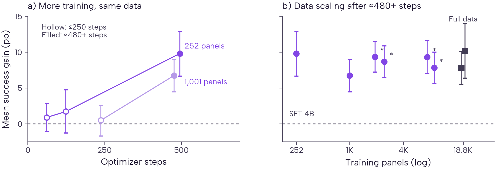

# Training-data size ablations for the 4B LoRA decoder

**How much Recipe 3 data the 4B LoRA decoder (ADM-4B) needs: very little, as long as it trains for enough optimizer steps. Every subset from 252 panels (1.3% of the 18,786; 495 examples) to 8,875 panels scores within about 1 pp of the full-data LoRA in its own window once it gets about 480 or more optimizer steps, and none beats it. With 250 steps or fewer the LoRA collapses to answering candidate 2 (96–99% of steps) and scores like SFT 4B alone. The limit is steps, not data: 250 states × 1 panel trained 16 epochs (496 steps) is level with full data (−0.4 [−3.4, +2.7] pp) at 2.2 H200-h of training instead of 18.9. Inference cost does not depend on the training data.** A full fine-tune instead of a LoRA is worse (−2.5 [−4.5, −0.4]); stopping the full-data LoRA at 1,692 of 4,122 steps changes nothing (−0.5).

All success rates are **overall success** (successes / episodes; invalid episodes count as failures); "Mean overall" and "Mean valid-only" weight the three benchmarks equally. Differences are in mean overall success, pp [paired 95% bootstrap over tasks common to both arms, 10,000 resamples, seed 20261029, benchmarks resampled independently, per-task success averaged over a condition's runs]; bold intervals exclude 0. Compare rows only within a window: absolute rates drift between windows (the full-data LoRA ranged 44.8–46.1% and SFT 4B alone 34.7–39.4% mean overall).

**Setup.** Every model is the Recipe 3 GPT-5.5 H = 4 4B LoRA decoder (ADM-4B): Qwen3-VL-4B LoRA on the 5-action selection prompt, LLaMA-Factory, global batch 16, 2 epochs unless stated, same recipe, seed and learning rate; only the training subset (and, where stated, the number of epochs) changes. Full data: 32,974 examples from 18,786 five-action panels on 2,112 states. Subsets: *states* keeps whole states in a seeded task order (250 / 500 / 1,000 states, all their panels); *panels per state* keeps all 2,112 states and samples 1 / 2 / 4 panels each (seed 20261023); *states × 1 panel* takes 1 panel from each of the first 1,000 or 250 states (nested in the 1-panel-per-state subset). Optimizer steps = ⌈examples / 16⌉ × epochs. Evaluation: OpenWebRL-4B-SFT actor, N = 5, T 1.0 / top-p 0.9, 30 steps, all 1,045 tasks (Online-Mind2Web 300, WebVoyager 595, DeepShop 150), 1 H200 per run; judges Online-Mind2Web gpt-5.6-terra, WebVoyager and DeepShop GPT-4o; no record refused.

## Summary: every subset against the full-data LoRA of its window

| Training data | Panels | Optimizer steps | Training, H200-h | Mean overall, subset vs full | Mean valid-only, subset vs full | − full data, pp [95% CI] | Window, runs |
| --- | ---: | ---: | ---: | ---: | ---: | ---: | --- |
| **Full data** | 18,786 | 4,122 | 18.9 | reference | reference | — | each window |
| 4 panels per state | 7,417 | 1,692 | 7.9 | 46.5% vs 46.1% | 50.2% vs 49.8% | +0.4 [−1.6, +2.5] | Nov 8–9, 3 runs |
| 1,000 states, all panels | 8,875 | 1,970 | 9.1 | 45.0% vs 46.1% | 48.9% vs 49.8% | −1.1 [−3.1, +1.0] | Nov 8–9, 3 runs |
| 500 states, all panels | 4,429 | 968 | 4.4 | 44.0% vs 45.2% | 47.2% vs 47.9% | −1.3 [−4.2, +1.7] | Nov 4–6, 1 run |
| 2 panels per state | 4,035 | 936 | 4.4 | 44.8% vs 45.2% | 47.3% vs 47.9% | −0.5 [−3.3, +2.4] | Nov 4–6, 1 run |
| 250 states, all panels | 2,234 | 484 | 2.1 | 45.8% vs 45.6% | 49.8% vs 49.6% | +0.2 [−1.8, +2.2] | Nov 10–11, 3 runs |
| 1 panel per state | 2,112 | 490 | 2.3 | 46.5% vs 46.1% | 50.3% vs 49.8% | +0.4 [−1.7, +2.6] | Nov 8–9, 3 runs |
| 1,000 states × 1 panel, 4 epochs | 1,001 | 480 | 2.2 | 43.9% vs 45.0% | 47.5% vs 48.6% | −1.1 [−3.2, +1.0] | Nov 11, 3 runs |
| 1,000 states × 1 panel, 2 epochs | 1,001 | 240 | 1.1 | 37.6% vs 45.0% | 40.6% vs 48.6% | **−7.3 [−9.4, −5.2]** | Nov 11, 3 runs |
| 250 states × 1 panel, 16 epochs | 252 | 496 | 2.2 | 44.5% vs 44.8% | 48.3% vs 48.9% | −0.4 [−3.4, +2.7] | Nov 12, 3 runs |
| 250 states × 1 panel, 4 epochs | 252 | 124 | 0.6 | 36.4% vs 44.8% | 39.0% vs 48.9% | **−8.4 [−11.6, −5.4]** | Nov 12, 3 runs |
| 250 states × 1 panel, 2 epochs | 252 | 62 | 0.3 | 38.0% vs 45.0% | 40.6% vs 48.6% | **−6.9 [−9.2, −4.7]** | Nov 11, 3 runs |

*Each subset is shown next to the full-data LoRA of its own window (tables below). Where a subset ran in two windows, the row uses the later same-window rerun (4 per state, 1 per state and 1,000 states: November 8–9, with the November 4–6 screen in its own table); 500 states and 2 per state ran once, in the screen. Training: LLaMA-Factory `train_runtime` on 4 H200 (merge excluded), H200-h = 4 × runtime.*

*Every data-scaling LoRA as mean overall success minus SFT 4B alone, with its paired 95% interval; filled = about 480 or more optimizer steps, hollow = 250 or fewer (collapsed). Points marked * use the November 11 SFT run (their windows ran none). [PDF](arm_results/rl_integration/selection-recipe3-data-scaling-20261112.pdf) · [SVG](arm_results/rl_integration/selection-recipe3-data-scaling-20261112.svg) · [plot script](arm_results/rl_integration/selection-recipe3-data-scaling-20261112.py) · [data](arm_results/rl_integration/selection-recipe3-data-scaling-vs-sft-20261112.json)*

## First screen: fewer states and fewer panels per state (November 4–6)

Subsets ran November 4–5 (3 runs; 500 states and 2 panels per state 1 run); the full-data LoRA and SFT 4B alone were re-run 3 times on November 6 as references.

| Training data | Panels | Examples | Optimizer steps | Runs | Online-Mind2Web | WebVoyager | DeepShop | Mean overall | Mean valid-only | − full data, pp [95% CI] | − SFT alone, pp [95% CI] |
| --- | ---: | ---: | ---: | ---: | ---: | ---: | ---: | ---: | ---: | ---: | ---: |
| **Full data** | 18,786 | 32,974 | 4,122 | 3 | 35.2% | 51.1% | 49.3% | 45.2% | 47.9% | — | **+5.8 [+3.6, +8.1]** |
| SFT 4B alone (1 sample) | — | — | — | 3 | 29.7% | 43.7% | 44.9% | 39.4% | 40.9% | — | — |
| 250 states, all panels | 2,234 | 3,858 | 484 | 3 | 34.6% | 52.5% | 49.3% | 45.5% | 48.0% | +0.2 [−1.8, +2.3] | **+6.0 [+3.9, +8.2]** |
| 500 states, all panels | 4,429 | 7,742 | 968 | 1 | 35.3% | 50.6% | 46.0% | 44.0% | 47.2% | −1.3 [−4.2, +1.7] | **+4.6 [+1.8, +7.2]** |
| 1,000 states, all panels | 8,875 | 15,746 | 1,970 | 3 | 37.6% | 51.8% | 51.1% | 46.8% | 49.6% | +1.6 [−0.5, +3.6] | **+7.4 [+5.2, +9.6]** |
| 1 panel per state | 2,112 | 3,910 | 490 | 3 | 34.3% | 53.3% | 52.7% | 46.8% | 49.3% | +1.5 [−0.5, +3.6] | **+7.4 [+5.1, +9.7]** |
| 2 panels per state | 4,035 | 7,476 | 936 | 1 | 30.3% | 53.3% | 50.7% | 44.8% | 47.3% | −0.5 [−3.3, +2.4] | **+5.3 [+2.4, +8.4]** |
| 4 panels per state | 7,417 | 13,532 | 1,692 | 3 | 35.6% | 53.6% | 55.6% | 48.2% | 50.4% | **+3.0 [+1.1, +4.9]** | **+8.8 [+6.8, +11.0]** |

| Training data | Online-Mind2Web valid / episodes | Online-Mind2Web successes | WebVoyager valid / episodes | WebVoyager successes | DeepShop valid / episodes | DeepShop successes |
| --- | ---: | ---: | ---: | ---: | ---: | ---: |
| Full data | 790 / 900 | 317 | 1,702 / 1,785 | 913 | 444 / 450 | 222 |
| SFT 4B alone (1 sample) | 811 / 900 | 267 | 1,744 / 1,785 | 780 | 447 / 450 | 202 |
| 250 states, all panels | 773 / 900 | 311 | 1,736 / 1,785 | 937 | 446 / 450 | 222 |
| 500 states, all panels | 249 / 300 | 106 | 573 / 595 | 301 | 148 / 150 | 69 |
| 1,000 states, all panels | 769 / 900 | 338 | 1,740 / 1,785 | 924 | 445 / 450 | 230 |
| 1 panel per state | 767 / 900 | 309 | 1,744 / 1,785 | 952 | 446 / 450 | 237 |
| 2 panels per state | 253 / 300 | 91 | 584 / 595 | 317 | 147 / 150 | 76 |
| 4 panels per state | 784 / 900 | 320 | 1,752 / 1,785 | 956 | 448 / 450 | 250 |

*The leads of 4 panels per state (+3.0), 1 panel per state and 1,000 states over the full data did not replicate in the same-window rerun below: the references ran a day or two after the subsets.*

## Same-window rerun and training controls (November 8–9)

The three leading subsets re-evaluated in one window with the full-data LoRA, plus two training controls on the full data: the LoRA stopped at the 4-per-state subset's 1,692 steps, and a full fine-tune.

| Training data | Panels | Examples | Optimizer steps | Runs | Online-Mind2Web | WebVoyager | DeepShop | Mean overall | Mean valid-only | − full data, pp [95% CI] |
| --- | ---: | ---: | ---: | ---: | ---: | ---: | ---: | ---: | ---: | ---: |
| **Full data** | 18,786 | 32,974 | 4,122 | 3 | 34.7% | 51.5% | 52.0% | 46.1% | 49.8% | — |
| 4 panels per state | 7,417 | 13,532 | 1,692 | 3 | 36.8% | 51.5% | 51.1% | 46.5% | 50.2% | +0.4 [−1.6, +2.5] |
| 1 panel per state | 2,112 | 3,910 | 490 | 3 | 37.6% | 49.2% | 52.7% | 46.5% | 50.3% | +0.4 [−1.7, +2.6] |
| 1,000 states, all panels | 8,875 | 15,746 | 1,970 | 3 | 34.7% | 48.2% | 52.0% | 45.0% | 48.9% | −1.1 [−3.1, +1.0] |
| Full data, stopped at 1,692 steps | 18,786 | 32,974 | 1,692 | 3 | 36.0% | 51.5% | 49.1% | 45.6% | 49.3% | −0.5 [−2.5, +1.4] |
| Full data, full fine-tune | 18,786 | 32,974 | 4,122 | 3 | 33.6% | 47.3% | 49.8% | 43.6% | 47.0% | **−2.5 [−4.5, −0.4]** |

| Training data | Online-Mind2Web valid / episodes | Online-Mind2Web successes | WebVoyager valid / episodes | WebVoyager successes | DeepShop valid / episodes | DeepShop successes |
| --- | ---: | ---: | ---: | ---: | ---: | ---: |
| Full data | 779 / 900 | 312 | 1,619 / 1,785 | 919 | 444 / 450 | 234 |
| 4 panels per state | 787 / 900 | 331 | 1,616 / 1,785 | 919 | 446 / 450 | 230 |
| 1 panel per state | 782 / 900 | 338 | 1,616 / 1,785 | 879 | 445 / 450 | 237 |
| 1,000 states, all panels | 770 / 900 | 312 | 1,612 / 1,785 | 861 | 444 / 450 | 234 |
| Full data, stopped at 1,692 steps | 790 / 900 | 324 | 1,609 / 1,785 | 920 | 445 / 450 | 221 |
| Full data, full fine-tune | 789 / 900 | 302 | 1,621 / 1,785 | 845 | 444 / 450 | 224 |

*Subsets match the full data but do not beat it. Stopping at 1,692 steps changes nothing, so the full LoRA is not overtrained. The full fine-tune (one seed, one learning rate) is worse at this setting. No SFT run in this window.*

## 250 states, all panels (November 10–11)

| Training data | Panels | Examples | Optimizer steps | Runs | Online-Mind2Web | WebVoyager | DeepShop | Mean overall | Mean valid-only | − full data, pp [95% CI] |
| --- | ---: | ---: | ---: | ---: | ---: | ---: | ---: | ---: | ---: | ---: |
| **Full data** | 18,786 | 32,974 | 4,122 | 3 | 37.2% | 50.3% | 49.3% | 45.6% | 49.6% | — |
| 250 states, all panels | 2,234 | 3,858 | 484 | 3 | 36.3% | 49.8% | 51.3% | 45.8% | 49.8% | +0.2 [−1.8, +2.2] |

| Training data | Online-Mind2Web valid / episodes | Online-Mind2Web successes | WebVoyager valid / episodes | WebVoyager successes | DeepShop valid / episodes | DeepShop successes |
| --- | ---: | ---: | ---: | ---: | ---: | ---: |
| Full data | 784 / 900 | 335 | 1,610 / 1,785 | 898 | 442 / 450 | 222 |
| 250 states, all panels | 772 / 900 | 327 | 1,611 / 1,785 | 889 | 445 / 450 | 231 |

*2,234 panels (12% of the data) match the full data. No SFT run in this window.*

## Below 2K panels: 1 panel per state on 1,000 or 250 states (November 11)

| Training data | Panels | Examples | Optimizer steps | Runs | Online-Mind2Web | WebVoyager | DeepShop | Mean overall | Mean valid-only | − full data, pp [95% CI] | − SFT alone, pp [95% CI] | Picks candidate 2 |
| --- | ---: | ---: | ---: | ---: | ---: | ---: | ---: | ---: | ---: | ---: | ---: | ---: |
| **Full data** | 18,786 | 32,974 | 4,122 | 3 | 36.9% | 48.5% | 49.6% | 45.0% | 48.6% | — | **+7.8 [+5.6, +10.1]** | 30% |
| SFT 4B alone (1 sample) | — | — | — | 3 | 29.8% | 42.4% | 39.3% | 37.2% | 39.9% | — | — | — |
| 1,000 states × 1 panel | 1,001 | 1,905 | 240 | 3 | 30.8% | 42.1% | 40.0% | 37.6% | 40.6% | **−7.3 [−9.4, −5.2]** | +0.5 [−1.6, +2.6] | 96% |
| 250 states × 1 panel | 252 | 495 | 62 | 3 | 31.4% | 40.4% | 42.2% | 38.0% | 40.6% | **−6.9 [−9.2, −4.7]** | +0.9 [−1.0, +2.8] | 99% |
| 1,000 states × 1 panel, 4 epochs | 1,001 | 1,905 | 480 | 3 | 35.4% | 48.2% | 48.0% | 43.9% | 47.5% | −1.1 [−3.2, +1.0] | **+6.7 [+4.5, +8.9]** | 22% |

| Training data | Online-Mind2Web valid / episodes | Online-Mind2Web successes | WebVoyager valid / episodes | WebVoyager successes | DeepShop valid / episodes | DeepShop successes |
| --- | ---: | ---: | ---: | ---: | ---: | ---: |
| Full data | 793 / 900 | 332 | 1,606 / 1,785 | 865 | 446 / 450 | 223 |
| SFT 4B alone (1 sample) | 796 / 900 | 268 | 1,625 / 1,785 | 756 | 447 / 450 | 177 |
| 1,000 states × 1 panel | 794 / 900 | 277 | 1,614 / 1,785 | 752 | 447 / 450 | 180 |
| 250 states × 1 panel | 810 / 900 | 283 | 1,615 / 1,785 | 722 | 450 / 450 | 190 |
| 1,000 states × 1 panel, 4 epochs | 787 / 900 | 319 | 1,612 / 1,785 | 860 | 445 / 450 | 216 |

*At 2 epochs (240 and 62 optimizer steps) both LoRAs answer candidate 2 at almost every step and score like SFT alone. The same 1,001 panels trained 4 epochs (480 steps; evaluated in the evening of the same day against these references) are level with the full data. "Picks candidate 2": share of decision steps selecting the second candidate (chance 20%).*

## More epochs on 252 panels (November 12)

| Training data | Panels | Examples | Optimizer steps | Runs | Online-Mind2Web | WebVoyager | DeepShop | Mean overall | Mean valid-only | − full data, pp [95% CI] | − SFT alone, pp [95% CI] | Picks candidate 2 |
| --- | ---: | ---: | ---: | ---: | ---: | ---: | ---: | ---: | ---: | ---: | ---: | ---: |
| **Full data** | 18,786 | 32,974 | 4,122 | 1 | 35.3% | 49.7% | 49.3% | 44.8% | 48.9% | — | **+10.1 [+6.3, +14.0]** | — |
| SFT 4B alone (1 sample) | — | — | — | 1 | 30.0% | 38.7% | 35.3% | 34.7% | 37.3% | — | — | — |
| 250 states × 1 panel, 4 epochs | 252 | 495 | 124 | 3 | 29.7% | 40.3% | 39.1% | 36.4% | 39.0% | **−8.4 [−11.6, −5.4]** | +1.7 [−1.3, +4.8] | 96% |
| 250 states × 1 panel, 16 epochs | 252 | 495 | 496 | 3 | 37.8% | 48.9% | 46.7% | 44.5% | 48.3% | −0.4 [−3.4, +2.7] | **+9.8 [+6.6, +12.9]** | 24% |

| Training data | Online-Mind2Web valid / episodes | Online-Mind2Web successes | WebVoyager valid / episodes | WebVoyager successes | DeepShop valid / episodes | DeepShop successes |
| --- | ---: | ---: | ---: | ---: | ---: | ---: |
| Full data | 253 / 300 | 106 | 535 / 595 | 296 | 150 / 150 | 74 |
| SFT 4B alone (1 sample) | 265 / 300 | 90 | 542 / 595 | 230 | 149 / 150 | 53 |
| 250 states × 1 panel, 4 epochs | 803 / 900 | 267 | 1,616 / 1,785 | 720 | 448 / 450 | 176 |
| 250 states × 1 panel, 16 epochs | 776 / 900 | 340 | 1,616 / 1,785 | 873 | 447 / 450 | 210 |

*4 epochs (124 steps) still collapses; 16 epochs (496 steps) is level with the full data. The full-data and SFT references ran once in this window; the subsets 3 times.*

## Training and inference cost

| Training data | Training time on 4 H200 | H200-h | Selection ms, mean / p90 | Selector TFLOP / step | Model time / episode | End-to-end / episode, mean | Steps / episode |
| --- | ---: | ---: | ---: | ---: | ---: | ---: | ---: |
| Full data | 4 h 43 min | 18.9 | 474 / 760 | 30.8 | 114 s | 181 s | 13.2 |
| 4 panels per state | 1 h 58 min | 7.9 | 500 / 788 | 30.5 | 104 s | 169 s | 12.3 |
| 1 panel per state | 0 h 34 min | 2.3 | 496 / 790 | 30.8 | 110 s | 176 s | 12.8 |
| 1,000 states, all panels | 2 h 15 min | 9.1 | 504 / 789 | 31.0 | 114 s | 183 s | 13.1 |
| 250 states, all panels | 0 h 32 min | 2.1 | 511 / 806 | 31.9 | 121 s | 191 s | 13.6 |
| 1,000 states × 1 panel, 2 epochs | 0 h 16 min | 1.1 | 469 / 756 | 29.8 | 111 s | 173 s | 13.4 |
| 1,000 states × 1 panel, 4 epochs | 0 h 33 min | 2.2 | 468 / 747 | 30.5 | 116 s | 184 s | 13.7 |
| 250 states × 1 panel, 2 epochs | 0 h 04 min | 0.3 | 491 / 780 | 29.7 | 107 s | 168 s | 12.9 |
| 250 states × 1 panel, 4 epochs | 0 h 08 min | 0.6 | 463 / 739 | 29.7 | 107 s | 167 s | 13.0 |
| 250 states × 1 panel, 16 epochs | 0 h 33 min | 2.2 | 515 / 809 | 30.8 | 111 s | 176 s | 13.1 |
| Full data, full fine-tune | 4 h 42 min | 18.8 | 478 / 767 | 30.9 | 116 s | 183 s | 13.3 |
| SFT 4B alone (1 sample) | — | — | — | — | 32 s | 91 s | 12.8 |

*Inference cost is the same for every LoRA (one 4B forward over the selection prompt per step); only training cost changes with the data. Per decision step; selector FLOPs = 2 × 4.44B × (uncached selection-prompt + generated tokens); the actor's five candidates cost about 61 TFLOP per step in every row. Selection and model time from each step's decision trace (browser excluded); end-to-end = each episode's wall clock including browser. Each LoRA in its own eval window (the November 8–9 full-data row is that window's reference). For comparison the 22.6M head trains in 1.0 H200-h of feature extraction plus 7.5 CPU-minutes and selects in 17 ms ([ARM_HEAD_SIZE_ABLATIONS](ARM_HEAD_SIZE_ABLATIONS.md#head-size-cost-20261112)).* Evidence: [data](arm_results/rl_integration/selection-head-scale-cost-20261112.json) · [script](arm_results/rl_integration/selection-head-scale-cost-20261112.py).

**Evidence.** All success tables: [data](arm_results/rl_integration/selection-recipe3-data-size-20261114.json) · [script](arm_results/rl_integration/selection-recipe3-data-size-20261114.py) (recomputed from the episode records; matches the per-window analyses linked from [ARM_FINAL_RESULTS](ARM_FINAL_RESULTS.md#final-selection-recipe3-data-ablations-20261105), which also has valid-only per-benchmark views and the earlier plots). Runtime: `/gpfs/scrubbed/zixianma/openwebrl-runtime/recipe3-ablations-20261104/` (subsets `lora-data/<subset>/`, LoRAs `lora/<subset>/`, evals `eval/`, `eval-ctrl/`, `eval-1108/`, `eval-1110/`, `eval-1111/`, `eval-1111b/`, `eval-s250ep/`).
