# Figure gallery

<!-- Generated by assets/build_figure_gallery.py from ARM_FINAL_RESULTS.md. -->

[Color key: purple ADM-23M · green/salmon ADM-4B](assets/paper_plot_palette_preview.png) · [Salmon ADM version](ARM_FIGURES_SALMON_ADM.md)

## Methods

### Action Decision Models: overview

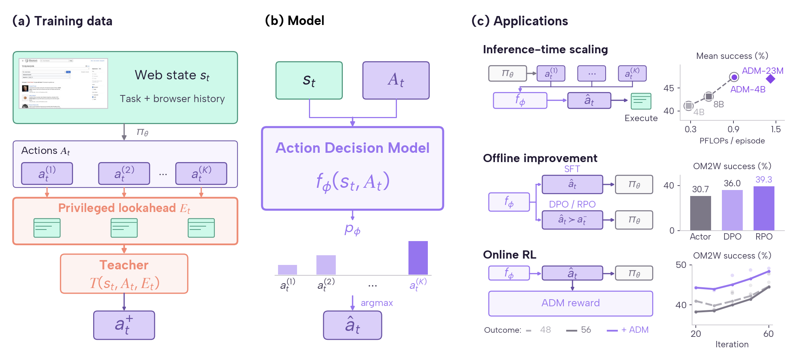

[PDF](arm_results/methods/adm_overview/figure1.pdf) · [SVG](arm_results/methods/adm_overview/figure1.svg) · [Plot script](arm_results/methods/adm_overview/plot_figure1.py) · [Reproduce](arm_results/methods/adm_overview/README.md)

### Rollout collection and action decision labeling

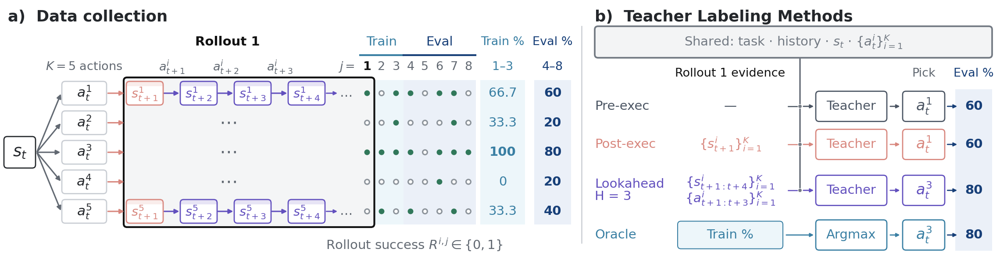

[PDF](arm_results/methods/selection-offline-eval-20261022.pdf) · [SVG](arm_results/methods/selection-offline-eval-20261022.svg)

### ADM architecture

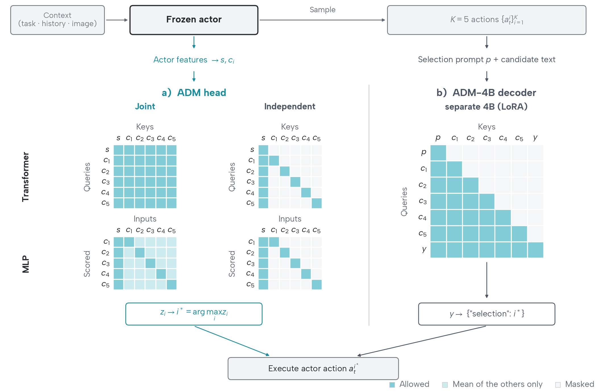

[PDF](arm_results/methods/selection-arch-overview-20261107.pdf) · [SVG](arm_results/methods/selection-arch-overview-20261107.svg)

### ADM architectures with the Kev-style pointer

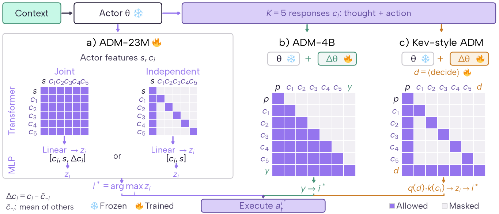

[PDF](arm_results/methods/selection-arch-overview-kev-20261112.pdf) · [SVG](arm_results/methods/selection-arch-overview-kev-20261112.svg)

### Teacher decisions: worked examples

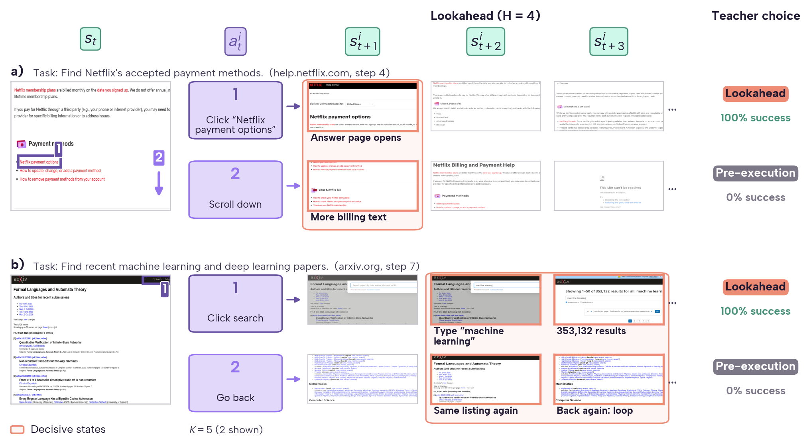

[PDF](arm_results/luna_pre_post_k3_20261105/examples-compact.pdf)

## Teacher and student ADM

### Teacher and student: offline and online

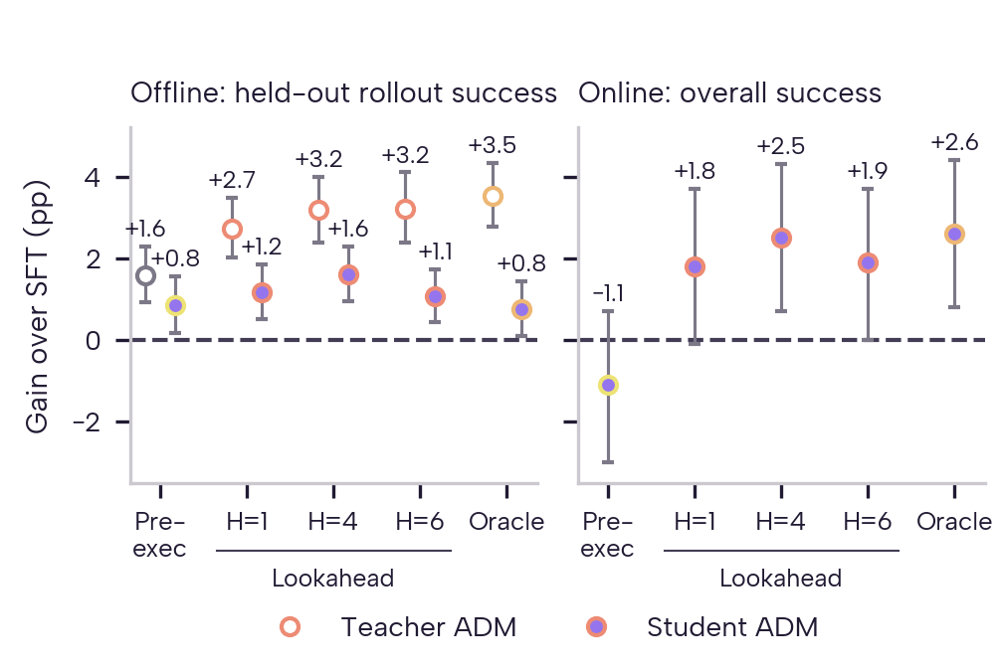

[PDF](arm_results/rl_integration/selection-label-setups-kfold-20261101.pdf) · [SVG](arm_results/rl_integration/selection-label-setups-kfold-20261101.svg)

### Label sources across three stages: 5-fold

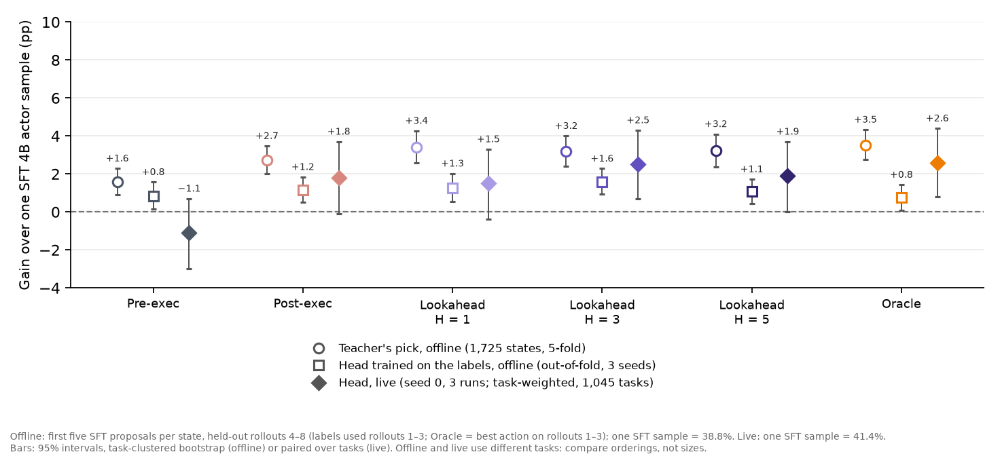

### Training, held-out and online: 5-fold

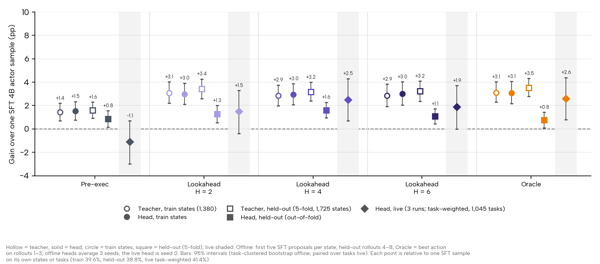

### Teacher offline success and student online success

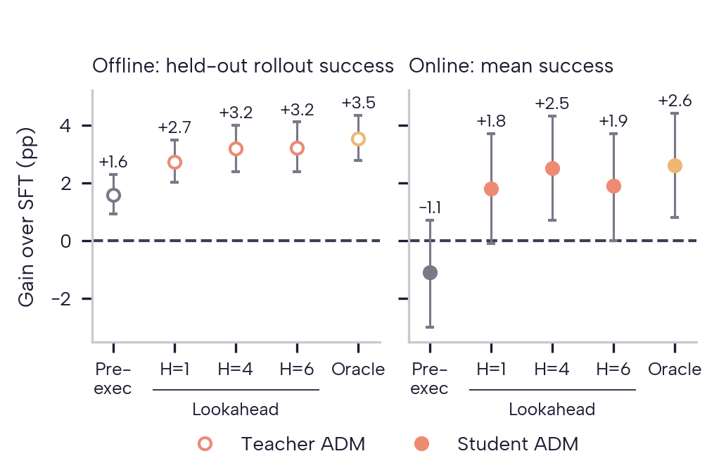

[PDF](arm_results/rl_integration/selection-label-setups-kfold-teacher-only-offline-20261101.pdf) · [SVG](arm_results/rl_integration/selection-label-setups-kfold-teacher-only-offline-20261101.svg)

## Actor + ADM trade-offs

### All actors: benchmark mean

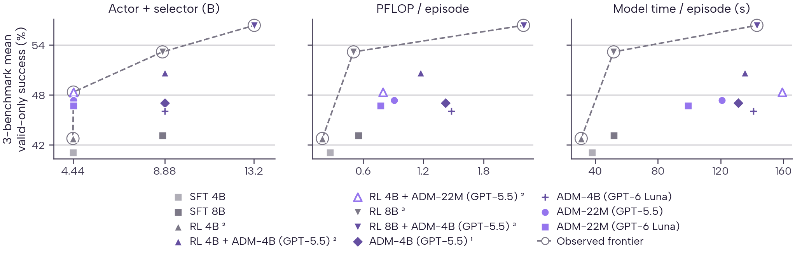

[PDF](arm_results/rl_integration/selection-recipe3-vs-cost-20261104.pdf) · [SVG](arm_results/rl_integration/selection-recipe3-vs-cost-20261104.svg)

### All actors: per benchmark

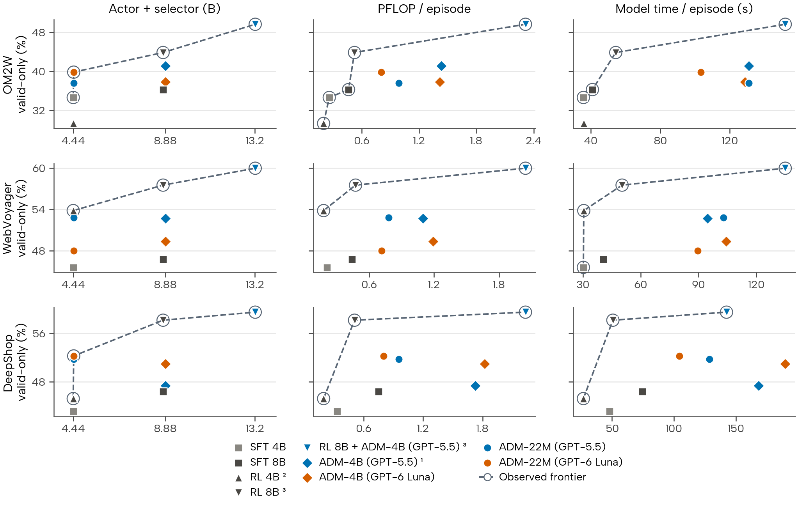

[PDF](arm_results/rl_integration/selection-recipe3-vs-cost-per-benchmark-20261104.pdf) · [SVG](arm_results/rl_integration/selection-recipe3-vs-cost-per-benchmark-20261104.svg)

### SFT actors: benchmark mean

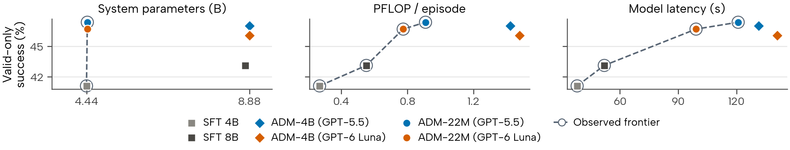

[PDF](arm_results/rl_integration/selection-recipe3-vs-cost-sft-actors-20261104.pdf) · [SVG](arm_results/rl_integration/selection-recipe3-vs-cost-sft-actors-20261104.svg)

### SFT and RL actors with selectors: mean overall success

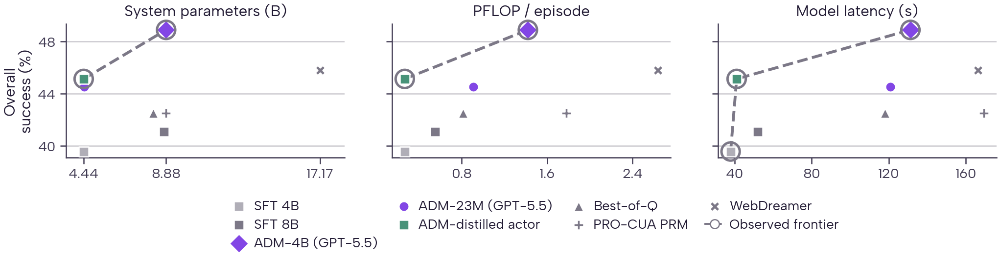

[PDF](arm_results/rl_integration/selection-recipe3-vs-cost-sft-actors-overall-20261104.pdf) · [SVG](arm_results/rl_integration/selection-recipe3-vs-cost-sft-actors-overall-20261104.svg)

### SFT and RL actors with selectors: overall success by benchmark

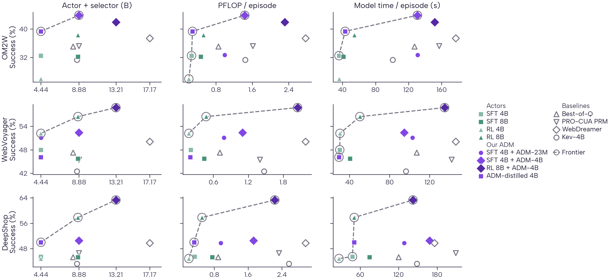

[PDF](arm_results/rl_integration/selection-recipe3-vs-cost-per-benchmark-sft-actors-overall-20261104.pdf) · [SVG](arm_results/rl_integration/selection-recipe3-vs-cost-per-benchmark-sft-actors-overall-20261104.svg)

### Updated cost comparison with RL actors and ADM

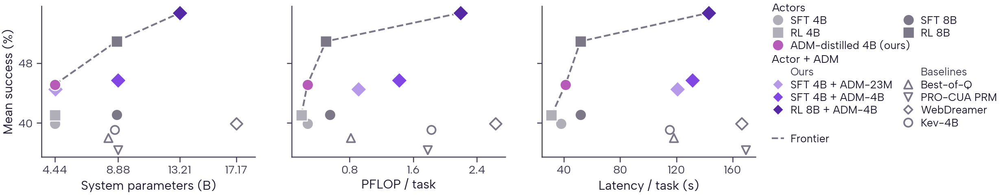

[PDF](arm_results/rl_integration/selection-recipe3-vs-cost-sft-actors-overall-baselines-with-rl-20261113.pdf) · [SVG](arm_results/rl_integration/selection-recipe3-vs-cost-sft-actors-overall-baselines-with-rl-20261113.svg)

### SFT 4B and baseline ADMs: updated overall success

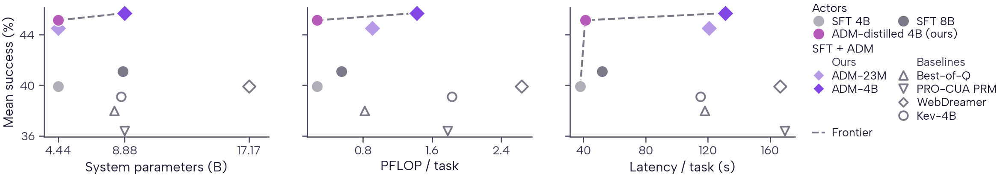

[PDF](arm_results/rl_integration/selection-recipe3-vs-cost-sft-actors-overall-baselines-20261113.pdf) · [SVG](arm_results/rl_integration/selection-recipe3-vs-cost-sft-actors-overall-baselines-20261113.svg)

### SFT actors and ADMs: earlier baseline comparison, revised markers

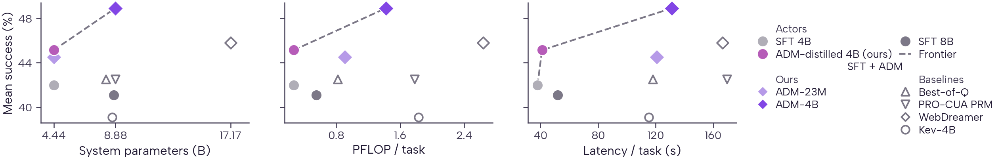

[PDF](arm_results/rl_integration/selection-recipe3-vs-cost-sft-actors-overall-no-rl-baselines-20261104.pdf) · [SVG](arm_results/rl_integration/selection-recipe3-vs-cost-sft-actors-overall-no-rl-baselines-20261104.svg)

### SFT actors and ADMs: without RL checkpoints

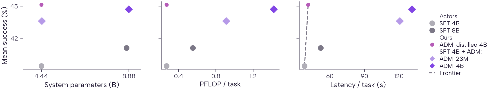

[PDF](arm_results/rl_integration/selection-recipe3-vs-cost-sft-actors-overall-no-rl-20261104.pdf) · [SVG](arm_results/rl_integration/selection-recipe3-vs-cost-sft-actors-overall-no-rl-20261104.svg)

### SFT actors and ADMs: without RL, per benchmark

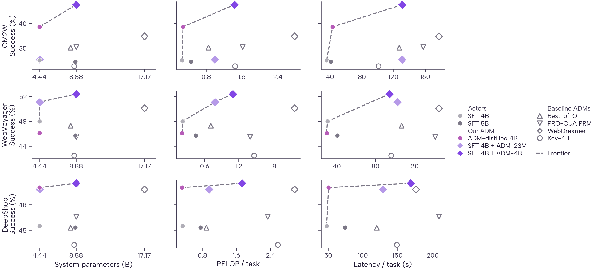

[PDF](arm_results/rl_integration/selection-recipe3-vs-cost-per-benchmark-sft-actors-overall-no-rl-20261104.pdf) · [SVG](arm_results/rl_integration/selection-recipe3-vs-cost-per-benchmark-sft-actors-overall-no-rl-20261104.svg)

### SFT actors: per benchmark

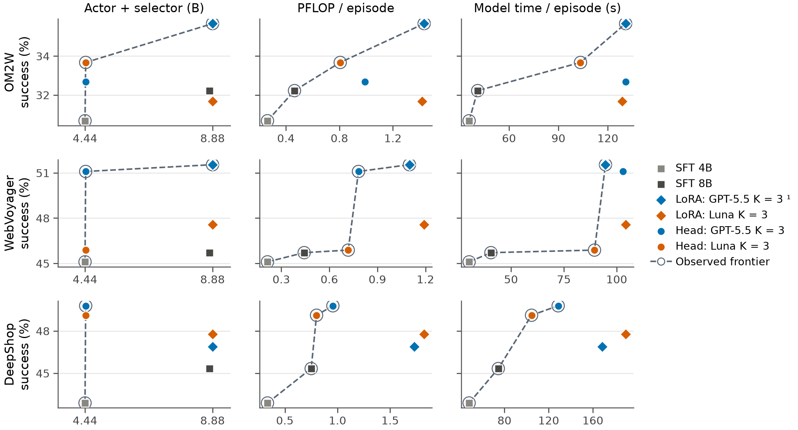

[PDF](arm_results/rl_integration/selection-recipe3-vs-cost-per-benchmark-sft-actors-20261104.pdf) · [SVG](arm_results/rl_integration/selection-recipe3-vs-cost-per-benchmark-sft-actors-20261104.svg)

### RL actors: benchmark mean

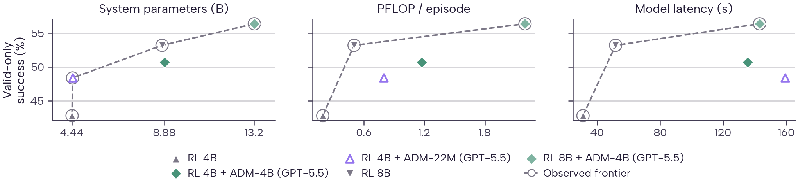

[PDF](arm_results/rl_integration/selection-recipe3-vs-cost-rl-actors-20261104.pdf) · [SVG](arm_results/rl_integration/selection-recipe3-vs-cost-rl-actors-20261104.svg)

### Selection head scaling: success and selection time, all runs pooled

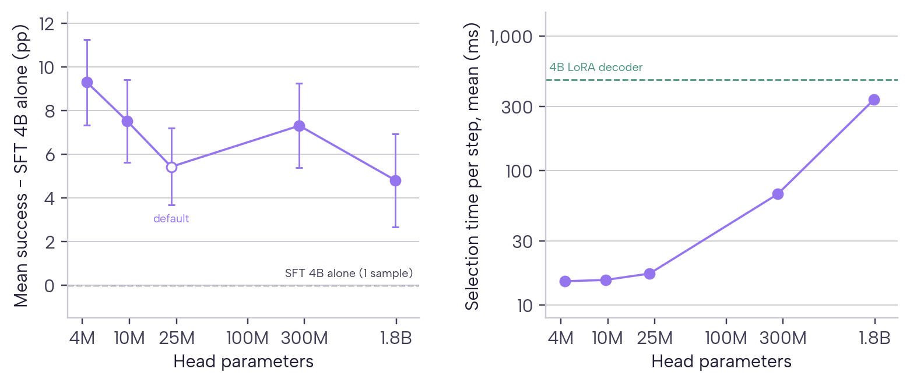

[PDF](arm_results/rl_integration/selection-head-scale-pooled-20261112.pdf) · [SVG](arm_results/rl_integration/selection-head-scale-pooled-20261112.svg)

### Selection head scaling: held-out agreement with the teacher

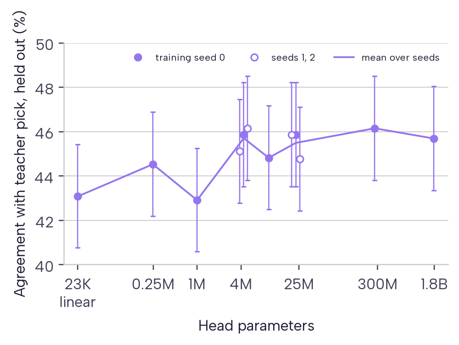

[PDF](arm_results/rl_integration/selection-head-scale-agreement-20261112.pdf) · [SVG](arm_results/rl_integration/selection-head-scale-agreement-20261112.svg)

### Selection head scaling: single-seed screen (November 11)

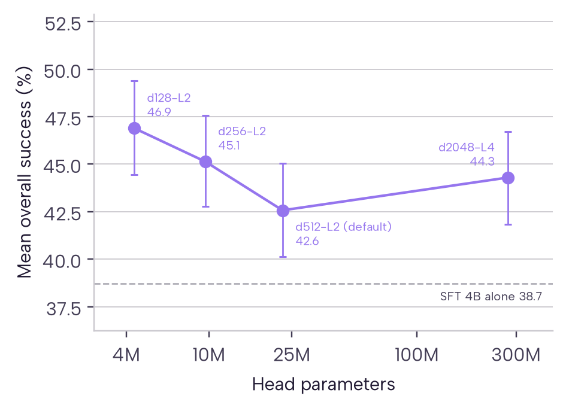

[PDF](arm_results/rl_integration/selection-head-scale-20261111.pdf) · [SVG](arm_results/rl_integration/selection-head-scale-20261111.svg)

## Recipe 3 data ablations

### Training states and panels: benchmark mean

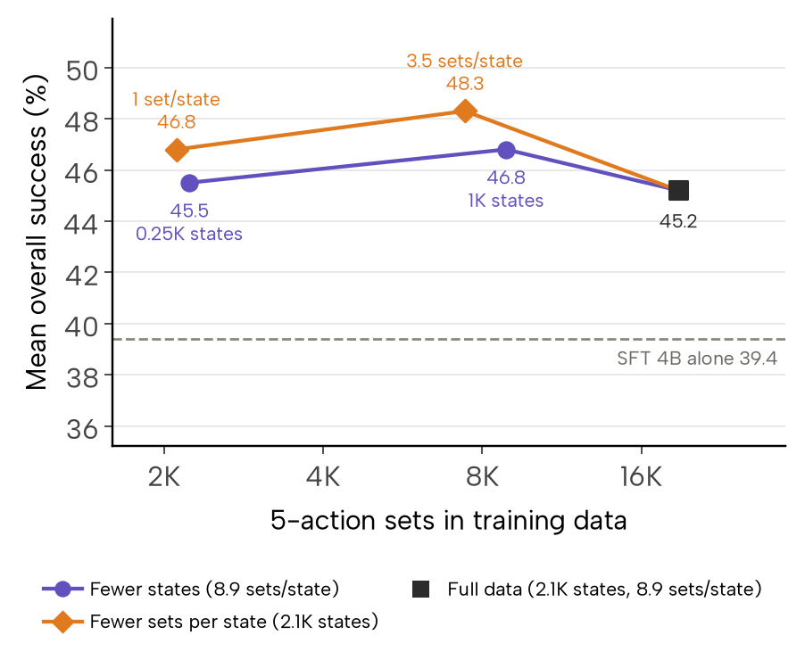

[PDF](arm_results/rl_integration/selection-recipe3-data-ablations-compact-20261105.pdf) · [SVG](arm_results/rl_integration/selection-recipe3-data-ablations-compact-20261105.svg)

### Training states and panels: per benchmark

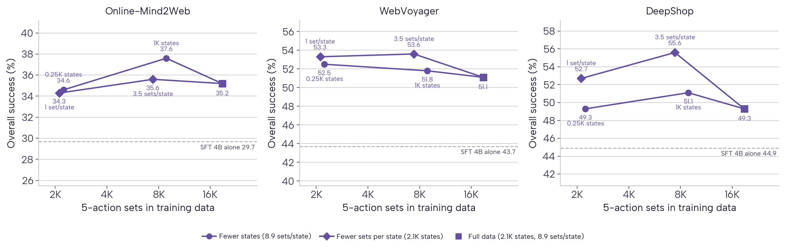

[PDF](arm_results/rl_integration/selection-recipe3-data-ablations-per-benchmark-20261105.pdf) · [SVG](arm_results/rl_integration/selection-recipe3-data-ablations-per-benchmark-20261105.svg)

### Training data scaling versus SFT alone

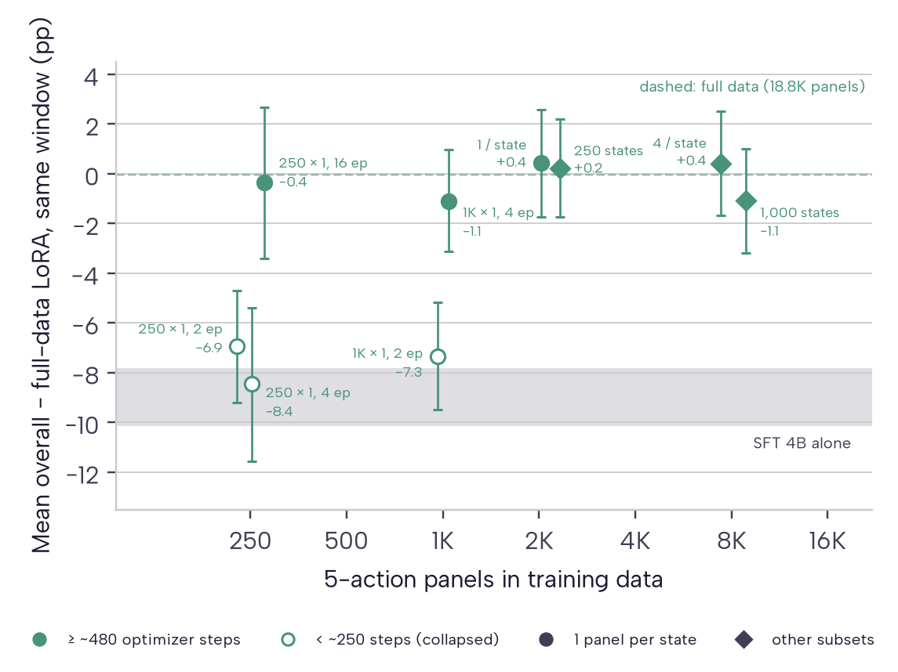

[PDF](arm_results/rl_integration/selection-recipe3-data-scaling-20261112.pdf) · [SVG](arm_results/rl_integration/selection-recipe3-data-scaling-20261112.svg)

### Training data ablations: matched-window results

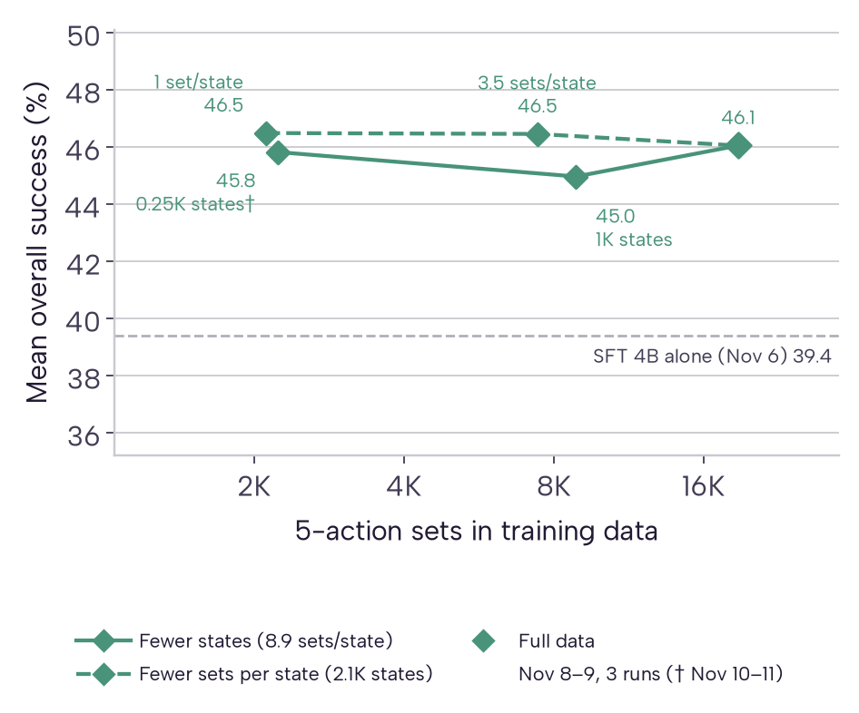

[PDF](arm_results/rl_integration/selection-recipe3-data-ablations-rerun-clean-20261109.pdf) · [SVG](arm_results/rl_integration/selection-recipe3-data-ablations-rerun-clean-20261109.svg)

### Training data ablations: matched-window results by benchmark

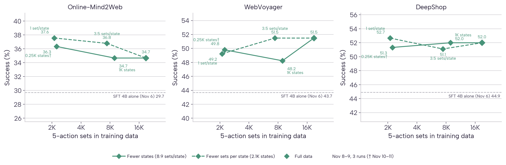

[PDF](arm_results/rl_integration/selection-recipe3-data-ablations-rerun-clean-per-benchmark-20261109.pdf)

### Training data ablations: matched-window rerun

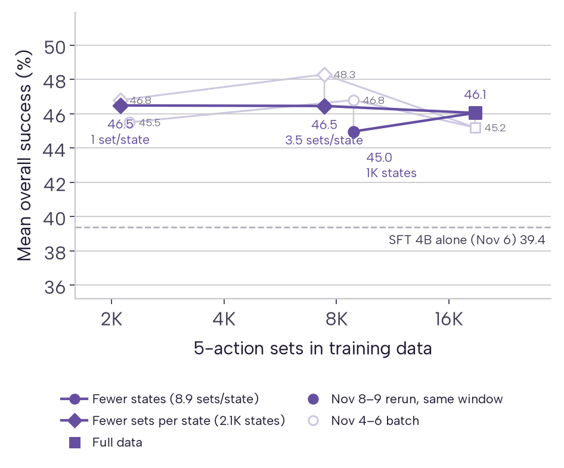

[PDF](arm_results/rl_integration/selection-recipe3-data-ablations-rerun-20261109.pdf) · [SVG](arm_results/rl_integration/selection-recipe3-data-ablations-rerun-20261109.svg)

### Training data ablations: matched-window rerun by benchmark

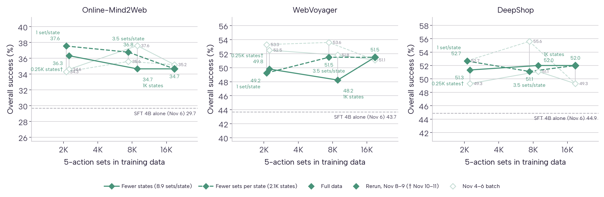

[PDF](arm_results/rl_integration/selection-recipe3-data-ablations-rerun-per-benchmark-20261109.pdf)

## RL training and evaluation

### Training and validation: valid-only success

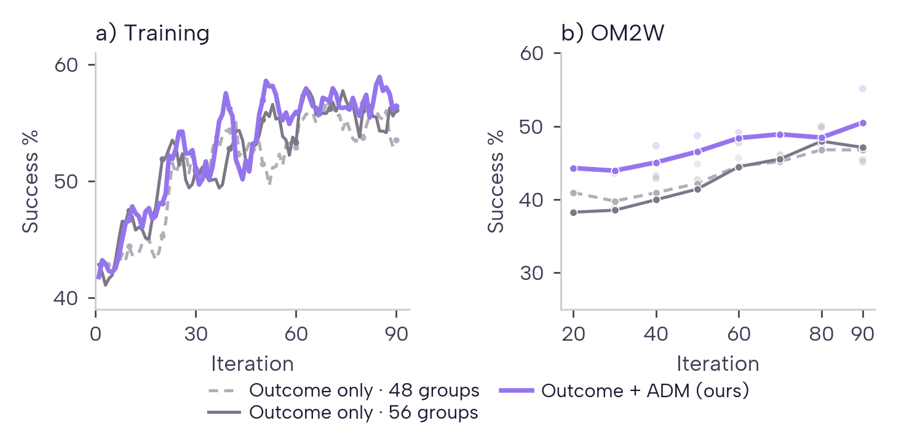

[PDF](arm_results/rl_final_20261108/rl_learning_compact.pdf) · [SVG](arm_results/rl_final_20261108/rl_learning_compact.svg)

### RL learning and repetition: merged four-panel figure

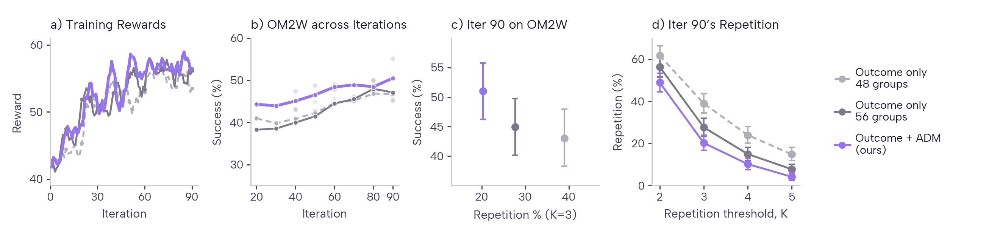

[PDF](arm_results/rl_final_20261108/rl_learning_compact_with_repetition.pdf) · [SVG](arm_results/rl_final_20261108/rl_learning_compact_with_repetition.svg)

### Training and validation: overall success

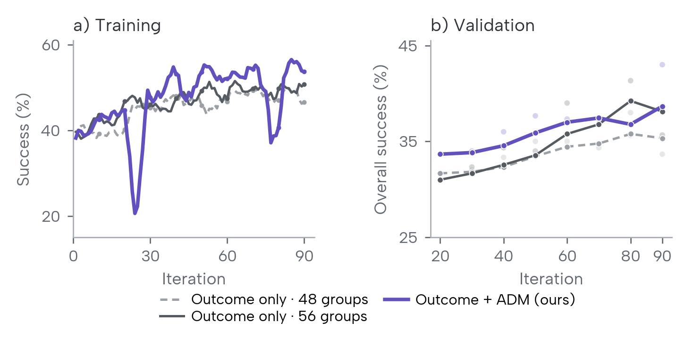

[PDF](arm_results/rl_final_20261108/rl_learning_compact_overall.pdf) · [SVG](arm_results/rl_final_20261108/rl_learning_compact_overall.svg)

### Repetition, success and threshold robustness

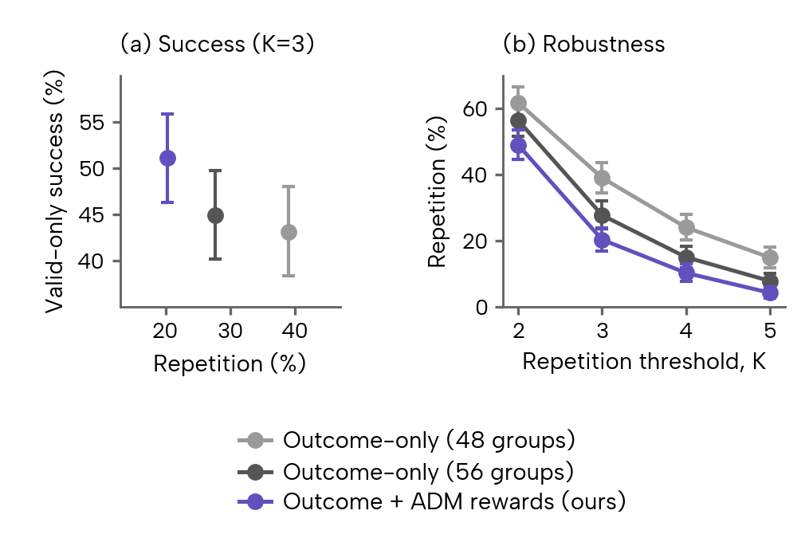

[PDF](rl_results/rl_repetition_success_robustness.pdf) · [SVG](rl_results/rl_repetition_success_robustness.svg)

## BrowserCode scaling: completed and gap-repaired results

### Fourteen settings: same valid tasks

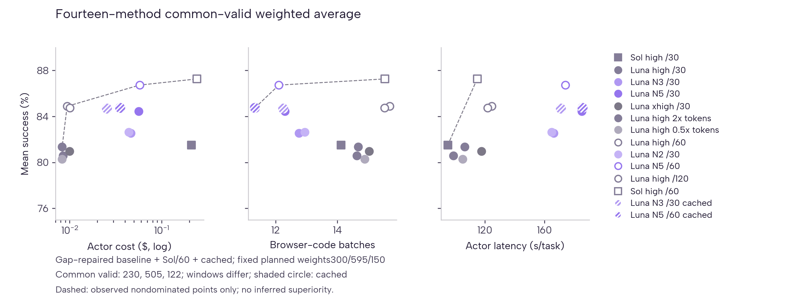

[PDF](arm_results/browsercode_cached_selection_20261105/browsercode_scaling14_common_valid_weighted.pdf) · [SVG](arm_results/browsercode_cached_selection_20261105/browsercode_scaling14_common_valid_weighted.svg)

### Fourteen settings: own-valid tasks

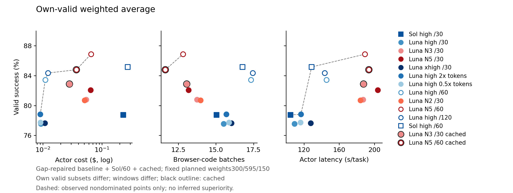

[PDF](arm_results/browsercode_cached_selection_20261105/browsercode_scaling14_own_valid_weighted.pdf) · [SVG](arm_results/browsercode_cached_selection_20261105/browsercode_scaling14_own_valid_weighted.svg)

### Scaling after gap recovery

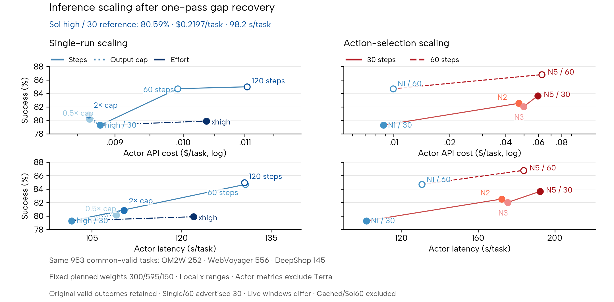

[PDF](arm_results/browsercode_gap_repaired_20261104/browsercode_scaling_gap_repaired_compact.pdf) · [SVG](arm_results/browsercode_gap_repaired_20261104/browsercode_scaling_gap_repaired_compact.svg)

## BrowserCode Pareto variants: before gap recovery

### Per-benchmark Pareto frontiers

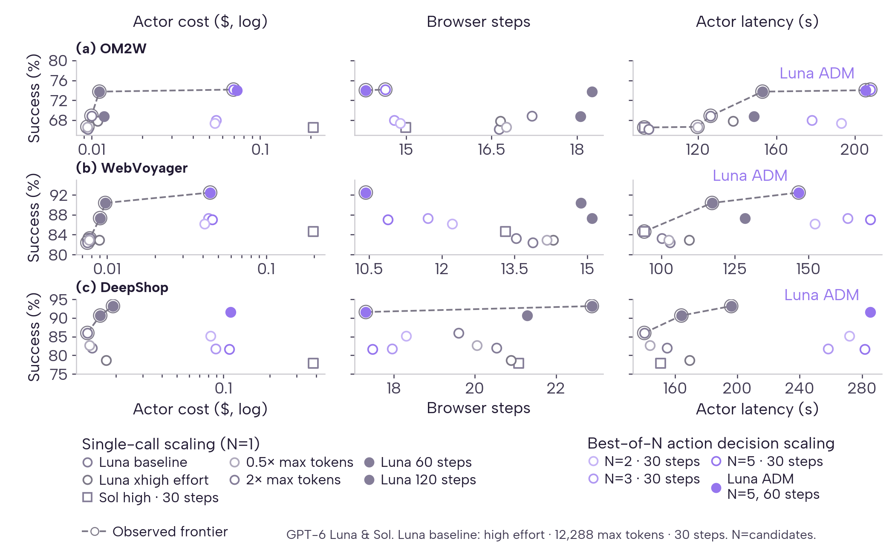

[PDF](arm_results/browsercode_inference_scaling_20261031/browsercode_scaling_pareto_preview.pdf) · [SVG](arm_results/browsercode_inference_scaling_20261031/browsercode_scaling_pareto_preview.svg)

### Weighted-average Pareto frontier

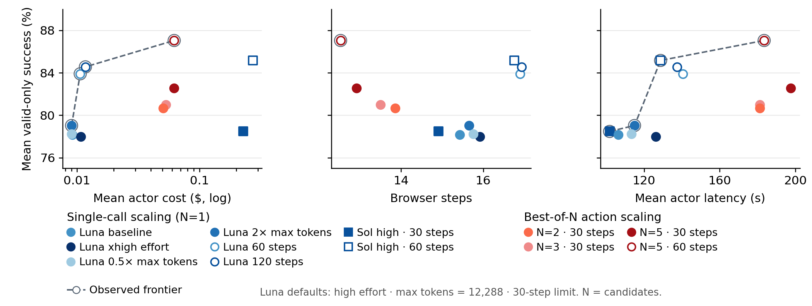

[PDF](arm_results/browsercode_inference_scaling_20261031/browsercode_scaling_weighted_pareto_preview.pdf) · [SVG](arm_results/browsercode_inference_scaling_20261031/browsercode_scaling_weighted_pareto_preview.svg)

### Common-valid weighted Pareto frontier

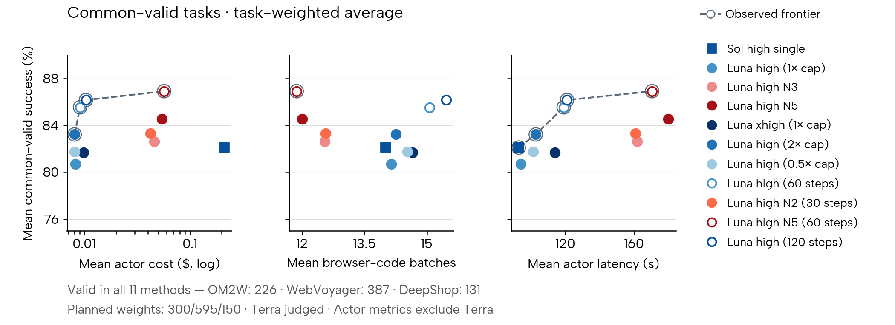

[PDF](arm_results/browsercode_inference_scaling_20261031/browsercode_scaling_common_valid_pareto_preview.pdf)

### Sixteen settings: right-side legend

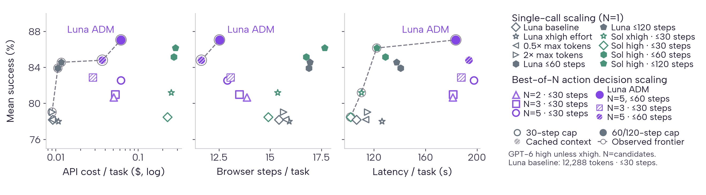

[PDF](arm_results/browsercode_inference_scaling_20261031/browsercode_scaling_weighted_pareto_highlight_right_legend_preview.pdf) · [SVG](arm_results/browsercode_inference_scaling_20261031/browsercode_scaling_weighted_pareto_highlight_right_legend_preview.svg)

### Sixteen settings: bottom legend

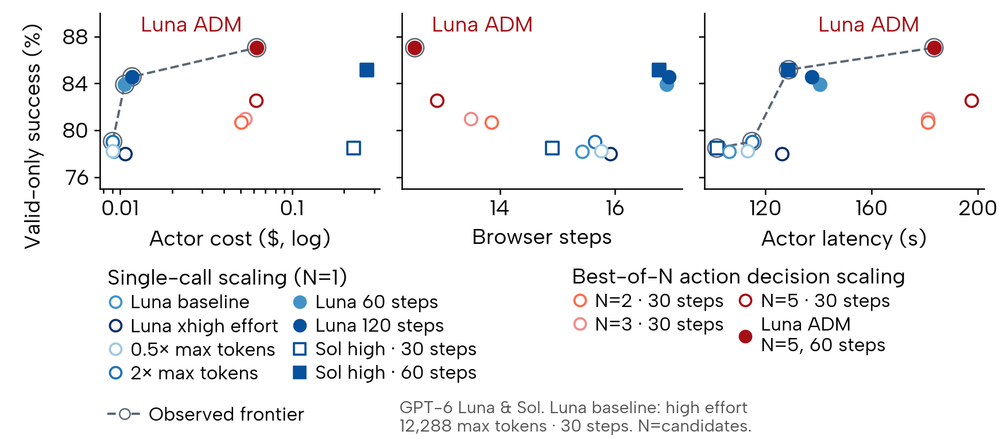

[PDF](arm_results/browsercode_inference_scaling_20261031/browsercode_scaling_weighted_pareto_highlight_preview.pdf) · [SVG](arm_results/browsercode_inference_scaling_20261031/browsercode_scaling_weighted_pareto_highlight_preview.svg)

### Sixteen settings: overall success

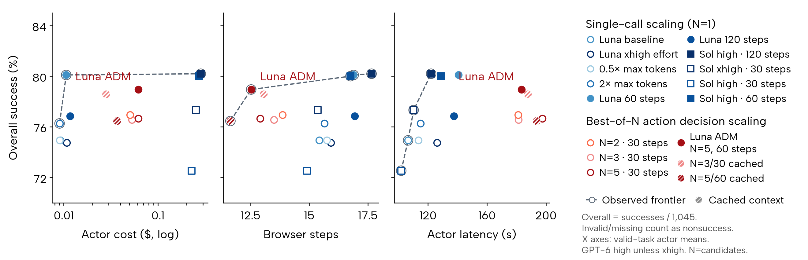

[PDF](arm_results/browsercode_inference_scaling_20261031/browsercode_scaling_weighted_pareto_highlight_right_legend_overall_success_preview.pdf) · [SVG](arm_results/browsercode_inference_scaling_20261031/browsercode_scaling_weighted_pareto_highlight_right_legend_overall_success_preview.svg)

### Sixteen settings: same valid tasks

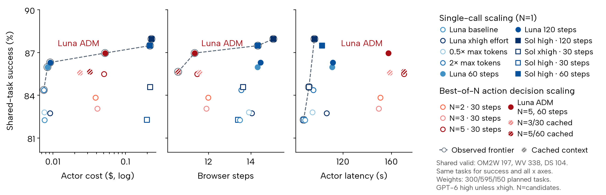

[PDF](arm_results/browsercode_inference_scaling_20261031/browsercode_scaling_weighted_pareto_highlight_right_legend_common_valid_preview.pdf) · [SVG](arm_results/browsercode_inference_scaling_20261031/browsercode_scaling_weighted_pareto_highlight_right_legend_common_valid_preview.svg)

## BrowserCode scaling: historical and supplementary views

### Scaling strategies: compact

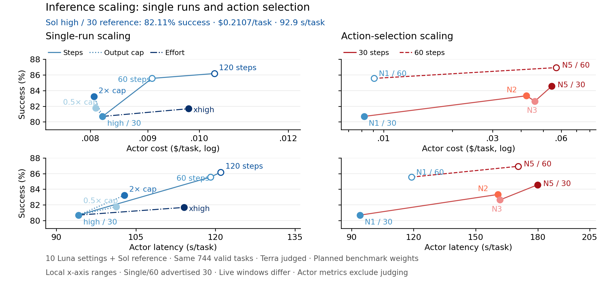

[PDF](arm_results/browsercode_inference_scaling_20261031/browsercode_scaling_strategies_compact.pdf) · [SVG](arm_results/browsercode_inference_scaling_20261031/browsercode_scaling_strategies_compact.svg)

### Scaling strategies: six-panel view

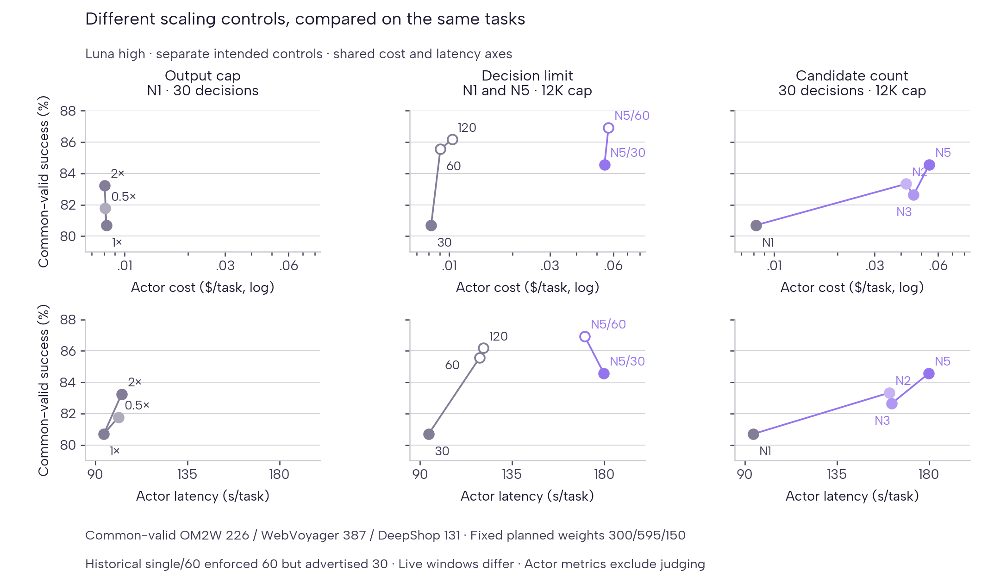

### Success and efficiency: per benchmark

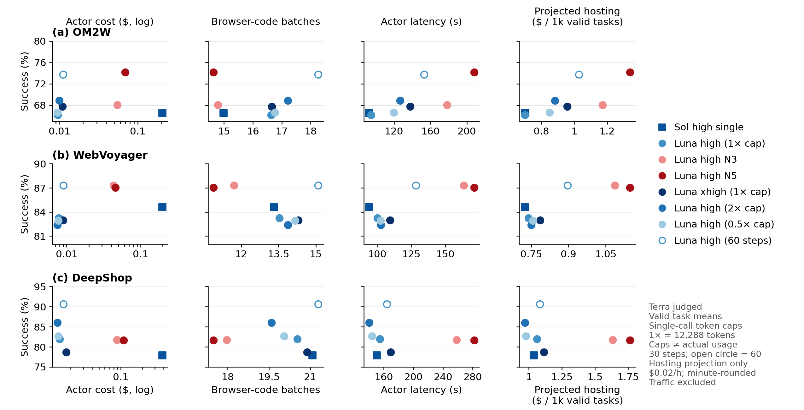

[SVG](arm_results/browsercode_inference_scaling_20261031/browsercode_scaling.svg) · [PDF](arm_results/browsercode_inference_scaling_20261031/browsercode_scaling.pdf)

### Action selection and browser-code batches

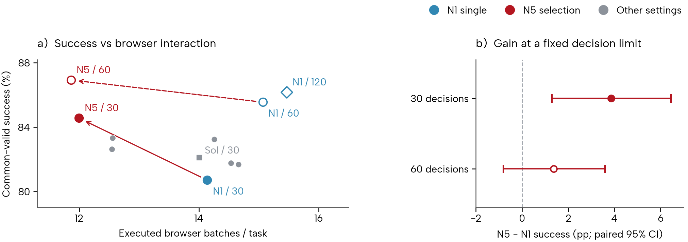

[PDF](arm_results/browsercode_inference_scaling_20261031/browsercode_selection_interaction.pdf) · [SVG](arm_results/browsercode_inference_scaling_20261031/browsercode_selection_interaction.svg)

### Action selection: paired outcomes

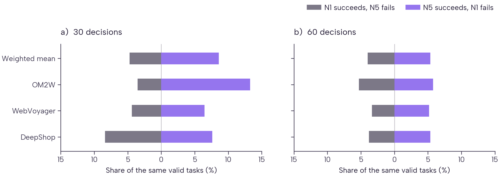

[PDF](arm_results/browsercode_inference_scaling_20261031/browsercode_selection_paired_outcomes.pdf) · [SVG](arm_results/browsercode_inference_scaling_20261031/browsercode_selection_paired_outcomes.svg)

### Candidate-count scaling

[PDF](arm_results/browsercode_inference_scaling_20261031/browsercode_selection_scaling.pdf) · [SVG](arm_results/browsercode_inference_scaling_20261031/browsercode_selection_scaling.svg)

### Equal-weight benchmark average

[PDF](arm_results/browsercode_inference_scaling_20261031/browsercode_scaling_average.pdf) · [SVG](arm_results/browsercode_inference_scaling_20261031/browsercode_scaling_average.svg)

### Task-weighted benchmark average

[PDF](arm_results/browsercode_inference_scaling_20261031/browsercode_scaling_weighted_average.pdf) · [SVG](arm_results/browsercode_inference_scaling_20261031/browsercode_scaling_weighted_average.svg)

### Eleven methods: same valid tasks

[PDF](arm_results/browsercode_inference_scaling_20261031/browsercode_scaling_common_valid_weighted_average.pdf) · [SVG](arm_results/browsercode_inference_scaling_20261031/browsercode_scaling_common_valid_weighted_average.svg)

### Output and reasoning token consumption

[SVG](arm_results/browsercode_inference_scaling_20261031/browsercode_scaling_tokens.svg) · [PDF](arm_results/browsercode_inference_scaling_20261031/browsercode_scaling_tokens.pdf)

## BrowserCode on US-residential stealth browsers

### US-stealth success and observed browser costs

[PDF](arm_results/browsercode_us_stealth_full300_20261102/us_stealth_observed_costs.pdf) · [SVG](arm_results/browsercode_us_stealth_full300_20261102/us_stealth_observed_costs.svg)

## Claude BrowserCode

### Claude: high-effort trade-offs

[SVG](arm_results/claude_browsercode_om2w300_20261028/claude_tradeoffs.svg) · [PDF](arm_results/claude_browsercode_om2w300_20261028/claude_tradeoffs.pdf)

### Claude: same valid tasks

[SVG](arm_results/claude_browsercode_om2w300_20261028/claude_tradeoffs_common_valid.svg)

## Shared-Terra comparisons

### High-effort trade-offs: three benchmarks

[PDF](arm_results/cuawright_browsercode_om2w_20261027/shared_terra_high_four_row_paper.pdf) · [SVG](arm_results/cuawright_browsercode_om2w_20261027/shared_terra_high_four_row_paper.svg)

### OM2W: pre-recovery high-effort comparison

[PDF](arm_results/cuawright_browsercode_om2w_20261027/om2w_terra_high_valid_only_tradeoffs.pdf)

### OM2W: all GPT settings

[PDF](arm_results/cuawright_browsercode_om2w_20261027/om2w_terra_all_tradeoffs.pdf) · [SVG](arm_results/cuawright_browsercode_om2w_20261027/om2w_terra_all_tradeoffs.svg)

### OM2W: valid-task BrowserCode efficiency

[PDF](arm_results/cuawright_browsercode_om2w_20261027/om2w_terra_valid_only_tradeoffs_browsercode.pdf) · [SVG](arm_results/cuawright_browsercode_om2w_20261027/om2w_terra_valid_only_tradeoffs_browsercode.svg)

### OM2W: valid-task efficiency, both harnesses

[PDF](arm_results/cuawright_browsercode_om2w_20261027/om2w_terra_valid_only_tradeoffs.pdf)

### OM2W: original medium- and low-effort cohort

[PDF](arm_results/cuawright_browsercode_om2w_20261027/om2w_terra_effort_tradeoffs.pdf)

## API comparisons: earlier cohorts

### Three-benchmark API trade-offs

[SVG](arm_results/sol6_luna_three_benchmarks_20261019/api_performance_tradeoffs.svg) · [PDF](arm_results/sol6_luna_three_benchmarks_20261019/api_performance_tradeoffs.pdf)

### API performance versus cost

[SVG](arm_results/sol6_luna_three_benchmarks_20261019/api_performance_vs_cost.svg) · [PDF](arm_results/sol6_luna_three_benchmarks_20261019/api_performance_vs_cost.pdf)

### API performance versus latency

[SVG](arm_results/sol6_luna_three_benchmarks_20261019/api_performance_vs_latency.svg) · [PDF](arm_results/sol6_luna_three_benchmarks_20261019/api_performance_vs_latency.pdf)

### API performance versus browser steps

[SVG](arm_results/sol6_luna_three_benchmarks_20261019/api_performance_vs_browser_steps.svg) · [PDF](arm_results/sol6_luna_three_benchmarks_20261019/api_performance_vs_browser_steps.pdf)

### OM2W: historical grading, all 300 tasks

[PDF](arm_results/cuawright_browsercode_om2w_20261027/om2w_harness_tradeoffs.pdf) · [SVG](arm_results/cuawright_browsercode_om2w_20261027/om2w_harness_tradeoffs.svg)

### OM2W: historical grading, 111 common-valid tasks

## Selection labels: historical comparisons

### October 21: label sources versus cost

[PDF](arm_results/rl_integration/selection-head-labels-vs-cost-20261021.pdf) · [SVG](arm_results/rl_integration/selection-head-labels-vs-cost-20261021.svg)

### October 27: label sources across three stages

### October 27: training, test and online

### October 27: three-panel label comparison

## Selection data: earlier sweeps

### Recipe 3 states: earlier valid-only view

### Recipe 3 panels: earlier valid-only view

### One panel per state: benchmark mean

### One panel per state: per benchmark

## RL curves: historical and all-run views

### Outcome-only and ADM: local validation, iterations 20–90

[PDF](rl_results/rl_eval_learning_curves.pdf) · [SVG](rl_results/rl_eval_learning_curves.svg)

### Validation success: all runs

[PDF](arm_results/rl_final_20261108/validation_success.pdf)

### Training success: all runs

[PDF](arm_results/rl_final_20261108/training_success.pdf)
