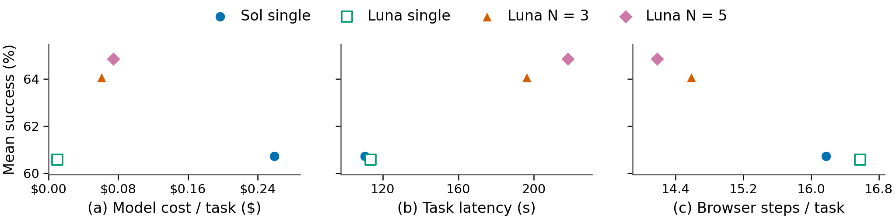
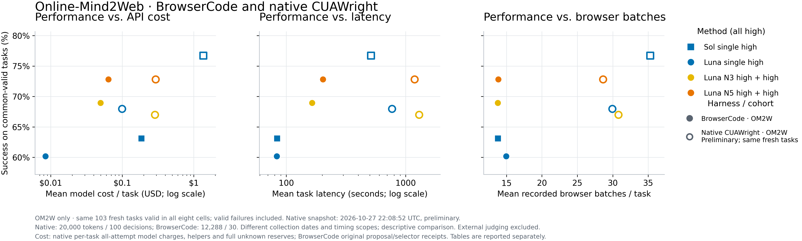
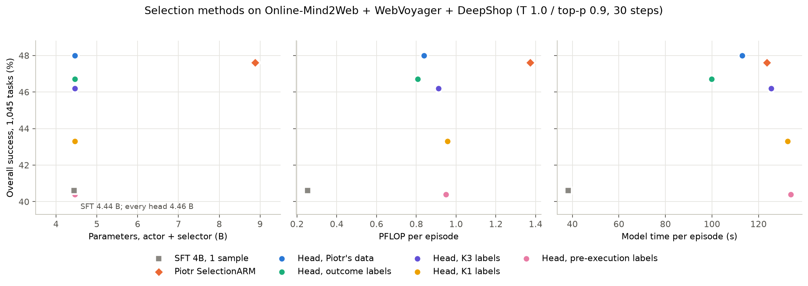
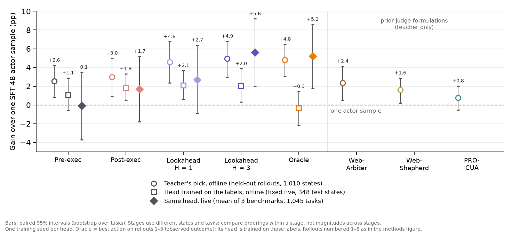
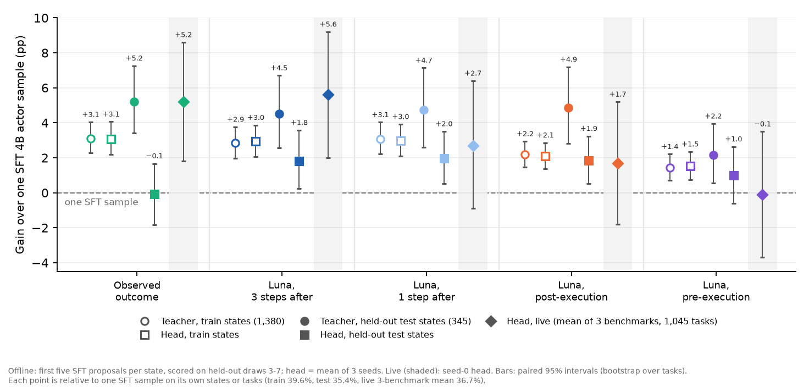
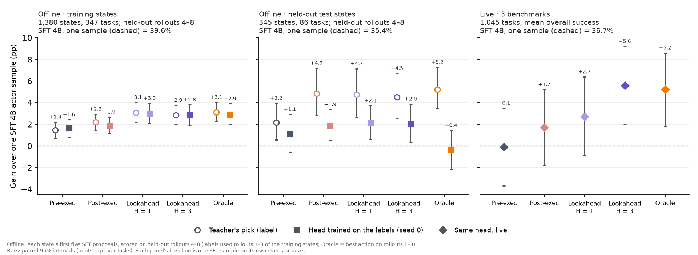
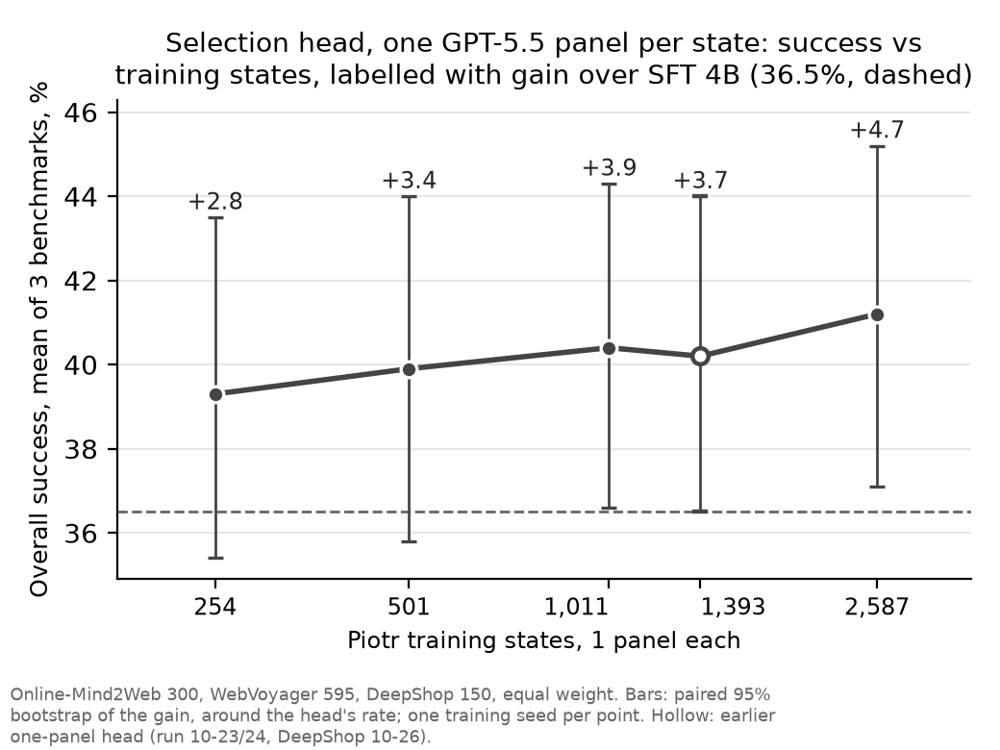
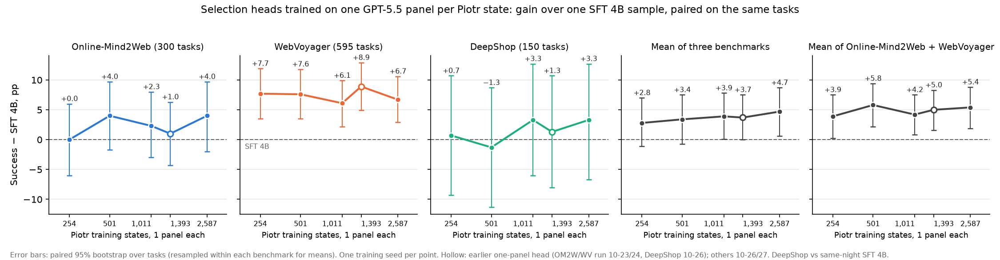

# Final inference results

## Headline performance cost and efficiency

<!-- three-benchmark-headlines-v2 -->
**Four methods × three benchmarks · BrowserCode · Updated October 22, 2026.** Both single-call methods use high effort; N3/N5 use high proposals and a high selector. Limits are 12,288 output tokens per call and 30 decisions.

**All twelve method–benchmark cells are complete and independently audited.** OM2W Luna single was collected later on the same fixed tasks; live-site drift is not controlled. The archived original three-arm and primary new-200 comparisons remain below. DeepShop Sol includes the approved 31-cell budget recovery.

**Overall (mean)** weights each benchmark equally (one third), using unrounded values. **Overall (total)** sums all-attempt model costs across the three benchmarks.

### Matched task success

Common-valid cohorts across all four methods: **254 OM2W tasks, 489 WebVoyager tasks and 140 DeepShop tasks**. These rates condition on validity; full fixed-task rates follow.

| Method | Online-Mind2Web · 254 | WebVoyager · 489 | DeepShop · 140 | Overall (mean) |
|---|---:|---:|---:|---:|
| GPT-6 Sol single high | 65.0% | 72.2% | 45.0% | 60.72% |
| GPT-6 Luna single high | 62.6% | 69.1% | 50.0% | 60.57% |
| GPT-6 Luna N3 high | 66.5% | 69.9% | 55.7% | 64.06% |
| GPT-6 Luna N5 high | 69.7% | 72.0% | 52.9% | 64.84% |

### Overall task success

Rates divide successes by every fixed task, counting invalid outcomes as unsuccessful. Counts and validity are separate below.

| Method | Online-Mind2Web · 300 | WebVoyager · 595 | DeepShop · 150 | Overall (mean) |
|---|---:|---:|---:|---:|
| GPT-6 Sol single high | 57.0% | 64.7% | 44.0% | 55.24% |
| GPT-6 Luna single high | 56.0% | 65.5% | 48.7% | 56.74% |
| GPT-6 Luna N3 high | 60.0% | 66.1% | 54.0% | 60.02% |
| GPT-6 Luna N5 high | 62.7% | 65.4% | 51.3% | 59.79% |

OM2W uses the original 300-task secondary cohort for Sol/N3/N5 plus the later fresh Luna single arm. Separate OM2W retry cohorts are excluded; original outcomes remain unchanged.

### Model API cost across all attempts

Includes every proposal/selector, invalid or aborted attempt and conservative unknown-call reservation. Judge and compute costs are excluded. Dollar amounts are frozen-rate receipt estimates. DeepShop Sol includes all pre-amendment attempts.

| Method | Online-Mind2Web | WebVoyager | DeepShop | Overall (total) |
|---|---:|---:|---:|---:|
| GPT-6 Sol single high | $57.21 | $115.60 | $59.64 | $232.45 |
| GPT-6 Luna single high | $2.64 | $4.61 | $2.10 | $9.35 |
| GPT-6 Luna N3 high | $15.75 | $25.81 | $13.20 | $54.76 |
| GPT-6 Luna N5 high | $19.68 | $27.61 | $16.22 | $63.52 |

### Matched efficiency

All metrics use the same common-valid tasks across all four methods within each benchmark. Task latency measures actor-loop wall time, excluding browser setup, final judge-only capture and external judging; online model work is included. Browser steps count selected BrowserCode batches, each potentially containing multiple browser operations.

#### Mean model API cost per matched task

| Method | Online-Mind2Web | WebVoyager | DeepShop | Overall (mean) |
|---|---:|---:|---:|---:|
| GPT-6 Sol single high | $0.2031 | $0.1882 | $0.3861 | $0.2591 |
| GPT-6 Luna single high | $0.0094 | $0.0073 | $0.0138 | $0.0102 |
| GPT-6 Luna N3 high | $0.0543 | $0.0407 | $0.0871 | $0.0607 |
| GPT-6 Luna N5 high | $0.0693 | $0.0443 | $0.1088 | $0.0742 |

#### Mean task latency

| Method | Online-Mind2Web | WebVoyager | DeepShop | Overall (mean) |
|---|---:|---:|---:|---:|
| GPT-6 Sol single high | 90.7 s | 89.5 s | 151.4 s | 110.5 s |
| GPT-6 Luna single high | 93.3 s | 94.1 s | 152.8 s | 113.4 s |
| GPT-6 Luna N3 high | 177.1 s | 156.9 s | 254.8 s | 196.3 s |
| GPT-6 Luna N5 high | 207.5 s | 167.0 s | 279.7 s | 218.1 s |

#### Mean browser steps

| Method | Online-Mind2Web | WebVoyager | DeepShop | Overall (mean) |
|---|---:|---:|---:|---:|
| GPT-6 Sol single high | 14.8 | 12.7 | 21.1 | 16.2 |
| GPT-6 Luna single high | 16.5 | 12.9 | 20.4 | 16.6 |
| GPT-6 Luna N3 high | 14.7 | 11.3 | 17.8 | 14.6 |
| GPT-6 Luna N5 high | 14.6 | 10.5 | 17.4 | 14.2 |

### Performance versus cost and latency

Each benchmark has equal weight (one third). Both axes use the four-method common-valid cohorts above; cost and latency are averaged per task within each benchmark before averaging across benchmarks. These are descriptive point estimates across different collection dates. Judge-only work is excluded.

*All methods use high reasoning effort, including the N = 3/5 selectors. Success, cost, latency and browser steps are equal-benchmark means on the same four-method common-valid cohorts (254 / 489 / 140 tasks); judge-only work is excluded. Axes are cropped to the observed range; points are descriptive estimates without uncertainty bars, and collection dates differ.*

| Method | Mean success | Mean model cost / task | Mean task latency | Mean browser steps |
|---|---:|---:|---:|---:|
| Sol single high | 60.72% | $0.2591 | 110.5 s | 16.2 |
| Luna single high | 60.57% | $0.0102 | 113.4 s | 16.6 |
| Luna N3 high + high | 64.06% | $0.0607 | 196.3 s | 14.6 |
| Luna N5 high + high | 64.84% | $0.0742 | 218.1 s | 14.2 |

[Cost plot (SVG)](arm_results/sol6_luna_three_benchmarks_20261019/api_performance_vs_cost.svg) · [Latency plot (SVG)](arm_results/sol6_luna_three_benchmarks_20261019/api_performance_vs_latency.svg) · [Browser steps plot (SVG)](arm_results/sol6_luna_three_benchmarks_20261019/api_performance_vs_browser_steps.svg) · [Combined SVG](arm_results/sol6_luna_three_benchmarks_20261019/api_performance_tradeoffs.svg) · [Mean values (CSV)](arm_results/sol6_luna_three_benchmarks_20261019/api_tradeoffs_means.csv) · [Plot source](arm_results/sol6_luna_three_benchmarks_20261019/plot_api_tradeoffs.py)

[Paper PDF: combined](arm_results/sol6_luna_three_benchmarks_20261019/api_performance_tradeoffs.pdf) · [Cost PDF](arm_results/sol6_luna_three_benchmarks_20261019/api_performance_vs_cost.pdf) · [Latency PDF](arm_results/sol6_luna_three_benchmarks_20261019/api_performance_vs_latency.pdf) · [Browser steps PDF](arm_results/sol6_luna_three_benchmarks_20261019/api_performance_vs_browser_steps.pdf). Combined layout: 7-inch canvas; individual panels: 3.35-inch canvas. Grid lines, in-figure protocol footers and repeated titles are omitted; vector PDFs embed TrueType fonts and PNG previews use 300 dpi.

[Audited aggregate metrics](arm_results/sol6_luna_three_benchmarks_20261019/aggregate.json) · [OM2W completion and accounting](ARM_INFERENCE_SCALING.md#luna-single-high-om2w300-20261022) · [DeepShop recovery scope](ARM_INFERENCE_SCALING.md#deepshop-sol-budget-recovery-20261019)

### Online-Mind2Web only: BrowserCode and native CUAWright

**The scatter comparison uses the exact same 103 fresh tasks valid in all eight method–harness cells.** Valid failures remain included; none of these tasks belongs to either harness's historical 100 cohort. The separate BrowserCode three-benchmark plot above is unchanged. Full-cohort rates are reported separately in the results tables, with invalid outcomes counted as unsuccessful. The figure uses model color/shape and harness fill: blue square for Sol single, blue circle for Luna single, yellow circle for Luna N3 and orange circle for Luna N5; filled markers denote BrowserCode and outlined markers native CUAWright.

| Method | Shared tasks | BrowserCode successes | BrowserCode success | Native successes | Native success |
|---|---:|---:|---:|---:|---:|
| Sol single high | 103 | 65 | 63.1% | 79 | 76.7% |
| Luna single high | 103 | 62 | 60.2% | 70 | 68.0% |
| Luna N3 high + high | 103 | 71 | 68.9% | 69 | 67.0% |
| Luna N5 high + high | 103 | 75 | 72.8% | 75 | 72.8% |

Native data are a **preliminary snapshot at October 27, 2026, 22:08:52 UTC**, with 277/300 N5 outcomes; the campaign remains active and its final audit is pending. The common-valid cohort conditions on execution outcomes and can differ from the full task population. BrowserCode uses 12,288 output tokens/30 decisions; native uses 20,000/100, with summary 20. Collection dates, timing boundaries and runtime contention also differ, so this is a descriptive comparison, not a controlled harness-only effect.

Accounting, latency and reproducibility

BrowserCode model costs use the original audited per-episode proposal/selector receipt estimates; none of these 103 tasks has unknown model usage in any BrowserCode method. Native costs include all per-task attempts, model helpers, input counters, cache bounds and full unknown reserves at the fixed cutoff. Both exclude external judging. BrowserCode latency is actor-loop time excluding initial setup and final judge-only capture; native latency retains the original native task boundary and excludes external/saved-evidence grading. Browser steps are recorded selected batches, potentially containing several operations, rather than model decisions. Native singleton recovery and other contention differences remain latency comparability limitations.

[Aggregate coordinates and definitions](arm_results/cuawright_browsercode_om2w_20261027/om2w_harness_comparison_preliminary.json) · [Coordinates CSV](arm_results/cuawright_browsercode_om2w_20261027/om2w_harness_tradeoff_coordinates.csv) · [SVG](arm_results/cuawright_browsercode_om2w_20261027/om2w_harness_tradeoffs.svg) · [PDF](arm_results/cuawright_browsercode_om2w_20261027/om2w_harness_tradeoffs.pdf) · [Plot source](arm_results/cuawright_browsercode_om2w_20261027/plot_om2w_harness_tradeoffs.py)

Coverage and success counts

| Benchmark | Method | Fixed tasks | Successes | Valid | Invalid | Status |
|---|---:|---:|---:|---:|---:|---:|
| Online-Mind2Web | GPT-6 Sol single high | 300 | 171 | 266 | 34 | Audited |
| Online-Mind2Web | GPT-6 Luna single high | 300 | 168 | 269 | 31 | Audited |
| Online-Mind2Web | GPT-6 Luna N3 high | 300 | 180 | 269 | 31 | Audited |
| Online-Mind2Web | GPT-6 Luna N5 high | 300 | 188 | 267 | 33 | Audited |
| WebVoyager | GPT-6 Sol single high | 595 | 385 | 553 | 42 | Audited |
| WebVoyager | GPT-6 Luna single high | 595 | 390 | 579 | 16 | Audited |
| WebVoyager | GPT-6 Luna N3 high | 595 | 393 | 568 | 27 | Audited |
| WebVoyager | GPT-6 Luna N5 high | 595 | 389 | 555 | 40 | Audited |
| DeepShop | GPT-6 Sol single high | 150 | 66 | 145 | 5 | Audited after budget recovery |
| DeepShop | GPT-6 Luna single high | 150 | 73 | 150 | 0 | Audited |
| DeepShop | GPT-6 Luna N3 high | 150 | 81 | 148 | 2 | Audited |
| DeepShop | GPT-6 Luna N5 high | 150 | 77 | 147 | 3 | Audited |

Original controlled Online-Mind2Web comparison and full-300 cohort

### GPT-6 Sol single high versus GPT-6 Luna N3 and N5

**Online-Mind2Web 300 · BrowserCode · Final audited results · October 18, 2026.** All proposals and selectors use high reasoning effort; the limit is 30 decisions per episode.

**Luna reduces model API cost per task by 73.2% (N3) and 66.6% (N5), while taking 1.99× and 2.33× as long on the primary shared-valid comparison.** Its observed success rates are higher, but neither primary paired gain is statistically established.

#### Primary comparison on new tasks

The new 200-task cohort is primary. Efficiency below uses exactly the same 165 tasks valid in all three arms. Model cost includes every proposal and selector call; model cost and task latency exclude the judge.

| Model and policy | Shared valid tasks | Successes | Success rate | Mean model cost / task | Mean task latency | Model cost / successful task | Cost reduction vs Sol | Latency vs Sol |
|---|---:|---:|---:|---:|---:|---:|---:|---:|
| GPT-6 Sol single high | 165 | 104 | 63.0% | $0.2084 | 94.1 s | $0.3306 | 0.0% | 1.00× |
| GPT-6 Luna N3 high + high selector | 165 | 108 | 65.5% | $0.0558 | 186.9 s | $0.0852 | 73.2% | 1.99× |
| GPT-6 Luna N5 high + high selector | 165 | 114 | 69.1% | $0.0696 | 219.7 s | $0.1008 | 66.6% | 2.33× |

Cost per successful task is total model cost across these 165 tasks divided by successes, including cost spent on valid failures. It excludes infrastructure-invalid attempts. N3’s paired success difference is +2.4 percentage points (95% CI −4.8 to +9.7); N5’s is +6.1 points (−0.6 to +12.7).

#### Full 300 task results

The combined cohort is secondary because the first 100 Luna tasks had already been observed. All 900 original dispositions are retained; retry outcomes are separate. Overall success divides by all 300 tasks; valid-only success divides by each arm’s valid count.

| Model and policy | Tasks | Valid | Invalid | Successes | Overall success | Valid-only success |
|---|---:|---:|---:|---:|---:|---:|
| GPT-6 Sol single high | 300 | 266 | 34 | 171 | 57.0% | 64.3% |
| GPT-6 Luna N3 high + high selector | 300 | 269 | 31 | 180 | 60.0% | 66.9% |
| GPT-6 Luna N5 high + high selector | 300 | 267 | 33 | 188 | 62.7% | 70.4% |

For a matched comparison across the full cohort, the following rows use only the same 256 tasks valid in all three arms.

| Model and policy | Shared valid tasks | Successes | Success rate | Mean model cost / task | Mean task latency | Model cost / successful task |
|---|---:|---:|---:|---:|---:|---:|
| GPT-6 Sol single high | 256 | 165 | 64.5% | $0.2046 | 91.5 s | $0.3175 |
| GPT-6 Luna N3 high + high selector | 256 | 171 | 66.8% | $0.0546 | 177.7 s | $0.0817 |
| GPT-6 Luna N5 high + high selector | 256 | 178 | 69.5% | $0.0699 | 208.0 s | $0.1005 |

[Detailed comparison and audit](ARM_INFERENCE_SCALING.md#sol6-luna-browsercode300-20261018) · [Audited aggregate metrics](arm_results/sol6_luna_browsercode300_20261018/aggregate.json)

## Native CUAWright: four methods on 100 tasks

**Sol single high achieved 80 successes; Sol N=3 achieved 72; Luna N=3 and the historical Luna single each achieved 68, out of the same fixed 100 Online-Mind2Web tasks.** All 300 new dispositions and all 49 attempts passed independent source, usage, cap, W&B and physical teardown audits. Overall success counts invalid outcomes as failures.

| Method | Tasks | Valid | Invalid | Successes | Overall success | Valid-only success |
|---|---:|---:|---:|---:|---:|---:|
| Luna single high (historical) | 100 | 93 | 7 | 68 | 68.0% | 73.1% |
| Luna N=3 high + high selector | 100 | 90 | 10 | 68 | 68.0% | 75.6% |
| Sol single high | 100 | 98 | 2 | 80 | 80.0% | 81.6% |
| Sol N=3 high + high selector | 100 | 90 | 10 | 72 | 72.0% | 80.0% |

Efficiency below averages all 100 tasks per method. Model cost includes every attempt, selection and online helpers, with conservative reserves for unknown usage; it excludes external judging. Native task latency excludes external judging and separate grading recovery. Browser batches are recorded native browser-command batches, not individual DOM actions.

| Method | Model cost / task | Mean native latency | Mean browser batches | Mean native decisions |
|---|---:|---:|---:|---:|
| Luna single high (historical) | $0.087 | 18.58 min | 31.8 | 60.3 |
| Luna N=3 high + high selector | $0.258 | 18.93 min | 30.0 | 46.2 |
| Sol single high | $1.143 | 7.48 min | 32.8 | 47.6 |
| Sol N=3 high + high selector | $4.601 | 11.72 min | 33.6 | 46.0 |

Luna single was collected earlier under a different concurrency policy and live web conditions; its comparisons are descriptive. These native 100-task results are separate from the three-benchmark BrowserCode averages above.

Matched valid tasks, uncertainty and accounting

The same 79 tasks were valid in all four methods. This is a conditional cohort selected after execution; it can favor different tasks from the full 100-task cohort.

| Method | Shared valid tasks | Successes | Success rate | Model cost / task | Mean native latency | Mean browser batches |
|---|---:|---:|---:|---:|---:|---:|
| Luna single high (historical) | 79 | 60 | 75.9% | $0.086 | 16.86 min | 29.6 |
| Luna N=3 high + high selector | 79 | 61 | 77.2% | $0.247 | 18.04 min | 29.0 |
| Sol single high | 79 | 69 | 87.3% | $0.965 | 6.57 min | 29.9 |
| Sol N=3 high + high selector | 79 | 65 | 82.3% | $4.313 | 10.91 min | 31.4 |

Among the three newly run methods, 83 tasks were valid in all three: Luna N=3 succeeded on 64 (77.1%), Sol single on 72 (86.7%), and Sol N=3 on 68 (81.9%). Sol N=3 versus Sol single was −8.0 percentage points on all 100 tasks (paired bootstrap 95% interval −14.0 to −2.0; exact McNemar p=0.0215). On the 83 common-valid tasks it was −4.8 points (exact p=0.125). The paired tests are exploratory and unadjusted for multiple comparisons; the conditional analysis does not establish a reliable quality gain from selection.

The new arms consumed $600.203071 in conservative model charges/reservations and $25.854568 in external judging, within separate $1,600/$150 caps and every original per-shard limit. All 22 invalid outcomes remain: 16 native failures and six judging failures. No unchanged native episode or paid grading retries replaced them. A timed-out native episode remains invalid; independent host evidence verifies physical cleanup despite missing native completion metadata. Its five unused call credits ($0.1043585) remain recorded separately from model charges.

Earlier GPT-5.4 reproduction: qualified historical result

| Method | Tasks | Valid | Invalid | Successes | Overall success | Valid-only success | Audit status |
|---|---:|---:|---:|---:|---:|---:|---|
| GPT-5.4 xhigh, native CUAWright, 100 decisions | 100 | 96 | 4 | 81 | 81.0% | 84.4% | Browser-start budget audit failed; qualified |

Its conservative all-attempt model total was $353.582380 ($348.649556 known usage plus $4.932825 reserved unknown usage); external judging cost $7.506035. Mean latency was 1,495.7 seconds and mean browser batches 24.9 across its 96 valid tasks. Two shards exceeded browser-start caps by at least eight starts in total; one case lacks verified episode-end cleanup and actual concurrency. Preserve this descriptive result with those limitations.

[Earlier protocol and audit](ARM_INFERENCE_SCALING.md#cuawright-native-local100-closeout-20261023) · [GPT-5.4 aggregate](arm_results/cuawright_native_local100_20261023/aggregate.json)

[Completed comparison and methodology](ARM_INFERENCE_SCALING.md#cuawright-native-selection-results-20261024) · [Audited aggregate metrics](arm_results/cuawright_native_selection_local100_20261023/aggregate.json) · [Historical Luna audit](arm_results/cuawright_luna_high_local100_20261023/aggregate.json)

## Selection head: which training labels work (October 21, 2026)

**A 22.6 M-parameter head on the frozen SFT-4B actor, trained on observed-outcome or lookahead K = 3 labels for 1,380 SFT-actor branch states, is level with Piotr SelectionARM (−0.8 and −0.9 pp) at 56–65% of its compute per episode. Lookahead K = 1 labels gain about a third as much and pre-execution labels nothing. Trained on Piotr's data, the same head is the best method (+1.4 pp over Piotr, within noise). An 8B actor without selection gains +3.3 pp over the 4B.** Online-Mind2Web 300, WebVoyager 595, DeepShop 150 tasks; T 1.0 / top-p 0.9, 30 steps, one episode per task. "Mean" weights each benchmark equally (one third), as in the API comparison above.

**Success.**

| Actor | Selector | Training data: states / panels / labels | Online-Mind2Web valid-only | WebVoyager valid-only | DeepShop valid-only | Mean overall | Mean valid-only |
| --- | --- | --- | ---: | ---: | ---: | ---: | ---: |
| SFT 4B | — (1 sample) | — | 39.6% | 45.0% | 34.2% | 38.2% | 39.6% |
| SFT 8B | — (1 sample) | — | 39.9% | 49.7% | 39.9% | 41.5% | 43.2% |
| SFT 4B | Piotr SelectionARM (4B LoRA) | 2,692 (Piotr's) / 35,916 of 5 sampled / GPT-5.5, before | 46.8% | **53.8%** | 41.9% | 44.9% | 47.5% |
| SFT 4B | Head (22.6 M) | 2,692 (Piotr's) / 35,916 of 5 sampled / GPT-5.5, before | **49.4%** | 53.4% | **44.9%** | **46.3%** | **49.2%** |
| SFT 4B | Head (22.6 M) | 1,380 (branch) / 1,380 of 2–5 distinct / observed outcome | 42.2% | 53.0% | 42.6% | 44.1% | 45.9% |
| SFT 4B | Head (22.6 M) | 1,380 (branch) / 1,380 of 2–5 distinct / Luna, 3 steps after | 43.1% | 52.0% | 42.7% | 44.0% | 45.9% |
| SFT 4B | Head (22.6 M) | 1,380 (branch) / 1,380 of 2–5 distinct / Luna, 1 step after | 38.6% | 50.5% | 38.8% | 40.4% | 42.6% |
| SFT 4B | Head (22.6 M) | 1,380 (branch) / 1,380 of 2–5 distinct / Luna, before | 36.9% | 47.1% | 34.2% | 37.6% | 39.4% |

**Size and cost** (means over the three benchmarks).

| Actor | Selector | Labels | Params (actor + selector) | PFLOP per step | PFLOP per episode | Model time per episode | Steps per episode |
| --- | --- | --- | ---: | ---: | ---: | ---: | ---: |
| SFT 4B | — | — | 4.44 B | 0.019 | 0.28 | 42 s | 14.5 |
| SFT 8B | — | — | 8.77 B | 0.037 | 0.56 | 51 s | 15.0 |
| SFT 4B | Piotr SelectionARM | GPT-5.5, before | 4.44 B + 4.44 B | 0.098 | 1.53 | 143 s | 15.4 |
| SFT 4B | Head | GPT-5.5, before | 4.44 B + 22.6 M | 0.063 | 0.92 | 131 s | 14.6 |
| SFT 4B | Head | Observed outcome | 4.44 B + 22.6 M | 0.062 | 0.86 | 109 s | 13.8 |
| SFT 4B | Head | Luna, K = 3 | 4.44 B + 22.6 M | 0.062 | 1.00 | 142 s | 16.0 |
| SFT 4B | Head | Luna, K = 1 | 4.44 B + 22.6 M | 0.062 | 1.05 | 149 s | 16.8 |
| SFT 4B | Head | Luna, before execution | 4.44 B + 22.6 M | 0.062 | 1.05 | 155 s | 16.8 |

*Top row: equal mean of the three benchmarks (success and cost). Bottom row: Online-Mind2Web 300 only, adding the three-candidate runs ([below](#final-selection-n3-om2w-20261022)); lines join each selector's N = 3 (triangle) and N = 5 runs. Success counts invalid episodes as failures. T = 1.0, top-p = 0.9, 30 steps; selectors use N = 5 unless marked N = 3, and SFT baselines use one sample. “Piotr” denotes SelectionARM or the head's training data, as indicated in the legend; K = 1/3 denotes label lookahead depth. Heads have 4.46 B total parameters (pointwise: 4.457 B), versus 4.44 B for SFT 4B, so some points overlap in the parameter column. Axes are cropped; points are descriptive estimates without uncertainty bars.*

[Paper PDF](arm_results/rl_integration/selection-head-labels-vs-cost-20261021.pdf) · [Editable SVG](arm_results/rl_integration/selection-head-labels-vs-cost-20261021.svg). Compact 7-inch canvas with a shared legend and column labels; 300 dpi PNG preview. Protocol details are in this caption.

- **Definitions.** "Overall" counts invalid episodes as failures; "valid-only" divides successes by valid episodes. Model time is actor + selector decision time summed over an episode, excluding browser execution. PFLOP per episode = PFLOP per step × steps per episode.
- **Methods.** Every selector picks one of five candidates the frozen actor samples per step; "branch" data are the SFT-actor branching states collected for this project ([collection and labels](ARM_FORMULATIONS.md#lookahead-labels-current)), "Piotr's" the GPT-5.5-labelled panels of Piotr's release. SFT rows take a single sample. Training data reads states / panels (with the actions in each panel) / labels. Piotr's panels are five sampled actor actions each (about 13 per state), duplicates included, each labelled with one GPT-5.5 pick made before execution (from the screenshot and candidates only). Branch panels are one per state holding its 2–5 distinct SFT-proposed actions, reshuffled each epoch; branch states come from the tasks of Piotr's training split.
- **How the paired 95% intervals are computed** (every "pp [95% CI]" difference and every plot error bar in the selection-head results). Both runs use the same frozen task list. Each task scores 1 if its single episode is valid and judged successful, else 0 (invalid episodes count as failures), and the per-task difference is d = run − reference ∈ {−1, 0, +1}; the point estimate is the mean of d. For one benchmark, draw 10,000 resamples of its tasks with replacement, each the size of the benchmark, and take the mean of d in each. For the three-benchmark mean, resample tasks independently within each benchmark (keeping 300 / 595 / 150 tasks) and average the three resampled means with weight 1/3 each. The interval is the 2.5th to 97.5th percentile of the 10,000 resampled values. The random seed is fixed in each analysis script (e.g. NumPy `default_rng(20261018)`; the data-scaling script uses Python `random.Random(0)`). Pairing on tasks removes task-difficulty variance shared by the two runs, so these intervals are narrower than comparing two per-run intervals; they do not include training-seed variance (one seed per live head), episode-sampling variance beyond the one episode per task, or run-date drift (DeepShop).
- **Paired differences on the mean overall rate, pp [95% bootstrap, tasks resampled within each benchmark].** vs SFT 4B: Piotr +6.7 [+3.0, +10.4], Piotr-data head +8.1 [+4.4, +11.8], outcome +5.9 [+2.5, +9.4], K = 3 +5.8 [+2.1, +9.5], K = 1 +2.2 [−1.5, +5.8], pre-execution −0.7 [−4.2, +2.8], SFT 8B +3.3 [−0.3, +6.9]. vs Piotr: Piotr-data head +1.4 [−2.1, +4.9], outcome −0.8 [−4.5, +2.8], K = 3 −0.9 [−4.5, +2.7], K = 1 −4.5 [−8.3, −0.8], pre-execution −7.4 [−11.1, −3.8], SFT 8B −3.4 [−7.3, +0.4]. Piotr-data head − SFT 8B +4.8 [+1.0, +8.5]. Valid-only differences (tasks valid under both) agree within 1.1 pp.
- **From teacher to live, per label source.** For each label, three gains over one sample of the same SFT 4B actor: the teacher's own pick offline (held-out rollouts 4–8 on the 1,010 main-set branch states; [details](ARM_FORMULATIONS.md#lookahead-labels-current)), the head trained on those labels offline (fixed five on the 348 test states) and the same head live (three-benchmark mean). The stages use different states and tasks, so compare orderings within a stage, not sizes across stages. Online-Mind2Web here uses the current gpt-5.6-terra judge (all runs re-judged from saved requests), so the live gains are slightly lower than the o4-mini numbers above. Post-execution labels (Luna judging each action from its immediate result) were added on 2026-10-27: its head gains +1.8 pp offline and +1.7 pp [−1.8, +5.2] live (Online-Mind2Web −0.3, WebVoyager +4.0, DeepShop +1.3; [data](arm_results/rl_integration/selection-post-label-20261027.json)), close to the lookahead H = 1 head; DeepShop SFT varied 26.7–34.0% across three runs, so DeepShop gains carry run-date drift. Bars are [paired 95% intervals](#final-paired-bootstrap). [Plot script](arm_results/rl_integration/selection-label-stages-20261027-plot.py) · [data](arm_results/rl_integration/selection-label-stages-20261027.json)

  
- **Same states, train and test (draft, under review).** Teacher and head scored on the same SFT-action branch states, so offline points share states: each state's first five SFT proposals (duplicates kept) on held-out rollouts 4–8; the head is the seed-0 head, the same one run live. On the 1,380 training states (labels came from rollouts 1–3) every head matches its teacher within 0.3 pp. On the 345 held-out test states (86 tasks) every teacher gains 4.5–5.2 pp except pre-execution (+2.2); the Luna heads keep about 2 pp of that, the Oracle (observed-outcome) head none (−0.4 [−2.2, +1.4]), yet it is among the best live. Each point is relative to one SFT sample on its own states or tasks. [Plot script](arm_results/rl_integration/selection-label-same-state-20261027-plot.py) · [data](arm_results/rl_integration/selection-label-same-state-20261027.json)

  
- **Same comparison, one panel per setup (draft, under review).** Training states, held-out test states and live use different states, tasks and SFT baselines, so each gets its own panel; teacher and head are paired only offline, where both are scored. Offline points use held-out rollouts 4–8 in both splits (training-state labels came from rollouts 1–3). Names and colours follow the [offline-evaluation methods figure](arm_results/methods/selection-offline-eval-20261022.png) (rollouts numbered 1–8; Oracle = best action on rollouts 1–3; Lookahead H = 1 / 3 = Luna judging 1 / 3 steps after). [Plot script](arm_results/rl_integration/selection-label-setups-20261027-plot.py)

  
- **Online-Mind2Web is where the branch labels fall short.** On WebVoyager and DeepShop the outcome and K3 heads match Piotr; on Online-Mind2Web none clearly beats SFT, while the Piotr-data head does (+7.3 pp [+1.7, +13.0]).
- **Why time barely drops.** Generating five candidates takes about 8.2 s of each 8–9 s decision; Piotr's selector adds 0.50 s and the head 0.02 s. Selector FLOPs are a fast prefill, while decoding is bandwidth-bound, so the head's 36% compute saving per step becomes only about 0.5 s per decision, roughly offset by its hidden-state capture. Episode length matters as much: the outcome head is cheapest per episode because it takes the fewest steps. Times come from live runs on different nodes, not a matched timing study.
- **Architecture barely matters.** With K = 1 labels on the same 1,380 branch states, crossing joint / independent attention with soft CE / per-candidate BCE on all 1,045 tasks gives mean overall rates of 40.2–41.5%. Joint − independent is +0.7 pp [−2.1, +3.4] and soft CE − BCE −0.6 pp [−3.1, +1.9] ([details](ARM_SELECTION_HEAD.md#selection-head-arch-full-20261022)).
- **Graded outcome targets do not beat the best-action target.** Replacing the outcome head's best-action label with a soft ranking (softmax(rate / 0.25)), centred advantage MSE or a binomial rate fit is level offline. Live, the soft-ranking head, best of the three on Online-Mind2Web (+2.3 pp, within noise), is **−5.3 pp [−8.8, −1.8]** below the best-action head on the three-benchmark mean, level with one SFT sample; WebVoyager alone is −4.2 [−8.2, −0.3] ([details](ARM_SELECTION_HEAD.md#selection-head-outcome-objectives-20261025)).
- A 4B LoRA trained with Piotr's recipe on the 1,380 branch states does no better than the head offline ([details](ARM_SELECTION_HEAD.md#selection-head-sft-actions-lora-20261021)).
- [Details, per-benchmark intervals and caveats](ARM_SELECTION_HEAD.md#selection-head-sft-actions-20261021) · Evidence: [heads](arm_results/rl_integration/selection-head-sft-actions-full-20261021.json), [SFT 8B and N = 3](arm_results/rl_integration/selection-n3-sft8b-full-20261021.json), [benchmark means and differences](arm_results/rl_integration/selection-mean-benchmark-diffs-20261022.json) · [Plot script](arm_results/rl_integration/selection-head-labels-vs-cost-20261021.py)

### Three candidates instead of five (Online-Mind2Web)

**On Online-Mind2Web, cutting each selector from five to three candidates per decision costs no measurable success and saves 26–33% of model time per episode. All three N = 3 selectors still beat SFT 4B; differences among them are within noise.** Plotted in the bottom row of the figure above. 300 tasks, same task order, decoding and judge as above; one run per method. The pointwise head is the per-candidate MLP (16.8 M parameters) trained on the same Piotr data; it has no N = 5 full-set run.

| Actor | Selector | Training labels | Candidates per step | Params (actor + selector) | Overall | Valid-only | PFLOP per step | PFLOP per episode | Model time per episode | Steps per episode |
| --- | --- | --- | ---: | ---: | ---: | ---: | ---: | ---: | ---: | ---: |
| SFT 4B | — | — | 1 | 4.44 B | 36.3% | 39.6% | 0.018 | 0.26 | 40 s | 14.3 |
| SFT 8B | — | — | 1 | 8.77 B | 36.3% | 39.9% | 0.036 | 0.48 | 44 s | 13.5 |
| SFT 4B | Piotr SelectionARM (4B LoRA) | GPT-5.5 before, Piotr's 2,692 states | 5 | 4.44 B + 4.44 B | 41.0% | 46.8% | 0.095 | 1.41 | 125 s | 14.9 |
| SFT 4B | Piotr SelectionARM (4B LoRA) | GPT-5.5 before, Piotr's 2,692 states | 3 | 4.44 B + 4.44 B | **44.7%** | **51.7%** | 0.080 | 1.24 | 93 s | 15.5 |
| SFT 4B | Joint head (22.6 M) | GPT-5.5 before, Piotr's 2,692 states | 5 | 4.44 B + 22.6 M | 43.7% | 49.4% | 0.060 | 0.88 | 114 s | 14.7 |
| SFT 4B | Joint head (22.6 M) | GPT-5.5 before, Piotr's 2,692 states | 3 | 4.44 B + 22.6 M | 42.3% | 47.2% | 0.052 | 0.74 | 77 s | 14.2 |
| SFT 4B | Pointwise head (16.8 M) | GPT-5.5 before, Piotr's 2,692 states | 3 | 4.44 B + 16.8 M | 41.3% | 47.0% | 0.051 | 0.72 | 77 s | 14.2 |
| *Judged by gpt-5.6-terra (rows above: o4-mini)* | | | | | | | | | | |
| SFT 4B | Joint head (22.6 M), 10-18 run re-judged | GPT-5.5 before, Piotr's 2,692 states | 5 | 4.44 B + 22.6 M | 37.7% | 42.6% | 0.060 | 0.88 | 114 s | 14.7 |
| SFT 4B, n-gram decoding | Joint head (22.6 M) | GPT-5.5 before, Piotr's 2,692 states | 5 | 4.44 B + 22.6 M | 29.7% | 34.9% | 0.033 | 0.55 | 95 s | 16.4 |

- **N-gram speculative decoding (last two rows; not in the plot).** The same head with the actor served under sglang n-gram decoding (run 10-24/25) is **−8.0 pp [−13.3, −2.7]** below its 10-18 run (valid-only −6.9 [−13.1, −0.8]). Decisions are 26% faster (5.8 s vs 7.8 s), but episodes run longer (94 vs 63 hit the 30-step limit), so model time per episode falls only 17%. The cause of the drop is not established; the runs are a week apart on live sites. N-gram is not adopted ([details](ARM_SELECTION_HEAD.md#selection-inference-serving-20261024)). Both rows are judged by gpt-5.6-terra, which is stricter than o4-mini, so compare them with each other, not with the rows above.
- **Paired differences (300 tasks, 95% bootstrap, overall).** N = 3 vs N = 5: Piotr +3.7 [−1.7, +9.0], joint head −1.3 [−7.3, +4.3]. vs SFT 4B: Piotr N = 3 +8.3 [+2.3, +14.0], joint head N = 3 +6.0 [+0.3, +11.7], pointwise head N = 3 +5.0 [−0.7, +10.7]. At N = 3: joint head − Piotr −2.3 [−8.0, +3.3], pointwise − joint −1.0 [−6.7, +4.7].
- **Time.** A decision takes 6.0 s for Piotr and 5.4 s for the heads at N = 3, against 8.4 s and 7.8 s at N = 5: the slowest of fewer parallel candidates finishes sooner and the GPU serves fewer requests.
- **Caveat.** Piotr's N = 3 gain over N = 5 is not significant and comes from one run per method on one benchmark; WebVoyager and DeepShop were not run at N = 3.
- [Evidence](arm_results/rl_integration/selection-n3-sft8b-full-20261021.json) · [Analysis script](arm_results/rl_integration/selection-n3-sft8b-full-20261021-analysis.py) · n-gram: [evidence](arm_results/rl_integration/selection-ngram-om2w-full-20261025.json), [analysis script](arm_results/rl_integration/selection-ngram-om2w-full-20261025-analysis.py) · Plot: bottom row of the figure above

### More teacher data (Piotr's GPT-5.5 panels)

**Training the head on more of Piotr's GPT-5.5-labelled states does not help: 254 states gain as much over one SFT sample as all 2,587 (2,587 − 254: −2.2 pp [−5.9, +1.7]).** Same joint head and recipe as the Piotr-data head above, one seed per size, whole tasks added in a fixed order; all 1,045 tasks, T 1.0 / top-p 0.9, 30 steps. Online-Mind2Web judged by gpt-5.6-terra (o4-mini was retired on 2026-10-23; the references are re-judged), WebVoyager and DeepShop by GPT-4o.

| Training data | States | Online-Mind2Web overall | WebVoyager overall | DeepShop overall | Mean overall | − SFT 4B, pp [95% CI] |
| --- | ---: | ---: | ---: | ---: | ---: | ---: |
| Piotr's panels | 254 | 36.3% | 52.6% | 36.0% | 41.6% | **+5.0 [+1.1, +8.9]** |
| Piotr's panels | 501 | 35.3% | 54.8% | 36.7% | 42.3% | **+5.6 [+1.7, +9.4]** |
| Piotr's panels | 1,011 | 35.7% | 53.5% | 31.3% | 40.1% | +3.5 [−0.2, +7.2] |
| Piotr's panels, all | 2,587 | 33.3% | 53.8% | 31.3% | 39.5% | +2.8 [−1.0, +6.6] |
| Piotr's panels, one per state | 1,393 | 32.7% | 53.3% | 28.0% | 38.0% | +1.3 [−2.5, +5.2] |
| *SFT 4B, one sample (10-18)* | — | 31.7% | 44.4% | 34.0% | 36.7% | — |
| *Earlier Piotr-data head (10-18)* | 2,692 | 37.7% | 51.3% | 44.0% | 44.3% | **+7.6 [+3.9, +11.3]** |

- **The head learns the teacher better without picking better actions.** Validation agreement with GPT-5.5 rises from 58% to 66% with data, while the offline gain over one SFT sample stays at +2.3 to +3.0 pp at every size.
- **Our branch states are worth more per state.** One Piotr panel per state (1,393 states) is −4.3 pp [−8.1, −0.5] below our 1,380-state K = 3 head live.
- **Caveat: DeepShop drifted between run dates.** Same-day reruns on 10-24 dropped SFT 4B from 34.0% to 28.0% and the earlier head from 44.0% to 34.0%; against that same-day head the new heads differ by −6.0 to +2.7 pp on DeepShop (all intervals span 0). DeepShop columns, and so the means, are not comparable across dates; Online-Mind2Web and WebVoyager are flat.
- **Same-day rerun of both full-data heads (10-25).** On one day and all 1,045 tasks, the all-data head (2,587 states) is **−3.7 pp [−7.2, −0.1]** below the earlier Piotr-data head (2,692 states) on the mean (42.1% vs 38.4% overall). Online-Mind2Web (−1.7) and WebVoyager (−0.7) are level; the gap is DeepShop (−8.7 [−17.3, 0.0]). Each head rerun against its own earlier run moves only −2.2 and −1.1 pp, so run-date drift explains about a quarter of the original −4.8 pp gap ([details](ARM_SELECTION_HEAD.md#selection-piotr-head-sameday-20261025)).
- [Details](ARM_SELECTION_HEAD.md#selection-head-data-scale-20261023) · [Evidence](arm_results/rl_integration/selection-data-scale-20261023.json) · [Analysis script](arm_results/rl_integration/selection-data-scale-20261023-analysis.py)

### More states or more panels, one seed per head, same-day DeepShop (October 26–27)

**With one GPT-5.5 panel per state, ten times more states (254 → 2,587) moves the gain over one SFT 4B sample on the three-benchmark mean only from +2.8 to +4.7 pp (2,587 − 254: +1.9 pp [−2.0, +5.8]). On a fixed 1,393 states, 13× more panels per state is also flat (all panels − one: +1.2 pp [−2.6, +5.0]).** Every head's gain comes mainly from WebVoyager (+6 to +9 pp, each significant); Online-Mind2Web and DeepShop are within noise. All runs compare DeepShop against a same-day SFT 4B run, which removes the date drift noted above. Same joint head, soft CE, batch 64, last of 20 epochs; states are whole tasks in a fixed order, our 86 offline test tasks excluded; all 1,045 tasks, T 1.0 / top-p 0.9, 30 steps.

*Y-axis: overall success; labels: gain over SFT 4B, pp; bars: [paired 95% interval](#final-paired-bootstrap) of that gain, drawn around the head's rate; dashed: SFT 4B; hollow: the earlier 1,393-state one-panel head.*

| Training data | States | Panels | Online-Mind2Web overall | WebVoyager overall | DeepShop overall | Mean overall | Mean − SFT 4B, pp [95% CI] |
| --- | ---: | ---: | ---: | ---: | ---: | ---: | ---: |
| One panel per state | 254 | 254 | 31.7% | 52.1% | 34.0% | 39.3% | +2.8 [−1.1, +7.0] |
| One panel per state | 501 | 501 | 35.7% | 51.9% | 32.0% | 39.9% | +3.4 [−0.7, +7.5] |
| One panel per state | 1,011 | 1,011 | 34.0% | 50.4% | 36.7% | 40.4% | **+3.9 [+0.1, +7.8]** |
| One panel per state | 1,393 | 1,393 | 32.7% | 53.3% | 34.7% | 40.2% | **+4.2 [+0.4, +8.0]** |
| One panel per state | 2,587 | 2,587 | 35.7% | 51.1% | 36.7% | 41.2% | **+4.7 [+0.6, +8.7]** |
| ≤ 8 panels per state | 1,393 | 10,181 | 35.3% | 51.8% | 34.0% | 40.4% | **+4.4 [+0.7, +8.0]** |
| Every panel (≤ 16 per state) | 1,393 | 18,587 | 34.7% | 52.9% | 36.7% | 41.4% | **+5.4 [+1.8, +9.0]** |

SFT 4B: Online-Mind2Web 31.7% and WebVoyager 44.4% (10-18; Online-Mind2Web re-judged by gpt-5.6-terra); DeepShop 33.3% on 10-27 for the one-panel heads except 1,393, and 32.0% on 10-26 for the 1,393-state heads. Online-Mind2Web 300, WebVoyager 595, DeepShop 150 tasks; overall counts invalid episodes as failures; paired 95% bootstrap over tasks.

- **Offline agrees.** On the 348 held-out test states (fixed five, three seeds each), the one-panel heads score 37.3–38.2% and the panel counts 37.0–38.2%, against 35.65% for one SFT sample.
- **DeepShop drift explained the earlier panel effect.** Against a 10-24 run, all panels looked +8.7 pp better than one on DeepShop; rerunning the one-panel head on the same day as the others raised it by 6.7 pp, leaving +2.0 [−7.3, +11.3].
- **Caveat.** One training seed per live head (offline seed spread ≤ 0.8 pp); the 1,393-state one-panel head's Online-Mind2Web and WebVoyager runs are from 10-23/24, and its single panel per state was drawn differently from the other one-panel heads.
- [State-scaling details](ARM_SELECTION_HEAD.md#selection-head-state-scale-1panel-20261027) · [Panel-scaling details](ARM_SELECTION_HEAD.md#selection-head-panel-scale-20261026) · Evidence: [states](arm_results/rl_integration/selection-state-scale-1panel-20261027.json), [panels](arm_results/rl_integration/selection-panel-scale-20261026.json) · [Plot script](arm_results/rl_integration/selection-state-scale-1panel-paired-20261027-plot.py)
