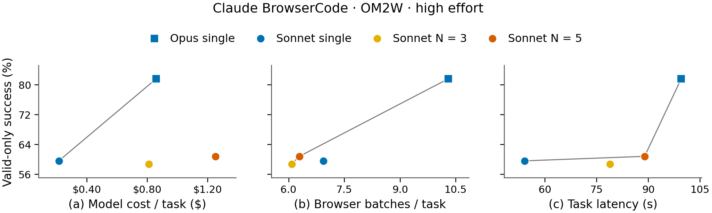

# Final inference results

<!-- claude-browsercode-om2w300-v1:start -->

## Claude BrowserCode: high effort on OM2W

**On the 246 common-valid tasks, Sonnet N5 matches Sonnet single at 147 successes; N3 records 144. Both use fewer selected browser batches, higher model cost and longer native latency.** Opus records 199 successes on that same cohort.

All four arms have audited outcomes for the same fixed 300 tasks; the table and primary figure use each arm’s own valid cohort.

| Method | Recorded | Valid | Invalid | Successes | Valid-only success | Model $ / task | Latency (s) | Browser batches |
|---|---:|---:|---:|---:|---:|---:|---:|---:|
| Opus single | 300 | 266 | 34 | 217 | 81.6% | 0.859 | 99.5 | 10.30 |
| Sonnet single | 300 | 262 | 38 | 156 | 59.5% | 0.214 | 54.1 | 6.94 |
| Sonnet N = 3 | 300 | 259 | 41 | 152 | 58.7% | 0.811 | 78.9 | 6.08 |
| Sonnet N = 5 | 300 | 265 | 35 | 161 | 60.8% | 1.252 | 89.0 | 6.29 |

Successes divide by valid outcomes in each arm; invalid outcomes stay in the separate count column. Model cost, latency and browser batches use exactly that arm's valid cohort, including valid failures. Cohorts can differ between arms and exclude cap-constrained episodes; these conditional rates do not establish a causal model-quality gain.

*Opus 5.5 and Sonnet 5.5; 12,288 output tokens and 30 decisions. N = 3/5 samples candidates independently and executes only the selected batch. The thin gray line joins observed Pareto points within each panel; it implies neither interpolation nor statistical superiority. Axes are cropped; no uncertainty is inferred from aggregate points. Collections occur on live sites.*

[Coordinates (CSV)](arm_results/claude_browsercode_om2w300_20261028/claude_coordinates.csv) · [Aggregate definitions](arm_results/claude_browsercode_om2w300_20261028/aggregate.json) · [SVG](arm_results/claude_browsercode_om2w300_20261028/claude_tradeoffs.svg) · [PDF](arm_results/claude_browsercode_om2w300_20261028/claude_tradeoffs.pdf) · [Plot source](arm_results/claude_browsercode_om2w300_20261028/plot_claude_tradeoffs.py)

Matched common-valid alternative and accounting scope

Model cost includes all candidate and selector calls in each included episode, including thinking output and conservative unknown reservations. Every plotted valid episode has known model usage; unknown reservations remain in the separate all-attempt accounting. Native latency measures actor-loop wall time, including online waits and browser execution, excluding browser setup, final judge-only capture, cleanup and external judging. A browser batch is one selected BrowserCode block and can contain multiple browser operations. GPT-5.6 Terra grades terminal success; historical GPT figures using another judge remain separately labeled.

**Validity and budget exclusions.** Six Sonnet single, five N3 and five N5 outcomes were invalid because full conservative request reservations could not be admitted within their frozen caps. Shared-halt consequences remain invalid too. These are not judged failures; common-valid conditioning does not cure the resulting selection. All invalid and unknown charges remain in the separate all-attempt accounting.

| Method | Invalid reason | Count |
|---|---|---:|
| Opus single | browser navigation download | 5 |
| Opus single | browser navigation network or redirect error | 5 |
| Opus single | browser navigation timeout | 20 |
| Opus single | episode or tool timeout | 1 |
| Opus single | native response json decode | 1 |
| Opus single | terminal interruption | 1 |
| Opus single | world output unicode encoding | 1 |
| Sonnet single | actor budget reservation admission | 6 |
| Sonnet single | browser navigation download | 5 |
| Sonnet single | browser navigation network or redirect error | 4 |
| Sonnet single | browser navigation timeout | 21 |
| Sonnet single | terminal interruption | 2 |
| Sonnet N = 3 | actor budget reservation admission | 5 |
| Sonnet N = 3 | browser navigation download | 5 |
| Sonnet N = 3 | browser navigation network or redirect error | 4 |
| Sonnet N = 3 | browser navigation timeout | 19 |
| Sonnet N = 3 | episode or tool timeout | 3 |
| Sonnet N = 3 | native protocol or validation | 1 |
| Sonnet N = 3 | provider or judge api error | 1 |
| Sonnet N = 3 | shared halt after prior failure | 1 |
| Sonnet N = 3 | terminal interruption | 2 |
| Sonnet N = 5 | actor budget reservation admission | 5 |
| Sonnet N = 5 | browser navigation download | 5 |
| Sonnet N = 5 | browser navigation network or redirect error | 5 |
| Sonnet N = 5 | browser navigation timeout | 20 |

All four methods are valid on 246 common tasks. The following rates and all three metric means use that identical intersection; conditioning on validity excludes invalid outcomes and can alter the task mix.

| Method | Common tasks | Successes | Success | Model $ / task | Latency (s) | Browser batches |
|---|---:|---:|---:|---:|---:|---:|
| Opus single | 246 | 199 | 80.9% | 0.827 | 97.3 | 10.06 |
| Sonnet single | 246 | 147 | 59.8% | 0.200 | 51.4 | 6.77 |
| Sonnet N = 3 | 246 | 144 | 58.5% | 0.728 | 73.4 | 5.81 |
| Sonnet N = 5 | 246 | 147 | 59.8% | 1.111 | 82.9 | 6.01 |

[Common-valid figure (SVG)](arm_results/claude_browsercode_om2w300_20261028/claude_tradeoffs_common_valid.svg). This OM2W-only result does not extend the earlier equal-weight three-benchmark mean. Valid-cohort costs above are distinct from all-attempt campaign spend, which includes every invalid/interrupted prior attempt and remains in the independently audited accounting record. External judge charges are excluded throughout the model-cost plots.

All-attempt model charges/reservations total **$901.048412**, comprising $900.251168 known usage and $0.797244 reserved unknown usage. External judge charges/reservations are **$14.7273831**, including $0.2776961 unknown reservations, and are excluded from plotted model costs. These totals retain invalid/interrupted work and differ from the valid-cohort means above. [Per-arm accounting](arm_results/claude_browsercode_om2w300_20261028/accounting.json).

Recorded in-allocation worker and private-process-group closure was verified. One raw workspace cleanup API interruption remains preserved; subsequent recorded worker/private-group closure was verified. No fresh global host-orphan scan is claimed.

<!-- claude-browsercode-om2w300-v1:end -->

## Headline performance cost and efficiency

<!-- three-benchmark-headlines-v2 -->
**Four methods × three benchmarks · BrowserCode · Updated October 22, 2026.** Both single-call methods use high effort; N3/N5 use high proposals and a high selector. Limits are 12,288 output tokens per call and 30 decisions.

**All twelve method–benchmark cells are complete and independently audited.** OM2W Luna single was collected later on the same fixed tasks; live-site drift is not controlled. The archived original three-arm and primary new-200 comparisons remain below. DeepShop Sol includes the approved 31-cell budget recovery.

**Overall (mean)** weights each benchmark equally (one third), using unrounded values. **Overall (total)** sums all-attempt model costs across the three benchmarks.

### Matched task success

Common-valid cohorts across all four methods: **254 OM2W tasks, 489 WebVoyager tasks and 140 DeepShop tasks**. These rates condition on validity; full fixed-task rates follow.

| Method | Online-Mind2Web · 254 | WebVoyager · 489 | DeepShop · 140 | Overall (mean) |
|---|---:|---:|---:|---:|
| GPT-6 Sol single high | 65.0% | 72.2% | 45.0% | 60.72% |
| GPT-6 Luna single high | 62.6% | 69.1% | 50.0% | 60.57% |
| GPT-6 Luna N3 high | 66.5% | 69.9% | 55.7% | 64.06% |
| GPT-6 Luna N5 high | 69.7% | 72.0% | 52.9% | 64.84% |

### Overall task success

Rates divide successes by every fixed task, counting invalid outcomes as unsuccessful. Counts and validity are separate below.

| Method | Online-Mind2Web · 300 | WebVoyager · 595 | DeepShop · 150 | Overall (mean) |
|---|---:|---:|---:|---:|
| GPT-6 Sol single high | 57.0% | 64.7% | 44.0% | 55.24% |
| GPT-6 Luna single high | 56.0% | 65.5% | 48.7% | 56.74% |
| GPT-6 Luna N3 high | 60.0% | 66.1% | 54.0% | 60.02% |
| GPT-6 Luna N5 high | 62.7% | 65.4% | 51.3% | 59.79% |

OM2W uses the original 300-task secondary cohort for Sol/N3/N5 plus the later fresh Luna single arm. Separate OM2W retry cohorts are excluded; original outcomes remain unchanged.

### Model API cost across all attempts

Includes every proposal/selector, invalid or aborted attempt and conservative unknown-call reservation. Judge and compute costs are excluded. Dollar amounts are frozen-rate receipt estimates. DeepShop Sol includes all pre-amendment attempts.

| Method | Online-Mind2Web | WebVoyager | DeepShop | Overall (total) |
|---|---:|---:|---:|---:|
| GPT-6 Sol single high | $57.21 | $115.60 | $59.64 | $232.45 |
| GPT-6 Luna single high | $2.64 | $4.61 | $2.10 | $9.35 |
| GPT-6 Luna N3 high | $15.75 | $25.81 | $13.20 | $54.76 |
| GPT-6 Luna N5 high | $19.68 | $27.61 | $16.22 | $63.52 |

### Matched efficiency

All metrics use the same common-valid tasks across all four methods within each benchmark. Task latency measures actor-loop wall time, excluding browser setup, final judge-only capture and external judging; online model work is included. Browser steps count selected BrowserCode batches, each potentially containing multiple browser operations.

#### Mean model API cost per matched task

| Method | Online-Mind2Web | WebVoyager | DeepShop | Overall (mean) |
|---|---:|---:|---:|---:|
| GPT-6 Sol single high | $0.2031 | $0.1882 | $0.3861 | $0.2591 |
| GPT-6 Luna single high | $0.0094 | $0.0073 | $0.0138 | $0.0102 |
| GPT-6 Luna N3 high | $0.0543 | $0.0407 | $0.0871 | $0.0607 |
| GPT-6 Luna N5 high | $0.0693 | $0.0443 | $0.1088 | $0.0742 |

#### Mean task latency

| Method | Online-Mind2Web | WebVoyager | DeepShop | Overall (mean) |
|---|---:|---:|---:|---:|
| GPT-6 Sol single high | 90.7 s | 89.5 s | 151.4 s | 110.5 s |
| GPT-6 Luna single high | 93.3 s | 94.1 s | 152.8 s | 113.4 s |
| GPT-6 Luna N3 high | 177.1 s | 156.9 s | 254.8 s | 196.3 s |
| GPT-6 Luna N5 high | 207.5 s | 167.0 s | 279.7 s | 218.1 s |

#### Mean browser steps

| Method | Online-Mind2Web | WebVoyager | DeepShop | Overall (mean) |
|---|---:|---:|---:|---:|
| GPT-6 Sol single high | 14.8 | 12.7 | 21.1 | 16.2 |
| GPT-6 Luna single high | 16.5 | 12.9 | 20.4 | 16.6 |
| GPT-6 Luna N3 high | 14.7 | 11.3 | 17.8 | 14.6 |
| GPT-6 Luna N5 high | 14.6 | 10.5 | 17.4 | 14.2 |

### Performance versus cost and latency

Each benchmark has equal weight (one third). Both axes use the four-method common-valid cohorts above; cost and latency are averaged per task within each benchmark before averaging across benchmarks. These are descriptive point estimates across different collection dates. Judge-only work is excluded.

*All methods use high reasoning effort, including the N = 3/5 selectors. Success, cost, latency and browser steps are equal-benchmark means on the same four-method common-valid cohorts (254 / 489 / 140 tasks); judge-only work is excluded. Axes are cropped to the observed range; points are descriptive estimates without uncertainty bars, and collection dates differ.*

| Method | Mean success | Mean model cost / task | Mean task latency | Mean browser steps |
|---|---:|---:|---:|---:|
| Sol single high | 60.72% | $0.2591 | 110.5 s | 16.2 |
| Luna single high | 60.57% | $0.0102 | 113.4 s | 16.6 |
| Luna N3 high + high | 64.06% | $0.0607 | 196.3 s | 14.6 |
| Luna N5 high + high | 64.84% | $0.0742 | 218.1 s | 14.2 |

[Cost plot (SVG)](arm_results/sol6_luna_three_benchmarks_20261019/api_performance_vs_cost.svg) · [Latency plot (SVG)](arm_results/sol6_luna_three_benchmarks_20261019/api_performance_vs_latency.svg) · [Browser steps plot (SVG)](arm_results/sol6_luna_three_benchmarks_20261019/api_performance_vs_browser_steps.svg) · [Combined SVG](arm_results/sol6_luna_three_benchmarks_20261019/api_performance_tradeoffs.svg) · [Mean values (CSV)](arm_results/sol6_luna_three_benchmarks_20261019/api_tradeoffs_means.csv) · [Plot source](arm_results/sol6_luna_three_benchmarks_20261019/plot_api_tradeoffs.py)

[Paper PDF: combined](arm_results/sol6_luna_three_benchmarks_20261019/api_performance_tradeoffs.pdf) · [Cost PDF](arm_results/sol6_luna_three_benchmarks_20261019/api_performance_vs_cost.pdf) · [Latency PDF](arm_results/sol6_luna_three_benchmarks_20261019/api_performance_vs_latency.pdf) · [Browser steps PDF](arm_results/sol6_luna_three_benchmarks_20261019/api_performance_vs_browser_steps.pdf). Combined layout: 7-inch canvas; individual panels: 3.35-inch canvas. Grid lines, in-figure protocol footers and repeated titles are omitted; vector PDFs embed TrueType fonts and PNG previews use 300 dpi.

[Audited aggregate metrics](arm_results/sol6_luna_three_benchmarks_20261019/aggregate.json) · [OM2W completion and accounting](ARM_INFERENCE_SCALING.md#luna-single-high-om2w300-20261022) · [DeepShop recovery scope](ARM_INFERENCE_SCALING.md#deepshop-sol-budget-recovery-20261019)

### Online-Mind2Web only: BrowserCode and native CUAWright

**The new Luna effort cohort has 300 recorded dispositions for each of five methods; these results are provisional pending final independent qualification.** The top BrowserCode panels overlay its five hollow points, judged by GPT-5.6 Terra, with the four filled historical high-effort points, judged by o4-mini. The four historical native high-effort points remain unchanged below. The side legends preserve the different judge cohorts and provisional status; live collection windows also differ.

*Legends on the right group historical BrowserCode, provisional Terra BrowserCode and native high methods; panels contain no point labels or leader lines. Filled BrowserCode markers denote historical o4-mini grading; hollow markers denote provisional Terra grading. Success divides successes by valid outcomes, not a common-valid intersection. Success scales are 30–78% for BrowserCode and 68–80% for native; cost and latency are logarithmic. New Luna cost is all-attempt model charges/reserves divided by 300, excluding judging. Latency and command or batch means use finite observations, including invalid outcomes; missing values are never filled with zero. The overlay is descriptive because judges, live windows, cost/timing definitions and coverage differ; it establishes no causal gain. No curves, frontiers, cohort averages, grid or rings are drawn.*

[Figure PDF](arm_results/cuawright_browsercode_om2w_20261027/om2w_harness_tradeoffs.pdf) · [SVG](arm_results/cuawright_browsercode_om2w_20261027/om2w_harness_tradeoffs.svg) · [Coordinates CSV](arm_results/cuawright_browsercode_om2w_20261027/om2w_harness_tradeoff_coordinates.csv) · [Plot source](arm_results/cuawright_browsercode_om2w_20261027/plot_om2w_harness_tradeoffs.py)

#### Luna effort: provisional full300 results

| Method | Recorded dispositions | Native results | Successes | Valid | Invalid | Valid-only success |
|---|---:|---:|---:|---:|---:|---:|
| Luna single xhigh | 300 | 300 | 171 | 264 | 36 | 64.8% |
| Luna single medium | 300 | 300 | 165 | 265 | 35 | 62.3% |
| Luna single low | 300 | 300 | 85 | 251 | 49 | 33.9% |
| Luna N5 medium + medium | 300 | 299 | 167 | 256 | 44 | 65.2% |
| Luna N5 low + low | 300 | 300 | 100 | 241 | 59 | 41.5% |

One explicit invalid disposition supplements N5 medium's 299 native results; no latency or selected-batch measurement is imputed for it. The five methods share the fixed OM2W task roster and Terra judge. Valid-only percentages can use different subsets of those 300 tasks; invalids remain in the recorded counts and all-attempt costs. In N5, the named medium/low effort applies to both candidates and selector. Every candidate and selector has a 12,288-token output cap; the episode limit is 30 decisions.

Provisional Luna cost, latency, selected batches and measurement coverage

Cost is the cumulative all-attempt model ledger charge or conservative reservation, including helpers, counters, invalid outcomes and retained full unknown-usage reserves, divided by all 300 planned tasks. External judge fees are excluded. The fixed cost denominator is an allocation denominator, not 300 independently observed provider bills. Latency and selected-batch means instead use the finite observations counted in their own columns, including valid and invalid dispositions; they use no zero filling.

| Method | All-attempt model USD | Model USD / 300 tasks | Mean latency (s) | Latency observations | Mean selected batches | Batch observations |
|---|---:|---:|---:|---:|---:|---:|
| Luna single xhigh | $3.1252 | $0.01042 | 168.6 | 271 | 15.31 | 300 |
| Luna single medium | $2.0913 | $0.00697 | 113.4 | 271 | 13.57 | 300 |
| Luna single low | $0.5132 | $0.00171 | 34.6 | 271 | 5.74 | 300 |
| Luna N5 medium + medium | $13.6673 | $0.04556 | 214.8 | 270 | 11.71 | 299 |
| Luna N5 low + low | $3.2596 | $0.01087 | 96.4 | 266 | 5.87 | 300 |

Latency measures the actor loop, including online model/browser waits, and excludes setup, final judge-only capture, cleanup and external judging. Selected batches are executable BrowserCode blocks, each potentially containing several browser operations. These are observed descriptive means, without a common-valid restriction or uncertainty intervals.

[Provisional aggregate and exact metric definitions](arm_results/luna_browsercode_effort_om2w300_20261030/aggregate.json) · [Aggregate builder](arm_results/luna_browsercode_effort_om2w300_20261030/build_aggregate.py)

Historical high-effort cohorts: unchanged counts, definitions and coverage

**All eight historical method–harness cells have outcomes for the same 300 tasks; no task outcomes are missing.** Valid-only success is successes divided by valid outcomes in each cell. Invalid outcomes are excluded from that success denominator; each cell’s valid subset can differ. The previous 111-task restriction selected fresh tasks valid in every cell; it did not indicate unfinished runs. The [111-task common-valid figure](arm_results/cuawright_browsercode_om2w_20261027/common_valid111/om2w_harness_tradeoffs.png) remains available as a conditional historical view. The BrowserCode three-benchmark plot above is unchanged.

| Method (all high) | Attempted per harness | BrowserCode successes | BrowserCode valid | BrowserCode valid-only success | Native successes | Native valid | Native valid-only success |
|---|---:|---:|---:|---:|---:|---:|---:|
| Sol single | 300 | 171 | 266 | 64.3% | 222 | 286 | 77.6% |
| Luna single | 300 | 168 | 269 | 62.5% | 189 | 271 | 69.7% |
| Luna N3 | 300 | 180 | 269 | 66.9% | 192 | 270 | 71.1% |
| Luna N5 | 300 | 188 | 267 | 70.4% | 202 | 270 | 74.8% |

Success denominators are the valid counts above, drawn from all 300 attempted tasks per cell; this is not a common-valid intersection. Cost, latency and command means use available measurements from valid and invalid episodes, with the coverage below; missing measurements are never filled with zero. This full300 view includes the historical 100 and different collection windows. BrowserCode uses 12,288 output tokens/30 decisions; native uses 20,000/100 with summary setting 20. Timing boundaries and runtime contention differ, so this is a descriptive comparison rather than a controlled harness effect. The [native fresh200 paired analysis](ARM_INFERENCE_SCALING.md#cuawright-native-full300-four-methods-20261025) remains the primary within-native comparison. Global native post-job cleanup remains uncertified.

The historical N5-minus-Luna-single valid-only differences are +8.0 percentage points with BrowserCode and +5.1 with native CUAWright. They are descriptive differences between each method's valid subset.

#### Historical metric coverage and definitions

| Method | BrowserCode cost measurements | BrowserCode latency measurements | BrowserCode command measurements | Native cost measurements | Native latency measurements | Native command measurements |
|---|---:|---:|---:|---:|---:|---:|
| Sol single | 300 | 275 | 300 | 300 | 300 | 300 |
| Luna single | 300 | 274 | 300 | 300 | 300 | 300 |
| Luna N3 | 300 | 275 | 293 | 300 | 300 | 300 |
| Luna N5 | 300 | 273 | 294 | 300 | 298 | 298 |

BrowserCode cost uses original received proposal/selector estimates plus the independently audited historical cost backfill. One N3 task has one model call with unknown final usage, so its reported cost can be understated. Native cost includes all per-task attempts, helpers, counters, cache bounds and full unknown reservations. Both exclude external judging. Missing native N5 latency and command measurements correspond to two OOM-interrupted invalid outcomes; their failures and conservative costs remain included.

BrowserCode latency excludes initial browser setup and final judge-only capture; native retains the original native task boundary and excludes external/saved-evidence grading. Browser-command executions count saved selected BrowserCode blocks versus literal native browser-command log entries. Either can contain several actions; this measures harness-level command volume, not standardized actions or equal work. The observed-only x-axis means can use different task subsets, as their explicit denominators show.

Historical method encodings: blue square Sol single, blue circle Luna single, yellow circle N3 and orange circle N5. These BrowserCode points are filled; the new Terra-judged Luna effort points are hollow in the same panels. The lower row retains native CUAWright. All points have equal opacity; the plot has no grid, connecting lines, rings or embedded table. The earlier dashed lines connected observed nondominated methods (lower x and higher success), rather than measured curves; that overlay has been removed. Detailed definitions and coverage remain here in the caption and tables.

[Historical valid-only success and attempt-metric coverage aggregate](arm_results/cuawright_browsercode_om2w_20261027/om2w_harness_comparison_valid_only.json).

Coverage and success counts

| Benchmark | Method | Fixed tasks | Successes | Valid | Invalid | Status |
|---|---:|---:|---:|---:|---:|---:|
| Online-Mind2Web | GPT-6 Sol single high | 300 | 171 | 266 | 34 | Audited |
| Online-Mind2Web | GPT-6 Luna single high | 300 | 168 | 269 | 31 | Audited |
| Online-Mind2Web | GPT-6 Luna N3 high | 300 | 180 | 269 | 31 | Audited |
| Online-Mind2Web | GPT-6 Luna N5 high | 300 | 188 | 267 | 33 | Audited |
| WebVoyager | GPT-6 Sol single high | 595 | 385 | 553 | 42 | Audited |
| WebVoyager | GPT-6 Luna single high | 595 | 390 | 579 | 16 | Audited |
| WebVoyager | GPT-6 Luna N3 high | 595 | 393 | 568 | 27 | Audited |
| WebVoyager | GPT-6 Luna N5 high | 595 | 389 | 555 | 40 | Audited |
| DeepShop | GPT-6 Sol single high | 150 | 66 | 145 | 5 | Audited after budget recovery |
| DeepShop | GPT-6 Luna single high | 150 | 73 | 150 | 0 | Audited |
| DeepShop | GPT-6 Luna N3 high | 150 | 81 | 148 | 2 | Audited |
| DeepShop | GPT-6 Luna N5 high | 150 | 77 | 147 | 3 | Audited |

Original controlled Online-Mind2Web comparison and full-300 cohort

### GPT-6 Sol single high versus GPT-6 Luna N3 and N5

**Online-Mind2Web 300 · BrowserCode · Final audited results · October 18, 2026.** All proposals and selectors use high reasoning effort; the limit is 30 decisions per episode.

**Luna reduces model API cost per task by 73.2% (N3) and 66.6% (N5), while taking 1.99× and 2.33× as long on the primary shared-valid comparison.** Its observed success rates are higher, but neither primary paired gain is statistically established.

#### Primary comparison on new tasks

The new 200-task cohort is primary. Efficiency below uses exactly the same 165 tasks valid in all three arms. Model cost includes every proposal and selector call; model cost and task latency exclude the judge.

| Model and policy | Shared valid tasks | Successes | Success rate | Mean model cost / task | Mean task latency | Model cost / successful task | Cost reduction vs Sol | Latency vs Sol |
|---|---:|---:|---:|---:|---:|---:|---:|---:|
| GPT-6 Sol single high | 165 | 104 | 63.0% | $0.2084 | 94.1 s | $0.3306 | 0.0% | 1.00× |
| GPT-6 Luna N3 high + high selector | 165 | 108 | 65.5% | $0.0558 | 186.9 s | $0.0852 | 73.2% | 1.99× |
| GPT-6 Luna N5 high + high selector | 165 | 114 | 69.1% | $0.0696 | 219.7 s | $0.1008 | 66.6% | 2.33× |

Cost per successful task is total model cost across these 165 tasks divided by successes, including cost spent on valid failures. It excludes infrastructure-invalid attempts. N3’s paired success difference is +2.4 percentage points (95% CI −4.8 to +9.7); N5’s is +6.1 points (−0.6 to +12.7).

#### Full 300 task results

The combined cohort is secondary because the first 100 Luna tasks had already been observed. All 900 original dispositions are retained; retry outcomes are separate. Overall success divides by all 300 tasks; valid-only success divides by each arm’s valid count.

| Model and policy | Tasks | Valid | Invalid | Successes | Overall success | Valid-only success |
|---|---:|---:|---:|---:|---:|---:|
| GPT-6 Sol single high | 300 | 266 | 34 | 171 | 57.0% | 64.3% |
| GPT-6 Luna N3 high + high selector | 300 | 269 | 31 | 180 | 60.0% | 66.9% |
| GPT-6 Luna N5 high + high selector | 300 | 267 | 33 | 188 | 62.7% | 70.4% |

For a matched comparison across the full cohort, the following rows use only the same 256 tasks valid in all three arms.

| Model and policy | Shared valid tasks | Successes | Success rate | Mean model cost / task | Mean task latency | Model cost / successful task |
|---|---:|---:|---:|---:|---:|---:|
| GPT-6 Sol single high | 256 | 165 | 64.5% | $0.2046 | 91.5 s | $0.3175 |
| GPT-6 Luna N3 high + high selector | 256 | 171 | 66.8% | $0.0546 | 177.7 s | $0.0817 |
| GPT-6 Luna N5 high + high selector | 256 | 178 | 69.5% | $0.0699 | 208.0 s | $0.1005 |

[Detailed comparison and audit](ARM_INFERENCE_SCALING.md#sol6-luna-browsercode300-20261018) · [Audited aggregate metrics](arm_results/sol6_luna_browsercode300_20261018/aggregate.json)

## Native CUAWright: four methods on 100 tasks

**Sol single high achieved 80 successes; Sol N=3 achieved 72; Luna N=3 and the historical Luna single each achieved 68, out of the same fixed 100 Online-Mind2Web tasks.** All 300 new dispositions and all 49 attempts passed independent source, usage, cap, W&B and physical teardown audits. Overall success counts invalid outcomes as failures.

| Method | Tasks | Valid | Invalid | Successes | Overall success | Valid-only success |
|---|---:|---:|---:|---:|---:|---:|
| Luna single high (historical) | 100 | 93 | 7 | 68 | 68.0% | 73.1% |
| Luna N=3 high + high selector | 100 | 90 | 10 | 68 | 68.0% | 75.6% |
| Sol single high | 100 | 98 | 2 | 80 | 80.0% | 81.6% |
| Sol N=3 high + high selector | 100 | 90 | 10 | 72 | 72.0% | 80.0% |

Efficiency below averages all 100 tasks per method. Model cost includes every attempt, selection and online helpers, with conservative reserves for unknown usage; it excludes external judging. Native task latency excludes external judging and separate grading recovery. Browser batches are recorded native browser-command batches, not individual DOM actions.

| Method | Model cost / task | Mean native latency | Mean browser batches | Mean native decisions |
|---|---:|---:|---:|---:|
| Luna single high (historical) | $0.087 | 18.58 min | 31.8 | 60.3 |
| Luna N=3 high + high selector | $0.258 | 18.93 min | 30.0 | 46.2 |
| Sol single high | $1.143 | 7.48 min | 32.8 | 47.6 |
| Sol N=3 high + high selector | $4.601 | 11.72 min | 33.6 | 46.0 |

Luna single was collected earlier under a different concurrency policy and live web conditions; its comparisons are descriptive. These native 100-task results are separate from the three-benchmark BrowserCode averages above.

Matched valid tasks, uncertainty and accounting

The same 79 tasks were valid in all four methods. This is a conditional cohort selected after execution; it can favor different tasks from the full 100-task cohort.

| Method | Shared valid tasks | Successes | Success rate | Model cost / task | Mean native latency | Mean browser batches |
|---|---:|---:|---:|---:|---:|---:|
| Luna single high (historical) | 79 | 60 | 75.9% | $0.086 | 16.86 min | 29.6 |
| Luna N=3 high + high selector | 79 | 61 | 77.2% | $0.247 | 18.04 min | 29.0 |
| Sol single high | 79 | 69 | 87.3% | $0.965 | 6.57 min | 29.9 |
| Sol N=3 high + high selector | 79 | 65 | 82.3% | $4.313 | 10.91 min | 31.4 |

Among the three newly run methods, 83 tasks were valid in all three: Luna N=3 succeeded on 64 (77.1%), Sol single on 72 (86.7%), and Sol N=3 on 68 (81.9%). Sol N=3 versus Sol single was −8.0 percentage points on all 100 tasks (paired bootstrap 95% interval −14.0 to −2.0; exact McNemar p=0.0215). On the 83 common-valid tasks it was −4.8 points (exact p=0.125). The paired tests are exploratory and unadjusted for multiple comparisons; the conditional analysis does not establish a reliable quality gain from selection.

The new arms consumed $600.203071 in conservative model charges/reservations and $25.854568 in external judging, within separate $1,600/$150 caps and every original per-shard limit. All 22 invalid outcomes remain: 16 native failures and six judging failures. No unchanged native episode or paid grading retries replaced them. A timed-out native episode remains invalid; independent host evidence verifies physical cleanup despite missing native completion metadata. Its five unused call credits ($0.1043585) remain recorded separately from model charges.

Earlier GPT-5.4 reproduction: qualified historical result

| Method | Tasks | Valid | Invalid | Successes | Overall success | Valid-only success | Audit status |
|---|---:|---:|---:|---:|---:|---:|---|
| GPT-5.4 xhigh, native CUAWright, 100 decisions | 100 | 96 | 4 | 81 | 81.0% | 84.4% | Browser-start budget audit failed; qualified |

Its conservative all-attempt model total was $353.582380 ($348.649556 known usage plus $4.932825 reserved unknown usage); external judging cost $7.506035. Mean latency was 1,495.7 seconds and mean browser batches 24.9 across its 96 valid tasks. Two shards exceeded browser-start caps by at least eight starts in total; one case lacks verified episode-end cleanup and actual concurrency. Preserve this descriptive result with those limitations.

[Earlier protocol and audit](ARM_INFERENCE_SCALING.md#cuawright-native-local100-closeout-20261023) · [GPT-5.4 aggregate](arm_results/cuawright_native_local100_20261023/aggregate.json)

[Completed comparison and methodology](ARM_INFERENCE_SCALING.md#cuawright-native-selection-results-20261024) · [Audited aggregate metrics](arm_results/cuawright_native_selection_local100_20261023/aggregate.json) · [Historical Luna audit](arm_results/cuawright_luna_high_local100_20261023/aggregate.json)

## Selection head: which training labels work (October 21, 2026)

**A 22.6 M-parameter head on the frozen SFT-4B actor, trained on observed-outcome or lookahead K = 3 labels for 1,380 SFT-actor branch states, is level with Piotr SelectionARM (−0.8 and −0.9 pp) at 56–65% of its compute per episode. Lookahead K = 1 labels gain about a third as much and pre-execution labels nothing. Trained on Piotr's data, the same head is the best method (+1.4 pp over Piotr, within noise). An 8B actor without selection gains +3.3 pp over the 4B.** Online-Mind2Web 300, WebVoyager 595, DeepShop 150 tasks; T 1.0 / top-p 0.9, 30 steps, one episode per task. "Mean" weights each benchmark equally (one third), as in the API comparison above.

**Success.**

| Actor | Selector | Training data: states / panels / labels | Online-Mind2Web valid-only | WebVoyager valid-only | DeepShop valid-only | Mean overall | Mean valid-only | − SFT 4B, pp [95% CI] | − Piotr SelectionARM, pp [95% CI] |
| --- | --- | --- | ---: | ---: | ---: | ---: | ---: | ---: | ---: |
| SFT 4B | — (1 sample) | — | 39.6% | 45.0% | 34.2% | 38.2% | 39.6% | — | **−6.7 [−10.4, −3.0]** |
| SFT 8B | — (1 sample) | — | 39.9% | 49.7% | 39.9% | 41.5% | 43.2% | +3.3 [−0.3, +6.9] | −3.4 [−7.3, +0.4] |
| SFT 4B | Piotr SelectionARM (4B LoRA) | 2,692 (Piotr's) / 35,916 of 5 sampled / GPT-5.5, before | 46.8% | **53.8%** | 41.9% | 44.9% | 47.5% | **+6.7 [+3.0, +10.4]** | — |
| SFT 4B | Head (22.6 M) | 2,692 (Piotr's) / 35,916 of 5 sampled / GPT-5.5, before | **49.4%** | 53.4% | **44.9%** | **46.3%** | **49.2%** | **+8.1 [+4.4, +11.8]** | +1.4 [−2.1, +4.9] |
| SFT 4B | Head (22.6 M) | 1,380 (branch) / 1,380 of 2–5 distinct / observed outcome | 42.2% | 53.0% | 42.6% | 44.1% | 45.9% | **+5.9 [+2.5, +9.4]** | −0.8 [−4.5, +2.8] |
| SFT 4B | Head (22.6 M) | 1,380 (branch) / 1,380 of 2–5 distinct / Luna, 3 steps after | 43.1% | 52.0% | 42.7% | 44.0% | 45.9% | **+5.8 [+2.1, +9.5]** | −0.9 [−4.5, +2.7] |
| SFT 4B | Head (22.6 M) | 1,380 (branch) / 1,380 of 2–5 distinct / Luna, 1 step after | 38.6% | 50.5% | 38.8% | 40.4% | 42.6% | +2.2 [−1.5, +5.8] | **−4.5 [−8.3, −0.8]** |
| SFT 4B | Head (22.6 M) | 1,380 (branch) / 1,380 of 2–5 distinct / Luna, before | 36.9% | 47.1% | 34.2% | 37.6% | 39.4% | −0.7 [−4.2, +2.8] | **−7.4 [−11.1, −3.8]** |

**Size and cost** (means over the three benchmarks).

| Actor | Selector | Labels | Params (actor + selector) | PFLOP per step | PFLOP per episode | Model time per episode | Steps per episode |
| --- | --- | --- | ---: | ---: | ---: | ---: | ---: |
| SFT 4B | — | — | 4.44 B | 0.019 | 0.28 | 42 s | 14.5 |
| SFT 8B | — | — | 8.77 B | 0.037 | 0.56 | 51 s | 15.0 |
| SFT 4B | Piotr SelectionARM | GPT-5.5, before | 4.44 B + 4.44 B | 0.098 | 1.53 | 143 s | 15.4 |
| SFT 4B | Head | GPT-5.5, before | 4.44 B + 22.6 M | 0.063 | 0.92 | 131 s | 14.6 |
| SFT 4B | Head | Observed outcome | 4.44 B + 22.6 M | 0.062 | 0.86 | 109 s | 13.8 |
| SFT 4B | Head | Luna, K = 3 | 4.44 B + 22.6 M | 0.062 | 1.00 | 142 s | 16.0 |
| SFT 4B | Head | Luna, K = 1 | 4.44 B + 22.6 M | 0.062 | 1.05 | 149 s | 16.8 |
| SFT 4B | Head | Luna, before execution | 4.44 B + 22.6 M | 0.062 | 1.05 | 155 s | 16.8 |

*Top row: equal mean of the three benchmarks (success and cost). Bottom row: Online-Mind2Web 300 only, adding the three-candidate runs ([below](#final-selection-n3-om2w-20261022)); lines join each selector's N = 3 (triangle) and N = 5 runs. Success counts invalid episodes as failures. T = 1.0, top-p = 0.9, 30 steps; selectors use N = 5 unless marked N = 3, and SFT baselines use one sample. “Piotr” denotes SelectionARM or the head's training data, as indicated in the legend; K = 1/3 denotes label lookahead depth. Heads have 4.46 B total parameters (pointwise: 4.457 B), versus 4.44 B for SFT 4B, so some points overlap in the parameter column. Axes are cropped; points are descriptive estimates without uncertainty bars.*

[Paper PDF](arm_results/rl_integration/selection-head-labels-vs-cost-20261021.pdf) · [Editable SVG](arm_results/rl_integration/selection-head-labels-vs-cost-20261021.svg). Compact 7-inch canvas with a shared legend and column labels; 300 dpi PNG preview. Protocol details are in this caption.

- **Definitions.** "Overall" counts invalid episodes as failures; "valid-only" divides successes by valid episodes. Model time is actor + selector decision time summed over an episode, excluding browser execution. PFLOP per episode = PFLOP per step × steps per episode.
- **Methods.** Every selector picks one of five candidates the frozen actor samples per step; "branch" data are the SFT-actor branching states collected for this project ([collection and labels](ARM_FORMULATIONS.md#lookahead-labels-current)), "Piotr's" the GPT-5.5-labelled panels of Piotr's release. SFT rows take a single sample. Training data reads states / panels (with the actions in each panel) / labels. Piotr's panels are five sampled actor actions each (about 13 per state), duplicates included, each labelled with one GPT-5.5 pick made before execution (from the screenshot and candidates only). Branch panels are one per state holding its 2–5 distinct SFT-proposed actions, reshuffled each epoch; branch states come from the tasks of Piotr's training split.
- **How the paired 95% intervals are computed** (every "pp [95% CI]" difference and every plot error bar in the selection-head results). Both runs use the same frozen task list. Each task scores 1 if its single episode is valid and judged successful, else 0 (invalid episodes count as failures), and the per-task difference is d = run − reference ∈ {−1, 0, +1}; the point estimate is the mean of d. For one benchmark, draw 10,000 resamples of its tasks with replacement, each the size of the benchmark, and take the mean of d in each. For the three-benchmark mean, resample tasks independently within each benchmark (keeping 300 / 595 / 150 tasks) and average the three resampled means with weight 1/3 each. The interval is the 2.5th to 97.5th percentile of the 10,000 resampled values. The random seed is fixed in each analysis script (e.g. NumPy `default_rng(20261018)`; the data-scaling script uses Python `random.Random(0)`). Pairing on tasks removes task-difficulty variance shared by the two runs, so these intervals are narrower than comparing two per-run intervals; they do not include training-seed variance (one seed per live head), episode-sampling variance beyond the one episode per task, or run-date drift (DeepShop).
- **Difference columns** are row − reference on the mean overall rate, [paired 95% bootstrap](#final-paired-bootstrap) with tasks resampled within each benchmark. Also: Piotr-data head − SFT 8B +4.8 [+1.0, +8.5]. Valid-only differences (tasks valid under both) agree within 1.1 pp.
- **From teacher to live, per label source.** For each label, three gains over one sample of the same SFT 4B actor: the teacher's own pick offline (held-out rollouts 4–8 on the 1,010 main-set branch states; [details](ARM_FORMULATIONS.md#lookahead-labels-current)), the head trained on those labels offline (fixed five on the 348 test states) and the same head live (three-benchmark mean). The stages use different states and tasks, so compare orderings within a stage, not sizes across stages. Online-Mind2Web here uses the current gpt-5.6-terra judge (all runs re-judged from saved requests), so the live gains are slightly lower than the o4-mini numbers above. Post-execution labels (Luna judging each action from its immediate result) were added on 2026-10-27: its head gains +1.8 pp offline and +1.7 pp [−1.8, +5.2] live (Online-Mind2Web −0.3, WebVoyager +4.0, DeepShop +1.3; [data](arm_results/rl_integration/selection-post-label-20261027.json)), close to the lookahead H = 1 head; DeepShop SFT varied 26.7–34.0% across three runs, so DeepShop gains carry run-date drift. Bars are [paired 95% intervals](#final-paired-bootstrap). [Plot script](arm_results/rl_integration/selection-label-stages-20261027-plot.py) · [data](arm_results/rl_integration/selection-label-stages-20261027.json)

  
- **Same states, train and test (draft, under review).** Teacher and head scored on the same SFT-action branch states, so offline points share states: each state's first five SFT proposals (duplicates kept) on held-out rollouts 4–8; the head is the seed-0 head, the same one run live. On the 1,380 training states (labels came from rollouts 1–3) every head matches its teacher within 0.3 pp. On the 345 held-out test states (86 tasks) every teacher gains 4.5–5.2 pp except pre-execution (+2.2); the Luna heads keep about 2 pp of that, the Oracle (observed-outcome) head none (−0.4 [−2.2, +1.4]), yet it is among the best live. Each point is relative to one SFT sample on its own states or tasks. [Plot script](arm_results/rl_integration/selection-label-same-state-20261027-plot.py) · [data](arm_results/rl_integration/selection-label-same-state-20261027.json)

  
- **Same comparison, one panel per setup (draft, under review).** Training states, held-out test states and live use different states, tasks and SFT baselines, so each gets its own panel; teacher and head are paired only offline, where both are scored. Offline points use held-out rollouts 4–8 in both splits (training-state labels came from rollouts 1–3). Names and colours follow the [offline-evaluation methods figure](arm_results/methods/selection-offline-eval-20261022.png) (rollouts numbered 1–8; Oracle = best action on rollouts 1–3; Lookahead H = 1 / 3 = Luna judging 1 / 3 steps after). [Plot script](arm_results/rl_integration/selection-label-setups-20261027-plot.py)

  
- **Online-Mind2Web is where the branch labels fall short.** On WebVoyager and DeepShop the outcome and K3 heads match Piotr; on Online-Mind2Web none clearly beats SFT, while the Piotr-data head does (+7.3 pp [+1.7, +13.0]).
- **Why time barely drops.** Generating five candidates takes about 8.2 s of each 8–9 s decision; Piotr's selector adds 0.50 s and the head 0.02 s. Selector FLOPs are a fast prefill, while decoding is bandwidth-bound, so the head's 36% compute saving per step becomes only about 0.5 s per decision, roughly offset by its hidden-state capture. Episode length matters as much: the outcome head is cheapest per episode because it takes the fewest steps. Times come from live runs on different nodes, not a matched timing study.
- **Architecture barely matters (lookahead K = 3 labels, same day, 2026-10-29).** Eight heads crossing joint / independent attention, transformer / MLP scorer and soft CE / per-candidate BCE, all trained on the K = 3 labels of the same 1,380 branch states (seed 0, 20 epochs, batch 64, ≈22.6 M parameters each), run on all 1,045 tasks on one day together with the Piotr-data head and SFT 4B. Every head beats one SFT sample; no design choice separates from noise. Online-Mind2Web judged by gpt-5.6-terra, WebVoyager and DeepShop by GPT-4o. Per-benchmark columns are valid-only success (successes / valid episodes); "Mean overall" averages the three benchmarks' overall rates (invalid episodes count as failures) and "Mean valid-only" their valid-only rates, each benchmark weighted one third. Differences are on the mean overall rate, [paired 95% intervals](#final-paired-bootstrap), reading row − reference. The default head is joint (bidirectional attention among the state and all candidates) · transformer · soft CE (bold); rows are sorted by mean overall.

  | Attention | Scorer | Loss | Online-Mind2Web valid-only | WebVoyager valid-only | DeepShop valid-only | Mean overall | Mean valid-only | − SFT 4B, pp [95% CI] |
  | --- | --- | --- | ---: | ---: | ---: | ---: | ---: | ---: |
  | **Joint (bidir)** | **Transformer** | **Soft CE** | 42.7% | 52.9% | 35.2% | 41.0% | 43.6% | **+7.0 [+3.3, +10.7]** |
  | Joint (bidir) | Transformer | BCE | 40.6% | 55.0% | 32.2% | 40.1% | 42.6% | **+6.1 [+2.5, +9.8]** |
  | Independent | MLP | BCE | 38.9% | 54.1% | 33.8% | 39.8% | 42.3% | **+5.8 [+2.1, +9.6]** |
  | Causal ¹ | Transformer | Soft CE | 39.6% | 53.0% | 32.9% | 39.5% | 41.8% | **+5.5 [+1.9, +9.2]** |
  | Independent | Transformer | Soft CE | 39.8% | 55.3% | 28.2% | 38.8% | 41.1% | **+4.8 [+1.0, +8.6]** |
  | Independent | Transformer | BCE | 34.5% | 52.4% | 35.6% | 38.7% | 40.8% | **+4.7 [+0.8, +8.6]** |
  | Independent | MLP | Soft CE | 35.4% | 54.5% | 32.4% | 38.6% | 40.8% | **+4.6 [+1.1, +8.0]** |
  | Joint (bidir) | MLP | BCE | 35.6% | 48.8% | 35.8% | 38.1% | 40.1% | **+4.1 [+0.1, +8.1]** |
  | Joint (bidir) | MLP | Soft CE | 34.9% | 51.2% | 34.3% | 37.8% | 40.1% | **+3.7 [+0.4, +7.2]** |
  | *Piotr-data head (same day)* |  |  | 37.6% | 57.7% | 36.2% | 40.9% | 43.9% | **+6.9 [+3.3, +10.8]** |
  | *SFT 4B, 1 sample (same day)* |  |  | 32.0% | 45.0% | 30.1% | 34.0% | 35.7% | — |

  Main effects on the mean, pp [95% CI]: joint − independent +0.3 [−1.8, +2.3] over all eight heads (transformer only +1.8 [−1.0, +4.6]); soft CE − BCE −0.1 [−2.1, +1.9] (transformer only +0.5 [−2.2, +3.2]); transformer − MLP +1.1 [−0.7, +2.9]; causal − independent (soft CE) +0.7 [−2.8, +4.2]. ¹ Causal attention: candidate i attends to the state and candidates 1..i in sampling order (the state attends only to itself), so its scores depend on candidate order; its three runs started about 5 h after the others on the same day. The earlier K = 1 transformer 2 × 2 (mean 40.2–41.5%, run 2026-10-22, not same-day with these rows) is in [details](ARM_SELECTION_HEAD.md#selection-head-arch-full-20261022). Evidence: [rates, judges and contrasts](arm_results/rl_integration/selection-head-arch-k3-sameday-20261029.json) · [script](arm_results/rl_integration/selection-head-arch-k3-sameday-20261029.py)
- **Graded outcome targets do not beat the best-action target.** Replacing the outcome head's best-action label with a soft ranking (softmax(rate / 0.25)), centred advantage MSE or a binomial rate fit is level offline. Live, the soft-ranking head, best of the three on Online-Mind2Web (+2.3 pp, within noise), is **−5.3 pp [−8.8, −1.8]** below the best-action head on the three-benchmark mean, level with one SFT sample; WebVoyager alone is −4.2 [−8.2, −0.3] ([details](ARM_SELECTION_HEAD.md#selection-head-outcome-objectives-20261025)).
- A 4B LoRA trained with Piotr's recipe on the 1,380 branch states does no better than the head offline ([details](ARM_SELECTION_HEAD.md#selection-head-sft-actions-lora-20261021)).
- [Details, per-benchmark intervals and caveats](ARM_SELECTION_HEAD.md#selection-head-sft-actions-20261021) · Evidence: [heads](arm_results/rl_integration/selection-head-sft-actions-full-20261021.json), [SFT 8B and N = 3](arm_results/rl_integration/selection-n3-sft8b-full-20261021.json), [benchmark means and differences](arm_results/rl_integration/selection-mean-benchmark-diffs-20261022.json) · [Plot script](arm_results/rl_integration/selection-head-labels-vs-cost-20261021.py)

### Three candidates instead of five (Online-Mind2Web)

**On Online-Mind2Web, cutting each selector from five to three candidates per decision costs no measurable success and saves 26–33% of model time per episode. All three N = 3 selectors still beat SFT 4B; differences among them are within noise.** Plotted in the bottom row of the figure above. 300 tasks, same task order, decoding and judge as above; one run per method. The pointwise head is the per-candidate MLP (16.8 M parameters) trained on the same Piotr data; it has no N = 5 full-set run.

| Actor | Selector | Training labels | Candidates per step | Params (actor + selector) | Overall | Valid-only | − SFT 4B, pp [95% CI] | N = 3 − N = 5, pp [95% CI] | PFLOP per step | PFLOP per episode | Model time per episode | Steps per episode |
| --- | --- | --- | ---: | ---: | ---: | ---: | ---: | ---: | ---: | ---: | ---: | ---: |
| SFT 4B | — | — | 1 | 4.44 B | 36.3% | 39.6% | — | — | 0.018 | 0.26 | 40 s | 14.3 |
| SFT 8B | — | — | 1 | 8.77 B | 36.3% | 39.9% | — | — | 0.036 | 0.48 | 44 s | 13.5 |
| SFT 4B | Piotr SelectionARM (4B LoRA) | GPT-5.5 before, Piotr's 2,692 states | 5 | 4.44 B + 4.44 B | 41.0% | 46.8% | — | — | 0.095 | 1.41 | 125 s | 14.9 |
| SFT 4B | Piotr SelectionARM (4B LoRA) | GPT-5.5 before, Piotr's 2,692 states | 3 | 4.44 B + 4.44 B | **44.7%** | **51.7%** | **+8.3 [+2.3, +14.0]** | +3.7 [−1.7, +9.0] | 0.080 | 1.24 | 93 s | 15.5 |
| SFT 4B | Joint head (22.6 M) | GPT-5.5 before, Piotr's 2,692 states | 5 | 4.44 B + 22.6 M | 43.7% | 49.4% | — | — | 0.060 | 0.88 | 114 s | 14.7 |
| SFT 4B | Joint head (22.6 M) | GPT-5.5 before, Piotr's 2,692 states | 3 | 4.44 B + 22.6 M | 42.3% | 47.2% | **+6.0 [+0.3, +11.7]** | −1.3 [−7.3, +4.3] | 0.052 | 0.74 | 77 s | 14.2 |
| SFT 4B | Pointwise head (16.8 M) | GPT-5.5 before, Piotr's 2,692 states | 3 | 4.44 B + 16.8 M | 41.3% | 47.0% | +5.0 [−0.7, +10.7] | — | 0.051 | 0.72 | 77 s | 14.2 |
| *Judged by gpt-5.6-terra (rows above: o4-mini)* |  |  |  |  |  |  |  |  |  |  |  |  |
| SFT 4B | Joint head (22.6 M), 10-18 run re-judged | GPT-5.5 before, Piotr's 2,692 states | 5 | 4.44 B + 22.6 M | 37.7% | 42.6% | — | — | 0.060 | 0.88 | 114 s | 14.7 |
| SFT 4B, n-gram decoding | Joint head (22.6 M) | GPT-5.5 before, Piotr's 2,692 states | 5 | 4.44 B + 22.6 M | 29.7% | 34.9% | — | — | 0.033 | 0.55 | 95 s | 16.4 |

- **N-gram speculative decoding (last two rows; not in the plot).** The same head with the actor served under sglang n-gram decoding (run 10-24/25) is **−8.0 pp [−13.3, −2.7]** below its 10-18 run (valid-only −6.9 [−13.1, −0.8]). Decisions are 26% faster (5.8 s vs 7.8 s), but episodes run longer (94 vs 63 hit the 30-step limit), so model time per episode falls only 17%. The cause of the drop is not established; the runs are a week apart on live sites. N-gram is not adopted ([details](ARM_SELECTION_HEAD.md#selection-inference-serving-20261024)). Both rows are judged by gpt-5.6-terra, which is stricter than o4-mini, so compare them with each other, not with the rows above.
- **Difference columns:** row − reference on overall success, 300 tasks, paired 95% bootstrap. At N = 3: joint head − Piotr −2.3 [−8.0, +3.3], pointwise − joint −1.0 [−6.7, +4.7]. The n-gram row is **−8.0 [−13.3, −2.7]** below the re-judged 10-18 row above it.
- **Time.** A decision takes 6.0 s for Piotr and 5.4 s for the heads at N = 3, against 8.4 s and 7.8 s at N = 5: the slowest of fewer parallel candidates finishes sooner and the GPU serves fewer requests.
- **Caveat.** Piotr's N = 3 gain over N = 5 is not significant and comes from one run per method on one benchmark; WebVoyager and DeepShop were not run at N = 3.
- [Evidence](arm_results/rl_integration/selection-n3-sft8b-full-20261021.json) · [Analysis script](arm_results/rl_integration/selection-n3-sft8b-full-20261021-analysis.py) · n-gram: [evidence](arm_results/rl_integration/selection-ngram-om2w-full-20261025.json), [analysis script](arm_results/rl_integration/selection-ngram-om2w-full-20261025-analysis.py) · Plot: bottom row of the figure above

### More of our data (Luna K = 3 lookahead labels)

**Training the one-panel Luna K = 3 head on more of our branching states does not help: 263, 501, 1,003 and 2,612 states score 37.0 / 34.7 / 37.7 / 38.9% on the three-benchmark mean, all below the 1,380-state head (41.4%). The 2,612-state head is −2.5 pp [−6.2, +1.3] against it and +1.9 [−1.9, +5.8] against 263 states. Offline the five sizes are within 1.1 pp (37.05–38.15%). The 1,380-state head's DeepShop lead holds on a same-day rerun (40.0% vs 42.7% on 10-21, −2.7 [−12.0, +6.7]); every other head scores 26.7–33.3% there.** This matches the GPT-5.5 [one-panel state scaling](ARM_SELECTION_HEAD.md#selection-head-state-scale-1panel-20261027): beyond a few hundred states, more states do not lift the head. The 1,380-state head is the best of these on the mean, but the curve is not monotonic (501 states is the lowest), so its edge is more likely a property of that particular trained head than of its state count.

All heads: SFT-4B actor, five candidates, T 1.0 / top-p 0.9, 30 steps, all 1,045 tasks, one episode per task; differences are [paired 95% intervals](#final-paired-bootstrap).

| One panel per state | Online-Mind2Web valid-only | WebVoyager valid-only | DeepShop valid-only | Mean overall | Mean valid-only | Offline fixed-five | − 1,380 states, pp [95% CI] | − SFT 4B, pp [95% CI] | 2,612 states − row, pp [95% CI] |
| --- | ---: | ---: | ---: | ---: | ---: | ---: | ---: | ---: | ---: |
| 263 states | 37.8% | 49.9% | 30.8% | 37.0% | 39.5% | 37.05% | **−4.4 [−8.3, −0.5]** | +2.7 [−0.8, +6.2] | +1.9 [−1.9, +5.8] |
| 501 states | 33.2% | 49.1% | 27.0% | 34.7% | 36.5% | 38.10% | **−6.7 [−10.4, −3.0]** | +0.5 [−3.1, +4.1] | — |
| 1,003 states | 37.5% | 49.2% | 34.2% | 37.7% | 40.3% | 37.68% | **−3.7 [−7.3, −0.1]** | +3.5 [0.0, +6.9] | — |
| 1,380 states (earlier head; DeepShop rerun 10-28) | 37.1% | 52.0% | 41.1% | 41.4% | 43.4% | 37.68% | — | **+7.1 [+3.7, +10.7]** | −2.5 [−6.2, +1.3] |
| 2,612 states (all) | 39.6% | 51.6% | 33.3% | 38.9% | 41.5% | 38.15% | −2.5 [−6.2, +1.3] | **+4.6 [+1.1, +8.1]** | — |
| *Luna K = 3, Piotr-style panels, 2,551 states* | 38.3% | 50.0% | 35.3% | 38.3% | 41.2% | 37.80% | — | — | +0.6 [−3.2, +4.1] |
| *Piotr's GPT-5.5 panels, 2,587 states (10-23)* | 38.8% | 54.6% | 31.8% | 39.5% | 41.7% | 38.31% | — | — | −0.6 [−4.3, +3.0] |
| *SFT 4B, one sample (DeepShop 10-28)* | 34.5% | 45.0% | 26.8% | 34.2% | 35.5% | 35.65% | — | — | **+4.6 [+1.1, +8.1]** |

Tasks: Online-Mind2Web 300, WebVoyager 595, DeepShop 150. Online-Mind2Web judged by gpt-5.6-terra (10-18 and 10-21 runs re-judged); WebVoyager and DeepShop by GPT-4o, checked on every saved verdict. Offline: 348 test states, first five SFT proposals, held-out draws 3–7.

- **Caveats.** DeepShop of every row here is from 10-27/28 except Piotr's data (10-23) and the Piotr-style-panel head (10-27). Same-day SFT 4B DeepShop fell to 26.7% from 33.3% the evening before, so DeepShop gaps to SFT are inflated by that day's draw; head-versus-head DeepShop gaps are same-day. Live heads are seed 0 only; live seed variance of these heads is unmeasured.
- [Setup, run notes and runtime paths](ARM_SELECTION_HEAD.md#selection-head-onepanel-k3-scale-20261028) · [Evidence](arm_results/rl_integration/selection-onepanel-k3-scale-20261028.json) · [Analysis script](arm_results/rl_integration/selection-onepanel-k3-scale-20261028-analysis.py)

#### Many Piotr-style panels per state instead of one

**Swapping Piotr's GPT-5.5 picks for Luna K = 3 lookahead picks, on 2,551 of our branching states in Piotr's panel format (22,880 panels, same trainer and recipe), gives a head level with the Piotr-data head: −1.2 pp [−4.9, +2.5] on the three-benchmark mean against its 10-23 run and −0.1 [−3.7, +3.4] against its same-recipe 10-25 rerun. It is +1.6 [−1.8, +5.1] over SFT 4B and −4.0 [−7.6, −0.2] below the earlier 1,380-state one-panel K = 3 head, a gap that is all DeepShop (−10.0, run six days apart). Offline it scores 37.80% against 38.31% for the Piotr-data head (−0.51 [−2.43, +1.42]) and 37.68% for the one-panel K = 3 head.** Like the [state](ARM_SELECTION_HEAD.md#selection-head-state-scale-1panel-20261027) and [panel](ARM_SELECTION_HEAD.md#selection-head-panel-scale-20261026) scaling, more Luna-labelled panels and states do not lift the head, so further state collection for this purpose is not justified by these results.

| Head (training data) | Online-Mind2Web valid-only | WebVoyager valid-only | DeepShop valid-only | Mean overall | Mean valid-only | Piotr-style head − row, pp [95% CI] |
| --- | ---: | ---: | ---: | ---: | ---: | ---: |
| **Luna K = 3, Piotr-style panels: 2,551 states / 22,880 panels (10-27)** | 38.3% | 50.0% | 35.3% | 38.3% | 41.2% | — |
| Piotr's GPT-5.5 panels: 2,587 states, all panels (10-23) | 38.8% | 54.6% | 31.8% | 39.5% | 41.7% | −1.2 [−4.9, +2.5] |
| Same head, rerun (10-25) | 39.8% | 53.6% | 28.8% | 38.4% | 40.7% | −0.1 [−3.7, +3.4] |
| Luna K = 3, one panel of distinct actions: 1,380 states (10-21) | 37.1% | 52.0% | 42.7% | 42.3% | 43.9% | **−4.0 [−7.6, −0.2]** |
| *SFT 4B, one sample (10-18; DeepShop same-day 10-27: 34.0% valid-only)* | 34.5% | 45.0% | 34.2% | 36.7% | 37.9% | +1.6 [−1.8, +5.1] |

Tasks: Online-Mind2Web 300, WebVoyager 595, DeepShop 150. Online-Mind2Web judged by gpt-5.6-terra (10-18 and 10-21 runs re-judged); WebVoyager and DeepShop by GPT-4o, checked on every saved verdict.

- **Caveats.** The one-panel K = 3 DeepShop run is from 10-21; the Piotr-data head's DeepShop moved −3.3 pp between 10-23 and 10-25 while SFT 4B moved −0.7 pp between 10-18 and 10-27, so part of the −10.0 may be date drift. WebVoyager, where the new head trails Piotr, does not drift measurably.
- [Setup, epoch choice, offline scores and run notes](ARM_SELECTION_HEAD.md#selection-head-lunak3-panels-20261027) · [Evidence](arm_results/rl_integration/selection-lunak3-panels-20261027.json) · [Analysis script](arm_results/rl_integration/selection-lunak3-panels-20261027-analysis.py)

### More of Piotr's data (GPT-5.5 panels)

**More of Piotr's GPT-5.5-labelled states or panels does not lift the head either: with one panel per state, 254 → 2,587 states moves the gain over SFT 4B from +2.8 to +4.7 pp (+1.9 [−2.0, +5.8]); on 1,393 states, every panel versus one is +1.2 [−2.6, +5.0].** Expand for tables.

Piotr's data: more GPT-5.5-labelled states (all panels per state, October 23)

**Training the head on more of Piotr's GPT-5.5-labelled states does not help: 254 states gain as much over one SFT sample as all 2,587 (2,587 − 254: −2.2 pp [−5.9, +1.7]).** Same joint head and recipe as the Piotr-data head above, one seed per size, whole tasks added in a fixed order; all 1,045 tasks, T 1.0 / top-p 0.9, 30 steps. Online-Mind2Web judged by gpt-5.6-terra (o4-mini was retired on 2026-10-23; the references are re-judged), WebVoyager and DeepShop by GPT-4o.

| Training data | States | Online-Mind2Web valid-only | WebVoyager valid-only | DeepShop valid-only | Mean overall | Mean valid-only | − SFT 4B, pp [95% CI] |
| --- | ---: | ---: | ---: | ---: | ---: | ---: | ---: |
| Piotr's panels | 254 | 41.3% | 54.5% | 36.5% | 41.6% | 44.1% | **+5.0 [+1.1, +8.9]** |
| Piotr's panels | 501 | 40.5% | 55.6% | 37.4% | 42.3% | 44.5% | **+5.6 [+1.7, +9.4]** |
| Piotr's panels | 1,011 | 41.2% | 54.4% | 32.4% | 40.1% | 42.6% | +3.5 [−0.2, +7.2] |
| Piotr's panels, all | 2,587 | 38.8% | 54.6% | 31.8% | 39.5% | 41.7% | +2.8 [−1.0, +6.6] |
| Piotr's panels, one per state | 1,393 | 37.3% | 54.7% | 29.6% | 38.0% | 40.5% | +1.3 [−2.5, +5.2] |
| *SFT 4B, one sample (10-18)* | — | 34.5% | 45.0% | 34.2% | 36.7% | 37.9% | — |
| *Earlier Piotr-data head (10-18)* | 2,692 | 42.6% | 53.4% | 44.9% | 44.3% | 47.0% | **+7.6 [+3.9, +11.3]** |

- **The head learns the teacher better without picking better actions.** Validation agreement with GPT-5.5 rises from 58% to 66% with data, while the offline gain over one SFT sample stays at +2.3 to +3.0 pp at every size.
- **Our branch states are worth more per state.** One Piotr panel per state (1,393 states) is −4.3 pp [−8.1, −0.5] below our 1,380-state K = 3 head live.
- **Caveat: DeepShop drifted between run dates.** Same-day reruns on 10-24 dropped SFT 4B from 34.0% to 28.0% and the earlier head from 44.0% to 34.0%; against that same-day head the new heads differ by −6.0 to +2.7 pp on DeepShop (all intervals span 0). DeepShop columns, and so the means, are not comparable across dates; Online-Mind2Web and WebVoyager are flat.
- **Same-day rerun of both full-data heads (10-25).** On one day and all 1,045 tasks, the all-data head (2,587 states) is **−3.7 pp [−7.2, −0.1]** below the earlier Piotr-data head (2,692 states) on the mean (42.1% vs 38.4% overall). Online-Mind2Web (−1.7) and WebVoyager (−0.7) are level; the gap is DeepShop (−8.7 [−17.3, 0.0]). Each head rerun against its own earlier run moves only −2.2 and −1.1 pp, so run-date drift explains about a quarter of the original −4.8 pp gap ([details](ARM_SELECTION_HEAD.md#selection-piotr-head-sameday-20261025)).
- [Details](ARM_SELECTION_HEAD.md#selection-head-data-scale-20261023) · [Evidence](arm_results/rl_integration/selection-data-scale-20261023.json) · [Analysis script](arm_results/rl_integration/selection-data-scale-20261023-analysis.py)

Piotr's data: more states or more panels at one seed per head, same-day DeepShop (October 26–27)

**With one GPT-5.5 panel per state, ten times more states (254 → 2,587) moves the gain over one SFT 4B sample on the three-benchmark mean only from +2.8 to +4.7 pp (2,587 − 254: +1.9 pp [−2.0, +5.8]). On a fixed 1,393 states, 13× more panels per state is also flat (all panels − one: +1.2 pp [−2.6, +5.0]).** Every head's gain comes mainly from WebVoyager (+6 to +9 pp, each significant); Online-Mind2Web and DeepShop are within noise. All runs compare DeepShop against a same-day SFT 4B run, which removes the date drift noted above. Same joint head, soft CE, batch 64, last of 20 epochs; states are whole tasks in a fixed order, our 86 offline test tasks excluded; all 1,045 tasks, T 1.0 / top-p 0.9, 30 steps.

*Y-axis: overall success; labels: gain over SFT 4B, pp; bars: [paired 95% interval](#final-paired-bootstrap) of that gain, drawn around the head's rate; dashed: SFT 4B; hollow: the earlier 1,393-state one-panel head.*

| Training data | States | Panels | Online-Mind2Web valid-only | WebVoyager valid-only | DeepShop valid-only | Mean overall | Mean valid-only | − SFT 4B, pp [95% CI] | 2,587 states − row, pp [95% CI] | Row − one panel (1,393 states), pp [95% CI] |
| --- | ---: | ---: | ---: | ---: | ---: | ---: | ---: | ---: | ---: | ---: |
| One panel per state | 254 | 254 | 37.1% | 53.0% | 34.9% | 39.3% | 41.7% | +2.8 [−1.1, +7.0] | +1.9 [−2.0, +5.8] | — |
| One panel per state | 501 | 501 | 40.7% | 53.0% | 32.0% | 39.9% | 41.9% | +3.4 [−0.7, +7.5] | — | — |
| One panel per state | 1,011 | 1,011 | 38.3% | 51.5% | 37.7% | 40.4% | 42.5% | **+3.9 [+0.1, +7.8]** | +0.8 [−2.8, +4.4] | — |
| One panel per state | 1,393 | 1,393 | 37.3% | 54.7% | 36.9% | 40.2% | 43.0% | **+4.2 [+0.4, +8.0]** | — | — |
| One panel per state | 2,587 | 2,587 | 41.6% | 52.7% | 37.9% | 41.1% | 44.1% | **+4.7 [+0.6, +8.7]** | — | — |
| ≤ 8 panels per state | 1,393 | 10,181 | 40.9% | 53.9% | 34.7% | 40.4% | 43.2% | **+4.4 [+0.7, +8.0]** | — | +0.2 [−3.6, +3.9] |
| Every panel (≤ 16 per state) | 1,393 | 18,587 | 40.5% | 54.3% | 39.0% | 41.4% | 44.6% | **+5.4 [+1.8, +9.0]** | — | +1.2 [−2.6, +5.0] |

SFT 4B: Online-Mind2Web 31.7% and WebVoyager 44.4% (10-18; Online-Mind2Web re-judged by gpt-5.6-terra); DeepShop 33.3% on 10-27 for the one-panel heads except 1,393, and 32.0% on 10-26 for the 1,393-state heads. Online-Mind2Web 300, WebVoyager 595, DeepShop 150 tasks; overall counts invalid episodes as failures; paired 95% bootstrap over tasks.

- **Offline agrees.** On the 348 held-out test states (fixed five, three seeds each), the one-panel heads score 37.3–38.2% and the panel counts 37.0–38.2%, against 35.65% for one SFT sample.
- **DeepShop drift explained the earlier panel effect.** Against a 10-24 run, all panels looked +8.7 pp better than one on DeepShop; rerunning the one-panel head on the same day as the others raised it by 6.7 pp, leaving +2.0 [−7.3, +11.3].
- **Caveat.** One training seed per live head (offline seed spread ≤ 0.8 pp); the 1,393-state one-panel head's Online-Mind2Web and WebVoyager runs are from 10-23/24, and its single panel per state was drawn differently from the other one-panel heads.
- [State-scaling details](ARM_SELECTION_HEAD.md#selection-head-state-scale-1panel-20261027) · [Panel-scaling details](ARM_SELECTION_HEAD.md#selection-head-panel-scale-20261026) · Evidence: [states](arm_results/rl_integration/selection-state-scale-1panel-20261027.json), [panels](arm_results/rl_integration/selection-panel-scale-20261026.json) · [Plot script](arm_results/rl_integration/selection-state-scale-1panel-paired-20261027-plot.py)

### Every selector, three runs each in one window (October 29–30)

**Pooled over three runs in one window, every selector beats one SFT 4B sample by 4.3–7.7 pp, and Piotr's data lead only modestly. The Piotr-data head beats our 2,612-state head (−2.4 pp) and 22K-panel head (−2.9 pp); our 1,380-state head (−1.2) and both of our LoRAs (−1.1, −1.2 against SelectionARM) are not significantly behind. More of our states does not help.** These numbers replace the single-run comparisons above, which mixed run dates (DeepShop drifted by up to 10 pp between days). SFT-4B actor, N = 5 candidates, T 1.0 / top-p 0.9, 30 steps, 1,024 response tokens, one training seed per selector, all 1,045 tasks; Online-Mind2Web judged by gpt-5.6-terra, WebVoyager and DeepShop by GPT-4o. Each task's success is pooled over the runs.

| Actor | Selector | Training data | Runs | Online-Mind2Web valid-only | WebVoyager valid-only | DeepShop valid-only | Mean overall | Mean valid-only | − SFT 4B, pp [95% CI] |
| --- | --- | --- | ---: | ---: | ---: | ---: | ---: | ---: | ---: |
| SFT 4B | — (1 sample) | — | 3 | 32.3% | 45.2% | 29.0% | 33.6% | 35.5% | — |
| SFT 4B | 4B LoRA | Recipe 1 (2.6K states / 35K panels) | 3 | **43.1%** | 56.0% | 36.0% | **41.4%** | **45.0%** | **+7.7 [+5.6, +9.8]** |
| SFT 4B | Head (22.6 M) | Recipe 1 (2.6K states / 35K panels) | 3 | 40.9% | **56.8%** | 32.6% | 40.8% | 43.4% | **+7.1 [+4.9, +9.3]** |
| SFT 4B | 4B LoRA | Recipe 2 (1.3K states / 1.3K panels) | 3 | 38.5% | 54.5% | 34.6% | 40.2% | 42.5% | **+6.5 [+4.5, +8.6]** |
| SFT 4B | 4B LoRA | Recipe 2 (2.6K states / 2.6K panels) | 3 | 38.8% | 52.5% | **38.3%** | 40.1% | 43.2% | **+6.5 [+4.3, +8.7]** |
| SFT 4B | Head (22.6 M) | Recipe 2 (1.3K states / 1.3K panels) | 3 | 38.5% | 52.4% | 35.1% | 39.6% | 42.0% | **+5.9 [+3.9, +8.0]** |
| SFT 4B | Head (22.6 M) | Recipe 2 (2.6K states / 2.6K panels) | 3 | 37.4% | 53.0% | 32.9% | 38.4% | 41.1% | **+4.8 [+2.6, +7.0]** |
| SFT 4B | Head (22.6 M) | Recipe 2 (2.5K states / 22K panels) | 3 | 39.4% | 52.1% | 30.6% | 37.9% | 40.7% | **+4.3 [+2.0, +6.5]** |

**Recipe 1** is Piotr's SelectionARM data: 2,692 states with 35,916 panels of five sampled actor actions, each labelled by one GPT-5.5 pick before execution. **Recipe 2** is ours: SFT-4B branch states with 2–5 distinct actions, labelled by Luna judging 3 steps after execution (one panel per state, or 22K Piotr-style panels on 2,551 states). Differences are in mean overall success, [paired 95% bootstrap](#final-paired-bootstrap) over tasks. Against the Piotr-data selector of the same model: LoRA 1,380 −1.1 [−3.4, +1.1], LoRA 2,612 −1.2 [−3.5, +1.1], head 1,380 −1.2 [−3.4, +1.1], head 2,612 **−2.4 [−4.7, −0.1]**, 22K-panel head **−2.9 [−4.9, −0.7]**.

- **Single runs are noisy.** Runs of identical weights in this window differ by up to 4.1 pp on the mean (LoRA 2,612: 42.6 / 39.3 / 38.5%), so the first single run, which put LoRA 2,612 on top, did not hold.
- **Data scale:** head 2,612 − 1,380 states −1.2 [−3.3, +0.9] (pooling all runs of these weights, across days: **−2.0 [−3.8, −0.4]**); LoRA 2,612 − 1,380 −0.1 [−2.2, +2.1].
- **LoRA vs head on the same data:** +0.6 (Piotr's), +0.6 (1,380), +1.7 [−0.4, +3.9] (2,612), none significant in this window.
- **Two one-run LoRA variants** (2,551 states with 22K Piotr-style panels, checkpoint 3,600: 41.4% overall; 2,612 states in one order instead of ten: 39.0%) are level with SelectionARM's three runs (0.0 and −2.4 pp, intervals span 0).
- [Details, per-run means, cross-day drift and counts](ARM_SELECTION_HEAD.md#selection-head-sameday-20261029) · [Evidence](arm_results/rl_integration/selection-sameday3-20261030.json) · [Analysis script](arm_results/rl_integration/selection-sameday3-20261030-analysis.py)

### Selection on the RL checkpoint actor (October 30)

**With the OpenWebRL-4B RL checkpoint as actor, Piotr's SelectionARM is the only selector that clearly helps: +6.6 pp [+2.7, +10.3] over the RL actor alone. A head trained on the RL actor's own branch states gains +2.3 [−1.7, +6.2] and trails SelectionARM by −4.2 [−8.0, −0.6]; the SFT-trained head transferred to the RL actor gains nothing (−1.6 [−5.5, +2.1]). The RL checkpoint alone is level with SFT 4B alone (+1.4 [−2.4, +5.1]).** All runs in one window, all 1,045 tasks, N = 5 candidates, T 1.0 / top-p 0.9, 30 steps, **4,096 response tokens** (the paper's setting), one run each. Online-Mind2Web judged by gpt-5.6-terra, WebVoyager and DeepShop by GPT-4o.

| Actor | Selector | Training data | Online-Mind2Web valid-only | WebVoyager valid-only | DeepShop valid-only | Mean overall | Mean valid-only | − RL alone, pp [95% CI] | − RL + 4B LoRA (Recipe 1), pp [95% CI] |
| --- | --- | --- | ---: | ---: | ---: | ---: | ---: | ---: | ---: |
| RL 4B | — (1 sample) | — | 32.8% | 59.2% | 40.7% | 42.4% | 44.2% | — | **−6.6 [−10.3, −2.7]** |
| RL 4B | 4B LoRA | Recipe 1 (2.6K states / 35K panels) | **45.8%** | **65.0%** | **45.6%** | **49.0%** | **52.1%** | **+6.6 [+2.7, +10.3]** | — |
| RL 4B | Head (22.6 M) | Recipe 2 on RL-actor states (0.9K states / 0.9K panels) | 40.2% | 62.0% | 42.9% | 44.7% | 48.4% | +2.3 [−1.7, +6.2] | **−4.2 [−8.0, −0.6]** |
| RL 4B | Head (22.6 M) on frozen SFT-4B features | Recipe 2 (1.3K states / 1.3K panels) | 37.2% | 60.6% | 32.9% | 40.8% | 43.6% | −1.6 [−5.5, +2.1] | **−8.2 [−11.8, −4.5]** |
| *SFT 4B* | *— (1 sample)* | — | 33.8% | 50.1% | 44.3% | 41.0% | 42.7% | −1.4 [−5.1, +2.4] | — |

Recipes as [defined above](#final-selection-sameday3-20261030); the RL-actor states are 1,147 branch states of the RL checkpoint (939 used for training) with the same Luna K = 3 labels. Differences are in mean overall success, [paired 95% bootstrap](#final-paired-bootstrap) over tasks.

- **Training the head on the RL actor's own states matters.** RL-state head − SFT-trained head +3.9 [+0.2, +7.7], almost all DeepShop (+10.7 [+2.0, +19.3]), where the SFT-trained head falls 9.3 pp below RL alone.
- **SelectionARM's lead is broad:** Online-Mind2Web +10.0 [+5.3, +15.0] and WebVoyager +5.0 [+0.8, +9.1] over RL alone; DeepShop +4.7 [−4.7, +14.0].
- **RL vs SFT actor:** level on the mean; RL is better on WebVoyager (+8.4 [+3.9, +12.8]) and level on the other two. SFT 4B alone here (41.0%) is 7.4 pp above its three-run mean in the previous table (33.6%, 1,024 tokens, a day earlier), mostly DeepShop and WebVoyager; the cap ended only 16 of its 1,045 episodes there and none here, so this is mostly day-to-day drift, and RL-actor results should be compared only within this table.
- **Response cap.** At 4,096 tokens 0–7 episodes per benchmark end because a response ran out (1,024 tokens cut off 258 of 1,045 RL-alone episodes, which made the earlier run invalid). Given a cut-off candidate, SelectionARM never picks it (0 of 59 steps); the heads do at 0–6 steps per benchmark.
- [Details and counts](ARM_SELECTION_HEAD.md#selection-head-rl-actor-20261030) · [Evidence](arm_results/rl_integration/selection-rlactor-4096-20261030.json) · Scripts: [per-run rates](arm_results/rl_integration/selection-rlactor-4096-20261030-heads.py), [paired](arm_results/rl_integration/selection-rlactor-4096-20261030-paired.py)
