# Final inference results

<!-- openwebrl-luna-n5-t1-three-repeats-20261111:start -->

## SFT 4B and RL 8B + Luna N5 at temperature 1.0: three repeats

**RL 8B + Luna N5 exceeds SFT 4B + Luna N5 on all three benchmarks: mean valid-only success is +9.5 pp on Online-Mind2Web, +5.8 pp on WebVoyager and +5.3 pp on DeepShop.** The two actors differ in both size and training (4B SFT versus 8B RL), so the gap does not isolate RL. No no-selector baseline exists under this exact protocol (T 1.0, top-p 0.9, 1,024-token actor cap, Terra on all three benchmarks), so these results do not show whether Luna selection helps or hurts either actor.

| Benchmark | Actor + selector | Tasks per seed | Mean overall success | SD | Mean valid-only success | SD |
|---|---|---:|---:|---:|---:|---:|
| Online-Mind2Web | SFT 4B + Luna N5 | 300 | 41.0% | 0.7 | 45.7% | 1.0 |
| Online-Mind2Web | RL 8B + Luna N5 | 300 | 49.9% | 3.2 | 55.2% | 3.7 |
| WebVoyager | SFT 4B + Luna N5 | 595 | 45.4% | 0.6 | 50.1% | 0.7 |
| WebVoyager | RL 8B + Luna N5 | 595 | 50.8% | 0.8 | 55.9% | 1.0 |
| DeepShop | SFT 4B + Luna N5 | 150 | 36.4% | 6.2 | 37.0% | 6.0 |
| DeepShop | RL 8B + Luna N5 | 150 | 42.2% | 4.9 | 42.3% | 5.0 |

Means and sample SDs (pp) are over three repeat seeds (42, 43, 44); all 18 cells are complete, 3,135 outcomes per method. Overall success divides successes by all assigned tasks; valid-only success divides by each cell's valid outcomes, so valid subsets differ between methods and seeds. DeepShop varies most across seeds (SFT 4B seed 44: 29.3% overall versus 40.7% and 39.3%). WebVoyager has exactly 55 invalid tasks in every SFT 4B seed, consistent with persistently unreachable sites rather than random failures.

[Aggregate counts, protocol and source fingerprints](arm_results/openwebrl_luna_n5_t1_three_repeats_20261111/aggregate.json).

Per-seed counts

| Benchmark | Actor + selector | Seed | Successes | Valid | Invalid | Total | Overall success | Valid-only success |
|---|---|---:|---:|---:|---:|---:|---:|---:|
| Online-Mind2Web | SFT 4B + Luna N5 | 42 | 123 | 271 | 29 | 300 | 41.0% | 45.4% |
| Online-Mind2Web | SFT 4B + Luna N5 | 43 | 125 | 267 | 33 | 300 | 41.7% | 46.8% |
| Online-Mind2Web | SFT 4B + Luna N5 | 44 | 121 | 270 | 30 | 300 | 40.3% | 44.8% |
| Online-Mind2Web | RL 8B + Luna N5 | 42 | 152 | 274 | 26 | 300 | 50.7% | 55.5% |
| Online-Mind2Web | RL 8B + Luna N5 | 43 | 139 | 271 | 29 | 300 | 46.3% | 51.3% |
| Online-Mind2Web | RL 8B + Luna N5 | 44 | 158 | 269 | 31 | 300 | 52.7% | 58.7% |
| WebVoyager | SFT 4B + Luna N5 | 42 | 270 | 540 | 55 | 595 | 45.4% | 50.0% |
| WebVoyager | SFT 4B + Luna N5 | 43 | 274 | 540 | 55 | 595 | 46.1% | 50.7% |
| WebVoyager | SFT 4B + Luna N5 | 44 | 267 | 540 | 55 | 595 | 44.9% | 49.4% |
| WebVoyager | RL 8B + Luna N5 | 42 | 305 | 541 | 54 | 595 | 51.3% | 56.4% |
| WebVoyager | RL 8B + Luna N5 | 43 | 297 | 542 | 53 | 595 | 49.9% | 54.8% |
| WebVoyager | RL 8B + Luna N5 | 44 | 305 | 539 | 56 | 595 | 51.3% | 56.6% |
| DeepShop | SFT 4B + Luna N5 | 42 | 61 | 148 | 2 | 150 | 40.7% | 41.2% |
| DeepShop | SFT 4B + Luna N5 | 43 | 59 | 149 | 1 | 150 | 39.3% | 39.6% |
| DeepShop | SFT 4B + Luna N5 | 44 | 44 | 146 | 4 | 150 | 29.3% | 30.1% |
| DeepShop | RL 8B + Luna N5 | 42 | 66 | 150 | 0 | 150 | 44.0% | 44.0% |
| DeepShop | RL 8B + Luna N5 | 43 | 69 | 149 | 1 | 150 | 46.0% | 46.3% |
| DeepShop | RL 8B + Luna N5 | 44 | 55 | 150 | 0 | 150 | 36.7% | 36.7% |

Protocol, recovery and API accounting

Each state samples five independent actor candidates in parallel; GPT-6 Luna (medium effort, 2,048-token response ceiling) selects one, and only that action executes. Both actors use temperature 1.0, top-p 0.9, a 1,024-token response ceiling and at most 30 steps, with local browsers through the native coordinate-action harness. GPT-5.6 Terra (medium effort, 4,096-token ceiling) grades each benchmark with its native success protocol. Seeds identify repeat cohorts (actor server seeds 4200/4300/4400). These settings differ from the [temperature-0.7 8B first repeat](#openwebrl8b-luna-n5-20261109), which remains separately labelled, and from the BrowserCode API-actor experiments.

Collection ran in several Slurm segments. Every committed valid or invalid outcome was preserved; only uncommitted infrastructure slots were retried: transient upstream Luna HTTP 503 and timeout halts (acknowledged in the selector ledger with full reservations retained), one actor CUDA/cuBLAS crash on a single node (excluded afterwards), and wall-time stops. Episodes whose Terra call was interrupted were rerun from scratch, never judged from partial state.

Selector ledgers at completion: SFT 4B pool $29.78 of a $70 cap; shared RL/SFT 8B pool $69.67, whose cap the user raised from $70 to $100 on November 11. Both totals include all attempts and retained unknown holds; the 8B pool also contains earlier temperature-0.7 and SFT 8B calls.

<!-- openwebrl-luna-n5-t1-three-repeats-20261111:end -->

<!-- openwebrl8b-luna-n5-20261109:start -->

## Native actors and N5 selectors: completed first repeat

**Luna high + learned N5 records the highest success on all three benchmarks in the first completed repeat; RL 8B + Luna N5 exceeds SFT 8B + Luna N5.** These are native coordinate-action results with GPT-5.6 Terra grading. The Luna-high comparison changes both actor and selector, so it does not isolate a learned-selector gain. Remaining repeats are incomplete.

| Benchmark | Actor + selector | Successes | Valid | Invalid | Total | Overall success | Valid-only success |
|---|---|---:|---:|---:|---:|---:|---:|
| Online-Mind2Web | SFT 8B + Luna N5 | 120 | 270 | 30 | 300 | 40.0% | 44.4% |
| Online-Mind2Web | RL 8B + Luna N5 | 144 | 268 | 32 | 300 | 48.0% | 53.7% |
| Online-Mind2Web | Luna high + Learned N5 | 164 | 273 | 27 | 300 | 54.7% | 60.1% |
| WebVoyager | SFT 8B + Luna N5 | 291 | 545 | 50 | 595 | 48.9% | 53.4% |
| WebVoyager | RL 8B + Luna N5 | 306 | 546 | 49 | 595 | 51.4% | 56.0% |
| WebVoyager | Luna high + Learned N5 | 373 | 545 | 50 | 595 | 62.7% | 68.4% |
| DeepShop | SFT 8B + Luna N5 | 64 | 147 | 3 | 150 | 42.7% | 43.5% |
| DeepShop | RL 8B + Luna N5 | 71 | 149 | 1 | 150 | 47.3% | 47.7% |
| DeepShop | Luna high + Learned N5 | 77 | 143 | 7 | 150 | 51.3% | 53.8% |

Overall success divides successes by all assigned tasks; valid-only success divides by valid outcomes. All nine cells contain their full assigned cohort. Valid subsets differ between methods. One completed repeat does not establish the final three-repeat mean or uncertainty.

[Aggregate counts, method-specific protocols and source fingerprints](arm_results/openwebrl8b_luna_n5_20261109/aggregate.json).

Actor/selector protocols, completed scope and remaining repeats

Each state samples five independent actor candidates in parallel, then executes only the selected action. Both 8B actors use temperature 0.7, top-p 0.9 and a 1,024-token response ceiling; their GPT-6 Luna selector uses medium effort and a 2,048-token response ceiling. The Luna-high API actor instead uses high effort and a 12,288-token response ceiling, with temperature, top-p and API seed omitted. Its local learned 4B selector is [`decoder-4b-lora-gpt55-k3-p16`](https://huggingface.co/zixianma/action-selection-heads/tree/2be6aadaf3743bd2c143d5c356adf0ba1d041f54/decoder-4b-lora-gpt55-k3-p16), at revision `2be6aadaf3743bd2c143d5c356adf0ba1d041f54`, with temperature 0 and at most 128 output tokens. It receives visible candidate actions and the last five selected actions, without private actor reasoning; K3 identifies training lookahead, while evaluation uses N5 candidates.

All methods use at most 30 steps and local browsers through the native coordinate-action harness. Terra uses medium effort and a 4,096-token response ceiling with each benchmark's native success protocol. These settings differ from the BrowserCode API-actor scaling experiments elsewhere on this page.

The table contains only repeat seed 42: 300 Online-Mind2Web, 595 WebVoyager and 150 DeepShop outcomes per method, or 1,045 outcomes each. Seeds 43 and 44 are incomplete, for a planned 3,135 outcomes per method. For the API actor, seeds identify repeat cohorts rather than seeded API sampling. Interrupted work preserves every committed valid or invalid outcome. Completed temperature-1.0 three-repeat results for SFT 4B and RL 8B + Luna N5 are [reported separately](#openwebrl-luna-n5-t1-three-repeats-20261111).

<!-- openwebrl8b-luna-n5-20261109:end -->

Lookahead H includes the candidate action: H = 1 is its immediate result, and H = 4 includes three continuation actions. [Notation and legacy identifier mapping](ARM_FORMULATIONS.md#lookahead-horizon-convention).

## Completed BrowserCode scaling: cached selection and Sol high/60

**Cached-context selection has lower observed API cost, with similar latency to historical selection; longer single runs remain the cheaper scaling option.** On the shared tasks below, cached N3/30 costs 45% less than historical N3/30, with 2.1 pp higher success and 3% longer latency. Cached N5/60 costs 39% less than historical N5/60, with 2.0 pp lower success and 7% longer latency. Sol high/60 has the highest observed weighted success, at substantially greater API cost. These are descriptive comparisons across live collection windows; selector context and some advertised decision limits also differ, so the differences cannot be attributed to provider caching alone.

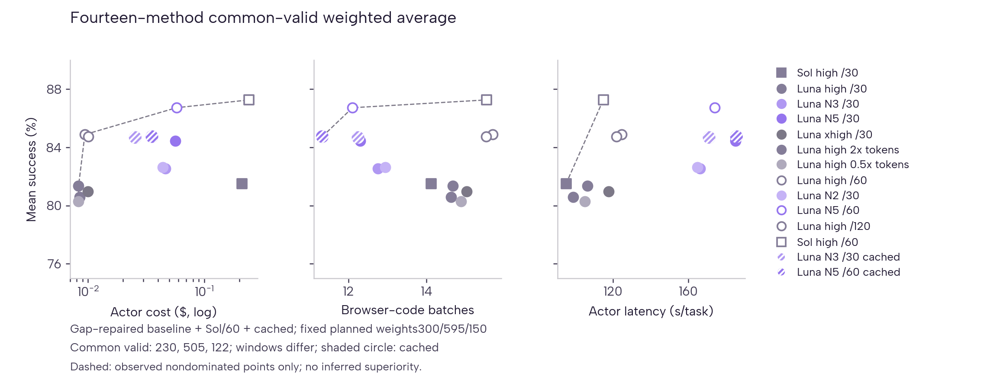

All fourteen settings use **GPT-6 Luna or Sol and the same GPT-5.6 Terra judge**. The figure includes the eleven gap-repaired historical settings, completed Sol high/60, cached N3/30 and cached N5/60. Every point uses the same freshly intersected tasks within each benchmark. Fixed planned weights **300/1,045, 595/1,045 and 150/1,045** apply to success and all three actor metrics; weighted success is not the pooled success rate across retained tasks. These conditional means include valid failures and exclude invalid outcomes.

| Benchmark | Planned | Common-valid across all 14 | Excluded |
|---|---:|---:|---:|
| OM2W | 300 | 230 | 70 |
| WebVoyager | 595 | 505 | 90 |
| DeepShop | 150 | 122 | 28 |
| Total | 1,045 | 857 | 188 |

*Neutral mauve: single-candidate runs; purple: candidate selection; Luna circles and Sol squares. N3 uses a lighter purple; white diagonal shading identifies cached-context selection. Dashed segments join observed nondominated points separately for each x metric and are visual guides, without confidence or superiority claims. A selected nonempty executable BrowserCode block counts as one batch, potentially containing several browser/CDP operations. Batches and decision limits do not equalize browser resources or fees. Actor latency is elapsed time per task, including parallel inference and browser execution, excluding browser initialization and external Terra judging. Cost preserves native usage pricing or upper bounds, excludes Terra, browser fees and invalid-attempt spending, and is not an invoice.*

[Paper PDF](arm_results/browsercode_cached_selection_20261105/browsercode_scaling14_common_valid_weighted.pdf) · [SVG](arm_results/browsercode_cached_selection_20261105/browsercode_scaling14_common_valid_weighted.svg) · [Weighted coordinates](arm_results/browsercode_cached_selection_20261105/browsercode_scaling14_common_valid_weighted_coordinates.csv) · [Per-benchmark means and success counts](arm_results/browsercode_cached_selection_20261105/common_valid_per_benchmark.csv) · [Sanitized aggregate](arm_results/browsercode_cached_selection_20261105/aggregate.json) · [Reproduction](API_EXPERIMENT_METHODS.md#cached-selection-completed-figures)

All fourteen settings: weighted means on the same 857 tasks

| Method / maximum decisions | Weighted success | Actor API $ / task | Actor latency (s / task) | Selected batches / task |
|---|---:|---:|---:|---:|
| Luna high single / 30 | 80.58% | 0.00848 | 98.7 | 14.62 |
| Luna xhigh single / 30 | 80.97% | 0.00996 | 117.7 | 15.03 |
| Luna high single / 30 · 0.5× cap | 80.27% | 0.00828 | 104.9 | 14.88 |
| Luna high single / 30 · 2× cap | 81.36% | 0.00828 | 106.4 | 14.67 |
| Luna high single / 60 | 84.88% | 0.00939 | 124.5 | 15.70 |
| Luna high single / 120 | 84.76% | 0.01007 | 121.9 | 15.53 |
| Luna high N2 / 30 | 82.64% | 0.04398 | 164.8 | 12.94 |
| Luna high N3 / 30 | 82.54% | 0.04623 | 166.1 | 12.75 |
| Luna high N3 / 30 · cached context | 84.68% | 0.02544 | 171.0 | 12.24 |
| Luna high N5 / 30 | 84.44% | 0.05646 | 184.9 | 12.29 |
| Luna high N5 / 60 | 86.73% | 0.05769 | 173.8 | 12.10 |
| Luna high N5 / 60 · cached context | 84.74% | 0.03546 | 185.5 | 11.32 |
| Sol high single / 30 | 81.50% | 0.21224 | 95.0 | 14.12 |
| Sol high single / 60 | 87.27% | 0.24279 | 114.8 | 15.53 |

The base output ceiling is 12,288 tokens per generation, including reasoning; 0.5× and 2× set ceilings of 6,144 and 24,576. They do not guarantee different realized spending. Historical Luna single/60 and N5/60 enforced 60 decisions while advertising 30; cached N5/60 and Sol/60 advertise and enforce 60. The 120-decision Luna run advertises and enforces 120. Cached selection retains the full native actor context, whereas historical selection uses its original context projection. All N proposals are concurrent; selection follows their completion and only the chosen action executes. The comparisons change more than a provider cache setting and are not randomized contemporaneous controls. No new paired uncertainty intervals are claimed for this 857-task snapshot.

Completed cached cohorts: coverage and each method’s own-valid figure

Both cached settings have a saved outcome for every planned task: 2,090 outcomes in total, 1,926 valid and 164 invalid, with none missing. Every saved success, valid failure and invalid outcome is preserved. Counts below describe each method’s own population, rather than the common-valid cohort above. Overall success divides successes by planned tasks; valid-only success divides by valid outcomes.

| Cached method | Benchmark | Planned / recorded | Valid | Invalid | Successes | Overall success | Valid-only success |
|---|---|---:|---:|---:|---:|---:|---:|
| N3 / 30 | OM2W | 300 | 262 | 38 | 184 | 61.33% | 70.23% |
| N3 / 30 | WebVoyager | 595 | 581 | 14 | 514 | 86.39% | 88.47% |
| N3 / 30 | DeepShop | 150 | 143 | 7 | 123 | 82.00% | 86.01% |
| N5 / 60 | OM2W | 300 | 259 | 41 | 188 | 62.67% | 72.59% |
| N5 / 60 | WebVoyager | 595 | 542 | 53 | 481 | 80.84% | 88.75% |
| N5 / 60 | DeepShop | 150 | 139 | 11 | 130 | 86.67% | 93.53% |

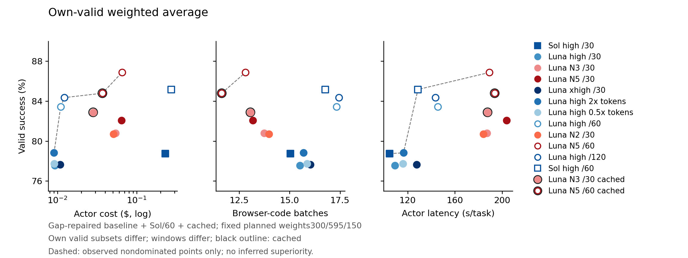

Own-valid populations differ between methods and are inappropriate for paired-effect claims. All outcomes are recorded for the fourteen settings, but invalid outcomes remain excluded from efficiency means and are never converted into valid failures. The eleven historical settings retain their original valid outcomes plus the prespecified first gap-repair outcomes; these are not fresh reruns of all baselines. The earlier 744-task, 953-task and twelve-setting snapshots retain their original denominators below.

[Own-valid PDF](arm_results/browsercode_cached_selection_20261105/browsercode_scaling14_own_valid_weighted.pdf) · [Own-valid SVG](arm_results/browsercode_cached_selection_20261105/browsercode_scaling14_own_valid_weighted.svg) · [Own-valid coordinates](arm_results/browsercode_cached_selection_20261105/browsercode_scaling14_own_valid_weighted_coordinates.csv) · [Own-valid per-benchmark counts and metrics](arm_results/browsercode_cached_selection_20261105/own_valid_per_benchmark.csv) · [Standalone renderer](arm_results/browsercode_cached_selection_20261105/plot_browsercode_scaling14.py) · [Render provenance](arm_results/browsercode_cached_selection_20261105/render-provenance.json)

Only aggregate results and rendering code are public. Task identities, trajectories and operational audits remain private. The completed experiment endpoint and aggregate projection were independently checked before release.

## BrowserCode scaling after one-pass gap recovery

**On the same 953 common-valid tasks, single/60 has a stronger observed cost/latency trade-off than N5/30:** 84.70% success at $0.00992 and 130.6 seconds per task, versus 83.66% at $0.05955 and 192.3 seconds. N5/60 reaches 86.78% with additional API cost and latency. These are conditional comparisons across live collection windows, not equal-browser-resource experiments. The cached-selector reruns and new Sol/60 runs are separate and are not merged into this snapshot.

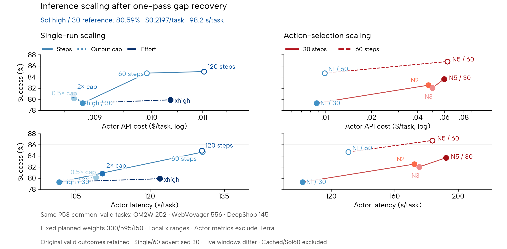

*All eleven original settings are represented: ten Luna configurations as circles and Sol high/30 in the reference strip. Left: configured output cap, effort and decision limit; right: candidate count at 30 and 60 decisions. Default Luna effort is high and the output ceiling is 12,288 tokens per generation, including reasoning. A larger cap is not necessarily greater realized spending. Column-specific x ranges are explicit and y limits are shared; line segments connect observations rather than fitted scaling laws. Actor API cost and elapsed per-task actor latency use the same common-valid tasks, including valid failures, and exclude Terra judging. Browser fees and invalid-attempt spending are not included in these valid-trajectory means. Equal decision limits do not equalize browser operations, session duration or fees.*

### Coverage and weighted means

The completed one-pass recovery expands the intersection from **744 to 953 of 1,045 tasks**, without replacing any original valid success or failure. Matching task identity does not remove common-valid selection or collection-window differences. Fixed planned benchmark weights **300/1,045, 595/1,045 and 150/1,045** apply identically to success, actor cost, latency and selected batches; these are not pooled success rates across the 953 tasks.

| Benchmark | Planned | Original common-valid | After recovery | Still excluded |
|---|---:|---:|---:|---:|
| OM2W | 300 | 226 | 252 | 48 |
| WebVoyager | 595 | 387 | 556 | 39 |
| DeepShop | 150 | 131 | 145 | 5 |
| Total | 1,045 | 744 | 953 | 92 |

| Method / maximum decisions | Weighted success | Actor API $ / task | Actor latency (s / task) | Selected browser batches |
|---|---:|---:|---:|---:|
| Luna high single / 30 | 79.28% | 0.00880 | 101.6 | 14.98 |
| Luna xhigh single / 30 | 79.90% | 0.01037 | 122.0 | 15.46 |
| Luna high single / 30 · 0.5× cap | 80.18% | 0.00866 | 109.1 | 15.32 |
| Luna high single / 30 · 2× cap | 80.82% | 0.00865 | 110.3 | 15.11 |
| Luna high single / 60 | 84.70% | 0.00992 | 130.6 | 16.26 |
| Luna high single / 120 | 84.98% | 0.01104 | 130.5 | 16.37 |
| Luna high N2 / 30 | 82.52% | 0.04693 | 172.3 | 13.36 |
| Luna high N3 / 30 | 82.02% | 0.04988 | 175.4 | 13.18 |
| Luna high N5 / 30 | 83.66% | 0.05955 | 192.3 | 12.68 |
| Luna high N5 / 60 | 86.78% | 0.06243 | 183.7 | 12.58 |
| Sol high single / 30 | 80.59% | 0.21974 | 98.2 | 14.54 |

### Paired gains and interpretation

| Paired contrast | Weighted gain (pp) | Pointwise paired 95% interval (pp) |
|---|---:|---:|
| Single/60 − single/30 | +5.41 | [+3.03, +7.79] |
| N5/30 − single/30 | +4.37 | [+1.95, +6.79] |
| N5/60 − single/60 | +2.09 | [+0.06, +4.10] |

The intervals use 50,000 paired task-bootstrap draws within benchmark and the same fixed weights. They condition on retained validity and saved labels, assume independent tasks, and exclude website clustering, live-window variation and multiplicity correction. The historical single/60 actor enforces 60 decisions while advertising 30; single/120 enforces and advertises 120. Candidate generation and selection vary together, so these comparisons do not isolate selector quality. The modest N5/60 gain is a cost/latency trade-off, not evidence that selection dominates other scaling strategies; N2 also exceeds N3 in this snapshot.

| Benchmark | Common-valid tasks | N5/30 − single/30 (pp) | N5/60 − single/60 (pp) |
|---|---:|---:|---:|
| OM2W | 252 | +9.52 | +1.59 |
| WebVoyager | 556 | +2.88 | +2.52 |
| DeepShop | 145 | +0.00 | +1.38 |

*Per-benchmark gains are descriptive; the intervals above apply to the fixed-weight three-benchmark contrasts.*

[PDF](arm_results/browsercode_gap_repaired_20261104/browsercode_scaling_gap_repaired_compact.pdf) · [SVG](arm_results/browsercode_gap_repaired_20261104/browsercode_scaling_gap_repaired_compact.svg) · [Aggregate means, counts and paired contingencies](arm_results/browsercode_gap_repaired_20261104/aggregate.json) · [Weighted coordinates and intervals](arm_results/browsercode_gap_repaired_20261104/weighted_summary.json) · [Plot source](arm_results/browsercode_gap_repaired_20261104/plot_gap_repaired_scaling.py) · [Reproduction](API_EXPERIMENT_METHODS.md#gap-repaired-browsercode-scaling)

Recovery and measurement definitions

The prespecified repair roster contains 703 previously invalid or missing method–task cells. Every cell now has one recorded new outcome: 386 valid (286 successes and 100 valid failures) and 317 invalid. All original valid outcomes and their actor metrics remain unchanged; failed repairs are not replayed or relabeled as valid failures. Thirty-three cells reuse qualified saved actor evidence for their first Terra judgment; 670 receive one fresh actor attempt, yielding 353 valid and 317 invalid outcomes. The two recorded native-only invalid outcomes remain distinct from parent dispositions; no outcome is imputed. Invalids still exclude a task from every method in its benchmark's intersection.

All judgments use GPT-5.6 Terra, medium effort, 4,096 completion tokens and seed 42. Saved-actor recoveries retain original actor cost/latency; fresh repairs use their native actor accounting. Historical pricing or its native upper bound is not an invoice. One selected nonempty executable BrowserCode block is one batch, potentially containing multiple browser/CDP operations; final answers and unselected proposals do not add batches. Batch counts do not measure browser resources or fees. The separate [US-residential browser study](#browsercode-us-stealth-full300) reports measured hosting/proxy charges on its own population. Historical selector implementation and scientific limits are preserved here; cached-selector results are a separate implementation condition.

The public reconstruction checks every paired contingency against its benchmark's same-task success marginals, validates complete coverage for all three actor metrics, and records source hashes in the [render provenance](arm_results/browsercode_gap_repaired_20261104/render_provenance.json). Only sanitized aggregate counts/means and plot code are released; task identities, trajectories and operational audits remain private. Earlier figures and their original denominators are retained below.

## Sol high single at 60 decisions (2026-11-04)

All **1,045 planned tasks have a recorded outcome**: 836 successes, 978 valid outcomes and 67 invalid outcomes. GPT-6 Sol uses high effort, a 12,288-token output ceiling, 60 enforced and advertised decisions, and a 900-second actor deadline. Judging uses GPT-5.6 Terra medium, 4,096 completion tokens and seed 42.

| Benchmark | Planned / recorded | Valid | Invalid | Successes | Overall success | Valid-only success | Actor API $ / valid task | Actor latency (s / valid task) | Selected batches / valid task |
|---|---:|---:|---:|---:|---:|---:|---:|---:|---:|
| OM2W | 300 | 267 | 33 | 185 | 61.67% | 69.29% | 0.24509 | 123.0 | 16.14 |
| WebVoyager | 595 | 569 | 26 | 520 | 87.39% | 91.39% | 0.21638 | 107.8 | 14.48 |
| DeepShop | 150 | 142 | 8 | 131 | 87.33% | 92.25% | 0.55163 | 223.2 | 27.04 |
| Total | 1,045 | 978 | 67 | 836 | 80.00% | 85.48% | — | — | — |

Overall success divides successes by all planned tasks. Valid-only rates and efficiency means include valid successes and failures, with invalids excluded. Cost uses recorded actor usage and its native cache-aware price or upper bound; latency is elapsed actor time per task, including inference and browser work. Both exclude Terra judging. A selected nonempty executable BrowserCode block is one batch, potentially containing multiple CDP operations. Local browser hosting/proxy fees are not measured here.

These are **Sol's own-valid populations**, collected in separate live windows. They are not the 953-task historical common-valid cohort above, and do not establish a paired gain over Sol/30 or Luna. The historical Luna single/60 prompt advertised 30 decisions; this Sol/60 protocol advertises 60. All saved successes, failures and invalid outcomes are retained.

[Sanitized per-benchmark aggregates](arm_results/browsercode_sol_high60_20261104/aggregate.json) · [Reproduction recipe](API_EXPERIMENT_METHODS.md#sol-high60)

### Observed Pareto frontiers per benchmark (before gap recovery)

Dashed segments join the observed nondominated settings in each panel: minimize that panel's x metric and maximize success, with at least one strict improvement required for dominance. Rings identify frontier settings; a one-setting frontier has no connecting segment. Every panel considers all eleven historical methods; the own-valid weighted preview also includes completed Sol high/60. Segments are visual guides between measured configurations, not fitted curves, attainable intermediate policies or evidence of statistical superiority. The original measurements above are unchanged.

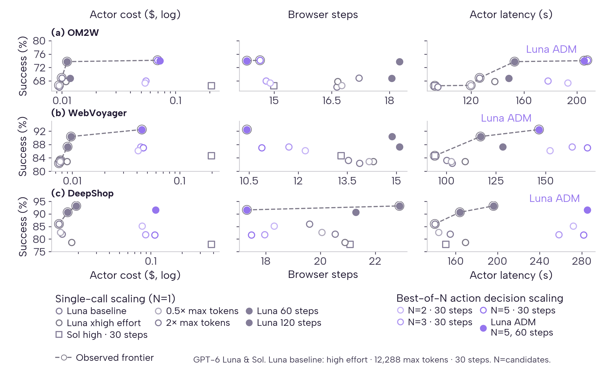

*Bottom legends separate single-call scaling (one candidate per decision: model, effort, maximum output tokens and step limit) from Best-of-N action scaling (N candidates and step limit). Luna defaults are high effort, a 12,288-output-token ceiling per call and 30 decisions; “0.5× max tokens” and “2× max tokens” set the per-call output ceiling to 6,144 and 24,576 tokens, respectively, including reasoning, and step labels denote maximum decisions. Browser steps counts executed nonempty BrowserCode batches; each batch may contain multiple browser operations. Sol uses high effort and 30 decisions. All eleven configurations retain their original marker shapes and share the paper palette. Hollow markers denote 30-step limits and filled markers 60/120-step limits; Luna ADM (N=5, 60 steps) is labeled in the latency panels. Per-benchmark frontiers use each method's own native-valid tasks, as in the original plot. Valid subsets, live windows and historical prompt limits differ. DeepShop's cost and latency frontiers contain only single-run settings; selection remains on the browser-batch frontier, which concerns command counts rather than browser resources.*

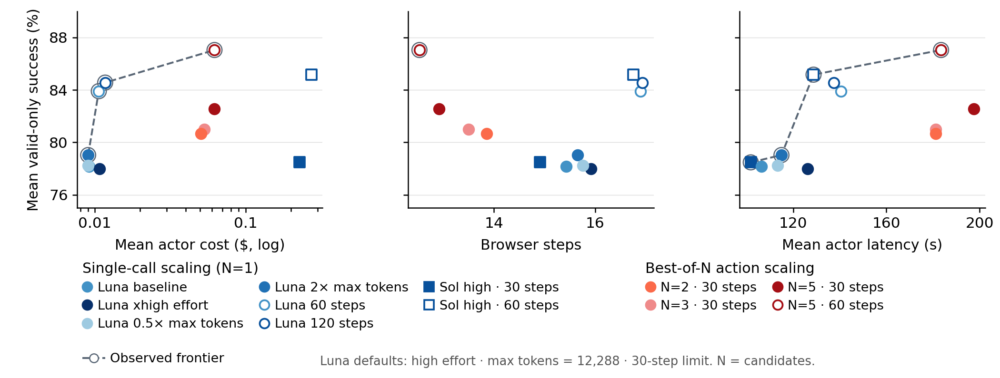

*The weighted preview includes twelve settings: all eleven historical methods plus [completed Sol high/60](#browsercode-sol-high60), shown as an neutral-mauve square. Each method retains its own valid population; Sol/60 has 267/569/142 valid tasks on OM2W/WebVoyager/DeepShop. The same fixed weights, 300/1,045, 595/1,045 and 150/1,045, apply to success and all actor means; this is not a pooled success rate. Sol/60 joins the observed latency frontier. The cost frontier remains Luna high/2× max tokens → Luna single60 → Luna single120 → N5/60; N5/30 remains dominated on cost and latency. Browser steps counts selected nonempty BrowserCode batches, potentially containing multiple browser operations. The [common-valid weighted preview](arm_results/browsercode_inference_scaling_20261031/browsercode_scaling_common_valid_pareto_preview.png) retains its original eleven methods and 744 matched valid tasks; adding Sol/60 there requires a new intersection. Frontier membership is descriptive, without uncertainty bands; valid subsets, live windows and historical prompt limits differ.*

**Weighted Pareto comparison with legends on the right.**

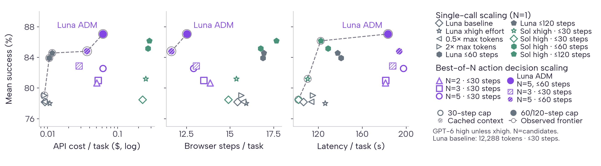

*Saturated purple and larger markers highlight action decision scaling; cool gray denotes single-call scaling. Smaller candidate sets use slightly lighter purple, and cached runs retain white diagonal shading. Sol high/120 and Sol xhigh/30 are added as dark cool-gray squares: filled for 120 decisions, hollow for 30. Both use GPT-6 Sol with the original 12,288-token ceiling and 900-second agent deadline; reasoning effort is high and xhigh, respectively. All fourteen existing coordinates, including cached N3/30 and N5/60, are preserved. Each method uses its own valid tasks. Success and all actor means use the fixed planned benchmark weights 300/1,045, 595/1,045 and 150/1,045; this is not a pooled valid-only rate. Valid populations and live collection windows differ, so frontier membership is descriptive rather than a paired or causal comparison.*

| Added setting | Recorded | Valid | Invalid | Successes | OM2W valid | OM2W successes | WebVoyager valid | WebVoyager successes | DeepShop valid | DeepShop successes |
| --- | ---: | ---: | ---: | ---: | ---: | ---: | ---: | ---: | ---: | ---: |
| Sol high/120 | 1,045 | 968 | 77 | 838 | 259 | 184 | 562 | 516 | 147 | 138 |
| Sol xhigh/30 | 1,045 | 993 | 52 | 808 | 272 | 188 | 572 | 504 | 149 | 116 |

[Preview PDF](arm_results/browsercode_inference_scaling_20261031/browsercode_scaling_weighted_pareto_highlight_right_legend_preview.pdf) · [SVG](arm_results/browsercode_inference_scaling_20261031/browsercode_scaling_weighted_pareto_highlight_right_legend_preview.svg) · [Source](arm_results/browsercode_inference_scaling_20261031/plot_browsercode_pareto_highlight_right_legend_preview.py) · [Aggregate inputs](arm_results/browsercode_inference_scaling_20261031/sol_high120_xhigh30_aggregate.json) · [Provenance](arm_results/browsercode_inference_scaling_20261031/browsercode_scaling_weighted_pareto_highlight_right_legend_preview.json).

[Bottom-legend variant](arm_results/browsercode_inference_scaling_20261031/browsercode_scaling_weighted_pareto_highlight_preview.png) · [PDF](arm_results/browsercode_inference_scaling_20261031/browsercode_scaling_weighted_pareto_highlight_preview.pdf) · [SVG](arm_results/browsercode_inference_scaling_20261031/browsercode_scaling_weighted_pareto_highlight_preview.svg) · [Source](arm_results/browsercode_inference_scaling_20261031/plot_browsercode_pareto_highlight_preview.py) · [Provenance](arm_results/browsercode_inference_scaling_20261031/browsercode_scaling_weighted_pareto_highlight_preview.json).

**Overall success on all 1,045 planned tasks.**

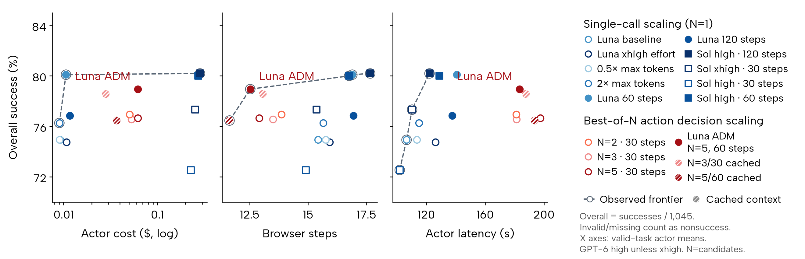

*The y-axis is total successes divided by 1,045; invalid and missing outcomes count as non-success. The x-axis coordinates retain the own-valid actor means and fixed planned benchmark weights used above, so they exclude invalid-outcome spending and latency. Frontiers are recomputed for this overall-success measure. Collection windows differ; this is a descriptive comparison, without paired uncertainty or a causal claim.*

[PDF](arm_results/browsercode_inference_scaling_20261031/browsercode_scaling_weighted_pareto_highlight_right_legend_overall_success_preview.pdf) · [SVG](arm_results/browsercode_inference_scaling_20261031/browsercode_scaling_weighted_pareto_highlight_right_legend_overall_success_preview.svg) · [Source](arm_results/browsercode_inference_scaling_20261031/plot_browsercode_pareto_highlight_population_previews.py) · [Provenance](arm_results/browsercode_inference_scaling_20261031/browsercode_scaling_weighted_pareto_highlight_right_legend_overall_success_preview.json).

**Same valid tasks across all sixteen settings.**

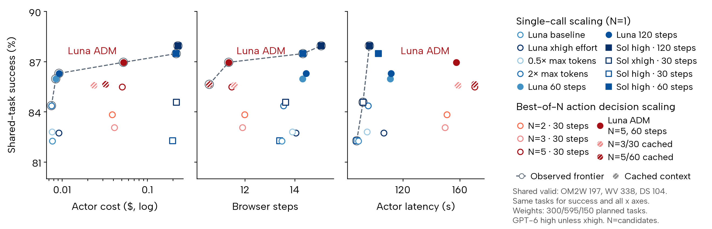

*Every point uses the same 639 tasks valid across all sixteen settings. Within each benchmark, success and actor means are recomputed on that shared subset; the benchmark weights remain 300/1,045, 595/1,045 and 150/1,045. This differs from pooling the 639 tasks. The shared subset changes the task mix, and collection windows still differ; no paired uncertainty interval or causal effect is claimed. Historical methods retain their original snapshot rather than the separately gap-repaired cohort.*

| Benchmark | Planned tasks | Shared valid tasks |
| --- | ---: | ---: |
| Online-Mind2Web | 300 | 197 |
| WebVoyager | 595 | 338 |
| DeepShop | 150 | 104 |
| Total | 1,045 | 639 |

[PDF](arm_results/browsercode_inference_scaling_20261031/browsercode_scaling_weighted_pareto_highlight_right_legend_common_valid_preview.pdf) · [SVG](arm_results/browsercode_inference_scaling_20261031/browsercode_scaling_weighted_pareto_highlight_right_legend_common_valid_preview.svg) · [Source](arm_results/browsercode_inference_scaling_20261031/plot_browsercode_pareto_highlight_population_previews.py) · [Aggregate inputs](arm_results/browsercode_inference_scaling_20261031/common16_aggregate.json) · [Provenance](arm_results/browsercode_inference_scaling_20261031/browsercode_scaling_weighted_pareto_highlight_right_legend_common_valid_preview.json).

Highlight preview definitions and comparison limits

The observed cost and latency frontiers are recomputed across sixteen settings. The main variant retains wider panels with legends and footer in the right sidebar. Cached N3/30 and N5/60 use purple circles with white diagonal shading and no dark outline. The bottom-legend variant uses the same cached encoding with legends outside the panels. Historical N5/60 is labeled “Luna ADM.” All Luna and Sol settings use high reasoning effort unless labeled xhigh.

“Browser steps” counts selected nonempty BrowserCode batches, potentially containing multiple browser/CDP operations. Actor cost and elapsed agent latency exclude external Terra judging; cost also excludes browser fees and invalid-outcome spending. The counts above retain every invalid outcome; plotted means use valid tasks only. No uncertainty bands or significance claim are provided.

Cached selection changes context projection. Cached N5/60 advertises 60 decisions, whereas historical N5/60 advertised 30 and enforced 60. No cache-only causal gain is implied. The eleven historical baselines here retain their original snapshot; the [separate fourteen-setting figures](#browsercode-cached-selection-complete-20261105) use gap-repaired baselines and include a common-valid alternative. The weighted preview above remains unchanged.

[Per-benchmark PDF](arm_results/browsercode_inference_scaling_20261031/browsercode_scaling_pareto_preview.pdf) · [SVG](arm_results/browsercode_inference_scaling_20261031/browsercode_scaling_pareto_preview.svg) · [Weighted PDF](arm_results/browsercode_inference_scaling_20261031/browsercode_scaling_weighted_pareto_preview.pdf) · [SVG](arm_results/browsercode_inference_scaling_20261031/browsercode_scaling_weighted_pareto_preview.svg) · [Common-valid weighted PDF](arm_results/browsercode_inference_scaling_20261031/browsercode_scaling_common_valid_pareto_preview.pdf) · [Frontier membership and source hashes](arm_results/browsercode_inference_scaling_20261031/browsercode_pareto_previews.json) · [Reproduction source](arm_results/browsercode_inference_scaling_20261031/plot_browsercode_pareto_previews.py) · [Shared paper style](arm_results/browsercode_inference_scaling_20261031/browsercode_pareto_paper_style.py).

Historical scaling snapshots before gap recovery

<!-- browsercode-inference-scaling-20261031:start -->

## BrowserCode: alternative ways to scale inference

### Compact comparison of scaling strategies

**The fixed-horizon selection gain does not establish the best practical scaling strategy.** On the same task intersection, single60 scores 85.55% at $0.00908 and 119.1 seconds per task, versus N5/30's 84.56% at $0.05448 and 179.8 seconds. N5/60 has the highest point estimate, 86.93%, but its paired gain over single60 is +1.38 points with an interval spanning zero. These historical comparisons remain subject to live-window and prompt differences.

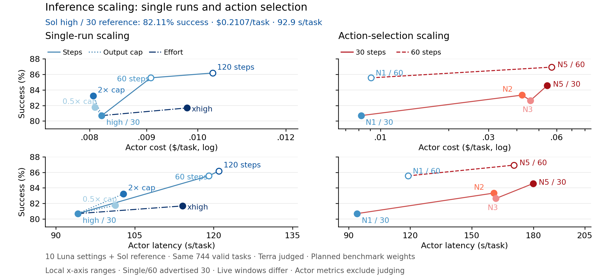

*Left: single-run output-cap, step-limit and reasoning-effort curves. Right: separate 30-step and 60-step candidate-count curves. The compact layout represents all eleven historical methods: ten Luna configurations as points and Sol high/30 as a numeric reference strip. This adds the Luna xhigh and Sol reference omitted from the original six-panel family figure. Column-specific x-axis ranges expose small changes; y-axis limits match throughout. Horizontal distances between columns are not comparable. Luna is high effort unless labeled xhigh; the default cap is 12,288 tokens and the default decision limit is 30. The 0.5×/2× output caps are ceilings, not realized spending.*

*All points and the Sol reference use the same 744 tasks valid across all eleven methods: 226 OM2W, 387 WebVoyager and 131 DeepShop. Fixed weights are 300/1,045, 595/1,045 and 150/1,045, applied to success and actor means. Terra judging is shared; actor cost and latency exclude judging. Historical single60 enforces 60 while advertising 30; single120 enforces and advertises 120. Live collection windows and runtime guards differ. This is the historical BrowserCode cohort, not every API experiment: cached reruns, current gap repairs and new Sol60/xhigh campaigns are not merged here. Browser-code batches remain in the [original common-valid view](#browsercode-all-method-common-valid). [Coverage manifest](arm_results/browsercode_inference_scaling_20261031/browsercode_scaling_strategies_compact_coverage.json).*

| Paired contrast | Weighted gain (pp) | Pointwise paired 95% interval (pp) |
|---|---:|---:|
| N5/30 − N1/30 | +3.86 | [+1.29, +6.45] |
| N5/30 − Sol high/30 | +2.45 | [−0.10, +4.97] |
| N5/60 − N1/60 | +1.38 | [−0.81, +3.59] |

These pointwise intervals use 50,000 paired task-bootstrap draws within benchmark, conditional on retained validity and saved labels. They treat tasks as independent and exclude website clustering, collection-window variation and multiplicity correction. Candidate generation and selection vary jointly; selector quality is not independently identified.

The supported framing is **selection improves fixed-horizon success, while increasing the single-run decision limit offers a stronger observed efficiency trade-off**. The intervals do not establish N5's superiority over Sol or single60, and these experiments do not establish an inference-scaling law.

[Compact PDF](arm_results/browsercode_inference_scaling_20261031/browsercode_scaling_strategies_compact.pdf) · [Compact SVG](arm_results/browsercode_inference_scaling_20261031/browsercode_scaling_strategies_compact.svg) · [Original six-panel family figure](arm_results/browsercode_inference_scaling_20261031/browsercode_scaling_by_family.png) · [Reproducible plot source](arm_results/browsercode_inference_scaling_20261031/plot_browsercode_scaling_families.py) · [Method and reproduction](API_EXPERIMENT_METHODS.md#recreate-the-completed-scaling-figures)

### Per-benchmark results

**A higher decision limit does not improve every benchmark.** Luna high single at 120 decisions has the strongest observed single-call valid-only success on WebVoyager and DeepShop; the 60-decision setting is higher on OM2W. N5 high at 60 decisions has the highest observed WebVoyager rate among these methods. All added settings retain high effort, a 12,288-output-token ceiling per generation and the 900-second actor alarm. Live collection windows, runtime safeguards and valid-task subsets differ, so these are descriptive comparisons. The historical single60 model and agent enforce 60 while their prompt advertises 30; single120 enforces and advertises 120. The comparison changes both limits.

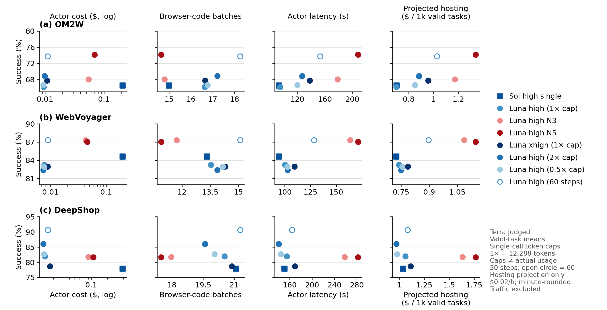

*All 33 points use GPT-5.6 Terra terminal-success judgments and local BrowserCode browsers; Sol and Luna denote GPT-6 Sol and GPT-6 Luna. Success and all actor means use each method's own native valid tasks, including valid failures. Native results, invalids and missing outcomes remain separate: N5/60 has 299 native OM2W results plus one claimed-missing outcome; N2/30 has 149 native DeepShop results plus one administrative missing outcome. Neither missing outcome is imputed. Browser-code batches count nonempty selected commands (`selected_code_batches`); a JavaScript batch may contain multiple browser/CDP calls. Final answers, unselected candidates and selection calls add no batches; execution errors still count. See the [exact rule](API_EXPERIMENT_METHODS.md#browsercode-batch-counting). Squares identify Sol and circles Luna; single-call settings use neutral mauve, and selection settings use purple, with lighter tints for smaller N. Hollow single-call circles denote single60/single120, and the hollow purple circle N5/60; remaining settings permit 30 decisions. Per-generation output ceilings include reasoning: 1× = 12,288, 2× = 24,576 and 0.5× = 6,144. Cost is frozen native usage pricing or its upper bound per valid task, excluding Terra, rather than an invoice. Latency is actor-loop time per valid task, including model and browser work and excluding Terra. Measured US-residential browser hosting/traffic is a separate comparison with its own populations; it is not projected onto these local-browser points. Axes are cropped, actor cost is logarithmic, and the legend is outside the panels.*

[Aggregate](arm_results/browsercode_inference_scaling_20261031/aggregate.json) · [Coordinates](arm_results/browsercode_inference_scaling_20261031/browsercode_scaling_coordinates.csv) · [SVG](arm_results/browsercode_inference_scaling_20261031/browsercode_scaling.svg) · [PDF](arm_results/browsercode_inference_scaling_20261031/browsercode_scaling.pdf) · [Plot source](arm_results/browsercode_inference_scaling_20261031/plot_browsercode_scaling.py) · [Reproduction recipes](API_EXPERIMENT_METHODS.md#luna-xhigh-output-limits)

All eleven methods account for every originally planned task by a native result or an explicitly retained missing outcome. Success percentages divide by native valid tasks; actor cost, batch and latency means cover that same valid cohort. All 24 previously published point dictionaries and their coordinates are unchanged. “Missing native” is not counted as invalid: N2 DeepShop is administrative missing, and N5/60 OM2W is claimed-missing. Confirmed successes divided by all planned tasks are lower bounds in those two cells.

### Online-Mind2Web · 300 planned tasks per method

| Method | Recorded | Missing native | Valid | Invalid | Successes | Valid-only success | Actor $ / task | Browser-code batches | Latency (s) |
|---|---:|---:|---:|---:|---:|---:|---:|---:|---:|
| Sol high single | 300 | 0 | 266 | 34 | 177 | 66.5% | 0.20771 | 14.99 | 92.7 |
| Luna high · 1× cap | 300 | 0 | 269 | 31 | 178 | 66.2% | 0.00951 | 16.63 | 94.9 |
| Luna high N3 | 300 | 0 | 269 | 31 | 183 | 68.0% | 0.05496 | 14.79 | 178.1 |
| Luna high N5 | 300 | 0 | 267 | 33 | 198 | 74.2% | 0.06960 | 14.63 | 207.9 |
| Luna xhigh · 1× cap | 300 | 0 | 267 | 33 | 181 | 67.8% | 0.01087 | 16.65 | 137.8 |
| Luna high · 2× cap | 300 | 0 | 270 | 30 | 186 | 68.9% | 0.00998 | 17.21 | 126.5 |
| Luna high · 0.5× cap | 300 | 0 | 267 | 33 | 178 | 66.7% | 0.00944 | 16.76 | 119.8 |
| Luna high · 60 steps | 300 | 0 | 259 | 41 | 191 | 73.7% | 0.01112 | 18.26 | 152.9 |
| Luna high N2 · 30 steps | 300 | 0 | 264 | 36 | 178 | 67.4% | 0.05389 | 14.89 | 193.2 |
| Luna high N5 · 60 steps | 299 | 1 | 258 | 41 | 191 | 74.0% | 0.07303 | 14.29 | 205.5 |
| Luna high · 120 steps | 300 | 0 | 259 | 41 | 178 | 68.7% | 0.01187 | 18.07 | 148.5 |

### WebVoyager · 595 planned tasks per method

| Method | Recorded | Missing native | Valid | Invalid | Successes | Valid-only success | Actor $ / task | Browser-code batches | Latency (s) |
|---|---:|---:|---:|---:|---:|---:|---:|---:|---:|
| Sol high single | 595 | 0 | 553 | 42 | 468 | 84.6% | 0.19770 | 13.31 | 94.1 |
| Luna high · 1× cap | 595 | 0 | 579 | 16 | 482 | 83.2% | 0.00778 | 13.54 | 100.1 |
| Luna high N3 | 595 | 0 | 568 | 27 | 496 | 87.3% | 0.04319 | 11.71 | 163.4 |
| Luna high N5 | 595 | 0 | 555 | 40 | 483 | 87.0% | 0.04588 | 10.89 | 171.0 |
| Luna xhigh · 1× cap | 595 | 0 | 581 | 14 | 482 | 83.0% | 0.00896 | 14.30 | 109.5 |
| Luna high · 2× cap | 595 | 0 | 585 | 10 | 482 | 82.4% | 0.00752 | 13.87 | 102.8 |
| Luna high · 0.5× cap | 595 | 0 | 580 | 15 | 481 | 82.9% | 0.00772 | 14.17 | 102.4 |
| Luna high · 60 steps | 595 | 0 | 584 | 11 | 510 | 87.3% | 0.00904 | 15.10 | 128.4 |
| Luna high N2 · 30 steps | 595 | 0 | 580 | 15 | 500 | 86.2% | 0.04095 | 12.21 | 152.2 |
| Luna high N5 · 60 steps | 595 | 0 | 544 | 51 | 503 | 92.5% | 0.04442 | 10.43 | 146.7 |
| Luna high · 120 steps | 595 | 0 | 540 | 55 | 488 | 90.4% | 0.00973 | 14.87 | 117.2 |

### DeepShop · 150 planned tasks per method

| Method | Recorded | Missing native | Valid | Invalid | Successes | Valid-only success | Actor $ / task | Browser-code batches | Latency (s) |
|---|---:|---:|---:|---:|---:|---:|---:|---:|---:|
| Sol high single | 150 | 0 | 145 | 5 | 113 | 77.9% | 0.38431 | 21.08 | 150.6 |
| Luna high · 1× cap | 150 | 0 | 150 | 0 | 123 | 82.0% | 0.01403 | 20.53 | 154.8 |
| Luna high N3 | 150 | 0 | 148 | 2 | 121 | 81.8% | 0.08884 | 17.96 | 258.2 |
| Luna high N5 | 150 | 0 | 147 | 3 | 120 | 81.6% | 0.10954 | 17.48 | 281.9 |
| Luna xhigh · 1× cap | 150 | 0 | 150 | 0 | 118 | 78.7% | 0.01733 | 20.89 | 169.3 |
| Luna high · 2× cap | 150 | 0 | 150 | 0 | 129 | 86.0% | 0.01309 | 19.59 | 140.2 |
| Luna high · 0.5× cap | 150 | 0 | 150 | 0 | 124 | 82.7% | 0.01347 | 20.05 | 144.0 |
| Luna high · 60 steps | 150 | 0 | 150 | 0 | 136 | 90.7% | 0.01586 | 21.29 | 164.0 |
| Luna high N2 · 30 steps | 149 | 1 | 148 | 1 | 126 | 85.1% | 0.08234 | 18.30 | 271.9 |
| Luna high N5 · 60 steps | 150 | 0 | 143 | 7 | 131 | 91.6% | 0.11113 | 17.31 | 285.3 |
| Luna high · 120 steps | 150 | 0 | 147 | 3 | 137 | 93.2% | 0.01919 | 22.88 | 196.0 |

The three token/effort variants record all 3,135 planned dispositions: 3,000 valid and 135 invalid. The additional 60-step setting records all 1,045 dispositions: 993 valid and 52 invalid. The additional single120 cohort has 1,045 native results, 946 valid and 99 invalid. N2/30 has 1,044 native results, 992 valid and 52 invalid plus its one administrative missing outcome; N5/60 has 1,044 native results, 945 valid and 99 invalid plus its one claimed-missing outcome. Historical versus fresh collection times, runtime safeguards and resulting valid cohorts differ; the new comparisons are descriptive and do not add paired uncertainty estimates. N3/N5 use high effort for both proposals and selection. External judging and invalid-attempt spend are excluded from the plotted valid-task actor means.

Supplementary batch-count and paired-outcome views

**Batch counts describe executed commands, not browser-resource efficiency.** A batch may contain multiple operations, and the browser may remain allocated while the model generates or selects. These local cohorts do not supply matched browser CPU/RAM or network measurements; fewer batches establish neither lower browser resources nor lower fees. The plots below are supplementary diagnostics, not recommended evidence of practical efficiency. The compact cost/latency comparison above remains primary: single60 has a stronger observed actor-cost/latency trade-off than N5/30.

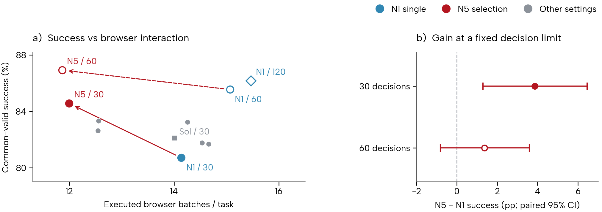

*All eleven historical methods remain visible; gray marks other settings, including Sol. Purple arrows compare observed N1 and N5 configurations at the same decision limit (solid: 30; dashed: 60), with no interpolation claim. Higher success and fewer command batches appear toward the upper left; this direction does not mean lower browser CPU/RAM, session time, bandwidth or billed resources. Batches are selected nonempty BrowserCode executions, potentially containing multiple browser operations; unselected proposals and model/selector calls are not batches. The paired-gain panel reuses the original pointwise 50,000-draw task-bootstrap intervals: +1.29 to +6.45 pp at 30 decisions and −0.81 to +3.59 pp at 60.*

[Interaction PDF](arm_results/browsercode_inference_scaling_20261031/browsercode_selection_interaction.pdf) · [SVG](arm_results/browsercode_inference_scaling_20261031/browsercode_selection_interaction.svg).

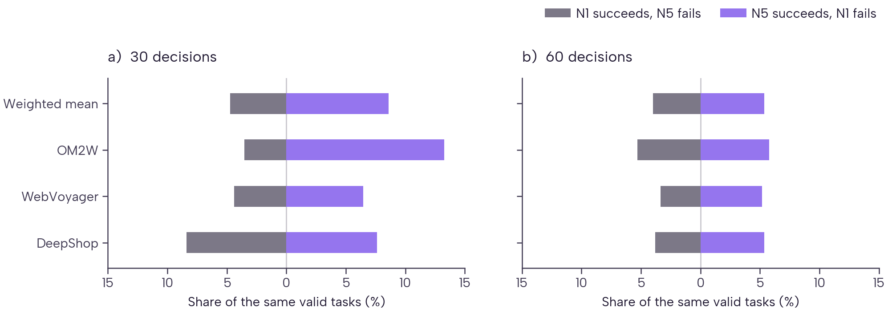

*The neutral bar counts N1 success/N5 failure; purple counts N5 success/N1 failure. Each bar divides by all common-valid tasks in its benchmark, not only discordant tasks. Concordant successes and failures are omitted. The weighted row uses the fixed planned benchmark weights, not pooled counts. The right-minus-left difference equals the paired success gain; the display preserves the small negative DeepShop contrast at 30 decisions.*

The [separate measured US-residential study](#browsercode-us-stealth-full300) reports actual hosting/proxy fees and uses a different cohort; those charges must not be transferred onto these local-browser points.

Both variants use the same 744-task intersection, planned benchmark weights, Terra judgments and historical protocol qualifications as the compact figure. Candidate generation and selection vary jointly; neither view isolates selector quality from additional sampling or controls live-window differences. The original compact figure is unchanged.

[Paired-outcome PDF](arm_results/browsercode_inference_scaling_20261031/browsercode_selection_paired_outcomes.pdf) · [SVG](arm_results/browsercode_inference_scaling_20261031/browsercode_selection_paired_outcomes.svg) · [Coordinates, definitions and source hashes](arm_results/browsercode_inference_scaling_20261031/browsercode_selection_strength_variants.json) · [Source](arm_results/browsercode_inference_scaling_20261031/plot_selection_strength_variants.py).

Supplementary paired-selection analysis and earlier three-panel rendering

### Candidate selection at the default decision limit

**At 30 decisions, Luna high N5 raises task-weighted common-valid success from 80.70% to 84.56%: +3.86 percentage points (pointwise paired-bootstrap 95% interval +1.29 to +6.45).** Mean actor cost rises from $0.00820 to $0.05448 per task and latency from 94.2 to 179.8 seconds. N2 scores 83.33% and N3 82.64%, so these observations do not establish monotonic improvement with candidate count.

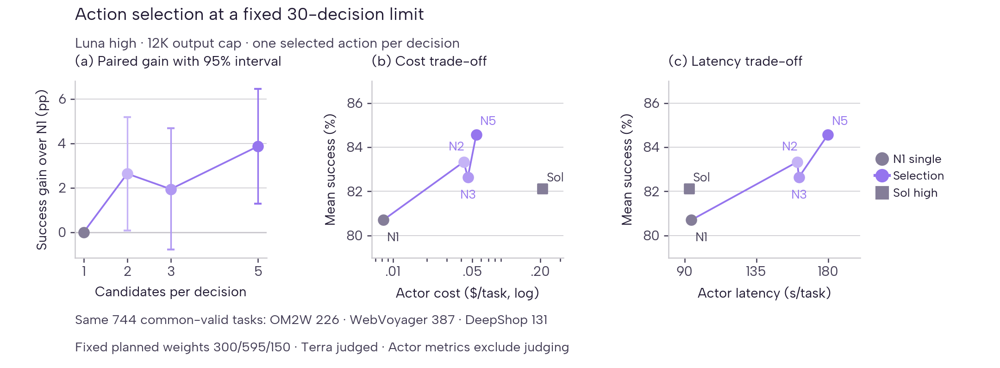

*Every point uses the same 744 tasks valid in all eleven historical methods: 226 OM2W, 387 WebVoyager and 131 DeepShop. Fixed benchmark weights are 300/1,045, 595/1,045 and 150/1,045, applied identically to success, cost and latency. All use Terra judging; actor metrics exclude judging. Panel (a) shows pointwise percentile intervals from 50,000 paired task-bootstrap draws within each benchmark. These condition on the retained validity sets and saved labels, treat tasks as independent, and do not cover website clustering, collection-window differences or multiplicity. N>1 adds candidate generation and selection jointly; without an equal-generation/random-selector control, this does not isolate the selector's contribution. Sol is a separate model reference, with the same 30-decision limit.*

[Selection PDF](arm_results/browsercode_inference_scaling_20261031/browsercode_selection_scaling.pdf) · [Selection SVG](arm_results/browsercode_inference_scaling_20261031/browsercode_selection_scaling.svg) · [Coordinates and paired intervals](arm_results/browsercode_inference_scaling_20261031/browsercode_scaling_family_summary.json) · [Aggregate paired counts](arm_results/browsercode_inference_scaling_20261031/browsercode_scaling_family_pairs.json)

Own-valid benchmark averages

### Equal-weight average across the three benchmarks

With equal benchmark weights, N5/60 has the highest macro success at **86.03%**. Single120 averages **84.10%**, versus **83.91%** for single60; this small descriptive difference does not establish an improvement under matched conditions.

[Average coordinates](arm_results/browsercode_inference_scaling_20261031/browsercode_scaling_average_coordinates.csv) · [Average PDF](arm_results/browsercode_inference_scaling_20261031/browsercode_scaling_average.pdf) · [Average SVG](arm_results/browsercode_inference_scaling_20261031/browsercode_scaling_average.svg) · [Plot source](arm_results/browsercode_inference_scaling_20261031/plot_browsercode_average.py) · [Reproduction command](API_EXPERIMENT_METHODS.md#recreate-the-completed-scaling-figures)

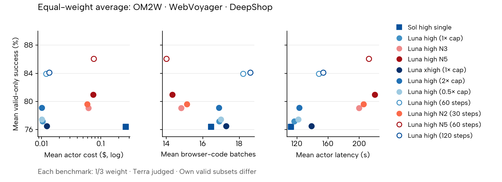

*Each benchmark receives weight 1/3: average its own-valid success percentage, and separately average its within-benchmark valid-task actor cost, batches and latency. This gives OM2W, WebVoyager and DeepShop equal influence despite their different sizes; it does not pool tasks. Actor cost and latency exclude Terra. Each method retains its own valid subsets, missing outcomes are not imputed, and live collection windows differ. Historical single60 enforced 60 decisions while advertising 30; single120 enforces and advertises 120. These descriptive macro means do not supply paired effects or confidence intervals.*

### Average weighted by planned benchmark task counts

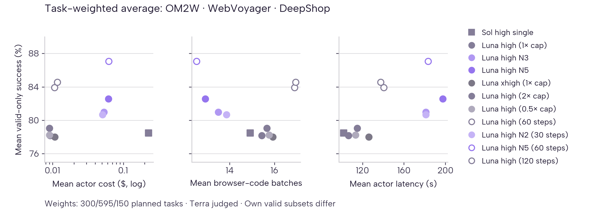

*Fixed weights are OM2W 300/1,045, WebVoyager 595/1,045 and DeepShop 150/1,045, matching the planned benchmark mix. Apply these same weights to each benchmark's own-valid success rate and its valid-task actor cost, batches and latency. This is not a pooled native-valid rate: weights stay identical across methods even when valid or missing counts differ. Actor cost and latency exclude Terra; missing outcomes are not imputed. The own-valid, cross-window and single60 prompt-30 versus single120 prompt-120 caveats above still apply; no paired effect or confidence interval is inferred.*

N5/60 has the highest task-weighted success at **87.05%**; single120 averages **84.56%** and single60 **83.91%**.

[Weighted coordinates](arm_results/browsercode_inference_scaling_20261031/browsercode_scaling_weighted_average_coordinates.csv) · [Weighted PDF](arm_results/browsercode_inference_scaling_20261031/browsercode_scaling_weighted_average.pdf) · [Weighted SVG](arm_results/browsercode_inference_scaling_20261031/browsercode_scaling_weighted_average.svg) · [Reproduction command](API_EXPERIMENT_METHODS.md#recreate-the-completed-scaling-figures)

### Same tasks across all eleven methods

**744 tasks are valid in every plotted method**, with the intersection computed separately within each benchmark. Success, actor cost, browser-code batches and actor latency are all recomputed on these identical task sets, including valid failures.

| Benchmark | Planned tasks | Valid in all 11 methods | Excluded from intersection |
|---|---:|---:|---:|
| OM2W | 300 | 226 | 74 |
| WebVoyager | 595 | 387 | 208 |
| DeepShop | 150 | 131 | 19 |
| **Total** | **1,045** | **744** | **301** |

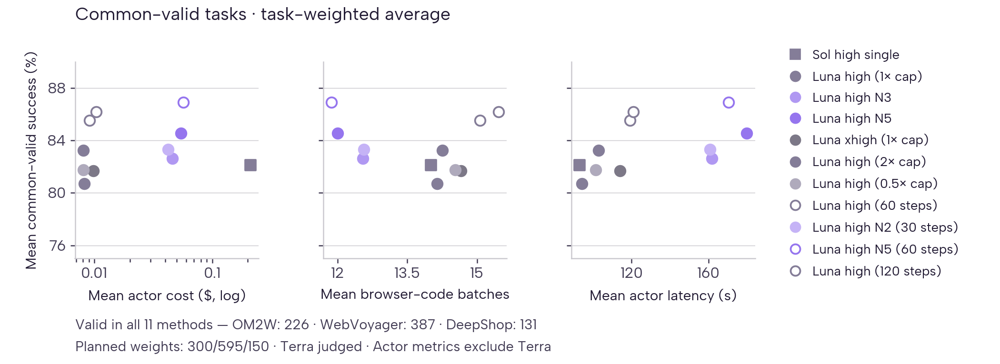

*The benchmark weights remain 300/1,045, 595/1,045 and 150/1,045, matching the preceding figure; this is not a pooled rate over the 744 retained tasks. A task invalid or missing in any method is excluded from every method in its benchmark. Every retained task has all three actor measurements; missing values are never zero-filled. Terra judging and the earlier method encodings are unchanged, and actor means exclude Terra. Conditioning on validity changes the task mix; matching task identity does not control live collection dates, runtime safeguards or the single60 advertised-30 versus single120 advertised-120 prompt difference. These are descriptive points without confidence intervals.*

On this common population, task-weighted success is **86.93% for N5/60**, **86.17% for single120** and **85.55% for single60**. These rates do not establish a reliable difference between methods.

[Common-valid aggregate](arm_results/browsercode_inference_scaling_20261031/aggregate_common_valid.json) · [Weighted coordinates](arm_results/browsercode_inference_scaling_20261031/browsercode_scaling_common_valid_weighted_average_coordinates.csv) · [Per-benchmark coordinates](arm_results/browsercode_inference_scaling_20261031/browsercode_scaling_common_valid_weighted_average_per_benchmark_coordinates.csv) · [Counts](arm_results/browsercode_inference_scaling_20261031/browsercode_scaling_common_valid_weighted_average_benchmark_counts.csv) · [PDF](arm_results/browsercode_inference_scaling_20261031/browsercode_scaling_common_valid_weighted_average.pdf) · [SVG](arm_results/browsercode_inference_scaling_20261031/browsercode_scaling_common_valid_weighted_average.svg) · [Plot source](arm_results/browsercode_inference_scaling_20261031/plot_browsercode_common_valid.py)

Equal-weight benchmark means for all eleven methods

Counts and missing outcomes remain in the per-benchmark tables below; averaging percentages does not create a pooled count denominator.

| Method | Equal-weight valid-only success | Equal-weight actor $ / task | Equal-weight browser-code batches | Equal-weight latency (s) |
|---|---:|---:|---:|---:|
| Sol high single | 76.37% | 0.26324 | 16.46 | 112.5 |
| Luna high · 1× cap | 77.14% | 0.01044 | 16.90 | 116.6 |
| Luna high N3 | 79.04% | 0.06233 | 14.82 | 199.9 |
| Luna high N5 | 80.94% | 0.07501 | 14.33 | 220.3 |
| Luna xhigh · 1× cap | 76.47% | 0.01239 | 17.28 | 138.9 |
| Luna high · 2× cap | 79.09% | 0.01020 | 16.89 | 123.2 |
| Luna high · 0.5× cap | 77.42% | 0.01021 | 16.99 | 122.1 |
| Luna high · 60 steps | 83.91% | 0.01201 | 18.22 | 148.5 |
| Luna high N2 · 30 steps | 79.59% | 0.05906 | 15.14 | 205.8 |
| Luna high N5 · 60 steps | 86.03% | 0.07619 | 14.01 | 212.5 |
| Luna high · 120 steps | 84.10% | 0.01360 | 18.61 | 153.9 |

Historical single30 versus single60 paired comparison

The earlier 30/60 single-call comparison retains its original outcomes and common-valid paired intervals. Every interval is positive, but pairing controls task identity rather than collection time, runtime safeguards or the advertised prompt limit. These intervals do not describe the newly added single120 or selection cohorts.

| Benchmark | Planned / method | 30-step valid | 30-step successes | 60-step valid | 60-step successes | Common-valid pairs | Paired gain (pp; 95% interval) |
|---|---:|---:|---:|---:|---:|---:|---:|
| OM2W | 300 | 269 | 178 | 259 | 191 | 255 | +7.8 [2.7, 12.9] |
| WebVoyager | 595 | 579 | 482 | 584 | 510 | 569 | +4.2 [1.4, 7.0] |
| DeepShop | 150 | 150 | 123 | 150 | 136 | 150 | +8.7 [1.3, 16.0] |

Actual output and reasoning consumption, ceilings and paired uncertainty

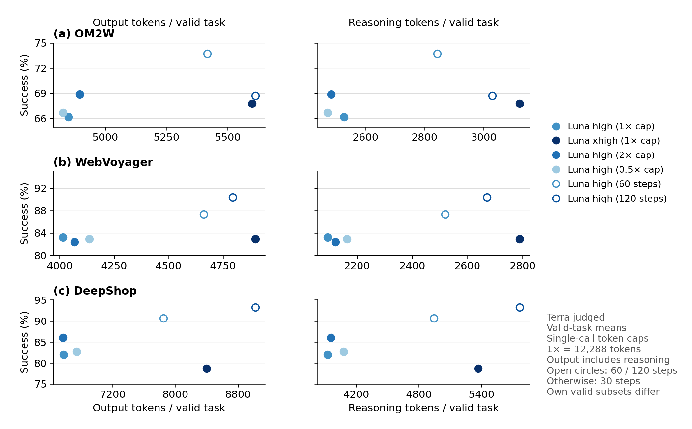

*Token axes show mean summed native output and reasoning tokens per valid task across all its generations. Reasoning is included in output, and is never added a second time. These quantities differ from a per-call token ceiling. All six plotted Luna single-call settings, including single120, have full native usage coverage on their valid tasks. Sol and the N2/N3/N5 selection settings do not export token coordinates in this aggregate and are explicitly omitted from this token figure; tokens are not a common compute unit across different models and selection policies.*

Increasing the high-effort ceiling from 1× to 2× did not double realized output; mean output remains similar in every benchmark. Xhigh consumes more output and reasoning than high/1× on all three benchmarks, without a consistent success gain. Across the three token/effort variants, none of 50,453 generation calls with known native usage hit its output ceiling or reported an output-limit stop, including calls from invalid episodes; six additional generation calls have unknown usage. Their tested ceilings did not constrain the observed known-usage generations. The 60-step setting adds 18,331 known-usage generation calls, including two output-limit stops in invalid episodes, plus one generation with unknown usage. Only 13 of its 993 valid episodes reach 60 decisions: four successes and nine failures. Eight invalid episodes explicitly reach the unchanged 900-second alarm.

[Actual-token coordinates](arm_results/browsercode_inference_scaling_20261031/browsercode_scaling_tokens_coordinates.csv) · [Token figure SVG](arm_results/browsercode_inference_scaling_20261031/browsercode_scaling_tokens.svg) · [Token figure PDF](arm_results/browsercode_inference_scaling_20261031/browsercode_scaling_tokens.pdf) · [Paired comparisons](arm_results/browsercode_inference_scaling_20261031/paired_comparisons.csv)

Paired comparisons use content-identical common-valid tasks, 10,000 task-bootstrap draws and percentile 95% intervals. The three alternative-versus-high/1× cohorts have 262/265/262 tasks on OM2W, 567/570/567 on WebVoyager and 150 each on DeepShop (xhigh/1×, high/2×, high/0.5× order). All nine intervals include zero; they do not establish equivalence. The exploratory DeepShop high/2× versus xhigh difference is +7.3 percentage points (95% interval +1.3 to +13.3); six token/effort contrasts and four additional 60-step contrasts per benchmark are reported without multiple-comparison correction. Sol and all selection points remain descriptive in this analysis. No new paired effect or interval is inferred for single120, N2/30 or N5/60 from their aggregate valid-only rates.

All-attempt spend for the three token/effort variants is $29.243526775 actor charges/reservations and $49.2198530 external judge charges/reservations. Seven exact quarantined unknown physical requests retain their full $0.246580875 reserve; native usage remains unknown. Prepared requests proven not to have crossed provider dispatch add no physical calls or charges. Invalid/interrupted work remains in these all-attempt totals. The 60-step cohort separately totals $10.982053010 actor charges/reservations and $16.5442735 external judge charges, including its unchanged $0.00950025 unknown-usage reserve. Invalid-attempt work remains charged. These accounting totals are separate from the valid-task actor means above; see the [60-step all-attempt costs](arm_results/browsercode_inference_scaling_20261031/all_attempt_accounting.json).

<!-- browsercode-inference-scaling-20261031:end -->

<!-- browsercode-us-stealth-full300:start -->

## BrowserCode on US-residential stealth browsers

**On 270 common-valid OM2W task pairs, Luna high N5 succeeds on 255, versus 247 for Single**, with mean actor-loop latency of 204.6 versus 119.6 seconds. The paired difference is +2.96 percentage points (two-sided task-level exact McNemar p = 0.134). The discordant outcomes do not establish a difference at the 0.05 level. This single-model, Single-versus-N5 comparison does not establish an inference-scaling law.

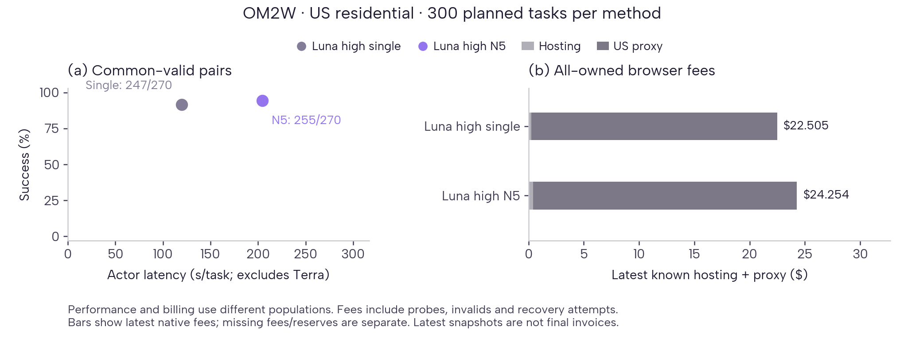

*Left: the same 270 valid tasks for both methods; Luna circles use neutral-mauve Single and purple N5. Actor latency excludes Terra and is elapsed task time, not summed parallel call durations. Right: latest native Browser Use hosting and residential-proxy fees for **304 owned sessions per method: 300 actor sessions plus four mechanical probes**, including invalids and every recovery. These billing and performance populations differ. Every session is verified stopped and re-queried at least 90 seconds after stop. Bars use latest fees, including downward corrections; conservative admission maxima and unresolved reserves are separate, never plotted as actual fees. Values are provider observations, not final invoices or cash paid after credits. These remote-browser results stay separate from the local-browser scaling figures above.*

| Method | Planned | Native | Valid | Invalid | Successes | Overall success (%) | Own-valid success (%) |
|---|---:|---:|---:|---:|---:|---:|---:|
| Luna high single | 300 | 300 | 281 | 19 | 257 | 85.67 | 91.46 |
| Luna high N5 | 300 | 300 | 280 | 20 | 264 | 88.00 | 94.29 |

All 600 planned actor outcomes are saved; no claimed-missing or unclaimed tasks remain. Overall success is confirmed successes divided by 300; invalid outcomes are not assigned a judged failure. Invalids include setup, capture/protocol and native-completion failures; they retain their original outcomes and are excluded from performance means. Both methods use high reasoning, a 12,288-output-token ceiling per generation, 30 decisions, a 900-second actor deadline, US residential routing and Terra medium/4,096/seed 42. N5 samples five candidates concurrently and executes only the selected action. Collection spans live website changes and bounded operational recovery; common-valid pairing controls task identity but does not eliminate attrition or those runtime effects.

[Aggregate](arm_results/browsercode_us_stealth_full300_20261102/aggregate.json) · [Paired counts and exact test](arm_results/browsercode_us_stealth_full300_20261102/paired_statistics.json) · [Coordinates](arm_results/browsercode_us_stealth_full300_20261102/us_stealth_observed_costs.csv) · [PDF](arm_results/browsercode_us_stealth_full300_20261102/us_stealth_observed_costs.pdf) · [SVG](arm_results/browsercode_us_stealth_full300_20261102/us_stealth_observed_costs.svg) · [Plot source](arm_results/browsercode_us_stealth_full300_20261102/plot_stealth_costs.py) · [Actual costs, own-valid means and reproduction](API_EXPERIMENT_METHODS.md#us-stealth-full300)
<!-- browsercode-us-stealth-full300:end -->

<!-- claude-browsercode-om2w300-v1:start -->

## Claude BrowserCode: high effort on OM2W

**On the 246 common-valid tasks, Sonnet N5 matches Sonnet single at 147 successes; N3 records 144. Both use fewer selected browser batches, higher model cost and longer native latency.** Opus records 199 successes on that same cohort.

All four arms have audited outcomes for the same fixed 300 tasks; the table and primary figure use each arm’s own valid cohort.

| Method | Recorded | Valid | Invalid | Successes | Valid-only success | Model $ / task | Latency (s) | Browser batches |
|---|---:|---:|---:|---:|---:|---:|---:|---:|
| Opus single | 300 | 266 | 34 | 217 | 81.6% | 0.859 | 99.5 | 10.30 |
| Sonnet single | 300 | 262 | 38 | 156 | 59.5% | 0.214 | 54.1 | 6.94 |
| Sonnet N = 3 | 300 | 259 | 41 | 152 | 58.7% | 0.811 | 78.9 | 6.08 |
| Sonnet N = 5 | 300 | 265 | 35 | 161 | 60.8% | 1.252 | 89.0 | 6.29 |

Successes divide by valid outcomes in each arm; invalid outcomes stay in the separate count column. Model cost, latency and browser batches use exactly that arm's valid cohort, including valid failures. Cohorts can differ between arms and exclude cap-constrained episodes; these conditional rates do not establish a causal model-quality gain.

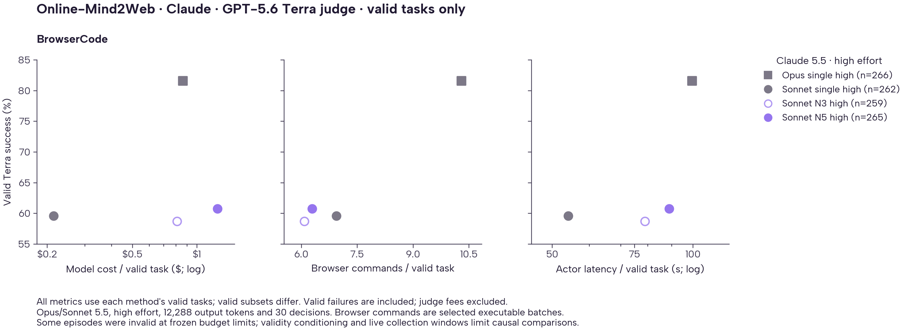

*Opus 5.5 and Sonnet 5.5; 12,288 output tokens and 30 decisions. N = 3/5 samples candidates independently and executes only the selected batch. Squares identify Opus and circles Sonnet; neutral mauve denotes a single proposal and purple candidates plus selection. Open purple circles denote N3 and filled purple circles N5. Legends sit outside on the right; cost and latency are logarithmic. All metrics use valid tasks, including valid failures. Axes are cropped; no uncertainty is inferred from aggregate points. Collections occur on live sites.*

[Coordinates (CSV)](arm_results/claude_browsercode_om2w300_20261028/claude_coordinates.csv) · [Aggregate definitions](arm_results/claude_browsercode_om2w300_20261028/aggregate.json) · [SVG](arm_results/claude_browsercode_om2w300_20261028/claude_tradeoffs.svg) · [PDF](arm_results/claude_browsercode_om2w300_20261028/claude_tradeoffs.pdf) · [Plot source](arm_results/claude_browsercode_om2w300_20261028/plot_claude_tradeoffs.py)

Matched common-valid alternative and accounting scope

Model cost includes all candidate and selector calls in each included episode, including thinking output and conservative unknown reservations. Every plotted valid episode has known model usage; unknown reservations remain in the separate all-attempt accounting. Native latency measures actor-loop wall time, including online waits and browser execution, excluding browser setup, final judge-only capture, cleanup and external judging. A browser batch is one selected BrowserCode block and can contain multiple browser operations. GPT-5.6 Terra grades terminal success; the matching GPT valid-task figure below uses the same judge protocol, with separate collection windows and actor cost scopes.

**Validity and budget exclusions.** Six Sonnet single, five N3 and five N5 outcomes were invalid because full conservative request reservations could not be admitted within their frozen caps. Shared-halt consequences remain invalid too. These are not judged failures; common-valid conditioning does not cure the resulting selection. All invalid and unknown charges remain in the separate all-attempt accounting.

| Method | Invalid reason | Count |
|---|---|---:|
| Opus single | browser navigation download | 5 |
| Opus single | browser navigation network or redirect error | 5 |
| Opus single | browser navigation timeout | 20 |
| Opus single | episode or tool timeout | 1 |
| Opus single | native response json decode | 1 |
| Opus single | terminal interruption | 1 |
| Opus single | world output unicode encoding | 1 |
| Sonnet single | actor budget reservation admission | 6 |
| Sonnet single | browser navigation download | 5 |
| Sonnet single | browser navigation network or redirect error | 4 |
| Sonnet single | browser navigation timeout | 21 |
| Sonnet single | terminal interruption | 2 |
| Sonnet N = 3 | actor budget reservation admission | 5 |
| Sonnet N = 3 | browser navigation download | 5 |
| Sonnet N = 3 | browser navigation network or redirect error | 4 |
| Sonnet N = 3 | browser navigation timeout | 19 |
| Sonnet N = 3 | episode or tool timeout | 3 |
| Sonnet N = 3 | native protocol or validation | 1 |
| Sonnet N = 3 | provider or judge api error | 1 |
| Sonnet N = 3 | shared halt after prior failure | 1 |
| Sonnet N = 3 | terminal interruption | 2 |
| Sonnet N = 5 | actor budget reservation admission | 5 |
| Sonnet N = 5 | browser navigation download | 5 |
| Sonnet N = 5 | browser navigation network or redirect error | 5 |
| Sonnet N = 5 | browser navigation timeout | 20 |

All four methods are valid on 246 common tasks. The following rates and all three metric means use that identical intersection; conditioning on validity excludes invalid outcomes and can alter the task mix.

| Method | Common tasks | Successes | Success | Model $ / task | Latency (s) | Browser batches |
|---|---:|---:|---:|---:|---:|---:|
| Opus single | 246 | 199 | 80.9% | 0.827 | 97.3 | 10.06 |
| Sonnet single | 246 | 147 | 59.8% | 0.200 | 51.4 | 6.77 |
| Sonnet N = 3 | 246 | 144 | 58.5% | 0.728 | 73.4 | 5.81 |
| Sonnet N = 5 | 246 | 147 | 59.8% | 1.111 | 82.9 | 6.01 |

[Common-valid figure (SVG)](arm_results/claude_browsercode_om2w300_20261028/claude_tradeoffs_common_valid.svg). This OM2W-only result does not extend the earlier equal-weight three-benchmark mean. Valid-cohort costs above are distinct from all-attempt campaign spend, which includes every invalid/interrupted prior attempt and remains in the independently audited accounting record. External judge charges are excluded throughout the model-cost plots.

All-attempt model charges/reservations total **$901.048412**, comprising $900.251168 known usage and $0.797244 reserved unknown usage. External judge charges/reservations are **$14.7273831**, including $0.2776961 unknown reservations, and are excluded from plotted model costs. These totals retain invalid/interrupted work and differ from the valid-cohort means above. [Per-arm accounting](arm_results/claude_browsercode_om2w300_20261028/accounting.json).

Recorded in-allocation worker and private-process-group closure was verified. One raw workspace cleanup API interruption remains preserved; subsequent recorded worker/private-group closure was verified. No fresh global host-orphan scan is claimed.

<!-- claude-browsercode-om2w300-v1:end -->

## Headline performance cost and efficiency

<!-- three-benchmark-headlines-v2 -->
**Historical judge view.** These tables retain the original benchmark-native judgments. The [shared-Terra figure and numeric results](#shared-terra-high-three-benchmarks-20261031) below use newly graded saved endpoints; changing the judge changes the reported score.

**Four methods × three benchmarks · BrowserCode · Updated October 22, 2026.** Both single-call methods use high effort; N3/N5 use high proposals and a high selector. Limits are 12,288 output tokens per call and 30 decisions.

**All twelve method–benchmark cells are complete and independently audited.** OM2W Luna single was collected later on the same fixed tasks; live-site drift is not controlled. The archived original three-arm and primary new-200 comparisons remain below. DeepShop Sol includes the approved 31-cell budget recovery.

**Overall (mean)** weights each benchmark equally (one third), using unrounded values. **Overall (total)** sums all-attempt model costs across the three benchmarks.

### Matched task success

Common-valid cohorts across all four methods: **254 OM2W tasks, 489 WebVoyager tasks and 140 DeepShop tasks**. These rates condition on validity; full fixed-task rates follow.

| Method | Online-Mind2Web · 254 | WebVoyager · 489 | DeepShop · 140 | Overall (mean) |
|---|---:|---:|---:|---:|
| GPT-6 Sol single high | 65.0% | 72.2% | 45.0% | 60.72% |
| GPT-6 Luna single high | 62.6% | 69.1% | 50.0% | 60.57% |
| GPT-6 Luna N3 high | 66.5% | 69.9% | 55.7% | 64.06% |
| GPT-6 Luna N5 high | 69.7% | 72.0% | 52.9% | 64.84% |

### Overall task success

Rates divide successes by every fixed task, counting invalid outcomes as unsuccessful. Counts and validity are separate below.

| Method | Online-Mind2Web · 300 | WebVoyager · 595 | DeepShop · 150 | Overall (mean) |
|---|---:|---:|---:|---:|
| GPT-6 Sol single high | 57.0% | 64.7% | 44.0% | 55.24% |
| GPT-6 Luna single high | 56.0% | 65.5% | 48.7% | 56.74% |
| GPT-6 Luna N3 high | 60.0% | 66.1% | 54.0% | 60.02% |
| GPT-6 Luna N5 high | 62.7% | 65.4% | 51.3% | 59.79% |

OM2W uses the original 300-task secondary cohort for Sol/N3/N5 plus the later fresh Luna single arm. Separate OM2W retry cohorts are excluded; original outcomes remain unchanged.

### Model API cost across all attempts

Includes every proposal/selector, invalid or aborted attempt and conservative unknown-call reservation. Judge and compute costs are excluded. Dollar amounts are frozen-rate receipt estimates. DeepShop Sol includes all pre-amendment attempts.

| Method | Online-Mind2Web | WebVoyager | DeepShop | Overall (total) |
|---|---:|---:|---:|---:|
| GPT-6 Sol single high | $57.21 | $115.60 | $59.64 | $232.45 |
| GPT-6 Luna single high | $2.64 | $4.61 | $2.10 | $9.35 |
| GPT-6 Luna N3 high | $15.75 | $25.81 | $13.20 | $54.76 |
| GPT-6 Luna N5 high | $19.68 | $27.61 | $16.22 | $63.52 |

### Matched efficiency

All metrics use the same common-valid tasks across all four methods within each benchmark. Task latency measures actor-loop wall time, excluding browser setup, final judge-only capture and external judging; online model work is included. Browser steps count selected BrowserCode batches, each potentially containing multiple browser operations.

#### Mean model API cost per matched task

| Method | Online-Mind2Web | WebVoyager | DeepShop | Overall (mean) |
|---|---:|---:|---:|---:|
| GPT-6 Sol single high | $0.2031 | $0.1882 | $0.3861 | $0.2591 |
| GPT-6 Luna single high | $0.0094 | $0.0073 | $0.0138 | $0.0102 |
| GPT-6 Luna N3 high | $0.0543 | $0.0407 | $0.0871 | $0.0607 |
| GPT-6 Luna N5 high | $0.0693 | $0.0443 | $0.1088 | $0.0742 |

#### Mean task latency

| Method | Online-Mind2Web | WebVoyager | DeepShop | Overall (mean) |
|---|---:|---:|---:|---:|
| GPT-6 Sol single high | 90.7 s | 89.5 s | 151.4 s | 110.5 s |
| GPT-6 Luna single high | 93.3 s | 94.1 s | 152.8 s | 113.4 s |
| GPT-6 Luna N3 high | 177.1 s | 156.9 s | 254.8 s | 196.3 s |
| GPT-6 Luna N5 high | 207.5 s | 167.0 s | 279.7 s | 218.1 s |

#### Mean browser steps

| Method | Online-Mind2Web | WebVoyager | DeepShop | Overall (mean) |
|---|---:|---:|---:|---:|
| GPT-6 Sol single high | 14.8 | 12.7 | 21.1 | 16.2 |
| GPT-6 Luna single high | 16.5 | 12.9 | 20.4 | 16.6 |
| GPT-6 Luna N3 high | 14.7 | 11.3 | 17.8 | 14.6 |
| GPT-6 Luna N5 high | 14.6 | 10.5 | 17.4 | 14.2 |

### Performance versus cost and latency

Each benchmark has equal weight (one third). Both axes use the four-method common-valid cohorts above; cost and latency are averaged per task within each benchmark before averaging across benchmarks. These are descriptive point estimates across different collection dates. Judge-only work is excluded.

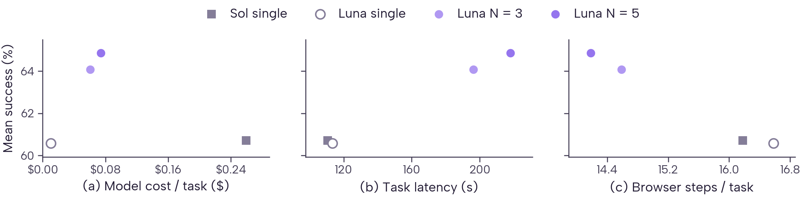

*All methods use high reasoning effort, including the N = 3/5 selectors. Success, cost, latency and browser steps are equal-benchmark means on the same four-method common-valid cohorts (254 / 489 / 140 tasks); judge-only work is excluded. Axes are cropped to the observed range; points are descriptive estimates without uncertainty bars, and collection dates differ.*

| Method | Mean success | Mean model cost / task | Mean task latency | Mean browser steps |
|---|---:|---:|---:|---:|
| Sol single high | 60.72% | $0.2591 | 110.5 s | 16.2 |
| Luna single high | 60.57% | $0.0102 | 113.4 s | 16.6 |
| Luna N3 high + high | 64.06% | $0.0607 | 196.3 s | 14.6 |
| Luna N5 high + high | 64.84% | $0.0742 | 218.1 s | 14.2 |

[Cost plot (SVG)](arm_results/sol6_luna_three_benchmarks_20261019/api_performance_vs_cost.svg) · [Latency plot (SVG)](arm_results/sol6_luna_three_benchmarks_20261019/api_performance_vs_latency.svg) · [Browser steps plot (SVG)](arm_results/sol6_luna_three_benchmarks_20261019/api_performance_vs_browser_steps.svg) · [Combined SVG](arm_results/sol6_luna_three_benchmarks_20261019/api_performance_tradeoffs.svg) · [Mean values (CSV)](arm_results/sol6_luna_three_benchmarks_20261019/api_tradeoffs_means.csv) · [Plot source](arm_results/sol6_luna_three_benchmarks_20261019/plot_api_tradeoffs.py)

[Paper PDF: combined](arm_results/sol6_luna_three_benchmarks_20261019/api_performance_tradeoffs.pdf) · [Cost PDF](arm_results/sol6_luna_three_benchmarks_20261019/api_performance_vs_cost.pdf) · [Latency PDF](arm_results/sol6_luna_three_benchmarks_20261019/api_performance_vs_latency.pdf) · [Browser steps PDF](arm_results/sol6_luna_three_benchmarks_20261019/api_performance_vs_browser_steps.pdf). Combined layout: 7-inch canvas; individual panels: 3.35-inch canvas. Grid lines, in-figure protocol footers and repeated titles are omitted; vector PDFs embed TrueType fonts and PNG previews use 300 dpi.

[Audited aggregate metrics](arm_results/sol6_luna_three_benchmarks_20261019/aggregate.json) · [OM2W completion and accounting](ARM_INFERENCE_SCALING.md#luna-single-high-om2w300-20261022) · [DeepShop recovery scope](ARM_INFERENCE_SCALING.md#deepshop-sol-budget-recovery-20261019)

### High-effort shared-Terra tradeoffs across three benchmarks

**High-effort actors, shared Terra grading, three benchmarks.** OM2W shows Sol single and Luna single/N3/N5 in BrowserCode and native CUAWright. WebVoyager and DeepShop show the same four methods in BrowserCode. Every point uses GPT-5.6 Terra terminal-success grading (medium judge effort, 4,096 completion tokens, seed 42). Success and actor means use each method's valid Terra tasks, including successes and failures; these are different valid subsets, not a common-task intersection.

**WebVoyager and DeepShop use shared Terra terminal-success scores, rather than their original benchmark-native scores.** We regraded all 2,845 originally valid saved episodes, with zero actor calls; the 135 original invalids stay excluded. Higher scores relative to the historical tables come from changing the judge on the same rollouts. The separately accounted judging fee was **$45.63**, excluded from all actor-cost coordinates.

**Native recovery now qualifies 277 / 279 / 254 / 250 of 300 tasks for Sol single / Luna single / N3 / N5.** Of 379 prescribed gap cells, 322 received one new actor attempt; **57 remain unclaimed** (N3: 28; N5: 29). Sol and Luna single completed their recovery rosters. N3 stopped at its planned admission cutoff; N5 stopped after an operational error. All eligible endpoints have their first Terra verdict. These are different valid subsets; adding fresh attempts and evidence changes coverage, so the updated rates are not fixed-cohort actor improvements.

Native valid-task cost, browser records and latency include original plus recovery attempts for recovered tasks. BrowserCode coordinates stay unchanged. BrowserCode uses 12,288 output tokens / 30 decisions; native uses 20,000 / 100 with summaries every 20. Different limits, timing boundaries and collection windows prevent a causal harness comparison.

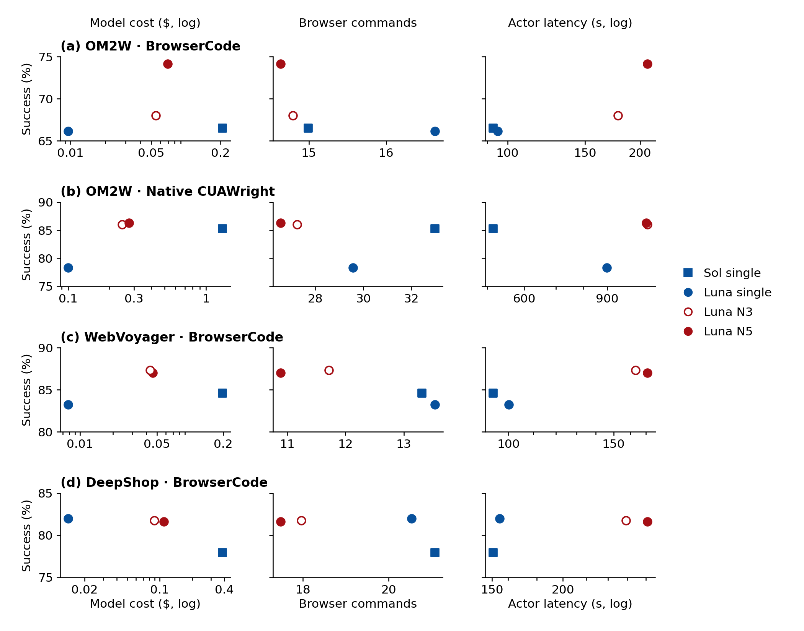

[PDF](arm_results/cuawright_browsercode_om2w_20261027/shared_terra_high_four_row_paper.pdf) · [SVG](arm_results/cuawright_browsercode_om2w_20261027/shared_terra_high_four_row_paper.svg) · [Coordinates CSV](arm_results/cuawright_browsercode_om2w_20261027/shared_terra_high_four_row_paper_coordinates.csv) · [Aggregate](arm_results/cuawright_browsercode_om2w_20261027/shared_terra_high_four_row_aggregate.json) · [Standalone plot source](arm_results/cuawright_browsercode_om2w_20261027/plot_terra_benchmark_tradeoffs.py)

*Luna is a circle; Sol a square. Neutral mauve denotes one proposal; purple denotes candidates plus a selector (N3 lighter, N5 base purple; both filled). All actors use high effort. One shared legend sits outside on the right; denominators appear in the table. The fixed 7 × 5.5-inch figure uses 7.5-point labels and vector exports. Cost and latency axes are logarithmic; axes are cropped. Every actor metric uses valid tasks, including valid failures; judge fees are excluded. Browser commands count selected BrowserCode blocks or literal-LF native browser-step records, each potentially containing several actions.*

#### Shared-Terra success and valid-task efficiency

Planned rosters are 300 OM2W, 595 WebVoyager and 150 DeepShop tasks per method. “Invalid / ungraded” counts recorded tasks that remain unqualified; native recovery cells never admitted are separate in “Unclaimed.” Neither is a judged-failure count. Native efficiency means are cumulative across original and recovery attempts on qualified tasks; judge fees are excluded. Every metric has full observation coverage within its own valid-task set.

| Benchmark / harness | Method | Successes | Valid | Invalid / ungraded | Unclaimed | Valid success | Model USD / valid task | Actor latency (s) | Browser batches / steps |
|---|---|---:|---:|---:|---:|---:|---:|---:|---:|
| OM2W / BrowserCode | Sol single | 177 | 266 | 34 | — | 66.5% | $0.20771 | 92.7 | 14.99 |
| OM2W / BrowserCode | Luna single | 178 | 269 | 31 | — | 66.2% | $0.00951 | 94.9 | 16.63 |
| OM2W / BrowserCode | Luna N3 | 183 | 269 | 31 | — | 68.0% | $0.05496 | 178.1 | 14.79 |
| OM2W / BrowserCode | Luna N5 | 198 | 267 | 33 | — | 74.2% | $0.06960 | 207.9 | 14.63 |
| OM2W / native | Sol single | 234 | 277 | 23 | 0 | 84.5% | $1.75204 | 723.9 | 48.53 |
| OM2W / native | Luna single | 215 | 279 | 21 | 0 | 77.1% | $0.12468 | 1165.0 | 40.09 |
| OM2W / native | Luna N3 | 207 | 254 | 18 | 28 | 81.5% | $0.34104 | 1634.9 | 37.41 |
| OM2W / native | Luna N5 | 209 | 250 | 21 | 29 | 83.6% | $0.34088 | 1470.8 | 32.43 |
| WebVoyager / BrowserCode | Sol single | 468 | 553 | 42 | — | 84.6% | $0.19770 | 94.1 | 13.31 |
| WebVoyager / BrowserCode | Luna single | 482 | 579 | 16 | — | 83.2% | $0.00778 | 100.1 | 13.54 |
| WebVoyager / BrowserCode | Luna N3 | 496 | 568 | 27 | — | 87.3% | $0.04319 | 163.4 | 11.71 |
| WebVoyager / BrowserCode | Luna N5 | 483 | 555 | 40 | — | 87.0% | $0.04588 | 171.0 | 10.89 |
| DeepShop / BrowserCode | Sol single | 113 | 145 | 5 | — | 77.9% | $0.38431 | 150.6 | 21.08 |
| DeepShop / BrowserCode | Luna single | 123 | 150 | 0 | — | 82.0% | $0.01403 | 154.8 | 20.53 |
| DeepShop / BrowserCode | Luna N3 | 121 | 148 | 2 | — | 81.8% | $0.08884 | 258.2 | 17.96 |
| DeepShop / BrowserCode | Luna N5 | 120 | 147 | 3 | — | 81.6% | $0.10954 | 281.9 | 17.48 |

[Historical pre-recovery compact OM2W-only PDF](arm_results/cuawright_browsercode_om2w_20261027/om2w_terra_high_valid_only_tradeoffs.pdf) · [OM2W-only aggregate](arm_results/cuawright_browsercode_om2w_20261027/om2w_terra_valid_only_aggregate.json). Original benchmark-native results remain in the [historical tables](#headline-performance-cost-and-efficiency).

Native recovery: accounting, terminal evidence and timing boundaries

The updated native points retain all **821 qualified historical labels** and add **231 standard first verdicts plus eight separately qualified terminal endpoints**: 1,060 qualified task–arm cells out of 1,200. The eight endpoints require authenticated terminal captures and verified owned shutdown; original dispositions remain archived. Recovery claimed 322 of 379 gap cells, of which 83 remain unqualified; 57 were never admitted. All four actor lineages and their judge continuations are closed. This is a verified partial endpoint, not completion of all 379 prescribed cells.

For each recovered valid logical task, model cost includes both original and recovery physical model work, including candidates, selectors and applicable helpers; browser records and observed actor time also sum both components. Historical-only tasks retain their original measurements. No attempted component is replaced by zero when missing. Work on tasks that remain unqualified is excluded from these conditional means and retained separately below. The aggregate carries source hashes and all-attempt recovery totals.

| Native method | Recovery model calls | Recovery model charges / reserves (USD) | Unknown calls | Full unknown reserve (USD) | First Terra calls | Terra USD |
|---|---:|---:|---:|---:|---:|---:|
| Sol single | 16703 | 175.224220 | 4 | 0.667290000 | 107 | 1.2844785 |
| Luna single | 17118 | 9.205629 | 2 | 0.031181750 | 62 | 0.7776920 |
| Luna N3 | 26728 | 21.734104 | 2 | 0.052797125 | 46 | 0.5905550 |
| Luna N5 | 25201 | 17.015287 | 5 | 0.059451875 | 24 | 0.3166010 |

These totals cover all new recovery attempts and first judging stages; original collection and historical regrading remain separately accounted. The 13 unknown model calls retain their full $0.810720750 reservations. Unknown usage is not fabricated or refunded. Failed recovery actor cases receive no second recovery attempt. Terra costs are excluded from every plotted actor-cost coordinate.

Historical native time spans parent-worker creation through owned cleanup. Recovery time spans the native episode runner through cleanup, subtracting only the measured final dedicated observer RPC. Preclose capture overhead remains. BrowserCode time covers its actor loop and excludes setup and cleanup. Native browser records count literal-LF browser-step entries; BrowserCode counts selected nonempty executable code batches. Both can encompass several low-level actions. These timing and counting boundaries differ across harnesses.

Supporting results: lower efforts, full-attempt accounting and regrading provenance

**Historical pre-recovery snapshot.** These supporting figures are unchanged by the native recovery above. **Every point in these supporting views uses GPT-5.6 Terra terminal-success grading: medium effort, 4,096 completion tokens and seed 42.** We regraded all 1,071 original-valid historical BrowserCode episodes and 821 native episodes with qualified saved endpoint evidence. Another 276 original-valid native episodes lack that evidence and remain ungraded; earlier judges' labels are not substituted. **Native success rates are conditional on this selected evidence subset, not full-300 rates.** The historical runs' 232 original invalid outcomes remain invalid. The separate regrading cost was **$27.12**, with no actor calls.

The four medium/low arms include one prescribed fresh episode for each original-invalid task–arm pair: **187 retries recovered 64 valid outcomes and 29 successes**. Original valid outcomes take priority; the single retry supplies an outcome only after an original invalid. The four arms now have 271, 271, 269 and 266 valid outcomes out of 300 planned tasks. Final qualification of the original effort campaign remains incomplete, so these arms remain provisional. Luna single xhigh is retained in the original tables and omitted from this figure.

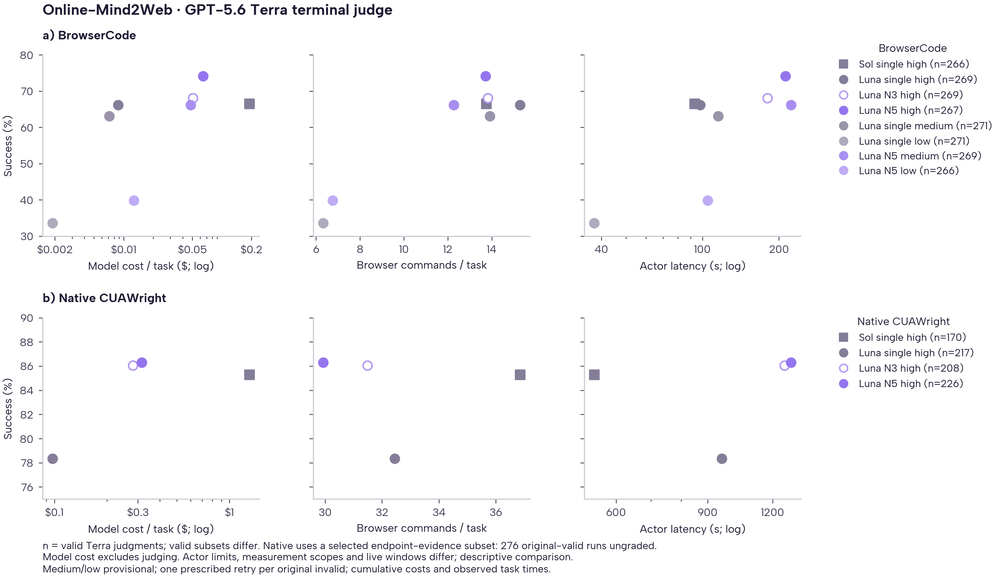

[PDF](arm_results/cuawright_browsercode_om2w_20261027/om2w_terra_all_tradeoffs.pdf) · [SVG](arm_results/cuawright_browsercode_om2w_20261027/om2w_terra_all_tradeoffs.svg) · [Coordinates CSV](arm_results/cuawright_browsercode_om2w_20261027/om2w_terra_all_tradeoffs_coordinates.csv) · [Aggregate](arm_results/cuawright_browsercode_om2w_20261027/om2w_terra_all_aggregate.json) · [Plot source](arm_results/cuawright_browsercode_om2w_20261027/plot_om2w_terra_tradeoffs.py)

*Circles identify Luna and squares identify Sol. Neutral mauve denotes a single proposal; purple denotes candidates plus a selector. High effort is darker, medium intermediate and low lighter within each family; open purple circles denote N3 and filled purple circles N5. Legends sit outside on the right and show each success denominator. Cost and latency use logarithmic axes. Success is successes divided by valid Terra judgments in each cell; valid subsets differ. Model cost excludes all judge fees. Medium/low cost includes the prescribed retries, and their latency/command coordinates sum original and retry observations per task only when all required measurements exist. Historical x-coordinates retain all available original attempt measurements; their observations are not restricted to the newly graded endpoint subset. Different actor limits, endpoint geometry, collection dates, contention and coverage remain; shared grading alone does not establish a causal harness or effort effect.*

Additional view: success and actor efficiency on valid tasks only

The full-attempt plot above uses valid-only success. This additional view also restricts model cost, actor latency and browser commands to **each method's Terra-valid tasks, including both successes and failures**. Success percentages are unchanged. Valid subsets differ between methods; this is not a common-valid intersection.

For a recovered valid task, cost and observed actor time still include its original episode and prescribed retry. Tasks that remain invalid, and their costs, are excluded from this conditional view; the full-attempt plot above retains those costs. Missing measurements remain missing: N5 low latency has 262 observations among 266 valid tasks. The other plotted metric means have complete coverage within their own valid-task sets.

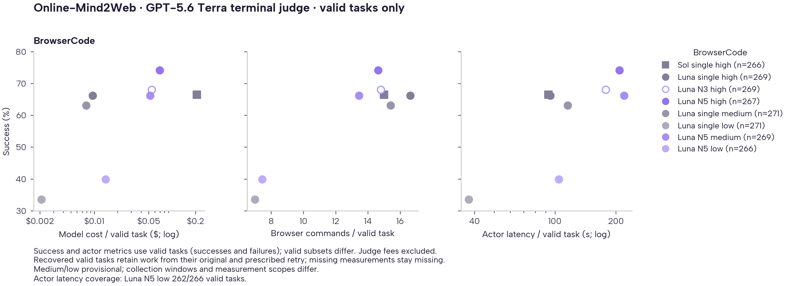

[BrowserCode PDF](arm_results/cuawright_browsercode_om2w_20261027/om2w_terra_valid_only_tradeoffs_browsercode.pdf) · [SVG](arm_results/cuawright_browsercode_om2w_20261027/om2w_terra_valid_only_tradeoffs_browsercode.svg) · [Coordinates CSV](arm_results/cuawright_browsercode_om2w_20261027/om2w_terra_valid_only_tradeoffs_browsercode_coordinates.csv) · [Both harnesses](arm_results/cuawright_browsercode_om2w_20261027/om2w_terra_valid_only_tradeoffs.png) · [Both-harness PDF](arm_results/cuawright_browsercode_om2w_20261027/om2w_terra_valid_only_tradeoffs.pdf) · [Valid-task aggregate](arm_results/cuawright_browsercode_om2w_20261027/om2w_terra_valid_only_aggregate.json)

The native view restricts all metrics to the same selected endpoint-evidence subset used for its success rates; 276 original-valid native runs remain ungraded. Recent medium/low results remain provisional, and collection windows, actor limits and timing scopes still differ. External judge fees are excluded.

#### Lower-effort Terra success and coverage

| Harness | Method | Successes | Terra-valid | Without valid Terra verdict | Valid-only success |
|---|---|---:|---:|---:|---:|
| BrowserCode | Luna single medium | 171 | 271 | 29 | 63.1% |
| BrowserCode | Luna single low | 91 | 271 | 29 | 33.6% |
| BrowserCode | Luna N5 medium + medium | 178 | 269 | 31 | 66.2% |
| BrowserCode | Luna N5 low + low | 106 | 266 | 34 | 39.8% |

[Recovered effort counts, original/retry breakdown and cumulative costs](arm_results/luna_browsercode_effort_om2w300_20261030/retry_aggregate.json).

Model cost, actor latency, browser commands and measurement coverage

Model cost is divided by all 300 planned tasks. The historical BrowserCode estimates include the existing cost backfill; one N3 call has unknown final usage and its estimate can understate cost. Native and medium/low costs include cumulative charges and full unknown-usage reservations, including invalid attempts. All external judging and the new regrading fee are excluded from the x-axis.

Latency and command counts use only finite measurements, including valid and invalid episodes; missing values are not zero-filled. For medium/low arms, the per-task total includes both original and prescribed retry when every attempted episode has that measurement. Historical timing boundaries are retained; BrowserCode actor-loop time excludes setup, final judge-only capture, cleanup and judging. Browser commands are selected BrowserCode blocks or literal native command-log entries, each potentially containing several actions; these are not standardized action counts.

| Harness | Method | Model USD / planned task | Mean actor latency (s) | Latency observations | Mean browser commands | Command observations |
|---|---|---:|---:|---:|---:|---:|
| BrowserCode | Sol single high | $0.19070 | 93.2 | 275 | 13.75 | 300 |
| BrowserCode | Luna single high | $0.00879 | 97.9 | 274 | 15.30 | 300 |
| BrowserCode | Luna N3 high | $0.05084 | 180.5 | 275 | 13.83 | 293 |
| BrowserCode | Luna N5 high | $0.06432 | 212.6 | 273 | 13.72 | 294 |
| BrowserCode | Luna single medium | $0.00714 | 115.4 | 271 | 13.91 | 300 |
| BrowserCode | Luna single low | $0.00188 | 37.4 | 271 | 6.32 | 300 |
| BrowserCode | Luna N5 medium + medium | $0.04802 | 223.3 | 270 | 12.26 | 299 |
| BrowserCode | Luna N5 low + low | $0.01271 | 104.9 | 266 | 6.76 | 300 |
| Native | Sol single high | $1.30012 | 544.4 | 300 | 36.85 | 300 |
| Native | Luna single high | $0.09737 | 958.1 | 300 | 32.45 | 300 |
| Native | Luna N3 high | $0.28151 | 1265.2 | 300 | 31.48 | 300 |
| Native | Luna N5 high | $0.31590 | 1302.7 | 298 | 29.93 | 298 |

These are descriptive means with metric-specific observation counts, not estimates on a shared valid-task intersection. The original effort campaign remains provisional; native global post-job cleanup remains uncertified.

Original Luna effort cohort before prescribed retries

[Original medium/low figure](arm_results/cuawright_browsercode_om2w_20261027/om2w_terra_effort_tradeoffs.png) · [PDF](arm_results/cuawright_browsercode_om2w_20261027/om2w_terra_effort_tradeoffs.pdf)

#### Luna effort: provisional full300 results

| Method | Recorded dispositions | Native results | Successes | Valid | Invalid | Valid-only success |
|---|---:|---:|---:|---:|---:|---:|
| Luna single xhigh | 300 | 300 | 171 | 264 | 36 | 64.8% |
| Luna single medium | 300 | 300 | 165 | 265 | 35 | 62.3% |
| Luna single low | 300 | 300 | 85 | 251 | 49 | 33.9% |
| Luna N5 medium + medium | 300 | 299 | 167 | 256 | 44 | 65.2% |
| Luna N5 low + low | 300 | 300 | 100 | 241 | 59 | 41.5% |

One explicit invalid disposition supplements N5 medium's 299 native results; no latency or selected-batch measurement is imputed for it. The five methods share the fixed OM2W task roster and Terra judge. Valid-only percentages can use different subsets of those 300 tasks; invalids remain in the recorded counts and all-attempt costs. In N5, the named medium/low effort applies to both candidates and selector. Every candidate and selector has a 12,288-token output cap; the episode limit is 30 decisions.

Provisional Luna cost, latency, selected batches and measurement coverage

Cost is the cumulative all-attempt model ledger charge or conservative reservation, including helpers, counters, invalid outcomes and retained full unknown-usage reserves, divided by all 300 planned tasks. External judge fees are excluded. The fixed cost denominator is an allocation denominator, not 300 independently observed provider bills. Latency and selected-batch means instead use the finite observations counted in their own columns, including valid and invalid dispositions; they use no zero filling.

| Method | All-attempt model USD | Model USD / 300 tasks | Mean latency (s) | Latency observations | Mean selected batches | Batch observations |
|---|---:|---:|---:|---:|---:|---:|
| Luna single xhigh | $3.1252 | $0.01042 | 168.6 | 271 | 15.31 | 300 |
| Luna single medium | $2.0913 | $0.00697 | 113.4 | 271 | 13.57 | 300 |
| Luna single low | $0.5132 | $0.00171 | 34.6 | 271 | 5.74 | 300 |
| Luna N5 medium + medium | $13.6673 | $0.04556 | 214.8 | 270 | 11.71 | 299 |
| Luna N5 low + low | $3.2596 | $0.01087 | 96.4 | 266 | 5.87 | 300 |

Latency measures the actor loop, including online model/browser waits, and excludes setup, final judge-only capture, cleanup and external judging. Selected batches are executable BrowserCode blocks, each potentially containing several browser operations. These are observed descriptive means, without a common-valid restriction or uncertainty intervals.

[Provisional aggregate and exact metric definitions](arm_results/luna_browsercode_effort_om2w300_20261030/aggregate.json) · [Aggregate builder](arm_results/luna_browsercode_effort_om2w300_20261030/build_aggregate.py)

Historical high-effort cohorts with their earlier judges

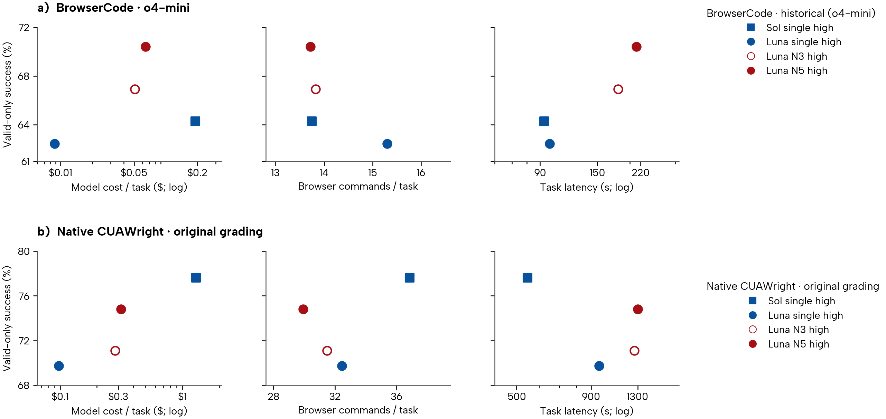

[Historical PDF](arm_results/cuawright_browsercode_om2w_20261027/om2w_harness_tradeoffs.pdf) · [SVG](arm_results/cuawright_browsercode_om2w_20261027/om2w_harness_tradeoffs.svg)

The tables and figure in this section retain historical o4-mini BrowserCode grading and native grading that includes GPT-4o. They do not use the Terra regrade above. **All eight historical method–harness cells have outcomes for the same 300 tasks under those earlier judges.** Valid-only success is successes divided by valid outcomes in each cell. Invalid outcomes are excluded from that success denominator; each cell’s valid subset can differ. The previous 111-task restriction selected fresh tasks valid in every cell; it did not indicate unfinished runs. The [111-task common-valid figure](arm_results/cuawright_browsercode_om2w_20261027/common_valid111/om2w_harness_tradeoffs.png) remains available as a conditional historical view. The BrowserCode three-benchmark plot above is unchanged.

| Method (all high) | Attempted per harness | BrowserCode successes | BrowserCode valid | BrowserCode valid-only success | Native successes | Native valid | Native valid-only success |
|---|---:|---:|---:|---:|---:|---:|---:|
| Sol single | 300 | 171 | 266 | 64.3% | 222 | 286 | 77.6% |
| Luna single | 300 | 168 | 269 | 62.5% | 189 | 271 | 69.7% |
| Luna N3 | 300 | 180 | 269 | 66.9% | 192 | 270 | 71.1% |
| Luna N5 | 300 | 188 | 267 | 70.4% | 202 | 270 | 74.8% |

Success denominators are the valid counts above, drawn from all 300 attempted tasks per cell; this is not a common-valid intersection. Cost, latency and command means use available measurements from valid and invalid episodes, with the coverage below; missing measurements are never filled with zero. This full300 view includes the historical 100 and different collection windows. BrowserCode uses 12,288 output tokens/30 decisions; native uses 20,000/100 with summary setting 20. Timing boundaries and runtime contention differ, so this is a descriptive comparison rather than a controlled harness effect. The [native fresh200 paired analysis](ARM_INFERENCE_SCALING.md#cuawright-native-full300-four-methods-20261025) remains the primary within-native comparison. Global native post-job cleanup remains uncertified.

The historical N5-minus-Luna-single valid-only differences are +8.0 percentage points with BrowserCode and +5.1 with native CUAWright. They are descriptive differences between each method's valid subset.

#### Historical metric coverage and definitions

| Method | BrowserCode cost measurements | BrowserCode latency measurements | BrowserCode command measurements | Native cost measurements | Native latency measurements | Native command measurements |
|---|---:|---:|---:|---:|---:|---:|
| Sol single | 300 | 275 | 300 | 300 | 300 | 300 |
| Luna single | 300 | 274 | 300 | 300 | 300 | 300 |
| Luna N3 | 300 | 275 | 293 | 300 | 300 | 300 |
| Luna N5 | 300 | 273 | 294 | 300 | 298 | 298 |

BrowserCode cost uses original received proposal/selector estimates plus the independently audited historical cost backfill. One N3 task has one model call with unknown final usage, so its reported cost can be understated. Native cost includes all per-task attempts, helpers, counters, cache bounds and full unknown reservations. Both exclude external judging. Missing native N5 latency and command measurements correspond to two OOM-interrupted invalid outcomes; their failures and conservative costs remain included.

BrowserCode latency excludes initial browser setup and final judge-only capture; native retains the original native task boundary and excludes external/saved-evidence grading. Browser-command executions count saved selected BrowserCode blocks versus literal native browser-command log entries. Either can contain several actions; this measures harness-level command volume, not standardized actions or equal work. The observed-only x-axis means can use different task subsets, as their explicit denominators show.

Every Luna method uses a circle and every Sol method a square. Neutral mauve denotes single generation and purple candidates plus selection; shades darken with effort. In the historical figure, an open purple circle denotes N3 and a filled purple circle N5. The main figure above uses Terra for every point and includes the prescribed medium/low retries. All points have equal opacity; the plots have no grid, connecting lines or embedded table. The earlier dashed nondominated-method overlay has been removed. Detailed definitions and coverage remain in the caption and tables.

[Historical valid-only success and attempt-metric coverage aggregate](arm_results/cuawright_browsercode_om2w_20261027/om2w_harness_comparison_valid_only.json).

Coverage and success counts

| Benchmark | Method | Fixed tasks | Successes | Valid | Invalid | Status |
|---|---:|---:|---:|---:|---:|---:|
| Online-Mind2Web | GPT-6 Sol single high | 300 | 171 | 266 | 34 | Audited |
| Online-Mind2Web | GPT-6 Luna single high | 300 | 168 | 269 | 31 | Audited |
| Online-Mind2Web | GPT-6 Luna N3 high | 300 | 180 | 269 | 31 | Audited |
| Online-Mind2Web | GPT-6 Luna N5 high | 300 | 188 | 267 | 33 | Audited |
| WebVoyager | GPT-6 Sol single high | 595 | 385 | 553 | 42 | Audited |
| WebVoyager | GPT-6 Luna single high | 595 | 390 | 579 | 16 | Audited |
| WebVoyager | GPT-6 Luna N3 high | 595 | 393 | 568 | 27 | Audited |
| WebVoyager | GPT-6 Luna N5 high | 595 | 389 | 555 | 40 | Audited |
| DeepShop | GPT-6 Sol single high | 150 | 66 | 145 | 5 | Audited after budget recovery |
| DeepShop | GPT-6 Luna single high | 150 | 73 | 150 | 0 | Audited |
| DeepShop | GPT-6 Luna N3 high | 150 | 81 | 148 | 2 | Audited |
| DeepShop | GPT-6 Luna N5 high | 150 | 77 | 147 | 3 | Audited |

Original controlled Online-Mind2Web comparison and full-300 cohort

### GPT-6 Sol single high versus GPT-6 Luna N3 and N5

**Online-Mind2Web 300 · BrowserCode · Final audited results · October 18, 2026.** All proposals and selectors use high reasoning effort; the limit is 30 decisions per episode.

**Luna reduces model API cost per task by 73.2% (N3) and 66.6% (N5), while taking 1.99× and 2.33× as long on the primary shared-valid comparison.** Its observed success rates are higher, but neither primary paired gain is statistically established.

#### Primary comparison on new tasks

The new 200-task cohort is primary. Efficiency below uses exactly the same 165 tasks valid in all three arms. Model cost includes every proposal and selector call; model cost and task latency exclude the judge.

| Model and policy | Shared valid tasks | Successes | Success rate | Mean model cost / task | Mean task latency | Model cost / successful task | Cost reduction vs Sol | Latency vs Sol |
|---|---:|---:|---:|---:|---:|---:|---:|---:|
| GPT-6 Sol single high | 165 | 104 | 63.0% | $0.2084 | 94.1 s | $0.3306 | 0.0% | 1.00× |
| GPT-6 Luna N3 high + high selector | 165 | 108 | 65.5% | $0.0558 | 186.9 s | $0.0852 | 73.2% | 1.99× |
| GPT-6 Luna N5 high + high selector | 165 | 114 | 69.1% | $0.0696 | 219.7 s | $0.1008 | 66.6% | 2.33× |

Cost per successful task is total model cost across these 165 tasks divided by successes, including cost spent on valid failures. It excludes infrastructure-invalid attempts. N3’s paired success difference is +2.4 percentage points (95% CI −4.8 to +9.7); N5’s is +6.1 points (−0.6 to +12.7).

#### Full 300 task results

The combined cohort is secondary because the first 100 Luna tasks had already been observed. All 900 original dispositions are retained; retry outcomes are separate. Overall success divides by all 300 tasks; valid-only success divides by each arm’s valid count.

| Model and policy | Tasks | Valid | Invalid | Successes | Overall success | Valid-only success |
|---|---:|---:|---:|---:|---:|---:|
| GPT-6 Sol single high | 300 | 266 | 34 | 171 | 57.0% | 64.3% |
| GPT-6 Luna N3 high + high selector | 300 | 269 | 31 | 180 | 60.0% | 66.9% |
| GPT-6 Luna N5 high + high selector | 300 | 267 | 33 | 188 | 62.7% | 70.4% |

For a matched comparison across the full cohort, the following rows use only the same 256 tasks valid in all three arms.

| Model and policy | Shared valid tasks | Successes | Success rate | Mean model cost / task | Mean task latency | Model cost / successful task |
|---|---:|---:|---:|---:|---:|---:|
| GPT-6 Sol single high | 256 | 165 | 64.5% | $0.2046 | 91.5 s | $0.3175 |
| GPT-6 Luna N3 high + high selector | 256 | 171 | 66.8% | $0.0546 | 177.7 s | $0.0817 |
| GPT-6 Luna N5 high + high selector | 256 | 178 | 69.5% | $0.0699 | 208.0 s | $0.1005 |

[Detailed comparison and audit](ARM_INFERENCE_SCALING.md#sol6-luna-browsercode300-20261018) · [Audited aggregate metrics](arm_results/sol6_luna_browsercode300_20261018/aggregate.json)

## Native CUAWright: four methods on 100 tasks

**Sol single high achieved 80 successes; Sol N=3 achieved 72; Luna N=3 and the historical Luna single each achieved 68, out of the same fixed 100 Online-Mind2Web tasks.** All 300 new dispositions and all 49 attempts passed independent source, usage, cap, W&B and physical teardown audits. Overall success counts invalid outcomes as failures.

| Method | Tasks | Valid | Invalid | Successes | Overall success | Valid-only success |
|---|---:|---:|---:|---:|---:|---:|
| Luna single high (historical) | 100 | 93 | 7 | 68 | 68.0% | 73.1% |
| Luna N=3 high + high selector | 100 | 90 | 10 | 68 | 68.0% | 75.6% |
| Sol single high | 100 | 98 | 2 | 80 | 80.0% | 81.6% |
| Sol N=3 high + high selector | 100 | 90 | 10 | 72 | 72.0% | 80.0% |

Efficiency below averages all 100 tasks per method. Model cost includes every attempt, selection and online helpers, with conservative reserves for unknown usage; it excludes external judging. Native task latency excludes external judging and separate grading recovery. Browser batches are recorded native browser-command batches, not individual DOM actions.

| Method | Model cost / task | Mean native latency | Mean browser batches | Mean native decisions |
|---|---:|---:|---:|---:|
| Luna single high (historical) | $0.087 | 18.58 min | 31.8 | 60.3 |
| Luna N=3 high + high selector | $0.258 | 18.93 min | 30.0 | 46.2 |
| Sol single high | $1.143 | 7.48 min | 32.8 | 47.6 |
| Sol N=3 high + high selector | $4.601 | 11.72 min | 33.6 | 46.0 |

Luna single was collected earlier under a different concurrency policy and live web conditions; its comparisons are descriptive. These native 100-task results are separate from the three-benchmark BrowserCode averages above.

Matched valid tasks, uncertainty and accounting

The same 79 tasks were valid in all four methods. This is a conditional cohort selected after execution; it can favor different tasks from the full 100-task cohort.

| Method | Shared valid tasks | Successes | Success rate | Model cost / task | Mean native latency | Mean browser batches |
|---|---:|---:|---:|---:|---:|---:|
| Luna single high (historical) | 79 | 60 | 75.9% | $0.086 | 16.86 min | 29.6 |
| Luna N=3 high + high selector | 79 | 61 | 77.2% | $0.247 | 18.04 min | 29.0 |
| Sol single high | 79 | 69 | 87.3% | $0.965 | 6.57 min | 29.9 |
| Sol N=3 high + high selector | 79 | 65 | 82.3% | $4.313 | 10.91 min | 31.4 |

Among the three newly run methods, 83 tasks were valid in all three: Luna N=3 succeeded on 64 (77.1%), Sol single on 72 (86.7%), and Sol N=3 on 68 (81.9%). Sol N=3 versus Sol single was −8.0 percentage points on all 100 tasks (paired bootstrap 95% interval −14.0 to −2.0; exact McNemar p=0.0215). On the 83 common-valid tasks it was −4.8 points (exact p=0.125). The paired tests are exploratory and unadjusted for multiple comparisons; the conditional analysis does not establish a reliable quality gain from selection.

The new arms consumed $600.203071 in conservative model charges/reservations and $25.854568 in external judging, within separate $1,600/$150 caps and every original per-shard limit. All 22 invalid outcomes remain: 16 native failures and six judging failures. No unchanged native episode or paid grading retries replaced them. A timed-out native episode remains invalid; independent host evidence verifies physical cleanup despite missing native completion metadata. Its five unused call credits ($0.1043585) remain recorded separately from model charges.

Earlier GPT-5.4 reproduction: qualified historical result

| Method | Tasks | Valid | Invalid | Successes | Overall success | Valid-only success | Audit status |
|---|---:|---:|---:|---:|---:|---:|---|
| GPT-5.4 xhigh, native CUAWright, 100 decisions | 100 | 96 | 4 | 81 | 81.0% | 84.4% | Browser-start budget audit failed; qualified |

Its conservative all-attempt model total was $353.582380 ($348.649556 known usage plus $4.932825 reserved unknown usage); external judging cost $7.506035. Mean latency was 1,495.7 seconds and mean browser batches 24.9 across its 96 valid tasks. Two shards exceeded browser-start caps by at least eight starts in total; one case lacks verified episode-end cleanup and actual concurrency. Preserve this descriptive result with those limitations.

[Earlier protocol and audit](ARM_INFERENCE_SCALING.md#cuawright-native-local100-closeout-20261023) · [GPT-5.4 aggregate](arm_results/cuawright_native_local100_20261023/aggregate.json)

[Completed comparison and methodology](ARM_INFERENCE_SCALING.md#cuawright-native-selection-results-20261024) · [Audited aggregate metrics](arm_results/cuawright_native_selection_local100_20261023/aggregate.json) · [Historical Luna audit](arm_results/cuawright_luna_high_local100_20261023/aggregate.json)

## Selection head: headline results

**The best selector is Piotr's SelectionARM LoRA: it adds about 7 pp over one actor sample on both the SFT and the RL actor. Our 4B LoRAs trained on our own branch data come within about 1 pp of it (intervals cross zero). Our 22.6M heads add 4–7 pp at a fraction of the compute; trained on our labels they are 1–3 pp behind the Piotr-data selectors.** Among label sources for our heads, only lookahead H = 4 and Oracle labels clearly beat the actor alone. **Default ADM (from November 7):** ADM-4B now means the 4B LoRA trained on Recipe 3 GPT-5.5 H = 4 plus the WebArbiter SFT pairs (R3+WA, [row †](#final-selection-recipe3); checkpoint `RT/recipe3/default-adm/`). It is level with SelectionARM in a cross-day comparison (+0.6 [−1.5, +2.7] pp). ADM-4B rows and plots dated before November 7 use the Recipe 3 GPT-5.5 H = 4 LoRA without WebArbiter pairs. All tables pool three runs per row from one window, on all 1,045 tasks (Online-Mind2Web 300, WebVoyager 595, DeepShop 150). Settings: N = 5 candidates, T 1.0 / top-p 0.9, 30 steps. Online-Mind2Web is judged by gpt-5.6-terra; WebVoyager and DeepShop by GPT-4o. Per-benchmark columns are valid-only success; differences are on the three-benchmark mean overall success, with [paired 95% intervals](#final-paired-bootstrap). Compare rows only within a table: the tables ran on different days, and DeepShop drifts by up to 13 pp between days. **Bold** = best and <ins>underline</ins> = second best per column.

**Recipe 1** is Piotr's SelectionARM data: 2,692 states and 35,916 five-action panels, each labelled by one GPT-5.5 pick before execution. **Recipe 2** is ours: SFT-4B branch states with 2–5 distinct actions each, labelled by Luna 3 steps after execution. **Recipe 3** is ours at scale: Piotr-style panels of five sampled SFT-4B actions (duplicates kept, as at inference) on about 2,100–2,300 SFT-4B states, each panel labelled by one GPT-5.5 or Luna pick after seeing every candidate executed and followed for 3 more actor steps. [Definition](#final-selection-recipe3)

**SFT 4B actor** (October 29–30; 1,024 response tokens). [Details](#final-selection-sameday3-20261030)

| Selector | Training data | Online-Mind2Web | WebVoyager | DeepShop | Mean overall | Mean valid-only | − SFT alone, pp [95% CI] |
| --- | --- | ---: | ---: | ---: | ---: | ---: | ---: |
| ***Baseline*** | | | | | | | |
| SFT 4B alone (1 sample) | — | 32.3% | 45.2% | 29.0% | 33.6% | 35.5% | — |
| ***Ours: 4B LoRAs (SelectionARM recipe)*** | | | | | | | |
| Piotr SelectionARM (4B LoRA) | Recipe 1 | **43.1%** | <ins>56.0%</ins> | <ins>36.0%</ins> | **41.4%** | **45.0%** | **+7.7 [+5.6, +9.8]** |
| 4B LoRA | Recipe 2, 1.3K states | 38.5% | 54.5% | 34.6% | 40.2% | 42.5% | +6.5 [+4.5, +8.6] |
| 4B LoRA | Recipe 2, 2.6K states | 38.8% | 52.5% | **38.3%** | 40.1% | 43.2% | +6.5 [+4.3, +8.7] |
| ***Ours: 22.6M heads on actor features*** | | | | | | | |
| Head | Recipe 1 | <ins>40.9%</ins> | **56.8%** | 32.6% | <ins>40.8%</ins> | <ins>43.4%</ins> | <ins>+7.1 [+4.9, +9.3]</ins> |
| Head | Recipe 2, 1.3K states | 38.5% | 52.4% | 35.1% | 39.6% | 42.0% | +5.9 [+3.9, +8.0] |
| Head | Recipe 2, 2.6K states | 37.4% | 53.0% | 32.9% | 38.4% | 41.1% | +4.8 [+2.6, +7.0] |
| Head | Recipe 2, 2.5K states / 22K panels | 39.4% | 52.1% | 30.6% | 37.9% | 40.7% | +4.3 [+2.0, +6.5] |

**RL 4B actor** (October 30 – November 1; 4,096 response tokens; heads trained on SFT-4B features score the RL actor's hidden states unchanged). [Details](#final-selection-rl-actor-20261030)

| Selector | Training data | Online-Mind2Web | WebVoyager | DeepShop | Mean overall | Mean valid-only | − RL alone, pp [95% CI] |
| --- | --- | ---: | ---: | ---: | ---: | ---: | ---: |
| ***Baseline*** | | | | | | | |
| RL 4B alone (1 sample) | — | 30.2% | 56.9% | 44.6% | 42.0% | 43.9% | — |
| ***Ours: 4B LoRA (SelectionARM recipe)*** | | | | | | | |
| Piotr SelectionARM (4B LoRA) | Recipe 1 | **43.4%** | <ins>62.7%</ins> | 50.9% | **49.0%** | <ins>52.3%</ins> | **+7.0 [+4.8, +9.2]** |
| 4B LoRA | Recipe 2, 2.6K states | <ins>42.4%</ins> | **64.7%** | **51.7%** | <ins>48.6%</ins> | **52.9%** | <ins>+6.6 [+4.1, +8.9]</ins> |
| ***Ours: 22.6M heads on actor features*** | | | | | | | |
| Head | Recipe 2, 2.6K states | 37.3% | 59.4% | <ins>51.1%</ins> | 46.8% | 49.3% | +4.8 [+2.6, +7.0] |
| Head | Recipe 1 | 38.6% | 59.6% | 47.1% | 46.4% | 48.4% | +4.4 [+2.0, +6.7] |

**Recipe 3** (SFT 4B actor, November 3–4; 1,024 response tokens; SFT and SelectionARM from the same window). [Definition and details](#final-selection-recipe3)

| Selector | Training data | Online-Mind2Web | WebVoyager | DeepShop | Mean overall | Mean valid-only | − SFT alone, pp [95% CI] |
| --- | --- | ---: | ---: | ---: | ---: | ---: | ---: |
| ***Baseline*** | | | | | | | |
| SFT 4B alone (1 sample) | — | 34.6% | 45.6% | 43.1% | 39.6% | 41.1% | — |
| SFT 8B alone (1 sample) ¹ | — | 36.2% | 46.8% | 46.4% | 41.1% | 43.1% | +1.5 [−0.7, +3.7] |
| RL 4B alone (1 sample, 4,096 tokens) ¹ | — | 29.3% | 53.8% | 45.2% | 41.0% | 42.8% | +1.5 [−0.7, +3.6] |
| ***Recipe 1 reference*** | | | | | | | |
| Piotr SelectionARM (4B LoRA) | Recipe 1 | **43.8%** | 52.4% | 50.5% | 45.7% | **48.9%** | +6.2 [+4.0, +8.3] |
| ***Ours: 4B LoRAs (SelectionARM recipe)*** | | | | | | | |
| 4B LoRA ¹ | Recipe 3, GPT-5.5 H = 4 | 41.1% | 52.7% | 47.3% | 44.7% | 47.0% | +5.1 [+3.0, +7.3] |
| 4B LoRA | Recipe 3, Luna H = 4 | 37.8% | 49.4% | 50.9% | 42.3% | 46.1% | +2.8 [+0.7, +4.9] |
| 4B LoRA † | Recipe 3, GPT-5.5 H = 4 + WebArbiter SFT pairs (**default ADM**) | 39.3% | **57.6%** | 47.6% | <ins>45.8%</ins> | 48.2% | <ins>+6.2 [+3.9, +8.5]</ins> |
| 4B LoRA ¹ | *Ablation:* Recipe 3 panels, GPT-5.5 pre | <ins>41.4%</ins> | <ins>53.7%</ins> | 51.2% | **46.2%** | <ins>48.8%</ins> | **+6.7 [+4.5, +8.9]** |
| 4B LoRA | *Ablation:* Recipe 3 panels, Luna pre | 40.2% | 51.2% | 46.2% | 42.1% | 45.9% | +2.5 [+0.3, +4.6] |
| ***Ours: 22.6M heads on actor features*** | | | | | | | |
| Head | Recipe 3, GPT-5.5 H = 4 | 37.6% | 52.8% | <ins>51.7%</ins> | 44.5% | 47.4% | +5.0 [+2.9, +7.1] |
| Head | Recipe 3, Luna H = 4 | 39.8% | 48.0% | **52.2%** | 42.9% | 46.7% | +3.3 [+1.1, +5.5] |
| Head | *Ablation:* Recipe 3 panels, GPT-5.5 pre | 36.8% | 49.9% | 45.0% | 41.3% | 43.9% | +1.7 [−0.5, +4.0] |
| Head | *Ablation:* Recipe 3 panels, Luna pre | 38.8% | 47.3% | 46.1% | 40.0% | 44.1% | +0.5 [−1.7, +2.7] |

¹ Re-evaluated in a same-day 3-run batch on November 4 together with SelectionARM, the window right after the SFT and SelectionARM rows above (November 3–4). SelectionARM did not move between the two windows (−0.5 [−2.4, +1.4] pp), so the − SFT differences of these two rows are adjacent-window, not same-day. Same-day on November 4: GPT-5.5 pre − H = 4 LoRA +1.5 [−0.6, +3.6], H = 4 LoRA − SelectionARM −0.5 [−2.4, +1.4], pre LoRA − SelectionARM +1.0 [−1.0, +3.1] ([data](arm_results/rl_integration/selection-recipe3-gpt55-lora-sameday-20261104.json) · [script](arm_results/rl_integration/selection-recipe3-gpt55-lora-sameday-20261104.py)). Absolute numbers are not comparable with the October tables above (DeepShop success has drifted upward since November 1). SFT 8B alone and the RL 4B checkpoint alone (`OpenWebRL-4B` 616cc8f, 4,096 response tokens as in the RL-actor protocol) ran in the same November 4 window; against same-day SelectionARM they are −4.1 [−6.4, −1.9] and −4.2 [−6.5, −1.8] pp. The RL checkpoint gains on WebVoyager (+7.1 pp over SFT 4B) and loses on Online-Mind2Web (−4.7).

† Trained on the 32,974 Recipe 3 GPT-5.5 H = 4 examples plus the 17,356 text-only WebArbiter SFT pairs ([WebPRMBench results](WEBPRM_BASELINES.md#webprmbench-lora-wa-r3wa-20261104)), and evaluated alone on November 5–6 (3 runs, all 1,045 tasks, same protocol and judges; 21.6 H200-hours). **No same-window control ran, so every difference for this row is cross-day.** Against the November 4 rows: − GPT-5.5 H = 4 LoRA +1.1 [−1.0, +3.2] pp, − SelectionARM +0.6 [−1.5, +2.7]; the gain is entirely WebVoyager (+4.9 [+2.4, +7.6] and +5.9 [+3.4, +8.4]), with Online-Mind2Web −1.7 and −2.3 and DeepShop 0.0 and −1.8 (intervals cross zero). SelectionARM's WebVoyager success did not move between November 3–4 and November 4 (52.4% vs 52.3%), but a one-day WebVoyager shift cannot be ruled out without a same-day control ([data](arm_results/rl_integration/selection-r3wa-lora-20261105.json) · [script](arm_results/rl_integration/selection-r3wa-lora-20261105.py)).

² **RL 4B actor with the GPT-5.5 H = 4 selectors** (OpenWebRL RL 4B 616cc8f, 4,096 response tokens; November 4–5), 3 runs on all 1,045 tasks. ADM-4B is the same 4B LoRA; ADM-22M is the same 22.6M head reading the RL actor's own layer 18/27/36 features (trained on SFT-actor features, not retrained). Valid-only Online-Mind2Web / WebVoyager / DeepShop, then mean overall / mean valid-only: RL 4B alone (November 4) 29.3% / 53.8% / 45.2%, 41.0% / 42.8%; + ADM-4B 38.7% / 58.4% / 54.9%, 47.9% / 50.7%; + ADM-22M 36.2% / 55.5% / 53.4%, 45.0% / 48.4%. Against RL 4B alone (adjacent window): ADM-4B **+6.9 [+4.8, +9.0]**, ADM-22M **+4.0 [+1.9, +6.1]**; ADM-4B − ADM-22M +2.9 [+0.8, +5.1]. Against the same selector on the SFT 4B actor: ADM-4B +3.2 [+1.1, +5.3] (November 4), ADM-22M +0.5 [−1.8, +2.8] (November 2, cross-date). RL 8B alone is +2.9 [+0.7, +5.2] over RL 4B + ADM-4B ([data](arm_results/rl_integration/selection-rl4b-adm-gpt55-20261105.json) · [script](arm_results/rl_integration/selection-rl4b-adm-gpt55-20261105.py)).

³ **RL 8B actor** (`OpenWebRL/OpenWebRL-8B` 824a54f, 4,096 response tokens; November 4–5, the window right after the rows above), 3 runs on all 1,045 tasks. Valid-only Online-Mind2Web / WebVoyager / DeepShop, then mean overall / mean valid-only: RL 8B alone 43.8% / 57.5% / 58.2%, 50.9% / 53.2%; + GPT-5.5 H = 4 LoRA 49.6% / 60.0% / 59.5%, 53.6% / 56.4%; + GPT-5.5 pre LoRA 48.2% / 60.8% / 64.5%, 54.7% / 57.8%. Same-day against RL 8B alone: H = 4 LoRA **+2.7 [+0.6, +4.8]**, pre LoRA **+3.8 [+1.9, +5.8]**; pre − H = 4 +1.1 [−0.9, +3.1]. Adjacent-window: RL 8B alone is +9.8 [+7.6, +12.1] over RL 4B and +5.7 [+3.4, +8.0] over SFT 4B + SelectionARM ([data](arm_results/rl_integration/selection-rl8b-gpt55-lora-20261105.json) · [script](arm_results/rl_integration/selection-rl8b-gpt55-lora-20261105.py)).

**RL 8B, local browsers: performance, compute and latency** (November 4–5, same runs as ³).

| Condition | Runs | Mean overall | Mean valid-only | Actor TFLOP / step | Selector TFLOP / step | PFLOP / episode | Selection ms, mean / p90 | Model time / episode | End-to-end / episode, mean / median | Steps / episode |
| --- | ---: | ---: | ---: | ---: | ---: | ---: | ---: | ---: | ---: | ---: |
| RL 8B alone (1 sample) | 3 | 50.9% | 53.2% | 39.4 | — | 0.49 | — | 51 s | 117 / 91 s | 12.6 |
| + 4B LoRA, Recipe 3 GPT-5.5 H = 4 | 3 | 53.6% | 56.4% | 136.2 | 36.3 | 2.13 | 518 / 808 | 143 s | 212 / 155 s | 12.4 |
| + 4B LoRA, Recipe 3 panels GPT-5.5 pre | 3 | 54.7% | 57.8% | 138.0 | 36.6 | 2.19 | 519 / 802 | 147 s | 218 / 161 s | 12.5 |

*Forward FLOPs = 2 × params × tokens per decision step: actor 2 × 8.77B × (uncached prompt + completion tokens) of the step's actor requests (run 1), selector 2 × 4.44B × (uncached selection-prompt + generated tokens); PFLOP per episode = (actor + selector) × steps per episode. N = 5 costs the actor about 3.5× one sample (shared prompt prefix cached). Selection and model time from each step's decision trace (browser excluded); end-to-end = each episode record's wall clock incl. browser (judge excluded), local browsers. 1 H200 per run. Evidence: [data](arm_results/rl_integration/selection-rl8b-cost-20261113.json) · [script](arm_results/rl_integration/selection-rl8b-cost-20261113.py).*

**Which labels to train our head on** (SFT 4B actor, November 1–3; six heads on the same 1,380 branch states, differing only in label source). [Details](#final-selection-label-live-3run-20261103)

| Selector | Labels | Online-Mind2Web | WebVoyager | DeepShop | Mean overall | Mean valid-only | − SFT alone, pp [95% CI] |
| --- | --- | ---: | ---: | ---: | ---: | ---: | ---: |
| ***Baseline*** | | | | | | | |
| SFT 4B alone (1 sample) | — | 32.5% | 48.0% | **45.5%** | 39.9% | 42.0% | — |
| ***Ours: 22.6M heads*** | | | | | | | |
| Head | Pre-execution (Luna) | 31.9% | 48.1% | 43.0% | 38.6% | 41.0% | −1.3 [−3.5, +0.9] |
| Head | Lookahead H = 1 (Luna) | 36.3% | <ins>51.1%</ins> | 44.7% | 41.3% | 44.0% | +1.4 [−0.8, +3.7] |
| Head | Lookahead H = 2 | 35.2% | 50.8% | 44.7% | 40.9% | 43.6% | +1.0 [−1.1, +3.1] |
| Head | Lookahead H = 4 | <ins>37.9%</ins> | 51.0% | 44.3% | **42.1%** | **44.4%** | **+2.2 [+0.1, +4.3]** |
| Head | Lookahead H = 6 | **38.1%** | 50.6% | 42.9% | 41.3% | 43.9% | +1.3 [−0.8, +3.4] |
| Head | Oracle (observed outcomes) | 35.6% | **51.8%** | <ins>45.1%</ins> | <ins>41.9%</ins> | <ins>44.2%</ins> | <ins>+2.0 [+0.1, +4.0]</ins> |

- **Same data, LoRA vs head:** the LoRA is 0.6–1.8 pp ahead, not significant. On the RL actor both heads trail SelectionARM (−2.2 [−4.3, −0.0] and −2.6 [−4.6, −0.6]).
- **More of our states does not help:** 2.6K − 1.3K states is −1.2 [−3.3, +0.9] for the head and −0.1 [−2.2, +2.1] for the LoRA.
- **Single runs mislead.** The mean of runs of identical weights varies by up to 4.7 pp, so the older one-run tables below are history.

**Recipe 3 follow-ups (November 8–9), all with the SFT 4B actor and the GPT-5.5 H = 4 labels; one window per comparison:**

- **Less data is enough, more steps don't hurt.** LoRAs on 4 panels per state, 1 panel per state (12% of the examples) or 1,000 states are +0.4, +0.4 and −1.1 pp mean overall against the full-data LoRA (all intervals cross 0); the earlier subset leads were a window effect. With about 480+ optimizer steps even 252 panels (1.5% of the examples, 16 epochs) is level with the full data (−0.4 [−3.4, +2.7]); with 250 steps or fewer, LoRAs on 1K or fewer panels collapse to a fixed answer and score like SFT alone. [Plot](#final-selection-recipe3-data-below2k-20261111) Stopping the full-data LoRA at 1,692 instead of 4,122 steps changes nothing (−0.5 [−2.5, +1.4]); a full fine-tune is worse (−2.5 [−4.6, −0.4]). [Rerun](#final-selection-recipe3-data-rerun-20261109) · [controls](#final-selection-recipe3-lora-controls-20261109)
- **Head size does not matter (0.25M–1.8B).** 1.0M and 0.25M heads are no worse than the 22.6M default (+4.0 / +3.1 pp, one seed, one window). Over three training seeds in one window the 4.4M and 22.6M heads are level (−0.2 [−1.8, +1.4] pp), and the 1.8B head is level with the 22.6M default (−1.1 [−4.3, +2.2]); the single-seed screen's 4.4M lead (+4.3) was a seed and window effect. [Details](#final-selection-recipe3-head-scale-20261111)
- **Kev-style selectors work on all three benchmarks and match the GPT-5.5 decoder.** Over 3 runs against one SFT sample in the same windows, Kev-A is +8.7 [+6.7, +10.8] pp mean overall and Kev-B (no LoRA on prompt tokens, so the actor's cache could be reused) +7.0 [+4.9, +9.1]. In a same-window run with the Recipe 3 GPT-5.5 K = 3 decoder, Kev-A − decoder is +0.7 [−2.9, +4.3] and Kev-B − decoder −0.9 [−4.6, +2.9]. [Details](#final-selection-recipe3-kev-3bench-20261110)
- **The selector gain survives stealth browsers.** US-residential stealth browsers add about +13.5 pp mean overall to both SFT 4B and SFT 4B + the LoRA decoder (Online-Mind2Web and WebVoyager only); the decoder's gain is +7.2 [+3.5, +10.9] under stealth vs +7.6 [+5.4, +9.7] locally (1 stealth run). [Details](#final-selection-recipe3-stealth-20261109)

### Recipe 3: lookahead-labelled Piotr-style panels at scale (November 2–4)

**With the same 18.8–20.5K panels, every Recipe 3 selector beats one SFT sample (+2.8 to +5.1 pp); H = 4 lookahead labels beat pre-execution labels for heads (+2.9 Luna, +3.2 GPT-5.5) but not for LoRAs (Luna +0.3 [−1.8, +2.4]; GPT-5.5 pre − H = 4 +1.5 [−0.6, +3.6], same day). The GPT-5.5 LoRAs are level with SelectionARM on the same day (H = 4 −0.5 [−2.4, +1.4], pre +1.0 [−1.0, +3.1]), and the GPT-5.5 H = 4 head is level with it too (−1.2 [−3.3, +0.9]).** Results table: [Recipe 3 headline](#selection-head-headline-results). Label comparison and per-benchmark H = 4 − pre differences: [ARM_TEACHER_PRE_VS_LOOKAHEAD.md](ARM_TEACHER_PRE_VS_LOOKAHEAD.md#luna-pre-vs-k3p-live-20261103).

| | Recipe 3 |
| --- | --- |
| States | SFT-4B states from the p16 collection (batches p16a, d, e, f, g): each state keeps 80 SFT-4B proposals sampled at T 1.0 |
| Panels | Piotr-style: draws 5k … 5k+4 of the 80, k = 0 … 15, duplicates kept; a panel is skipped if all 5 actions are identical or it repeats an earlier panel of the state, and kept only if every draw's target was executed with a H = 4 lookahead (about 9 panels per state on average) |
| Labels (Recipe 3) | One pick per panel after the judge sees, for each candidate, its execution result and the actor's next 3 steps (screenshots only; page text and final answer hidden). **GPT-5.5** (effort high): the judge-models H = 4 request. **Luna** (`gpt-6-luna`, effort high): Piotr's selection prompt plus an "Execution Lookahead" block (`k3p`) |
| Ablation labels | the same judge's pick before execution (Piotr's pre-execution request: task, action-only history, current screenshot, 5 candidates with thoughts) |
| 4B LoRA | Piotr's SelectionARM recipe (LLaMA-Factory, `qwen3_vl`, rank 32 / alpha 64 / dropout 0.05 on all linear layers, vision tower and projector frozen, lr 1e-4 cosine, 5% warmup, effective batch 16, 2 epochs, bf16, seed 42); target `{"selection": N}`, tied best candidates each give one example. GPT-5.5: 18,786 panels / 2,112 states / 806 tasks (labels as of November 2; 32,974 H = 4 and 34,498 pre examples). Luna: 20,525 panels / 2,313 states / 896 tasks (35,527 H = 4 and 36,368 pre examples). All panels are training data |
| Head (22.6M) | `train_head_round.py --extra-only` on SFT-4B features: 20,508 panels / 2,309 states / 896 tasks, 91 tasks held out for validation (18,781 training panels); batch 256, 20 epochs, seed 0, best validation epoch. GPT-5.5 and Luna heads use identical panels and split |

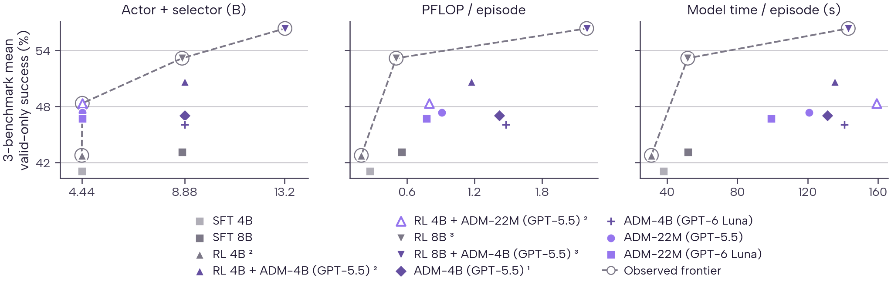

*Recipe 3 update of the [October 21 cost plot](#final-selection-head-ablations-20261021) (whose points are from October 21 and are not comparable: DeepShop success has drifted up about 13 pp since). SFT 4B actor, November 3–4, with the SFT 4B run of the same window. Success: 3-benchmark equal-weight mean of valid-only success (successes / valid episodes), three runs pooled. Cost from run 1 (all 1,045 tasks), as in the October plot: actor PFLOP = 2 × params × (uncached prompt + generated tokens), LoRA selectors 2 × 4.44 B × their tokens, head FLOPs as logged; model time = actor + selector decision time per episode, excluding browser execution. Only H = 4 lookahead labels (Recipe 3) are plotted; the pre-execution-label ablations are in the table above. Legend: ADM-4B = diamond-marked 4B LoRA selector (green/teal for GPT-5.5, salmon for GPT-6 Luna); ADM-22M = light-purple 22.6M head (circles for GPT-5.5, squares for Luna). Squares are single-sample actors (SFT 4B gray, SFT 8B dark); ² Up triangles are the RL 4B checkpoint (4,096 response tokens): dark alone (November 4), whose shorter episodes make it the cheapest point; green/teal diamonds with ADM-4B (GPT-5.5) and light purple hollow with ADM-22M (GPT-5.5) on the RL actor's own features (November 4–5). ³ Down triangles are the RL 8B actor (November 4–5): dark alone, lighter green/teal diamonds with the GPT-5.5 H = 4 LoRA (8.77 B + 4.44 B parameters). Dashed segments and rings mark the observed Pareto frontier of each panel, as in the API plots: points not beaten by any other point on both lower x and higher success. They are descriptive, not attainable interpolations or significant differences. ¹ The GPT-5.5 LoRAs are from the November 4 same-day rerun, the window right after the other rows (SelectionARM unchanged between the two windows: −0.5 [−2.4, +1.4] pp); their costs are measured on that rerun. Points are descriptive, without uncertainty bars; paired intervals are in the table above.* [PDF](arm_results/rl_integration/selection-recipe3-vs-cost-20261104.pdf) · [SVG](arm_results/rl_integration/selection-recipe3-vs-cost-20261104.svg) · [data](arm_results/rl_integration/selection-recipe3-vs-cost-20261104.json) · [cost script](arm_results/rl_integration/selection-recipe3-vs-cost-20261104-analysis.py) · [plot script](arm_results/rl_integration/selection-recipe3-vs-cost-20261104.py)

**Per benchmark:**

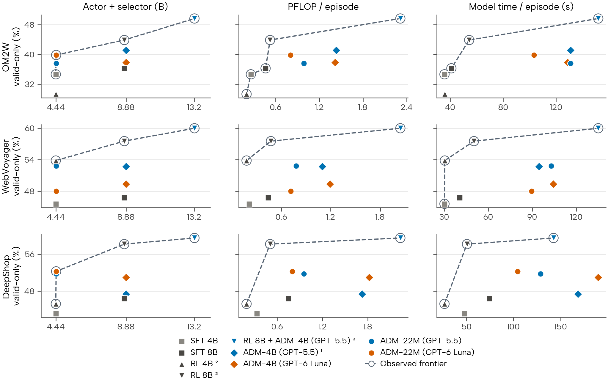

*Same data, encoding and frontier rule as above, one row per benchmark (valid-only success, three runs pooled; cost from run 1).* [PDF](arm_results/rl_integration/selection-recipe3-vs-cost-per-benchmark-20261104.pdf) · [SVG](arm_results/rl_integration/selection-recipe3-vs-cost-per-benchmark-20261104.svg) · [plot script](arm_results/rl_integration/selection-recipe3-vs-cost-20261104.py) (renders all five figures)

All five Recipe 3 cost views use a shared legend below the panels, with Albert Sans text and full-width plotting areas. The earlier six-panel actor/head comparison uses the same bottom-legend placement.

**SFT actors only** (same plots without the RL 4B and RL 8B checkpoints; frontiers recomputed over the remaining points):

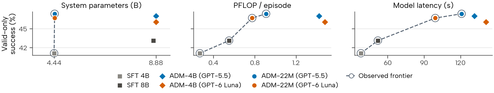

*Filled circles identify ADM-23M and larger filled diamonds identify ADM-4B; bright purple identifies GPT-5.5 labels and salmon identifies Luna labels. Compact SFT-only view: equal-weight mean of valid-only success across the three benchmarks, with three runs pooled within each benchmark and costs from run 1. System parameters sum actor and selector parameters. Model latency is actor-plus-selector decision time per episode, excluding browser execution. GPT-5.5 LoRA uses the adjacent November 4 rerun window described above; its legend omits the footnote marker. The six existing SFT configurations retain their coordinates. The added ADM-distilled actor uses the user-provided November 10 summary: equal-weight mean valid-only success 49.9%, 0.270 PFLOP/episode and 41.1 s/episode (41.13 before rounding from benchmark means), with 4.44B parameters assumed for a standalone distilled 4B actor. Its green square is included in the recomputed observed frontier. Evaluation date, run count, judge, exact valid counts and cost-population accounting were not supplied for this added point, so comparison is descriptive. [Distilled-actor source values](arm_results/rl_integration/selection-adm-distilled-actor-20261110.json).*

**Overall-success version** (including external selectors, RL 8B with/without ADM, and updated SFT 4B / best ADM-4B success rates; GPT-6 Luna variants omitted; frontiers recomputed):

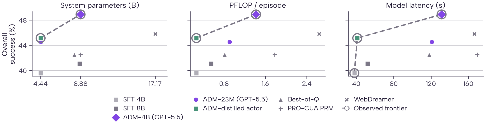

*Overall success is successes / scheduled tasks, with invalid episodes counted as failures. Means weight OM2W, WebVoyager and DeepShop equally. Rings and dashed lines mark the observed cost–success frontier; they do not imply statistical superiority. The legend groups actors, our ADM methods and external selectors. Filled purple circles/diamonds denote ADM-23M/ADM-4B (GPT-5.5 labels); the darker purple diamond uses the RL 8B actor. A purple square denotes the distilled actor; hollow gray markers identify external selectors. The mean parameter frontier contains the ADM-distilled actor (45.1%), RL 8B (50.9%) and RL 8B + ADM-4B (54.7%). The mean compute frontier additionally retains RL 4B (41.0%); the mean latency frontier additionally retains RL 4B and SFT 4B (42.0%); best SFT-actor ADM-4B (48.9%) is dominated by RL 8B in these updated point estimates. RL 4B is restored from the original pooled result table: OM2W 26.0%, WebVoyager 52.21%, DeepShop 44.89%, equal-weight mean 41.0%; its existing run-1 costs are retained (0.194 PFLOP and 31.1 model seconds per episode). The user-provided RL 8B rates are WebVoyager 56.5%, OM2W 38.3%, DeepShop 57.8%, mean 50.9%; RL 8B + ADM-4B rates are 58.8%, 41.9%, 63.3%, mean 54.7%. RL costs retain the existing November 4–5 run-1 coordinates: 8.77B / 13.21B system parameters, 0.504 / 2.197 PFLOP per episode and 51.8 / 143.1 model seconds per episode for baseline / ADM. Matching costs, exact counts and dates for the supplied success rows were not provided. The retained historical methods use the linked [cost/result data](arm_results/rl_integration/selection-recipe3-vs-cost-20261104.json); the distilled actor uses the user-provided [summary](arm_results/rl_integration/selection-adm-distilled-actor-20261110.json). Added external selectors use the user-provided [costs and overall-success rates](arm_results/rl_integration/selection-external-selector-costs-20261113.json): Best-of-Q 42.5%, PRO-CUA PRM 42.5%, WebDreamer (one value sample; Dreamer-7B in the success table) 45.8%. Kev-4B is added at the user-reported 39.1%, using [matching November 11 run telemetry and accounting](ARM_JEV_KEV_CROSSBENCH.md#kev-4b-system-cost): 8.644B system parameters, 1.828 PFLOP/episode and 115.2 model seconds/episode, equal-weight means. Kev compute charges the full selector input because cache savings are not exposed; its serialized response tokens are excluded because it does not generate text. Their reported mean rates are retained because the rounded benchmark rates do not exactly reconstruct every reported mean. External selectors use the SFT 4B actor, five candidates, temperature 1.0, run 1; historical SFT/ADM success rates pool three runs. SFT 4B now uses the user-provided overall rates: WebVoyager 48.0%, OM2W 32.5%, DeepShop 45.5%, mean 42.0%, retaining its existing cost coordinates; exact counts, date and run count for this new row were not supplied. The best ADM-4B point now uses the user-provided overall rates: WebVoyager 52.4%, OM2W 43.8%, DeepShop 50.5%, reported mean 48.9%. It replaces the GPT-5.5 ADM-4B success coordinates in these overall-success views while retaining that configuration’s existing costs. Matching costs, evaluation date, exact counts and run count for the new row were not supplied; this is a combined summary, not a verified matched-run cost measurement. Original pooled data and valid-only plots are preserved. External latency is estimated from steps × (7.96 s actor generation + measured selector time), excluding browser time; PRO-CUA and WebDreamer estimates are lower bounds because GPU sharing slows the actor. Best-of-Q assumes 300 embedder state tokens/step, a slight compute undercount. The distilled actor's protocol and exact counts remain unspecified. Comparisons are descriptive. Valid-only plots are retained unchanged.* [PDF](arm_results/rl_integration/selection-recipe3-vs-cost-sft-actors-overall-20261104.pdf) · [SVG](arm_results/rl_integration/selection-recipe3-vs-cost-sft-actors-overall-20261104.svg).

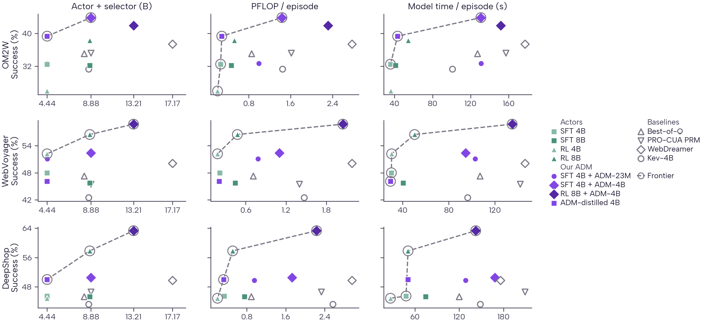

[Per-benchmark PDF](arm_results/rl_integration/selection-recipe3-vs-cost-per-benchmark-sft-actors-overall-20261104.pdf) · [SVG](arm_results/rl_integration/selection-recipe3-vs-cost-per-benchmark-sft-actors-overall-20261104.svg).

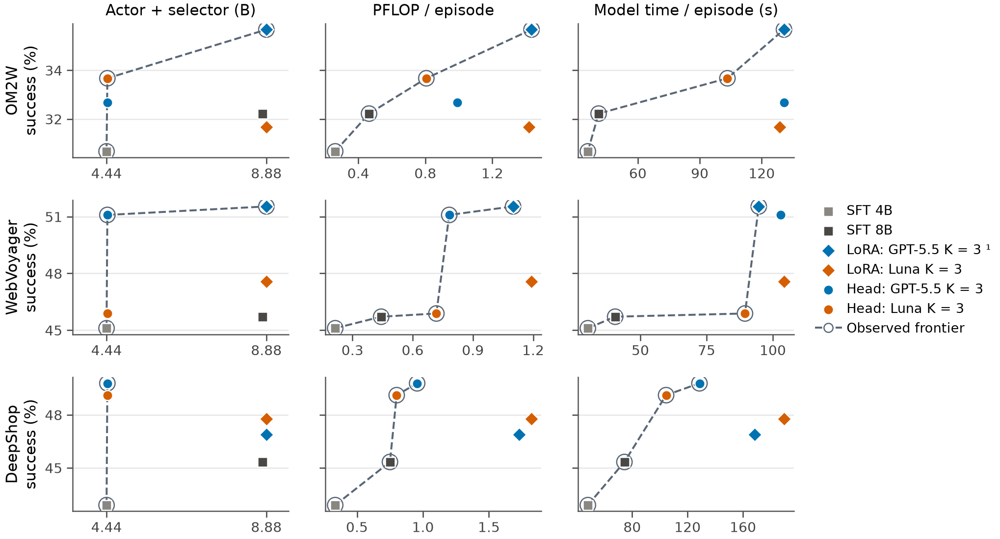

[PDF](arm_results/rl_integration/selection-recipe3-vs-cost-sft-actors-20261104.pdf) · [SVG](arm_results/rl_integration/selection-recipe3-vs-cost-sft-actors-20261104.svg) · per benchmark: [PDF](arm_results/rl_integration/selection-recipe3-vs-cost-per-benchmark-sft-actors-20261104.pdf) · [SVG](arm_results/rl_integration/selection-recipe3-vs-cost-per-benchmark-sft-actors-20261104.svg)

**RL actors only** (RL 4B and RL 8B checkpoints alone and with the GPT-5.5 H = 4 selectors; frontiers recomputed over these five points):

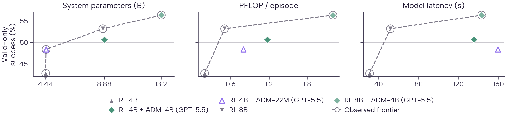

*Compact RL-only view, same encoding as the SFT-only view: up triangles RL 4B (616cc8f), down triangles RL 8B (824a54f), both with 4,096 response tokens; dark = actor alone, green/teal diamonds = + ADM-4B (GPT-5.5), lighter for the RL 8B actor, light purple hollow = + ADM-22M (GPT-5.5) on the RL 4B actor's own features. RL 4B alone is from November 4; the selector rows and RL 8B are from November 4–5 (adjacent windows; paired intervals in footnotes ² and ³ of the Recipe 3 table).* [PDF](arm_results/rl_integration/selection-recipe3-vs-cost-rl-actors-20261104.pdf) · [SVG](arm_results/rl_integration/selection-recipe3-vs-cost-rl-actors-20261104.svg)

#### Training time, compute and latency: heads vs 4B decoder

**The 22.6M head trains about 18× cheaper and selects about 27× faster than the 4B LoRA decoder, but end-to-end decision time per episode is the same, because generating the five candidates dominates every step.** Both are the default Recipe 3 GPT-5.5 H = 4 selectors (ADM-22M, ADM-4B with full data, no WebArbiter pairs), trained on the same panels and evaluated with the SFT 4B actor, N = 5.

| | 22.6M head (ADM-22M) | 4B LoRA decoder (ADM-4B) | Ratio |
| --- | ---: | ---: | ---: |
| ***Training*** | | | |
| Feature extraction (actor hidden states, layers 18/27/36, all panels) | 1.0 H200-h (1 H200, 1 h 02 min) | — | |
| Training | 7.5 min on 16 CPUs, no GPU (20 epochs, 18,781 panels) | 18.9 H200-h (4 H200, 4 h 44 min; 2 epochs, 32,974 examples) | |
| Total GPU time | 1.0 H200-h | 18.9 H200-h | ~18× |
| ***Selection, per step*** | | | |
| Selection, mean / median / 90th percentile | 17 / 15 / 24 ms | 473 / 429 / 756 ms | ~27× |
| Actor generation of 5 candidates, mean | 7.98 s | 7.96 s | ≈ 1 |
| Decision step (generation + selection), mean | 8.00 s | 8.43 s | 0.95 |
| ***Per episode*** | | | |
| Steps | 14.0 | 13.2 | |
| Selection time | 0.24 s | 6.2 s | |
| Decision time (SFT 4B alone, 1 sample: 32 s) | 112 s | 111 s | ≈ 1 |
| End-to-end episode time incl. browser, mean (SFT 4B alone: 92 s) ³ | 182 s | 181 s | ≈ 1 |
| Steps measured | 29,334 (2 runs) | 40,193 (3 runs) | |

*Latency: November 11 runs on 1 H200 each (head: head-size sweep `eval-scale`; decoder and SFT: data sweep `eval-1111`), all three benchmarks, from each step's `selection_seconds` / `generation_seconds`; browser time excluded. The head scores hidden states the actor exports while generating; that export overlaps with the other candidates' generation, so generation time matches the decoder's. The decoder is a separate sglang server on the same GPU (one forward per step over about 3.5K uncached selection-prompt tokens on average, request overhead included). ³ From the table below (all runs of each). Training: head `train/heads-all2/k3-best` (`train_seconds` 452, train job allocated 1 H200 that the CPU trainer did not use, not counted); features `features/features-all2` (job 413066); decoder `lora/lora` (job 412317, LLaMA-Factory `train_runtime` 4:43:59, merge excluded); all under `rl-actor-recollect-20261016/p16-k3-20261031/`. Evidence: [latency data](arm_results/rl_integration/selection-latency-head-vs-decoder-20261111.json) · [script](arm_results/rl_integration/selection-latency-head-vs-decoder-20261111.py).*

**Compute and latency by head size (November 11–12).** *Every head adds under 0.1 TFLOP per step to the actor's 61 TFLOP for five candidates (the 1.8B head itself 17.7 GFLOP); the 4B decoder adds 30.7 TFLOP, so a decoder episode costs about 1.2 PFLOP against 0.8–0.9 with any head. Selection time grows with head size (15 ms at 4.4M, 67 ms at 273M, 337 ms at 1.8B, 474 ms for the decoder), but end-to-end episode time is 161–186 s for every head and 181 s for the decoder, against 92 s for SFT 4B alone: generating five candidates instead of one doubles the episode, and the selector does not matter.*

| Selector | Params | Selector TFLOP / step | of which head | Actor TFLOP / step | PFLOP / episode | Selection ms, mean / median / p90 | Model time / episode | End-to-end / episode, mean / median / p90 | Steps / episode |
| --- | ---: | ---: | ---: | ---: | ---: | ---: | ---: | ---: | ---: |
| d128-L2 head | 4.4M | 0.046 | 0.04 G | 61.2 | 0.80 | 15 / 13 / 21 | 100 s | 168 / 112 / 388 s | 13.0 |
| d256-L2 head | 9.6M | 0.049 | 0.10 G | 60.5 | 0.77 | 15 / 13 / 21 | 98 s | 161 / 113 / 363 s | 12.7 |
| d512-L2 head (default, ADM-22M) | 22.6M | 0.047 | 0.23 G | 60.7 | 0.86 | 17 / 15 / 24 | 112 s | 182 / 129 / 403 s | 14.1 |
| d2048-L4 head | 272.8M | 0.049 | 2.7 G | 59.6 | 0.83 | 67 / 53 / 109 | 112 s | 179 / 127 / 396 s | 14.0 |
| d4096-L8 head | 1.77B | 0.064 | 17.7 G | 60.8 | 0.85 | 337 / 276 / 512 | 116 s | 186 / 128 / 417 s | 13.9 |
| 4B LoRA decoder (ADM-4B) | 4.44B | 30.7 | — | 61.1 | 1.22 | 474 / 430 / 758 | 113 s | 181 / 122 / 410 s | 13.3 |
| SFT 4B alone (1 sample) | — | — | — | 18.7 | 0.24 | — | 33 s | 92 / 66 / 205 s | 12.8 |

*Per decision step, forward FLOPs = 2 × params × tokens. Head selector = the actor's follow-up decode for candidates whose end token was not cached (2 × 4.44B × uncached + sampled tokens, about 44 GFLOP) plus the head (2 × head params × 5 candidates, "of which head"), as logged per step. Decoder selector = 2 × 4.44B × (uncached selection-prompt + generated tokens) from each step's selector telemetry. Actor = 2 × 4.44B × (uncached prompt + completion tokens) over the step's actor requests (5.0 per step with N = 5), run 1 only. PFLOP per episode = (actor + selector) × steps per episode. Selection and model time from each step's decision trace (browser excluded); end-to-end = each episode record's `elapsed_seconds` (wall clock from start to finish incl. browser; the judge ran afterwards). Each run is 1 H200 on all 1,045 tasks. Heads pool every run of the head-size sweep (`eval-scale`, `eval-seed`, `eval-sizes3`; training seed 0; 3 runs each, 22.6M 4), November 11–12; decoder and SFT: `eval-1111` (3 runs, November 11). End-to-end times also move with steps per episode and site speed (the 9.6M head's 161 s comes with 12.7 steps per episode, the 22.6M head's 182 s with 14.1). Evidence: [data](arm_results/rl_integration/selection-head-scale-cost-20261112.json) · [script](arm_results/rl_integration/selection-head-scale-cost-20261112.py).*

#### How much Recipe 3 data the 4B LoRA needs (November 4–9)

**About 12% of the GPT-5.5 H = 4 data is enough: LoRAs trained on 252 states (all their panels) or on one panel per state match the full-data LoRA. Rerun in one window with the full LoRA (November 8–9), four panels per state, one panel per state and 1,000 states are +0.4, +0.4 and −1.1 pp, and 252 states is +0.2 in its own window with a fresh full-data reference (November 10–11; all intervals cross 0): subsets match the full data but do not beat it. Below that, 2-epoch LoRAs on about 1K and 250 panels collapse to a fixed answer and score like SFT alone; trained for about 480 steps, 1,001 panels (4 epochs) and even 252 panels (16 epochs, 1.5% of the data) are level with the full data ([below 2K](#final-selection-recipe3-data-below2k-20261111)). Their November 4–6 leads (+3.0 [+1.1, +4.9], +1.5, +1.6) were a window effect ([rerun below](#final-selection-recipe3-data-rerun-20261109)).** Same recipe, seed and evaluation as the [GPT-5.5 H = 4 4B LoRA](#final-selection-recipe3) (SFT 4B actor, N = 5, T 1.0 / top-p 0.9, all 1,045 tasks); only the training subset changes. Subsets of the 32,974-example data: *states* keeps whole tasks, in a seeded task order, until 250 / 500 / 1,000 states, with all their panels; *panels* keeps all 2,112 states and samples 1 / 2 / 4 panels per state (seed 20261023). Ablations ran November 4–5. SFT 4B and the full-data LoRA were re-run 3 times on November 6 as same-window references; they match their earlier batches (SFT −0.1 [−2.2, +1.9] pp vs November 3, full LoRA +0.5 [−1.3, +2.5] vs November 4).

| Training subset | Examples | States | Runs | Online-Mind2Web | WebVoyager | DeepShop | Mean overall | Mean valid-only | − SFT alone, pp [95% CI] | − full-data LoRA, pp [95% CI] |
| --- | ---: | ---: | ---: | ---: | ---: | ---: | ---: | ---: | ---: | ---: |
| SFT 4B alone (1 sample) | — | — | 3 | 32.9% | 44.7% | 45.2% | 39.4% | 40.9% | — | — |
| Full data (GPT-5.5 H = 4 LoRA) | 32,974 | 2,112 | 3 | 40.1% | 53.6% | 50.0% | 45.2% | 47.9% | +5.8 [+3.5, +8.1] | — |
| 250 states | 3,858 | 252 | 3 | 40.2% | 54.0% | 49.8% | 45.5% | 48.0% | +6.0 [+3.9, +8.3] | +0.2 [−1.9, +2.3] |
| 500 states | 7,742 | 500 | 1 | <ins>42.6%</ins> | 52.5% | 46.6% | 44.0% | 47.2% | +4.6 [+1.9, +7.3] | −1.3 [−4.2, +1.7] |
| 1,000 states | 15,746 | 1,001 | 3 | **44.0%** | 53.1% | 51.7% | <ins>46.8%</ins> | 49.6% | +7.4 [+5.2, +9.6] | +1.6 [−0.4, +3.6] |
| 1 panel per state | 3,910 | 2,112 | 3 | 40.3% | **54.6%** | <ins>53.1%</ins> | <ins>46.8%</ins> | 49.3% | +7.4 [+5.1, +9.6] | +1.5 [−0.6, +3.7] |
| 2 panels per state | 7,476 | 2,112 | 1 | 36.0% | 54.3% | 51.7% | 44.8% | 47.3% | +5.3 [+2.3, +8.4] | −0.5 [−3.4, +2.4] |
| 4 panels per state | 13,532 | 2,112 | 3 | 40.8% | **54.6%** | **55.8%** | **48.3%** | **50.4%** | **+8.8 [+6.6, +10.9]** | **+3.0 [+1.1, +4.9]** |

*Per-benchmark columns are valid-only success. Mean overall is the equal-weight 3-benchmark mean of overall success (successes / tasks); differences are on it, paired bootstrap over tasks (10,000 resamples, seed 20261029), per-task success averaged over a row's runs. Intervals reflect task sampling, not training-seed variance (one seed per subset). Against the full LoRA, 4 panels per state is +6.2 [+2.0, +10.4] on DeepShop, +2.4 [−0.1, +4.9] on WebVoyager and +0.3 [−2.6, +3.3] on Online-Mind2Web; 1 panel per state is +3.3 [−1.8, +8.2], +2.2 [−0.3, +4.8] and −0.9 [−3.8, +2.0]. Task-weighted (300 / 595 / 150 of 1,045) − SFT: full +6.5, 4 panels +8.8, 1 panel +7.9, 1,000 states +7.8, 250 states +7.0. With the earlier references (SFT November 3, full LoRA November 4) the gaps were similar: 4 panels +3.5, 1 panel and 1,000 states +2.1 over the full LoRA. November 6 judge note: the OpenAI key failed mid-run, so the reference rollouts finished without judging and were judged afterwards from their saved final-turn inputs by the same judge, prompts and parsers (requests verified identical to live ones on 15 tasks per benchmark). Subsets take 480–1,700 optimizer steps (2 epochs, batch 16) against about 4,100 for the full data, so the full LoRA may be overtrained. A step-matched control (November 9, [below](#final-selection-recipe3-lora-controls-20261109)) rules this out: the full data at the 4-per-state subset's 1,692 steps scores the same as at 4,122.*

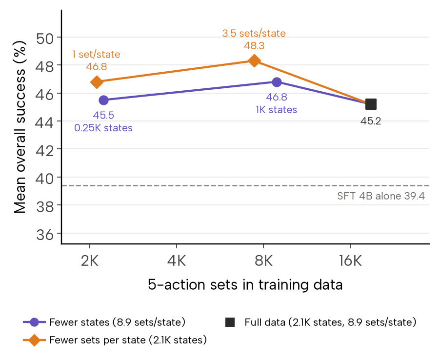

*Both subset families on one log axis of 5-action sets (panels) in the training data; the legend gives each family's fixed setting and each point is labelled with the varied one (states, rounded in K, or mean sets per state; the 4-per-state subset averages 3.5, as some states have fewer than 4 sets). Dark purple identifies ADM-4B throughout. Circles: fewer states (252 / 1,001 states with all their sets). Diamonds: fewer sets per state (1 / 4 per state, all 2,112 states). Square: full data (2,112 states, 18,786 sets). y: equal-weight 3-benchmark mean of overall success (successes / tasks), 3 runs pooled per point; the 1-run subsets (500 states, 2 sets per state) are in the table only. Dashed: SFT 4B alone (3 runs, November 6). Paired intervals are in the table above.*

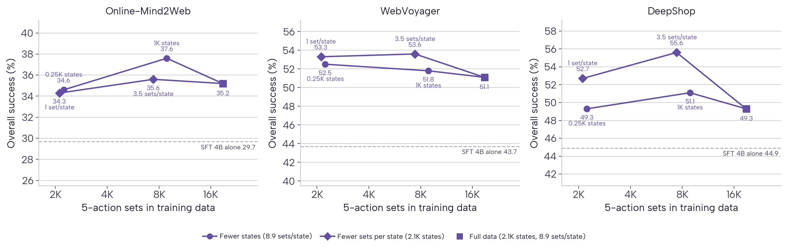

*Same encoding, overall success per benchmark. The 4-sets-per-state lead over the full data is mostly DeepShop (+6.2 [+2.0, +10.4] pp, table note); it did not replicate in the [November 8–9 rerun](#final-selection-recipe3-data-rerun-20261109). Mean: [PDF](arm_results/rl_integration/selection-recipe3-data-ablations-compact-20261105.pdf) · [SVG](arm_results/rl_integration/selection-recipe3-data-ablations-compact-20261105.svg) · per benchmark: [PDF](arm_results/rl_integration/selection-recipe3-data-ablations-per-benchmark-20261105.pdf) · [SVG](arm_results/rl_integration/selection-recipe3-data-ablations-per-benchmark-20261105.svg) · [plot script](arm_results/rl_integration/selection-recipe3-data-ablations-compact-20261105.py) · earlier separate valid-only plots: states [PNG](arm_results/rl_integration/selection-recipe3-data-states-20261105.png), panels [PNG](arm_results/rl_integration/selection-recipe3-data-panels-20261105.png) ([script](arm_results/rl_integration/selection-recipe3-data-ablations-20261105.py)) · [data](arm_results/rl_integration/selection-recipe3-data-ablations-20261105.json) · [analysis script](arm_results/rl_integration/selection-recipe3-data-ablations-20261105-analysis.py). Runtime: `/gpfs/scrubbed/zixianma/openwebrl-runtime/recipe3-ablations-20261104/` (subset builder `build_lora_subsets.py`, LoRAs `lora/<subset>/{adapter,merged}`, evals `eval/run<k>/`, same-window references `eval-ctrl/run<k>/`, deferred judging `deferjudge/`).

**Below 2K panels (November 11).** *With about 480+ optimizer steps, even 252 panels (495 examples, 1.5% of the data, 16 epochs) are level with the full data in the same window (−0.4 [−3.4, +2.7] pp), as are 1,001 panels at 4 epochs (−1.1 [−3.1, +1.0]). With 250 steps or fewer, LoRAs on 1K or fewer panels collapse to always answering candidate 2 and score like SFT alone. The limit is optimizer steps, not data.* LoRAs on 1 panel per state for the first 1,000 or 250 states of the seeded task order (nested in the 1-panel-per-state subset; same recipe) were evaluated with the full-data LoRA and SFT 4B alone in one window, 3 runs each.

| Training data | Panels | Examples | Online-Mind2Web | WebVoyager | DeepShop | Mean overall | Mean valid-only | − full-data LoRA, pp [95% CI] | Picks candidate 2 |
| --- | ---: | ---: | ---: | ---: | ---: | ---: | ---: | ---: | ---: |
| Full data | 18,786 | 32,974 | 41.9% | 53.9% | 50.0% | 45.0% | 48.6% | — | 30% |
| 1,000 states × 1 panel | 1,001 | 1,905 | 34.9% | 46.6% | 40.3% | 37.6% | 40.6% | **−7.3 [−9.5, −5.2]** | 96% |
| 250 states × 1 panel | 252 | 495 | 34.9% | 44.7% | 42.2% | 38.0% | 40.6% | **−6.9 [−9.2, −4.7]** | 99% |
| 1,000 states × 1 panel, 4 epochs ¹ | 1,001 | 1,905 | 40.5% | 53.3% | 48.5% | 43.9% | 47.5% | −1.1 [−3.1, +1.0] | 22% |
| 250 states × 1 panel, 4 epochs ² | 252 | 495 | 33.3% | 44.6% | 39.3% | 36.4% | 39.0% | **−8.4 [−11.6, −5.4]** | 96% |
| 250 states × 1 panel, 16 epochs ² | 252 | 495 | 43.8% | 54.0% | 47.0% | **44.5%** | **48.3%** | −0.4 [−3.4, +2.7] | 24% |
| SFT 4B alone (1 sample) | 0 | 0 | 33.7% | 46.5% | 39.6% | 37.2% | 39.9% | −7.8 [−10.1, −5.6] | — |

| Training data | Online-Mind2Web valid / episodes | Online-Mind2Web successes | WebVoyager valid / episodes | WebVoyager successes | DeepShop valid / episodes | DeepShop successes |
| --- | ---: | ---: | ---: | ---: | ---: | ---: |
| Full data | 793 / 900 | 332 | 1,606 / 1,785 | 865 | 446 / 450 | 223 |
| 1,000 states × 1 panel | 794 / 900 | 277 | 1,614 / 1,785 | 752 | 447 / 450 | 180 |
| 250 states × 1 panel | 810 / 900 | 283 | 1,615 / 1,785 | 722 | 450 / 450 | 190 |
| 1,000 states × 1 panel, 4 epochs | 787 / 900 | 319 | 1,612 / 1,785 | 860 | 445 / 450 | 216 |
| 250 states × 1 panel, 4 epochs | 803 / 900 | 267 | 1,616 / 1,785 | 720 | 448 / 450 | 176 |
| 250 states × 1 panel, 16 epochs | 776 / 900 | 340 | 1,616 / 1,785 | 873 | 447 / 450 | 210 |
| SFT 4B alone | 796 / 900 | 268 | 1,625 / 1,785 | 756 | 447 / 450 | 177 |

*Per-benchmark columns are valid-only; differences on mean overall, paired bootstrap as above. "Picks candidate 2": share of run-1 decision steps (about 13–14K each) on which the decoder answered `{"selection": 2}`; no step fell back (every answer parsed). The full-data LoRA spreads its picks (39 / 30 / 10 / 9 / 13% over candidates 1–5). Choosing a fixed slot among five independent samples is equivalent to one sample, so both small LoRAs land on SFT 4B alone (37.6% and 38.0% vs 37.2%). Both trained for very few optimizer steps (about 240 and 62, against 490 for the 1-panel-per-state subset and 4,122 for the full data), and the step-matched control confirms it was too few steps. ¹ The same 1,001 panels trained 4 epochs (about 476 steps), evaluated 3 runs on November 11 evening (`eval-1111b`), later than the other rows, so its difference is same-day but cross-window; its picks spread over the five candidates (17 / 22 / 16 / 24 / 20% on DeepShop) and it is +6.2 [+4.0, +8.5] pp over the 2-epoch LoRA on the same data ([data](arm_results/rl_integration/selection-evening-20261111.json), `step_matched`). ² The same 252 panels trained 4 epochs (about 124 steps) and 16 epochs (about 495 steps), 3 runs each, evaluated November 12 (00:00–04:20 PST, `eval-s250ep`) with the full-data LoRA and SFT 4B alone re-run in that window (1 run each: 44.8% and 34.7% mean overall); their differences are against that same-window full-data run. At 4 epochs the LoRA still answers candidate 2 on 96% of steps; at 16 epochs its picks spread (31 / 24 / 13 / 14 / 17%) and it is +8.1 [+6.0, +10.2] pp over the 4-epoch LoRA. Overfitting 252 panels for 16 epochs does not hurt live success. Evidence: [rates and contrasts](arm_results/rl_integration/selection-recipe3-data-s250-steps-20261112.json) · [script](arm_results/rl_integration/selection-recipe3-data-s250-steps-20261112.py). The full-data reference reproduces earlier windows (45.0% mean overall vs 45.6% and 46.1%). Evidence: [rates and contrasts](arm_results/rl_integration/selection-recipe3-data-below2k-20261111.json) · [script](arm_results/rl_integration/selection-recipe3-data-below2k-20261111.py). Runtime: `recipe3-ablations-20261104/` (subsets `lora-data/{s1000,s250}-pps1/`, LoRAs `lora/{s1000,s250}-pps1/`, evals `eval-1111/run<k>/`).*

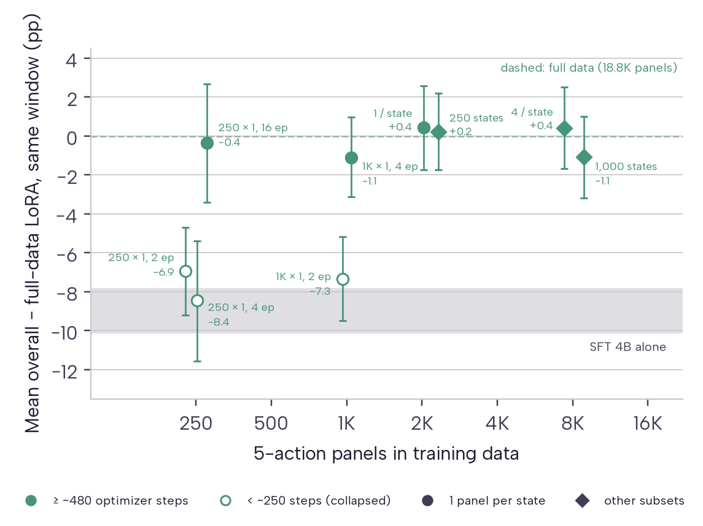

*Every data-scaling LoRA (November 8–12, 3 runs each) as mean overall success minus SFT 4B alone (1 sample; 3 runs on November 11, 1 run on November 12, when the full-data reference also ran once), with its paired 95% interval; labels give states × panels per state and epochs. Filled: about 480 or more optimizer steps (all +6.7 to +9.8 pp, level with the full-data LoRA at +7.8 / +10.1 in the November 11 / 12 windows); hollow: 250 or fewer, collapsed to candidate 2 and level with SFT (+0.5 to +1.7, intervals cross 0). SFT from the same window where it ran (November 11 and 12); the November 8–9 and 10 windows ran no SFT, so points marked * use the November 11 SFT (cross-window; the same-window comparison with the full-data LoRA is in the tables above). Paired bootstrap over tasks (10,000 resamples, seed 20261029, benchmarks resampled independently). [PDF](arm_results/rl_integration/selection-recipe3-data-scaling-20261112.pdf) · [SVG](arm_results/rl_integration/selection-recipe3-data-scaling-20261112.svg) · [plot script](arm_results/rl_integration/selection-recipe3-data-scaling-20261112.py) · [data](arm_results/rl_integration/selection-recipe3-data-scaling-vs-sft-20261112.json) · [analysis script](arm_results/rl_integration/selection-recipe3-data-scaling-vs-sft-20261112.py).*

**Training and inference cost of the data-scaling LoRAs.** *Inference cost does not depend on the training data: every LoRA spends about 30 TFLOP and 460–520 ms per selection and 167–191 s per episode end to end (SFT 4B alone: 91–92 s). Training cost falls with the data: the 250 × 1 panel LoRA at 16 epochs, level with the full data, takes 2.2 H200-h against 18.9.*

| Window | LoRA training data | Epochs | Training, 4 H200 | H200-h | Selection ms, mean / p90 | Selector TFLOP / step | Model time / episode | End-to-end / episode, mean / median / p90 | Steps / episode | Runs |
| --- | --- | ---: | ---: | ---: | ---: | ---: | ---: | ---: | ---: | ---: |
| Nov 8–9 | Full data | 2 | 4 h 44 min | 18.9 | 474 / 760 | 30.8 | 114 s | 181 / 121 / 407 s | 13.2 | 3 |
| Nov 8–9 | 4 panels / state | 2 | 1 h 58 min | 7.9 | 500 / 788 | 30.5 | 104 s | 169 / 111 / 390 s | 12.3 | 3 |
| Nov 8–9 | 1 panel / state | 2 | 0 h 34 min | 2.3 | 496 / 790 | 30.8 | 110 s | 176 / 117 / 395 s | 12.8 | 3 |
| Nov 8–9 | 1,000 states | 2 | 2 h 15 min | 9.1 | 504 / 789 | 31.0 | 114 s | 183 / 123 / 411 s | 13.1 | 3 |
| Nov 8–9 | Full data, 1,692 steps | 0.82 | 1 h 56 min | 7.8 | 480 / 764 | 31.0 | 113 s | 179 / 117 / 411 s | 13.0 | 3 |
| Nov 8–9 | Full data, full fine-tune | 2 | 4 h 42 min | 18.8 | 478 / 767 | 30.9 | 116 s | 183 / 124 / 412 s | 13.3 | 3 |
| Nov 10 | Full data | 2 | 4 h 44 min | 18.9 | 473 / 757 | 30.7 | 111 s | 177 / 120 / 395 s | 13.0 | 3 |
| Nov 10 | 252 states | 2 | 0 h 32 min | 2.1 | 511 / 806 | 31.9 | 121 s | 191 / 132 / 432 s | 13.6 | 3 |
| Nov 11 | 1,000 states × 1 panel, 2 ep | 2 | 0 h 16 min | 1.1 | 469 / 756 | 29.8 | 111 s | 173 / 123 / 385 s | 13.4 | 3 |
| Nov 11 | 250 states × 1 panel, 2 ep | 2 | 0 h 04 min | 0.3 | 491 / 780 | 29.7 | 107 s | 168 / 118 / 379 s | 12.9 | 3 |
| Nov 11 evening | 1,000 states × 1 panel, 4 ep | 4 | 0 h 33 min | 2.2 | 468 / 747 | 30.5 | 116 s | 184 / 128 / 417 s | 13.7 | 3 |
| Nov 12 | Full data | 2 | 4 h 44 min | 18.9 | 469 / 742 | 30.8 | 119 s | 189 / 132 / 428 s | 13.8 | 1 |
| Nov 12 | 250 states × 1 panel, 4 ep | 4 | 0 h 08 min | 0.6 | 463 / 739 | 29.7 | 107 s | 167 / 114 / 378 s | 13.0 | 3 |
| Nov 12 | 250 states × 1 panel, 16 ep | 16 | 0 h 33 min | 2.2 | 515 / 809 | 30.8 | 111 s | 176 / 127 / 380 s | 13.1 | 3 |
| Nov 12 | SFT 4B alone | — | — | — | — | — | 32 s | 91 / 64 / 197 s | 12.8 | 1 |

*Training: LLaMA-Factory `train_runtime` on 4 H200 (merge excluded); H200-h = 4 × runtime. Inference columns as in the [head-size cost table](#final-selection-recipe3-head-scale-cost-20261112), each LoRA in its own eval window (3 runs; the November 12 full-data and SFT references 1 run). Evidence: [data](arm_results/rl_integration/selection-head-scale-cost-20261112.json) · [script](arm_results/rl_integration/selection-head-scale-cost-20261112.py).*

**Same-window rerun (November 8–9).** *Subsets match the full data; they do not beat it.* The full-data LoRA and the 4-panels-per-state, 1-panel-per-state and 1,000-state subsets were re-evaluated together, 3 runs each, because the November 4–6 subset rows ran a day or two before their full-data reference. All three are within about 1 pp of the full LoRA on mean overall, with intervals spanning 0. The 4-per-state DeepShop lead is gone (−1.1 [−6.3, +4.1] valid-only, was +6.2), and the 1,000-state subset is lowest on WebVoyager (53.4% vs 56.8% valid-only).

| LoRA (Nov 8–9) | Runs | Online-Mind2Web | WebVoyager | DeepShop | Mean overall | Mean valid-only | − full-data LoRA, pp [95% CI] | Nov 4–6 − full, pp |
| --- | ---: | ---: | ---: | ---: | ---: | ---: | ---: | ---: |
| Full data | 3 | 40.1% | 56.8% | 52.7% | 46.1% | 49.8% | — | — |
| 4 panels per state | 3 | 42.1% | 56.9% | 51.6% | 46.5% | 50.2% | +0.4 [−1.7, +2.5] | +3.0 [+1.1, +4.9] |
| 1 panel per state | 3 | 43.2% | 54.4% | 53.3% | 46.5% | 50.3% | +0.4 [−1.7, +2.6] | +1.5 [−0.6, +3.7] |
| 1,000 states | 3 | 40.5% | 53.4% | 52.7% | 45.0% | 48.9% | −1.1 [−3.2, +1.0] | +1.6 [−0.4, +3.6] |
| ***November 10–11 window*** | | | | | | | | |
| Full data | 3 | 42.7% | 55.8% | 50.2% | 45.6% | 49.6% | — | — |
| 252 states | 3 | 42.4% | 55.2% | 51.9% | 45.8% | 49.8% | +0.2 [−1.7, +2.2] | +0.2 [−1.9, +2.3] |

| LoRA (Nov 8–9) | Online-Mind2Web valid / episodes | WebVoyager valid / episodes | DeepShop valid / episodes |
| --- | ---: | ---: | ---: |
| Full data | 779 / 900 | 1,619 / 1,785 | 444 / 450 |
| 4 panels per state | 787 / 900 | 1,616 / 1,785 | 446 / 450 |
| 1 panel per state | 782 / 900 | 1,616 / 1,785 | 445 / 450 |
| 1,000 states | 770 / 900 | 1,612 / 1,785 | 444 / 450 |
| Full data (Nov 10–11) | 784 / 900 | 1,610 / 1,785 | 442 / 450 |
| 252 states (Nov 10–11) | 772 / 900 | 1,611 / 1,785 | 445 / 450 |

*Per-benchmark columns are valid-only success. Same protocol, judges and bootstrap as the table above (paired over tasks, 10,000 resamples, seed 20261029, per-task success averaged over runs); no SFT 4B rerun in this window. The November 8–9 full-data row is shared with the [controls below](#final-selection-recipe3-lora-controls-20261109). The 252-state subset was rerun separately on November 10–11 (16:05–00:40 PST) with its own 3-run full-data reference, which reproduces November 8–9 (45.6% vs 46.1% mean overall); its difference is against that reference. Valid-only, Online-Mind2Web / WebVoyager / DeepShop: −0.4 [−3.7, +3.0] / −0.6 [−2.9, +1.7] / +1.7 [−2.9, +6.5]. One reference WebVoyager run lost its model server at 557 of 595 tasks and was resumed for the last 38. Evidence: [rates and contrasts](arm_results/rl_integration/selection-recipe3-data-s250-20261110.json) · [script](arm_results/rl_integration/selection-recipe3-data-s250-20261110.py). Runtime: `recipe3-ablations-20261104/eval-1110/run<k>/`.*

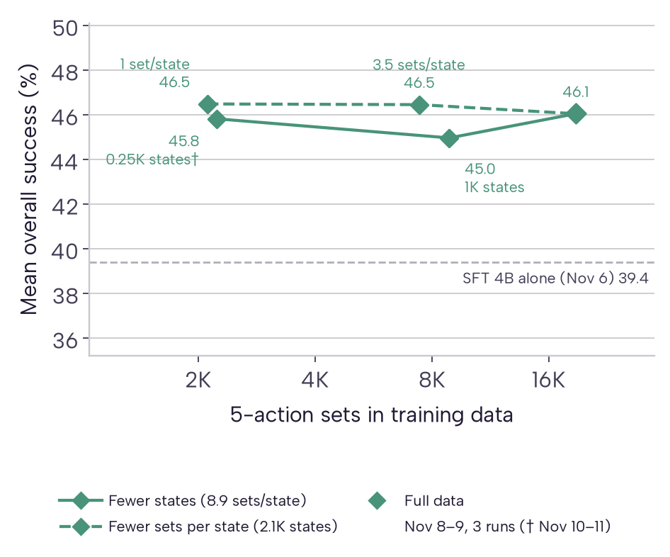

*Rerun points only: diamonds, solid line = fewer states, dashed line = fewer sets per state; November 8–9, 3 runs per point, except † 252 states (November 10–11, its own full-data reference 45.6% vs 46.1%). Dashed gray: SFT 4B alone (November 6). Per benchmark: [PNG](arm_results/rl_integration/selection-recipe3-data-ablations-rerun-clean-per-benchmark-20261109.png) · [PDF](arm_results/rl_integration/selection-recipe3-data-ablations-rerun-clean-per-benchmark-20261109.pdf). Mean: [PDF](arm_results/rl_integration/selection-recipe3-data-ablations-rerun-clean-20261109.pdf) · [SVG](arm_results/rl_integration/selection-recipe3-data-ablations-rerun-clean-20261109.svg).*

**With the November 4–6 batch** (shows how much the earlier subset leads moved):

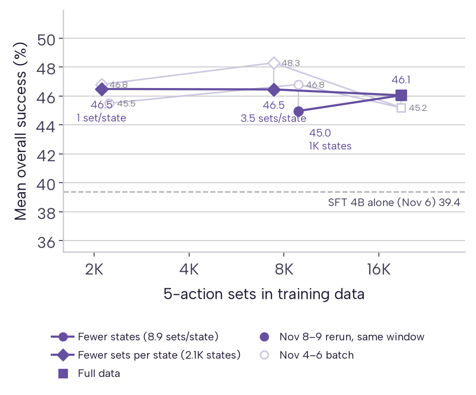

*All ADM-4B points use diamonds; solid family lines vary states and dashed family lines vary sets per state. Filled: November 8–9 rerun, all points in one window, except † 252 states, which shows its raw November 10–11 value (its reference that window: 45.6% vs 46.1%). Faded: the November 4–6 batch, each joined to its rerun by a gray line (points at 2.2K / 8.9K sets = 252 / 1,001 states; points at 2.1K / 7.4K = 1 / 3.5 sets per state). Dashed: SFT 4B alone (November 6, not rerun). Per benchmark: [PNG](arm_results/rl_integration/selection-recipe3-data-ablations-rerun-per-benchmark-20261109.png) · [PDF](arm_results/rl_integration/selection-recipe3-data-ablations-rerun-per-benchmark-20261109.pdf). Mean: [PDF](arm_results/rl_integration/selection-recipe3-data-ablations-rerun-20261109.pdf) · [SVG](arm_results/rl_integration/selection-recipe3-data-ablations-rerun-20261109.svg) · [plot script](arm_results/rl_integration/selection-recipe3-data-ablations-rerun-20261109.py) · [data](arm_results/rl_integration/selection-recipe3-data-ablations-rerun-20261109-analysis.json) · [analysis script](arm_results/rl_integration/selection-recipe3-data-ablations-rerun-20261109-analysis.py). Runtime: `recipe3-ablations-20261104/eval-1108/run<k>/`.*

**Step-matched LoRA and full fine-tune (November 9).** *The full-data LoRA is not overtrained, and full fine-tuning does not help.* Stopping the same LoRA at 1,692 steps (the 4-per-state subset's step count, about 0.82 epoch) gives the same success as the full 4,122-step schedule (−0.5 [−2.5, +1.4] pp mean overall). Training all language-model weights instead (lr 1e-5, same data, batch and 4,122 steps; vision tower and projector frozen) is worse: −2.5 [−4.6, −0.4] pp, mostly on WebVoyager (−4.6 [−7.2, −2.1] valid-only). Each row ran 3 times in one window (November 9, 03:30–10:15 PST); same actor, protocol and judges as the table above.

| Selector training | Online-Mind2Web valid | Online-Mind2Web successes | Online-Mind2Web | WebVoyager valid | WebVoyager successes | WebVoyager | DeepShop valid | DeepShop successes | DeepShop | Mean overall | Mean valid-only | − full LoRA, pp [95% CI] |
| --- | ---: | ---: | ---: | ---: | ---: | ---: | ---: | ---: | ---: | ---: | ---: | ---: |
| Full data, LoRA, 4,122 steps (reference) | 779 / 900 | 312 | 40.1% | 1,619 / 1,785 | 919 | 56.8% | 444 / 450 | 234 | 52.7% | **46.1%** | **49.8%** | — |
| Full data, LoRA, 1,692 steps (step-matched) | 790 / 900 | 324 | **41.0%** | 1,609 / 1,785 | 920 | **57.2%** | 445 / 450 | 221 | 49.7% | 45.6% | 49.3% | −0.5 [−2.5, +1.4] |
| Full data, full fine-tune, 4,122 steps | 789 / 900 | 302 | 38.3% | 1,621 / 1,785 | 845 | 52.1% | 444 / 450 | 224 | 50.5% | 43.6% | 47.0% | **−2.5 [−4.6, −0.4]** |

*Rate columns are valid-only, pooled over 3 runs; the difference is on mean overall (equal-weight 3-benchmark mean of overall success), paired bootstrap over tasks (10,000 resamples, seed 20261029, per-task success averaged over runs). Valid-only: step-matched − full LoRA −0.6 [−2.7, +1.5]; full fine-tune −2.9 [−5.1, −0.7]. Per benchmark, valid-only: step-matched +1.0 [−2.4, +4.3] / +0.4 [−1.9, +2.8] / −3.0 [−7.8, +1.7], full fine-tune −1.8 [−5.1, +1.7] / −4.6 [−7.2, −2.1] / −2.3 [−7.3, +2.9] (Online-Mind2Web / WebVoyager / DeepShop). One seed and one learning rate for the full fine-tune, so this shows it is worse at this setting, not that it cannot match the LoRA; we are not pursuing it further. The reference re-run reproduces November 6 (46.1% vs 45.2% mean overall). Same-window re-runs of the 4-per-state, 1-per-state and 1,000-state subsets are [above](#final-selection-recipe3-data-rerun-20261109). All 9,405 episodes judged; none refused.* Evidence: [rates and contrasts](arm_results/rl_integration/selection-recipe3-lora-controls-20261109.json) · [script](arm_results/rl_integration/selection-recipe3-lora-controls-20261109.py). Runtime: `recipe3-ablations-20261104/` (training `lora/{full-s1692,ft-full}/`, evals `eval-1108/run<k>/`, job log `eval-1108/jobs.txt`).

#### Head architecture with Recipe 3 labels (November 6–7)

**Architecture still does not matter. Crossing attention (joint / independent) with the scorer (transformer / MLP), all four GPT-5.5 H = 4 heads score 43.3–43.6% mean overall over two runs, each about +4 pp over one SFT sample. MLP − transformer is −0.2 [−1.9, +1.4] pp and joint − independent +0.1 [−1.7, +2.0].** This matches the [H = 2](ARM_SELECTION_HEAD.md#selection-head-arch-full-20261022) and [October 29 H = 4](#final-selection-arch-k3-20261029) rounds. Heads are trained as the [GPT-5.5 H = 4 head](#final-selection-recipe3) (same 18,781 training panels, split, batch 256, 20 epochs, seed 0, best validation epoch, ≈22.6 M parameters), soft CE loss; only attention and scorer change. MLP: depth 2, width-matched (1,686 joint / 1,856 independent); its joint variant adds each candidate minus the mean of the other four. SFT 4B actor, N = 5, T 1.0 / top-p 0.9, all 1,045 tasks.

| Attention | Scorer | Runs | Online-Mind2Web | WebVoyager | DeepShop | Mean overall | Mean overall per run | Mean valid-only | − SFT alone, pp [95% CI] | − joint transformer, pp [95% CI] |
| --- | --- | ---: | ---: | ---: | ---: | ---: | --- | ---: | ---: | ---: |
| *SFT 4B alone (1 sample)* | | 3 | 32.9% | 44.7% | 45.2% | 39.4% | 39.5 / 39.5 / 39.2 | 40.9% | — | — |
| **Joint** | **Transformer** | 2 | 38.7% | 51.7% | **51.9%** | **43.6%** | 42.2 / 45.1 | **47.4%** | +4.2 [+1.9, +6.5] | — |
| Joint | MLP | 2 | 38.6% | 49.8% | 51.4% | **43.6%** | 44.5 / 42.6 | 46.6% | +4.2 [+1.8, +6.6] | −0.1 [−2.5, +2.2] |
| Independent | Transformer | 2 | **40.0%** | **52.7%** | 49.3% | **43.6%** | 43.7 / 43.6 | 47.3% | +4.2 [+1.9, +6.6] | −0.0 [−2.4, +2.4] |
| Independent | MLP | 2 | 37.6% | 52.2% | 50.7% | 43.3% | 44.2 / 42.4 | 46.8% | +3.9 [+1.6, +6.2] | −0.4 [−2.9, +2.2] |
| *Joint transformer, original training run* | | 1 | 37.5% | 49.1% | 45.6% | 41.3% | 41.3 | 44.1% | +1.9 [−1.1, +5.0] | −2.3 [−5.5, +0.9] |

*Per-benchmark columns are valid-only success (successes / valid episodes), runs pooled; bold marks the best head per column. Mean overall is the equal-weight 3-benchmark mean of overall success; differences are on it, paired bootstrap over tasks (10,000 resamples, seed 20261029), per-task success averaged over a row's runs; intervals reflect task sampling, not training seeds (one seed per head). Main effects, each the average of two matched contrasts: MLP − transformer −0.2 [−1.9, +1.4] (Online-Mind2Web −0.5, WebVoyager −0.6, DeepShop +0.5); joint − independent +0.1 [−1.7, +2.0]; interaction +0.1 [−1.6, +1.8]. Dates: run 1 of the three non-default heads, the original default and SFT ran November 6; their run 2 and both runs of the retrained joint transformer ran November 7. The joint transformer row is the default recipe retrained with the same code as the other heads (byte-identical across two retrains); the original default `heads-all2/k3-best/seed0/head.pt` came from an earlier training run of the same recipe and is not byte-identical. Its one-run deficit (−2.3, interval crosses 0) is about the size of the retrained head's own run-to-run spread (42.2 vs 45.1). Rollouts ran with judging deferred and were judged afterwards from their saved final-turn inputs by the native judges (Online-Mind2Web gpt-5.6-terra, WebVoyager and DeepShop GPT-4o). Episodes: 600 / 1,190 / 300 per two-run head.* Evidence: [rates, per-run means and contrasts](arm_results/rl_integration/selection-recipe3-head-arch-20261107.json) · [script](arm_results/rl_integration/selection-recipe3-head-arch-20261107.py). Runtime: `/gpfs/scrubbed/zixianma/openwebrl-runtime/recipe3-ablations-20261104/` (training `train_arch.sbatch` and `source-arch/`, heads `heads-arch/<name>/head.pt`, evals `eval-arch/run<k>/`, job log `eval-arch/jobs.txt`).

One-day screen (November 6): nine heads, run 1 only

All four attention × scorer × loss combinations plus causal attention, one run each, same window as the SFT row above. The first-run ranking did not hold: the original default came last here, while its retrained copy ties the best heads over two runs.

| Attention | Scorer | Loss | Online-Mind2Web | WebVoyager | DeepShop | Mean overall | Mean valid-only | − SFT alone, pp [95% CI] | − original default, pp [95% CI] |
| --- | --- | --- | ---: | ---: | ---: | ---: | ---: | ---: | ---: |
| Independent | MLP | BCE | 41.3% | 50.5% | 51.3% | 44.6% | 47.7% | +5.2 [+2.2, +8.4] | +3.3 [−0.2, +6.7] |
| Joint | MLP | Soft CE | 40.2% | 47.6% | 53.0% | 44.5% | 46.9% | +5.1 [+2.2, +8.0] | +3.2 [−0.2, +6.6] |
| Joint | MLP | BCE | 41.8% | 53.1% | 47.3% | 44.2% | 47.4% | +4.8 [+1.7, +8.0] | +2.9 [−0.9, +6.7] |
| Independent | MLP | Soft CE | 39.0% | 52.5% | 51.0% | 44.2% | 47.5% | +4.8 [+2.0, +7.6] | +2.8 [−0.6, +6.4] |
| Independent | Transformer | Soft CE | 40.1% | 52.4% | 48.6% | 43.7% | 47.0% | +4.3 [+1.4, +7.2] | +2.3 [−1.1, +5.8] |
| Joint | Transformer | BCE | 39.7% | 52.7% | 47.7% | 43.5% | 46.7% | +4.1 [+0.9, +7.2] | +2.1 [−1.4, +5.5] |
| Causal ¹ | Transformer | Soft CE | 40.1% | 51.9% | 48.6% | 43.5% | 46.9% | +4.1 [+1.3, +7.0] | +2.2 [−1.2, +5.5] |
| Independent | Transformer | BCE | 36.3% | 51.9% | 50.0% | 43.4% | 46.1% | +3.9 [+0.9, +7.1] | +2.0 [−1.5, +5.5] |
| Joint (original default) | Transformer | Soft CE | 37.5% | 49.1% | 45.6% | 41.3% | 44.1% | +1.9 [−1.1, +5.0] | — |

*Same definitions as above. ¹ Candidate i attends to the state and candidates 1..i in sampling order. The OpenAI key failed during these rollouts; 1,298 affected episodes were judged afterwards from their saved inputs (requests verified identical to live ones on 15 tasks per benchmark).* Evidence: [rates and contrasts](arm_results/rl_integration/selection-recipe3-head-arch-run1-20261106.json) · [script](arm_results/rl_integration/selection-recipe3-head-arch-run1-20261106.py)

- **One path for everything:** runtime `/gpfs/scrubbed/zixianma/openwebrl-runtime/recipe3/` (panels, all four label sets, LoRA SFT data, head training data and checkpoints, as symlinks; see its README.md).
- **Checkpoints.** LoRAs, public: [`decoder-4b-lora-gpt55-k3-p16`](https://huggingface.co/zixianma/action-selection-heads/tree/main/decoder-4b-lora-gpt55-k3-p16) (Recipe 3, GPT-5.5) and [`decoder-4b-lora-gpt55-pre-p16`](https://huggingface.co/zixianma/action-selection-heads/tree/main/decoder-4b-lora-gpt55-pre-p16) (pre ablation). Runtime (under `rl-actor-recollect-20261016/p16-k3-20261031/`): LoRAs `lora/` (GPT-5.5 H = 4), `lora-pre/`, `lora-luna-k3/`, `lora-luna-pre/`, each with `lora/adapter` and `lora/merged`; heads `train/heads-all2/{k3,pre}-best/seed0/head.pt` (GPT-5.5) and `train/heads-luna/{k3,pre}-best/seed0/head.pt` (Luna).
- **Data and labellers.** Panels `labels/<batch>/panels.jsonl`; GPT-5.5 labels `labels/<batch>/{k3,pre}/` (`labels/p16_labels.py`); Luna labels `labels-luna/<batch>/{k3p,pre}/` (`labels-luna/p16_labels_luna{,_k3p}.py`); LoRA data builders `lora/build_lora_panels_v2.py` (GPT-5.5) and `lora/build_lora_panels_v4_luna.py` (Luna); head data `train/build_train_v2.py` and `train/build_train_v3_luna.py`.
- **Not yet:** more than one training seed per selector (the [architecture round](#final-selection-recipe3-head-arch-20261107) varies runs, not seeds). The [step-matched control](#final-selection-recipe3-lora-controls-20261109) is done.

#### Head model scale with Recipe 3 labels (November 11)

**Head size does not matter from 0.25M to 1.8B parameters. Heads of 1.0M and 0.25M are no worse than the 22.6M default in one window (+4.0 / +3.1 pp, one training seed each; [smaller heads](#final-selection-recipe3-head-small-20261113)). Over three training seeds in one window, the 4.4M and 22.6M heads are level (−0.2 [−1.8, +1.4] pp mean overall, pooled), and the 1.8B head is level with the 22.6M default (−1.1 [−4.3, +2.2]). The single-seed screen's 4.4M lead (+4.3 [+1.9, +6.7]) was a seed and window effect.** All heads are the joint (bidirectional) transformer with soft-CE loss on the Recipe 3 GPT-5.5 H = 4 panels, same data, split, recipe and learning rate (3e-4); only width and depth change. Every head beats one SFT 4B sample.

**Training-seed replication (November 11 evening).** Seeds 1 and 2 of the 4.4M (d128-L2) and 22.6M (d512-L2) heads, 2 runs each, with seed 0 of both and SFT 4B alone re-run in the same window (1 run each; 16:00–21:00 PST).

| Head | Training seed | Online-Mind2Web | WebVoyager | DeepShop | Mean overall | Mean valid-only | − SFT alone, pp [95% CI] |
| --- | ---: | ---: | ---: | ---: | ---: | ---: | ---: |
| SFT 4B alone (1 sample) | — | 29.5% | 45.0% | 29.5% | 32.2% | 34.7% | — |
| 4.4M (d128-L2) | 0 | 41.0% | **56.3%** | **50.7%** | **45.1%** | **49.3%** | **+12.9 [+9.2, +16.6]** |
| 4.4M (d128-L2) | 1 | 38.2% | 48.7% | 48.3% | 41.6% | 45.1% | +9.4 [+6.5, +12.4] |
| 4.4M (d128-L2) | 2 | 38.9% | 51.7% | 43.6% | 41.4% | 44.8% | +9.2 [+5.9, +12.5] |
| 22.6M (d512-L2, default) | 0 | **43.3%** | 51.1% | 46.3% | 43.4% | 46.9% | +11.2 [+7.8, +14.7] |
| 22.6M (d512-L2) | 1 | 37.2% | 51.7% | 49.3% | 42.8% | 46.1% | +10.6 [+7.4, +13.9] |
| 22.6M (d512-L2) | 2 | 39.9% | 53.4% | 41.9% | 41.6% | 45.1% | +9.3 [+6.2, +12.5] |
| ***Pooled over seeds*** | | | | | | | |
| 4.4M, 3 seeds | | 39.1% | 51.4% | 46.9% | 42.2% | 45.8% | +10.0 [+7.2, +12.9] |
| 22.6M, 3 seeds | | 39.5% | 52.2% | 45.8% | 42.4% | 45.8% | +10.2 [+7.4, +13.1] |
| *4.4M − 22.6M, pp [95% CI]* | | −0.4 [−3.0, +2.1] | −0.8 [−2.8, +1.1] | +1.1 [−2.8, +4.9] | **−0.2 [−1.8, +1.4]** | | |

| Head | Seed | Online-Mind2Web valid / episodes | Online-Mind2Web successes | WebVoyager valid / episodes | WebVoyager successes | DeepShop valid / episodes | DeepShop successes |
| --- | ---: | ---: | ---: | ---: | ---: | ---: | ---: |
| SFT 4B alone | — | 271 / 300 | 80 | 538 / 595 | 242 | 149 / 150 | 44 |
| 4.4M | 0 | 256 / 300 | 105 | 533 / 595 | 300 | 148 / 150 | 75 |
| 4.4M | 1 | 523 / 600 | 200 | 1,075 / 1,190 | 523 | 296 / 300 | 143 |
| 4.4M | 2 | 529 / 600 | 206 | 1,069 / 1,190 | 553 | 298 / 300 | 130 |
| 22.6M | 0 | 263 / 300 | 114 | 538 / 595 | 275 | 149 / 150 | 69 |
| 22.6M | 1 | 527 / 600 | 196 | 1,078 / 1,190 | 557 | 298 / 300 | 147 |
| 22.6M | 2 | 524 / 600 | 209 | 1,073 / 1,190 | 573 | 298 / 300 | 125 |

*Per-benchmark columns are valid-only success; the − SFT and pooled-difference columns are on mean overall success (equal-weight 3-benchmark mean), paired bootstrap over tasks common to every condition (10,000 resamples, seed 20261029, benchmarks resampled independently, per-task success averaged over a condition's runs); pooled rows average per-task success over all seeds and runs of a size. Per seed, 4.4M − 22.6M on mean overall: seed 0 +1.7 [−2.2, +5.7], seed 1 −1.2 [−3.5, +1.2], seed 2 −0.2 [−2.6, +2.2]. Validation agreement with the GPT-5.5 picks (1,727 held-out panels): 4.4M 49.5 / 46.3 / 47.5%, 22.6M 46.8 / 46.4 / 46.1% (seeds 0 / 1 / 2). This window's single SFT run is low (32.2% mean overall, DeepShop 29.5% valid-only, against 38.7% and 44.6% in the morning screen), so the − SFT column here is larger than elsewhere; the size comparison does not use it. One 22.6M seed-2 WebVoyager run and one 22.6M seed-0 Online-Mind2Web run lost their model server and were resumed. Evidence: [rates and contrasts](arm_results/rl_integration/selection-head-seeds-20261111.json) · [script](arm_results/rl_integration/selection-head-seeds-20261111.py). Runtime: `recipe3-ablations-20261104/` (heads `heads-scale/<size>-seed<k>/`, evals `eval-seed/run<k>/`).*

**1.8B head (November 11 evening).** d4096-L8 (1.77B parameters, lr 3e-4 like the others; validation agreement 46.3%), 2 runs, against the 22.6M default and SFT 4B alone re-run in the same window (1 run each): Online-Mind2Web / WebVoyager / DeepShop valid-only 38.4 / 50.4 / 48.6%, mean overall **42.3%** (22.6M default 43.4%, SFT 32.2%); − 22.6M default **−1.1 [−4.3, +2.2]** pp, − SFT +10.1 [+7.1, +13.2]. Counts: 524 / 600 valid, 201 successes; 1,074 / 1,190, 541; 296 / 300, 144. The head scores on the CPU inside the eval worker, which loads it from about 40 threads at once and held one copy per thread (peak memory about 54× the head file), so the first 1.8B attempts were OOM-killed at 120G and 240G. These runs use a launcher that serializes that load (`deferjudge/xbench_defer_headlock.py`; same scores). Evidence: [rates and contrasts](arm_results/rl_integration/selection-evening-20261111.json) (`head_1p8b`) · [script](arm_results/rl_integration/selection-evening-20261111.py).

**All sizes in one window (November 12, 00:00–03:20 PST).** One run each of every size with SFT 4B alone, all on all 1,045 tasks: no size differs from the 22.6M default (intervals all cross 0).

| Head | Params | Online-Mind2Web | WebVoyager | DeepShop | Mean overall | Mean valid-only | − SFT alone, pp [95% CI] | − 22.6M default, pp [95% CI] |
| --- | ---: | ---: | ---: | ---: | ---: | ---: | ---: | ---: |
| SFT 4B alone (1 sample) | — | 36.8% | 46.3% | 40.7% | 38.3% | 41.3% | — | — |
| d256-L2 | 9.6M | **42.5%** | **54.0%** | 44.3% | 43.3% | 46.9% | +5.0 [+1.5, +8.5] | +2.1 [−1.4, +5.6] |
| d512-L2 (default) | 22.6M | 40.6% | 49.0% | 45.0% | 41.2% | 44.8% | +2.8 [−1.0, +6.7] | — |
| d2048-L4 | 272.8M | 39.5% | 51.8% | **52.0%** | **44.4%** | **47.8%** | **+6.0 [+2.5, +9.6]** | +3.2 [−0.3, +6.6] |
| d4096-L8 | 1.8B | 36.5% | 50.4% | 45.9% | 40.8% | 44.3% | +2.5 [−1.3, +6.1] | −0.4 [−4.1, +3.2] |

| Head | Online-Mind2Web valid / episodes | Online-Mind2Web successes | WebVoyager valid / episodes | WebVoyager successes | DeepShop valid / episodes | DeepShop successes |
| --- | ---: | ---: | ---: | ---: | ---: | ---: |
| SFT 4B alone | 266 / 300 | 98 | 536 / 595 | 248 | 150 / 150 | 61 |
| 9.6M | 261 / 300 | 111 | 539 / 595 | 291 | 149 / 150 | 66 |
| 22.6M | 261 / 300 | 106 | 529 / 595 | 259 | 149 / 150 | 67 |
| 272.8M | 266 / 300 | 105 | 537 / 595 | 278 | 148 / 150 | 77 |
| 1.8B | 260 / 300 | 95 | 536 / 595 | 270 | 148 / 150 | 68 |

*Same protocol, judges and bootstrap as the tables above; training seed 0 for every size; one run per condition, so intervals are wider than in the seed replication. With this window every size has three eval runs (9.6M and 272.8M: 2 in the November 11 morning screen + this one; 1.8B: 2 on the evening of November 11 + this one). All heads ran through the head-lock launcher (serialized head load; same scores). Evidence: [rates and contrasts](arm_results/rl_integration/selection-head-sizes-sameday-20261112.json) · [script](arm_results/rl_integration/selection-head-sizes-sameday-20261112.py). Runtime: `recipe3-ablations-20261104/eval-sizes3/`.*

**Every eval run pooled (November 11–12).** Each size pools all of its training-seed-0 eval runs from the three windows above (3 per head, 4 for the 22.6M default and SFT). All heads beat SFT by +4.8 to +9.3 pp; selection time grows from 15 ms to 337 ms with size while success does not rise. The 4.4M head's +3.9 over the default is its seed-0 head: over three training seeds the two sizes are level (−0.2 [−1.8, +1.4], above).

| Head | Params | Runs | Online-Mind2Web | WebVoyager | DeepShop | Mean overall | Mean valid-only | − SFT alone, pp [95% CI] | − 22.6M default, pp [95% CI] |
| --- | ---: | ---: | ---: | ---: | ---: | ---: | ---: | ---: | ---: |
| SFT 4B alone (1 sample) | — | 4 | 33.7% | 45.6% | 39.9% | 37.0% | 39.7% | — | — |
| d128-L2 | 4.4M | 3 | 39.9% | 56.9% | 53.1% | 46.3% | 50.0% | +9.3 [+7.3, +11.3] | +3.9 [+1.9, +5.8] |
| d256-L2 | 9.6M | 3 | 41.7% | 54.3% | 48.7% | 44.5% | 48.2% | +7.5 [+5.6, +9.4] | +2.1 [+0.2, +4.0] |
| d512-L2 (default) | 22.6M | 4 | 40.9% | 50.5% | 46.6% | 42.4% | 46.0% | +5.4 [+3.7, +7.2] | — |
| d2048-L4 | 272.8M | 3 | 40.0% | 51.0% | 52.1% | 44.3% | 47.7% | +7.3 [+5.4, +9.2] | +1.9 [−0.1, +3.8] |
| d4096-L8 | 1.8B | 3 | 37.8% | 50.4% | 47.7% | 41.8% | 45.3% | +4.8 [+2.7, +6.9] | −0.6 [−2.7, +1.4] |

| Head | Online-Mind2Web valid / episodes | Online-Mind2Web successes | WebVoyager valid / episodes | WebVoyager successes | DeepShop valid / episodes | DeepShop successes |
| --- | ---: | ---: | ---: | ---: | ---: | ---: |
| SFT 4B alone | 1,072 / 1,200 | 361 | 2,153 / 2,380 | 982 | 597 / 600 | 238 |
| d128-L2 | 784 / 900 | 313 | 1,614 / 1,785 | 919 | 446 / 450 | 237 |
| d256-L2 | 785 / 900 | 327 | 1,610 / 1,785 | 875 | 446 / 450 | 217 |
| d512-L2 | 1,046 / 1,200 | 428 | 2,135 / 2,380 | 1,078 | 597 / 600 | 278 |
| d2048-L4 | 792 / 900 | 317 | 1,608 / 1,785 | 820 | 447 / 450 | 233 |
| d4096-L8 | 784 / 900 | 296 | 1,610 / 1,785 | 811 | 444 / 450 | 212 |

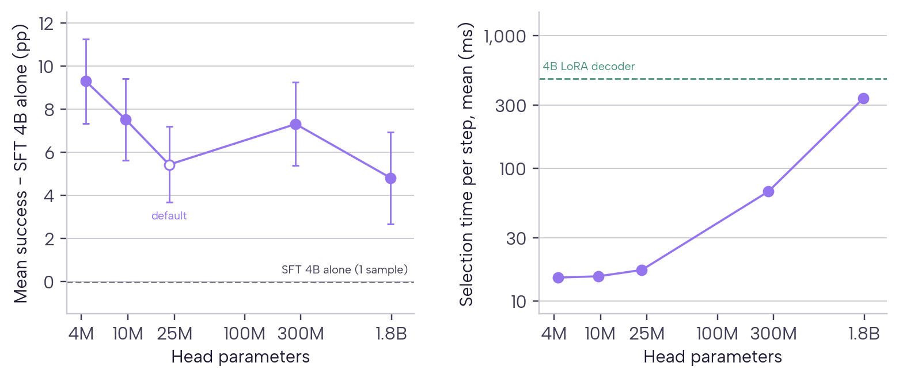

*Left: mean overall success (equal-weight 3-benchmark mean) minus SFT 4B alone, paired 95% bootstrap intervals over tasks common to every condition (10,000 resamples, seed 20261029, benchmarks resampled independently, per-task success averaged over a condition's runs); hollow = 22.6M default. Right: mean selection time per step from the [cost table](#final-selection-recipe3-head-scale-cost-20261112), with the 4B LoRA decoder (474 ms). Runs come from different windows in different mixes (4.4M: November 11 morning ×2 + evening; 9.6M and 272.8M: morning ×2 + November 12; 1.8B: evening ×2 + November 12; 22.6M and SFT: morning ×2 + evening + November 12), and SFT itself ranged 32.2–38.7% across these windows, so the per-window tables above are the controlled comparisons. Per-benchmark columns are valid-only success. [PDF](arm_results/rl_integration/selection-head-scale-pooled-20261112.pdf) · [SVG](arm_results/rl_integration/selection-head-scale-pooled-20261112.svg) · [plot script](arm_results/rl_integration/selection-head-scale-pooled-20261112-plot.py) · [data](arm_results/rl_integration/selection-head-scale-pooled-20261112.json) · [analysis script](arm_results/rl_integration/selection-head-scale-pooled-20261112.py).*

**Smaller heads (November 12–13).** *Shrinking the head to 1.0M (d32-L1) or 0.25M (d8-L1) parameters does not hurt: in one window, both score above the 22.6M default (+4.0 and +3.1 pp mean overall, intervals above 0). One training seed each and a default that is low in this window (40.2%, against 41.2–43.4% elsewhere), so read this as "no loss down to 0.25M", not as small heads being better: the single-seed 4.4M lead (+4.3) also vanished over seeds.* Joint transformers, same data, recipe and lr; width 32 / 8, 1 layer (2 heads at d8). 2 runs each, vlm/normal, rolled out judge-deferred and judged afterwards; no SFT run in this window.

| Head | Params | Online-Mind2Web | WebVoyager | DeepShop | Mean overall | Mean valid-only | − 22.6M default, pp [95% CI] |
| --- | ---: | ---: | ---: | ---: | ---: | ---: | ---: |
| d8-L1 | 0.25M | 40.7% | 54.0% | 46.0% | 43.4% | 46.9% | +3.1 [+0.7, +5.6] |
| d32-L1 | 1.0M | 42.9% | 54.4% | 46.3% | 44.2% | 47.9% | +4.0 [+1.6, +6.4] |
| d512-L2 (default) | 22.6M | 35.8% | 51.0% | 43.9% | 40.2% | 43.6% | — |

| Head | Online-Mind2Web valid / episodes | Online-Mind2Web successes | WebVoyager valid / episodes | WebVoyager successes | DeepShop valid / episodes | DeepShop successes |
| --- | ---: | ---: | ---: | ---: | ---: | ---: |
| d8-L1 | 518 / 600 | 211 | 1,077 / 1,190 | 582 | 300 / 300 | 138 |
| d32-L1 | 517 / 600 | 222 | 1,082 / 1,190 | 589 | 298 / 300 | 138 |
| d512-L2 (default) | 522 / 600 | 187 | 1,077 / 1,190 | 549 | 296 / 300 | 130 |

*Per-benchmark columns are valid-only success; differences on mean overall success (equal-weight 3-benchmark mean), paired bootstrap over tasks (10,000 resamples, seed 20261029, benchmarks resampled independently, per-task success averaged over runs). Per benchmark, valid-only, − default: d32-L1 +7.1 [+3.2, +11.0] / +3.5 [+0.3, +6.6] / +2.4 [−3.4, +8.1], d8-L1 +4.9 [+0.5, +9.3] / +3.1 [−0.1, +6.3] / +2.1 [−3.5, +7.6] (Online-Mind2Web / WebVoyager / DeepShop). Held-out agreement with the teacher at the final epoch: d8-L1 44.5%, d32-L1 42.9% (larger heads 44.8–46.2%). Judges: Online-Mind2Web gpt-5.6-terra, WebVoyager and DeepShop GPT-4o; all 6,270 episodes judged, none refused. Evidence: [rates and contrasts](arm_results/rl_integration/selection-head-small-20261113.json) · [script](arm_results/rl_integration/selection-head-small-20261113.py). Runtime: `recipe3-ablations-20261104/` (heads `heads-scale/{d8-L1,d32-L1}/`, evals `eval-small/run<k>/`, job log `eval-small/jobs.txt`).*

**Offline: agreement with the teacher.** *Every size from 0.25M to 1.8B agrees with the GPT-5.5 teacher's pick on 42.9–46.2% of held-out panels at the final epoch (chance 20%), and the three training seeds of one size span the same range (4.4M 45.1–46.2%, 22.6M 44.8–45.9%). Size does not change what the head learns.*

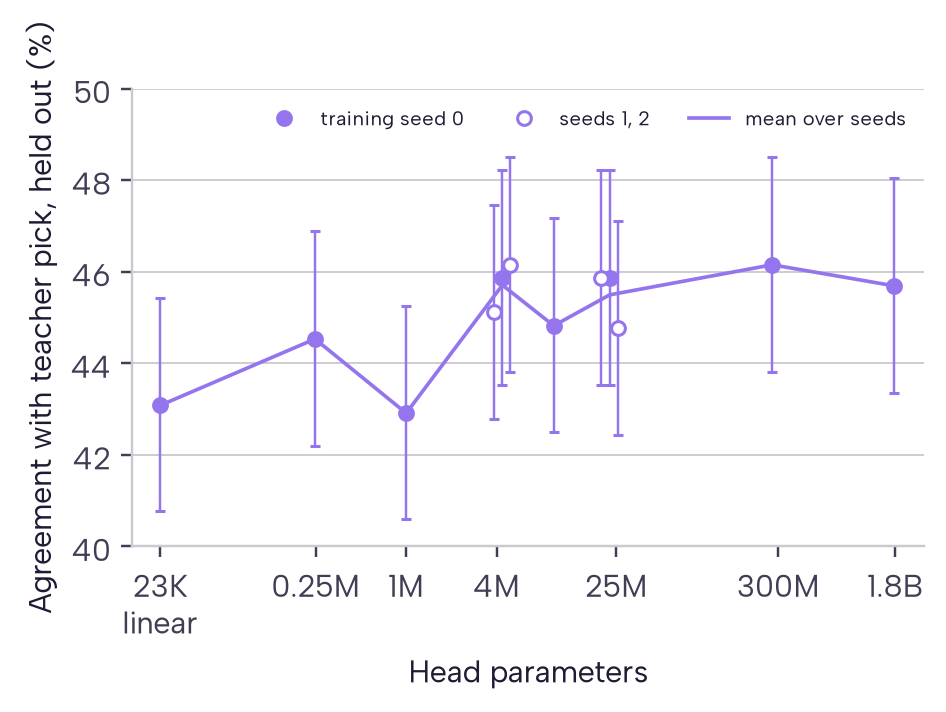

*Final-epoch (20th) agreement with the teacher's pick on the 1,727 held-out validation panels (199 states, 90 tasks), Wilson 95% intervals over panels (panels of one state are correlated, so the real noise is larger). Best-epoch agreement, picked on the same panels and so optimistic, is 46.1–49.5% (the 4.4M seed-0 head's 49.5% is epoch 4; its final epoch is 45.9%). Offline success of the head's pick on the 348 held-out test states (continuation draws) is 36.6–39.0% for every head and seed (d8-L1 38.3%, d32-L1 37.2%), against 36.3% for a uniform pick and 48.0% for the oracle. On those test states two heads pick the same candidate 58–77% of the time, and a seed change at fixed size (61–73%) moves picks as much as a size change. [PDF](arm_results/rl_integration/selection-head-scale-agreement-20261112.pdf) · [SVG](arm_results/rl_integration/selection-head-scale-agreement-20261112.svg) · [plot script](arm_results/rl_integration/selection-head-scale-agreement-20261112-plot.py) · [data](arm_results/rl_integration/selection-head-scale-agreement-20261112.json) · [script](arm_results/rl_integration/selection-head-scale-agreement-20261112.py).*

**Single-seed screen (November 11 morning).** One training seed per size, 2 runs each, SFT in the same window (00:59–09:30 PST). Superseded by the seed replication above for the size comparison.

| Head | Params | Validation agreement | Online-Mind2Web | WebVoyager | DeepShop | Mean overall | Mean valid-only | − SFT alone, pp [95% CI] | − 22.6M default, pp [95% CI] |
| --- | ---: | ---: | ---: | ---: | ---: | ---: | ---: | ---: | ---: |
| SFT 4B alone (1 sample) | — | — | 34.2% | 45.6% | 44.6% | 38.7% | 41.5% | — | — |
| d128-L2 | 4.4M | 49.5% | 39.4% | **57.3%** | **54.4%** | **46.9%** | **50.3%** | **+8.2 [+5.7, +10.7]** | **+4.3 [+1.9, +6.7]** |
| d256-L2 | 9.6M | 46.4% | **41.2%** | 54.5% | 50.8% | 45.1% | 48.9% | +6.4 [+4.0, +8.8] | +2.6 [+0.0, +5.1] |
| d512-L2 (default) | 22.6M | 46.8% | 39.8% | 50.9% | 47.5% | 42.6% | 46.1% | +3.8 [+1.4, +6.3] | — |
| d2048-L4 | 272.8M | 47.2% | 40.3% | 50.6% | 52.2% | 44.3% | 47.7% | +5.6 [+3.1, +8.0] | +1.7 [−0.7, +4.2] |

| Head | Online-Mind2Web valid / episodes | Online-Mind2Web successes | WebVoyager valid / episodes | WebVoyager successes | DeepShop valid / episodes | DeepShop successes |
| --- | ---: | ---: | ---: | ---: | ---: | ---: |
| SFT 4B alone | 535 / 600 | 183 | 1,079 / 1,190 | 492 | 298 / 300 | 133 |
| d128-L2 | 528 / 600 | 208 | 1,081 / 1,190 | 619 | 298 / 300 | 162 |
| d256-L2 | 524 / 600 | 216 | 1,071 / 1,190 | 584 | 297 / 300 | 151 |
| d512-L2 (default) | 522 / 600 | 208 | 1,068 / 1,190 | 544 | 299 / 300 | 142 |
| d2048-L4 | 526 / 600 | 212 | 1,071 / 1,190 | 542 | 299 / 300 | 156 |

*Per-benchmark columns are valid-only success; differences are on the equal-weight 3-benchmark mean of overall success, paired bootstrap over tasks (10,000 resamples, seed 20261029, benchmarks resampled independently, per-task success averaged over runs). Validation agreement: best-epoch agreement with the GPT-5.5 picks on 1,727 held-out panels. Per benchmark, valid-only, d128-L2 − default: Online-Mind2Web −0.5 [−5.1, +4.0], WebVoyager +6.3 [+3.3, +9.4], DeepShop +6.9 [+1.3, +12.5]; the small head's lead is on WebVoyager and DeepShop. The default head is +3.8 over SFT here against +5.0 in its November 3–4 window (cross-day). Judges: Online-Mind2Web gpt-5.6-terra, WebVoyager and DeepShop GPT-4o; rolled out judge-deferred, no record refused. These evals ran with `--allow-source-drift` because another session edited `crossbench_selector_eval.py` (adding new selector kinds only) between preparation and launch. One d128-L2 Online-Mind2Web run lost its model server at 152 of 300 tasks and was resumed.*

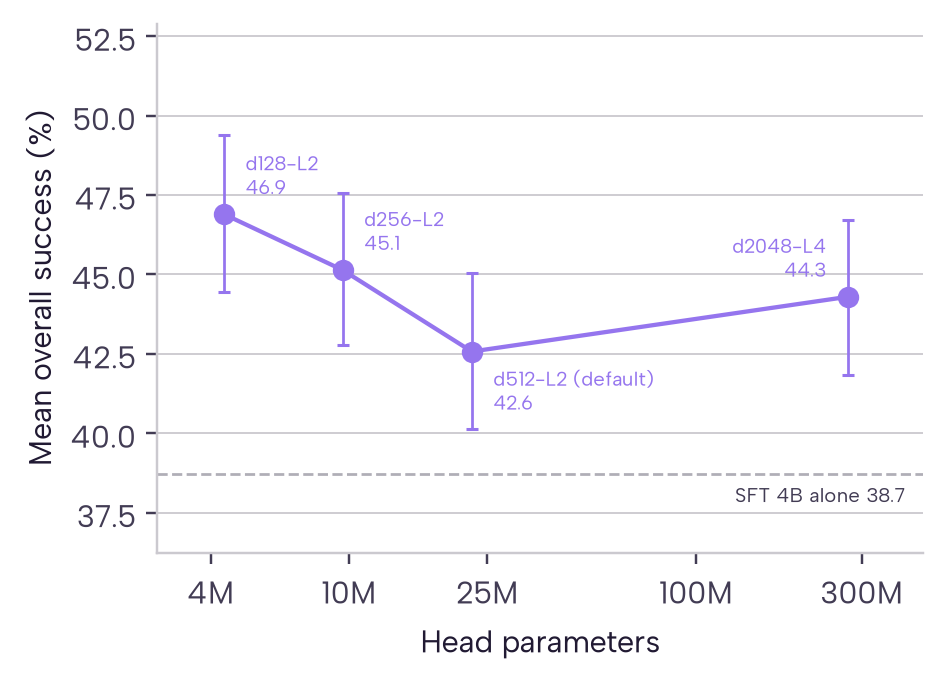

*Points: mean overall success, 2 runs; bars: paired 95% interval of each head's difference from SFT 4B alone, drawn around the point. [PDF](arm_results/rl_integration/selection-head-scale-20261111.pdf) · [SVG](arm_results/rl_integration/selection-head-scale-20261111.svg) · [plot script](arm_results/rl_integration/selection-head-scale-20261111-plot.py) · [data](arm_results/rl_integration/selection-head-scale-20261111.json) · [analysis script](arm_results/rl_integration/selection-head-scale-20261111.py). Runtime: `recipe3-ablations-20261104/` (training `train_scale.sbatch`, `source-scale/`, heads `heads-scale/<size>/`, evals `eval-scale/run<k>/`, job log `eval-scale/jobs.txt`).*

#### Kev-style decision pass on Recipe 3 labels (November 7–12)

**Over 3 runs, both Kev-style selectors beat one SFT 4B sample on all three benchmarks: Kev-A by +8.7 [+6.7, +10.8] pp mean overall, Kev-B by +7.0 [+4.9, +9.1]. Kev-B, which skips the LoRA on prompt tokens so the selector could reuse the actor's generation cache, is −1.7 [−3.9, +0.4] behind Kev-A; the gap is all DeepShop (−6.4 [−11.8, −1.1] overall). In a same-window run, neither Kev variant differs from the Recipe 3 GPT-5.5 K = 3 decoder: Kev-A − decoder +0.7 [−2.9, +4.3], Kev-B − decoder −0.9 [−4.6, +2.9] pp mean overall.** All 1,045 tasks per run, with SFT re-run in each window. Runs 1–2: Online-Mind2Web November 8 (16:15–19:45 PST), WebVoyager and DeepShop November 10 (16:00–21:00 PST). Run 3, all four conditions on all three benchmarks: November 11, 23:43 to November 12, 04:30 PST.

**3 runs: Kev-style vs SFT.**

| Selector | Online-Mind2Web | WebVoyager | DeepShop | Mean overall | Mean valid-only | − SFT alone, mean overall pp [95% CI] | − SFT alone, mean valid-only pp [95% CI] |
| --- | ---: | ---: | ---: | ---: | ---: | ---: | ---: |
| SFT 4B alone (1 sample) | 28.6% | 41.3% | 38.2% | 36.0% | 38.6% | — | — |
| Kev-A: LoRA on all tokens | 33.2% | **48.6%** | **52.4%** | **44.8%** | **48.0%** | **+8.7 [+6.7, +10.8]** | **+9.3 [+7.2, +11.5]** |
| Kev-B: no LoRA on prompt tokens | **34.7%** | 48.4% | 46.0% | 43.0% | 46.5% | **+7.0 [+4.9, +9.1]** | **+7.8 [+5.6, +10.0]** |
| *Kev-B − Kev-A, pp [95% CI]* | +1.4 [−1.6, +4.4] | −0.2 [−2.4, +1.9] | **−6.4 [−11.8, −1.1]** | −1.7 [−3.9, +0.4] | −1.5 [−3.8, +0.7] | | |

| Selector | Online-Mind2Web valid / episodes | Online-Mind2Web successes | WebVoyager valid / episodes | WebVoyager successes | DeepShop valid / episodes | DeepShop successes |
| --- | ---: | ---: | ---: | ---: | ---: | ---: |
| SFT 4B alone | 799 / 900 | 257 | 1,628 / 1,785 | 737 | 447 / 450 | 172 |
| Kev-A | 790 / 900 | 299 | 1,621 / 1,785 | 868 | 449 / 450 | 236 |
| Kev-B | 784 / 900 | 312 | 1,612 / 1,785 | 864 | 450 / 450 | 207 |

*Per-benchmark columns are overall success (invalid episodes and tasks with no recorded episode count as failures). Mean overall is the equal-weight 3-benchmark mean; differences are paired bootstrap over tasks (10,000 resamples, seed 20261029, benchmarks resampled independently, per-task success averaged over runs); one training run per selector. Overall − SFT, Online-Mind2Web / WebVoyager / DeepShop: Kev-A +4.7 [+1.6, +7.8] / +7.3 [+4.9, +9.8] / +14.2 [+9.6, +19.1], Kev-B +6.1 [+3.1, +9.0] / +7.1 [+4.6, +9.6] / +7.8 [+2.7, +12.9]. Valid-only rates: SFT 32.2 / 45.3 / 38.5%, Kev-A 37.8 / 53.5 / 52.6%, Kev-B 39.8 / 53.6 / 46.0%.*

**Run 3, same window: Kev-style vs the Recipe 3 decoder.**

| Selector | Online-Mind2Web | WebVoyager | DeepShop | Mean overall | − SFT alone, mean overall pp [95% CI] | − Decoder, mean overall pp [95% CI] |
| --- | ---: | ---: | ---: | ---: | ---: | ---: |
| SFT 4B alone (1 sample) | 32.0% | 40.8% | 34.0% | 35.6% | — | — |
| Recipe 3 decoder (GPT-5.5 K = 3, 4B LoRA) | 36.0% | 47.9% | 46.7% | 43.5% | **+7.9 [+4.4, +11.4]** | — |
| Kev-A: LoRA on all tokens | 33.0% | 45.0% | **54.7%** | **44.2%** | **+8.6 [+5.0, +12.2]** | +0.7 [−2.9, +4.3] |
| Kev-B: no LoRA on prompt tokens | **37.3%** | **48.6%** | 42.0% | 42.6% | **+7.0 [+3.2, +10.7]** | −0.9 [−4.6, +2.9] |

| Selector | Online-Mind2Web valid / tasks | Online-Mind2Web successes | WebVoyager valid / tasks | WebVoyager successes | DeepShop valid / tasks | DeepShop successes |
| --- | ---: | ---: | ---: | ---: | ---: | ---: |
| SFT 4B alone | 268 / 300 | 96 | 536 / 595 | 243 | 149 / 150 | 51 |
| Decoder | 255 / 300 | 108 | 536 / 595 | 285 | 147 / 150 | 70 |
| Kev-A | 261 / 300 | 99 | 536 / 595 | 268 | 149 / 150 | 82 |
| Kev-B | 259 / 300 | 112 | 537 / 595 | 289 | 150 / 150 | 63 |

*One run per condition; per-benchmark columns are overall success. Overall − decoder, Online-Mind2Web / WebVoyager / DeepShop: Kev-A −3.0 [−8.3, +2.0] / −2.9 [−6.4, +0.8] / +8.0 [−0.7, +16.7]; Kev-B +1.3 [−4.3, +7.0] / +0.7 [−3.2, +4.5] / −4.7 [−14.0, +4.7]. Mean valid-only: SFT 38.5%, decoder 47.7%, Kev-A 47.7%, Kev-B 46.4%. The decoder is `arm5-9fadc8dc4655` (GPT-5.5 K = 3 labels, p16), the same checkpoint as the [Recipe 3 table](#selection-head-headline-results). Run 3 left 10 of 4,180 task episodes unrecorded (at most 2 per job) because the browser failed all attempts; they count as invalid failures.*

*Judges: Online-Mind2Web gpt-5.6-terra (AgentTrek prompt), WebVoyager and DeepShop GPT-4o; rolled out judge-deferred and judged afterwards, no record refused. One Kev-A WebVoyager run-1 job restarted on another node after the actor server crashed at startup (bus error on g016); its 595 tasks all come from the restart. Run 3 used 12 one-H200 jobs (about 30 of 49 approved H200-hours, urgent QoS) and $22.45 of judge calls.*

2-run report (November 10)

| Selector | Online-Mind2Web | WebVoyager | DeepShop | Mean overall | Mean valid-only | − SFT alone, mean overall pp [95% CI] | − SFT alone, mean valid-only pp [95% CI] |
| --- | ---: | ---: | ---: | ---: | ---: | ---: | ---: |
| SFT 4B alone (1 sample) | 30.3% | 45.2% | 40.6% | 36.2% | 38.7% | — | — |
| Kev-A: LoRA on all tokens | 37.8% | **55.3%** | **51.3%** | **45.0%** | **48.1%** | **+8.8 [+6.3, +11.4]** | **+9.4 [+6.8, +12.1]** |
| Kev-B: no LoRA on prompt tokens | **38.1%** | 53.5% | 48.0% | 43.2% | 46.5% | **+7.0 [+4.6, +9.4]** | **+7.8 [+5.3, +10.3]** |
| *Kev-B − Kev-A, pp [95% CI]* | +0.3 [−3.9, +4.4] | −1.8 [−4.7, +1.1] | −3.3 [−9.3, +2.3] | −1.8 [−4.3, +0.6] | −1.6 [−4.2, +1.0] | | |

| Selector | Online-Mind2Web valid / episodes | Online-Mind2Web successes | WebVoyager valid / episodes | WebVoyager successes | DeepShop valid / episodes | DeepShop successes |
| --- | ---: | ---: | ---: | ---: | ---: | ---: |
| SFT 4B alone | 531 / 600 | 161 | 1,092 / 1,190 | 494 | 298 / 300 | 121 |
| Kev-A | 529 / 600 | 200 | 1,085 / 1,190 | 600 | 300 / 300 | 154 |
| Kev-B | 525 / 600 | 200 | 1,075 / 1,190 | 575 | 300 / 300 | 144 |

*Per-benchmark columns are valid-only success. Mean overall is the equal-weight 3-benchmark mean of overall success (invalid episodes count as failures); differences are on it, paired bootstrap over tasks (10,000 resamples, seed 20261029, benchmarks resampled independently, per-task success averaged over runs); one training run per selector. Valid-only − SFT, Online-Mind2Web / WebVoyager / DeepShop: Kev-A +7.5 [+3.1, +11.9] / +10.1 [+6.8, +13.4] / +10.7 [+5.0, +16.5], Kev-B +7.8 [+3.7, +11.9] / +8.3 [+5.1, +11.4] / +7.4 [+1.9, +12.9]. The Kev-B − Kev-A row is valid-only per benchmark, with mean overall and mean valid-only in their columns. Judges: Online-Mind2Web gpt-5.6-terra (AgentTrek prompt), WebVoyager and DeepShop GPT-4o; rolled out judge-deferred and judged afterwards, no record refused. One Kev-A WebVoyager run restarted on another node after the actor server crashed at startup (bus error on g016); its 595 tasks all come from the restart. For context only (other windows, cross-day): the Recipe 3 4B LoRA decoder is +5.1 to +7.6 pp over SFT in its own windows ([Recipe 3 table](#selection-head-headline-results), [stealth section](#final-selection-recipe3-stealth-20261109)).*

Online-Mind2Web alone (November 8, first report)

| Selector | Runs | Valid | Successes | Online-Mind2Web overall | Online-Mind2Web valid-only | Overall per run | − SFT alone, overall pp [95% CI] | − SFT alone, valid-only pp [95% CI] |
| --- | ---: | ---: | ---: | ---: | ---: | --- | ---: | ---: |
| SFT 4B alone (1 sample) | 2 | 531 / 600 | 161 | 26.8% | 30.3% | 26.3 / 27.3 | — | — |
| Kev-A: LoRA on all tokens | 2 | 529 / 600 | 200 | **33.3%** | 37.8% | 35.0 / 31.7 | **+6.5 [+2.7, +10.3]** | **+7.5 [+3.1, +11.9]** |
| Kev-B: no LoRA on prompt tokens | 2 | 525 / 600 | 200 | **33.3%** | **38.1%** | 31.7 / 35.0 | **+6.5 [+3.0, +10.0]** | **+7.8 [+3.7, +11.9]** |

*300 tasks per run; judge gpt-5.6-terra (AgentTrek prompt), rolled out judge-deferred and judged afterwards; no record refused. Paired bootstrap over tasks (10,000 resamples, seed 20261029, per-task success averaged over runs); one training run per selector. For context only (other windows, cross-day): Recipe 3 22.6M heads score 37.6–40.0% and the 4B LoRA decoder 40.1% valid-only on Online-Mind2Web ([architecture round](#final-selection-recipe3-head-arch-20261107), [November 9 controls](#final-selection-recipe3-lora-controls-20261109)), with SFT at 32.9% in the head round. One Kev-A episode timed out and counts as invalid.*

- **Training.** Kev-style selector ([Kev-inspired variants](ARM_SELECTION_HEAD.md#selection-head-designs), October) on the same Recipe 3 GPT-5.5 H = 4 panels and split as the default head: the 4B SFT actor with a LoRA on all 36 layers plus a pointer head on a decision token, initialised from the pointwise head, lr 1e-4 (pointer 1e-3), batch 8 states. Best probe at step 600 of 750 (4,800 training states), 6.8 h on 1 H200 each. Kev-A adapts every token; Kev-B runs the prompt through the unadapted actor (`--kev-prompt-base`). Held-out agreement with the GPT-5.5 picks on 1,727 validation panels: 41.6% (A) and 42.7% (B).
- **Inference.** Evaluated as a separate scorer service next to the actor (`head5x`), N = 5, SFT 4B actor, T 1.0 / top-p 0.9, 30 steps.
- Evidence: [3 runs and same-window decoder: rates and contrasts](arm_results/rl_integration/selection-recipe3-kev-3bench-20261112.json) · [script](arm_results/rl_integration/selection-recipe3-kev-3bench-20261112.py) · 2-runs: [rates](arm_results/rl_integration/selection-recipe3-kev-3bench-20261110.json) · [script](arm_results/rl_integration/selection-recipe3-kev-3bench-20261110.py) · Online-Mind2Web only: [rates](arm_results/rl_integration/selection-recipe3-kev-om2w-20261108.json) · [script](arm_results/rl_integration/selection-recipe3-kev-om2w-20261108.py). Runtime: `recipe3-ablations-20261104/` (training `kev/train.sbatch`, `kev/common.sh`, source `source-kev/`, checkpoints `/gpfs/projects/krishna/zixianma/kev-ckpt-tmp/kev{A,B}-r3/`, evals `eval-kev/run<k>/`, job log `eval-kev/jobs.txt`).

#### Recipe 3 decoder on US-residential stealth browsers (November 9)

**Stealth browsers raise success by +13.7 [+10.3, +17.1] pp mean overall for SFT 4B and +13.3 [+10.1, +16.4] with the GPT-5.5 H = 4 4B LoRA, all of it on Online-Mind2Web (about +20 pp valid-only) and WebVoyager (about +18); DeepShop does not gain (−2 to −4, intervals cross 0). The decoder's gain over one SFT sample is unchanged: +7.2 [+3.5, +10.9] pp under stealth versus +7.6 [+5.4, +9.7] locally on the same tasks (difference −0.4 [−4.5, +3.6]).** One stealth run per condition on all 1,045 tasks. Same actor, decoder, N = 5, T 1.0 / top-p 0.9, 30 steps and judges as the local [Recipe 3](#final-selection-recipe3) evaluations (Online-Mind2Web gpt-5.6-terra, WebVoyager and DeepShop GPT-4o); only the browser changes. Both stealth conditions ran in the same windows (November 9, 00:04–01:36 and 09:40–11:22 PST; Browser Use credits ran out in between).

**Stealth − local, same tasks.** Each condition on all tasks; local runs pooled.

| Condition | Benchmark | Tasks | Local runs | Local valid | Local successes | Stealth valid | Stealth successes | Local | Stealth | Stealth − local, pp [95% CI] |
| --- | --- | ---: | ---: | ---: | ---: | ---: | ---: | ---: | ---: | ---: |
| SFT 4B alone | Online-Mind2Web | 300 | 2 | 531 | 161 | 298 | 153 | 30.3% | 51.3% | +21.0 [+15.3, +26.7] |
| | WebVoyager | 595 | 3 | 1,744 | 780 | 591 | 374 | 44.7% | 63.3% | +18.6 [+14.2, +22.9] |
| | DeepShop | 150 | 3 | 447 | 202 | 149 | 64 | 45.2% | 43.0% | −2.2 [−10.0, +5.4] |
| | **Mean overall** | | | | | | | 38.5% | 52.2% | **+13.7 [+10.3, +17.1]** |
| | Mean valid-only | | | | | | | 40.1% | 52.5% | +12.4 [+9.0, +16.0] |
| + GPT-5.5 H = 4 4B LoRA | Online-Mind2Web | 300 | 3 | 779 | 312 | 291 | 170 | 40.1% | 58.4% | +18.4 [+12.6, +24.1] |
| | WebVoyager | 595 | 3 | 1,619 | 919 | 585 | 433 | 56.8% | 74.0% | +17.3 [+13.0, +21.5] |
| | DeepShop | 150 | 3 | 444 | 234 | 150 | 73 | 52.7% | 48.7% | −4.0 [−10.4, +2.0] |
| | **Mean overall** | | | | | | | 46.1% | 59.4% | **+13.3 [+10.1, +16.4]** |
| | Mean valid-only | | | | | | | 49.8% | 60.4% | +10.5 [+7.4, +13.6] |

*Benchmark rows are valid-only success (successes / valid episodes); differences on them are valid-only. Mean overall is the equal-weight 3-benchmark mean of overall success (invalid episodes count as failures). Local references: SFT Online-Mind2Web November 8 (2 runs), SFT WebVoyager and DeepShop November 6 (3 runs), decoder November 9, 03:30–07:00 (3 runs). The SFT comparison is therefore cross-day; its 19–21 pp gaps are far above the SFT references' day-to-day drift (−0.1 [−2.2, +1.9] pp mean overall, November 3 vs 6). Several local Online-Mind2Web failures are sites that never load in the local browser (e.g. bestbuy.com timing out at reset), which the stealth browser completes. DeepShop (amazon.com) loads locally, so stealth does not help there.*

**Selector gain, local vs stealth.** Decoder − SFT, all tasks.

| Benchmark | Tasks | Gain local, pp [95% CI] | Gain stealth, pp [95% CI] | Stealth − local, pp [95% CI] |
| --- | ---: | ---: | ---: | ---: |
| Online-Mind2Web | 300 | +9.7 [+6.1, +13.6] | +7.1 [+1.4, +12.8] | −2.7 [−9.1, +3.6] |
| WebVoyager | 595 | +12.0 [+9.4, +14.7] | +10.7 [+6.6, +14.8] | −1.3 [−6.2, +3.4] |
| DeepShop | 150 | +7.5 [+2.5, +12.5] | +5.7 [−3.0, +14.7] | −1.8 [−11.5, +7.8] |
| **Mean overall** | | **+7.6 [+5.4, +9.7]** | **+7.2 [+3.5, +10.9]** | **−0.4 [−4.5, +3.6]** |
| Mean valid-only | | +9.8 [+7.5, +12.0] | +7.8 [+4.2, +11.6] | −1.9 [−6.1, +2.2] |

*Benchmark rows are valid-only gains. Stealth rates: SFT 51.3 / 63.3 / 43.0% valid-only (Online-Mind2Web / WebVoyager / DeepShop; 298 / 591 / 149 valid, 153 / 374 / 64 successes), decoder 58.4 / 74.0 / 48.7% (291 / 585 / 150 valid, 170 / 433 / 73 successes); mean overall 52.2% vs 59.4%. All intervals: paired bootstrap over tasks (10,000 resamples, seed 20261029, benchmarks resampled independently, per-task success averaged over a cell's runs); one stealth run, so they exclude stealth run-to-run variance. All 2,090 stealth episodes were judged; none was refused.*

- **Setup.** Native `browser-use` mode (`openwebrl/env/browser_use_env.py`), through a wrapper that changes only the browser.
  - Browser Use cloud browsers with stealth, a US residential proxy (`proxy_country_code: us`) and CAPTCHA solving on.
  - `allow_resizing` on, so the viewport can be pinned to 1280 × 1000 at DPR 1 over CDP; the remote compositor otherwise renders at a random scale. Every screenshot is Lanczos-downscaled to 1280 × 1000.
  - Rollouts ran with judging deferred and were judged afterwards by the native judges.
- **Cost.** 11 jobs (6 plus 5 resumes), 1 H200 each, 12.0 H200-hours (urgent QoS, billed 2×), and about $210 of Browser Use credit (≈ $0.10 per episode). About 99% of that credit is residential-proxy traffic ($5 per GB, about 20 MB per episode); browser time is about 1%.
- **Cheaper setting (pilot, SFT 4B, 119 Online-Mind2Web tasks).** Without the residential proxy (stealth fingerprint and CAPTCHA solving only), an episode costs $0.003. On 40 random tasks it succeeded on 57.5%, against 35.0% with the proxy above and 36.2% locally. On the 79 tasks selected because the proxy run succeeded and the local runs failed, it succeeded on 62.0% (local 10.8%). Keeping the proxy but blocking video and ad/tracker hosts cut the cost to $0.041 per episode with similar success (47.5% / 63.3%). The pilot is small and one run, but it gives no sign that the proxy itself is needed. Runtime: `stealth/pilot-cost/` (wrapper `xbench_pilot.py`, task list `parent/`, plans and records `{noproxy,block}/`).
- Evidence: [rates, stealth − local and gain comparisons](arm_results/rl_integration/selection-recipe3-stealth-20261109.json) · [script](arm_results/rl_integration/selection-recipe3-stealth-20261109.py). Runtime: `/gpfs/scrubbed/zixianma/openwebrl-runtime/recipe3-ablations-20261104/stealth/` (wrapper `xbench_stealth.py`, viewport and credit guard `viewport.py`, `submit.sh`, plans and records `run1/<benchmark>/<condition>/`, job log `jobs.txt`).

## Selection head: which training labels work (October 21 – November 3)

**Current results: on all 1,725 branch states (task-level 5-fold), lookahead H = 4 gives the best head offline, and live over three same-day runs only the H = 4 (+2.2 [+0.1, +4.3] pp) and Oracle (+2.0 [+0.1, +4.0]) heads beat one SFT 4B sample; pre-execution labels do not help (−1.3).** Details: [5-fold](#final-selection-label-kfold-20261101), [live three runs](#final-selection-label-live-3run-20261103). These label sources were then scaled up as [Recipe 3](#final-selection-recipe3). The October 21 first comparison (one run per selector, superseded by the three-run rounds) and the October 29–31 architecture round (superseded by the [Recipe 3 architecture round](#final-selection-recipe3-head-arch-20261107), same conclusion) are collapsed below.

October 21 first comparison (one run per selector): heads vs SelectionARM, size and cost

**A 22.6 M-parameter head on the frozen SFT-4B actor, trained on observed-outcome or lookahead H = 4 labels for 1,380 SFT-actor branch states, is level with Piotr SelectionARM (−0.8 and −0.9 pp) at 56–65% of its compute per episode. Lookahead H = 2 labels gain about a third as much and pre-execution labels nothing. Trained on Piotr's data, the same head is the best method (+1.4 pp over Piotr, within noise). An 8B actor without selection gains +3.3 pp over the 4B.** Online-Mind2Web 300, WebVoyager 595, DeepShop 150 tasks; T 1.0 / top-p 0.9, 30 steps, one episode per task. "Mean" weights each benchmark equally (one third), as in the API comparison above.

**Success.**

| Actor | Selector | Training data: states / panels / labels | Online-Mind2Web valid-only | WebVoyager valid-only | DeepShop valid-only | Mean overall | Mean valid-only | − SFT 4B, pp [95% CI] | − Piotr SelectionARM, pp [95% CI] |
| --- | --- | --- | ---: | ---: | ---: | ---: | ---: | ---: | ---: |
| SFT 4B | — (1 sample) | — | 39.6% | 45.0% | 34.2% | 38.2% | 39.6% | — | **−6.7 [−10.4, −3.0]** |
| SFT 8B | — (1 sample) | — | 39.9% | 49.7% | 39.9% | 41.5% | 43.2% | +3.3 [−0.3, +6.9] | −3.4 [−7.3, +0.4] |
| SFT 4B | Piotr SelectionARM (4B LoRA) | 2,692 (Piotr's) / 35,916 of 5 sampled / GPT-5.5, before | 46.8% | **53.8%** | 41.9% | 44.9% | 47.5% | **+6.7 [+3.0, +10.4]** | — |
| SFT 4B | Head (22.6 M) | 2,692 (Piotr's) / 35,916 of 5 sampled / GPT-5.5, before | **49.4%** | 53.4% | **44.9%** | **46.3%** | **49.2%** | **+8.1 [+4.4, +11.8]** | +1.4 [−2.1, +4.9] |
| SFT 4B | Head (22.6 M) | 1,380 (branch) / 1,380 of 2–5 distinct / observed outcome | 42.2% | 53.0% | 42.6% | 44.1% | 45.9% | **+5.9 [+2.5, +9.4]** | −0.8 [−4.5, +2.8] |
| SFT 4B | Head (22.6 M) | 1,380 (branch) / 1,380 of 2–5 distinct / Luna, 3 steps after | 43.1% | 52.0% | 42.7% | 44.0% | 45.9% | **+5.8 [+2.1, +9.5]** | −0.9 [−4.5, +2.7] |
| SFT 4B | Head (22.6 M) | 1,380 (branch) / 1,380 of 2–5 distinct / Luna, 1 step after | 38.6% | 50.5% | 38.8% | 40.4% | 42.6% | +2.2 [−1.5, +5.8] | **−4.5 [−8.3, −0.8]** |
| SFT 4B | Head (22.6 M) | 1,380 (branch) / 1,380 of 2–5 distinct / Luna, before | 36.9% | 47.1% | 34.2% | 37.6% | 39.4% | −0.7 [−4.2, +2.8] | **−7.4 [−11.1, −3.8]** |

**Size and cost** (means over the three benchmarks).

| Actor | Selector | Labels | Params (actor + selector) | PFLOP per step | PFLOP per episode | Model time per episode | Steps per episode |
| --- | --- | --- | ---: | ---: | ---: | ---: | ---: |
| SFT 4B | — | — | 4.44 B | 0.019 | 0.28 | 42 s | 14.5 |
| SFT 8B | — | — | 8.77 B | 0.037 | 0.56 | 51 s | 15.0 |
| SFT 4B | Piotr SelectionARM | GPT-5.5, before | 4.44 B + 4.44 B | 0.098 | 1.53 | 143 s | 15.4 |
| SFT 4B | Head | GPT-5.5, before | 4.44 B + 22.6 M | 0.063 | 0.92 | 131 s | 14.6 |
| SFT 4B | Head | Observed outcome | 4.44 B + 22.6 M | 0.062 | 0.86 | 109 s | 13.8 |
| SFT 4B | Head | Luna, H = 4 | 4.44 B + 22.6 M | 0.062 | 1.00 | 142 s | 16.0 |
| SFT 4B | Head | Luna, H = 2 | 4.44 B + 22.6 M | 0.062 | 1.05 | 149 s | 16.8 |
| SFT 4B | Head | Luna, before execution | 4.44 B + 22.6 M | 0.062 | 1.05 | 155 s | 16.8 |

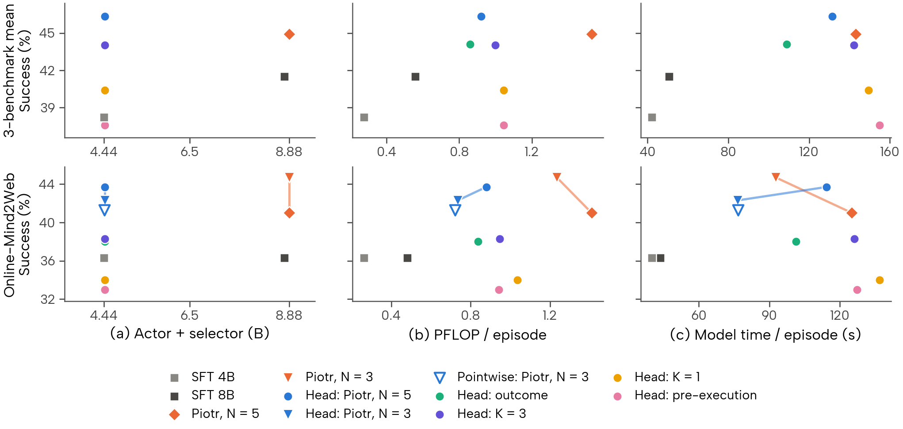

*Top row: equal mean of the three benchmarks (success and cost). Bottom row: Online-Mind2Web 300 only, adding the three-candidate runs ([below](#final-selection-n3-om2w-20261022)); lines join each selector's N = 3 (triangle) and N = 5 runs. Success counts invalid episodes as failures. T = 1.0, top-p = 0.9, 30 steps; selectors use N = 5 unless marked N = 3, and SFT baselines use one sample. “Piotr” denotes SelectionARM or the head's training data, as indicated in the legend; H = 2/4 denotes the label horizon, including the candidate action. Heads have 4.46 B total parameters (pointwise: 4.457 B), versus 4.44 B for SFT 4B, so some points overlap in the parameter column. Axes are cropped; points are descriptive estimates without uncertainty bars.*

[Paper PDF](arm_results/rl_integration/selection-head-labels-vs-cost-20261021.pdf) · [Editable SVG](arm_results/rl_integration/selection-head-labels-vs-cost-20261021.svg). Compact 7-inch canvas with a shared legend and column labels; 300 dpi PNG preview. Protocol details are in this caption.

- **Definitions.** "Overall" counts invalid episodes as failures; "valid-only" divides successes by valid episodes. Model time is actor + selector decision time summed over an episode, excluding browser execution. PFLOP per episode = PFLOP per step × steps per episode.
- **Methods.** Every selector picks one of five candidates the frozen actor samples per step; "branch" data are the SFT-actor branching states collected for this project ([collection and labels](ARM_FORMULATIONS.md#lookahead-labels-current)), "Piotr's" the GPT-5.5-labelled panels of Piotr's release. SFT rows take a single sample. Training data reads states / panels (with the actions in each panel) / labels. Piotr's panels are five sampled actor actions each (about 13 per state), duplicates included, each labelled with one GPT-5.5 pick made before execution (from the screenshot and candidates only). Branch panels are one per state holding its 2–5 distinct SFT-proposed actions, reshuffled each epoch; branch states come from the tasks of Piotr's training split.
- **How the paired 95% intervals are computed** (every "pp [95% CI]" difference and every plot error bar in the selection-head results). Both runs use the same frozen task list. Each task scores 1 if its single episode is valid and judged successful, else 0 (invalid episodes count as failures), and the per-task difference is d = run − reference ∈ {−1, 0, +1}; the point estimate is the mean of d. For one benchmark, draw 10,000 resamples of its tasks with replacement, each the size of the benchmark, and take the mean of d in each. For the three-benchmark mean, resample tasks independently within each benchmark (keeping 300 / 595 / 150 tasks) and average the three resampled means with weight 1/3 each. The interval is the 2.5th to 97.5th percentile of the 10,000 resampled values. The random seed is fixed in each analysis script (e.g. NumPy `default_rng(20261018)`; the data-scaling script uses Python `random.Random(0)`). Pairing on tasks removes task-difficulty variance shared by the two runs, so these intervals are narrower than comparing two per-run intervals; they do not include training-seed variance (one seed per live head), episode-sampling variance beyond the one episode per task, or run-date drift (DeepShop).
- **Difference columns** are row − reference on the mean overall rate, [paired 95% bootstrap](#final-paired-bootstrap) with tasks resampled within each benchmark. Also: Piotr-data head − SFT 8B +4.8 [+1.0, +8.5]. Valid-only differences (tasks valid under both) agree within 1.1 pp.
- **From teacher to live, per label source.** For each label, three gains over one sample of the same SFT 4B actor: the teacher's own pick offline and the head trained on those labels offline, both on all 1,725 branch states with task-level 5-fold heads ([method](#final-selection-label-kfold-20261101)), and the seed-0 head live (task-weighted overall success: each of the 1,045 tasks counts once, so WebVoyager carries 57%). The live points come from one [same-day 3-run batch](#final-selection-label-live-3run-20261103) of all six heads and SFT alone, so they are directly comparable with each other but not with the older live numbers above. Offline and live use different tasks, so compare orderings, not sizes. Bars are 95% intervals (task-clustered offline, [paired](#final-paired-bootstrap) live). [Plot script](arm_results/rl_integration/selection-label-stages-kfold-20261101-plot.py)

  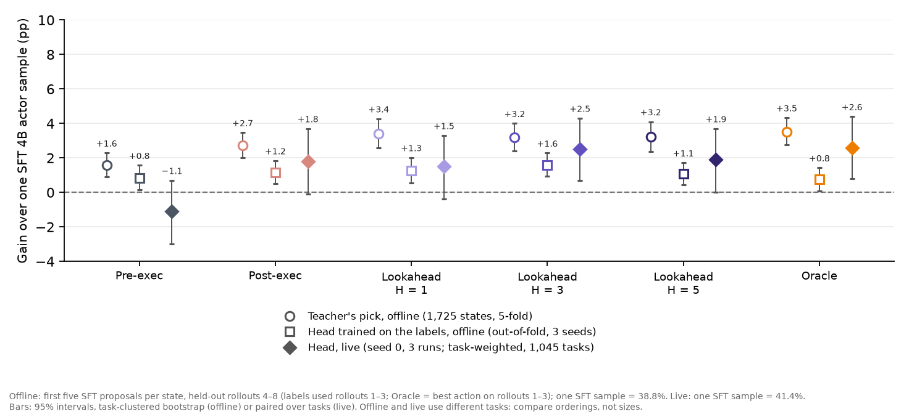

  Earlier version (teacher on 1,010 main-set states, head on the 348 test states, plus the WebArbiter, WebShepherd and PRO-CUA judge formulations as teachers only): [plot](arm_results/rl_integration/selection-label-stages-20261027.png) · [script](arm_results/rl_integration/selection-label-stages-20261027-plot.py) · [data](arm_results/rl_integration/selection-label-stages-20261027.json)
- **Same states, train and held-out.** Teacher and head on the same SFT-action branch states, each state's first five SFT proposals (duplicates kept) on held-out rollouts 4–8; heads average 3 seeds. On the 1,380 training states (labels came from rollouts 1–3) every head matches its teacher within 0.2 pp, H = 6 included. Held out (all 1,725 states, task-level 5-fold), every head keeps only part of its teacher's gain; the Oracle head the least (+0.8 against +3.5), yet it is among the best live. Each point is relative to one SFT sample on its own states or tasks. [Plot script](arm_results/rl_integration/selection-label-same-state-kfold-20261101-plot.py) · [training-state data](arm_results/rl_integration/selection-label-train-states-kfold-20261101.json)

  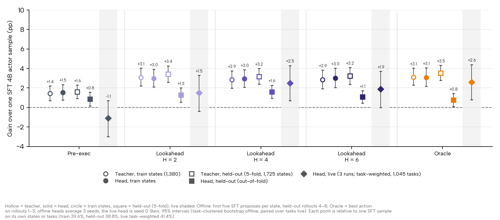

  Earlier version with the 345-state / 86-task test split (seed-0 heads, the most favourable fold): [plot](arm_results/rl_integration/selection-label-same-state-20261027.png) · [script](arm_results/rl_integration/selection-label-same-state-20261027-plot.py) · [data](arm_results/rl_integration/selection-label-same-state-20261027.json)
- **Label sources on all 1,725 states, task-level 5-fold (2026-11-01).** The 345-state / 86-task test split was too small to rank label sources, so every branch state (1,725 states, 433 tasks) is now scored out-of-fold. It is split into five task-level folds of 345 states (fold 0 = the original test split), and each fold's heads are trained on the other four folds, about 1,380 states each. The heads use the round-1 recipe with 3 seeds, averaged per state. Teacher = the label's argmax among each state's first five SFT proposals (duplicates kept, ties averaged). Both are scored on held-out rollouts 4–8 (labels used rollouts 1–3), valid draws only, against one SFT sample from the same five. Intervals: task-clustered percentile bootstrap, 10,000 resamples, seed 20261101. Lookahead H = 6 labels (Luna judging 5 steps after the action, same prompt and settings as H = 4) are new: 3,454 Luna calls, $9.04.

  | Label source | Teacher success | Teacher − SFT, pp [95% CI] | Head success | Head − SFT, pp [95% CI] | Head − teacher, pp [95% CI] |
  | --- | ---: | ---: | ---: | ---: | ---: |
  | *SFT 4B, 1 sample* | 38.8% | — | — | — | — |
  | Pre-exec | 40.4% | +1.6 [+0.9, +2.3] | 39.6% | +0.8 [+0.2, +1.6] | −0.7 [−1.3, −0.1] |
  | Lookahead H = 1 | 41.5% | +2.7 [+2.0, +3.5] | 39.9% | +1.2 [+0.5, +1.8] | −1.6 [−2.4, −0.8] |
  | Lookahead H = 2 | 42.2% | +3.4 [+2.6, +4.3] | 40.0% | +1.3 [+0.5, +2.0] | −2.1 [−2.9, −1.4] |
  | Lookahead H = 4 | 41.9% | +3.2 [+2.4, +4.0] | **40.4%** | **+1.6 [+0.9, +2.3]** | −1.6 [−2.4, −0.8] |
  | Lookahead H = 6 | 42.0% | +3.2 [+2.4, +4.1] | 39.8% | +1.1 [+0.5, +1.7] | −2.1 [−3.0, −1.4] |
  | Oracle | **42.3%** | **+3.5 [+2.8, +4.3]** | 39.5% | +0.8 [+0.1, +1.4] | −2.8 [−3.7, −1.9] |

  - **Teachers: H = 2, H = 4, H = 6 and Oracle are level; Lookahead H = 1 is below them and pre-exec is weakest.** Lookahead H = 1 − H = 2 is −0.7 [−1.3, −0.1] and Lookahead H = 1 − Oracle is −0.8 [−1.6, −0.0]; pre-exec is below every other source. Lookahead H = 1's apparent lead on the old test split (+4.9) was specific to fold 0.
  - **H = 6 adds nothing over H = 4.** As teachers they are level (H = 4 − H = 6 = −0.0 [−0.5, +0.4]). As heads, H = 6 is borderline worse (H = 4 − H = 6 = +0.5 [+0.0, +1.0]). This agrees with the earlier 315-state check ([H = 6 − H = 4 −0.05 pp](ARM_FORMULATIONS.md#lookahead-v2-20261013)).
  - **H = 4 is the best head.** It beats the Oracle head (+0.8 [+0.1, +1.6]) and the pre-exec head (+0.7 [+0.0, +1.5]). Every other pair of heads overlaps zero. This matches the live ordering, where the H = 4 and Oracle heads are the two best and pre-exec the worst (right panel).
  - **Heads keep only part of the teacher's gain**, from about half (pre-exec, H = 4) to under a quarter (Oracle). The Oracle head loses the most (−2.8 pp below its teacher).
  - **Offline gains are small and do not predict live size.** They are 1–3.5 pp here against −1.3 to +2.2 pp live (equal benchmark average), and they use different states, tasks and SFT baselines, so compare orderings, not sizes.
  - **Live, all label sources in one same-day batch, 3 runs each (2026-11-01 to 11-03).** Only H = 4 (+2.2 [+0.1, +4.3]) and Oracle (+2.0 [+0.1, +4.0]) beat SFT alone; Lookahead H = 1, H = 6 and H = 2 gain +1.0 to +1.4 with intervals crossing zero, and pre-exec does not help (−1.3 [−3.5, +0.9]). Against the H = 4 head, only pre-exec is clearly worse (−3.5 [−5.5, −1.5]); Oracle, Lookahead H = 1, H = 6 and H = 2 are within −0.2 to −1.2 pp, all intervals crossing zero. H = 6 adds nothing over H = 4 live either (−0.9 [−3.0, +1.2]). The gains come from Online-Mind2Web and WebVoyager; on DeepShop no head beats SFT. For comparison, weighting each task once down-weights DeepShop and gives slightly larger, tighter gains: Oracle +2.6 [+0.8, +4.4], H = 4 +2.5 [+0.7, +4.3], H = 6 +1.9 [+0.0, +3.7], Lookahead H = 1 +1.8 [−0.1, +3.7], H = 2 +1.5 [−0.4, +3.3], pre-exec −1.1 [−3.0, +0.7]. Setup: the six seed-0 heads trained on the same 1,380 states with the round-1 recipe (H = 6: fold-0 seed-0 head), SFT 4B actor, 1280×1000, N = 5, T 1.0 / top-p 0.9, 30 steps, all tasks, same judges (Online-Mind2Web gpt-5.6-terra, WebVoyager and DeepShop GPT-4o). Three runs per condition; run 1 of SFT, H = 4 and H = 6 is the 11-01/02 run, all other runs 11-02/03. Per-benchmark columns are valid-only, pooled over the three runs; differences are on mean overall with per-task success averaged over runs, [paired 95% intervals](#final-paired-bootstrap) (seed 20261029); they exclude training-seed variance. DeepShop still drifts between runs (SFT 47.0 / 45.5 / 43.9% valid-only). **Why the gains are smaller than on 10-29 (H = 4 +6.0 then, +2.2 now):** Online-Mind2Web is unchanged (H = 4 − SFT +4.6 then, +3.8 now) and WebVoyager moved within noise, but DeepShop SFT rose from 28.4% to 43.8% overall (H = 4: 34.4% to 44.2%), erasing the DeepShop gain. Protocol, code paths, heads and judge snapshot (gpt-4o-2024-08-06) are identical. Replaying the saved 10-29 judge requests unchanged on 11-03 reproduces the old verdicts (SFT 28.4 → 28.2%, H = 4 34.4 → 34.7%; about 95% of verdicts identical), so the judge did not drift: the episodes on amazon.com themselves now succeed more often. DeepShop numbers from before 11-01 are therefore not comparable with these. [Re-judge data](arm_results/rl_integration/selection-deepshop-rejudge-20261103.json) · [script](arm_results/rl_integration/selection-deepshop-rejudge-20261103.py) 125.4 H200-hours (117.8 on urgent QoS, billed 2×) plus 18.8 for the 11-01/02 run.

    | Condition | Online-Mind2Web valid-only | WebVoyager valid-only | DeepShop valid-only | Mean overall | Mean valid-only | − SFT 4B, pp [95% CI] | − H = 4 head, pp [95% CI] | Task-weighted − SFT 4B, pp [95% CI] |
    | --- | ---: | ---: | ---: | ---: | ---: | ---: | ---: | ---: |
    | Head, H = 4 labels | 37.9% | 51.0% | 44.3% | **42.1%** | **44.4%** | **+2.2 [+0.1, +4.3]** | — | +2.5 [+0.7, +4.3] |
    | Head, Oracle labels | 35.6% | **51.8%** | 45.1% | 41.9% | 44.2% | +2.0 [+0.1, +4.0] | −0.2 [−2.3, +2.0] | **+2.6 [+0.8, +4.4]** |
    | Head, Lookahead H = 1 labels | 36.3% | 51.1% | 44.7% | 41.3% | 44.0% | +1.4 [−0.8, +3.7] | −0.8 [−3.0, +1.4] | +1.8 [−0.1, +3.7] |
    | Head, H = 6 labels | **38.1%** | 50.6% | 42.9% | 41.3% | 43.9% | +1.3 [−0.8, +3.4] | −0.9 [−3.0, +1.2] | +1.9 [+0.0, +3.7] |
    | Head, H = 2 labels | 35.2% | 50.8% | 44.7% | 40.9% | 43.6% | +1.0 [−1.1, +3.1] | −1.2 [−3.4, +0.9] | +1.5 [−0.4, +3.3] |
    | *SFT 4B, 1 sample* | 32.5% | 48.0% | **45.5%** | 39.9% | 42.0% | — | — | — |
    | Head, pre-exec labels | 31.9% | 48.1% | 43.0% | 38.6% | 41.0% | −1.3 [−3.5, +0.9] | −3.5 [−5.5, −1.5] | −1.1 [−3.0, +0.7] |

    [Data, per-run rates and per-benchmark contrasts](arm_results/rl_integration/selection-label-live-3run-20261103.json) · [analysis script](arm_results/rl_integration/selection-label-live-3run-20261103-analysis.py) · earlier one-run H = 6 check (11-01/02, part of this batch): [data](arm_results/rl_integration/selection-label-k5-live-20261102.json) · [script](arm_results/rl_integration/selection-label-k5-live-20261102-analysis.py)

  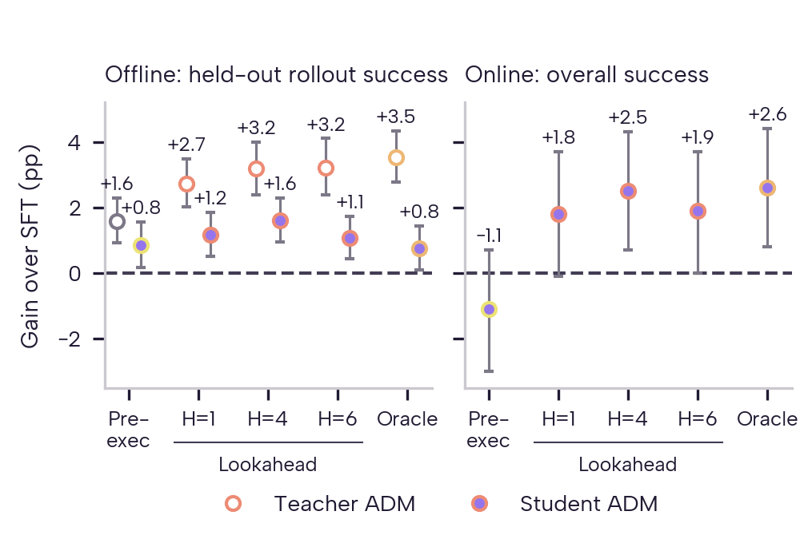

  *Column-width 3.35 × 2.25-inch layout. Shown label sources: Pre-exec, Lookahead H = 1, H = 4, H = 6 and Oracle. H = 1 is the immediate-result teacher; H = 4/6 correspond to the legacy three-/five-continuation-action conditions. H = 2 remains in the tables but is omitted here. The three H ticks share a Lookahead label to fit the column width. Hollow circles: Teacher ADM; solid circles: Student ADM-22M. Both use gray for Pre-exec, salmon for Lookahead and yellow/orange for Oracle, with gray confidence-interval bars; online evaluates the student only. Oracle uses the same amber (`#EDB774`) as the collection schematic. Offline: 1,725 states, 433 tasks, task-level 5-fold student predictions with 3 training seeds; held-out rollouts 4–8, valid only. Labels use rollouts 1–3 where applicable; Oracle selects the best action on those label rollouts. Online: task-weighted overall success across OM2W (300 tasks), WebVoyager (595) and DeepShop (150), with weights 300/1,045, 595/1,045 and 150/1,045; seed-0 student, 3 runs. Gains are relative to one SFT 4B sample on each panel's own population (offline 38.8%, online 41.4%); compare orderings across panels, not gain sizes. Bars: 95% intervals, task-clustered bootstrap offline and paired over tasks online. All intervals are shown in full.* [Paper PDF](arm_results/rl_integration/selection-label-setups-kfold-20261101.pdf) · [SVG](arm_results/rl_integration/selection-label-setups-kfold-20261101.svg).

  **Teacher-only offline variant:** removes the student’s held-out rollout-success points while retaining all teacher results on the left and student online results on the right. Values, intervals and populations match the comparison above.

  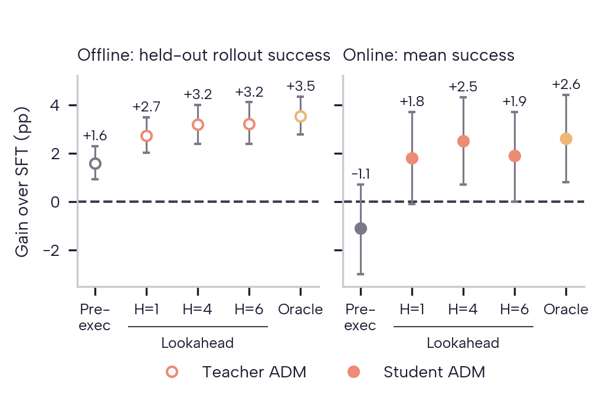

  [PDF](arm_results/rl_integration/selection-label-setups-kfold-teacher-only-offline-20261101.pdf) · [SVG](arm_results/rl_integration/selection-label-setups-kfold-teacher-only-offline-20261101.svg). Reproduce with the existing renderer’s `--teacher-only-offline` flag.

  Evidence: [pooled results, contrasts and per-fold numbers](arm_results/rl_integration/selection-label-kfold-20261101.json) · [analysis script](arm_results/rl_integration/selection-label-kfold-20261101-analysis.py) · [plot script](arm_results/rl_integration/selection-label-setups-kfold-20261101-plot.py)

  

Old 345-state / 86-task test split (fold 0) versus 5-fold, and per-fold results

  Fold 0 reproduces the published test-split numbers exactly (teacher and seed-0 head, same bootstrap). It was the most favourable fold for the teachers: its SFT baseline is the lowest (35.4% against 37.0–42.8% on the other folds), and its teacher gains are the largest.

  | Label source | Teacher − SFT, 5-fold | Teacher − SFT, fold 0 | Head − SFT, 5-fold (3 seeds) | Head − SFT, fold 0 (3 seeds) | Head − SFT, fold 0 (seed 0, published) |
  | --- | ---: | ---: | ---: | ---: | ---: |
  | Pre-exec | +1.6 | +2.2 [+0.6, +4.0] | +0.8 | +1.0 [−0.6, +2.6] | +1.1 [−0.6, +2.9] |
  | Lookahead H = 1 | +2.7 | +4.9 [+2.9, +7.2] | +1.2 | +1.9 [+0.5, +3.3] | +1.9 [+0.5, +3.4] |
  | Lookahead H = 2 | +3.4 | +4.7 [+2.6, +7.2] | +1.3 | +2.0 [+0.5, +3.5] | +2.1 [+0.6, +3.7] |
  | Lookahead H = 4 | +3.2 | +4.5 [+2.6, +6.7] | +1.6 | +1.8 [+0.3, +3.5] | +2.0 [+0.3, +3.9] |
  | Lookahead H = 6 | +3.2 | +4.7 [+2.7, +6.8] | +1.1 | +0.9 [−0.4, +2.3] | — |
  | Oracle | +3.5 | +5.2 [+3.4, +7.3] | +0.8 | −0.1 [−1.8, +1.6] | −0.4 [−2.2, +1.4] |

  Per fold, gain over one SFT sample in pp, shown as teacher / head (3 seeds):

  | Fold | States | Tasks | SFT 1 sample | Pre-exec | Lookahead H = 1 | Lookahead H = 2 | Lookahead H = 4 | Lookahead H = 6 | Oracle |
  | --- | ---: | ---: | ---: | ---: | ---: | ---: | ---: | ---: | ---: |
  | 0 | 345 | 86 | 35.4% | +2.2 / +1.0 | +4.9 / +1.9 | +4.7 / +2.0 | +4.5 / +1.8 | +4.7 / +0.9 | +5.2 / −0.1 |
  | 1 | 345 | 85 | 38.7% | +1.5 / +0.5 | +2.4 / +1.1 | +4.1 / +1.6 | +3.0 / +1.8 | +3.6 / +1.6 | +4.1 / +1.0 |
  | 2 | 345 | 86 | 42.8% | +0.0 / +0.2 | +2.2 / +1.4 | +2.9 / +0.7 | +2.6 / +1.4 | +2.3 / +0.7 | +3.3 / +0.6 |
  | 3 | 345 | 86 | 39.9% | +2.7 / +1.7 | +2.1 / +1.1 | +3.3 / +1.1 | +3.4 / +1.0 | +3.6 / +0.8 | +2.9 / +2.0 |
  | 4 | 345 | 90 | 37.0% | +1.6 / +0.9 | +2.1 / +0.4 | +1.9 / +1.0 | +2.5 / +1.9 | +2.0 / +1.3 | +2.2 / +0.3 |

  The earlier three-panel version of this figure (training states, the 345 test states and live; seed-0 heads, 2026-10-27) is kept as history: [plot](arm_results/rl_integration/selection-label-setups-20261027.png) · [script](arm_results/rl_integration/selection-label-setups-20261027-plot.py).

  

Earlier findings (October 21–31): Online-Mind2Web shortfall, decision time, architecture round (three runs), graded targets, LoRA on 1,380 states

- **Online-Mind2Web is where the branch labels fall short.** On WebVoyager and DeepShop the outcome and H = 4 heads match Piotr; on Online-Mind2Web none clearly beats SFT, while the Piotr-data head does (+7.3 pp [+1.7, +13.0]).
- **Why time barely drops.** Generating five candidates takes about 8.2 s of each 8–9 s decision; Piotr's selector adds 0.50 s and the head 0.02 s. Selector FLOPs are a fast prefill, while decoding is bandwidth-bound, so the head's 36% compute saving per step becomes only about 0.5 s per decision, roughly offset by its hidden-state capture. Episode length matters as much: the outcome head is cheapest per episode because it takes the fewest steps. Times come from live runs on different nodes, not a matched timing study.
- **Architecture does not matter (lookahead H = 4 labels, three runs).** On Online-Mind2Web + WebVoyager, the six H = 4 heads run three times score 40.3–43.4% and none separates from the default head (−1.9 to +1.2 pp, every interval includes zero); the Piotr-data head, at 45.5%, beats all of them. All heads are trained on the H = 4 labels of the same 1,380 branch states (seed 0, 20 epochs, batch 64, ≈22.6 M parameters each). The default head is joint (bidirectional attention among the state and all candidates) · transformer · soft CE (bold). The five other heads are the best non-default heads of the [one-day run](#final-selection-arch-k3-run1-20261029); their runs 2 and 3 are run on 10-30/31, while the default, Piotr-data and SFT rows ran all three times on 10-29. DeepShop drifts with the run date: the same five heads score 28–35% valid-only on 10-29 and 43–48% on 10-30/31, so their DeepShop leads (+5 to +9 pp) are not attributed to the heads, and differences are read on the two-benchmark mean. Per-benchmark columns are valid-only success pooled over three runs (successes / valid episodes); "Mean overall" averages the three benchmarks' overall rates (invalid episodes count as failures) and "Mean valid-only" their valid-only rates. Differences are on the Online-Mind2Web + WebVoyager overall mean (each benchmark weighted one half; per-task success averaged over runs), [paired 95% intervals](#final-paired-bootstrap), reading row − reference. Rows are sorted by that mean.

  | Attention | Scorer | Loss | Online-Mind2Web valid-only | WebVoyager valid-only | DeepShop valid-only | DeepShop run dates | Mean overall | Mean valid-only | OM2W + WV overall | − SFT 4B, pp [95% CI] | − default, pp [95% CI] | Runs 2–3 only: − default, pp [95% CI] |
  | --- | --- | --- | ---: | ---: | ---: | --- | ---: | ---: | ---: | ---: | ---: | ---: |
  | *Piotr-data head* |  |  | 40.9% | 56.8% | 32.6% | 10-29 | 40.8% | 43.4% | 45.5% | **+9.2 [+7.2, +11.4]** | **+3.3 [+1.3, +5.4]** | **+5.0 [+2.6, +7.5]** |
  | Joint (bidir) | Transformer | BCE | 38.0% | 55.3% | 41.3% | 10-29, 30, 31 | 42.4% | 44.9% | 43.4% | **+7.1 [+5.1, +9.1]** | +1.2 [−0.7, +3.0] | +1.7 [−0.6, +4.1] |
  | Independent | Transformer | Soft CE | 40.2% | 53.8% | 40.0% | 10-29, 31, 31 | 42.1% | 44.7% | 43.2% | **+7.0 [+4.9, +9.0]** | +1.0 [−0.9, +3.0] | +1.7 [−0.7, +4.0] |
  | Independent | MLP | BCE | 37.8% | 54.3% | 43.5% | 10-29, 30, 31 | 43.0% | 45.2% | 42.9% | **+6.7 [+4.7, +8.7]** | +0.8 [−1.2, +2.7] | +1.9 [−0.5, +4.2] |
  | Causal ¹ | Transformer | Soft CE | 40.2% | 52.7% | 39.8% | 10-29, 31, 31 | 41.6% | 44.2% | 42.8% | **+6.5 [+4.4, +8.7]** | +0.6 [−1.3, +2.5] | +1.5 [−0.9, +3.8] |
  | **Joint (bidir)** | **Transformer** | **Soft CE** | 38.5% | 52.4% | 35.1% | 10-29 | 39.6% | 42.0% | 42.2% | **+5.9 [+3.9, +7.9]** | — | — |
  | Independent | Transformer | BCE | 35.7% | 51.1% | 41.0% | 10-29, 31, 31 | 40.0% | 42.6% | 40.3% | **+4.0 [+2.0, +6.1]** | −1.9 [−3.9, +0.0] | −1.0 [−3.4, +1.4] |
  | *SFT 4B, 1 sample* |  |  | 32.3% | 45.2% | 29.0% | 10-29 | 33.7% | 35.5% | 36.3% | — | **−5.9 [−7.9, −3.9]** | **−4.8 [−7.2, −2.5]** |

  Tasks: Online-Mind2Web 300, WebVoyager 595, DeepShop 150 per run; 3 runs each (900 / 1,785 / 450 episodes). Online-Mind2Web judged by gpt-5.6-terra, WebVoyager and DeepShop by GPT-4o, checked on every saved verdict. ¹ Causal attention: candidate i attends to the state and candidates 1..i in sampling order (the state attends only to itself), so its scores depend on candidate order.

  - **The default head's one-day lead was luck.** Its three-benchmark mean is 41.0 / 38.4 / 39.5% across its three runs; the Piotr-data head's is 40.9 / 40.4 / 41.0%. Runs 2–3 alone (last column) do not reuse run 1, the run used to choose these five heads, and show the same ordering.
  - **Recovery.** An OpenAI key outage (10-30 ~17:00, judge HTTP 401) left 4,621 episodes of runs 2–3 missing or judge-failed: the 1,006 judge-failed records were set aside and all 4,621 tasks rerun on 10-31 under the same frozen plans; rejected judge calls (never billed) were released from the per-run judge caps. 81.2 H200-hours for runs 2–3 of the five heads.
  - Evidence: [rates, judges, record dates and intervals](arm_results/rl_integration/selection-head-k3-3run-judges-20261031.json) · [script](arm_results/rl_integration/selection-head-k3-3run-judges-20261031.py)

  

One-day run (2026-10-29): eight heads, run 1 only

  Same day for every row. Differences are on the three-benchmark mean overall rate.

  | Attention | Scorer | Loss | Online-Mind2Web valid-only | WebVoyager valid-only | DeepShop valid-only | Mean overall | Mean valid-only | − SFT 4B, pp [95% CI] |
  | --- | --- | --- | ---: | ---: | ---: | ---: | ---: | ---: |
  | **Joint (bidir)** | **Transformer** | **Soft CE** | 42.7% | 52.9% | 35.2% | 41.0% | 43.6% | **+7.0 [+3.3, +10.7]** |
  | Joint (bidir) | Transformer | BCE | 40.6% | 55.0% | 32.2% | 40.1% | 42.6% | **+6.1 [+2.5, +9.8]** |
  | Independent | MLP | BCE | 38.9% | 54.1% | 33.8% | 39.8% | 42.3% | **+5.8 [+2.1, +9.6]** |
  | Causal ¹ | Transformer | Soft CE | 39.6% | 53.0% | 32.9% | 39.5% | 41.8% | **+5.5 [+1.9, +9.2]** |
  | Independent | Transformer | Soft CE | 39.8% | 55.3% | 28.2% | 38.8% | 41.1% | **+4.8 [+1.0, +8.6]** |
  | Independent | Transformer | BCE | 34.5% | 52.4% | 35.6% | 38.7% | 40.8% | **+4.7 [+0.8, +8.6]** |
  | Independent | MLP | Soft CE | 35.4% | 54.5% | 32.4% | 38.6% | 40.8% | **+4.6 [+1.1, +8.0]** |
  | Joint (bidir) | MLP | BCE | 35.6% | 48.8% | 35.8% | 38.1% | 40.1% | **+4.1 [+0.1, +8.1]** |
  | Joint (bidir) | MLP | Soft CE | 34.9% | 51.2% | 34.3% | 37.8% | 40.1% | **+3.7 [+0.4, +7.2]** |
  | *Piotr-data head (same day)* |  |  | 37.6% | 57.7% | 36.2% | 40.9% | 43.9% | **+6.9 [+3.3, +10.8]** |
  | *SFT 4B, 1 sample (same day)* |  |  | 32.0% | 45.0% | 30.1% | 34.0% | 35.7% | — |

  Main effects on the mean, pp [95% CI]: joint − independent +0.3 [−1.8, +2.3] over all eight heads (transformer only +1.8 [−1.0, +4.6]); soft CE − BCE −0.1 [−2.1, +1.9] (transformer only +0.5 [−2.2, +3.2]); transformer − MLP +1.1 [−0.7, +2.9]; causal − independent (soft CE) +0.7 [−2.8, +4.2]. ¹ Causal attention: candidate i attends to the state and candidates 1..i in sampling order (the state attends only to itself), so its scores depend on candidate order; its three runs started about 5 h after the others on the same day. The earlier H = 2 transformer 2 × 2 (mean 40.2–41.5%, run 2026-10-22, not same-day with these rows) is in [details](ARM_SELECTION_HEAD.md#selection-head-arch-full-20261022). Evidence: [rates, judges and contrasts](arm_results/rl_integration/selection-head-arch-k3-sameday-20261029.json) · [script](arm_results/rl_integration/selection-head-arch-k3-sameday-20261029.py)

  

- **Graded outcome targets do not beat the best-action target.** Replacing the outcome head's best-action label with a soft ranking (softmax(rate / 0.25)), centred advantage MSE or a binomial rate fit is level offline. Live, the soft-ranking head, best of the three on Online-Mind2Web (+2.3 pp, within noise), is **−5.3 pp [−8.8, −1.8]** below the best-action head on the three-benchmark mean, level with one SFT sample; WebVoyager alone is −4.2 [−8.2, −0.3] ([details](ARM_SELECTION_HEAD.md#selection-head-outcome-objectives-20261025)).
- A 4B LoRA trained with Piotr's recipe on the 1,380 branch states does no better than the head offline ([details](ARM_SELECTION_HEAD.md#selection-head-sft-actions-lora-20261021)).
- [Details, per-benchmark intervals and caveats](ARM_SELECTION_HEAD.md#selection-head-sft-actions-20261021) · Evidence: [heads](arm_results/rl_integration/selection-head-sft-actions-full-20261021.json), [SFT 8B and N = 3](arm_results/rl_integration/selection-n3-sft8b-full-20261021.json), [benchmark means and differences](arm_results/rl_integration/selection-mean-benchmark-diffs-20261022.json) · [Plot script](arm_results/rl_integration/selection-head-labels-vs-cost-20261021.py)

### Three candidates instead of five (Online-Mind2Web)

**On Online-Mind2Web, cutting each selector from five to three candidates per decision costs no measurable success and saves 26–33% of model time per episode. All three N = 3 selectors still beat SFT 4B; differences among them are within noise.** Plotted in the bottom row of the figure above. 300 tasks, same task order, decoding and judge as above; one run per method. The pointwise head is the per-candidate MLP (16.8 M parameters) trained on the same Piotr data; it has no N = 5 full-set run.

| Actor | Selector | Training labels | Candidates per step | Params (actor + selector) | Overall | Valid-only | − SFT 4B, pp [95% CI] | N = 3 − N = 5, pp [95% CI] | PFLOP per step | PFLOP per episode | Model time per episode | Steps per episode |
| --- | --- | --- | ---: | ---: | ---: | ---: | ---: | ---: | ---: | ---: | ---: | ---: |
| SFT 4B | — | — | 1 | 4.44 B | 36.3% | 39.6% | — | — | 0.018 | 0.26 | 40 s | 14.3 |
| SFT 8B | — | — | 1 | 8.77 B | 36.3% | 39.9% | — | — | 0.036 | 0.48 | 44 s | 13.5 |
| SFT 4B | Piotr SelectionARM (4B LoRA) | GPT-5.5 before, Piotr's 2,692 states | 5 | 4.44 B + 4.44 B | 41.0% | 46.8% | — | — | 0.095 | 1.41 | 125 s | 14.9 |
| SFT 4B | Piotr SelectionARM (4B LoRA) | GPT-5.5 before, Piotr's 2,692 states | 3 | 4.44 B + 4.44 B | **44.7%** | **51.7%** | **+8.3 [+2.3, +14.0]** | +3.7 [−1.7, +9.0] | 0.080 | 1.24 | 93 s | 15.5 |
| SFT 4B | Joint head (22.6 M) | GPT-5.5 before, Piotr's 2,692 states | 5 | 4.44 B + 22.6 M | 43.7% | 49.4% | — | — | 0.060 | 0.88 | 114 s | 14.7 |
| SFT 4B | Joint head (22.6 M) | GPT-5.5 before, Piotr's 2,692 states | 3 | 4.44 B + 22.6 M | 42.3% | 47.2% | **+6.0 [+0.3, +11.7]** | −1.3 [−7.3, +4.3] | 0.052 | 0.74 | 77 s | 14.2 |
| SFT 4B | Pointwise head (16.8 M) | GPT-5.5 before, Piotr's 2,692 states | 3 | 4.44 B + 16.8 M | 41.3% | 47.0% | +5.0 [−0.7, +10.7] | — | 0.051 | 0.72 | 77 s | 14.2 |
| *Judged by gpt-5.6-terra (rows above: o4-mini)* |  |  |  |  |  |  |  |  |  |  |  |  |
| SFT 4B | Joint head (22.6 M), 10-18 run re-judged | GPT-5.5 before, Piotr's 2,692 states | 5 | 4.44 B + 22.6 M | 37.7% | 42.6% | — | — | 0.060 | 0.88 | 114 s | 14.7 |
| SFT 4B, n-gram decoding | Joint head (22.6 M) | GPT-5.5 before, Piotr's 2,692 states | 5 | 4.44 B + 22.6 M | 29.7% | 34.9% | — | — | 0.033 | 0.55 | 95 s | 16.4 |

- **N-gram speculative decoding (last two rows; not in the plot).** The same head with the actor served under sglang n-gram decoding (run 10-24/25) is **−8.0 pp [−13.3, −2.7]** below its 10-18 run (valid-only −6.9 [−13.1, −0.8]). Decisions are 26% faster (5.8 s vs 7.8 s), but episodes run longer (94 vs 63 hit the 30-step limit), so model time per episode falls only 17%. The cause of the drop is not established; the runs are a week apart on live sites. N-gram is not adopted ([details](ARM_SELECTION_HEAD.md#selection-inference-serving-20261024)). Both rows are judged by gpt-5.6-terra, which is stricter than o4-mini, so compare them with each other, not with the rows above.
- **Difference columns:** row − reference on overall success, 300 tasks, paired 95% bootstrap. At N = 3: joint head − Piotr −2.3 [−8.0, +3.3], pointwise − joint −1.0 [−6.7, +4.7]. The n-gram row is **−8.0 [−13.3, −2.7]** below the re-judged 10-18 row above it.
- **Time.** A decision takes 6.0 s for Piotr and 5.4 s for the heads at N = 3, against 8.4 s and 7.8 s at N = 5: the slowest of fewer parallel candidates finishes sooner and the GPU serves fewer requests.
- **Caveat.** Piotr's N = 3 gain over N = 5 is not significant and comes from one run per method on one benchmark; WebVoyager and DeepShop were not run at N = 3.
- [Evidence](arm_results/rl_integration/selection-n3-sft8b-full-20261021.json) · [Analysis script](arm_results/rl_integration/selection-n3-sft8b-full-20261021-analysis.py) · n-gram: [evidence](arm_results/rl_integration/selection-ngram-om2w-full-20261025.json), [analysis script](arm_results/rl_integration/selection-ngram-om2w-full-20261025-analysis.py) · Plot: bottom row of the figure above

### Data sweeps before Recipe 3 (October 23–31)

**Superseded by [Recipe 3](#final-selection-recipe3) and its [data ablations](#final-selection-recipe3-data-ablations-20261105).** On Recipe 2 data, neither more of our states, Piotr-style panels instead of one panel per state, nor stronger lookahead judges (GPT-5.5, GPT-6.1 Sol) closed the gap to Piotr's data, and more of Piotr's own states or panels did not lift the head either. Recipe 3, many lookahead-labelled panels per state at scale, is the version that matches SelectionARM.

Details: more of our data, many panels per state, stronger judges, more of Piotr's data

### More of our data (Luna H = 4 lookahead labels)

**Training the one-panel Luna H = 4 head on more of our branching states does not help: 263, 501, 1,003 and 2,612 states score 37.0 / 34.7 / 37.7 / 38.9% on the three-benchmark mean, all below the 1,380-state head (41.4%). The 2,612-state head is −2.5 pp [−6.2, +1.3] against it and +1.9 [−1.9, +5.8] against 263 states. Offline the five sizes are within 1.1 pp (37.05–38.15%). The 1,380-state head's DeepShop lead holds on a same-day rerun (40.0% vs 42.7% on 10-21, −2.7 [−12.0, +6.7]); every other head scores 26.7–33.3% there.** This matches the GPT-5.5 [one-panel state scaling](ARM_SELECTION_HEAD.md#selection-head-state-scale-1panel-20261027): beyond a few hundred states, more states do not lift the head. The 1,380-state head is the best of these on the mean, but the curve is not monotonic (501 states is the lowest), so its edge is more likely a property of that particular trained head than of its state count.

All heads: SFT-4B actor, five candidates, T 1.0 / top-p 0.9, 30 steps, all 1,045 tasks, one episode per task; differences are [paired 95% intervals](#final-paired-bootstrap).

| One panel per state | Online-Mind2Web valid-only | WebVoyager valid-only | DeepShop valid-only | Mean overall | Mean valid-only | Offline fixed-five | − 1,380 states, pp [95% CI] | − SFT 4B, pp [95% CI] | 2,612 states − row, pp [95% CI] |
| --- | ---: | ---: | ---: | ---: | ---: | ---: | ---: | ---: | ---: |
| 263 states | 37.8% | 49.9% | 30.8% | 37.0% | 39.5% | 37.05% | **−4.4 [−8.3, −0.5]** | +2.7 [−0.8, +6.2] | +1.9 [−1.9, +5.8] |
| 501 states | 33.2% | 49.1% | 27.0% | 34.7% | 36.5% | 38.10% | **−6.7 [−10.4, −3.0]** | +0.5 [−3.1, +4.1] | — |
| 1,003 states | 37.5% | 49.2% | 34.2% | 37.7% | 40.3% | 37.68% | **−3.7 [−7.3, −0.1]** | +3.5 [0.0, +6.9] | — |
| 1,380 states (earlier head; DeepShop rerun 10-28) | 37.1% | 52.0% | 41.1% | 41.4% | 43.4% | 37.68% | — | **+7.1 [+3.7, +10.7]** | −2.5 [−6.2, +1.3] |
| 2,612 states (all) | 39.6% | 51.6% | 33.3% | 38.9% | 41.5% | 38.15% | −2.5 [−6.2, +1.3] | **+4.6 [+1.1, +8.1]** | — |
| *Luna H = 4, Piotr-style panels, 2,551 states* | 38.3% | 50.0% | 35.3% | 38.3% | 41.2% | 37.80% | — | — | +0.6 [−3.2, +4.1] |
| *Piotr's GPT-5.5 panels, 2,587 states (10-23)* | 38.8% | 54.6% | 31.8% | 39.5% | 41.7% | 38.31% | — | — | −0.6 [−4.3, +3.0] |
| *SFT 4B, one sample (DeepShop 10-28)* | 34.5% | 45.0% | 26.8% | 34.2% | 35.5% | 35.65% | — | — | **+4.6 [+1.1, +8.1]** |

Tasks: Online-Mind2Web 300, WebVoyager 595, DeepShop 150. Online-Mind2Web judged by gpt-5.6-terra (10-18 and 10-21 runs re-judged); WebVoyager and DeepShop by GPT-4o, checked on every saved verdict. Offline: 348 test states, first five SFT proposals, held-out draws 3–7.

- **Caveats.** DeepShop of every row here is from 10-27/28 except Piotr's data (10-23) and the Piotr-style-panel head (10-27). Same-day SFT 4B DeepShop fell to 26.7% from 33.3% the evening before, so DeepShop gaps to SFT are inflated by that day's draw; head-versus-head DeepShop gaps are same-day. Live heads are seed 0 only; live seed variance of these heads is unmeasured.
- [Setup, run notes and runtime paths](ARM_SELECTION_HEAD.md#selection-head-onepanel-k3-scale-20261028) · [Evidence](arm_results/rl_integration/selection-onepanel-k3-scale-20261028.json) · [Analysis script](arm_results/rl_integration/selection-onepanel-k3-scale-20261028-analysis.py)

**RL 8B actor with the default ADM on stealth browsers (November 12–13).** *On stealth browsers the default ADM adds +1.2 [−2.6, +5.2] pp mean overall (+2.7 [−1.0, +6.6] valid-only) to the RL 8B actor: positive on Online-Mind2Web and WebVoyager (+4.1 [+0.1, +8.1] valid-only), flat on DeepShop, and not significant on the 3-benchmark mean with one run. RL 8B alone is already strong under stealth (59.5% mean overall, WebVoyager 75.9% valid-only). Locally a Recipe 3 LoRA added +2.7 [+0.6, +4.8] to RL 8B, within this interval.* RL 8B (OpenWebRL/OpenWebRL-8B @ 824a54f, 4,096 response tokens) alone vs + the default ADM (R3+WA 4B LoRA, `arm5-d470d7e52a38`, N = 5); US residential proxy, T 1.0 / top-p 0.9, 30 steps, one run on all 1,045 tasks, judge-deferred and judged afterwards (Online-Mind2Web gpt-5.6-terra, WebVoyager and DeepShop GPT-4o; no record refused).

| Condition | Online-Mind2Web | WebVoyager | DeepShop | Mean overall | Mean valid-only |
| --- | ---: | ---: | ---: | ---: | ---: |
| RL 8B alone (1 sample) | 59.8% | 75.9% | 46.3% | 59.5% | 60.7% |
| RL 8B + ADM (N = 5) | 62.6% | **80.0%** | 47.5% | 60.7% | 63.4% |
| *ADM − alone, pp [95% CI]* | +2.8 [−2.6, +8.2] | **+4.1 [+0.1, +8.1]** | +1.2 [−8.1, +10.7] | +1.2 [−2.6, +5.2] | +2.7 [−1.0, +6.6] |

| Condition | Online-Mind2Web valid / tasks | Online-Mind2Web successes | WebVoyager valid / tasks | WebVoyager successes | DeepShop valid / tasks | DeepShop successes |
| --- | ---: | ---: | ---: | ---: | ---: | ---: |
| RL 8B alone | 291 / 300 | 174 | 584 / 595 | 443 | 149 / 150 | 69 |
| RL 8B + ADM | 286 / 300 | 179 | 579 / 595 | 463 | 141 / 150 | 67 |

*Per-benchmark columns and their differences are valid-only success; mean columns as labelled; paired bootstrap over tasks (10,000 resamples, seed 20261029, benchmarks resampled independently). Overall differences per benchmark: Online-Mind2Web +1.7 [−4.0, +7.3], WebVoyager +3.4 [−0.7, +7.4], DeepShop −1.3 [−10.7, +8.0]. The ADM arm has more invalid episodes (DeepShop 9 vs 1, Online-Mind2Web 14 vs 9), so it gains less overall than valid-only; about 1–2% of episodes in both arms end on the actor's 32K context limit (prompt + 4,096 response tokens), as in the local RL 8B runs. Browser Use proxy cost: about $0.15 per episode on Online-Mind2Web and DeepShop, $0.07 on WebVoyager (about $215 in all); the Online-Mind2Web ADM job paused on credit at 268 tasks and was resumed. Evidence: [rates and contrasts](arm_results/rl_integration/selection-rl8b-stealth-20261112.json) · [script](arm_results/rl_integration/selection-rl8b-stealth-20261112.py). Runtime: `recipe3-ablations-20261104/stealth/rl8b-proxy-1112/`.*

**Compute and latency** (same runs).

| Condition | Runs | Mean overall | Mean valid-only | Actor TFLOP / step | Selector TFLOP / step | PFLOP / episode | Selection ms, mean / p90 | Model time / episode | End-to-end / episode, mean / median | Steps / episode |
| --- | ---: | ---: | ---: | ---: | ---: | ---: | ---: | ---: | ---: | ---: |
| RL 8B alone (1 sample) | 1 | 59.5% | 60.7% | 39.1 | — | 0.43 | — | 39 s | 132 / 92 s | 10.9 |
| RL 8B + default ADM (N = 5) | 1 | 60.7% | 63.4% | 140.3 | 35.3 | 1.92 | 503 / 782 | 112 s | 207 / 138 s | 10.9 |

*Forward FLOPs = 2 × params × tokens per decision step: actor 2 × 8.77B × (uncached prompt + completion tokens) of the step's actor requests (run 1), selector 2 × 4.44B × (uncached selection-prompt + generated tokens); PFLOP per episode = (actor + selector) × steps per episode. N = 5 costs the actor about 3.5× one sample (shared prompt prefix cached). Selection and model time from each step's decision trace (browser excluded); end-to-end = each episode record's wall clock incl. browser (judge excluded), remote Browser Use sessions with US proxy, so end-to-end is not comparable with local. 1 H200 per run. Evidence: [data](arm_results/rl_integration/selection-rl8b-cost-20261113.json) · [script](arm_results/rl_integration/selection-rl8b-cost-20261113.py).*

#### Many Piotr-style panels per state instead of one

**Swapping Piotr's GPT-5.5 picks for Luna H = 4 lookahead picks, on 2,551 of our branching states in Piotr's panel format (22,880 panels, same trainer and recipe), gives a head level with the Piotr-data head: −1.2 pp [−4.9, +2.5] on the three-benchmark mean against its 10-23 run and −0.1 [−3.7, +3.4] against its same-recipe 10-25 rerun. It is +1.6 [−1.8, +5.1] over SFT 4B and −4.0 [−7.6, −0.2] below the earlier 1,380-state one-panel H = 4 head, a gap that is all DeepShop (−10.0, run six days apart). Offline it scores 37.80% against 38.31% for the Piotr-data head (−0.51 [−2.43, +1.42]) and 37.68% for the one-panel H = 4 head.** Like the [state](ARM_SELECTION_HEAD.md#selection-head-state-scale-1panel-20261027) and [panel](ARM_SELECTION_HEAD.md#selection-head-panel-scale-20261026) scaling, more Luna-labelled panels and states do not lift the head, so further state collection for this purpose is not justified by these results.

| Head (training data) | Online-Mind2Web valid-only | WebVoyager valid-only | DeepShop valid-only | Mean overall | Mean valid-only | Piotr-style head − row, pp [95% CI] |
| --- | ---: | ---: | ---: | ---: | ---: | ---: |
| **Luna H = 4, Piotr-style panels: 2,551 states / 22,880 panels (10-27)** | 38.3% | 50.0% | 35.3% | 38.3% | 41.2% | — |
| Piotr's GPT-5.5 panels: 2,587 states, all panels (10-23) | 38.8% | 54.6% | 31.8% | 39.5% | 41.7% | −1.2 [−4.9, +2.5] |
| Same head, rerun (10-25) | 39.8% | 53.6% | 28.8% | 38.4% | 40.7% | −0.1 [−3.7, +3.4] |
| Luna H = 4, one panel of distinct actions: 1,380 states (10-21) | 37.1% | 52.0% | 42.7% | 42.3% | 43.9% | **−4.0 [−7.6, −0.2]** |
| *SFT 4B, one sample (10-18; DeepShop same-day 10-27: 34.0% valid-only)* | 34.5% | 45.0% | 34.2% | 36.7% | 37.9% | +1.6 [−1.8, +5.1] |

Tasks: Online-Mind2Web 300, WebVoyager 595, DeepShop 150. Online-Mind2Web judged by gpt-5.6-terra (10-18 and 10-21 runs re-judged); WebVoyager and DeepShop by GPT-4o, checked on every saved verdict.

- **Caveats.** The one-panel H = 4 DeepShop run is from 10-21; the Piotr-data head's DeepShop moved −3.3 pp between 10-23 and 10-25 while SFT 4B moved −0.7 pp between 10-18 and 10-27, so part of the −10.0 may be date drift. WebVoyager, where the new head trails Piotr, does not drift measurably.
- [Setup, epoch choice, offline scores and run notes](ARM_SELECTION_HEAD.md#selection-head-lunak3-panels-20261027) · [Evidence](arm_results/rl_integration/selection-lunak3-panels-20261027.json) · [Analysis script](arm_results/rl_integration/selection-lunak3-panels-20261027-analysis.py)

#### Stronger lookahead judges (GPT-5.5, GPT-6.1 Sol)

**Relabelling the same 2,612 one-panel states with GPT-5.5 or GPT-6.1 Sol (effort high) instead of Luna, under the same H = 4 lookahead protocol, does not close the gap to Piotr's data. Run on the same day (10-31, three runs each), Sol is level with Luna (+0.1 pp [−1.9, +2.1]) and GPT-5.5 is +1.5 [−0.6, +3.4]; the Piotr-data head stays ahead of Sol and Luna (+2.2 and +2.3) and of GPT-5.5 by +0.8 (within noise), and Piotr's SelectionARM is best (+1.8 [−0.4, +4.0] over the Piotr-data head).** An earlier cross-date reading (new heads on 10-31, references on 10-29) showed Sol +3.1 over the Piotr-data head; that lead was DeepShop date drift.

Same states, panels, trainer and recipe as the [2,612-state Luna head](#final-selection-our-data-20261028) (screenshots only, no history, final answer hidden; seed 0, 20 epochs, batch 64); only the judge changes. Luna's labels vote over two calls per state, GPT-5.5's and Sol's are one call each. Every row is three runs on 10-31 (the GPT-5.5 and Sol first runs are the 10-31 runs of the earlier reading). Per-benchmark columns are valid-only success pooled over runs; "Mean overall" averages the three benchmarks' overall rates and "task-weighted" weights them by task count (300 / 595 / 150). Differences are on the mean overall rate, [paired 95% intervals](#final-paired-bootstrap), reading row − column.

| Selector | Online-Mind2Web valid-only | WebVoyager valid-only | DeepShop valid-only | Mean overall | Mean valid-only | Task-weighted overall | − Luna, pp [95% CI] | − Piotr-data head, pp [95% CI] | − SelectionARM, pp [95% CI] | Label cost, USD |
| --- | ---: | ---: | ---: | ---: | ---: | ---: | ---: | ---: | ---: | ---: |
| *Piotr SelectionARM* | 41.2% | 56.5% | 50.6% | 46.2% | 49.4% | 48.3% | **+4.1 [+2.0, +6.1]** | +1.8 [−0.4, +4.0] | — | — |
| *Piotr-data head (GPT-5.5 pre-execution, Piotr's 2,587 states)* | 40.4% | 54.1% | 46.4% | 44.4% | 47.0% | 46.5% | **+2.3 [+0.1, +4.5]** | — | −1.8 [−4.0, +0.4] | — |
| GPT-5.5 H = 4, high | 38.5% | 53.1% | 46.3% | 43.6% | 46.0% | 45.6% | +1.5 [−0.6, +3.4] | −0.8 [−2.9, +1.2] | **−2.6 [−4.7, −0.6]** | 337.68 |
| GPT-6.1 Sol H = 4, high | 36.8% | 50.9% | 46.7% | 42.3% | 44.8% | 43.8% | +0.1 [−1.9, +2.1] | **−2.2 [−4.2, −0.0]** | **−4.0 [−6.0, −1.8]** | 110.07 |
| GPT-6 Luna H = 4, high | 35.3% | 51.3% | 47.0% | 42.2% | 44.5% | 43.6% | — | **−2.3 [−4.5, −0.1]** | **−4.1 [−6.1, −2.0]** | — |

Tasks: Online-Mind2Web 300, WebVoyager 595, DeepShop 150 per run (900 / 1,785 / 450 episodes per row). Online-Mind2Web judged by gpt-5.6-terra, WebVoyager and DeepShop by GPT-4o, checked on every saved verdict; every record was written on 10-31. Task-weighted differences are the same direction and slightly larger (Piotr-data head − Sol +2.7 [+0.9, +4.5]).

- **Caveats.** One training seed per head; intervals cover task sampling only. Label cost includes the 100-state pilot and 8 GPT-5.5 calls that failed during the 10-30 key outage and stay charged at their reservation.
- **Run notes.** 39 same-day jobs plus 3 resumes (1 H200 each); one Luna Online-Mind2Web run lost its actor to a CUDA error at 80/300 and resumed from its committed records; two WebVoyager runs hit the 4 h limit and resumed. Every episode has a judge verdict.
- Evidence: [same-day rates, judges, record dates and intervals](arm_results/rl_integration/selection-head-judges-sameday-20261031.json) · [script](arm_results/rl_integration/selection-head-judges-sameday-20261031.py) · earlier cross-date reading: [evidence](arm_results/rl_integration/selection-head-k3-3run-judges-20261031.json)

### More of Piotr's data (GPT-5.5 panels)

**More of Piotr's GPT-5.5-labelled states or panels does not lift the head either: with one panel per state, 254 → 2,587 states moves the gain over SFT 4B from +2.8 to +4.7 pp (+1.9 [−2.0, +5.8]); on 1,393 states, every panel versus one is +1.2 [−2.6, +5.0].** Expand for tables.

Piotr's data: more GPT-5.5-labelled states (all panels per state, October 23)

**Training the head on more of Piotr's GPT-5.5-labelled states does not help: 254 states gain as much over one SFT sample as all 2,587 (2,587 − 254: −2.2 pp [−5.9, +1.7]).** Same joint head and recipe as the Piotr-data head above, one seed per size, whole tasks added in a fixed order; all 1,045 tasks, T 1.0 / top-p 0.9, 30 steps. Online-Mind2Web judged by gpt-5.6-terra (o4-mini was retired on 2026-10-23; the references are re-judged), WebVoyager and DeepShop by GPT-4o.

| Training data | States | Online-Mind2Web valid-only | WebVoyager valid-only | DeepShop valid-only | Mean overall | Mean valid-only | − SFT 4B, pp [95% CI] |
| --- | ---: | ---: | ---: | ---: | ---: | ---: | ---: |
| Piotr's panels | 254 | 41.3% | 54.5% | 36.5% | 41.6% | 44.1% | **+5.0 [+1.1, +8.9]** |
| Piotr's panels | 501 | 40.5% | 55.6% | 37.4% | 42.3% | 44.5% | **+5.6 [+1.7, +9.4]** |
| Piotr's panels | 1,011 | 41.2% | 54.4% | 32.4% | 40.1% | 42.6% | +3.5 [−0.2, +7.2] |
| Piotr's panels, all | 2,587 | 38.8% | 54.6% | 31.8% | 39.5% | 41.7% | +2.8 [−1.0, +6.6] |
| Piotr's panels, one per state | 1,393 | 37.3% | 54.7% | 29.6% | 38.0% | 40.5% | +1.3 [−2.5, +5.2] |
| *SFT 4B, one sample (10-18)* | — | 34.5% | 45.0% | 34.2% | 36.7% | 37.9% | — |
| *Earlier Piotr-data head (10-18)* | 2,692 | 42.6% | 53.4% | 44.9% | 44.3% | 47.0% | **+7.6 [+3.9, +11.3]** |

- **The head learns the teacher better without picking better actions.** Validation agreement with GPT-5.5 rises from 58% to 66% with data, while the offline gain over one SFT sample stays at +2.3 to +3.0 pp at every size.
- **Our branch states are worth more per state.** One Piotr panel per state (1,393 states) is −4.3 pp [−8.1, −0.5] below our 1,380-state H = 4 head live.
- **Caveat: DeepShop drifted between run dates.** Same-day reruns on 10-24 dropped SFT 4B from 34.0% to 28.0% and the earlier head from 44.0% to 34.0%; against that same-day head the new heads differ by −6.0 to +2.7 pp on DeepShop (all intervals span 0). DeepShop columns, and so the means, are not comparable across dates; Online-Mind2Web and WebVoyager are flat.
- **Same-day rerun of both full-data heads (10-25).** On one day and all 1,045 tasks, the all-data head (2,587 states) is **−3.7 pp [−7.2, −0.1]** below the earlier Piotr-data head (2,692 states) on the mean (42.1% vs 38.4% overall). Online-Mind2Web (−1.7) and WebVoyager (−0.7) are level; the gap is DeepShop (−8.7 [−17.3, 0.0]). Each head rerun against its own earlier run moves only −2.2 and −1.1 pp, so run-date drift explains about a quarter of the original −4.8 pp gap ([details](ARM_SELECTION_HEAD.md#selection-piotr-head-sameday-20261025)).
- [Details](ARM_SELECTION_HEAD.md#selection-head-data-scale-20261023) · [Evidence](arm_results/rl_integration/selection-data-scale-20261023.json) · [Analysis script](arm_results/rl_integration/selection-data-scale-20261023-analysis.py)

Piotr's data: more states or more panels at one seed per head, same-day DeepShop (October 26–27)

**With one GPT-5.5 panel per state, ten times more states (254 → 2,587) moves the gain over one SFT 4B sample on the three-benchmark mean only from +2.8 to +4.7 pp (2,587 − 254: +1.9 pp [−2.0, +5.8]). On a fixed 1,393 states, 13× more panels per state is also flat (all panels − one: +1.2 pp [−2.6, +5.0]).** Every head's gain comes mainly from WebVoyager (+6 to +9 pp, each significant); Online-Mind2Web and DeepShop are within noise. All runs compare DeepShop against a same-day SFT 4B run, which removes the date drift noted above. Same joint head, soft CE, batch 64, last of 20 epochs; states are whole tasks in a fixed order, our 86 offline test tasks excluded; all 1,045 tasks, T 1.0 / top-p 0.9, 30 steps.

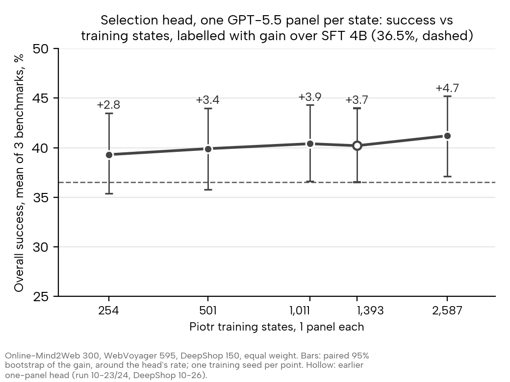

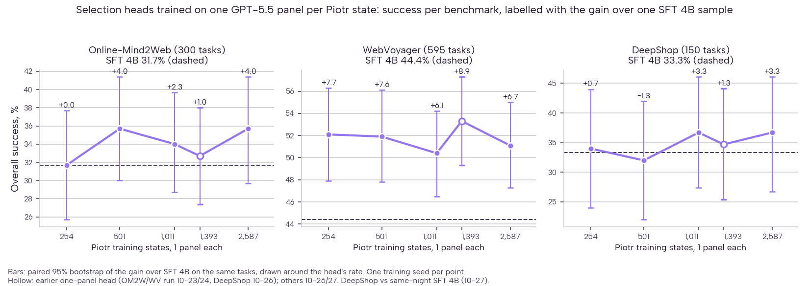

*Y-axis: overall success; labels: gain over SFT 4B, pp; bars: [paired 95% interval](#final-paired-bootstrap) of that gain, drawn around the head's rate; dashed: SFT 4B; hollow: the earlier 1,393-state one-panel head.*

| Training data | States | Panels | Online-Mind2Web valid-only | WebVoyager valid-only | DeepShop valid-only | Mean overall | Mean valid-only | − SFT 4B, pp [95% CI] | 2,587 states − row, pp [95% CI] | Row − one panel (1,393 states), pp [95% CI] |
| --- | ---: | ---: | ---: | ---: | ---: | ---: | ---: | ---: | ---: | ---: |
| One panel per state | 254 | 254 | 37.1% | 53.0% | 34.9% | 39.3% | 41.7% | +2.8 [−1.1, +7.0] | +1.9 [−2.0, +5.8] | — |
| One panel per state | 501 | 501 | 40.7% | 53.0% | 32.0% | 39.9% | 41.9% | +3.4 [−0.7, +7.5] | — | — |
| One panel per state | 1,011 | 1,011 | 38.3% | 51.5% | 37.7% | 40.4% | 42.5% | **+3.9 [+0.1, +7.8]** | +0.8 [−2.8, +4.4] | — |
| One panel per state | 1,393 | 1,393 | 37.3% | 54.7% | 36.9% | 40.2% | 43.0% | **+4.2 [+0.4, +8.0]** | — | — |
| One panel per state | 2,587 | 2,587 | 41.6% | 52.7% | 37.9% | 41.1% | 44.1% | **+4.7 [+0.6, +8.7]** | — | — |
| ≤ 8 panels per state | 1,393 | 10,181 | 40.9% | 53.9% | 34.7% | 40.4% | 43.2% | **+4.4 [+0.7, +8.0]** | — | +0.2 [−3.6, +3.9] |
| Every panel (≤ 16 per state) | 1,393 | 18,587 | 40.5% | 54.3% | 39.0% | 41.4% | 44.6% | **+5.4 [+1.8, +9.0]** | — | +1.2 [−2.6, +5.0] |

SFT 4B: Online-Mind2Web 31.7% and WebVoyager 44.4% (10-18; Online-Mind2Web re-judged by gpt-5.6-terra); DeepShop 33.3% on 10-27 for the one-panel heads except 1,393, and 32.0% on 10-26 for the 1,393-state heads. Online-Mind2Web 300, WebVoyager 595, DeepShop 150 tasks; overall counts invalid episodes as failures; paired 95% bootstrap over tasks.

- **Offline agrees.** On the 348 held-out test states (fixed five, three seeds each), the one-panel heads score 37.3–38.2% and the panel counts 37.0–38.2%, against 35.65% for one SFT sample.
- **DeepShop drift explained the earlier panel effect.** Against a 10-24 run, all panels looked +8.7 pp better than one on DeepShop; rerunning the one-panel head on the same day as the others raised it by 6.7 pp, leaving +2.0 [−7.3, +11.3].
- **Caveat.** One training seed per live head (offline seed spread ≤ 0.8 pp); the 1,393-state one-panel head's Online-Mind2Web and WebVoyager runs are from 10-23/24, and its single panel per state was drawn differently from the other one-panel heads.
- [State-scaling details](ARM_SELECTION_HEAD.md#selection-head-state-scale-1panel-20261027) · [Panel-scaling details](ARM_SELECTION_HEAD.md#selection-head-panel-scale-20261026) · Evidence: [states](arm_results/rl_integration/selection-state-scale-1panel-20261027.json), [panels](arm_results/rl_integration/selection-panel-scale-20261026.json) · [Plot script](arm_results/rl_integration/selection-state-scale-1panel-paired-20261027-plot.py)

### Every selector, three runs each in one window (October 29–30)

**Pooled over three runs in one window, every selector beats one SFT 4B sample by 4.3–7.7 pp, and Piotr's data lead only modestly. The Piotr-data head beats our 2,612-state head (−2.4 pp) and 22K-panel head (−2.9 pp); our 1,380-state head (−1.2) and both of our LoRAs (−1.1, −1.2 against SelectionARM) are not significantly behind. More of our states does not help.** These numbers replace the single-run comparisons above, which mixed run dates (DeepShop drifted by up to 10 pp between days). SFT-4B actor, N = 5 candidates, T 1.0 / top-p 0.9, 30 steps, 1,024 response tokens, one training seed per selector, all 1,045 tasks; Online-Mind2Web judged by gpt-5.6-terra, WebVoyager and DeepShop by GPT-4o. Each task's success is pooled over the runs.

| Actor | Selector | Training data | Runs | Online-Mind2Web valid-only | WebVoyager valid-only | DeepShop valid-only | Mean overall | Mean valid-only | − SFT 4B, pp [95% CI] |
| --- | --- | --- | ---: | ---: | ---: | ---: | ---: | ---: | ---: |
| SFT 4B | — (1 sample) | — | 3 | 32.3% | 45.2% | 29.0% | 33.6% | 35.5% | — |
| SFT 4B | 4B LoRA | Recipe 1 (2.6K states / 35K panels) | 3 | **43.1%** | 56.0% | 36.0% | **41.4%** | **45.0%** | **+7.7 [+5.6, +9.8]** |
| SFT 4B | Head (22.6 M) | Recipe 1 (2.6K states / 35K panels) | 3 | 40.9% | **56.8%** | 32.6% | 40.8% | 43.4% | **+7.1 [+4.9, +9.3]** |
| SFT 4B | 4B LoRA | Recipe 2 (1.3K states / 1.3K panels) | 3 | 38.5% | 54.5% | 34.6% | 40.2% | 42.5% | **+6.5 [+4.5, +8.6]** |
| SFT 4B | 4B LoRA | Recipe 2 (2.6K states / 2.6K panels) | 3 | 38.8% | 52.5% | **38.3%** | 40.1% | 43.2% | **+6.5 [+4.3, +8.7]** |
| SFT 4B | Head (22.6 M) | Recipe 2 (1.3K states / 1.3K panels) | 3 | 38.5% | 52.4% | 35.1% | 39.6% | 42.0% | **+5.9 [+3.9, +8.0]** |
| SFT 4B | Head (22.6 M) | Recipe 2 (2.6K states / 2.6K panels) | 3 | 37.4% | 53.0% | 32.9% | 38.4% | 41.1% | **+4.8 [+2.6, +7.0]** |
| SFT 4B | Head (22.6 M) | Recipe 2 (2.5K states / 22K panels) | 3 | 39.4% | 52.1% | 30.6% | 37.9% | 40.7% | **+4.3 [+2.0, +6.5]** |

**Recipe 1** is Piotr's SelectionARM data: 2,692 states with 35,916 panels of five sampled actor actions, each labelled by one GPT-5.5 pick before execution. **Recipe 2** is ours: SFT-4B branch states with 2–5 distinct actions, labelled by Luna judging 3 steps after execution (one panel per state, or 22K Piotr-style panels on 2,551 states). Differences are in mean overall success, [paired 95% bootstrap](#final-paired-bootstrap) over tasks. Against the Piotr-data selector of the same model: LoRA 1,380 −1.1 [−3.4, +1.1], LoRA 2,612 −1.2 [−3.5, +1.1], head 1,380 −1.2 [−3.4, +1.1], head 2,612 **−2.4 [−4.7, −0.1]**, 22K-panel head **−2.9 [−4.9, −0.7]**.

- **Single runs are noisy.** Runs of identical weights in this window differ by up to 4.1 pp on the mean (LoRA 2,612: 42.6 / 39.3 / 38.5%), so the first single run, which put LoRA 2,612 on top, did not hold.
- **Data scale:** head 2,612 − 1,380 states −1.2 [−3.3, +0.9] (pooling all runs of these weights, across days: **−2.0 [−3.8, −0.4]**); LoRA 2,612 − 1,380 −0.1 [−2.2, +2.1].
- **LoRA vs head on the same data:** +0.6 (Piotr's), +0.6 (1,380), +1.7 [−0.4, +3.9] (2,612), none significant in this window.
- **Two one-run LoRA variants** (2,551 states with 22K Piotr-style panels, checkpoint 3,600: 41.4% overall; 2,612 states in one order instead of ten: 39.0%) are level with SelectionARM's three runs (0.0 and −2.4 pp, intervals span 0).
- [Details, per-run means, cross-day drift and counts](ARM_SELECTION_HEAD.md#selection-head-sameday-20261029) · [Evidence](arm_results/rl_integration/selection-sameday3-20261030.json) · [Analysis script](arm_results/rl_integration/selection-sameday3-20261030-analysis.py)

### Matched 1280×720 viewport at inference (November 1–2)

**Recipe 2 selectors were trained on branch states captured at 1280×720 but are evaluated at the 1280×1000 default. Evaluating them at the matched 720 viewport does not help: their gains over SFT alone at the same viewport shrink. The head drops from +4.8 [+2.5, +7.0] to +2.1 [+0.1, +4.2] pp and the LoRA from +6.5 [+4.3, +8.8] to +4.9 [+2.8, +7.2]. The changes in gain are −2.6 [−5.8, +0.5] for the head and −1.5 [−4.6, +1.6] for the LoRA, so 1280×1000 stays the default.** SFT 4B actor, three runs per condition, all 1,045 tasks, N = 5, T 1.0 / top-p 0.9, 30 steps, 1,024 response tokens. The 1000 rows are the [same-window runs above](#final-selection-sameday3-20261030) (October 29–30). The 720 rows ran November 1–2 from a frozen source copy whose only change is the environment's viewport height (720). The default configs are unchanged.

| Viewport | Actor | Selector | Training data | Runs | Online-Mind2Web valid-only | WebVoyager valid-only | DeepShop valid-only | Mean overall | Mean valid-only | − SFT 4B at same viewport, pp [95% CI] |
| --- | --- | --- | --- | ---: | ---: | ---: | ---: | ---: | ---: | ---: |
| 1280×1000 | SFT 4B | — (1 sample) | — | 3 | 32.3% | 45.2% | 29.0% | 33.6% | 35.5% | — |
| 1280×1000 | SFT 4B | 4B LoRA | Recipe 2 (2.6K states / 2.6K panels) | 3 | 38.8% | 52.5% | 38.3% | 40.1% | 43.2% | **+6.5 [+4.3, +8.8]** |
| 1280×1000 | SFT 4B | Head (22.6 M) | Recipe 2 (2.6K states / 2.6K panels) | 3 | 37.4% | 53.0% | 32.9% | 38.4% | 41.1% | **+4.8 [+2.5, +7.0]** |
| 1280×720 | SFT 4B | — (1 sample) | — | 3 | 29.1% | 45.5% | 42.4% | 36.1% | 39.0% | — |
| 1280×720 | SFT 4B | 4B LoRA | Recipe 2 (2.6K states / 2.6K panels) | 3 | 37.0% | 51.0% | 44.3% | 41.1% | 44.1% | **+4.9 [+2.8, +7.2]** |
| 1280×720 | SFT 4B | Head (22.6 M) | Recipe 2 (2.6K states / 2.6K panels) | 3 | 33.7% | 49.5% | 40.8% | 38.3% | 41.3% | **+2.1 [+0.1, +4.2]** |

Per-benchmark valid-only = successes / valid episodes pooled over the three runs. Differences are in mean overall success, as a [paired 95% bootstrap](#final-paired-bootstrap) over tasks on per-task success averaged over runs. Only the within-viewport differences are same-day comparisons.

- **Compare gains, not raw rates, across viewports.** The two viewports ran on different days, and DeepShop drifted between them: SFT alone went from 29.0% to 42.4% valid-only, a cross-day +12.4 [+6.4, +18.4] pp. So the 720 − 1000 differences in raw rates are not interpretable. On Online-Mind2Web and WebVoyager, all three conditions are lower at 720 (−1.9 to −4.9 pp).
- **Per benchmark at 720, the LoRA − SFT gains are** Online-Mind2Web +6.2 [+3.2, +9.3], WebVoyager +5.9 [+3.4, +8.4] and DeepShop +2.7 [−2.7, +8.0]. **The head − SFT gains are** +2.7 [−0.2, +5.6], +4.4 [+1.8, +7.0] and −0.7 [−5.6, +4.2]. At 720 the LoRA leads the head by +2.8 [+0.7, +5.0], against +1.7 [−0.4, +3.9] at 1000.
- **Compute.** 27 jobs used about 57 H200-hours, within the approved 80.
- [Evidence](arm_results/rl_integration/selection-viewport-720-20261102.json) · [Analysis script](arm_results/rl_integration/selection-viewport-720-20261102-analysis.py)

### Selection on the RL checkpoint actor (October 30–31)

**On the OpenWebRL-4B RL checkpoint, over three runs each, SelectionARM gains +7.0 pp [+4.8, +9.2] over the RL actor alone and the 4B LoRA trained on Recipe 2 (2.6K states) +6.6 [+4.1, +8.9]; the two LoRAs are level (Recipe 2 − Recipe 1 −0.4 [−2.6, +1.7]). Heads trained on SFT-4B features gain +4.8 [+2.6, +7.0] (Recipe 2, 2.6K states) and +4.4 [+2.0, +6.7] (Recipe 1) when they score the RL actor's own hidden states with no retraining and no extra model. Both heads trail SelectionARM (−2.2 [−4.3, −0.0] and −2.6 [−4.6, −0.6]) and are level with each other (+0.4 [−1.6, +2.4]); the 2.6K head's one-run tie with SelectionARM did not hold.** Run 1 on October 30 (RL alone, SelectionARM) or 31 (heads), runs 2–3 together on October 31; the Recipe 2 LoRA's three runs together on October 31 – November 1; all 1,045 tasks per run, N = 5 candidates, T 1.0 / top-p 0.9, 30 steps, 4,096 response tokens. Online-Mind2Web judged by gpt-5.6-terra, WebVoyager and DeepShop by GPT-4o.

| Actor | Selector | Training data | Runs | Online-Mind2Web valid-only | WebVoyager valid-only | DeepShop valid-only | Mean overall | Mean valid-only | − RL alone, pp [95% CI] | − RL + 4B LoRA (Recipe 1), pp [95% CI] |
| --- | --- | --- | ---: | ---: | ---: | ---: | ---: | ---: | ---: | ---: |
| RL 4B | — (1 sample) | — | 3 | 30.2% | 56.9% | 44.6% | 42.0% | 43.9% | — | **−7.0 [−9.2, −4.8]** |
| RL 4B | 4B LoRA | Recipe 1 (2.6K states / 35K panels) | 3 | **43.4%** | 62.7% | 50.9% | **49.0%** | 52.3% | **+7.0 [+4.8, +9.2]** | — |
| RL 4B | 4B LoRA | Recipe 2 (2.6K states / 2.6K panels) | 3 | 42.4% | **64.7%** | **51.7%** | 48.6% | **52.9%** | **+6.6 [+4.1, +8.9]** | −0.4 [−2.6, +1.7] |
| RL 4B | Head (22.6 M) on RL-actor features | Recipe 2 (2.6K states / 2.6K panels) | 3 | 37.3% | 59.4% | 51.1% | 46.8% | 49.3% | **+4.8 [+2.6, +7.0]** | **−2.2 [−4.3, −0.0]** |
| RL 4B | Head (22.6 M) on RL-actor features | Recipe 1 (2.6K states / 35K panels) | 3 | 38.6% | 59.6% | 47.1% | 46.4% | 48.4% | **+4.4 [+2.0, +6.7]** | **−2.6 [−4.6, −0.6]** |

Pooled over three runs: per-benchmark valid-only = successes / valid episodes across runs; differences are in mean overall success, [paired 95% bootstrap](#final-paired-bootstrap) over tasks on per-task success averaged over the three runs. Heads were trained on SFT-4B features and score the RL actor's own hidden states unchanged. The Recipe 2 LoRA trains on the same 2,612 states as the Recipe 2 2.6K head (each panel shown in 10 candidate orderings during training) and is released as [`decoder-4b-lora-recipe2-2.6k`](https://huggingface.co/zixianma/action-selection-heads/tree/main/decoder-4b-lora-recipe2-2.6k).

- **Single runs vary by up to 4.7 pp on the mean.** Per-run mean overall: RL alone 42.4 / 41.4 / 42.4%, SelectionARM 49.0 / 49.8 / 48.3%, Recipe 2 LoRA 47.6 / 48.6 / 49.6%, Recipe 1 head 45.8 / 47.4 / 46.0%, Recipe 2 2.6K head 49.3 / 46.6 / 44.6%.
- **Recipe 2 LoRA against SelectionARM and the 2.6K head:** level with SelectionARM on every benchmark (Online-Mind2Web −1.0 [−4.2, +2.2], WebVoyager +2.0 [−0.5, +4.4], DeepShop −2.2 [−7.1, +2.9]); above the head trained on the same states, +1.8 [−0.2, +3.8] on the mean, from WebVoyager (+4.7 [+2.0, +7.3]) and Online-Mind2Web (+2.9 [−0.0, +5.8]).
- **Where the heads lose to SelectionARM:** Online-Mind2Web (2.6K head −3.9 [−6.9, −0.9], Recipe 1 head −2.3 [−5.4, +0.8]) and WebVoyager (−2.7 [−5.1, −0.4], −2.2 [−4.8, +0.4]); DeepShop is level (0.0 and −3.3 [−7.6, +0.9]).
- **Gains over RL alone are broad:** SelectionARM is significant on all three benchmarks (+9.9 / +4.8 / +6.2); the 2.6K head on Online-Mind2Web (+6.0) and DeepShop (+6.2); the Recipe 1 head on Online-Mind2Web (+7.6) and WebVoyager (+2.6 [0.0, +5.3]).

- [Evidence (three runs)](arm_results/rl_integration/selection-rlactor-4096-3run-20261031.json) · [Analysis script](arm_results/rl_integration/selection-rlactor-4096-3run-20261031.py) · [Run notes](ARM_SELECTION_HEAD.md#selection-head-rl-actor-20261030)

One run, including the frozen SFT-4B encoder (October 30–31; rankings did not survive the three-run pooling)

Run 1 of every condition, plus the heads with a separate frozen SFT-4B encoder (one run only). Rankings among the top rows here did not survive the three-run pooling above. Baselines and the frozen-encoder Recipe 2 head ran on October 30, all other heads on October 31; all 1,045 tasks, N = 5 candidates, T 1.0 / top-p 0.9, 30 steps, **4,096 response tokens** (the paper's setting), one run each. Online-Mind2Web judged by gpt-5.6-terra, WebVoyager and DeepShop by GPT-4o.

| Actor | Selector | Training data | Online-Mind2Web valid-only | WebVoyager valid-only | DeepShop valid-only | Mean overall | Mean valid-only | − RL alone, pp [95% CI] | − RL + 4B LoRA (Recipe 1), pp [95% CI] |
| --- | --- | --- | ---: | ---: | ---: | ---: | ---: | ---: | ---: |
| RL 4B | — (1 sample) | — | 32.8% | 59.2% | 40.7% | 42.4% | 44.2% | — | **−6.6 [−10.3, −2.7]** |
| RL 4B | Head (22.6 M) on RL-actor features | Recipe 2 (2.6K states / 2.6K panels) | 39.2% | 58.0% | **57.0%** | **49.3%** | 51.4% | **+6.9 [+3.2, +10.7]** | +0.4 [−3.3, +3.9] |
| RL 4B | 4B LoRA | Recipe 1 (2.6K states / 35K panels) | **45.8%** | **65.0%** | 45.6% | 49.0% | **52.1%** | **+6.6 [+2.7, +10.3]** | — |
| RL 4B | Head (22.6 M) on frozen SFT-4B features | Recipe 1 (2.6K states / 35K panels) | 42.9% | 59.5% | 49.3% | 47.9% | 50.6% | **+5.5 [+1.6, +9.3]** | −1.1 [−4.6, +2.6] |
| RL 4B | Head (22.6 M) on RL-actor features | Recipe 2 (1.3K states / 1.3K panels) | 40.9% | 62.2% | 47.0% | 47.2% | 50.0% | **+4.8 [+1.3, +8.3]** | −1.7 [−5.3, +2.0] |
| RL 4B | Head (22.6 M) on RL-actor features | Recipe 1 (2.6K states / 35K panels) | 38.0% | 59.2% | 46.0% | 45.8% | 47.7% | +3.4 [−0.3, +7.0] | −3.2 [−6.6, +0.4] |
| RL 4B | Head (22.6 M) on frozen SFT-4B features | Recipe 2 (1.3K states / 1.3K panels) | 37.2% | 60.6% | 32.9% | 40.8% | 43.6% | −1.6 [−5.5, +2.1] | **−8.2 [−11.8, −4.5]** |
| *SFT 4B* | *— (1 sample)* | — | 33.8% | 50.1% | 44.3% | 41.0% | 42.7% | −1.4 [−5.1, +2.4] | — |

Recipes as [defined above](#final-selection-sameday3-20261030). All heads were trained on SFT-4B features and are used unchanged: "on RL-actor features" scores the RL actor's own hidden states at inference (no extra model); "on frozen SFT-4B features" re-encodes the candidates with a separate frozen SFT-4B model. Differences are in mean overall success, [paired 95% bootstrap](#final-paired-bootstrap) over tasks.

- **Which features at inference depends on the head.** RL-actor − frozen SFT-4B features: Recipe 2 1.3K head **+6.4 [+2.6, +10.4]**, almost all DeepShop (+15.3 [+6.0, +24.7]); Recipe 1 head −2.1 [−5.5, +1.2].
- **On RL-actor features in run 1, Recipe 2 led Recipe 1** (2.6K head − Recipe 1 head +3.6 [+0.1, +7.0]; 1.3K − Recipe 1 +1.5 [−1.8, +4.8]); over three runs the two are level (+0.4 [−1.6, +2.4]). Run 1's leads, and the 2.6K head's tie with SelectionARM, came from DeepShop (2.6K − SelectionARM: DeepShop **+11.3 [+2.7, +20.0]**, WebVoyager **−5.9 [−9.9, −1.8]**, Online-Mind2Web −4.3 [−9.7, +1.0]). DeepShop has 150 tasks and drifted by up to 7 pp between run days, and these heads ran a day after the baselines.
- **SelectionARM's lead is broad:** Online-Mind2Web +10.0 [+5.3, +15.0] and WebVoyager +5.0 [+0.8, +9.1] over RL alone; DeepShop +4.7 [−4.7, +14.0].
- **RL vs SFT actor:** level on the mean; RL is better on WebVoyager (+8.4 [+3.9, +12.8]) and level on the other two. SFT 4B alone here (41.0%) is 7.4 pp above its three-run mean in the previous table (33.6%, 1,024 tokens, a day earlier), mostly DeepShop and WebVoyager; the cap ended only 16 of its 1,045 episodes there and none here, so this is mostly day-to-day drift, and RL-actor results should be compared only within this table.
- **Response cap.** At 4,096 tokens 0–11 episodes per benchmark end because a response ran out (1,024 tokens cut off 258 of 1,045 RL-alone episodes, which made the earlier run invalid). Given a cut-off candidate, SelectionARM never picks it (0 of 59 steps); the heads do at 0–11 steps per benchmark, most often the 2.6K head on RL-actor features (17 of 73 steps on Online-Mind2Web and WebVoyager).
- **October 31 run notes.** On Online-Mind2Web the frozen SFT-4B scorer of the Recipe 1 head failed with a cuDNN attention error on 184 episodes (persistently after about an hour); those tasks were rerun the same day, while 26 tasks whose site failed to load kept their single original attempt, as for every other run. The 1.3K head on RL-actor features stopped at the 4 h limit on WebVoyager with 581 of 595 tasks and was resumed for the other 14.
- [Details and counts](ARM_SELECTION_HEAD.md#selection-head-rl-actor-20261030) · [Evidence](arm_results/rl_integration/selection-rlactor-4096-20261030.json) · Scripts: [per-run rates](arm_results/rl_integration/selection-rlactor-4096-20261030-heads.py), [paired](arm_results/rl_integration/selection-rlactor-4096-20261030-paired.py)

## RL evaluation through training

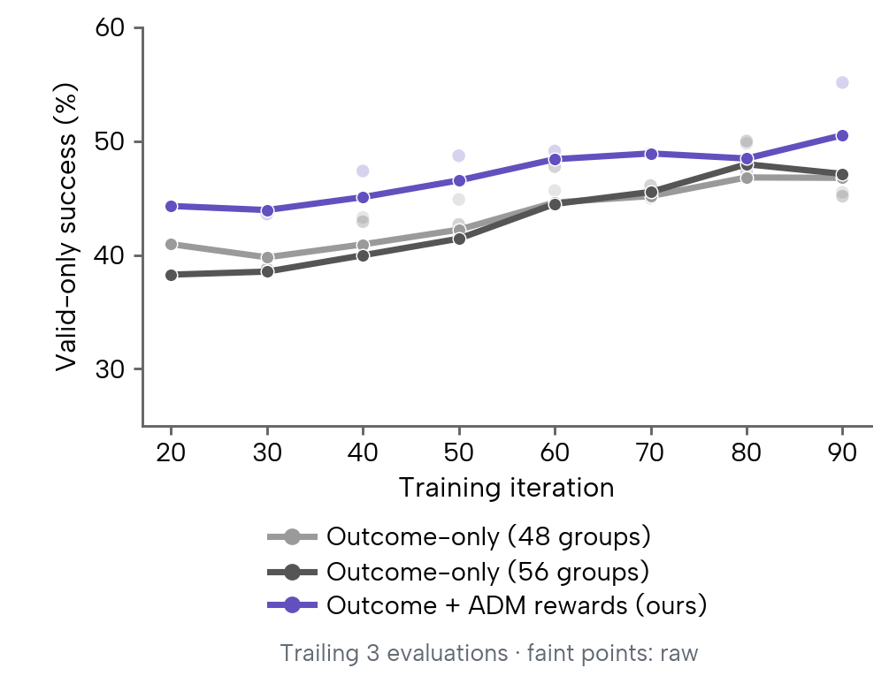

*Full-300 OM2W, local browser, GPT-4.1/action_history, actor T0. Iterations 20–90. Solid lines and dots pool success and valid counts across the latest three evaluations within this interval; faint points show raw valid-only success. Initial windows use one or two observations, without iteration-10 warmup. One training lineage per method; collection dates, valid populations and optimizer work differ. These historical single-checkpoint cohorts are separate from the later iteration-90 three-repeat comparison.* [PDF](rl_results/rl_eval_learning_curves.pdf) · [SVG](rl_results/rl_eval_learning_curves.svg) · [Definition, coverage and sources](RL_EVALUATION.md#rl-smoothed-eval-learning-curves).

## Online RL with ARM turn credit: main-paper set

Main-paper candidate set for online RL with SelectionARM turn credit, chosen on November 8 from
runs trained to at least iteration 60. Detailed history stays in
[ARM_SUMMARY.md](ARM_SUMMARY.md#arm-rl-method-guide) and [ARM_RESULTS.md](ARM_RESULTS.md).

**Status (November 11):** Same-day iteration-90 evaluation of all nine runs, three full-300 repeats each,
paper actor sampling and one shared Terra judge. Every run that keeps mixed groups beats outcome-only 48 by
3.6–6.2 pp (p ≤ 0.044); 40M+16F, Gate B, 48M+16F and Additive are indistinguishable from each other (36.7–38.3%
overall). Failures in main batch is the exception: +1.2 pp, not significant, and 4.0 pp below Gate B (p = 0.011).
Against the SFT start model (same protocol, November 11), outcome-only 48 gains +4.1 pp and Gate B +8.6 pp.
Every number is one training run per method.

### Experiments

One **group** is five trajectories of one task. `M` = mixed-outcome group; `F` = all-failure group.
`A` = group-normalized outcome advantage; `b = β·m·(1[selected executed response] − 1/5)` = SelectionARM
turn bonus (β = 0.5, labels attempted on q = 20% of turns, K = 5 candidates). `D` = distinct candidate
actions required to label a turn. All runs start from OpenWebRL-4B-SFT at iteration 0 with
batch 256, 2 PPO epochs, LR 1e−6, GPT-4.1 training judge and 15 browser turns.

| Method | Mixed groups | Failure groups | Gate | Turn credit | Trained to | Question |
| --- | --- | --- | --- | --- | ---: | --- |
| Outcome-only, 48 groups | 48 | 0 | — | `A` | 100 | Paper baseline |
| Outcome-only, 56 groups | 56 | 0 | — | `A` | 90 | Matches Gate B's group count |
| **Gate B (ours)** | 48 | ≤ 8, separate loss, coef. N/48 | D ≥ 2 | `A + b`; `b` on F | 100 | Main method |
| Additive | 48 | ≤ 8, separate loss, coef. N/48 | D = 5 | `A + b`; `b` on F | 100 | Does relaxing the gate matter? |
| Mixed-only bonus | 48 | 0 | D ≥ 2 | `A + b` | 90 | Do failure groups matter? |
| Mixed-only reweight | 48 | 0 | D ≥ 2 | `A × w` (λ = 0.5) | 90 | Bonus versus redistributing `A` |
| Failures in main batch | 48 − N | N, inside main batch | D = 5 | `A + b`; `b` on F | 100 | Replace versus add failure groups |
| Gate B · 40M + 16F | 40 | ≤ 16, separate loss, coef. N/48 | D ≥ 2 | `A + b`; `b` on F | 90 | Larger ARM-only share |
| Gate B · 48M + 16F | 48 | ≤ 16, separate loss, coef. N/48 | D ≥ 2 | `A + b`; `b` on F | 90 | Larger ARM-only share |

**Failures in main batch** replaces mixed groups: $(48-N)$ mixed groups plus $N$ all-failure groups share one 48-group batch. Outcome + ADM keeps 48 mixed groups and adds failure groups through a separate loss. This comparison also changes the gate ($D=5$ versus $D\ge2$), so it does not isolate batch placement.

Excluded: uniform G8 outcome-only control (by decision), runs stopped before 60 (failure β = 1,
failure sampling 40%), and the loop-credit and rescue pilots. Appendix candidates: original bonus (to 80), Gate C
(to 60), expanded 4,102-task outcome-only (to 60) and action-only (collapsed by 40; see
[ARM_SUMMARY.md](ARM_SUMMARY.md#arm-rl-method-guide)).

### Results

**Same-day iteration 90, shared Terra judge, three repeats (November 9–10).** Online-Mind2Web, all 300 tasks,
local browser, 30 turns, actor T0.6 / top-p 0.95 / top-k 20. Every episode is graded offline by gpt-5.6-terra with
the shared terminal-success prompt (medium effort, 4,096 tokens, seed 42, final screenshot). Overall counts invalid
episodes as failures; valid-only divides by valid episodes. Rates are means over the three repeats.

| Method | Successes per repeat | Valid per repeat | Overall % | Valid-only % | Δ vs outcome-only 48, pp | Paired 95% CI, pp | p |
| --- | --- | --- | ---: | ---: | ---: | --- | ---: |
| Outcome-only, 48 groups | 106 / 98 / 85 | 273 / 264 / 272 | 32.11 | 35.73 | — | — | — |
| Outcome-only, 56 groups | 91 / 92 / 95 | 272 / 270 / 271 | 30.89 | 34.20 | −1.2 | [−4.3, +1.9] | 0.49 |
| **Gate B (ours)** | 113 / 120 / 103 | 268 / 268 / 269 | 37.33 | 41.74 | +5.2 | [+2.0, +8.3] | 0.002 |
| Additive | 111 / 114 / 105 | 267 / 270 / 270 | 36.67 | 40.89 | +4.6 | [+1.2, +8.0] | 0.010 |
| Mixed-only bonus | 106 / 106 / 109 | 270 / 272 / 269 | 35.67 | 39.58 | +3.6 | [+0.6, +6.7] | 0.028 |
| Mixed-only reweight | 107 / 102 / 112 | 274 / 272 / 267 | 35.67 | 39.50 | +3.6 | [+0.2, +6.9] | 0.044 |
| Failures in main batch | 103 / 97 / 100 | 269 / 273 / 273 | 33.33 | 36.82 | +1.2 | [−1.9, +4.3] | 0.49 |
| Gate B · 40M + 16F | 110 / 114 / 121 | 268 / 272 / 273 | **38.33** | **42.43** | +6.2 | [+2.9, +9.6] | 0.001 |
| Gate B · 48M + 16F | 116 / 108 / 110 | 270 / 268 / 273 | 37.11 | 41.18 | +5.0 | [+1.7, +8.3] | 0.005 |

| Same-day comparison | Δ overall, pp | Paired 95% CI, pp | p |
| --- | ---: | --- | ---: |
| Gate B − outcome-only, 56 groups | +6.4 | [+3.3, +9.6] | < 0.001 |
| 40M+16F − Gate B | +1.0 | [−2.3, +4.3] | 0.61 |
| 48M+16F − Gate B | −0.2 | [−3.3, +2.9] | 0.94 |
| Additive − Gate B | −0.7 | [−3.8, +2.6] | 0.74 |
| Mixed-only bonus − Gate B | −1.7 | [−4.7, +1.3] | 0.30 |
| Failures in main batch − Gate B | −4.0 | [−7.0, −1.0] | 0.011 |

- **Paired test:** per-task success averaged over the three repeats; task bootstrap (10,000 samples) for the
  interval and a sign-flip test for p. Not corrected for multiple comparisons. Against outcome-only 56, every
  mixed-group run gains 4.8–7.4 pp (p ≤ 0.005) and Failures in main batch gains +2.4 pp (p = 0.12).
- **Collection:** jobs 442017 (Gate B, 40M+16F, 48M+16F, both outcome-only) and 442018 (the other four), run in parallel and
  interleaved by repeat. The in-harness judge was disabled; grading cost $58.36 with no actor calls.
- **One ungraded episode:** in 48M+16F repeat 2 the judge answered `Status: "success"` twice, which the frozen
  parser rejects; it counts as a failure (at most +0.1 pp).
- **Not established:** training-seed variability.

**Gain over the SFT start model (November 11).** Same protocol; one job with the SFT model (iteration 0, HF weights
15e777db) and same-day anchors for outcome-only 48 and Gate B at iteration 90, three repeats each, interleaved.

| Model | Successes per repeat | Valid per repeat | Judged per repeat | Mean turns | Overall % | Valid-only % |
| --- | --- | --- | ---: | ---: | ---: | ---: |
| SFT, iteration 0 | 86 / 94 / 86 | 271 / 270 / 270 | 185 | 14.6 | 29.56 | 32.80 |
| Outcome-only 48, iteration 90 | 99 / 104 / 100 | 269 / 274 / 274 | 263 | 9.4 | 33.67 | 37.09 |
| Gate B, iteration 90 | 113 / 123 / 107 | 269 / 269 / 265 | 265 | 9.6 | 38.11 | 42.70 |

| Paired comparison | Δ overall, pp | Paired 95% CI, pp | p |
| --- | ---: | --- | ---: |
| Outcome-only 48 − SFT | +4.11 | [+0.67, +7.56] | 0.024 |
| Gate B − SFT | +8.56 | [+4.89, +12.11] | < 0.001 |
| Gate B − outcome-only 48 | +4.44 | [+1.00, +8.00] | 0.020 |

*Judged* = valid episodes that ended on their own and reached the judge; the rest hit the 30-turn limit or a browser
failure and count as failures. The SFT model averages 14.6 turns and reaches the judge on 185 of ~270 valid episodes.
The anchors reproduce the November 9–10 rates within 1.6 pp (outcome-only 48: 33.67 vs 32.11; Gate B: 38.11 vs 37.33).
Judge cost $16.98. [Aggregate](arm_results/rl_final_20261108/iter0_terra_anchor_20261111.json) · Runner: `scripts/run_iter0_terra_anchor.py`.

[Aggregate, protocol and paired tests](arm_results/rl_final_20261108/iter90_terra_sameday_20261111.json)
· Runners: `scripts/run_iter90_terra_reeval.py`, `scripts/run_iter90_terra_reeval_ext.py`
· Re-grader: `scripts/rejudge_rl_evals_shared_terra.py`.

Historical single-evaluation and mixed-date results (GPT-4.1 and stealth/o4-mini judges)

Online-Mind2Web, all 300 tasks. Invalid episodes count as failures in overall rates.

| Method | Iter. 60 successes | Iter. 60 overall % | Iter. 90 successes | Iter. 90 valid | Iter. 90 overall % | Iter. 90 valid-only % | Mean 70/80/90 overall % | Matched iter. 90, 3 repeats, overall % | Stealth iter. 90, 3 repeats, overall % |
| --- | ---: | ---: | ---: | ---: | ---: | ---: | ---: | ---: | ---: |
| Outcome-only, 48 groups | 105 | 35.00 | 101 | 222 | 33.67 | 45.50 | 35.33 | 34.11 | 55.22 |
| Outcome-only, 56 groups | 117 | 39.00 | 107 | 237 | 35.67 | 45.15 | 38.11 | 35.33 | — |
| **Gate B (ours)** | 112 | 37.33 | 129 | 234 | **43.00** | **55.13** | **38.67** | **40.56** | 58.78 |
| Additive | 90 | 30.00 | 118 | 216 | 39.33 | 54.63 | 37.89 | — | 58.44 |
| Mixed-only bonus | 113 | 37.67 | 122 | 233 | 40.67 | 52.36 | 38.33 | — | **59.00** |
| Mixed-only reweight | 110 | 36.67 | 113 | 227 | 37.67 | 49.78 | 38.56 | — | 56.22 |
| Failures in main batch | 100 | 33.33 | 101 | 217 | 33.67 | 46.54 | 33.22 | — | — |
| Gate B · 40M + 16F | 108 | 36.00 | 103 | 227 | 34.33 | 45.37 | 34.89 | — | — |
| Gate B · 48M + 16F | 99 | 33.00 | 103 | 222 | 34.33 | 46.40 | 34.33 | — | — |

| Matched iteration-90 comparison (October 25) | Difference | Paired 95% CI | Holm p |
| --- | ---: | --- | ---: |
| Gate B − outcome-only, 56 groups | +5.22 pp | [+1.56, +8.89] pp | 0.014 |
| Gate B − outcome-only, 48 groups | +6.44 pp | [+2.67, +10.22] pp | 0.004 |

- **Iteration and mean columns:** one evaluation per checkpoint with a local browser,
  GPT-4.1 action-history judge, actor temperature 0 and 30 turns. Collection dates and
  valid-task sets differ between runs. Repeat evaluations of one checkpoint differ by up to about 4 pp.
- **Matched column:** three contemporaneous full-300 repeats on October 25 with the same protocol.
  Paired task bootstrap and sign-flip tests. Successes per repeat were 103/95/109 (48 groups),
  114/102/102 (56 groups) and 123/117/125 (Gate B).
- **Stealth column:** stealth browser, o4-mini/AgentTrek judge, actor T0.6/p0.95/k20. The
  outcome-only, additive and Gate B cohorts were collected September 29–30; the mixed-only
  cohorts on October 6. Gate B − outcome-only is +3.56 pp, Holm p = 0.22. WebVoyager and
  DeepShop show no ARM gain ([details](ARM_SUMMARY.md#arm-localbench90-summary-20261008)).
- **Not established:** training-seed variability. Every number comes from one training run per method.

### Compact training and evaluation curves

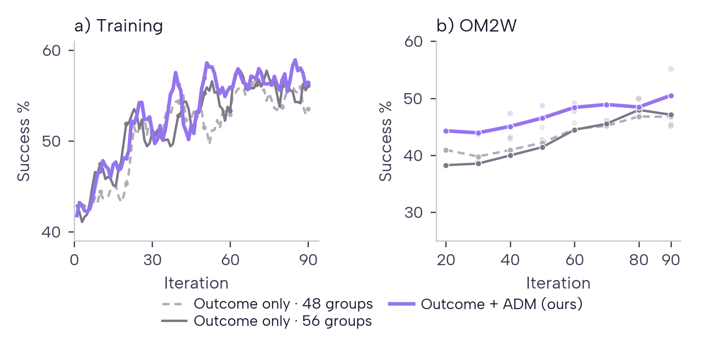

*(a) Training “Success %” is binary task success among valid collected trajectories, before dynamic-sampling filtering. It excludes the ADM bonus and is not the total reward. Lines average the last five per-iteration rates; dots mark every tenth iteration. This policy-dependent collection metric is not fixed-task held-out accuracy. (b) Valid-only Online-Mind2Web success over iterations 20–90, reproducing the [standalone evaluation curves](rl_results/rl_eval_learning_curves.png). Lines and circles pool successes and valid counts across the latest three evaluations; faint dots show raw rates. Initial windows use one or two evaluations, without iteration-10 warmup. These historical evaluations use a local browser, GPT-4.1/action-history judge, actor T0 and 30 turns. Dates and valid populations differ; invalid episodes are excluded. One training lineage per method. The 40M+16F and other omitted ablations remain in the table and archived views below.*

The GPT-4.1-judged matched bars are omitted; the shared-Terra comparison is the [same-day iteration-90 table](#final-rl-iter90-terra-sameday-20261111). Learning and repetition figures share a 4.9 × 2.10-inch canvas, square panels and tighter horizontal spacing, 8 pt titles, 7.5 pt axis labels, 7 pt ticks and a vertical 7 pt legend on the right.

[PDF](arm_results/rl_final_20261108/rl_learning_compact.pdf) · [SVG](arm_results/rl_final_20261108/rl_learning_compact.svg) · [Renderer](arm_results/rl_final_20261108/plot_rl_learning_compact.py) · [Coordinates, protocols and hashes](arm_results/rl_final_20261108/rl_learning_compact.json).

**Merged learning and repetition version.**

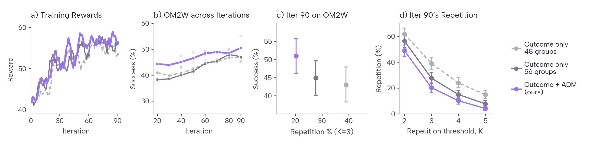

*Same three methods and unchanged source values as the separate figures. (a) Training Rewards: binary outcome reward, displayed as a percentage among valid collected trajectories, with a trailing-five-iteration mean; the ADM bonus is excluded. (b) OM2W across Iterations: valid-only evaluation success, with faint raw dots and the trailing-three-evaluation pooled ratio. (c) Iteration 90: valid-only OM2W success versus the percentage of valid episodes containing at least three identical eligible tool calls; success intervals are 95% task-cluster bootstrap intervals. (d) Iter 90’s Repetition: the same repeated-action incidence at K = 2–5, with 95% task-cluster intervals. Calls need not be consecutive; `wait` and `done` are excluded. Panel (c) pools three repeats per checkpoint; it is not the final smoothed point in (b). Panels use their original method-specific valid populations and historical evaluation windows, without asserting matched cohorts across panels. The single-row 8.8 × 2.10-inch layout uses four square panels and one vertical legend. See the [learning definitions above](#final-rl-learning-compact) and [repetition methodology](RL_BEHAVIOR.md#rl-repetition-incidence-paper).*

[PDF](arm_results/rl_final_20261108/rl_learning_compact_with_repetition.pdf) · [SVG](arm_results/rl_final_20261108/rl_learning_compact_with_repetition.svg) · [Source](arm_results/rl_final_20261108/plot_rl_learning_repetition_merged.py) · [Coordinates and provenance](arm_results/rl_final_20261108/rl_learning_compact_with_repetition.json).

Overall-success version: invalid attempts included

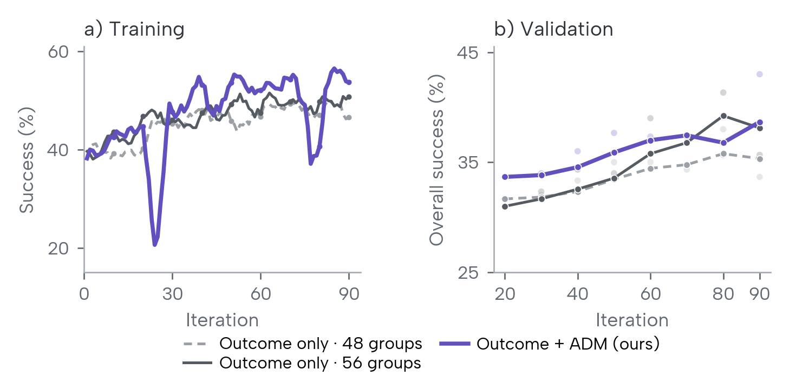

*Same methods, checkpoints, physical panel sizes and smoothing windows. Training: `100 × successes / all completed collected trajectories`, before dynamic-sampling filtering; ADM bonuses are excluded. Lines average five per-iteration rates. Validation: `100 × successes / 300 planned tasks` at each checkpoint; invalid episodes count as non-success. Lines pool successes and planned counts over up to three evaluations in iterations 20–90; faint dots show raw overall rates. This validation metric still uses GPT-4.1/action-history judgments. The ADM training dips near iterations 21–24 and 76–77 coincide with infrastructure-invalid rates of about 42–90%, so overall collection success mixes policy performance with browser reliability. The valid-only figure above removes invalid attempts from its denominators.*

[PDF](arm_results/rl_final_20261108/rl_learning_compact_overall.pdf) · [SVG](arm_results/rl_final_20261108/rl_learning_compact_overall.svg) · [Coordinates and metric definitions](arm_results/rl_final_20261108/rl_learning_compact_overall.json). Reproduce with the same renderer and `--overall`; the original input aggregates remain unchanged.

All runs: full training and validation curves

### Validation success across iterations

Panel 1 compares Gate B with both outcome-only controls. The X markers are the October 25
three-repeat means at iteration 90. Each other panel shows one ablation (dashed purple) against Gate B
(solid purple) and outcome-only 56 (dark gray). [PDF](arm_results/rl_final_20261108/validation_success.pdf).

### Training success across iterations

Success among **valid** training rollouts collected at each iteration, before dynamic sampling
removes all-success and all-failure groups. Bold lines are trailing five-iteration means; faint
lines are raw values. This is the GPT-4.1 training judge on 15-turn episodes; the ARM bonus is
not included. Valid-only rates remove infrastructure incidents: for example, at Gate B
iterations 21–24 and 76–77, 42–90% of episodes were invalid, against a usual 6%.
Overall rates and invalid rates are in the data file. [PDF](arm_results/rl_final_20261108/training_success.pdf).

Sources and reproduction

- **Aggregate data:** [arm_final_results_data.json](arm_results/rl_final_20261108/arm_final_results_data.json), with
  per-checkpoint counts, per-iteration training success, invalid rates and accepted-turn reward, and the W&B run of each lineage.
- **Validation counts:** the verified audits behind
  [ARM_SUMMARY.md](ARM_SUMMARY.md#arm-rl-method-guide). Gate B · 48M + 16F at iteration 70 comes from its
  verified controller progress record (99 successes, 230 valid). Iterations after 90 are omitted:
  outcome-only 48 continued at 30 turns, while Gate B and additive continued at 15.
- **Training curves:** W&B `train/task_success_rate` and `train/task_invalid_rate` on
  `train/reward_iteration`, in project `openwebrl`. Where a resumed run logged an iteration twice, the last value is kept.
- **Figures:** `python scripts/plot_arm_final_results.py` (matplotlib). Compact view: `python openwebrl/docs/arm_results/rl_final_20261108/plot_rl_learning_compact.py`. The compact renderer also reads the published success-CI aggregate linked above; no API or browser calls.

