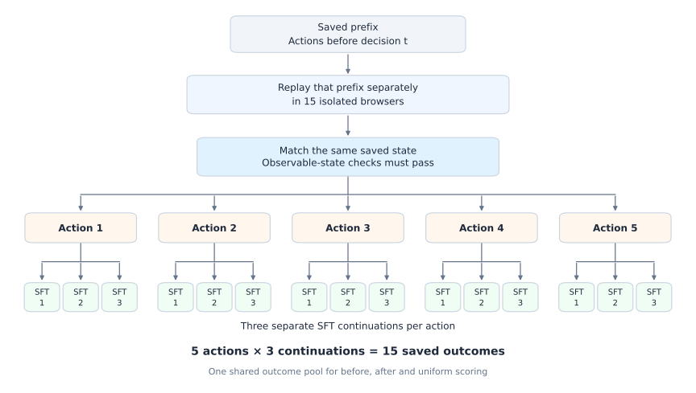
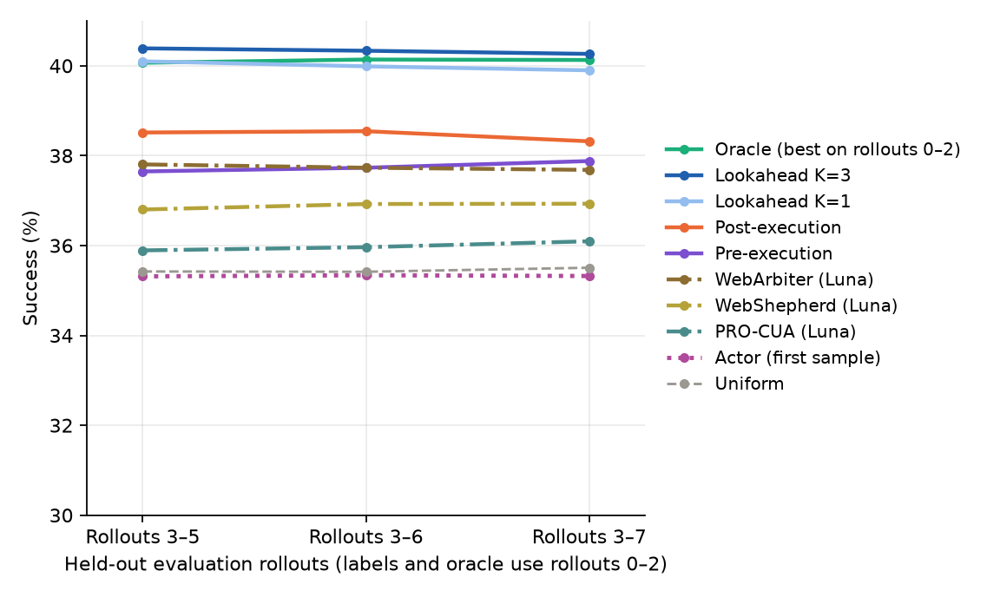
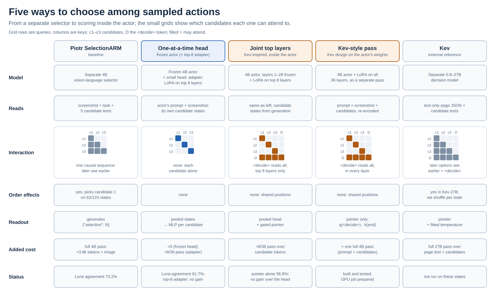
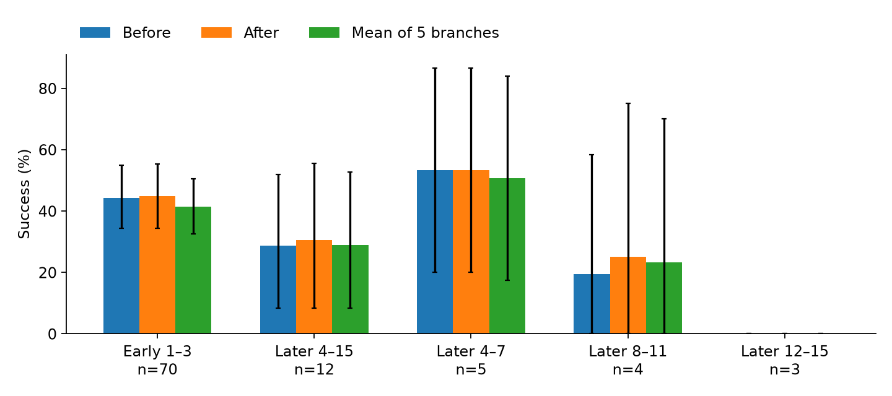
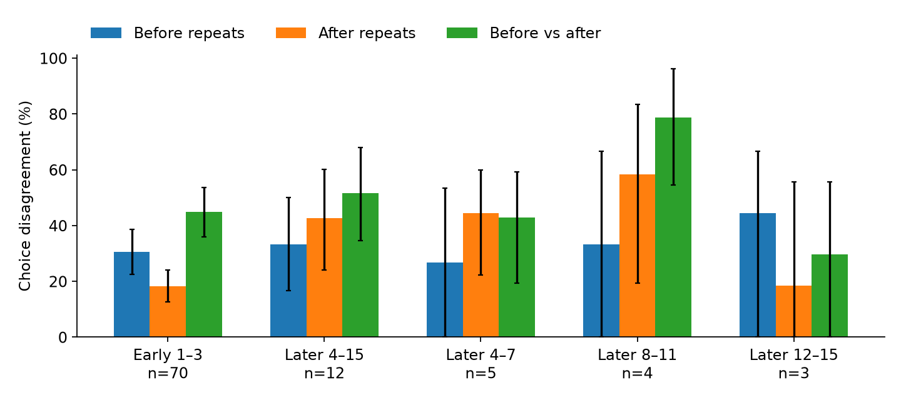

# ARM branching: action quality, execution evidence and selector training

**Looking ahead is what makes a teacher's action choice better; immediate post-action evidence adds nothing.** On 1,037 SFT-actor branching states (329 tasks), GPT-6 Luna judging each candidate after the actor's next three steps (lookahead K = 3) beats judging it right after execution by about 2 pp under both outcome judges, while judging after execution is level with judging before it. Every teacher formulation beats a uniform pick; the WebArbiter, WebShepherd and PRO-CUA formulations land at or below our pre-execution baseline. Scored on held-out continuation draws 3–7, valid draws only; [method](#branching-design), [details](#lookahead-main-results).

| Question | States | Paired difference, pp: o4-mini judge [95%] | Same, GPT-6 Luna judge [95%] | Takeaway |
| --- | ---: | --- | --- | --- |
| Does immediate execution evidence help? | 1,037 | post − pre +0.32 [−0.90, +1.48] | +0.58 [−0.47, +1.55] | No |
| Does looking ahead help? | 1,037 | K = 3 − post +2.18 [+1.09, +3.33] | +2.38 [+1.58, +3.22] | Yes; K = 1 is within 0.6 pp of K = 3 |
| Do teachers beat a uniform pick? | 1,037 | K = 3 +4.76 [+3.53, +5.94]; pre +2.26 [+1.17, +3.33] | +3.97 [+2.96, +5.03]; +1.02 [+0.27, +1.81] | Yes, all of them; the actor's first sample does not (−0.04) |
| Do prior-work judge formulations do better? | 1,037 | K = 3 − WebArbiter +2.63 [+1.44, +3.74] | +1.97 [+0.81, +3.06] | No; WebArbiter is the best of the three, level with pre-execution |
| Does a stronger teacher help? | 194 | GPT-6.1 Sol − Luna, both after execution: +0.41 [−1.17, +1.89] | — | No ([details](#teacher-labels-211-20261011)) |
| Does selecting with 24 continuations beat eight? | 14 | +3.52 [−0.12, +7.35] | — | Inconclusive ([details](#branch-extra24-20261008)) |
| Do trained selectors beat uniform offline (natural five-proposal panels)? | 345 | Piotr SelectionARM +2.4 [+1.1, +3.8] | — | Piotr's does, possibly helped by having trained on other states of the same tasks; 4B LoRAs trained on our K = 3 or outcome labels +1.5 [−0.1, +3.1] and +0.6 [−0.6, +2.0] ([details](ARM_SELECTION_HEAD.md#selection-head-sft-actions-lora-20261021)) |

Intervals resample whole tasks. The Luna-judge column re-judges the same continuations with GPT-6 Luna, a much stricter judge. Whether these labels train better selectors live is answered in [ARM_SELECTION_HEAD](ARM_SELECTION_HEAD.md#headline-results): heads trained on K = 3 or outcome labels match Piotr SelectionARM on 1,045 benchmark tasks; heads trained on pre-execution labels gain nothing. [Paired-difference evidence](arm_results/rl_integration/lookahead-full-set-pairs-20261022.json).

Earlier summary on smaller, older state sets (superseded)

| Question | Matched states | Paired difference, percentage points | 95% interval | Takeaway |
| --- | ---: | ---: | --- | --- |
| Does Luna select better after seeing immediate execution evidence? | 119 | +2.24, after − before | [−0.28, +4.95] | No clear advantage yet; historical invalid-as-zero score |
| Can old continuation outcomes select better than uniform on fresh outcomes? | 58 | +8.51, select on three − uniform | [+3.45, +14.37] | Evidence of outcome signal; gains over actor-first and Luna remain uncertain |
| Does selecting with 24 continuations beat selecting with eight? | 14 | +3.52, select with 24 − select with eight | [−0.12, +7.35] | Inconclusive on the same fresh, valid-only holdout |
| Do teacher-trained selectors pick better actions than uniform? | 138 | Piotr ARM +2.48; outcome-selected on five draws +5.32 | [−0.14, +5.21]; [+3.09, +7.62] | Only outcome selection is clearly above uniform ([details](#selection-head-20261009)) |
| Do execution evidence or a stronger teacher improve picks? | 194 | Sol after − before −0.31; Luna after − before +0.15; after: Sol − Luna +0.41 | [−2.40, +1.68]; [−1.86, +2.10]; [−1.17, +1.89] | No measurable gain from either; all teachers ≈ +3 pp over uniform ([2×2](#teacher-labels-211-20261011)) |
| Does multi-step lookahead help? | 194 | Luna lookahead (answers hidden) − immediate +1.98 | [+0.08, +3.98] | Modest gain; reaches the outcome reference; showing final answers hurts ([details](#lookahead-labels-20261011)) |
| Does the lookahead gain replicate on fresh Piotr-matched states? (prespecified primary test) | 121 | Luna lookahead (answers hidden) − immediate +4.75 | [+1.58, +8.27] | Yes; lookahead also beats uniform (+4.19) and is within 1 pp of the outcome reference ([stage a](#lookahead-stage-a-20261012)) |

The first interval resamples states; the others resample task groups. Selectors trained on teacher choices did not clearly beat a uniform pick on held-out draws of 138 eight-draw states, while selecting by outcomes on five draws did: +5.32 pp [+3.09, +7.62].

## What is measured

A **state** is the task, screenshot and action history before the candidate action. A **candidate** is one of five fixed actor responses; duplicate actions remain in the panel. A **continuation/draw** executes that candidate in a separately replayed browser and then follows the frozen SFT actor to a terminal outcome. Only the root-action choice differs between selection rules; these are conditional continuation rates, not full-benchmark pass@1 or episode pass@k.

| Selection rule | Information used to choose the root action | Interpretation |
| --- | --- | --- |
| Actor first / uniform | First candidate / random index among all five | Baselines scored on the same saved outcomes |
| Before / after critic | State and candidates / additionally immediate execution evidence | Direct test of the value of post-action evidence; neither sees future returns |
| Outcome-selected reference | Separate continuation outcomes for each candidate | Privileged offline reference, evaluated on held-out draws; not a trained critic |
| Same-data hindsight maximum | The same outcomes used for selection and scoring | Optimistically biased diagnostic, not a true upper bound |

“Select on *m*, score on *h*” counts draws **per candidate action**. Exact uniform averaging handles tied winners without looking at the holdout. In the valid-only family these are draw slots: invalid observations reduce the usable denominator. Score each candidate's valid held-out mean, then weight states equally. Native valid unjudged action-limit zeros stay failures; missing/replay-rejected records stay missing. Saved judge labels can credit partial or misinterpreted success, so artifact verification does not establish semantic correctness.

Original three-draw diagram and shared actor/judge protocol

The diagram depicts the historical five-by-three design. The new pilot uses eight draws per action; its extension targets 32 in total. Before, after and uniform choices reuse the same outcomes within each comparison. Uniform requires no separate rollout set. [PNG](arm_results/rl_integration/branching-experiment-design.png).

All families use official OpenWebRL SFT with temperature 1.0, top-p 0.95, top-k off and 4,096 response tokens, and canonical o4-mini/AgentTrek terminal-success labels. The 30-action budget includes the prefix. Strict observable-state replay checks are preserved; they do not guarantee identical hidden state or eliminate website drift. The new pilot requires forty ready contexts; its candidate intervention retains the complete sampled reasoning/action response in the continuation history.

## Lookahead teacher labels: the current comparison on 1,037 states

### Lookahead labelling: what Luna sees in each condition

Every condition is the same GPT-6 Luna request (`gpt-6-luna`, high reasoning effort), built by `openwebrl.arm_branch_teacher.request` with condition-specific additions (`scripts/run_branch_lookahead_labels.py`).
- **Calls per state:** four: three in the canonical candidate order and one in a seeded shuffled order. Luna returns `{"selection": k}`.
- **Scoring:** each pick is scored on held-out draws 3–7 of the chosen action. Draws 1–7 are never shown, nor is any judge verdict or reward.

**Current, consistent "steps" format.** Reasoning appears only for the candidates being judged. History and future are both represented as abbreviated actions with screenshots.

| Input | Before execution | Immediate result | Lookahead K = 1, 2, 3, 5 |
| --- | :---: | :---: | :---: |
| Task and current screenshot | ✓ | ✓ | ✓ |
| Five candidates' full text, **reasoning included** | ✓ | ✓ | ✓ |
| Last 3 past steps: abbreviated action + the screenshot before it | ✓ | ✓ | ✓ |
| Immediate result of each candidate (draw 0): post-action screenshot, page observation, tool feedback | — | ✓ | ✓ |
| Next K actor steps after each candidate (draw 0): abbreviated action + the resulting screenshot | — | — | ✓ |
| Final answer if the episode ended within K steps | — | — | hidden: shown as "[the episode ended here; any final answer is not shown]" |
| Images per call (maximum) | 4 | 9 | 14 / 19 / 24 / 34 |

- **Abbreviated action.** The actor's output after its last `</think>`, which is the tool call, capped at 1,500 characters. The cap guards against unusually long actions such as long typed text; most tool calls are far shorter.
- **Why the final answer is hidden.** On the 194-state study, showing it made Luna's picks worse: −1.49 pp [−2.64, −0.42] against hiding it.

### Lookahead labels: main results

**Looking three steps ahead is what makes Luna's labels better. On 1,037 states across 329 tasks, K = 3 beats pre-execution, post-execution and the WebShepherd, WebArbiter and PRO-CUA judge formulations by 2–4 pp under both outcome judges and in every view; the input format, history and call order barely matter.** Recommended labeller: **K = 3, screenshots only, no history, 1–2 randomized-order calls per state** (about USD 3.3 per 1,000 states at one call). K = 1 is within 1 pp at about 35% lower cost.

**A. Across teacher formulations and outcome judges** (main set: all labelled states with a valid held-out draw for every action, completely blank pages removed; 1,037 states, 329 tasks; held-out draws 3–7; valid draws only):

| Teacher (GPT-6 Luna; screenshots only, no history) | o4-mini judge | − K = 3, pp [95%] | GPT-6 Luna judge | − K = 3, pp [95%] |
| --- | ---: | --- | ---: | --- |
| **Lookahead K = 3** | 40.49% | — | 32.47% | — |
| WebArbiter formulation + lookahead K = 1 | 40.37% | −0.12 [−1.40, +1.07] | 32.43% | −0.04 [−1.03, +0.87] |
| Lookahead K = 1 | 40.26% | −0.23 [−1.30, +0.79] | 31.83% | −0.64 [−1.48, +0.13] |
| Post-execution | 38.31% | −2.18 [−3.33, −1.09] | 30.09% | −2.38 [−3.22, −1.58] |
| Pre-execution | 37.98% | −2.51 [−3.59, −1.36] | 29.51% | −2.95 [−4.03, −1.86] |
| WebArbiter formulation | 37.86% | −2.63 [−3.74, −1.44] | 30.49% | −1.97 [−3.06, −0.81] |
| WebShepherd formulation | 37.04% | −3.45 [−4.56, −2.29] | 29.29% | −3.17 [−4.20, −2.21] |
| PRO-CUA formulation | 36.26% | −4.23 [−5.42, −2.87] | 28.84% | −3.62 [−4.76, −2.51] |
| Uniform pick | 35.72% | −4.76 [−5.93, −3.53] | 28.50% | −3.97 [−5.03, −2.96] |
| Actor's first sample | 35.69% | −4.80 [−6.64, −2.82] | 28.73% | −3.74 [−5.30, −2.21] |

- **Execution evidence, not the judging format, carries the gain.** Giving WebArbiter's pairwise tournament each response's K = 1 lookahead raises it by +2.51 pp [+0.98, +3.92] (o4-mini) and +1.94 pp [+0.70, +3.01] (Luna), to the level of the plain lookahead labellers: +0.11 pp [−0.89, +1.11] and +0.60 pp [−0.22, +1.45] over K = 1.
  - It costs about 1.6× plain K = 1: USD 8.09 and 4,712 calls on 1,171 states, 4 pairwise calls per state.
  - The robustness views agree. Its gain over WebArbiter alone is +1.17 pp [−0.10, +2.46] under Luna with arXiv capped.
  - [JSON](arm_results/rl_integration/lookahead-arbiter-k1-20261018.json), runner `scripts/run_branch_prm_formulations.py` method `arbiter_k1` (commit `73295df`).

**Robustness across views** (all differences in pp [95%]; each view's rule was fixed before the final results):

| View | States | Tasks | K = 3 − post-execution, o4-mini | K = 3 − post-execution, Luna | K = 3 − pre-execution, o4-mini | K = 3 − pre-execution, Luna |
| --- | ---: | ---: | --- | --- | --- | --- |
| Main (blank pages removed) | 1,037 | 329 | +2.18 [+1.09, +3.33] | +2.38 [+1.58, +3.22] | +2.51 [+1.36, +3.59] | +2.95 [+1.86, +4.03] |
| 2+ different actions | 743 | 262 | +2.37 [+1.00, +3.78] | +2.42 [+1.37, +3.53] | +2.83 [+1.37, +4.19] | +3.62 [+2.31, +5.00] |
| Without browser error pages | 961 | 327 | +2.36 [+1.25, +3.45] | +2.34 [+1.49, +3.19] | +2.65 [+1.41, +3.85] | +2.95 [+1.81, +4.13] |
| arXiv capped at 10% | 766 | 329 | +1.96 [+0.53, +3.34] | +2.49 [+1.46, +3.55] | +1.97 [+0.41, +3.52] | +2.87 [+1.49, +4.26] |

*Main set: 1,010 states, 323 tasks, all OpenWebRL-4B-SFT; valid draws only; the same states at every point (every action has a valid rollout in 0–2 and in 3–5). Rollouts are numbered 0–7 as in the tables. Teachers see rollout 0 only (screenshot-only, no history; dash-dot lines are the WebArbiter, WebShepherd and PRO-CUA formulations, GPT-6 Luna), and the oracle picks the best action on rollouts 0–2 at every point; only the held-out window grows. On rollouts 3–7, lookahead K = 3 reaches 40.26% and the oracle 40.13%, +4.94 pp [+2.95, +6.81] and +4.81 pp [+3.02, +6.49] over the actor's first sample (35.32%); the curves are flat because a longer window only reduces noise. Task-clustered intervals. [JSON](arm_results/rl_integration/lookahead-draw-split-20261013/curve_fixedfit_main.json), [code](arm_results/rl_integration/lookahead-draw-split-20261013/curve_fixedfit.py), [plot](arm_results/rl_integration/lookahead-draw-split-20261013/plot_fixedfit.py); earlier variable-split version (oracle on 8 − x draws): [figure](arm_results/rl_integration/lookahead-draw-split-20261013/lookahead_draw_split_piotr_absolute_lines_valid_only_main.png), [JSON](arm_results/rl_integration/lookahead-draw-split-20261013/curve_piotr_main.json).*

- *All states: 1,171 labelled (736 grid + 435 new `fast1k`), all from OpenWebRL-4B-SFT; 103 lack a valid held-out draw for some action and 31 are completely blank pages. Views: 2+ different effective actions (type + target); without the 76 browser error pages; arXiv (a third of the main set) downsampled round-robin across its tasks to 10%. The Luna judge re-judged every judged held-out continuation (no state lacks a verdict). Task-clustered intervals. [JSON](arm_results/rl_integration/lookahead-full-set-20261017.json), [code](arm_results/rl_integration/lookahead-full-set-20261017.py).*

**B. Across input formats** (run on the 736 grid states only; o4-mini judge; 493 Piotr-task states, 78 tasks; randomized order, 2 calls per state unless noted):

| Input format (o4-mini judge) | Pre-execution | Post-execution | K = 1 | K = 3 |
| --- | ---: | ---: | ---: | ---: |
| **Screenshots only**, no history | 34.20% | 34.77% | 37.71% | 38.21% |
| Text only, no history | 35.27% | 36.11% | 37.02% | 37.62% |
| Screenshot + text, no history | 34.35% | 35.20% | 37.10% | 37.48% |
| Screenshot + text, 3 past steps | 34.73% | 35.80% | — | 37.76% |
| Screenshot + text, 3 past steps, fixed order | 35.16% | 36.03% | — | 38.07% |

**C. Smaller ablations** (run only on the 421 new states; 372 with valid draws):

| Ablation on the new `fast1k` states (o4-mini judge, valid draws only, fixed order) | Success |
| --- | ---: |
| K = 3, screenshot + text, 3 past steps (reference) | 36.00% |
| without tool feedback in lookahead steps | 35.52% |
| with only the current screenshot | 36.31% |
| without history | 35.75% |

**D. Prior-work judge formulations on the earlier Piotr-task subset** (superseded by table A on the main set; all with GPT-6 Luna; 493 Piotr-task states, 78 tasks; held-out draws 3–7; valid draws only):

| Teacher formulation (all with GPT-6 Luna) | Candidates picked per state | o4-mini judge | − K = 3, pp [95%] | GPT-6 Luna judge | − K = 3, pp [95%] |
| --- | ---: | ---: | --- | ---: | --- |
| **Lookahead K = 3 (ours)** | — | 38.21% | — | 29.64% | — |
| Post-execution (ours) | — | 34.77% | −3.43 [−5.29, −1.83] | 26.26% | −3.38 [−4.78, −2.16] |
| Pre-execution (ours) | — | 34.20% | −4.01 [−5.36, −2.62] | 26.30% | −3.34 [−4.85, −1.86] |
| WebArbiter formulation | 1.0 | 34.49% | −3.72 [−5.12, −2.14] | 26.54% | −3.09 [−4.72, −1.56] |
| WebShepherd formulation | 3.3 | 33.62% | −4.58 [−6.08, −3.05] | 26.30% | −3.34 [−5.03, −1.98] |
| PRO-CUA formulation | 3.5 | 32.08% | −6.13 [−7.90, −4.08] | 24.85% | −4.79 [−6.74, −2.90] |
| Uniform pick | — | 32.33% | −5.87 [−7.50, −4.07] | 25.52% | −4.12 [−5.80, −2.58] |
| Actor's first sample | — | 31.22% | −6.98 [−9.42, −4.45] | 24.92% | −4.72 [−7.37, −2.56] |

- **All three prior-work formulations judge before execution and score like our pre-execution baseline; K = 3 lookahead beats each by 3–6 pp under both judges.** WebArbiter (pairwise tournament) is the best of the three, level with our post-execution labels; PRO-CUA is the weakest and marks most candidates correct (3.5 of 5 per state on average), so its picks are close to uniform.
- *Formulation-faithful: each method's own prompt and scoring with Luna as the model. WebShepherd: upstream checklist and progress prompts, text observation, labels scored Yes 1 / In Progress 0.5 / No 0 (upstream weights them by token probabilities); many early states give every candidate 0, hence ties. WebArbiter: official WebPRMBench pairwise template, native verdict parser and knockout tournament. PRO-CUA: the paper's PRM grading prompt verbatim with the action target marked on the screenshot, one binary call per candidate. The page text is the saved accessibility tree; coordinate clicks are mapped to the element under the click point for WebShepherd and WebArbiter. Ties count as an even split. 11,040 calls, USD 7.07. [JSON](arm_results/rl_integration/lookahead-prior-work-judges-20261016.json), [scoring](arm_results/rl_integration/lookahead-prior-work-judges-20261016.py), [runner](../../scripts/run_branch_prm_formulations.py).*

- **Depth:** K = 3 beats post-execution by about 3 pp under both judges; post-execution adds nothing over pre-execution. K = 1 recovers most of the gain.
- **Input format:** screenshots only, text only and both are within about 1 pp; screenshots only is cheapest and best at K = 3. History, call order (fixed vs randomized) and the number of calls (1 vs 4) change success by less than 1 pp. The one text component that matters is the tool feedback inside lookahead steps (C).
- **Judges:** GPT-6 Luna is far stricter than o4-mini (success 37.7% vs 48.5% on the same continuations; κ 0.70), yet K = 3's lead is unchanged.
- **How many outcomes it is worth:** K = 3 matches an oracle that picks on 3–5 observed outcomes per action ([draw-split figure](#lookahead-draw-split-20261013)).
- *Details: [representation grid](#lookahead-representation-grid-20261016), [second judge](#lookahead-second-judge-20261016), [randomized order](#lookahead-why-20261014), [history and feedback](#lookahead-history-feedback-20261014), [costs](#lookahead-costs).*

#### How the prior-work judge formulations are implemented

**Each method keeps its own prompt, inputs and scoring rule; only the model is GPT-6 Luna (high reasoning effort), the same teacher as the lookahead labels.** All three judge a candidate before it is executed. Runner: [`scripts/run_branch_prm_formulations.py`](../../scripts/run_branch_prm_formulations.py) (`prepare`, `dry-run` writes sample requests without calls, `execute`).

| | WebShepherd | WebArbiter | PRO-CUA |
| --- | --- | --- | --- |
| Source | Official repository, revision `b87898f6`, loaded by `openwebrl/webprm_source.py::load_shepherd` (prompt modules `checklist_prompt.py`, `judge_prompt.py`, `construct_messages.py`) | Official WebPRMBench rendered prompts (`load_arbiter_causal_renderer`, template SHA-256 `041e7912…`) and the evaluator's `parse_answer` (`load_arbiter`) | Paper appendix "Prompt for PRM Grading" ([arXiv 2605.29119](https://arxiv.org/abs/2605.29119)), saved verbatim in [`scripts/prompts/procua_prm_grading.txt`](../../scripts/prompts/procua_prm_grading.txt) |
| Calls per state | 1 checklist + 5 judgments | 4 pairwise comparisons | 5 (one per candidate) |
| Prompt | `web_shepherd` checklist generation, then `judge_progress` with the checklist (text observation, no image) | The paper's pairwise template: four general criteria, state / criteria / analysis sections, `<Answer>Response 1 or 2</Answer>` | The grading prompt with the five-step analysis (state assessment, target verification, mental rollout, task alignment, verdict) and the four flaw categories |
| Inputs | Task, start URL, current URL, page text, last 10 steps (thought + action), candidate thought and action | Task, page text, trajectory, start and current URL, two candidates' thought and action | Task, action history, current screenshot annotated at the action target (red ring and point, index label), candidate thought and action code |
| Scoring | Each checklist item labelled Yes / In Progress / No; score = mean of 1 / 0.5 / 0; best score wins | Viewer knockout: pairs (1,2), (3,4), bye 5, then winners; one winner | `is_correct` per candidate; pick among the correct ones (all five if none) |
| Ties | Kept and scored as an even split | None | Kept and scored as an even split |

**Adaptations forced by our states:**
- **Page text:** the saved accessibility tree (`a11ytree`, or the interactive-element list) rendered as BrowserGym-like `[id] tag "text"` lines. Upstream uses BrowserGym AXTREE text with element ids.
- **Actions:** our candidates act by screen coordinates. For WebShepherd and WebArbiter, which were built on id-based BrowserGym actions, each click point is mapped to the smallest element whose box contains it (`click('id')`, falling back to `mouse_click(x, y)`); typing, keys, scrolling, navigation and tabs map to `keyboard_type`, `keyboard_press`, `scroll`, `goto`, `go_back`, `new_tab`, `tab_focus`, and `done` to `send_msg_to_user`. PRO-CUA keeps the native coordinate action, as in the paper.
- **WebShepherd scoring:** upstream weights each label by the reward model's token probabilities; Luna returns text only, so labels are counted. The label parser reads one label per checklist line from the evaluation section. Consequence: on early states no candidate has checklist progress yet, many score 0, and ties are frequent (3.3 candidates picked per state on average).
- **WebShepherd checklist:** generated once per state from that state's page; upstream generates it once per episode at the first step.
- **Model and decoding:** Luna replaces WebShepherd-8B, WebArbiter-7B and PRO-CUA's GPT-5-mini or Qwen3-VL-4B; up to 8,192 output tokens (reasoning included). The paper models' sampling settings are not reproduced.

*Validation: a 5-state pilot (75 calls) checked that every method's output parses; the WebShepherd label parser was tightened after the pilot showed dash-separated labels. Full run: 736 states, 11,040 calls, USD 7.07. Results: [table D above](#lookahead-main-results).*

#### Why lookahead labels are better: real outcome information, not an order-bias fix

**K = 3 adds real information about outcomes. Its judgments are also steadier and less biased toward the first-shown candidate, but a randomized-order test shows the bias is not what holds pre- and post-execution back.** Fixed-order runs on the 421 `fast1k` states (67 tasks):

| | Pre-execution | Post-execution | K = 1 | K = 2 | K = 3 |
| --- | ---: | ---: | ---: | ---: | ---: |
| Held-out success of picks (draws 3–7) | 29.09% | 30.68% | 31.37% | 30.75% | 31.78% |
| Agreement among the 4 calls per state | 0.733 | 0.796 | 0.840 | 0.841 | 0.854 |
| Picks of the candidate shown first (chance 20%) | 36.9% | 39.2% | 25.1% | 24.7% | 23.1% |
| Vote share vs held-out success, correlation | 0.123 | 0.171 | 0.186 | 0.164 | 0.196 |
| Picked candidate's own draw 0 succeeded | 30.3% | 33.7% | 38.2% | 41.2% | 41.8% |

- **Not just draw 0's outcome.** K = 3 picks a candidate whose draw 0 succeeded far more often, but an oracle that knows draw 0's outcome scores only 29.61% on draws 3–7, below K = 3. Seeing early steps generalizes better than one observed outcome.
- **Where it helps:** arXiv (+4.6 pp over pre-execution [+2.0, +6.7]) and other domains, and decision depths 3–5 (+2.4 over post-execution [+0.4, +5.1]). On error or blank pages (99 states) no condition beats uniform by much and K = 3 is slightly worse than post-execution (−1.9 [−5.4, +2.0]). When all five post-action screenshots look the same (98 states), every condition is near uniform.
- **Early stopping is not the driver:** K = 3 − post-execution is +0.4 where some draw-0 continuation ended within 3 steps (195 states) and +1.8 where none did.
- **Disagreements:** K = 3's majority pick differs from post-execution's on 247 states; K = 3 is better on 75, worse on 61, tied on 111.

**What the lookahead shows.** Where K = 3's and post-execution's majority picks differ (247 states), K = 3 avoids candidates whose continuation loops or fails and favours ones that make visible progress:

| Signal in the candidate's 3-step continuation | K = 3's pick | Post-execution's pick | Held-out success vs state mean, pp |
| --- | ---: | ---: | ---: |
| Actor repeats an action | 21.1% | 35.2% | -1.06 |
| Error or failure reply | 21.1% | 34.8% | -0.61 |
| Actor stops within 3 steps | 15.4% | 25.1% | +0.34 |
| Actor goes back | 27.1% | 32.4% | -0.64 |
| Reaches 2+ new pages | 26.7% | 14.2% | +1.83 |
| Candidate itself shows no visible navigation | 33.2% | 23.1% | -2.65 |

| Distinct candidate tool calls per state | States | K = 3 − post-execution, pp |
| --- | ---: | ---: |
| 1 (all five identical) | 54 | +2.96 |
| 2 | 77 | +2.86 |
| 3 | 68 | +3.31 |
| 4 | 102 | −0.88 |
| 5 | 120 | −0.42 |

- **Lookahead helps where the candidates' actions look alike.** All of K = 3's lead over post-execution comes from states with 1–3 distinct tool calls among the five candidates. Identical calls give near-identical immediate results, but the candidates differ in reasoning, and the actor's continuation follows that plan: the next steps show which candidate's plan the actor carries through. With 4–5 distinct actions, post-execution evidence already separates the candidates and lookahead adds nothing.
- **Where it misleads:** apparent progress that does not end in success, or a continuation that stops early with an answer Luna cannot see (final answers are hidden), as when the actor answers from its own knowledge after a blocked site.
- *421 `fast1k` states, fixed order, held-out draws 3–7, invalid = failure. Signals are text heuristics over the steps Luna saw; Luna returns only its pick, so these are associations, not its stated reasons. Example cases are kept locally because they contain raw trajectories. [JSON](arm_results/rl_integration/lookahead-information-20261015.json), [code](arm_results/rl_integration/lookahead-information-20261015.py).*

**Randomized-order test.** Pre-execution, post-execution, K = 3 and K = 3 current screenshot only were rerun with 2 calls per state, each in its own seeded random candidate order, on all 736 labelled states (5,888 calls, USD 27.87).

| Success on Piotr-task states, valid draws only (493 states, 78 tasks) | Fixed order | Random order | Random − fixed, pp [95%] |
| --- | ---: | ---: | --- |
| Pre-execution | 35.16% | 34.73% | −0.43 [−1.43, +0.71] |
| Post-execution | 36.03% | 35.80% | −0.23 [−1.35, +0.96] |
| K = 3 | 38.07% | 37.76% | −0.31 [−0.95, +0.40] |
| K = 3, current screenshot only (372 `fast1k` states) | 36.31% | 35.69% | −0.63 [−1.56, +0.26] |

| Gap, pp [95%] | Fixed order | Random order |
| --- | --- | --- |
| K = 3 − pre-execution | +2.91 [+1.50, +4.20] | +3.03 [+1.21, +4.49] |
| K = 3 − post-execution | +2.04 [+0.27, +4.09] | +1.96 [+0.48, +3.75] |

- **Randomizing order helps no condition, and K = 3 keeps its full lead.** Luna still picks the first-shown candidate 39% (pre-execution) and 44% (post-execution) of the time under random order, versus 26% with K = 3: the position preference reflects uncertainty, not a fixed favourite candidate. A post-hoc position reweighting of the fixed-order votes had suggested pre-execution could catch up (+1.76 pp); the randomized test does not support that.
- **Uniform 32.33%, actor's first sample 31.22% on these states.** Random order is 0.2–0.9 pp lower than fixed order everywhere (significant only on all 736 states with invalid = failure, for pre-execution and K = 3); unexplained.
- *Held-out draws 3–7; task-clustered intervals. The 493 states need valid held-out draws only, so the set is slightly larger than the ≈480 of the draw-split figure. [JSON](arm_results/rl_integration/lookahead-random-order-20261015.json), [code](arm_results/rl_integration/lookahead-random-order-20261015.py).*

*Invalid draws count as failures. Intervals are task-clustered. Screenshots count as distinct when their mean absolute difference at 96×54 grayscale exceeds 2/255. [JSON](arm_results/rl_integration/lookahead-why-20261014.json), [code](arm_results/rl_integration/lookahead-why-20261014.py).*

Earlier format, and the stopped ablation

- **Earlier format.** The history was the last 5 past actor outputs as text, with their reasoning and no screenshots. Lookahead steps were stripped of reasoning. The 194-state and stage (a) results above use this format.
- **Stopped ablation.** An ablation in that format (K = 2, K = 5, K = 1 + 3 history screenshots) was stopped after USD 4.85 because history and future were represented inconsistently. It is not reported.

#### Robustness: how many observed outcomes is lookahead worth?

*Superseded by the main-set figure in [main results](#lookahead-main-results) (1,037 states, same method).*

Earlier version on the Piotr-task states (about 480 states)

**With the recommended labeller (screenshots only, no history), K = 3 beats the actor's first sample by about 7 pp at every split and matches an oracle that picks on 3–5 observed outcomes; pre- and post-execution stay well below.**

*Piotr-task states (fresh states), valid draws only; a state counts when every action has a valid draw on both sides of the split. Teacher conditions: screenshots only (no page text), no history, 2 randomized-order calls per state. x = continuations per action used for evaluation; the oracle picks on the other 8 − x draws, and teacher conditions see only draw 0. Bands (first figure): 95% task-clustered interval of the paired difference from the actor's first sample. The earlier version with screenshot + text and 3 past steps is in [this JSON](arm_results/rl_integration/lookahead-draw-split-20261013/curve_piotr.json). [JSON](arm_results/rl_integration/lookahead-draw-split-20261013/curve_piotr_s.json), [code](arm_results/rl_integration/lookahead-draw-split-20261013/curve_s.py), [plot](arm_results/rl_integration/lookahead-draw-split-20261013/plot_piotr_single.py).*

| Success, % | 2 eval | 3 eval | 4 eval | 5 eval | 6 eval |
| --- | ---: | ---: | ---: | ---: | ---: |
| Oracle (observed draws) | 39.4 | 37.8 | 38.0 | 36.8 | 36.1 |
| Lookahead K = 3 | 39.0 | 37.9 | 38.0 | 38.0 | 37.8 |
| Lookahead K = 1 | 36.9 | 36.8 | 37.1 | 37.3 | 37.0 |
| Post-execution | 34.8 | 34.2 | 34.6 | 34.6 | 34.6 |
| Pre-execution | 34.6 | 33.2 | 33.7 | 33.9 | 33.7 |
| Uniform | 32.4 | 32.0 | 32.1 | 31.9 | 31.5 |
| Actor (first sample) | 31.9 | 30.9 | 31.0 | 30.6 | 30.3 |
| States | 465 | 484 | 484 | 481 | 463 |

**Recorded API cost per run.** Input dominates: about 95% of each run's cost. The immediate result adds about 32,000 input tokens per call (mostly the five candidates' post-action page observations and tool feedback), while each lookahead step adds only about 5,000 (five screenshots and five short actions). K = 3 therefore costs about 20% more than K = 1, not several times more. Removing the 3 past steps saves about 2,000–2,300 input tokens per call.

| States | Condition | Calls | Input tokens / call | Output tokens / call | Input USD | Output USD | Total USD |
| --- | --- | ---: | ---: | ---: | ---: | ---: | ---: |
| Earlier 315 states | Pre-execution | 1,260 | 9,315 | 748 | 1.47 | 0.47 | 1.94 |
| Earlier 315 states | Post-execution | 1,260 | 38,027 | 436 | 5.99 | 0.27 | 6.26 |
| Earlier 315 states | Lookahead K = 1 | 1,260 | 43,558 | 639 | 6.86 | 0.40 | 7.26 |
| Earlier 315 states | Lookahead K = 2 | 1,260 | 48,558 | 688 | 7.65 | 0.43 | 8.08 |
| Earlier 315 states | Lookahead K = 3 | 1,262 | 53,136 | 684 | 8.37 | 0.43 | 8.95 |
| Earlier 315 states | Lookahead K = 5 | 1,261 | 61,356 | 697 | 9.66 | 0.44 | 10.11 |
| New 421 states | Pre-execution | 1,684 | 10,322 | 833 | 2.17 | 0.70 | 2.88 |
| New 421 states | Post-execution | 1,684 | 42,089 | 485 | 8.86 | 0.41 | 9.27 |
| New 421 states | Lookahead K = 1 | 1,684 | 47,860 | 691 | 10.07 | 0.58 | 10.77 |
| New 421 states | Lookahead K = 2 | 1,684 | 53,131 | 694 | 11.18 | 0.58 | 11.77 |
| New 421 states | Lookahead K = 3 | 1,684 | 58,087 | 666 | 12.23 | 0.56 | 12.86 |
| New 421 states | Pre-execution, no history | 1,684 | 8,075 | 645 | 1.70 | 0.54 | 2.24 |
| New 421 states | K = 1, no history | 1,684 | 45,607 | 640 | 9.60 | 0.54 | 10.24 |
| New 421 states | K = 3, no history | 1,684 | 55,833 | 624 | 11.75 | 0.53 | 12.28 |
| New 421 states | K = 3, no tool feedback in lookahead | 1,684 | 56,667 | 800 | 11.93 | 0.67 | 12.60 |
| New 421 states | K = 3, current screenshot only | 1,684 | 36,461 | 647 | 7.67 | 0.54 | 8.23 |

- **Sources:** tokens are averaged from each judgment's saved usage report (input includes cache-write tokens), priced at USD 0.125 / 0.50 per million input / output tokens. Total USD is the run ledger's settled charge, including transient retries, so it can exceed input + output by a few cents. [JSON](arm_results/rl_integration/lookahead-costs-20261014.json).
- **Totals:** USD 135.74 across these 16 runs.

*Held-out success with valid draws only (372 of the 421 `fast1k` states, 58 tasks) vs recorded Luna cost per 1,000 labelled states (4 calls each). Hollow markers are ablations of the condition with the same colour. [Plot](arm_results/rl_integration/lookahead-success-vs-cost-20261015.py).*

| Run | States | Conditions | Format | Status |
| --- | ---: | --- | --- | --- |
| [First lookahead study](#lookahead-labels-20261011) | 194 | before, immediate, K = 3 (hidden / shown) | earlier: text history with reasoning, 5 steps | done |
| [Stage (a)](#lookahead-stage-a-20261012), fresh Piotr-matched states | 121 | before, immediate, K = 3 | earlier | done |
| [Consistent-format rerun](#lookahead-v2-20261013), the same 194 + 121 = 315 states | 315 | before, immediate, K = 1, 2, 3, 5 | steps | done (USD 42.60) |
| [Scale-up on `fast1k-20261012`](#lookahead-fast1k-20261013), states whose candidates differ in outcome | 421 | before, immediate, K = 1, 2, 3 | steps | done (USD 35.77 + 11.77 for K = 2) |

Earlier detailed runs: consistent-format rerun, fast1k scale-up, history and feedback ablations, representation grid, second judge

#### Results in the consistent format: depth plateaus after one step

**On 315 states (202 task groups), every lookahead depth beats immediate evidence, and depth beyond one step adds little.**
- **Format:** all conditions use the format above. Every pick is scored on held-out draws 3–7.
- **Intervals:** they resample task groups.

| Condition | Success | − Uniform, pp [95%] | − K = 3, pp [95%] | − Immediate result, pp [95%] |
| --- | ---: | --- | --- | --- |
| Before execution | 37.72% | +2.60 [+1.04, +4.23] | −1.81 [−3.79, +0.20] | — |
| Immediate result | 36.75% | +1.62 [−0.10, +3.38] | −2.79 [−4.54, −1.07] | — |
| Lookahead K = 1 | 38.98% | +3.86 [+2.03, +5.76] | −0.56 [−1.88, +0.78] | +2.24 [+0.95, +3.53] |
| Lookahead K = 2 | 38.98% | +3.86 [+1.96, +5.81] | −0.56 [−1.75, +0.59] | +2.24 [+0.68, +3.83] |
| **Lookahead K = 3** | **39.54%** | **+4.42 [+2.57, +6.28]** | — | +2.79 [+1.07, +4.55] |
| Lookahead K = 5 | 39.49% | +4.37 [+2.42, +6.32] | −0.05 [−1.40, +1.16] | +2.75 [+0.83, +4.63] |
| Uniform pick | 35.12% | — | — | — |
| Outcome reference: best on draws 0–2 | 40.39% | +5.27 [+3.28, +7.22] | +0.85 [−1.01, +2.63] | — |

- **K = 3 is within 0.85 pp of choosing on three observed outcomes.** K = 1 already captures most of the gain at about 60% of K = 3's images.
- **The immediate result alone does not beat before-execution,** as in the earlier studies.
- **Before-execution is now clearly above uniform** (+2.60 pp). The abbreviated history with screenshots may also help the plain teacher, though the earlier stage (a) figure (+0.88) used a different state set.
- **Evidence:** [JSON](arm_results/rl_integration/lookahead-v2-20261013.json). Analysis: `selection_outcome_experiments.py lookahead_v2`.

#### Scale-up on fresh states: lookahead stays best, with a smaller margin over the immediate result

**Pooled over 736 states (227 task groups), K = 3 lookahead matches choosing on three observed outcomes and beats both before-execution and the immediate result.** On the 421 new states alone, lookahead is still the best teacher condition, but its margin over the immediate result is no longer significant.

| Condition | New states: success | New: − Uniform, pp [95%] | New: − Immediate, pp [95%] | Pooled: success | Pooled: − Uniform, pp [95%] | Pooled: − K = 3, pp [95%] | Pooled: − Immediate, pp [95%] |
| --- | ---: | --- | --- | ---: | --- | --- | --- |
| Before execution | 29.09% | +3.20 [+1.42, +4.84] | — | 32.79% | +2.95 [+1.70, +4.09] | −2.31 [−3.39, −1.09] | — |
| Immediate result | 30.68% | +4.79 [+1.80, +7.23] | — | 33.27% | +3.43 [+1.39, +5.30] | −1.83 [−3.22, −0.53] | — |
| Lookahead K = 1 | 31.37% | +5.48 [+2.86, +7.71] | +0.69 [−0.40, +2.03] | 34.63% | +4.78 [+2.98, +6.45] | −0.48 [−1.65, +0.64] | +1.35 [+0.50, +2.33] |
| Lookahead K = 2 | 30.75% | +4.86 [+2.77, +6.55] | +0.07 [−1.47, +1.83] | 34.27% | +4.43 [+2.87, +5.80] | −0.83 [−1.69, −0.06] | +1.00 [−0.13, +2.19] |
| **Lookahead K = 3** | **31.78%** | **+5.89 [+3.71, +7.69]** | +1.10 [−0.45, +2.87] | **35.10%** | **+5.26 [+3.69, +6.64]** | — | +1.83 [+0.53, +3.23] |
| Uniform pick | 25.89% | — | — | 29.84% | — | — | — |
| Outcome reference: best on draws 0–2 | 31.07% | +5.18 [+3.45, +7.00] | — | 35.06% | +5.22 [+3.95, +6.37] | −0.04 [−1.21, +1.26] | — |

- **States.** `fast1k-20261012` has 722 released states on 88 tasks. 476 are informative: at least one candidate's outcome differs from another's on draws 0–7. 55 of those lack a valid draw-0 attempt for at least one candidate, mostly because the browser service was unreachable during terminal capture (`missing_fresh_terminal_evidence`). Every condition therefore uses the same 421 states on 67 task groups. All picks are scored on held-out draws 3–7, with intervals resampling task groups.
- **Pooling.** The pool combines these 421 states with the 315 above. The two sets share no states but share 42 tasks; a shared task is one bootstrap cluster. The old 315 were not filtered for informativeness, so uniform success differs between the sets (35.12% versus 25.89%).
- **Differences from the 315-state rerun.** On the new states the immediate result beats before-execution (+1.59 pp), unlike before (−0.97). Before-execution is clearly the weakest condition in the pool (−2.31 pp against K = 3).
- **Caveat.** The new states are concentrated: arXiv tasks make up 290 of the 722 released states, and error or blank pages 160.
- **Evidence:** [JSON](arm_results/rl_integration/lookahead-fast1k-20261013.json) (per-collection and pooled). Analysis: `selection_outcome_experiments.py lookahead_v2 --bases <v2 root> <fast1k root>`. 6,736 Luna calls, USD 35.77, within the approved USD 50 / 9,000 calls; K = 2 added later on the same 421 states (1,684 calls, USD 11.77, approved cap USD 15 / 2,000).

#### Ablations of K = 1 and K = 3: past-step history and lookahead text feedback

**Removing the 3 past steps changes success by less than 1 pp. Removing the tool feedback from lookahead steps costs K = 3 about 0.5–0.7 pp, about half its edge over post-execution. Dropping every screenshot except the current one leaves K = 3 unchanged at 36% lower cost: the signal is in the text.**

| Condition | Invalid = failure (421 states, 67 tasks) | Valid draws only (372 states, 58 tasks) |
| --- | ---: | ---: |
| Pre-execution | 29.09% | 32.88% |
| Pre-execution, no history | 28.62% | 32.13% |
| Post-execution | 30.68% | 34.96% |
| **K = 1** | 31.37% | 35.73% |
| K = 1, no history | 31.05% | 35.51% |
| **K = 3** | 31.78% | 36.00% |
| K = 3, no history | 31.45% | 35.75% |
| K = 3, no tool feedback in lookahead | 31.07% | 35.52% |
| K = 3, current screenshot only | 31.90% | 36.31% |

*Same 421 `fast1k` states, held-out draws 3–7. "No history" removes the 3 past steps (action + screenshot); "no tool feedback" cuts each lookahead step to the actor's tool call, dropping the environment's tool response and observation text, as in the history steps. "Current screenshot only" keeps all text (past actions, immediate receipts, lookahead actions with feedback) but no history, immediate-result or lookahead screenshots. Earlier lookahead results include that feedback. Paired differences (task-clustered): history − none +0.2 to +0.7 pp, none significant; K = 3 feedback − none +0.71 [+0.19, +1.56] (invalid = failure), +0.48 [−0.04, +1.13] (valid only). Current screenshot only − K = 3: +0.12 [−0.58, +0.86] (invalid = failure), +0.31 [−0.48, +1.26] (valid only). [JSON](arm_results/rl_integration/lookahead-history-feedback-20261014.json), [code](arm_results/rl_integration/lookahead-history-feedback-20261014.py).*

#### Representation × depth grid without history

**Execution depth matters; representation and history barely do. Screenshot-only K = 3 is the best and among the cheapest conditions.** **Recommended labeller: K = 3, screenshots only, no history, 1–2 randomized-order calls per state** (about USD 3.3 per 1,000 states at 1 call, roughly a tenth of the original K = 3 with 4 calls, at equal or better accuracy). All 12 cells use the same 736 states, no history, and 2 randomized-order calls per state. Success on the reporting set (Piotr-task states, valid draws only; 493 states, 78 tasks; uniform 32.33%, actor's first sample 31.22%):

| Representation, no history | Pre-execution | Post-execution | K = 1 | K = 3 |
| --- | ---: | ---: | ---: | ---: |
| S + T (screenshot + page text) | 34.35% | 35.20% | 37.10% | 37.48% |
| T (page text, no images) | 35.27% | 36.11% | 37.02% | 37.62% |
| S (screenshots, no page text) | 34.20% | 34.77% | 37.71% | 38.21% |
| S + T with 3 past steps | 34.73% | 35.80% | — | 37.76% |

| USD per 1,000 states (2 calls each) | Pre-execution | Post-execution | K = 1 | K = 3 |
| --- | ---: | ---: | ---: | ---: |
| S + T (screenshot + page text) | 2.6 | 10.0 | 11.6 | 14.1 |
| T (page text, no images) | 2.4 | 8.3 | 8.7 | 9.0 |
| S (screenshots, no page text) | 1.4 | 2.7 | 4.3 | 6.6 |

- **Depth:** K = 3 beats post-execution in every representation: S + T +2.28 [+0.81, +4.04], T +1.51 [+0.04, +3.16], S +3.43 [+1.83, +5.29]. Pre- vs post-execution differences are not significant.
- **Representation:** within ±1 pp of S + T everywhere. Screenshot-only K = 3 is the one significant difference: +0.73 [+0.05, +1.56] over S + T, at less than half the cost. Text and screenshots carry largely redundant information; either suffices with lookahead.
- **History:** 3 past steps change success by +0.39 / +0.60 / +0.28 pp (pre / post / K = 3), none significant.
- **All 736 states, invalid = failure:** the same pattern; S K = 3 35.26%, S + T K = 3 34.71%, S + T post 32.50%.
- *T drops every image including the current screenshot; S drops page text (visible text and interactive elements) from the current and immediate states and observation text from lookahead replies, keeping URL, title, actions and one-line tool results. Held-out draws 3–7; task-clustered intervals. Total USD 60.19. [JSON](arm_results/rl_integration/lookahead-representation-grid-20261016.json), [code](arm_results/rl_integration/lookahead-representation-grid-20261016.py).*

#### Does a second outcome judge change the findings?

**No. Under GPT-6 Luna, a much stricter judge, K = 3's lead over pre- and post-execution is nearly unchanged and significant under both judges.** GPT-6 Luna (medium effort) re-judged every judged held-out continuation (draws 3–7) of all 559 Piotr-task states, replaying each logged o4-mini judge request unchanged (same prompt, trajectory, answer and screenshots).

- **Agreement:** 85.3% on 7,744 continuations, Cohen's κ = 0.704. Success rate 48.5% (o4-mini) vs 37.7% (Luna): 988 o4-mini-only successes vs 151 Luna-only. Luna rejects runs that substitute a nearby category for the requested one, claim results without checking them, or complete the task only partly.

| Condition (screenshots only, no history) | o4-mini judge | GPT-6 Luna judge |
| --- | ---: | ---: |
| Pre-execution | 33.75% | 25.54% |
| Post-execution | 34.50% | 25.60% |
| K=1 | 37.11% | 27.81% |
| K=3 | 37.81% | 28.75% |
| Oracle (draws 0-2) | 36.63% | 27.86% |
| Uniform | 31.77% | 24.68% |
| Actor | 30.41% | 23.75% |

| Paired difference, pp [95%] | o4-mini judge | GPT-6 Luna judge |
| --- | --- | --- |
| K=3 - Post-execution | +3.31 [+1.76, +5.11] | +3.15 [+1.94, +4.48] |
| K=3 - Pre-execution | +4.06 [+2.41, +5.59] | +3.22 [+1.50, +4.85] |
| K=1 - Post-execution | +2.61 [+1.20, +3.99] | +2.21 [+0.80, +3.45] |
| Post-execution - Pre-execution | +0.75 [−1.42, +2.70] | +0.06 [−1.47, +1.36] |
| K=3 - Uniform | +6.04 [+4.20, +7.72] | +4.07 [+2.48, +5.77] |
| K=3 - Oracle (draws 0-2) | +1.18 [−0.18, +2.55] | +0.90 [−0.37, +2.25] |

- *467 scored states on 68 tasks (states need a valid held-out draw for every action); valid draws only. Continuations with no extractable answer score 0 without a judge and invalid ones are excluded; both are unchanged. Teacher picks are the randomized screenshot-only no-history runs; the oracle picks on o4-mini draws 0–2. The teacher (Luna, high effort) and second judge (Luna, medium) share a model family. A first 100-state subset (81 scored states, 31 tasks) had suggested the gaps roughly halve under Luna (K = 3 − post-execution +0.96 [−2.48, +4.67]); with all states that was small-sample noise. USD 6.25 in total (1.07 subset + 5.18 remainder, subset verdicts reused). [JSON](arm_results/rl_integration/lookahead-second-judge-all-20261016.json), [code](arm_results/rl_integration/lookahead-second-judge-all-20261016.py), [subset JSON](arm_results/rl_integration/lookahead-second-judge-20261016.json), [re-judge script](../../scripts/rejudge_branch_outcomes.py).*

## Two data families, each with a continuation extension

An extension adds **continuations after the same five fixed candidate actions**, not additional action proposals. The historical family and the new pilot are separate collections; their extensions are not independent replications.

| Family | Initial states | Initial draws per action | Added draws per action | States with all added draws | Primary outcome rule |
| --- | ---: | ---: | ---: | ---: | --- |
| [Historical 124 + extra two](#arm-continuation-branches-results-20261007) | 124 | 3 | 2 | 58 | Committed invalid outcomes count as zero |
| [New pilot 32 + extra 24](#branch-selector-scaleup-20261008) | 32 | 8 | 24 | 18 | Invalid outcomes excluded; valid-only success |

The historical target was 149 states; 124 were collected and frozen. The new pilot collected its full 32-state target from the released WebVoyager-source **training pool**, not the WebVoyager evaluation benchmark. It introduced multiple prespecified states per task and train/seen-task/unseen-task roles. The extra24 analysis qualifies only 14 of its 18 complete grids because every candidate needs valid selection and held-out observations.

**Group these records by lineage; do not pool their success rates.** Cohort, task mix, collection time, holdout draws and invalid-outcome policy differ. In particular, the pilot's 48.50% and extra24's 53.32% are not a controlled improvement. The matched eight-versus-24 comparison is 49.80% versus 53.32% on the same 14 states. Both extensions ended partially; no further collection is active.

[Historical teacher comparison](#arm-continuation-branches-results-20261007) · [Fresh extra-two test](#branch-extra2-heldout58-20261008) · [Extra24 common-holdout test](#branch-extra24-20261008) · [Teacher-trained heads](#selection-head-20261009) · [Remaining experiments](#branch-post-to-pre-study-20261008)

## Historical family: 124 states, three draws, then two fresh draws

*Superseded by the [1,037-state teacher comparison](#lookahead-main-results), which measures pre- versus post-execution judgments and outcome selection versus uniform on about 8× more states.*

Historical results: 119-state before/after comparison, 58-state fresh-draw test, depth, repeat and tie diagnostics

### Does immediate execution evidence help the critic?

Both index-only Luna-high conditions choose among the same candidates without seeing continuation returns. After-execution additionally sees each candidate's immediate execution evidence. The paired comparison uses **119 states and 1,785 outcomes**; four invalid teacher panels and one unavailable-after panel are excluded only here. Their states remain in the 124-state outcome analyses. Committed invalid outcomes count as zero.

| Critic input | Matched states | Continuation success | 95% state-bootstrap interval |
| --- | ---: | ---: | --- |
| Before execution | 119 | 35.11% | [27.73%, 42.67%] |
| After immediate execution | 119 | 37.35% | [29.88%, 45.10%] |

The paired after-minus-before interval in the overview includes zero. After-execution judgments saw the immediate result of execution draws 0–2, which are also the first steps of the continuations scored here. Scoring only on draws 3–7 avoids that overlap. On 57 states with such draws, after minus before is +1.77 pp [−0.51, +4.40]; after minus uniform is +4.61 [+0.39, +9.16]. Choosing by outcomes of draws 0–2 gives +7.22 [+2.88, +12.21] over uniform ([aggregate](arm_results/rl_integration/selection-outcomes-20261010.json)). Repeated teacher choices average over the same saved outcomes; they add no rollout data. Repeat consistency and label changes are diagnostics, not evidence of better action success. [Original aggregate and paired audit](arm_results/rl_integration/continuation-fixed124-20261008.json).

What one Luna judgment sees, and why there are 4 before and 10 after judgments per state

Each call is one independent GPT-6 Luna request at high reasoning effort. The request contains the task, the last five history entries, the original screenshot and the five candidate responses, and Luna returns one candidate index (`openwebrl/arm_branch_teacher.py`). An after-execution call also receives, for every candidate, the screenshot and tool feedback **immediately after that candidate's action in one execution draw**. No call sees later steps of a continuation, final screenshots or rewards.

| Condition | Evidence | Calls per state |
| --- | --- | ---: |
| Before | State and candidates only | 3 repeats + 1 with candidates shuffled = 4 |
| After, execution draw 0 | Immediate results from draw 0 | 3 repeats + 1 shuffled = 4 |
| After, execution draw 1 | Immediate results from draw 1 | 3 repeats |
| After, execution draw 2 | Immediate results from draw 2 | 3 repeats |

- **Repeats** send identical input, to measure Luna's own variability.
- **Shuffled calls** test whether Luna favors candidates by position.
- **The three draws** show the same actions' immediate screens from separate browser replays, which can differ.
- **Coverage.** Every state planned 14 calls. All 14 are valid on 119 states. Two states have 4 before and 6 after judgments; three have 4 before and none after.

Reported "before" and "after" scores average each condition's valid calls per state. Because after-evidence comes from draws 0–2, which are also the first steps of the continuations scored on those draws, the [leakage-free check](#arm-continuation-branches-results-20261007) scores only draws 3–7. Applying this script unchanged to an eight-draw panel would request after-judgments for all eight draws. A labelling manifest must instead fix the evidence draws in advance and keep held-out draws out of the teacher's view.

### Does selection from old outcomes improve fresh continuations?

**The extra-two pass is audited partial:** 58 of 124 states passed strict replay, adding 580 outcomes. All 1,860 original records are unchanged, giving **2,440 saved outcome records**. The remaining 66 states failed reconstruction; their 660 missing continuations are not counted as zero. The approved 3,100-record target and original 149-state target remain incomplete.

Each row below uses the **same 58 states from 58 task groups, with 580 fresh records and two draws per candidate**. The outcome-based choice uses only the three original draws. Tied best actions receive their exact uniform expected score. Luna’s score averages the fresh outcomes of its three saved before-execution choices; no new teacher calls were made. Committed invalid outcomes count as zero.

| Root-action choice | States | Continuation success | 95% task-bootstrap interval |
| --- | ---: | ---: | --- |
| Actor’s first candidate | 58 | 26.72% | [17.24%, 37.07%] |
| Uniform over five candidates | 58 | 26.03% | [17.76%, 34.83%] |
| Saved Luna before execution | 58 | 31.03% | [20.11%, 42.24%] |
| Select on original three; score fresh two | 58 | 34.54% | [23.97%, 45.23%] |

The outcome-based choice gains **+8.51 percentage points over uniform [3.45, 14.37]**. Its gains over actor-first, **+7.82 points [−0.26, 16.84]**, and Luna, **+3.51 points [−2.84, 10.80]**, remain unresolved. These exploratory, pointwise intervals support a useful continuation-outcome signal; they do not establish a trained selector’s performance or superiority to teacher-label training. [Aggregate estimates and audit hashes](arm_results/rl_integration/continuation-extra2-heldout58-20261008.json).

**Replay selection materially changes the cohort.** Using only original draws, actor-first scored 17.82% on these 58 states versus 40.40% on the 66 that later failed reconstruction. Consequently, comparing fresh 34.54% directly with the earlier 124-state LOO result of 38.12% would confound cohort composition, draw count and collection time. The accepted states span candidate decisions 1–3/4–9/10–15 with 36/11/11 states respectively. Frozen observable-state checks do not guarantee identical hidden state or eliminate website drift.

Five-draw sensitivity, ties, uncertainty and judge limitations

These secondary rows pool old and fresh draws on the same 58 states, yielding 1,450 outcome records. Five-fold LOO selects with four draws and scores the fifth, averaging all overlapping folds. It mixes collection times; the temporally separated old-three/fresh-two comparison above remains primary.

| Root-action choice | States | Pooled continuation success | 95% task-bootstrap interval |
| --- | ---: | ---: | --- |
| Actor’s first candidate | 58 | 21.38% | [13.10%, 30.35%] |
| Uniform candidate | 58 | 24.97% | [16.76%, 33.66%] |
| Select on four; score held-out fifth | 58 | 33.95% | [23.94%, 44.16%] |
| Same-data five-draw hindsight oracle | 58 | 41.38% | [31.03%, 51.72%] |

The hindsight row chooses and scores on the same outcomes and is optimistic. Original-three selection ties at the top in 39/58 states; 29/58 give every candidate equal success counts, including 25 all-zero panels. Five-draw hindsight still ties in 35/58 states. Five-fold training maxima tie in 187/290 folds. Ties and duplicate candidates are retained.

Every state has equal weight. Ten thousand bootstrap draws, seed 20261007, resample whole task groups with all their states and normalize by sampled state count. The 58 groups each contain one state here. Intervals are pointwise, exploratory and unadjusted for multiple comparisons. Exact tie expectations avoid choosing winners from held-out outcomes. Valid-only sensitivity, with its own weighted denominators, is included in the aggregate.

The official SFT actor and decoding remain temperature 1.0, top-p 0.95, top-k off and 4,096 response tokens, with the original 30-action budget including replayed prefixes. Canonical o4-mini/AgentTrek labels remain unchanged. Of the 580 fresh records, 523 are valid and 57 invalid; 303 received a judge call and 220 valid records retain native unjudged zero outcomes. Qualitative checks found positives that conflate website statistics or accept a different language edition. These scores measure the frozen judge’s operational reward, not independently established factual or instruction-complete success. Source and identity checks support seed assignment; an independently echoed request seed was unavailable.

Partial collection, reconstruction failures and final accounting

| Coverage | States | Saved outcome records |
| --- | ---: | ---: |
| Full five draws per action | 58 | 1,450 |
| Original three only | 66 | 990 |
| Preserved combined data | 124 | 2,440 |
| Approved combined target | 124 | 3,100 |

All 124 states were processed once under the frozen reconstruction rule. The first failures on 66 rejected states were 58 visible-snapshot mismatches, five raster mismatches, one page mismatch, one prefix-capture timeout and one initial-navigation timeout. Their 147 unreleased attempt receipts and 513 untouched queue slots remain evidence of missing continuations. They are not added to the outcome dataset. One historical post-commit release-read invalid remains among the original records as previously audited; no candidate execution is invented.

The sole extra-two allocation consumed 14,238 of 28,800 approved seconds on four H200s / 32 CPUs / 480 GiB; 14,562 seconds remain unused and are not transferred. All 727 attempts are charged. Extra-two used 727 browser starts, 6,788 SFT calls and 303 judge calls / $2.406679, with no teacher calls. Combined with prior charges, the shared ledger contains 6,923/9,000 browser starts, 40,512/110,000 SFT calls, 1,438/6,600 judge calls / $11.5469541 of $25, and 1,698/2,200 Luna calls / $6.5299025 of $15.

Scheduler and W&B finished. Independent audits reconciled artifacts, all-attempt accounting, the original-record hashes and controller-owned actor/browser teardown. Post-allocation SSH was unavailable, so teardown does not claim an independent physical node scan. The pass is closed as audited partial, with full-target completion false. The frozen rule forbids replacement or outcome-based replay after reconstruction rejection; no automatic rerun or relaxed replay was used. The separately approved 32-state pilot remains a separate experiment and budget.

Original three-draw reference, depth, repeat controls and judge limitations

All 2,090 fixed candidate tasks were considered under the frozen replay checks and depth quotas, yielding 124 of the 149 target states: 1,860 outcomes, with 1,710 valid and 150 invalid. The original 149-state target remains incomplete. These estimates use only the original draws, before the extra-two pass.

### Original 124-state outcome comparison

| Root-action choice | States | Continuation success | 95% state-bootstrap interval |
| --- | ---: | ---: | --- |
| Actor’s first sample | 124 | 29.84% | [22.85%, 37.10%] |
| Uniform candidate | 124 | 32.42% | [26.13%, 38.98%] |
| Select on two continuations; score held-out third | 124 | 38.12% | [31.06%, 45.31%] |
| Same-data hindsight action oracle | 124 | 50.00% | [42.47%, 57.53%] |

Leave-one-out selection improves over the actor’s first sample by **+8.28 percentage points [+3.84, +12.99]** and over uniform selection by **+5.70 points [+2.60, +9.03]**. For each state, select using two continuations per action, score the held-out third, and average all three overlapping folds. Ties use their exact uniform expectation without consulting the held-out outcome. Candidate 0 is the first actor sample; uniform selection averages all five entries, including duplicates.

The hindsight oracle chooses and scores using the **same three outcomes**, making its 50.00% optimistic. It does not select a successful trajectory from all 15. LOO uses additional continuation outcomes and does not measure a trained selector’s performance.

### Where are the states, and how does selection perform by depth?

The groups below are disjoint. These are descriptive strata: tasks, replayability and remaining action budgets differ, so these rows do not identify a causal depth effect.

| Candidate decisions | States | Share | Actor first | Uniform | LOO selection | Hindsight oracle |
| --- | ---: | ---: | ---: | ---: | ---: | ---: |
| 1–3 | 74 | 59.7% | 39.19% | 39.91% | 43.60% | 56.76% |
| 4–9 | 27 | 21.8% | 16.05% | 22.96% | 32.55% | 43.21% |
| 10–15 | 23 | 18.5% | 15.94% | 19.42% | 27.05% | 36.23% |

The early 74-state cohort is unchanged; **50 of the targeted 75 later states** were collected. Adding later states changes cohort composition, not the actor or teacher. Per-stratum intervals are in the aggregate.

### Exact decision counts and teacher-matched depth comparisons

| Candidate decision | Complete states | Teacher-matched states |
| --- | ---: | ---: |
| 1 | 33 | 31 |
| 2 | 23 | 22 |
| 3 | 18 | 17 |
| 4 | 7 | 7 |
| 5 | 6 | 6 |
| 6 | 6 | 5 |
| 7 | 4 | 4 |
| 8 | 2 | 2 |
| 9 | 2 | 2 |
| 10 | 4 | 4 |
| 11 | 6 | 6 |
| 12 | 3 | 3 |
| 13 | 1 | 1 |
| 14 | 5 | 5 |
| 15 | 4 | 4 |

| Candidate decisions | Matched states | Actor first | Before teacher | After teacher | LOO selection |
| --- | ---: | ---: | ---: | ---: | ---: |
| 1–3 | 70 | 40.48% | 44.29% | 44.76% | 44.98% |
| 4–9 | 26 | 16.67% | 24.36% | 25.64% | 31.24% |
| 10–15 | 23 | 15.94% | 19.32% | 28.02% | 27.05% |

Matched groups total 119 states and use different denominators from the all-state rows above.

### Repeat controls, oracle-action agreement and ties

| Choice disagreement | Matched states | Rate |
| --- | ---: | ---: |
| Before versus before repeat | 119 | 32.77% |
| After versus after repeat | 119 | 24.28% |
| Before versus after | 119 | 46.62% |

Cross-condition disagreement exceeds mean within-condition disagreement by +18.10 points [+12.53, +23.93]. More consistent choices do not by themselves establish better success. Presentation-order controls are separate from primary estimates and mix order sensitivity with teacher stochasticity; they do not identify a causal order effect.

Oracle-action agreement credits any candidate tied for the highest observed success across three continuations. This is a noisy same-data label; all-equal candidates make agreement automatic.

| Oracle subset | Matched states | Before agreement | After agreement | Actor-first agreement | Uniform agreement |
| --- | ---: | ---: | ---: | ---: | ---: |
| Any tied best action | 119 | 68.07% | 69.37% | 59.66% | 63.70% |
| Unique best action | 36 | 22.22% | 21.91% | 11.11% | 20.00% |

Across 124 states, **86 have tied hindsight maxima (69.35%)** and **70 distinguish candidate success counts (56.45%)**. LOO training maxima tie in **286 of 372 folds (76.88%)**. Always choosing the lowest-index tied action gives 36.83%, versus 38.12% for uniform ties; this is a sensitivity calculation, not an independently validated selection rule. Agreement uncertainty and independent uniform tie-breaking are retained in the aggregate.

### Method, uncertainty, judge limitations and next continuations

Actor: official OpenWebRL SFT, temperature 1.0, top-p 0.95, top-k off, 4,096 response tokens. The 30-action budget includes the replayed prefix. Isolated browsers must pass strict observable-state replay checks; hidden state need not match. The accepted cohort is not a random sample of tasks or decision points.

Teacher: unchanged index-only Luna-high, three before judgments and three after judgments per execution repetition, plus separate order controls. Judge: unchanged canonical o4-mini/AgentTrek terminal-success protocol. Saved positive examples retain partial-progress, temporal-grounding, absence-claim and filter-application concerns. Additional examples accept goal reinterpretation and conflate page/article or registered-user/active-editor metrics. Native labels remain unchanged; these rates do not establish strict independently verified task completion.

Every state contributes equally. Ten thousand bootstrap draws resample whole states, retaining candidates, repetitions and overlapping folds. Main tables use the LOO aggregation seed; repeat controls use their original seed. Intervals are exploratory and not adjusted for multiple comparisons. Saved outcome/teacher fingerprints and independent exact LOO calculations agree. Task-level artifacts remain private.

The cohort amendment froze these 124 states and all 1,860 original outcomes. The extra-two pass subsequently preserved these records and added 580 outcomes on 58 states; its full 1,240-new-outcome target remains incomplete. No candidates or teachers were regenerated. The original 149-state target remains unmet. The candidate pool was exhausted without relaxing quotas, replay checks or scientific settings. [Collection protocol and history](ARM_INTEGRATION_PLAN.md#arm-continuation-finish100-20261007).

## New family: 32-state pilot and extra24 continuation extension

**The initial eight-draw pilot is verified complete; the extension is audited partial.** Both use the same 32 states, 29 task groups and five fixed candidates per state. The pilot saved 1,280 records: 1,008 valid and 272 invalid. Its valid set retains 224 native unjudged action-limit zeros. Existing records and candidates were preserved when adding draws 8–31.

| Coverage dimension | Category | Accepted states |
| --- | --- | ---: |
| Prespecified role | Train | 23 |
| Prespecified role | Seen-task validation | 4 |
| Prespecified role | Unseen-task validation | 5 |
| Candidate decision | 1–3 | 27 |
| Candidate decision | 4–9 | 2 |
| Candidate decision | 10–15 | 3 |

Replayable early decisions dominate. Both reported pilot analyses pool the prespecified roles as collection diagnostics; neither is a trained-selector validation score.

### Do more selection continuations improve the action choice?

**Extra-24 collection ended partially; more selection draws have not yet established a reliable gain.** On the same 14 eligible states from 11 task groups, selecting with 24 draws scores **53.32%** on fresh draws 24–31, versus **49.80%** when selecting with eight. The paired difference is **+3.52 percentage points, 95% task-bootstrap interval [−0.12, +7.35]**. The interval includes zero. This is a descriptive outcome-selection diagnostic combining the pilot's prespecified roles, not a learned selector validation score or evidence that a post-action critic helps.

| Policy on the same fresh held-out panel | States | Task groups | Valid-only held-out success |
| --- | ---: | ---: | ---: |
| Actor's first candidate | 14 | 11 | 45.66% |
| Uniform over all five candidates | 14 | 11 | 47.95% |
| Select using draws 0–7 | 14 | 11 | 49.80% |
| Select using draws 0–23 | 14 | 11 | 53.32% |

Twenty-four-draw selection minus actor-first is +7.65 pp [−5.65, +16.07]; minus uniform it is +5.37 pp [−2.12, +11.30]. Both intervals include zero. The matched pre/post critic comparison on this new cohort, and training from its branch outcomes, remain unperformed. [Aggregate, split-specific results and evidence hashes](arm_results/rl_integration/branch-extra24-partial-20261009.json).

The run saved **2,200 of 3,840 requested extra records**, preserving all **1,280 original records**: 3,480 of 5,120 combined. All 96 scheduled blocks resolved: 55 released and 41 failed strict replay. Eighteen states have complete 160-record grids; four of those lack a usable valid-only five-candidate panel, leaving 14 eligible states. The other 14 admitted states lack a complete extra-draw grid. Missing and rejected measurements remain missing; the full study stays **incomplete**. No proposals were regenerated, no retry replaced a rejected draw, and no budget cap was exhausted.

Coverage, split isolation and uncertainty

For each candidate, fit its success fraction using native-valid observations from draws 0–7 or 0–23; evaluate both choices only on draws 24–31. Require every original candidate to have a positive valid fitting and held-out denominator, retain duplicate candidate indices, and use exact uniform weights over tied maxima. Average valid held-out rates within candidates, then states equally; these percentages are not pooled episode fractions. Fitting ties occur in five of 14 states with eight draws and six of 14 with 24 draws. Native invalids are excluded; valid failures, including unjudged action-limit zeros, remain failures.

| Panel on the common 14 states | Observed draws | Valid draws | Excluded invalid draws |
| --- | ---: | ---: | ---: |
| Fit, draws 0–7 | 560 | 483 | 77 |
| Fit, draws 0–23 | 1,680 | 1,452 | 228 |
| Holdout, draws 24–31 | 560 | 480 | 80 |

| Prespecified role | States | Task groups | Actor first | Uniform | Select with eight | Select with 24 |
| --- | ---: | ---: | ---: | ---: | ---: | ---: |
| Train | 10 | 10 | 47.68% | 48.19% | 45.96% | 49.64% |
| Seen-task validation | 2 | 2 | 62.50% | 67.50% | 87.50% | 81.25% |
| Unseen-task validation | 2 | 1 | 18.75% | 27.20% | 31.25% | 43.75% |

Ten thousand paired whole-task bootstrap resamples, seed 20261008, keep each task's states together and normalize by sampled state count. Intervals are pointwise percentile intervals with linear interpolation, condition on the observed fitting panels and tie weights, and are unadjusted for multiple comparisons. Two seen-task clusters are insufficient for stable inference; the unseen split has only one task cluster, so no interval is reported. These tiny validation subsets cannot establish generalization. Replayability, unequal valid denominators, later website/judge drift and native judge errors further limit interpretation. A same-data maximum across 32 draws is optimistic and is not a true upper bound.

Partial endpoint audit and all-attempt accounting

All 3,480 committed small outcome records are bound by hashes to preserved parent or extra records; the 2,200 extra records also retain their audited ready/release identities. Native trajectory, judge and image checks reuse prior bounded reviews; this partial analysis does not claim a new exhaustive payload audit. The 392 finished reconstruction attempts without released outcomes remain charged and excluded from outcome denominators. Owned process/browser teardown passed. Slurm ended with exit 0; W&B intentionally records a failed run because the full collection target was unmet, and its remote final counts/costs reconcile. A stale final W&B browser sample is one; the authoritative final ledger and teardown show zero active browsers.

| Resource, including all attempts | Consumed | Approved cap |
| --- | ---: | ---: |
| Allocation seconds, four H200s / 32 CPUs / 480 GiB | 19,371 | 57,600 |
| Browser attempts | 2,592 | 5,000 |
| Local SFT call attempts | 16,607 | 240,000 |
| Canonical judge HTTP attempts | 1,287 | 8,000 |
| Judge charge, USD | 9.7330376 | 75 |
| Teacher calls | 0 | 0 |

The 38,229 unused allocation seconds remain separate from the pilot and historical extra-two budgets. All scheduled blocks have been processed under the approved no-retry rule; remaining budget does not justify relaxing replay checks or replacing outcomes. No additional collection is active.

Earlier eight-draw pilot: 6/2 selection, split coverage and verified accounting

Select using draws 0–5 and score valid observations from draws 6–7. Use the same unchanged five-candidate panel for every method: all candidates must have at least one valid fitting draw and one valid held-out draw. This leaves 25 states from 22 task groups and excludes seven states: five train and two unseen-task validation states. The common panel contains 18 train, four seen-task validation and three unseen-task validation states, with 721 valid fitting draws out of 750 and 241 valid held-out draws out of 250. Average valid held-out success within each candidate, then average states equally. Selection ties occur in 13 of these 25 states and receive exact uniform averaging without consulting held-out outcomes. These state-averaged rates are not pooled episode success fractions.

| Method on the same held-out panel | States | Task groups | Held-out success |
| --- | ---: | ---: | ---: |
| Actor's first candidate | 25 | 22 | 40.00% |
| Uniform over five entries | 25 | 22 | 41.20% |
| Select by six-draw valid success rate | 25 | 22 | 48.50% |

Selection minus actor-first is +8.50 pp [−2.72, +20.14]. Selection minus uniform is +7.30 pp, 95% task-bootstrap interval [+0.24, +15.17]. Intervals are exploratory, use 10,000 whole-task resamples and preserve paired states/candidates. This pools the pilot's prespecified roles for collection diagnostics; it is not a learned selector validation score. Native invalid records remain saved and charged but excluded from these rates. Valid-only performance is conditional on measurement availability, which can differ by action. The historical invalid-as-zero results above estimate a different quantity.

All 1,280 record identities, fixed candidate responses, strict replay releases, immediate post-action images, saved continuation and native judge bindings passed independent artifact checks. Prior completed payload audits were reused only after fingerprint verification. Native judge labels are preserved; integrity checks do not independently establish semantic correctness. The pilot used 27,263 of 43,200 approved allocation seconds, 3,360 of 5,000 browser attempts, 14,439 of 100,000 local SFT calls and 784 of 2,000 judge HTTP attempts, with a conservative judge-budget charge of $6.2050626 against $25. Discovery, failed reconstruction and every other attempt remain accounted for; no teacher calls or additional budget were used.

## Selectors trained on teacher labels: do they pick better actions?

*Superseded by the offline scoring of Piotr SelectionARM and the selection heads on 345 held-out SFT-actor states ([ARM_SELECTION_HEAD](ARM_SELECTION_HEAD.md#selection-head-sft-actions-lora-20261021): Piotr +2.4 pp [+1.1, +3.8] over uniform) and by their live evaluation on 1,045 benchmark tasks ([headline](ARM_SELECTION_HEAD.md#headline-results)).*

Earlier result on 138 eight-draw states

**No.** Piotr ARM and every actor-based selector were trained on GPT-5.5 choices, not on branching outcomes. Scored on held-out draws of every state that has eight draws for all five actions, none is clearly above a uniform pick. Selecting by observed outcomes on five draws is. Each fixed selector is scored on draws 0–7 of its chosen action. The outcome-selected reference picks on five draws and is scored on the other three, averaged over all 56 splits. Invalid outcomes count as zero, and intervals resample 120 task groups.

| Selector, 138 states | Held-out success | − Uniform, pp [95%] |
| --- | ---: | --- |
| Outcome-selected on five draws (privileged reference) | 36.99% | +5.32 [+3.09, +7.62] |
| Piotr SelectionARM | 34.15% | +2.48 [−0.14, +5.21] |
| Frozen-feature actor head | 33.70% | +2.03 [−0.26, +4.36] |
| Actor's first sample | 33.33% | +1.67 [−1.05, +4.30] |
| Kev-style pass on the actor, step 600 | 32.79% | +1.12 [−1.38, +3.75] |
| Uniform candidate | 31.67% | — |

The 138 states are 51 historical (topped up to eight draws), 32 pilot and 55 fresh states. Outcome selection gains about 5 pp in each collection. Teacher agreement does not predict these outcomes: the Kev-style pass matches held-out GPT-5.5 choices best of any actor-based selector (67.1%), yet its chosen actions succeed no more often than uniform. Outcome-labelled data now covers 188 eight-draw states in 151 task groups; that is 14× fewer states than the 2,692 teacher-labelled training states.

Method, metric definitions, teacher-agreement results, robustness checks and data sufficiency are in [ARM_SELECTION_HEAD.md](ARM_SELECTION_HEAD.md#selection-head-outcomes-20261010). The original 124-state, three-draw comparison is in its [robustness details](ARM_SELECTION_HEAD.md#selection-head-teacher-agreement).

## Execution evidence and a stronger teacher on 211 states

*Pre- versus post-execution is superseded by the [1,037-state comparison](#lookahead-main-results). The teacher-strength comparison is only here: on 194 states, GPT-6.1 Sol after execution − GPT-6 Luna after execution is +0.41 pp [−1.17, +1.89], and Sol before − Luna before on 211 states is +0.85 pp [−0.79, +2.51].*

Earlier results on 211 states: teacher strength × execution evidence, post-action diagnostics

**Neither immediate execution evidence nor a stronger teacher measurably improves action choice; every teacher sits about 3 pp above uniform, still below a pick from three observed continuations.** Each teacher's judgments are scored directly as picks on held-out continuation draws 3–7, which no teacher evidence touched. After-execution judgments saw only the immediate results of draws 0–2 (Luna) or draw 0 (Sol). The 211 states are the 160 new pilot, fresh and successor states, plus the 51 historical states with draws 3–7 for every action. Invalid draws count as zero, and intervals resample whole task groups.

**The 2×2: teacher strength × execution evidence.** These pairs share an identical layout: 3 repeats + 1 shuffled order per state, with after-evidence from draw 0. They are paired on the 194 states with complete draw-0 evidence.

| Paired comparison, 194 states | Difference, pp [95%] |
| --- | --- |
| Luna: after − before | +0.15 [−1.86, +2.10] |
| Sol: after − before | −0.31 [−2.40, +1.68] |
| After execution: Sol − Luna | +0.41 [−1.17, +1.89] |
| Outcome reference (best on draws 0–2) − Sol after | +1.83 [−0.98, +4.73] |

| Picker | States | Success, draws 3–7 | − Uniform, pp [95%] |
| --- | ---: | ---: | --- |
| Outcome reference: best on draws 0–2 | 211 | 39.16% | +5.68 [+3.67, +7.85] |
| Sol after (draw-0 evidence) | 194 | 39.20% | +3.45 [+1.17, +5.84] |
| Luna after (draw-0 evidence) | 194 | 38.79% | +3.04 [+0.82, +5.34] |
| Luna after (evidence draws 0–2, 10 calls) | 201 | 38.37% | +3.44 [+1.31, +5.72] |
| Sol before | 211 | 36.78% | +3.30 [+1.07, +5.63] |
| Piotr SelectionARM | 138 | 35.51% | +3.54 [+0.53, +6.59] |
| Luna before | 211 | 35.92% | +2.45 [+0.34, +4.64] |
| Actor's first sample | 211 | 35.55% | — |
| Uniform candidate | 211 | 33.48% | — |

On all 211 states, Sol before − Luna before is +0.85 [−0.79, +2.51] pp, and Luna's full 10-call after − before is +0.73 [−1.08, +2.51] pp. The historical states alone gave +2.37 for Luna after − before (49 states), consistent with the earlier +2.24; the new states give +0.20.

Why immediate post-action evidence does not help here: diagnostics on 194 states

These diagnostics use saved data only (`scripts/analyze_post_action_value.py`). The 194 states have draw-0 evidence and held-out draws 3–7 (146 new, 48 historical). After-picks are each teacher's draw-0 judgments.

| Check | Luna | Sol |
| --- | ---: | ---: |
| States whose majority action changes after execution | 69 (36%) | 49 (25%) |
| Changed picks: better / worse / tied on draws 3–7 | 21 / 15 / 33 | 16 / 10 / 23 |
| After − before on changed states, pp [95%] | +0.58 [−3.88, +4.93] | +0.10 [−7.10, +6.98] |
| Share of picks on visibly failed candidates (error or unchanged screen), before → after | 18.0% → 15.1% | 15.6% → 15.3% |

- **The evidence often cannot discriminate.**
  - In 39 states all five candidates are the same action.
  - In 18 states every distinct action produces the same screen and URL.
  - In 60 states some do.
  - Only 77 states (40%) show a distinct result for every distinct action.
- **Visible failures are rare and not costly.**
  - Only 4 of 970 candidate executions report a tool error.
  - 134 leave the screen unchanged, and those candidates succeed only 1.0 pp less than their state's mean.
  - Teachers already pick them less often than uniform (20%) before execution.
- **The kind of immediate result barely predicts the outcome.** Within-state relative success by immediate-result type, draw 0:

| Immediate result | Candidates | Relative success, pp |
| --- | ---: | ---: |
| navigated to a new URL | 482 | +0.7 |
| same URL, screen changed | 329 | −0.4 |
| terminated (done) | 81 | −3.3 |
| screen unchanged | 74 | +0.6 |
| errored | 4 | −2.0 |

- **The evidence replays consistently.** 98% of later draws reach the same URL as draw 0, and 76% the same screenshot.
- **No stratum shows a gain.** After − before stays within ±1.3 pp when states are split by whether the evidence distinguishes the actions, or by how much the actions' outcomes differ on draws 0–2. The draw-0–2 split is independent of the scored draws.
- **Changed picks (qualitative).**
  - The largest losses pick a page that looks closer to the goal: a direct article URL instead of a search, or an official site instead of a news hub. From there the fixed SFT continuation then fails more often.
  - Several other changes switch between near-identical actions, whose outcome differences are draw noise.
  - The teachers judge apparent progress. The outcome depends on whether this particular continuation policy can finish from the new page, and one post-action screen does not reveal that.

### Does multi-step lookahead help where immediate evidence did not?

*Superseded by the [1,037-state comparison](#lookahead-main-results); the student-training table is superseded by the [label ablations on 1,380 states](ARM_SELECTION_HEAD.md#selection-head-sft-actions-20261021). One finding is only here: showing the actor's final answers in the lookahead hurts Luna's picks, −1.49 pp [−2.64, −0.42] on 194 states, which is why every later lookahead hides them.*

Earlier lookahead studies: first 194-state study, 121-state replication (stage a), students on 124 states

**Yes, modestly: showing the fixed actor's next three steps improves Luna's picks over immediate evidence, and only when its final answers are hidden.** For each candidate, Luna additionally sees the SFT actor's next three actions in draw 0, each with the screenshot it produced. In arm A, an episode that ended within those steps is marked only as ended, without the final answer. In arm B, the final answer is shown; in 192 of 970 candidate continuations the actor submits one within three steps. No arm sees a judge verdict or reward, and scoring uses draws 3–7 only. All 194 states have complete draw-0 evidence, and every comparison is paired on them.

| Luna, 194 states | Success, draws 3–7 | − Uniform, pp [95%] |
| --- | ---: | --- |
| Lookahead, final answers hidden | 40.77% | +5.02 [+2.73, +7.40] |
| Lookahead, final answers shown | 39.28% | +3.53 [+1.34, +5.83] |
| Immediate result only (draw 0) | 38.79% | +3.04 [+0.82, +5.34] |
| Before execution (same states) | 38.64% | — |

| Paired comparison, 194 states | Difference, pp [95%] |
| --- | --- |
| Lookahead (answers hidden) − immediate result | +1.98 [+0.08, +3.98] |
| Lookahead (answers hidden) − before execution | +2.14 [−0.53, +4.92] |
| Answers shown − answers hidden | −1.49 [−2.64, −0.42] |

- **Lookahead reaches the outcome reference.** On these 194 states, picking the best action on three observed outcomes scores 41.03%. The answers-hidden lookahead scores 40.77%, from one draw of intermediate steps.
- **Seeing the answer hurts.** One plausible reading is that Luna rewards confident or plausible answers that the success judge does not accept. This was not tested.
- **These are exploratory, pointwise intervals** among several comparisons. The lookahead-versus-immediate gain is the only one with an interval above zero, and it was not prespecified as the primary test.
- **Accounting.** Job `355930` made 1,552 GPT-6 Luna calls at high effort, all valid, for USD 10.48 against an approved USD 35 / 1,700-call cap (`scripts/run_branch_lookahead_labels.py`).

#### Replication on fresh Piotr-matched states (stage a)

**The lookahead gain replicates on independent states: lookahead minus immediate result is +4.75 pp [+1.58, +8.27], the prespecified primary test.**
- **States:** 121 fresh states from the Piotr-matched collection, in 53 task groups. All have draw-0 evidence aligned for all five candidates, plus held-out draws 3–7. None were used in the 194-state study.
- **Design:** three matched Luna conditions on each state, 4 calls each (3 repeats + 1 shuffled order):
  - before execution;
  - immediate result from draw 0;
  - three-step lookahead from draw 0, final answers hidden.
- **Scoring:** draws 3–7 only. Intervals resample task groups (10,000 draws).

| Luna, 121 states | Success, draws 3–7 | − Uniform, pp [95%] |
| --- | ---: | --- |
| Lookahead, final answers hidden | 38.31% | +4.19 [+1.26, +7.22] |
| Before execution | 35.00% | +0.88 [−1.20, +2.87] |
| Immediate result only (draw 0) | 33.55% | −0.56 [−3.15, +1.84] |
| Uniform | 34.12% | — |
| Outcome reference: best on draws 0–2 | 39.36% | +5.24 [+1.71, +8.79] |

| Paired comparison, 121 states | Difference, pp [95%] |
| --- | --- |
| **Lookahead − immediate result (primary)** | **+4.75 [+1.58, +8.27]** |
| Lookahead − before execution | +3.31 [+0.32, +6.43] |
| Immediate result − before execution | −1.45 [−4.05, +1.17] |
| Outcome reference − lookahead | +1.05 [−1.86, +3.73] |

- **Immediate evidence still does not help.** As on the 194 states, the post-action screen alone leaves Luna at uniform.
- **Lookahead closes most of the gap to outcome selection** from a single draw of intermediate steps. It is within 1.05 pp of choosing on three observed outcomes.
- **Accounting.** Job `356327` made 1,452 GPT-6 Luna calls at high effort, all settled, for USD 6.46 against the approved USD 30 / 5,000-call cap. The script is `scripts/run_branch_lookahead_labels.py` with `LOOKAHEAD_CONDITIONS=before,after,lookahead`. The analysis is `selection_outcome_experiments.py stage_a`; evidence: [stage-a JSON](arm_results/rl_integration/lookahead-stage-a-20261012.json).

**Can these labels supervise a pre-action student?** Not at this scale. The [actor-feature head](ARM_SELECTION_HEAD.md#selection-head-label-types-20261011) trained from scratch on each label type stays at uniform:

| Training labels, original 124 states | Labelled states | 5-fold task-grouped CV, − uniform, pp [95%] | Trained on 124, tested on 87 new states, − uniform, pp [95%] |
| --- | ---: | --- | --- |
| Luna before | 124 | −1.71 [−4.82, +1.31] | −0.46 [−3.44, +2.67] |
| Luna after (evidence draws 0–2) | 121 | −0.52 [−3.60, +2.49] | +0.26 [−2.72, +3.15] |
| Outcomes on draws 0–2 (same executions) | 59 | −1.05 [−4.02, +2.00] | −1.03 [−4.27, +1.94] |
| GPT-5.5 labels, same number of other states | 124 | −1.13 [−4.07, +1.77] | −0.46 [−3.30, +2.33] |
| Sol before | 124 | +0.17 [−2.96, +3.27] | +0.26 [−2.76, +3.31] |

Outcome labels exist only where draws 0–2 separate the actions (59 states).

Labelling runs: layout, evidence protection and accounting

| Run | Model, effort | States | Calls | Charged, USD | Approved caps |
| --- | --- | ---: | ---: | ---: | --- |
| Luna, job `355533` | GPT-6 Luna, high | 160 | 2,115 | 8.22 | 2,400 calls, USD 15 |
| Sol, job `355536` | GPT-6.1 Sol, medium | 284 | 1,136 | 24.76 | 1,250 calls, USD 50 |
| Sol after, job `355686` | GPT-6.1 Sol, medium; draw-0 evidence | 194 of 211 (17 lack complete draw-0 evidence) | 776 | 70.87 | 850 calls, USD 100 |

- **Luna layout.** It uses the historical [4 before + 10 after layout](#arm-continuation-branches-results-20261007), with `arm_branch_teacher.py` unchanged. The teacher-only campaign's per-state release lists only draws 0–2, so draws 3–7 are never opened.
- **Luna coverage.** 144 states have all 14 judgments. 16 states lack evidence for some candidate in one or more of draws 0–2, because the action failed to execute; those after-calls are recorded invalid without a request. Every API call returned a valid choice.
- **Sol run.** It sends the same request as Luna before, with only the model and effort changed: 3 repeats and 1 shuffled order per state, with no execution evidence. It covers the 160 new states and all 124 historical states. Its own ledger reserved each call's worst case before dispatch and settled actual usage; all 1,136 calls were valid.
- **Compute.** Both runs were CPU-only Slurm jobs, without GPUs.

## What remains to establish post-action value and train a pre-action critic

The old Luna comparison has not established a post-action advantage. The new family supplies saved immediate next screenshots and continuation targets, but its zero-teacher-call budget included no new critic judgments. Training the actor-feature heads on existing labels does not answer whether next-screenshot labels improve a pre-action student.

| Question | Matched comparison | Evidence required |
| --- | --- | --- |
| Does immediate execution evidence help? | Same frozen critic and repeated index-only selection protocol, with versus without each candidate’s immediate next screenshot | Paired selected-action success on held-out continuations; task-bootstrap interval and valid-panel coverage |
| Can it train a better pre-action critic? | Identical pre-action students, training states and optimization budgets; targets from pre-action versus post-action teacher choices | Improvement on distinct seen-task states and unseen tasks, using only pre-action inputs at inference |
| How informative are the continuation outcomes themselves? | Separately labeled continuation-return-supervised selector/reference | Held-out outcomes that never enter its selection or training targets |

The needed sequence is a matched pre/post labeling comparison, then matched student fits, with an independent continuation holdout and task splits preserved. More continuations can improve a return estimate; they do not substitute for testing the post-action critic itself. New critic calls, branch-supervised training and larger collection require their own exact resource approvals.

Planned controls, task splits and larger collection proposal — not an active run

The post-action input must be the screenshot immediately after the fixed candidate action, bound to its execution receipt. A terminal screenshot or later suffix cannot substitute. Prespecify the evidence draw independently of outcomes; do not choose the successful or clearest-looking transition. Teachers receive no continuation returns or future screenshots. Repeated teacher choices can supply matched target distributions for distillation; both students use the same loss and see only the original state and candidates. Keep teacher labels and continuation-derived targets distinct. Missing evidence excludes a paired comparison, with coverage reported, while other valid targets remain usable.

| Dataset role | Total target states | Retained existing states | New state target | New continuation target |
| --- | ---: | ---: | ---: | ---: |
| Training | 1,000 | 124 | 876 | 35,040 |
| Seen-task validation | 250 | 0 | 250 | 10,000 |
| Unseen-task validation | 250 | 0 | 250 | 10,000 |

New states use five candidates × eight draws. Existing 124 states remain training eligible with their actual observations: 2,440 audited records, comprising five draws per action on 58 states and three on 66 states. Thus the full aspirational design requires 55,040 new outcomes and 57,480 combined outcomes; it does not require topping up historical states to eight draws. This larger collection and branch-supervised fitting remain unapproved; the separate teacher-trained head experiment above is already complete.

Task and state assignments are fixed before new outcomes. All candidates, draws and retries from one state stay together. Seen-task validation requires independently seeded discovery trajectories, distinct pre-action task/screenshot/history inputs, and an accepted training state from the same task. A different candidate panel alone does not create a new state. Previously collected task groups cannot enter unseen-task validation or test, but genuinely new states from those tasks may enter seen-task validation. Additional task groups remain locked for final testing. “Unseen” means unseen by this selector fit, not proven absent from backbone pretraining.

Fit a fresh adapter on released SelectionARM to each candidate’s success fraction using its **valid draw count**, retaining ties and all-equal panels. The proposed loss is independent sigmoid/binomial BCE over five candidate-index logits; serving still returns one index. Inputs contain only pre-action information and the candidate panel. **User amendment, October 8: skip invalid continuation measurements in targets and future success-rate denominators.** Keep valid unsuccessful outcomes, including native unjudged action-limit zeros. A candidate with no valid draws has no target and is masked from the loss. Preserve raw invalid records, reasons and costs without rerunning them. Missing records are unresolved, not invented failures. This is outcome adaptation of a teacher-pretrained model.

Evaluate selected-action continuation success separately on both validation sets against actor-first, uniform and the frozen selector. A rollout-based reference selects on the valid observations within six new draws and scores valid observations from the other two. Paired five-candidate reference comparisons require at least one valid selection draw and one valid held-out draw per candidate, on the same states for every method; report excluded states and per-candidate coverage. Do not renormalize the candidate set using held-out validity. Valid-only rates condition on measurement availability and can have unequal draw counts; the historical operational results above retain their original invalid-as-zero definition. Bootstrap whole task groups. Keep final test tasks unopened during checkpoint selection and label selected-checkpoint validation scores accordingly. Judge limitations and replayability selection remain; this does not establish end-to-end benchmark improvement or superiority to matched teacher-label training.

### Frozen opportunity pool and original pilot allocation

The full draft groups 2,090 task identities and defines three decision slots per task across decisions 1–3, 4–9 and 10–15. It has 2,978 training, 1,489 seen-task validation, 1,203 unseen-task validation and 600 locked-test opportunities. The pilot freezes 1,200 opportunities across 400 task groups: 600 train, 300 seen-task validation, 300 unseen-task validation, and 400 in each depth band. These are opportunities, not collected states. Eight CPU tests and 12 provenance/isolation/arithmetic checks passed. Assignment never consults new successes, ties or teacher preferences.

Exact task/normalized-goal comparison found no overlap with protected OM2W, WebVoyager, DeepShop or WebGym test cohorts. This does not establish semantic decontamination. Earlier selector dev/future/retention and joint-validation splits overlap 366 task groups, including 25 old states. Those historical splits are study-specific and remain untouched: retaining these examples is allowed for this new fit, but reused historical cohorts cannot support independent evaluation claims for it.

The recent later-state collection produced 38 accepted states from 1,173 discoveries in 39,868 seconds on four H200s, consuming 2,695 browser starts with three draws per action. Eight draws require all 40 isolated replay contexts to pass the unchanged readiness gate before candidate dispatch. The pilot reached and audited all 32 accepted states after 647 considered opportunities and 294 resolved replay groups. The existing pool cannot guarantee the full state target; source expansion or more prespecified slots will be budgeted from measured pilot yield.

**Original eight-draw pilot allocation:** four H200s, up to 40 CPUs, 480 GiB and 43,200 seconds total including startup, tests and retries. The scheduler requires at most eight CPUs per GPU, so the deployed request uses 32 CPUs. Caps: 5,000 browser-start attempts / 40 concurrent browsers, 100,000 local SFT call attempts, 2,000 canonical judge HTTP attempts / $25, no teacher calls. Stop at 32 newly accepted states / 1,280 new continuations, 1,200 opportunities, or the first binding cap. Diagnose zero acceptance among the first 24 resolved replay groups. Preserve every attempt and reserve time for cleanup. Scheduler admission, GPU startup and scientific completion are separate milestones.

The later branch-supervised fitting estimate is one H200, eight CPUs, 120 GiB and two hours total, pending exact approval and validated data/loss code. [Dated proposal and pilot aggregate](arm_results/rl_integration/branch-selector-scaleup-proposal-20261008.json). That file retains historical planning fields: its extra24 running status is superseded by the [terminal partial aggregate](arm_results/rl_integration/branch-extra24-partial-20261009.json), and its 58,140-outcome target assumes all 3,100 historical outcomes. Using the actual 2,440 preserved historical outcomes gives the 57,480 combined-outcome proposal above. Neither number is a collected dataset size.

Earlier snapshots and historical plots

These overlapping cohorts are history, not independent replications. Rows use their own teacher-matched cohorts.

| Completed states | Matched states | Actor first | Before teacher | After teacher | LOO selection | Hindsight oracle |
| --- | ---: | ---: | ---: | ---: | ---: | ---: |
| 86 | 82 | 38.21% | 42.01% | 42.68% | 43.39% | 55.69% |
| 88 | 84 | 37.70% | 41.40% | 42.06% | 42.69% | 55.16% |
| 97 | 93 | 36.56% | 41.58% | 42.05% | 42.47% | 55.20% |
| 120 | 115 | 31.01% | 35.56% | 37.78% | 38.21% | 50.72% |

The [97-state](arm_results/rl_integration/continuation-fixed97-20261008.json) and [120-state](arm_results/rl_integration/continuation-fixed120-20261008.json) aggregates remain unchanged. Historical values and hashes are also indexed in the [124-state aggregate](arm_results/rl_integration/continuation-fixed124-20261008.json). The plots below describe the older 86-completed/82-matched snapshot; a zero-width interval in a tiny all-failure group is not population certainty.

[Historical depth and coverage aggregate](arm_results/rl_integration/continuation-depth-balanced-partial-20261007/aggregate.json) · [Early-state diversity](arm_results/rl_integration/continuation-state-diversity-20261007/aggregate.json).

## Related diagnostics with different endpoints

Saved-action label changes and full-episode random selection

### Does execution change a saved-action progress judgment?

This separate diagnostic presents the same saved Piotr action to Luna-high before and after execution. The teacher returns progress probabilities, evidence and a rationale, rather than selecting among five actions.

| Comparison | Examples | Changed labels | Change rate |
| --- | ---: | ---: | ---: |
| Before → after, full set | 200 | 32 | 16% |
| Before → after, repeat subset | 100 | 18 | 18% |
| Before → before repeat | 100 | 13 | 13% |
| After → after repeat | 100 | 7 | 7% |

On the repeat subset, change exceeds before-repeat noise by 5 points [−3, +14]. Changed labels do not establish better accuracy, and only the executed action has evidence. [Diagnostic details](ARM_RESULTS.md#arm-teacher-evidence-primary200-20261006).

### Does random selection explain full-episode gains?

The root-state uniform control above randomizes one action and then continues with SFT. A separate full-episode control samples five candidates and picks uniformly at **every step**, under the same actor, decoding, browser, step cap and judge as its paired controls.

| Full-episode policy | Successes | Tasks | Task success |
| --- | ---: | ---: | ---: |
| SFT alone | 99 | 300 | 33.00% |
| Random of five | 100 | 300 | 33.33% |
| Piotr SelectionARM | 120 | 300 | 40.00% |

Random minus SFT is +0.33 points [−4.67, +5.67]; Piotr minus random is +6.67 points [+1.00, +12.33]. This supports useful learned selection in that run; random/SFT equivalence is not established. [Full-episode comparison](ARM_INFERENCE_SCALING.md#random5-sameday-results-20261007).

