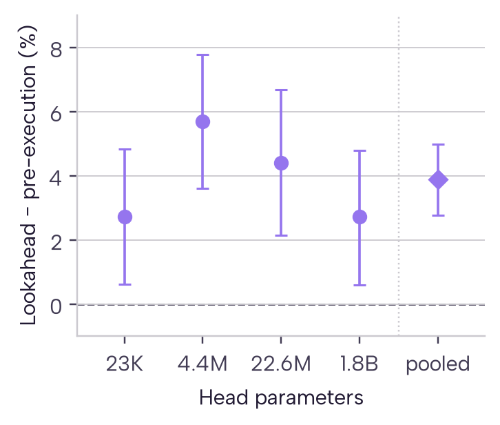
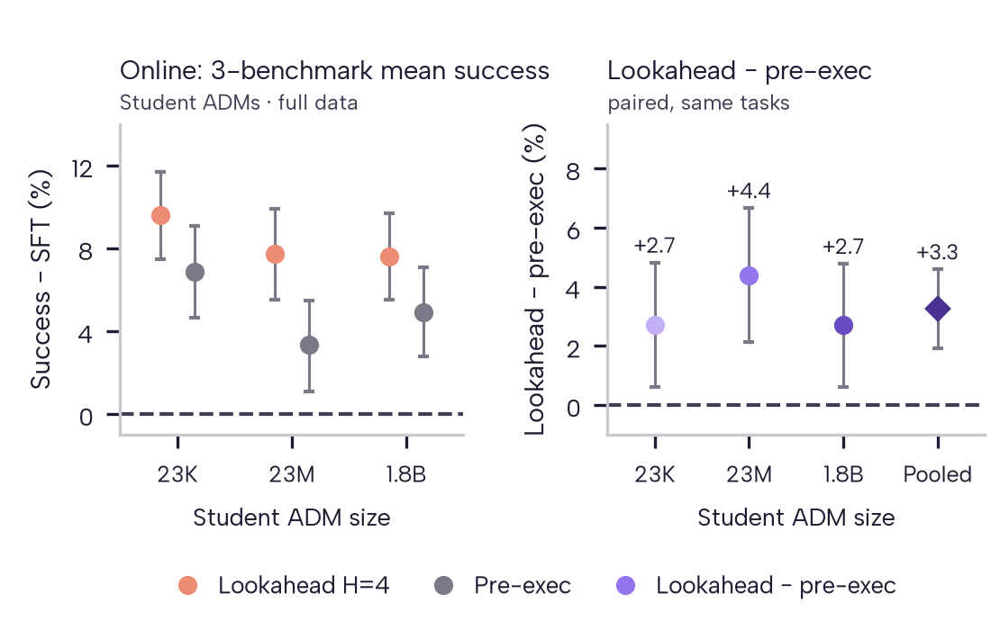
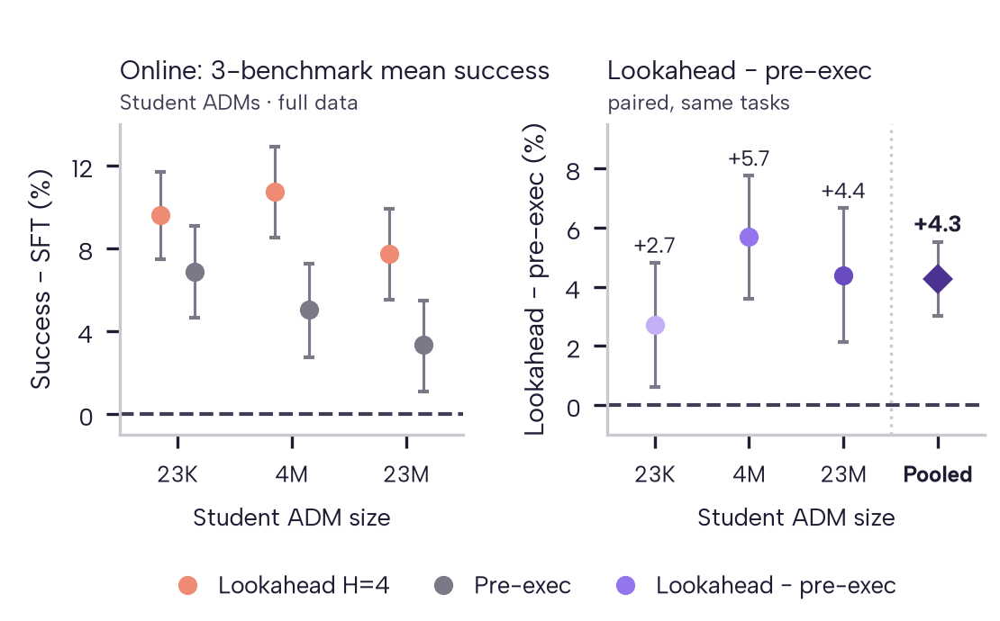
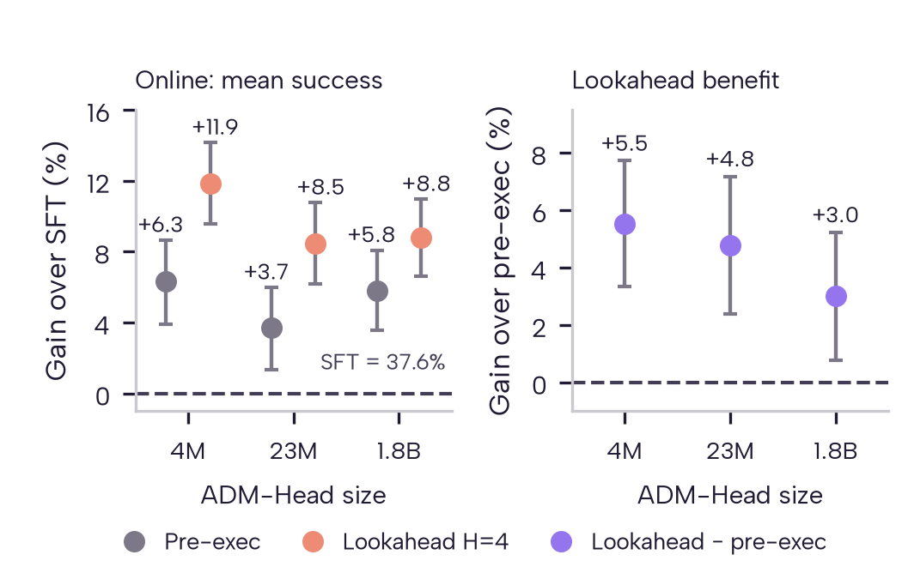
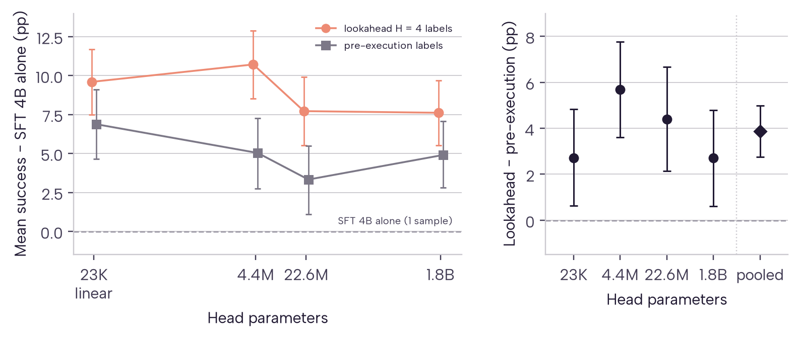
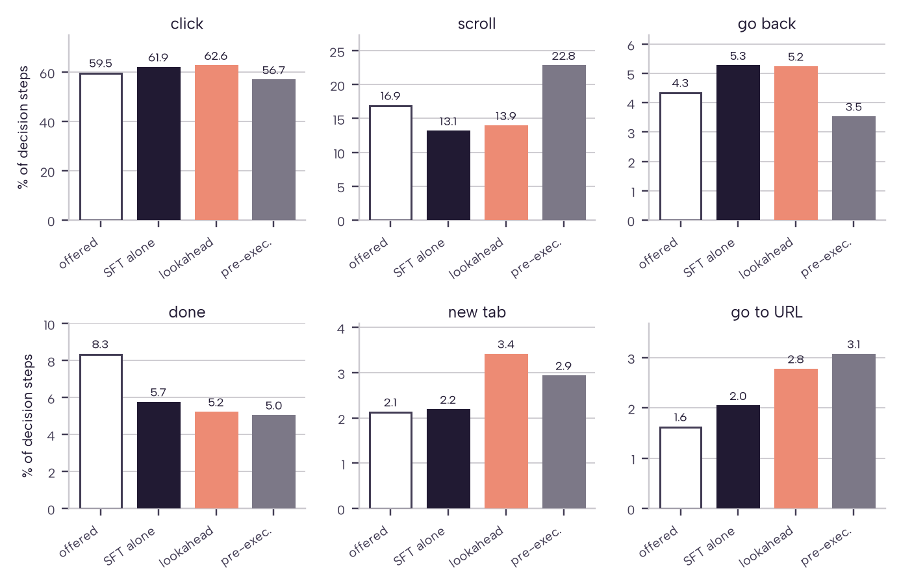
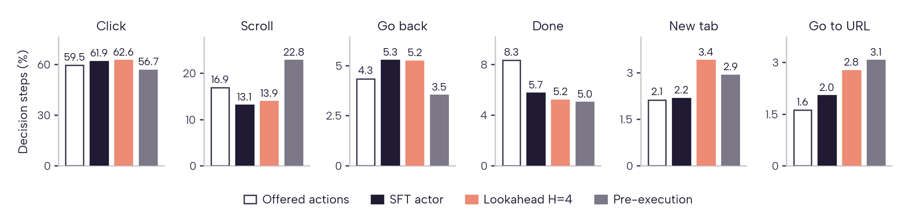
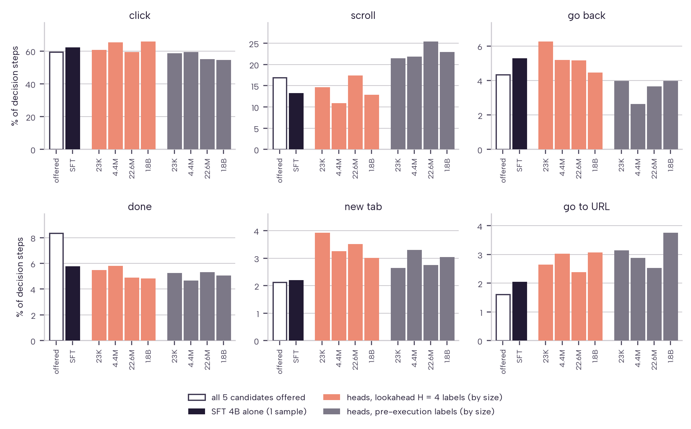

# Selection-head size ablations

**Head size barely matters. On the SFT 4B actor every head from a 23K-parameter linear probe to a 1.8B transformer beats one SFT 4B sample by +4.7 to +9.2 pp mean overall (the 4B LoRA: +7.9), with no trend in size; the apparent differences between sizes come from single training seeds and evaluation windows (over three seeds the 4.4M and 22.6M heads are level). On the RL 8B actor, scoring through the frozen SFT-4B encoder, the heads add −0.3 to +3.2 pp valid-only over RL 8B alone, at most matching the 4B LoRA (+3.2). Selection cost grows with size (15 ms per step at 4.4M, 337 ms at 1.8B, 474 ms for the 4B LoRA), but end-to-end episode time does not, because generating five candidates dominates. Lookahead labels beat pre-execution labels at every size (−3.9 [−5.0, −2.8] pp pooled, [one window](#head-labels-pre-vs-lookahead-20261115)).**

All success rates in this document are **overall success** (successes / episodes; invalid episodes count as failures); "Mean overall" weights the three benchmarks equally. Differences are in mean overall success, pp [paired 95% bootstrap over tasks common to both arms, 10,000 resamples, seed 20261029, benchmarks resampled independently, per-task success averaged over runs]; bold intervals exclude 0. Compare rows only within a table: absolute rates drift between windows (the SFT 4B baseline moved from 32.2% to 38.7% mean overall across these windows). Valid-only rates are in [ARM_FINAL_RESULTS](ARM_FINAL_RESULTS.md#final-selection-recipe3-head-scale-20261111).

**Setup.** Every head is the joint (bidirectional) transformer selection head with soft cross-entropy on the Recipe 3 GPT-5.5 H = 4 panels (18,781 training panels, 2,110 states, 802 tasks; 1,727 validation panels), learning rate 3e-4, batch 256, 20 epochs, best validation epoch, training seed 0 unless stated; only width (d) and depth (L) change, and the linear probe replaces the transformer with a linear readout of the standardized features. Heads read the actor's hidden states at layers 18/27/36 (prompt end and, per candidate, thought mean, action mean and last token). Evaluation: OpenWebRL-4B-SFT actor (unless stated), N = 5, T 1.0 / top-p 0.9, 30 steps, all 1,045 tasks (Online-Mind2Web 300, WebVoyager 595, DeepShop 150), 1 H200 per run, rolled out judge-deferred and judged afterwards (Online-Mind2Web gpt-5.6-terra, WebVoyager and DeepShop GPT-4o); no record refused.

## Summary: one row per method

| Method | Params | Runs | Eval dates | Online-Mind2Web | WebVoyager | DeepShop | Mean overall | Mean valid-only | − actor alone, overall, pp [95% CI] | − actor alone, valid-only, pp [95% CI] |
| --- | ---: | ---: | --- | ---: | ---: | ---: | ---: | ---: | ---: | ---: |
| ***SFT 4B actor*** (November 11–13) | | | | | | | | | | |
| **SFT 4B alone (1 sample)** | — | 7 | Nov 11–12 | 30.0% | 41.7% | 39.5% | 37.1% | 39.8% | — | — |
| + linear probe | 23K | 2 | Nov 13 | 35.5% | 48.8% | 46.3% | 43.6% | 47.4% | **+6.5 [+4.2, +8.8]** | **+7.5 [+5.1, +10.0]** |
| + d8-L1 head | 0.25M | 2 | Nov 12–13 | 35.2% | 48.9% | 46.0% | 43.4% | 46.9% | **+6.3 [+4.0, +8.5]** | **+7.1 [+4.8, +9.4]** |
| + d32-L1 head | 1.0M | 2 | Nov 12–13 | 37.0% | 49.5% | 46.0% | 44.2% | 47.9% | **+7.1 [+4.9, +9.2]** | **+8.1 [+5.8, +10.3]** |
| + d128-L2 head | 4.4M | 3 | Nov 11 | 34.8% | 51.5% | 52.7% | 46.3% | 50.0% | **+9.2 [+7.4, +11.1]** | **+10.2 [+8.2, +12.1]** |
| + d256-L2 head | 9.6M | 3 | Nov 11–12 | 36.3% | 49.0% | 48.2% | 44.5% | 48.2% | **+7.5 [+5.7, +9.3]** | **+8.4 [+6.5, +10.3]** |
| + d512-L2 head (default ADM-22M) | 22.6M | 8 | Nov 11–13 | 34.7% | 45.9% | 45.8% | 42.1% | 45.7% | **+5.0 [+3.7, +6.5]** | **+5.8 [+4.4, +7.4]** |
| + d2048-L4 head | 272.8M | 3 | Nov 11–12 | 35.2% | 45.9% | 51.8% | 44.3% | 47.7% | **+7.2 [+5.5, +9.0]** | **+7.9 [+6.0, +9.8]** |
| + d4096-L8 head | 1.8B | 3 | Nov 11–12 | 32.9% | 45.4% | 47.1% | 41.8% | 45.3% | **+4.7 [+2.8, +6.7]** | **+5.5 [+3.4, +7.5]** |
| + 4B LoRA decoder (ADM-4B) | 4.4B | 3 | Nov 11 | 36.9% | 48.5% | 49.6% | 45.0% | 48.6% | **+7.9 [+6.0, +9.8]** | **+8.8 [+6.8, +10.8]** |
| ***RL 8B actor*** (heads November 13–14 via frozen SFT-4B re-encoding; actor alone and 4B LoRA November 4–5) | | | | | | | | | | |
| **RL 8B alone (1 sample)** | — | 3 | Nov 4–5 | 38.3% | 56.5% | 57.8% | 50.9% | 53.2% | — | — |
| + linear probe | 23K | 2 | Nov 13–14 | 42.7% | 56.5% | 48.3% | 49.2% | 53.7% | −1.7 [−4.1, +0.7] | +0.6 [−1.9, +3.1] |
| + d128-L2 head | 4.4M | 2 | Nov 13–14 | 42.2% | 54.8% | 57.0% | 51.3% | 56.4% | +0.5 [−2.0, +2.9] | **+3.2 [+0.7, +5.7]** |
| + d512-L2 head (default ADM-22M) | 22.6M | 2 | Nov 13–14 | 43.7% | 53.9% | 46.3% | 48.0% | 52.9% | **−2.9 [−5.4, −0.4]** | −0.3 [−2.9, +2.4] |
| + d2048-L4 head | 272.8M | 2 | Nov 13–14 | 38.7% | 55.8% | 55.0% | 49.8% | 53.8% | −1.0 [−3.5, +1.3] | +0.7 [−1.9, +3.2] |
| + 4B LoRA decoder (GPT-5.5 H = 4) | 4.4B | 3 | Nov 4–5 | 43.6% | 58.8% | 58.4% | 53.6% | 56.4% | **+2.7 [+0.6, +4.8]** | **+3.2 [+1.0, +5.4]** |

| Method | Online-Mind2Web valid / episodes | Online-Mind2Web successes | WebVoyager valid / episodes | WebVoyager successes | DeepShop valid / episodes | DeepShop successes |
| --- | ---: | ---: | ---: | ---: | ---: | ---: |
| SFT 4B alone (1 sample) | 1,868 / 2,100 | 629 | 3,778 / 4,165 | 1,738 | 1,044 / 1,050 | 415 |
| SFT 4B + linear probe | 518 / 600 | 213 | 1,073 / 1,190 | 581 | 297 / 300 | 139 |
| SFT 4B + d8-L1 head | 518 / 600 | 211 | 1,077 / 1,190 | 582 | 300 / 300 | 138 |
| SFT 4B + d32-L1 head | 517 / 600 | 222 | 1,082 / 1,190 | 589 | 298 / 300 | 138 |
| SFT 4B + d128-L2 head | 784 / 900 | 313 | 1,614 / 1,785 | 919 | 446 / 450 | 237 |
| SFT 4B + d256-L2 head | 785 / 900 | 327 | 1,610 / 1,785 | 875 | 446 / 450 | 217 |
| SFT 4B + d512-L2 head (default ADM-22M) | 2,085 / 2,400 | 832 | 4,293 / 4,760 | 2,186 | 1,190 / 1,200 | 549 |
| SFT 4B + d2048-L4 head | 792 / 900 | 317 | 1,608 / 1,785 | 820 | 447 / 450 | 233 |
| SFT 4B + d4096-L8 head | 784 / 900 | 296 | 1,610 / 1,785 | 811 | 444 / 450 | 212 |
| SFT 4B + 4B LoRA decoder (ADM-4B) | 793 / 900 | 332 | 1,606 / 1,785 | 865 | 446 / 450 | 223 |
| RL 8B alone (1 sample) | 787 / 900 | 345 | 1,752 / 1,785 | 1,008 | 447 / 450 | 260 |
| RL 8B + linear probe | 530 / 600 | 256 | 1,083 / 1,190 | 672 | 285 / 300 | 145 |
| RL 8B + d128-L2 head | 520 / 600 | 253 | 1,077 / 1,190 | 652 | 285 / 300 | 171 |
| RL 8B + d512-L2 head (default ADM-22M) | 521 / 600 | 262 | 1,072 / 1,190 | 642 | 286 / 300 | 139 |
| RL 8B + d2048-L4 head | 532 / 600 | 232 | 1,085 / 1,190 | 664 | 291 / 300 | 165 |
| RL 8B + 4B LoRA decoder (GPT-5.5 H = 4) | 790 / 900 | 392 | 1,749 / 1,785 | 1,049 | 442 / 450 | 263 |

*One row per method, each against its actor alone. Per-benchmark columns and mean overall are overall success (invalid = failure); mean valid-only is successes / valid episodes; both are equal-weight 3-benchmark means. Each row pools every run of that method (heads: training seed 0) across its evaluation windows, and the SFT 4B control pools its 7 runs from November 11 (eval-scale, eval-seed, eval-1111) and 12 (eval-sizes3); differences are paired bootstrap over tasks on run-averaged per-task success (10,000 resamples, seed 20261029, benchmarks resampled independently); bold intervals exclude 0. Because the pooling spans windows, a row's difference also carries the drift of its windows (the 0.25M, 1.0M and probe heads ran only on November 12–13, with no SFT run in their windows; the 22.6M default ran in every window). Same-window comparisons are in the per-window tables below. RL 8B: overall success in the heads' window is depressed by 73 tasks whose sites failed to load in every run, against almost none on November 4–5, so its overall differences understate the heads; use valid-only there.* Evidence: [data](arm_results/rl_integration/selection-head-size-pooled-20261114.json) · [script](arm_results/rl_integration/selection-head-size-pooled-20261114.py).

## Pre-execution vs lookahead labels across sizes (November 14–15)

**Lookahead labels beat pre-execution labels at every head size: pre − lookahead is **−2.7 [−4.8, −0.6]** (23K probe), **−5.7 [−7.8, −3.6]** (4.4M), **−4.4 [−6.7, −2.1]** (22.6M) and **−2.7 [−4.8, −0.6]** (1.8B) pp mean overall, **−3.9 [−5.0, −2.8]** pooled. Size again makes no consistent difference within either label type.** Eight heads (four sizes × two label types) and SFT 4B alone in one window, 3 runs each on all 1,045 tasks (vlm/normal, November 14 15:20 – November 15 03:20 PST). Both label types label the same 18,781 training panels with GPT-5.5: lookahead = H = 4 with K = 3 continuations (the labels used everywhere else in this document), pre-execution = the same teacher choosing before any action is executed. Same recipe, learning rate and training seed for every head; the 22.6M pre head is the November 2 head (`heads-all2/pre-best`), the others were trained November 13–14.

| Head | Params | Labels | Online-Mind2Web | WebVoyager | DeepShop | Mean overall | Mean valid-only | − SFT alone, pp [95% CI] | pre − lookahead, pp [95% CI] |
| --- | ---: | --- | ---: | ---: | ---: | ---: | ---: | ---: | ---: |
| SFT 4B alone (1 sample) | — | — | 32.2% | 39.6% | 33.1% | 35.0% | 37.6% | — | — |
| linear probe | 23K | lookahead H = 4 | 37.3% | 48.1% | 48.2% | 44.6% | 48.1% | **+9.6 [+7.5, +11.7]** |  |
| linear probe | 23K | pre-execution | 35.1% | 43.5% | 46.9% | 41.8% | 45.0% | **+6.9 [+4.7, +9.1]** | **−2.7 [−4.8, −0.6]** |
| d128-L2 | 4.4M | lookahead H = 4 | 38.4% | 51.3% | 47.3% | 45.7% | 49.4% | **+10.7 [+8.5, +12.9]** |  |
| d128-L2 | 4.4M | pre-execution | 36.6% | 45.2% | 38.2% | 40.0% | 43.9% | **+5.0 [+2.8, +7.3]** | **−5.7 [−7.8, −3.6]** |
| d512-L2 (default) | 22.6M | lookahead H = 4 | 35.1% | 45.6% | 47.3% | 42.7% | 46.0% | **+7.7 [+5.5, +9.9]** |  |
| d512-L2 (default) | 22.6M | pre-execution | 32.3% | 43.9% | 38.7% | 38.3% | 41.3% | **+3.3 [+1.1, +5.5]** | **−4.4 [−6.7, −2.1]** |
| d4096-L8 | 1.8B | lookahead H = 4 | 32.9% | 47.5% | 47.3% | 42.6% | 46.4% | **+7.6 [+5.5, +9.7]** |  |
| d4096-L8 | 1.8B | pre-execution | 34.3% | 43.9% | 41.3% | 39.9% | 43.3% | **+4.9 [+2.8, +7.1]** | **−2.7 [−4.8, −0.6]** |
| ***All four sizes, pooled*** | | pre − lookahead | | | | | | | **−3.9 [−5.0, −2.8]** |

| Head | Labels | Online-Mind2Web valid / episodes | Online-Mind2Web successes | WebVoyager valid / episodes | WebVoyager successes | DeepShop valid / episodes | DeepShop successes |
| --- | --- | ---: | ---: | ---: | ---: | ---: | ---: |
| SFT 4B alone | — | 806 / 900 | 290 | 1,622 / 1,785 | 706 | 449 / 450 | 149 |
| linear probe | lookahead H = 4 | 788 / 900 | 336 | 1,631 / 1,785 | 859 | 444 / 450 | 217 |
| linear probe | pre-execution | 796 / 900 | 316 | 1,614 / 1,785 | 777 | 446 / 450 | 211 |
| d128-L2 | lookahead H = 4 | 795 / 900 | 346 | 1,615 / 1,785 | 915 | 443 / 450 | 213 |
| d128-L2 | pre-execution | 773 / 900 | 329 | 1,603 / 1,785 | 807 | 444 / 450 | 172 |
| d512-L2 (default) | lookahead H = 4 | 792 / 900 | 316 | 1,615 / 1,785 | 814 | 446 / 450 | 213 |
| d512-L2 (default) | pre-execution | 802 / 900 | 291 | 1,613 / 1,785 | 783 | 447 / 450 | 174 |
| d4096-L8 | lookahead H = 4 | 777 / 900 | 296 | 1,612 / 1,785 | 848 | 440 / 450 | 213 |
| d4096-L8 | pre-execution | 786 / 900 | 309 | 1,599 / 1,785 | 784 | 446 / 450 | 186 |

*Main-paper view: lookahead − pre-execution labels, paired difference in mean overall success on the same tasks, at each head size and pooled over the four sizes (95% paired bootstrap intervals). [PDF](arm_results/rl_integration/selection-head-lookahead-minus-pre-20261115.pdf) · [SVG](arm_results/rl_integration/selection-head-lookahead-minus-pre-20261115.svg) · [plot script](arm_results/rl_integration/selection-head-lookahead-minus-pre-20261115-plot.py).*

*Paper version (column width, same style as the merged label figure), three head sizes: 23K linear probe, 23M (22.6M default) and 1.8B. The 4.4M head is left out because its seed-0 lookahead head is a lucky seed (over three seeds 4.4M and 22.6M are level). Left, each student ADM minus SFT 4B alone for lookahead (salmon) and pre-execution (gray) labels; right, the paired lookahead − pre-execution difference per size and pooled over the three sizes, +3.3 [+1.9, +4.6] pp (all four sizes: +3.9 [+2.8, +5.0]). [3-size data](arm_results/rl_integration/selection-head-pre-vs-lookahead-3sizes-20261115.json) · [script](arm_results/rl_integration/selection-head-pre-vs-lookahead-3sizes-20261115.py) · [PDF](arm_results/rl_integration/selection-head-pre-vs-lookahead-paper-20261115.pdf) · [SVG](arm_results/rl_integration/selection-head-pre-vs-lookahead-paper-20261115.svg) · [plot script](arm_results/rl_integration/selection-head-pre-vs-lookahead-paper-20261115-plot.py).*

*Variant with the 23K, 4M (4.4M) and 23M (22.6M) heads, leaving out 1.8B: lookahead − pre-execution pooled over these three sizes is +4.3 [+3.0, +5.5] pp. The 4M lookahead head is the lucky training seed 0. [PDF](arm_results/rl_integration/selection-head-pre-vs-lookahead-paper-4m-20261115.pdf) · [SVG](arm_results/rl_integration/selection-head-pre-vs-lookahead-paper-4m-20261115.svg) · [plot script](arm_results/rl_integration/selection-head-pre-vs-lookahead-paper-4m-20261115-plot.py) · [3-size data](arm_results/rl_integration/selection-head-pre-vs-lookahead-3sizes-4m-20261115.json) ([script](arm_results/rl_integration/selection-head-pre-vs-lookahead-3sizes-4m-20261115.py)).*

*Same-window delta comparison: 4M (4.4M), 23M (22.6M) and 1.8B heads, all evaluated November 14–15 with their contemporaneous SFT 4B control. Pre-execution is on the left and lookahead on the right within each size pair. Left: gains over SFT; 23M is +3.7 pp pre-execution and +8.5 pp lookahead. Right: paired lookahead − pre-execution; 23M is +4.8 pp. Both use the original task-paired 95% bootstrap intervals, three observed runs, full benchmark populations and equal benchmark weights; success is valid-only (successes / valid episodes, updated November 16), so episodes whose site failed to load, such as the 46 Wolfram Alpha tasks, do not count. No pooled point is shown. The left panel labels its zero-gain reference as SFT = 37.6% (same-window equal-benchmark valid-only success). These are re-evaluations, distinct from the original Recipe 3 teacher-cost table's 41.3 / 44.5% outcomes and 39.6% SFT baseline; those original results remain unchanged. The 4M lookahead head is training seed 0; head-size rankings require training-seed replication. `%` denotes differences of percentage-valued success rates (percentage points). [Same-window data](arm_results/rl_integration/selection-head-pre-vs-lookahead-20261115.json) · [PDF](arm_results/rl_integration/selection-head-pre-vs-lookahead-paper-4m-1p8b-20261115.pdf) · [SVG](arm_results/rl_integration/selection-head-pre-vs-lookahead-paper-4m-1p8b-20261115.svg) · [Renderer](arm_results/rl_integration/selection-head-pre-vs-lookahead-paper-4m-1p8b-20261115-plot.py).*

*Left: each head minus SFT 4B alone, with that difference's interval; the two labels' intervals overlap at 23K and 1.8B. Right: the paired difference lookahead − pre-execution on the same tasks, the actual test of the label effect: +2.7, +5.7, +4.4 and +2.7 pp (23K, 4.4M, 22.6M, 1.8B) and +3.9 [+2.8, +5.0] pooled, every interval above 0. Each head is one training seed, so differences between sizes are within seed variation (4.4M vs 22.6M over three seeds: −0.2 [−1.8, +1.4]).*

*Same window and runs for every row; differences are paired bootstrap over tasks common to all nine conditions on run-averaged per-task success (10,000 resamples, seed 20261029, benchmarks resampled independently); the pooled row averages per-task success over the four sizes of each label type. On mean valid-only, pre − lookahead is **−3.0 [−5.2, −0.8]** / **−5.5 [−7.7, −3.3]** / **−4.8 [−7.2, −2.4]** / **−3.0 [−5.2, −0.8]** (23K / 4.4M / 22.6M / 1.8B) and **−4.1 [−5.3, −2.9]** pooled. Held-out agreement with each head's own labels at the final epoch: lookahead heads 43–46%, pre heads 58–60% (pre labels are easier to imitate but select worse actions). The two label types pick the same action on 35% of panels. Three WebVoyager runs lost their model server mid-run and were resumed from their saved records (the two resumes after node g003 crashes excluded that node); all 28,215 episodes judged, none refused.* Evidence: [data](arm_results/rl_integration/selection-head-pre-vs-lookahead-20261115.json) · [script](arm_results/rl_integration/selection-head-pre-vs-lookahead-20261115.py) · [plot script](arm_results/rl_integration/selection-head-pre-vs-lookahead-20261115-plot.py) · [PDF](arm_results/rl_integration/selection-head-pre-vs-lookahead-20261115.pdf) · [SVG](arm_results/rl_integration/selection-head-pre-vs-lookahead-20261115.svg). Runtime: `recipe3-ablations-20261104/` (pre heads `heads-scale/pre-*/`, evals `eval-pre/run<k>/`, job log `eval-pre/jobs.txt`).

**What the two label types pick.** *Pre-execution heads scroll far more: 21–25% of their decision steps at every size, above the 17% of offered candidates that are scrolls, against 11–17% for lookahead heads and 13% for one SFT sample. Lookahead heads go back more (5.2% vs 3.5%) and click more (62.6% vs 56.7%).* Pre-execution labels seem to favour the safe, information-gathering action; lookahead labels, which see what each action leads to, favour committing (clicking through) and undoing dead ends.

*Averaged over sizes: the four heads of each label type pooled. [PDF](arm_results/rl_integration/selection-head-action-types-avg-20261115.pdf) · [SVG](arm_results/rl_integration/selection-head-action-types-avg-20261115.svg) · [plot script](arm_results/rl_integration/selection-head-action-types-avg-20261115-plot.py). Per size:*

**Single-row action-distribution comparison:**

*Same event counts and percentages as the [two-row average figure](arm_results/rl_integration/selection-head-action-types-avg-20261115.png), arranged in six panels across a 7.2 × 1.75-inch figure with one shared legend. Hollow black bars represent offered actions; solid black bars represent SFT. Offered-actions bars show shares of all proposed candidate actions; the remaining bars show shares of selected decision steps for SFT alone and lookahead/pre-execution heads pooled across the four head sizes (23K, 4.4M, 22.6M, 1.8B), three evaluation runs each in the November 14–15 window. Head sizes, tasks and benchmarks are weighted by their recorded event counts, not equally. Unshown tool categories remain in each denominator; per-tool y ranges differ. No confidence intervals or significance claims are inferred from these pooled counts. Original values are unchanged.* [PDF](arm_results/rl_integration/selection-head-action-types-avg-row-20261116.pdf) · [SVG](arm_results/rl_integration/selection-head-action-types-avg-row-20261116.svg) · [Renderer](arm_results/rl_integration/selection-head-action-types-avg-row-20261116-plot.py) · [Plotted percentages and denominators](arm_results/rl_integration/selection-head-action-types-avg-row-20261116.json).

*Share of decision steps by the chosen action's tool, one panel per tool and one bar per method; same window and episodes as the table above (3 runs × 1,045 tasks per condition; 40–45K steps per head). Outlined bar: all five candidates the heads chose among; black: SFT 4B alone (its single sample); coral: the four lookahead-label heads by size; gray: the four pre-execution-label heads by size. Pre-execution heads scroll more and go back less than lookahead heads at every size. "done" is offered on 8.3% of candidates but picked on 4.7–5.8% by every head. Not shown (each under 3% for every method): write, wait, press_keys, drag, switch_tab, close_tab.* Evidence: [data](arm_results/rl_integration/selection-head-action-types-20261115.json) · [script](arm_results/rl_integration/selection-head-action-types-20261115.py) · [plot script](arm_results/rl_integration/selection-head-action-types-20261115-plot.py) · [PDF](arm_results/rl_integration/selection-head-action-types-20261115.pdf) · [SVG](arm_results/rl_integration/selection-head-action-types-20261115.svg).

## SFT 4B actor

### First screen: one training seed, 2 runs (November 11, 00:59–09:30 PST)

| Head | Params | Online-Mind2Web | WebVoyager | DeepShop | Mean overall | − SFT alone, pp [95% CI] | − 22.6M default, pp [95% CI] |
| --- | ---: | ---: | ---: | ---: | ---: | ---: | ---: |
| SFT 4B alone (1 sample) | — | 30.5% | 41.3% | 44.3% | 38.7% | — | — |
| d128-L2 | 4.4M | 34.7% | 52.0% | 54.0% | 46.9% | **+8.2 [+5.7, +10.7]** | **+4.3 [+1.9, +6.7]** |
| d256-L2 | 9.6M | 36.0% | 49.1% | 50.3% | 45.1% | **+6.4 [+4.0, +8.8]** | **+2.6 [+0.0, +5.1]** |
| d512-L2 (default) | 22.6M | 34.7% | 45.7% | 47.3% | 42.6% | **+3.8 [+1.4, +6.3]** | — |
| d2048-L4 | 272.8M | 35.3% | 45.5% | 52.0% | 44.3% | **+5.6 [+3.1, +8.0]** | +1.7 [−0.7, +4.2] |

| Head | Online-Mind2Web valid / episodes | Online-Mind2Web successes | WebVoyager valid / episodes | WebVoyager successes | DeepShop valid / episodes | DeepShop successes |
| --- | ---: | ---: | ---: | ---: | ---: | ---: |
| SFT 4B alone (1 sample) | 535 / 600 | 183 | 1,079 / 1,190 | 492 | 298 / 300 | 133 |
| d128-L2 | 528 / 600 | 208 | 1,081 / 1,190 | 619 | 298 / 300 | 162 |
| d256-L2 | 524 / 600 | 216 | 1,071 / 1,190 | 584 | 297 / 300 | 151 |
| d512-L2 (default) | 522 / 600 | 208 | 1,068 / 1,190 | 544 | 299 / 300 | 142 |
| d2048-L4 | 526 / 600 | 212 | 1,071 / 1,190 | 542 | 299 / 300 | 156 |

*Superseded for the size comparison by the seed replication below: the 4.4M head's lead here did not replicate.* Evidence: [data](arm_results/rl_integration/selection-head-scale-20261111.json) · [script](arm_results/rl_integration/selection-head-scale-20261111.py). Runtime: `recipe3-ablations-20261104/eval-scale/`.

### Training-seed replication and 1.8B (November 11, 16:00–21:00 PST)

Seeds 1 and 2 of the 4.4M and 22.6M heads (2 runs each) with seed 0 of both and SFT 4B alone re-run once in the same window.

| Head | Params | Online-Mind2Web | WebVoyager | DeepShop | Mean overall | − SFT alone, pp [95% CI] | − 22.6M, pp [95% CI] |
| --- | ---: | ---: | ---: | ---: | ---: | ---: | ---: |
| SFT 4B alone (1 sample) | — | 26.7% | 40.7% | 29.3% | 32.2% | — | — |
| d128-L2, seed 0 | 4.4M | 35.0% | 50.4% | 50.0% | 45.1% | **+12.9 [+9.2, +16.6]** | — |
| d128-L2, seed 1 | 4.4M | 33.3% | 43.9% | 47.7% | 41.6% | **+9.4 [+6.5, +12.4]** | — |
| d128-L2, seed 2 | 4.4M | 34.3% | 46.5% | 43.3% | 41.4% | **+9.2 [+5.9, +12.5]** | — |
| d512-L2, seed 0 (default) | 22.6M | 38.0% | 46.2% | 46.0% | 43.4% | **+11.2 [+7.8, +14.7]** | — |
| d512-L2, seed 1 | 22.6M | 32.7% | 46.8% | 49.0% | 42.8% | **+10.6 [+7.4, +13.9]** | — |
| d512-L2, seed 2 | 22.6M | 34.8% | 48.2% | 41.7% | 41.6% | **+9.3 [+6.2, +12.5]** | — |
| *4.4M, 3 seeds pooled* | 4.4M | 34.1% | 46.3% | 46.4% | 42.2% | **+10.0 [+7.2, +12.9]** | −0.2 [−1.8, +1.4] |
| *22.6M, 3 seeds pooled* | 22.6M | 34.6% | 47.2% | 45.5% | 42.4% | **+10.2 [+7.4, +13.1]** | — |

| Head | Online-Mind2Web valid / episodes | Online-Mind2Web successes | WebVoyager valid / episodes | WebVoyager successes | DeepShop valid / episodes | DeepShop successes |
| --- | ---: | ---: | ---: | ---: | ---: | ---: |
| SFT 4B alone (1 sample) | 271 / 300 | 80 | 538 / 595 | 242 | 149 / 150 | 44 |
| d128-L2, seed 0 | 256 / 300 | 105 | 533 / 595 | 300 | 148 / 150 | 75 |
| d128-L2, seed 1 | 523 / 600 | 200 | 1,075 / 1,190 | 523 | 296 / 300 | 143 |
| d128-L2, seed 2 | 529 / 600 | 206 | 1,069 / 1,190 | 553 | 298 / 300 | 130 |
| d512-L2, seed 0 (default) | 263 / 300 | 114 | 538 / 595 | 275 | 149 / 150 | 69 |
| d512-L2, seed 1 | 527 / 600 | 196 | 1,078 / 1,190 | 557 | 298 / 300 | 147 |
| d512-L2, seed 2 | 524 / 600 | 209 | 1,073 / 1,190 | 573 | 298 / 300 | 125 |
| *4.4M, 3 seeds pooled* | 1,308 / 1,500 | 511 | 2,677 / 2,975 | 1,376 | 742 / 750 | 348 |
| *22.6M, 3 seeds pooled* | 1,314 / 1,500 | 519 | 2,689 / 2,975 | 1,405 | 745 / 750 | 341 |

The 1.8B head (d4096-L8, 1.77B parameters), 2 runs in the same evening window, against the 22.6M seed-0 head and SFT 4B alone above:

| Head | Params | Online-Mind2Web | WebVoyager | DeepShop | Mean overall | − SFT alone, pp [95% CI] | − 22.6M default, pp [95% CI] |
| --- | ---: | ---: | ---: | ---: | ---: | ---: | ---: |
| d4096-L8 (2 runs) | 1.8B | 33.5% | 45.5% | 48.0% | 42.3% | **+10.1 [+7.1, +13.2]** | −1.1 [−4.3, +2.2] |

| Head | Online-Mind2Web valid / episodes | Online-Mind2Web successes | WebVoyager valid / episodes | WebVoyager successes | DeepShop valid / episodes | DeepShop successes |
| --- | ---: | ---: | ---: | ---: | ---: | ---: |
| d4096-L8 (2 runs) | 524 / 600 | 201 | 1,074 / 1,190 | 541 | 296 / 300 | 144 |

*This window's single SFT run is low (32.2% mean overall against 38.7% in the morning screen), so the − SFT column is larger here than elsewhere; the size comparison does not use it. Per seed, 4.4M − 22.6M: seed 0 +1.7 [−2.2, +5.7], seed 1 −1.2 [−3.5, +1.2], seed 2 −0.2 [−2.6, +2.2]. The 1.8B head ran through a launcher that serializes the head load (`deferjudge/xbench_defer_headlock.py`; same scores), after the first attempts were OOM-killed.* Evidence: [seeds](arm_results/rl_integration/selection-head-seeds-20261111.json) ([script](arm_results/rl_integration/selection-head-seeds-20261111.py)) · [1.8B](arm_results/rl_integration/selection-evening-20261111.json) (`head_1p8b`; [script](arm_results/rl_integration/selection-evening-20261111.py)). Runtime: `eval-seed/`, `eval-scale/` (1.8B).

### All sizes in one window, 1 run (November 12, 00:00–03:20 PST)

| Head | Params | Online-Mind2Web | WebVoyager | DeepShop | Mean overall | − SFT alone, pp [95% CI] | − 22.6M default, pp [95% CI] |
| --- | ---: | ---: | ---: | ---: | ---: | ---: | ---: |
| SFT 4B alone (1 sample) | — | 32.7% | 41.7% | 40.7% | 38.3% | — | — |
| d256-L2 | 9.6M | 37.0% | 48.9% | 44.0% | 43.3% | **+5.0 [+1.5, +8.5]** | +2.1 [−1.4, +5.6] |
| d512-L2 (default) | 22.6M | 35.3% | 43.5% | 44.7% | 41.2% | +2.8 [−1.0, +6.7] | — |
| d2048-L4 | 272.8M | 35.0% | 46.7% | 51.3% | 44.4% | **+6.0 [+2.5, +9.6]** | +3.2 [−0.3, +6.6] |
| d4096-L8 | 1.8B | 31.7% | 45.4% | 45.3% | 40.8% | +2.5 [−1.3, +6.1] | −0.4 [−4.1, +3.2] |

| Head | Online-Mind2Web valid / episodes | Online-Mind2Web successes | WebVoyager valid / episodes | WebVoyager successes | DeepShop valid / episodes | DeepShop successes |
| --- | ---: | ---: | ---: | ---: | ---: | ---: |
| SFT 4B alone (1 sample) | 266 / 300 | 98 | 536 / 595 | 248 | 150 / 150 | 61 |
| d256-L2 | 261 / 300 | 111 | 539 / 595 | 291 | 149 / 150 | 66 |
| d512-L2 (default) | 261 / 300 | 106 | 529 / 595 | 259 | 149 / 150 | 67 |
| d2048-L4 | 266 / 300 | 105 | 537 / 595 | 278 | 148 / 150 | 77 |
| d4096-L8 | 260 / 300 | 95 | 536 / 595 | 270 | 148 / 150 | 68 |

*With this window every size from 9.6M to 1.8B has three eval runs across windows.* Evidence: [data](arm_results/rl_integration/selection-head-sizes-sameday-20261112.json) · [script](arm_results/rl_integration/selection-head-sizes-sameday-20261112.py). Runtime: `eval-sizes3/`.

### Smaller heads: 0.25M and 1.0M, 2 runs (November 12–13)

| Head | Params | Online-Mind2Web | WebVoyager | DeepShop | Mean overall | − 22.6M default, pp [95% CI] |
| --- | ---: | ---: | ---: | ---: | ---: | ---: |
| d8-L1 | 0.25M | 35.2% | 48.9% | 46.0% | 43.4% | **+3.1 [+0.7, +5.6]** |
| d32-L1 | 1.0M | 37.0% | 49.5% | 46.0% | 44.2% | **+4.0 [+1.6, +6.4]** |
| d512-L2 (default) | 22.6M | 31.2% | 46.1% | 43.3% | 40.2% | — |

| Head | Online-Mind2Web valid / episodes | Online-Mind2Web successes | WebVoyager valid / episodes | WebVoyager successes | DeepShop valid / episodes | DeepShop successes |
| --- | ---: | ---: | ---: | ---: | ---: | ---: |
| d8-L1 | 518 / 600 | 211 | 1,077 / 1,190 | 582 | 300 / 300 | 138 |
| d32-L1 | 517 / 600 | 222 | 1,082 / 1,190 | 589 | 298 / 300 | 138 |
| d512-L2 (default) | 522 / 600 | 187 | 1,077 / 1,190 | 549 | 296 / 300 | 130 |

*No SFT run in this window.* Evidence: [data](arm_results/rl_integration/selection-head-small-20261113.json) · [script](arm_results/rl_integration/selection-head-small-20261113.py). Runtime: `eval-small/`.

### Linear probe: 23K parameters, 2 runs (November 13)

| Head | Params | Online-Mind2Web | WebVoyager | DeepShop | Mean overall | − 22.6M default, pp [95% CI] |
| --- | ---: | ---: | ---: | ---: | ---: | ---: |
| linear probe | 23K | 35.5% | 48.8% | 46.3% | 43.6% | +0.2 [−2.5, +2.8] |
| d512-L2 (default) | 22.6M | 36.2% | 47.0% | 47.0% | 43.4% | — |

| Head | Online-Mind2Web valid / episodes | Online-Mind2Web successes | WebVoyager valid / episodes | WebVoyager successes | DeepShop valid / episodes | DeepShop successes |
| --- | ---: | ---: | ---: | ---: | ---: | ---: |
| linear probe | 518 / 600 | 213 | 1,073 / 1,190 | 581 | 297 / 300 | 139 |
| d512-L2 (default) | 517 / 600 | 217 | 1,081 / 1,190 | 559 | 297 / 300 | 141 |

*No SFT run in this window. The probe loads through `deferjudge/xbench_defer_probe.py` (LinearProbeHead from `source-probe/`).* Evidence: [data](arm_results/rl_integration/selection-head-probe-20261113.json) · [script](arm_results/rl_integration/selection-head-probe-20261113.py). Runtime: `eval-probe/`.

## Compute and latency by size (SFT 4B actor)

| Selector | Params | Selector TFLOP / step | of which head, GFLOP | Selection ms, mean / p90 | Model time / episode | End-to-end / episode, mean | Steps / episode |
| --- | ---: | ---: | ---: | ---: | ---: | ---: | ---: |
| d128-L2 head | 4.4M | 0.05 | 0.04 | 15 / 21 | 100 s | 168 s | 13.0 |
| d256-L2 head | 9.6M | 0.05 | 0.10 | 15 / 21 | 98 s | 161 s | 12.7 |
| d512-L2 head (default) | 22.6M | 0.05 | 0.23 | 17 / 24 | 112 s | 182 s | 14.1 |
| d2048-L4 head | 272.8M | 0.05 | 2.73 | 67 / 109 | 112 s | 179 s | 14.0 |
| d4096-L8 head | 1.8B | 0.06 | 17.70 | 337 / 512 | 116 s | 186 s | 13.9 |
| 4B LoRA decoder (ADM-4B) | 4.44B | 30.73 | — | 474 / 758 | 113 s | 181 s | 13.3 |

*Per decision step; the actor's five candidates cost about 61 TFLOP per step in every row. Head selector FLOPs = the actor's one-token follow-up for candidates whose end token was not cached (about 44 GFLOP) plus the head (2 × head params × 5 candidates, "of which head"); decoder = 2 × 4.44B × (uncached selection-prompt + generated tokens). Selection and model time from each step's decision trace (browser excluded); end-to-end = each episode's wall clock including browser. Heads pool every run of the size sweep (November 11–12); decoder from November 11 (3 runs).* Evidence: [data](arm_results/rl_integration/selection-head-scale-cost-20261112.json) · [script](arm_results/rl_integration/selection-head-scale-cost-20261112.py).

## RL 8B actor (November 13–14)

The heads read OpenWebRL-4B-SFT features, so with the RL 8B actor (`OpenWebRL/OpenWebRL-8B` 824a54f, 4,096 response tokens) each step the frozen SFT-4B model re-encodes the RL 8B prompt and its five candidates and the unchanged head picks (`head5x`). 2 runs per head, training seed 0. No RL 8B-alone run in this window; the November 4–5 references (3 runs) are cross-window.

| Head | Params | Online-Mind2Web | WebVoyager | DeepShop | Mean overall | − 22.6M head, pp [95% CI] |
| --- | ---: | ---: | ---: | ---: | ---: | ---: |
| linear probe | 23K | 42.7% | 56.5% | 48.3% | 49.2% | +1.2 [−1.5, +3.9] |
| d128-L2 | 4.4M | 42.2% | 54.8% | 57.0% | 51.3% | **+3.3 [+0.8, +5.9]** |
| d512-L2 (default) | 22.6M | 43.7% | 53.9% | 46.3% | 48.0% | — |
| d2048-L4 | 272.8M | 38.7% | 55.8% | 55.0% | 49.8% | +1.8 [−0.8, +4.5] |
| *Nov 4–5:* RL 8B alone (1 sample) | — | 38.3% | 56.5% | 57.8% | 50.9% | — |
| *Nov 4–5:* + 4B LoRA, GPT-5.5 H = 4 | 4.4B | 43.6% | 58.8% | 58.4% | 53.6% | — |

| Head | Online-Mind2Web valid / episodes | Online-Mind2Web successes | WebVoyager valid / episodes | WebVoyager successes | DeepShop valid / episodes | DeepShop successes |
| --- | ---: | ---: | ---: | ---: | ---: | ---: |
| linear probe | 530 / 600 | 256 | 1,083 / 1,190 | 672 | 285 / 300 | 145 |
| d128-L2 | 520 / 600 | 253 | 1,077 / 1,190 | 652 | 285 / 300 | 171 |
| d512-L2 (default) | 521 / 600 | 262 | 1,072 / 1,190 | 642 | 286 / 300 | 139 |
| d2048-L4 | 532 / 600 | 232 | 1,085 / 1,190 | 664 | 291 / 300 | 165 |
| *Nov 4–5:* RL 8B alone (1 sample) | 787 / 900 | 345 | 1,752 / 1,785 | 1,008 | 447 / 450 | 260 |
| *Nov 4–5:* + 4B LoRA, GPT-5.5 H = 4 | 790 / 900 | 392 | 1,749 / 1,785 | 1,049 | 442 / 450 | 263 |

*In this window 73 tasks (mostly WebVoyager sites) failed at page load in every run (572 episodes), against almost none on November 4–5, so overall success is lower than on November 4–5 for reasons unrelated to selection; the head-vs-head column is same-window and unaffected. On valid-only success the heads are −0.3 to +3.2 pp against RL 8B alone and at or below the 4B LoRA ([ARM_FINAL_RESULTS](ARM_FINAL_RESULTS.md#final-selection-rl8b-heads-20261114)). The 4.4M lead is all DeepShop and one seed. Re-encoding makes selection slow here (about 4–5 s per step), so this tests transfer, not cost.* Evidence: [data](arm_results/rl_integration/selection-rl8b-heads-20261114.json) · [script](arm_results/rl_integration/selection-rl8b-heads-20261114.py). Runtime: `eval-rl8b-heads/`.

**Cost of the default head with RL 8B (plot accounting, November 14).** The system has **13.228B parameters**: RL 8B actor (8.767B), frozen SFT-4B encoder (4.438B), and the 22.6M head. The encoder re-encodes the actor's prompt and five candidates; its logged FLOPs and latency are included. Success is the two-run result above; cost is audited from run 1, with scheduled tasks as the denominator, including page-load failures with no decisions. The mean weights the three benchmarks equally.

| Benchmark | Cost tasks | Overall success (%) | PFLOP / task | Model latency / task (s) |
| --- | ---: | ---: | ---: | ---: |
| Online-Mind2Web | 300 | 43.7 | 3.591 | 218.6 |
| WebVoyager | 595 | 53.9 | 2.847 | 169.0 |
| DeepShop | 150 | 46.3 | 3.638 | 214.0 |
| **Mean** | — | **48.0** | **3.359** | **200.5** |

*Actor FLOPs = 2 × actor parameters × (uncached prompt + generated tokens), summed over logged actor requests. Selector FLOPs are the logged SFT-4B re-encoding and head FLOPs. Model latency sums decision time and excludes browser time. The audit covers all 1,045 run-1 records; 150 failed actor requests have no token telemetry and are excluded from FLOPs, so compute is a lower bound if they performed model work. The existing cross-window/page-availability caveat applies: the 48.0% result does not estimate the effect of adding the head to the earlier RL baseline.* [Cost aggregates](arm_results/rl_integration/selection-rl8b-head-cost-20261114.json) · [audit script](arm_results/rl_integration/selection-rl8b-head-cost-20261114.py) · [updated cost plot](arm_results/rl_integration/selection-recipe3-vs-cost-sft-actors-overall-baselines-with-rl-20261113.png).
