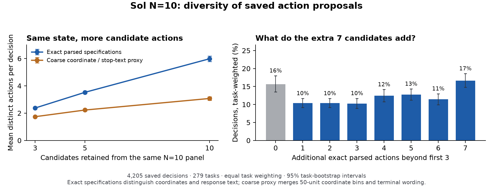

# ARM inference scaling

## Luna single high completes the OM2W four-method comparison (October 22, 2026)

Luna single high records **168 successes on 300 fixed tasks (56.0% overall)**, with 269 valid and 31 invalid outcomes. Across the 254 tasks valid in all four methods, its success rate is **62.6%**, mean model cost is **$0.0094**, mean actor-loop latency is **93.3 s**, and mean selected browser steps are **16.5**.

This adds a later-collected Luna single arm to the original Sol/N3/N5 300-task secondary cohort. The live-site collection dates differ; this is not a contemporaneous controlled model/policy comparison. Original 900 outcomes and separate retry cohorts remain unchanged. The four-arm common-valid denominator replaces the three-arm 256 denominator only in the headline comparison.

[Four-method, three-benchmark headline tables](ARM_FINAL_RESULTS.md#headline-performance-cost-and-efficiency) · [Audited aggregate metrics](arm_results/sol6_luna_three_benchmarks_20261019/aggregate.json)

Accounting, validity, step limits and resource scope

All 300 Luna dispositions, all physical model/judge calls, W&B termination and owned browser teardown passed independent completion checks. All-attempt model cost is **$2.636070**, including invalid/aborted calls and conservative reservations. Matched per-task costs use the same valid task set and include spend on valid failures; they exclude infrastructure-invalid attempts. Judge cost is accounted separately and is excluded from model costs.

The approved allocation was five CPU-only shards, each four CPUs/16 GiB for at most three hours across all attempts. Each shard had independent $3 model/5,000-call, $3 judge/70-call and 70-browser-start caps; campaign caps were $15 model plus $15 judge with no transfers. The final independent audit verified every per-shard cap and owned teardown.

Actor-loop latency excludes initial browser setup, final judge-only screenshot capture and terminal judging. Browser steps count selected BrowserCode batches, potentially multiple operations each. Output tokens include reasoning tokens; those must not be added twice.

| Method | Tasks | Valid failures | Explicit 30-decision limit failures | Share of all tasks | Share of valid failures |
|---|---:|---:|---:|---:|---:|
| GPT-6 Sol single high | 300 | 95 | 18 | 6.0% | 18.9% |
| GPT-6 Luna single high | 300 | 101 | 26 | 8.7% | 25.7% |
| GPT-6 Luna N3 high | 300 | 89 | 14 | 4.7% | 15.7% |
| GPT-6 Luna N5 high | 300 | 79 | 12 | 4.0% | 15.2% |

| All-attempt Luna single accounting | Count or amount |
|---|---:|
| Model generation calls | 4823 |
| Native input-token count calls | 1450 |
| Budget-counted model calls including native counts | 6273 |
| External judge calls | 269 |
| Model received cost excluding judge | $2.636070 |
| Model conservative unknown reservation | $0.000000 |
| Judge charged or reserved cost, separate | $2.628656 |
| Judge conservative unknown reservation | $0.000000 |
| Unknown model usage calls | 0 |
| Unknown judge usage calls | 0 |
| Browser starts including preflights | 305 |
| Allocation seconds across all attempts | 15769 |
| Logical shards | 5 |
| Scheduler attempts | 5 |

| Received model tokens across all attempts | Tokens |
|---|---:|
| input tokens | 97159989 |
| cached input tokens | 88486031 |
| cache write tokens | 8659489 |
| output tokens | 1334653 |
| reported reasoning tokens | 694031 |

Explicit `LimitsExceeded` failures and reaching 30 decisions are diagnostics, not evidence that a longer horizon would succeed. Infrastructure-invalid outcomes remain invalid.

- **SFT actor + Piotr SelectionARM:** **+5.67 ± 1.15 percentage points** (mean ± sample SD) across three complete runs.
- **RL actor + Piotr:** **42.67% → 54.00%**, a **+11.33-point gain [+5.33, +17.33]** in one complete paired run.
- **Selection rule:** random-of-five reaches **33.33%** and highest-likelihood-of-five **26.67%**, versus **33.00%** for SFT and **40.00%** for Piotr. Controls were collected separately.
- **Other selectors:** Sol/GPT-5.5 add **10–12 points**; Luna/Kev add about **9 points** under a different protocol. These are not controlled cross-protocol rankings.
- **Still unresolved:** whether 50 steps or an RL-trained actor increases Piotr's gain relative to the SFT 30-step comparison.

Every main result uses the same **300 Online-Mind2Web tasks**. Invalid and unjudged episodes count as zero. “Success” is the canonical o4-mini/AgentTrek verdict, which permits partial progress. **N** means candidates generated per decision; one is executed. Gains are percentage points (**pp**); intervals quantify task sampling, not judge error or website drift.

## Piotr SelectionARM: three complete runs

Official OpenWebRL-4B-SFT, **30 steps, T=0.7, top-p=0.9, 1,024 output tokens**. Compare one actor sample with greedy Piotr selection from five full candidates.

| Run | Tasks per arm | SFT successes | Piotr successes | SFT success | Piotr success | Gain, pp |
| --- | ---: | ---: | ---: | ---: | ---: | ---: |
| Oct 6, seed 43 | 300 | 100 | 115 | 33.33% | 38.33% | +5.00 |
| Oct 6, seed 44 | 300 | 98 | 113 | 32.67% | 37.67% | +5.00 |
| Oct 7, seed 45 | 300 | 99 | 120 | 33.00% | 40.00% | +7.00 |
| **Mean ± sample SD** | 300 | — | — | **33.00 ± 0.33%** | **38.67 ± 1.20%** | **+5.67 ± 1.15** |

Mean gain: **+5.67 pp**, paired 95% interval **[+2.67, +8.67]**. The same 300 tasks repeat across runs: 900 episodes per arm, 300 task clusters. SD describes the three run rates; the interval resamples task clusters with all runs retained. [Aggregate](arm_results/selectionarm_piotr_sameday30_20261007/aggregate.json) · [Protocol and accounting](ARM_INFERENCE.md#selectionarm-piotr-sameday30-20261007).

## Controls and variants

Same SFT actor and decoding as above; **300 tasks per arm in every row**.

**30 steps: selection rules, using the Oct 7 SFT control**

| Condition | N | Tasks | Successes | Success | Gain vs SFT, pp | Paired 95% interval, pp |
| --- | ---: | ---: | ---: | ---: | ---: | --- |
| SFT alone — baseline | 1 | 300 | 99 | 33.00% | — | — |
| Random-of-five | 5 | 300 | 100 | 33.33% | +0.33 | [−4.67, +5.67] |
| Highest likelihood of five | 5 | 300 | 80 | 26.67% | −6.33 | [−11.33, −1.33] |
| **Piotr SelectionARM, Oct 7** | 5 | 300 | 120 | 40.00% | +7.00 | [+2.33, +11.67] |

**50 steps: Piotr, using a fresh 50-step SFT control**

| Condition | N | Tasks | Successes | Success | Gain vs SFT, pp | Paired 95% interval, pp |
| --- | ---: | ---: | ---: | ---: | ---: | --- |
| SFT alone — baseline | 1 | 300 | 92 | 30.67% | — | — |
| Piotr | 5 | 300 | 120 | 40.00% | +9.33 | [+4.00, +14.67] |

**30 steps: RL-task-trained selector, using the earlier API-study SFT control**

| Condition | N | Tasks | Successes | Success | Gain vs SFT, pp | Paired 95% interval, pp |
| --- | ---: | ---: | ---: | ---: | ---: | --- |
| SFT alone — baseline | 1 | 300 | 95 | 31.67% | — | — |
| RL-task-trained SelectionARM | 5 | 300 | 123 | 41.00% | +9.33 | [+4.00, +14.67] |

- **Random control:** pick uniformly among five candidate indices at **every step**, including duplicates and malformed candidates. It reuses the Oct 7 SFT/Piotr episodes above. Piotr beats random by **+6.67 pp [+1.00, +12.33]**; random shows no detectable gain over SFT.
- **Likelihood control:** choose the highest mean native base-policy log-probability of the full response, including reasoning. It trails random by **−6.67 pp [−12.00, −1.33]** and Piotr by **−13.33 pp [−18.67, −8.00]**. This is one run with reused controls, not a general test of confidence gating. [Action-only follow-up](ARM_INFERENCE.md#action-only-likelihood-20261008).
- **Horizon:** the 50-step pair has a fresh SFT control. Its gain exceeds the same-day 30-step gain by **+2.33 pp [−4.67, +9.33]**; no clear horizon effect.
- **Selector training:** RL-task-trained SelectionARM changes the **selector**, while the actor stays SFT. It reuses the earlier SFT control from the API-selector study below; this is not a matched ranking against Piotr.

The Oct 7 Piotr row is the third run above, not an extra repeat. Collections used separate browser episodes and times. [Random-control audit](ARM_INFERENCE.md#selectionarm-random5-sameday30-20261007) · [50-step audit](ARM_INFERENCE.md#selectionarm-piotr-steps50-results-20261007) · [RL-task-selector audit](ARM_INFERENCE.md#selectionarm-rltasks-repeat-results-20261007).

## API and other selectors

Official SFT actor; one complete run per condition. **Compare each selector with its own protocol's SFT baseline.**

| Protocol | Selector | N | Tasks | Successes | Success | Gain, pp | Paired 95% interval, pp |
| --- | --- | ---: | ---: | ---: | ---: | ---: | --- |
| September protocol, Oct reproduction | None / SFT | 1 | 300 | 95 | 31.67% | — | — |
| September protocol, Oct reproduction | GPT-5.6 Sol | 5 | 300 | 130 | 43.33% | +11.67 | [+6.33, +17.00] |
| September protocol, Oct reproduction | GPT-5.5 | 5 | 300 | 126 | 42.00% | +10.33 | [+5.00, +15.67] |
| Local v2 | None / SFT | 1 | 300 | 94 | 31.33% | — | — |
| Local v2 | GPT-6 Luna, medium | 5 | 300 | 121 | 40.33% | +9.00 | [+3.33, +14.67] |
| Local v2 | Jev 1.13.0 | 5 | 300 | 100 | 33.33% | +2.00 | [−3.67, +7.67] |
| Local v2 | Kev27B | 5 | 300 | 122 | 40.67% | +9.33 | [+3.67, +15.00] |

| Protocol | Actor T / top-p | Actor token cap | Selector input | Episode limit |
| --- | --- | ---: | --- | --- |
| September protocol | 0.7 / 0.9 | 1,024 | Current screenshot + full candidates | 30 turns |
| Local v2 | 1.0 / 0.95 | 4,096 | Text/DOM + full candidates + five recent actions; no images | 30 browser operations / 60 decisions |

Sol/GPT-5.5 use medium reasoning and 2,048 selector tokens; Luna uses medium reasoning and 4,096. Jev/Kev use choice classifiers.

**Sol reproduces a similar rate to September:** 43.33% now versus 44.00% then. Sol versus GPT-5.5 is inconclusive: **+1.33 pp [−3.67, +6.33]**. Luna/Kev differ by one success; Jev's gain interval includes zero. [API aggregate](arm_results/api_selector_september_reproduction_20261006/aggregate.json) · [Local v2 audit](arm_results/local_sft_selector_controlled_20261006.json) · [Local v2 protocol](arm_results/local_inference_rerun_plan_20261006.json).

## Sol: does increasing the candidate count help?

**N=10 improves over N=3 by +6.67 pp [95% paired interval: +2.00, +11.67]**, at **3.28× the mean actor output tokens**. Both arms used the corrected September protocol above and were collected together on the same 300 tasks.

| Condition | N | Collection | Tasks | Successes | Success | Gain vs SFT, pp | Valid tasks | Invalid tasks | Valid-only success |
| --- | ---: | --- | ---: | ---: | ---: | ---: | ---: | ---: | ---: |
| SFT alone / no selector | 1 | Earlier control | 300 | 95 | 31.67% | — | 273 | 27 | 34.80% |
| SFT + Sol | 3 | Fresh paired study | 300 | 121 | 40.33% | +8.67 | 266 | 34 | 45.49% |
| SFT + Sol | 5 | Earlier reference | 300 | 130 | 43.33% | +11.67 | 268 | 32 | 48.51% |
| SFT + Sol | 10 | Fresh paired study | 300 | 141 | 47.00% | +15.33 | 264 | 36 | 53.41% |

N=10 wins alone on 38 tasks; N=3 wins alone on 18. Invalid episodes remain zero in the primary denominator. The SFT-alone control and N=5 reference come from the [earlier API-selector study](#api-selector-results-20261007) under the same corrected September protocol; comparisons with N=3/N=10 include collection-date differences. These are canonical o4-mini/AgentTrek scores, which permit partial progress; three targeted positive flags remain documented without relabeling.

Cost and paired sensitivity

| Candidates | Mean actor output tokens/task | Mean episode latency, s | All-attempt selector charge/reservation, USD |
| --- | ---: | ---: | ---: |
| 3 | 14,342 | 219.38 | 96.18 |
| 10 | 47,051 | 249.91 | 150.51 |

On the 255 tasks valid in both arms, the gain is +7.45 pp [95% paired interval: +1.96, +12.94]. Primary intervals use 10,000 task bootstrap draws, seed 42; they do not include judge error or website drift. Latency is time to result and includes overlapping work, not GPU compute. Shared campaign usage was 5.57 H200-hours and 618 browser attempts, including interrupted attempts. API charges/reservations are conservative ledger values, not invoices.

[Aggregate](arm_results/sol_candidate_scaling_september_20261007/aggregate.json) · [Accounting](arm_results/sol_candidate_scaling_september_20261007/accounting.json) · [Protocol and recovery audit](ARM_INFERENCE.md#sol-candidate-scaling-september-20261007).

### How much action diversity do the extra candidates add?

**At the same saved N=10 states, candidates 4–10 add 3.61 distinct parsed action specifications**, on average, beyond the first three (95% task-bootstrap interval **[3.45, 3.76]**). Sol selects a specification absent from the first three in **38.1%** of decisions, averaging within each task and then equally across tasks.

| Candidates retained from each N=10 panel | Mean distinct specifications | 95% interval |
| --- | ---: | --- |
| First 3 | 2.37 | [2.33, 2.42] |
| First 5 | 3.52 | [3.43, 3.61] |
| All 10 | 5.98 | [5.78, 6.17] |

These are **4,205 decisions from 279 tasks**; 21 episodes without candidate panels are excluded from diversity means. Specifications distinguish tool-call sequences and exact arguments, including coordinates and final-answer text. They exclude reasoning and formatting. Merging terminal wording and grouping coordinates into 50-unit bins reduces the added diversity to **1.33 classes [1.24, 1.43]**. This sensitivity check is not semantic UI-target matching; the saved evidence lacks target identities. The analysis establishes additional proposals, not their usefulness or a causal explanation of the success gain.

Actual N=3/5/10 runs, diversity plot and method

| Actual Sol run | Audited episodes | Tasks with panels | Saved decisions | Mean distinct specifications | 95% interval | Unparseable candidates | Total candidates |
| --- | ---: | ---: | ---: | ---: | --- | ---: | ---: |
| N=3 | 300 | 279 | 4,323 | 2.27 | [2.22, 2.33] | 35 | 12,969 |
| N=5, earlier collection | 300 | 279 | 4,221 | 3.44 | [3.33, 3.53] | 53 | 21,105 |
| N=10 | 300 | 279 | 4,205 | 5.98 | [5.78, 6.17] | 120 | 42,050 |

These actual runs visit different states; N=5 also has a different collection date. The main table instead holds each N=10 panel fixed. It does not rerun the selector on smaller panels or estimate their counterfactual success. Averaging every possible 3-of-10 and 5-of-10 subset gives 2.37 and 3.53 distinct specifications, consistent with the ordered-prefix comparison.

The selected specification is absent from the first three in 1,378 of 4,204 decisions with a parseable selection: pooled rate 32.78%, versus the task-weighted 38.13% [35.77, 40.54] above. Beyond the first five, the task-weighted added count is 2.46 [2.34, 2.57], and selection novelty is 24.94% [22.91, 27.11]. Later indices that duplicate an earlier specification are not novel.

The native Qwen25 parser and ordered tool-call sequences match the frozen execution path. Parsing does not establish executability: missing required arguments and generation-length stops are audited separately. Normalizing executor defaults and ignored arguments leaves 3.59 additional specifications beyond three; merging terminal wording alone leaves 2.74. Coordinate bins remain a coarse proxy, not a bound on semantic diversity.

Means first average observed decisions within task, then weight tasks equally. Intervals use 10,000 task-bootstrap samples. Input hashes, all 900 episode identities, candidate counts, selector indices and parser behavior were independently checked; ten focused tests passed. All analysis used saved evidence, with no new browser or model calls. [Aggregate metrics and definitions](arm_results/sol_action_diversity_20261008/aggregate.json).

## GPT-6.1 Sol at N=5: actor controls and reasoning effort

**WebVoyager shows a measured benefit from the Sol61 medium N=5 pipeline over its matching SFT N=1 control:** **57.98% versus 46.72%**, a **+11.26 pp** difference with a **95% paired task-bootstrap interval of [+7.39, +15.13]**. DeepShop remains inconclusive: **46.00% versus 42.67%**, or **+3.33 pp [−5.33, +11.33]**. These controls match weights, decoding, tasks, browsers and native judges, but were collected sequentially; the intervals do not cover website/judge drift or run-to-run variability.

**Higher selector effort did not establish an improvement on Online-Mind2Web:** medium scored **45.67%** and high **43.67%**, with high minus medium **−2.00 pp [−7.33, +3.33]**. Those contemporaneous runs use the same 300 tasks, five SFT action proposals per decision, and a shared 2,048-token selector output cap.

| Benchmark | Condition | N | Collection | Tasks | Successes | Valid | Invalid | Overall | Valid-only |
| --- | --- | ---: | --- | ---: | ---: | ---: | ---: | ---: | ---: |
| Online-Mind2Web | **SFT alone: closest historical control** | **1** | **Oct 7, seed 45** | **300** | **99** | **271** | **29** | **33.00%** | **36.53%** |
| Online-Mind2Web | SFT alone: earlier API-study sensitivity | 1 | Oct 7, seed 42 | 300 | 95 | 273 | 27 | 31.67% | 34.80% |
| Online-Mind2Web | Sol61 medium | 5 | Oct 9, seed 42 | 300 | 137 | 269 | 31 | 45.67% | 50.93% |
| Online-Mind2Web | Sol61 high | 5 | Oct 9, seed 42 | 300 | 131 | 257 | 43 | 43.67% | 50.97% |
| DeepShop | SFT alone: matching control | 1 | Oct 9 | 150 | 64 | 145 | 5 | 42.67% | 44.14% |
| DeepShop | Sol61 medium | 5 | Oct 9 | 150 | 69 | 147 | 3 | 46.00% | 46.94% |
| WebVoyager | SFT alone: matching control | 1 | Oct 9 | 595 | 278 | 573 | 22 | 46.72% | 48.52% |
| WebVoyager | Sol61 medium | 5 | Oct 9 | 595 | 345 | 565 | 30 | 57.98% | 61.06% |

All displayed cohorts are verified complete. Against the closest historical SFT control, Sol61 medium and high are descriptively **+12.67 and +10.67 percentage points** overall. Against the earlier seed-42 control, the gaps are +14.00 and +12.00 points. These comparisons reuse October 7 outcomes; they do not isolate a causal selector gain from collection-date, seed or runtime differences. [Closest control aggregate](arm_results/selectionarm_piotr_sameday30_20261007/aggregate.json) · [Earlier API-study control](arm_results/api_selector_september_reproduction_20261006/aggregate.json).

Overall includes invalid records as zero; valid-only excludes each condition's invalids. On the **same 250 tasks valid in both Sol61 OM2W conditions**, medium succeeded on **134** and high on **128**: high minus medium **−2.40 pp [−8.40, +3.60]**. Neither comparison supports a reliable effort effect. This tests reasoning effort within N=5. The historical controls match the nominal SFT actor/judge protocol, but there is no contemporaneous N=1 control.

**Both matching SFT N=1 controls are verified.** They preserve the official-SFT weights, actor decoding, local browser and native benchmark judge used by Sol61, with zero selector calls. The positive WebVoyager result persists on the tasks valid in both conditions; DeepShop's intervals include zero in both analyses.

| Benchmark | Paired population | Tasks | N1 successes | N5 successes | N5 − N1, pp | Paired 95% interval, pp |
| --- | --- | ---: | ---: | ---: | ---: | --- |
| WebVoyager | All tasks; invalids count as zero | 595 | 278 | 345 | +11.26 | [+7.39, +15.13] |
| WebVoyager | Valid in both conditions | 547 | 274 | 337 | +11.52 | [+7.31, +15.54] |
| DeepShop | All tasks; invalids count as zero | 150 | 64 | 69 | +3.33 | [−5.33, +11.33] |
| DeepShop | Valid in both conditions | 143 | 63 | 69 | +4.20 | [−4.20, +12.59] |

WebVoyager has 107 N5-only successes and 40 N1-only successes; DeepShop has 23 and 18. Pairing controls task identity. Common-valid estimates exclude 48 and seven tasks respectively, conditioning on availability in both arms. Intervals use 10,000 paired task-bootstrap resamples with seed 42. The WebVoyager result supports this N=5 selection pipeline under the saved native labels; it does not isolate selection from the additional proposal generation or establish a general gain across benchmarks. DeepShop's result establishes neither a reliable benefit nor equivalence. [Aggregate, paired analysis and audit hashes](arm_results/sol61_n5_launch_20261009.json).

Control audits, accounting and remaining comparability gaps

The control campaign audited all 745 records with zero selector or teacher calls. Each condition used one H200, eight CPUs, 120 GiB RAM and eight local browsers. Every attempt remains charged to its own approved cap; no budgets were transferred.

| SFT N1 control | Allocation seconds | Cap, seconds | Browser attempts | Browser cap | Judge HTTP calls | Call cap | Conservative judge charge, $ | Cap, $ |
| --- | ---: | ---: | ---: | ---: | ---: | ---: | ---: | ---: |
| WebVoyager | 8,796 | 21,600 | 595 | 655 | 420 | 2,620 | 1.8753300 | 30 |
| DeepShop | 4,954 | 10,800 | 150 | 165 | 101 | 660 | 0.5487225 | 10 |

The WebVoyager audit checked all 595 records, 7,595 one-proposal decisions, 7,604 actor receipts, all available saved images and native judge bindings. Of 573 native-valid N1 trajectories, 417 received parsed GPT-4o verdicts and 156 retained native unjudged zeros (137 turn limits, 14 generation-length limits and 5 format failures). The 22 invalids comprise 5 missing-turn-sample exceptions, 4 environment-step errors, 9 failed actor requests, 3 native judge parse failures and 1 episode timeout. The audit preserves partial exception payloads and checks their available saved history; it does not invent missing terminal images or verdicts.

DeepShop's full review checked all 150 records, available saved images, 2,618 one-proposal decisions, 2,619 actor receipts and native verdicts. Of 145 native-valid N1 trajectories, 101 received a GPT-4o verdict and 44 retained unjudged native zeros (42 turn limits and two generation-length limits). Its five invalids comprise four environment-step errors and one failed actor request.

Both controls have finished W&B runs and reconciled lifetime accounting, with no selective outcome retries or rejudging. DeepShop has 150 explicit browser-exit messages. WebVoyager has 590 normal exit messages; five initial screenshot/reset failures take a separate frozen, awaited cleanup path, supported by later port reuse, no cleanup warnings and final scheduler/cgroup evidence. Pool-counter logs were not retained for those five. Controller-owned process groups, zero-exit Slurm batch/extern steps and released controller locks were verified. Postexit SSH was denied by PAM, so this is scoped resource teardown evidence rather than a physical whole-node scan.

Both OM2W controls use the same 300-task file, official SFT revision, pinned actor-policy hash, local browsers, T=0.7/top-p=0.9/native default top-k, 1,024 actor tokens, 30 turns, full text history/latest screenshot and canonical o4-mini/AgentTrek judge as Sol61. The shared actor, browser, reward and native evaluator source files are byte-identical. The October 7 seed-45 control is the latest completed matching control located; the earlier API-study control also matches Sol61's seed-42/server-4200 settings.

The seed-45 control uses server seeds 4500/4501, versus 4200/4201 for Sol61 and the API-study control. FlashInfer ignores per-request seeds, so matching seed labels do not imply identical trajectories. Campaign wrappers, interleaving and collection times differ; core-file identity does not prove complete runtime equivalence. Website/judge drift and differing invalid sets remain. No new paired interval or common-valid estimate is claimed for the historical OM2W controls. Existing native outcomes, including valid unjudged zeros, are unchanged.

Paired comparison, latency and outcome definitions

Across all 300 OM2W tasks, both conditions succeeded on 101, only medium on 36, only high on 30, and neither on 133. Intervals use the frozen paired task bootstrap: 10,000 resamples, seed 42. They quantify task sampling, not website drift, model-alias drift or judge error. The common-valid analysis conditions on measurement availability in both conditions.

| Per-task mean, all 300 committed episodes | Medium | High |
| --- | ---: | ---: |
| Actor output tokens across all five proposals | 23,843.10 | 25,273.64 |
| Selector output tokens, including reasoning | 631.78 | 1,465.80 |
| Selector service seconds | 41.42 | 61.51 |
| Episode elapsed seconds | 225.18 | 259.35 |

These are committed-episode measurements, including invalid episodes; service times are summed within each episode and are not allocated GPU time. Two task shards interleaved medium and high, so per-shard allocation time cannot be attributed to one reasoning effort. Failed attempts and all API reservations are accounted separately.

Native unjudged zero outcomes remain valid: OM2W has 63 in medium and 68 in high, including step limits, generation-length failures and format failures. Its other 395 valid outcomes received the native o4-mini verdict. DeepShop N5 has 50 step-limit zeros and 97 native GPT-4o-judged outcomes. Invalid records remain saved and excluded only from valid-only rates. OM2W's invalids include browser reset/navigation failures, missing observations, a native episode timeout and actor requests whose prompt plus reserved output exceeded the context limit. The frozen client guard checks prompt length alone; this boundary mismatch is retained as a harness limitation, with no selective retries or changed labels. The native judge action-history parser omits unsupported tool names, including observed `select_option` calls; saved canonical requests and verdicts are preserved. The audit verifies integrity and protocol, without independently rejudging semantic correctness.

Controlled protocol, endpoint verification and accounting

All four conditions use the corrected September proposal protocol: local browsers, actor T=0.7/top-p=0.9, native default top-k, 1,024 actor tokens and 30 turns. GPT-6.1 Sol selects an index from the full proposals and current screenshot, with the same 2,048-token output cap for medium and high. Incomplete responses retain their validity and cost consequences. The arms share the proposal protocol; stochastic trajectories and candidates differ. Recorded server seeds 4200/4201 do not establish deterministic replay because FlashInfer ignores request seeds.

Online-Mind2Web uses canonical o4-mini/AgentTrek; WebVoyager and DeepShop use their native GPT-4o prompts and parsers, up to 30 screenshots, and an explicit 4,096-token judge cap. The earlier GPT-5.6 Sol N=5 result is a historical reference. Earlier local RL actor-only WebVoyager/DeepShop cohorts use different weights and T=0.6/top-p=0.95/top-k=20/4,096-token actor decoding.

The OM2W audit covered all 600 records, 44,240 actor sampling receipts, 8,828 full N=5 selector input/trace bindings and 395 native judge bindings, preserving every available rollout/image and all invalid outcomes. Frozen source, finished W&B histories and owned-process teardown passed. Direct postexit node inspection was unavailable because SSH authentication was denied; teardown verification uses owned process-group receipts, scheduler/cgroup completion and released controller locks.

| OM2W accounting | Used or charged | Approved cap |
| --- | ---: | ---: |
| Shard 0 allocation seconds, all attempts | 10,558 | 21,600 |
| Shard 1 allocation seconds, all attempts | 9,602 | 21,600 |
| Medium physical browser attempts | 300 | 330 |
| High physical browser attempts | 300 | 330 |
| Medium selector HTTP requests | 4,296 | 9,900 |
| High selector HTTP requests | 4,532 | 9,900 |
| Medium judge HTTP requests | 206 | 1,320 |
| High judge HTTP requests | 189 | 1,320 |
| Medium selector conservative USD | 53.7529163 | 100 |
| High selector conservative USD | 58.9326232 | 200 |
| Medium judge USD | 1.7440951 | 5 |
| High judge USD | 1.6319413 | 5 |

Shared OM2W API ledgers are counted once across the two shards. All requests settled, with zero unresolved reservations. Usage-derived API cost is **$116.0483339**, including cache-write tokens; the authoritative conservative charge is **$116.0615759**. Nominal diagnostic cost fields omit cache-write premiums and are not used for accounting.

DeepShop's exhaustive audit covered all 150 records, 13,685 actor sampling receipts, 2,737 selector input/trace bindings, all 97 native judge bindings, and full pixel decoding of 2,364 unique committed images. The original 23 records and all interrupted-attempt evidence were preserved. Frozen source, finished W&B history, final scheduler accounting and owned-process teardown passed independent checks.

| DeepShop accounting | Used or reserved | Approved cap |
| --- | ---: | ---: |
| Allocation seconds, all attempts | 7,646 | 14,400 |
| Physical browser episode attempts | 159 | 165 |
| Selector HTTP requests, including one unresolved reservation | 2,870 | 4,950 |
| Judge HTTP requests | 97 | 660 |
| Selector conservative charged/reserved USD | 42.2210126 | 75 |
| Judge charged/reserved USD | 0.53135 | 10 |

Received DeepShop API usage costs **$42.5816541** at frozen prices, including cache-write tokens; an additional **$0.166405** remains reserved for the interrupted provider-error request. The authoritative conservative total is **$42.7523626**, including that reservation. These are receipt-based calculations, not an independently verified provider invoice. Every attempt remains charged; no budget was added or transferred.

The WebVoyager audit covers all 595 records, 35,580 actor sampling receipts, 7,103 full N=5 selector bindings and 463 native GPT-4o judge responses. Of the 565 valid outcomes, 461 received parsed native verdicts and 104 are native unjudged zeros: 100 step limits, three generation-length limits and one format failure. Two of the 463 judge responses lacked the required verdict tokens and remain invalid. The other 28 invalids comprise 13 actor HTTP400 generation failures, ten missing-turn-sample exceptions and five environment-step errors. All native outcomes are preserved without selective retries or rejudging. Frozen source, all 595 finished W&B task-history rows and owned process-group teardown passed. Physical postexit inspection was denied by the scheduler's PAM policy; teardown evidence is scoped to owned groups, scheduler/cgroup completion and the released controller lock.

| WebVoyager accounting | Used or charged | Approved cap |
| --- | ---: | ---: |
| Allocation seconds, all attempts | 14,024 | 36,000 |
| Physical browser episode attempts | 595 | 655 |
| Selector HTTP requests | 7,103 | 19,650 |
| Judge HTTP requests | 463 | 2,620 |
| Selector conservative USD | 85.5520876 | 200 |
| Judge USD | 2.0726950 | 30 |

All WebVoyager requests settled. Received API usage costs **$87.6141281** at frozen prices, including cache-write tokens; the authoritative conservative charge is **$87.6247826**.

The campaign ceilings remain **26 H200-hours**, **$625** for APIs and **1,480 physical browser attempts**, with eight concurrent episodes per job. Each job has one H200, eight CPUs and 120 GiB RAM; the two Online-Mind2Web shards have six hours each, WebVoyager ten and DeepShop four. Budgets are separate from branching. All **1,345 requested records** and the paired OM2W comparison are verified. The campaign used 41,830 allocation seconds (11.6194 H200-hours), 1,354 browser attempts and $246.4387211 in conservative API charges/reservations. The one unresolved DeepShop reservation remains charged; no budget was added or transferred.

[Results and approval aggregate](arm_results/sol61_n5_launch_20261009.json) · [Official model settings and pricing](https://developers.openai.com/api/docs/models/gpt-6.1-sol).

## MolmoWeb 4B/8B: paired Sol selection and access-filtered controls

**Both DeepShop cohorts are verified complete, with 150 tasks per model.** The 4B N5 pipeline improves native success by **+10.67 pp**, with a **95% paired interval of [+2.67, +18.67]**. The 8B comparison shows **no reliable gain: −1.33 pp [−9.33, +6.67]** on all tasks and **+1.48 pp [−6.67, +9.63]** on the 135 tasks retained in both arms. All fixed 1,800-second wall timeouts remain unjudged raw failures: 16 N5 versus zero N1 for 4B, and 15 N5 versus one N1 for 8B. Filtered comparisons condition on observed completion and access/infra evidence; they do not estimate performance had those episodes avoided their timeouts.

**Both Online-Mind2Web N5 cohorts are verified complete, with 300 tasks per model.** The 4B N5 pipeline improves both judge scores, with positive paired intervals on all tasks and on the subset retained in both arms. The 8B cohort improves AgentTrek scores, while its native-judge gain remains uncertain. These judges evaluate the same saved episodes using different protocols and eligibility rules; their scores remain separate.

| Benchmark | Actor | Judge | Paired task subset | Tasks | N1 successes | N5 successes | N1 success | N5 success | N5 − N1, pp | Paired 95% interval, pp |
| --- | --- | --- | --- | ---: | ---: | ---: | ---: | ---: | ---: | --- |
| DeepShop | 4B | Native GPT-4o | All requested tasks | 150 | 43 | 59 | 28.67% | 39.33% | +10.67 | [+2.67, +18.67] |
| DeepShop | 4B | Native GPT-4o | Retained in both arms | 134 | 37 | 59 | 27.61% | 44.03% | +16.42 | [+8.21, +24.63] |
| DeepShop | 8B | Native GPT-4o | All requested tasks | 150 | 45 | 43 | 30.00% | 28.67% | −1.33 | [−9.33, +6.67] |
| DeepShop | 8B | Native GPT-4o | Retained in both arms | 135 | 41 | 43 | 30.37% | 31.85% | +1.48 | [−6.67, +9.63] |
| Online-Mind2Web | 4B | Native MolmoWeb | All requested tasks | 300 | 38 | 72 | 12.67% | 24.00% | +11.33 | [+6.67, +16.01] |
| Online-Mind2Web | 4B | AgentTrek | All requested tasks | 300 | 81 | 109 | 27.00% | 36.33% | +9.33 | [+4.33, +14.33] |
| Online-Mind2Web | 4B | Native MolmoWeb | Retained in both arms | 189 | 32 | 59 | 16.93% | 31.22% | +14.29 | [+7.94, +20.63] |
| Online-Mind2Web | 4B | AgentTrek | Retained in both arms | 189 | 67 | 90 | 35.45% | 47.62% | +12.17 | [+5.82, +18.52] |
| Online-Mind2Web | 8B | Native MolmoWeb | All requested tasks | 300 | 48 | 61 | 16.00% | 20.33% | +4.33 | [0.00, +9.00] |
| Online-Mind2Web | 8B | AgentTrek | All requested tasks | 300 | 76 | 105 | 25.33% | 35.00% | +9.67 | [+4.67, +14.67] |
| Online-Mind2Web | 8B | Native MolmoWeb | Retained in both arms | 193 | 44 | 55 | 22.80% | 28.50% | +5.70 | [−0.52, +12.44] |
| Online-Mind2Web | 8B | AgentTrek | Retained in both arms | 193 | 69 | 93 | 35.75% | 48.19% | +12.44 | [+5.70, +19.17] |

Intervals use the frozen 10,000-resample paired task bootstrap, seed 20261010. The subset retained in both arms is the intersection passing the fixed access/infra filter in both arms. N5 uses five native MolmoWeb proposals and GPT-6.1 Sol at medium effort; the comparison measures that combined pipeline, not selection independently of proposal compute. These are single-draw task comparisons collected sequentially; website changes and mixed runtime phases remain limitations. The intervals do not adjust for repeated interim examination or multiple comparisons, and these comparisons do not establish a model-size ranking.

Separately filtered arm rates use different task sets and are descriptive, not the paired selection effect above:

| Benchmark | Actor | Judge | N1 retained tasks | N1 retained successes | N1 filtered success | N5 retained tasks | N5 retained successes | N5 filtered success |
| --- | --- | --- | ---: | ---: | ---: | ---: | ---: | ---: |
| DeepShop | 4B | Native GPT-4o | 150 | 43 | 28.67% | 134 | 59 | 44.03% |
| DeepShop | 8B | Native GPT-4o | 149 | 45 | 30.20% | 135 | 43 | 31.85% |
| Online-Mind2Web | 4B | Native MolmoWeb | 218 | 37 | 16.97% | 206 | 64 | 31.07% |
| Online-Mind2Web | 4B | AgentTrek | 218 | 73 | 33.49% | 206 | 96 | 46.60% |
| Online-Mind2Web | 8B | Native MolmoWeb | 229 | 47 | 20.52% | 200 | 56 | 28.00% |
| Online-Mind2Web | 8B | AgentTrek | 229 | 74 | 32.31% | 200 | 95 | 47.50% |

The frozen filter excludes successful episodes too. For Online-Mind2Web 4B, it removes one native / eight AgentTrek successes from N1 and eight native / thirteen AgentTrek successes from N5. For Online-Mind2Web 8B, the corresponding counts are one / two and five / ten. It changes the task mix and does not estimate counterfactual Browserbase performance. Raw rates retain every requested record (150 DeepShop or 300 Online-Mind2Web tasks), including ordinary invalid outcomes and wall timeouts. For DeepShop, the frozen structured-worker-error rule excludes the 16 N5 timeouts for 4B and the one N1 / 15 N5 timeouts for 8B; none was a success. The N1 separately filtered rates retain 150 tasks for 4B and 149 for 8B, while the paired retained subsets contain 134 and 135 respectively. [Aggregates, metric definitions and audit bindings](arm_results/molmoweb_n1_controls_20261010.json).

**All six N1 controls are verified complete (2,090 records); the full N5 suite remains incomplete.** Both Online-Mind2Web and both DeepShop N5 cohorts are independently verified (900 N5 records). At the October 12 publication snapshot, WebVoyager 4B is running with 402/595 saved records; WebVoyager 8B stopped at 560/595 because the next native-judge reservation would exceed its $30 cap (charged/reserved total: $29.580893). The [stopped WebVoyager 8B partial cohort is independently audited](#molmoweb-wv8-partial-budget-stop-20261012); its coverage remains incomplete. No new API budget is approved. The [approved optimized continuation](#molmoweb-optimized-completion-20261011) preserves every committed outcome and the separate caps totaling 85.5 additional H200-hours.

WebVoyager 8B: audited partial result, 560/595 N5 records; native-judge budget stop

**This is an incomplete cohort.** The 35 missing N5 tasks are neither failures nor successes and are not imputed. Positive paired intervals below describe the observed subset; task completion, collection order, sequential collection and mixed runtime phases limit inference about all 595 requested tasks. The first two rows are descriptive arm rates with different task sets; only the last two rows are paired comparisons.

| Task subset | N1 tasks | N1 successes | N1 success | N5 tasks | N5 successes | N5 success | Paired N5 − N1, pp | Paired 95% interval, pp |
| --- | ---: | ---: | ---: | ---: | ---: | ---: | ---: | --- |
| All observed in each arm | 595 | 264 | 44.37% | 560 | 293 | 52.32% | — | — |
| Filtered separately in each arm | 463 | 254 | 54.86% | 431 | 279 | 64.73% | — | — |
| Observed in both arms | 560 | 250 | 44.64% | 560 | 293 | 52.32% | +7.68 | [+4.46, +11.07] |
| Retained in both arms | 424 | 240 | 56.60% | 424 | 277 | 65.33% | +8.73 | [+4.72, +12.74] |

The same frozen 10,000-resample paired bootstrap (seed 20261010) and access/infra filter apply. The filter excludes ten N1 and fourteen N5 successes; it changes the task mix and does not estimate counterfactual Browserbase performance. All 15 committed N5 wall timeouts remain unjudged raw failures. Native judging covers 595 N1 and 545 N5 episodes; no AgentTrek score is defined for this benchmark.

The next native-judge reservation requires **$0.483840**, exceeding the **$0.419107** left under the **$30** cap after **$29.580893** charged/reserved. Continuation is blocked under the existing cap despite 25,864 extension seconds remaining; neither time nor API allowance transfers between conditions. No new budget is approved.

Independent review verifies all 1,155 committed N1/N5 records, 188,249 artifact files, 11,668 physical API receipts and 77,496 all-attempt ledger rows. Two uncommitted slots retain 125 native draws and 24 settled selector requests. The lifetime ledger also retains both uncertain selector reservations. The audit verifies scoped owned teardown with a physical process scan; it does not certify unrelated processes. All attempts and committed outcomes remain preserved. [Aggregate metrics, accounting and partial-audit hashes](arm_results/molmoweb_n1_controls_20261010.json). The four completed N5 cohorts still total 900 verified records; this partial cohort does not change that count or complete the suite.

DeepShop eligibility, preservation, accounting and final audits

Each model's audit verifies all 300 N1/N5 records: 58,979 artifact files for 4B and 57,969 for 8B, with prior image-decode proofs bound to the same bytes and final images checked where needed. Physical API receipts and ledger reservations reconcile across 3,847 attempts for 4B and 3,700 for 8B. N1 used zero selector calls. DeepShop has no AgentTrek comparison and neither cohort has ordinary invalid outcomes.

| Actor | Condition | Saved tasks | Native GPT-4o verdicts | Unjudged wall timeouts |
| --- | --- | ---: | ---: | ---: |
| 4B | N1 | 150 | 150 | 0 |
| 4B | N5 | 150 | 134 | 16 |
| 8B | N1 | 150 | 149 | 1 |
| 8B | N5 | 150 | 135 | 15 |

Two historical 4B N1 judge-only recoveries use preserved rollouts without recollection. The 4B N5 native-transport recovery preserves all 120 outcomes committed before that interruption; the 8B N5 provider-503 recovery preserves all 135 prior outcomes. Every timeout, failed attempt and charged reservation remains in the record; no committed outcome was selectively retried or rejudged.

| Actor | Condition | Original seconds used | Original cap, seconds | Extension seconds used | Extension cap, seconds |
| --- | --- | ---: | ---: | ---: | ---: |
| 4B | N1 | 10,500 | 14,400 | 0 | 0 |
| 4B | N5 | 14,180 | 14,400 | 20,630 | 21,600 |
| 8B | N1 | 13,543 | 21,600 | 0 | 0 |
| 8B | N5 | 21,354 | 21,600 | 19,217 | 21,600 |

| Actor | N1 native charges/reservations, USD | N1 native cap, USD | N5 native charges/reservations, USD | N5 native cap, USD | N5 selector charges/reservations, USD | N5 selector cap, USD |
| --- | ---: | ---: | ---: | ---: | ---: | ---: |
| 4B | 11.080914 | 12 | 9.156402 | 10 | 32.380371 | 75 |
| 8B | 10.906712 | 12 | 9.076900 | 10 | 31.080980 | 75 |

The 4B N1 total retains an uncertain $0.483840 native-judge reservation; the 8B N5 selector total retains its uncertain $0.180480 provider-503 reservation. No unused time or API allowance transfers between conditions. These are conserved receipt/ledger totals, not an independently verified provider invoice.

W&B finished with all 150 N5 records for each model. Independent reviews verified paired counts and intervals, accounting and owned teardown. The 4B audit includes a physical post-exit scan for owned processes. For 8B, worker waits, normal native-server shutdown, a released controller lock and terminal allocation/batch/extern steps establish scoped owned teardown; PAM denied a physical post-exit scan. Neither claim covers unrelated processes. [Aggregate metrics and audit hashes](arm_results/molmoweb_n1_controls_20261010.json) · [4B N5 W&B](https://wandb.ai/zixianma/openwebrl-evals/runs/2ac5fb56ba574b3ba3f459521b683f02) · [8B N5 W&B](https://wandb.ai/zixianma/openwebrl-evals/runs/d1c53254096a44a19abfe46c1aaee9ec).

Online-Mind2Web eligibility, accounting and final audits

| Actor | Condition | Saved tasks | Completed rollouts | Ordinary invalids | Wall timeouts | Native judged | AgentTrek judged | Valid episodes without terminal EXIT |
| --- | --- | ---: | ---: | ---: | ---: | ---: | ---: | ---: |
| 4B | N1 | 300 | 287 | 10 | 3 | 287 | 105 | 182 |
| 4B | N5 | 300 | 287 | 10 | 3 | 287 | 117 | 170 |
| 8B | N1 | 300 | 289 | 10 | 1 | 289 | 92 | 197 |
| 8B | N5 | 300 | 288 | 10 | 2 | 288 | 115 | 173 |

AgentTrek's judged subset is not its benchmark denominator. Completed episodes without a native terminal `[EXIT]`, ordinary invalid episodes and wall timeouts retain protocol-defined unjudged zeros. Native and AgentTrek verdicts are never pooled or selected after observing which judge succeeds.

Each model's audit covers all 600 N1/N5 records: 153,368 artifact files for 4B and 153,080 for 8B, with prior image-decode proofs and newly decoded final images. Physical API responses, usage and ledger charges reconcile; N1 used zero selector calls. W&B finished with each N5 cohort's 300-task totals. Independent reviews verified the final counts, paired metrics, accounting and owned teardown for both cohorts.

| Actor | Original N5 seconds used | Original N5 cap, seconds | Extension N5 seconds used | Extension N5 cap, seconds | N5 API charges, USD |
| --- | ---: | ---: | ---: | ---: | ---: |
| 4B | 21,342 | 21,600 | 42,109 | 50,400 | 90.722763 |
| 8B | 32,187 | 32,400 | 38,948 | 50,400 | 89.915405 |

All failed attempts and reservations remain charged; no budget transfers occur. The earlier 8B N1 native-judge reservation of $0.229012 remains retained; 4B has no unresolved API reservations. The 4B teardown audit includes a physical post-exit scan for owned processes. For 8B, owned teardown rests on worker waits, normal native-server shutdown, a released controller lock and completed allocation/batch/extern steps; PAM denied a post-exit node probe. Neither claim includes unrelated jobs. The earlier partial audits below remain separately labeled history.

Verified N1 controls and fixed exposure-filter definitions

**All six MolmoWeb N1 controls are verified complete (2,090 records).** The final 4B WebVoyager rates are **45.04% raw and 56.30% access/infra-filtered**. The fixed filter removes 135 episodes, including nine successes, and changes the task mix. It is a diagnostic of the observed local-browser cohort, not a prediction of performance under Browserbase.

The two headline metrics below use the same saved verdicts. **Raw** divides successes by all observed task records, including committed invalid outcomes; **access/infra-filtered** removes any episode with identified access/infra evidence, whether it succeeded, failed or recovered. Missing records remain unresolved. Native and AgentTrek scores remain separate.

| Benchmark | N1 actor | Judge | Observed tasks | Raw successes | Raw success | Retained tasks | Retained successes | Access/infra-filtered success |
| --- | --- | --- | ---: | ---: | ---: | ---: | ---: | ---: |
| WebVoyager | 4B | Native MolmoWeb | 595 | 268 | 45.04% | 460 | 259 | 56.30% |
| WebVoyager | 8B | Native MolmoWeb | 595 | 264 | 44.37% | 463 | 254 | 54.86% |
| DeepShop | 4B | Native MolmoWeb | 150 | 43 | 28.67% | 150 | 43 | 28.67% |
| DeepShop | 8B | Native MolmoWeb | 150 | 45 | 30.00% | 149 | 45 | 30.20% |
| Online-Mind2Web | 4B | Native MolmoWeb | 300 | 38 | 12.67% | 218 | 37 | 16.97% |
| Online-Mind2Web | 4B | AgentTrek | 300 | 81 | 27.00% | 218 | 73 | 33.49% |
| Online-Mind2Web | 8B | Native MolmoWeb | 300 | 48 | 16.00% | 229 | 47 | 20.52% |
| Online-Mind2Web | 8B | AgentTrek | 300 | 76 | 25.33% | 229 | 74 | 32.31% |

Both WebVoyager controls now cover all 595 tasks. The same fixed filter excludes 132 episodes from 8B, including 10 successes. Separate filtered denominators differ, and these small raw-rate differences alone do not establish a reliable model ranking. [8B control W&B](https://wandb.ai/zixianma/openwebrl-evals/runs/e8780ff9ffb94d6d8bb9d6d9f16e2933).

The filter is fixed before collecting N5 outcomes and applied identically to both conditions. Paired N5−N1 comparisons use common observed tasks for raw rates and the intersection of retained tasks for filtered rates, with paired task-bootstrap uncertainty. Separately filtered arm averages alone do not establish selection benefit. Collection is sequential and website changes remain a caveat. These are single-draw task comparisons, not repeated-seed estimates. [Aggregates and metric definitions](arm_results/molmoweb_n1_controls_20261010.json), [4B WV N5 W&B](https://wandb.ai/zixianma/openwebrl-evals/runs/82e3d3aca2264d4195971b1dbb698486), [4B DS N5 W&B](https://wandb.ai/zixianma/openwebrl-evals/runs/2ac5fb56ba574b3ba3f459521b683f02).

N5 inference-queue diagnosis and bounded recovery, October 10

**N5 collection has a runtime confound:** 56 of the first 83 committed episodes hit the unchanged 30-minute wall limit, generally before reaching 30 decisions. Eight browsers were sharing one serial native predictor. Collection was restarted with two concurrent rollouts per job within the original resource caps; all committed outcomes remain, and no committed timeout is retried. The first 94 post-repair episodes passed artifact verification without timeouts, including 44 full 30-decision episodes; three later DeepShop episodes (one 4B and two 8B) timed out after their last completed actor/selector decisions. All outcomes are retained. Filtered early scores preferentially retain shorter episodes and do not establish selection quality. See the runtime audit and interim paired metrics below.

Thirty sampled generation receipts per active condition measured mean native prediction times of 2.8–3.4 seconds and mean queue waits of 15.0–23.6 seconds. Five proposals per decision across eight browsers caused frequent episode wall deadlines despite busy GPUs. This is collection infrastructure evidence, not a measured ranking of selectors.

The repair reduces admitted rollouts to two per job, below the approved eight-browser ceiling. Native weights, local browser implementation, decoding, deterministic draw seeds, five raw proposals, Sol medium selection, judges, 30 decisions and the 1,800-second episode limit are unchanged. The repair passed 85 offline checks, including rejection of committed-outcome retries and altered interruption evidence. All 2,160 existing N1/N5 records and all attempts remain preserved. Only 32 proven pre-deadline, uncommitted controller interruptions can be replayed; existing timeouts retain explicit raw zeros and their frozen filter classifications.

| N5 actor | Benchmark | Committed before repair | Wall timeouts | Prior allocation seconds | Replacement seconds | Stage cap seconds |
| --- | --- | ---: | ---: | ---: | ---: | ---: |
| 4B | WebVoyager | 24 | 15 | 5,197 | 23,580 | 28,800 |
| 4B | DeepShop | 21 | 14 | 5,196 | 9,180 | 14,400 |
| 8B | WebVoyager | 21 | 15 | 4,758 | 38,400 | 43,200 |
| 8B | DeepShop | 17 | 12 | 4,028 | 17,520 | 21,600 |
| 4B | Online-Mind2Web | 0 | 0 | 3 | 21,540 | 21,600 |
| 8B | Online-Mind2Web | 0 | 0 | 3 | 32,340 | 32,400 |

Every attempt is charged to its original stage; replacement time is rounded down, and N1 balances remain separate. The two Online-Mind2Web successors follow the updated dependencies. Maximum concurrent jobs remains four; the repaired controller admits at most eight browsers across those four jobs. The full requested cohorts are still incomplete. Final raw/common-task and filtered/common-valid comparisons must disclose the mixed admission phases and timeout coverage; excluding timeouts alone does not establish a fair 30-decision comparison.

Historical original-compute-stop paired metrics and six partial audits, October 11

Historical score snapshot: 2026-10-11T17:35:26.876349+00:00. This section describes the original compute stop; it does not replace the 300-task 8B Online-Mind2Web comparison above. All 491 N5 records across six incomplete cohorts are audited. All 56 initial wall timeouts and three later DeepShop timeouts remain raw zeros. The access/infra filter is unchanged and removes exposures in successful and failed episodes alike. Nonrandom coverage, sequential website changes and completion bias limit the paired comparisons.

| N5 actor | Benchmark | Judge | Observed tasks | Raw successes | Raw rate | Filtered tasks | Filtered successes | Filtered rate |
| --- | --- | --- | ---: | ---: | ---: | ---: | ---: | ---: |
| 4B | WebVoyager | Native | 111 | 56 | 50.45% | 75 | 54 | 72.00% |
| 8B | WebVoyager | Native | 141 | 66 | 46.81% | 99 | 60 | 60.61% |
| 4B | DeepShop | Native | 45 | 16 | 35.56% | 30 | 16 | 53.33% |
| 8B | DeepShop | Native | 59 | 17 | 28.81% | 45 | 17 | 37.78% |
| 4B | Online-Mind2Web | Native | 58 | 9 | 15.52% | 38 | 7 | 18.42% |
| 4B | Online-Mind2Web | AgentTrek | 58 | 14 | 24.14% | 38 | 13 | 34.21% |
| 8B | Online-Mind2Web | Native | 77 | 10 | 12.99% | 55 | 10 | 18.18% |
| 8B | Online-Mind2Web | AgentTrek | 77 | 25 | 32.47% | 55 | 23 | 41.82% |

OM labels use the same trajectories but distinct eligibility rules. The native judge assessed all 58 4B records and 75 of 77 8B records; two 8B episodes failed initial browser navigation. AgentTrek assessed 16 of 58 and 27 of 77 respectively. Other records retain explicit unjudged zeros under that protocol. Those eligibility differences are not removed by the access/infra filter.

Paired comparisons use common observed tasks or the intersection passing the access/infra filter in both arms. These denominators can be smaller than each arm’s separately filtered denominator.

| Actor | Benchmark / judge | Paired subset | Tasks | N1 successes | N5 successes | N1 rate | N5 rate | N5 − N1, pp | Paired 95% interval, pp |
| --- | --- | --- | ---: | ---: | ---: | ---: | ---: | ---: | --- |
| 4B | WebVoyager | Common observed | 111 | 47 | 56 | 42.34% | 50.45% | +8.11 | [+0.00, +17.12] |
| 4B | WebVoyager | Common valid | 74 | 44 | 54 | 59.46% | 72.97% | +13.51 | [+2.70, +24.32] |
| 8B | WebVoyager | Common observed | 141 | 58 | 66 | 41.13% | 46.81% | +5.67 | [-1.42, +12.77] |
| 8B | WebVoyager | Common valid | 98 | 55 | 60 | 56.12% | 61.22% | +5.10 | [-4.08, +14.29] |
| 4B | DeepShop | Common observed | 45 | 16 | 16 | 35.56% | 35.56% | +0.00 | [-15.56, +15.56] |
| 4B | DeepShop | Common valid | 30 | 10 | 16 | 33.33% | 53.33% | +20.00 | [+3.33, +36.67] |
| 8B | DeepShop | Common observed | 59 | 24 | 17 | 40.68% | 28.81% | -11.86 | [-23.73, +0.00] |
| 8B | DeepShop | Common valid | 45 | 20 | 17 | 44.44% | 37.78% | -6.67 | [-20.00, +6.67] |
| 4B | Online-Mind2Web / Native | Common observed | 58 | 4 | 9 | 6.90% | 15.52% | +8.62 | [+0.00, +18.97] |
| 4B | Online-Mind2Web / Native | Common valid | 35 | 4 | 7 | 11.43% | 20.00% | +8.57 | [-5.71, +22.86] |
| 4B | Online-Mind2Web / AgentTrek | Common observed | 58 | 10 | 14 | 17.24% | 24.14% | +6.90 | [-3.45, +18.97] |
| 4B | Online-Mind2Web / AgentTrek | Common valid | 35 | 7 | 13 | 20.00% | 37.14% | +17.14 | [+0.00, +34.29] |
| 8B | Online-Mind2Web / Native | Common observed | 77 | 9 | 10 | 11.69% | 12.99% | +1.30 | [-6.49, +10.39] |
| 8B | Online-Mind2Web / Native | Common valid | 51 | 8 | 10 | 15.69% | 19.61% | +3.92 | [-7.84, +15.69] |
| 8B | Online-Mind2Web / AgentTrek | Common observed | 77 | 16 | 25 | 20.78% | 32.47% | +11.69 | [+1.30, +22.08] |
| 8B | Online-Mind2Web / AgentTrek | Common valid | 51 | 13 | 22 | 25.49% | 43.14% | +17.65 | [+5.88, +31.37] |

Intervals use 10,000 paired task-bootstrap resamples, seed 20261010, within the observed subset. The 8B OM/AgentTrek raw interval excludes zero; the other raw intervals include zero. Positive common-valid intervals for 4B WebVoyager, 4B DeepShop and 8B OM/AgentTrek also suggest conditional signals, but do not correct selection from exclusions, timeouts or incomplete coverage. These exploratory intervals do not adjust for repeated interim examination or multiple comparisons. Native OM and AgentTrek are not interchangeable evidence.

**Artifact and accounting audit.** All six stopped N5 cohorts passed verification of task identities, images, native weights/decoding, exactly five proposal identities, Sol medium responses and canonical judge bindings. Their owned processes and scheduler steps are terminal; W&B records audited partial status. Each stop preserves two uncommitted, pre-deadline interrupted rollouts. None has a completed trajectory awaiting a judge. Every earlier attempt and reservation remains charged.

| Stopped N5 cohort | Saved records | Requested | Missing | Interrupted | Untouched | Used seconds | Stage cap seconds | Remaining seconds |
| --- | ---: | ---: | ---: | ---: | ---: | ---: | ---: | ---: |
| 4B WebVoyager | 111 | 595 | 484 | 2 | 482 | 28,582 | 28,800 | 218 |
| 4B DeepShop | 45 | 150 | 105 | 2 | 103 | 14,180 | 14,400 | 220 |
| 4B Online-Mind2Web | 58 | 300 | 242 | 2 | 240 | 21,342 | 21,600 | 258 |
| 8B WebVoyager | 141 | 595 | 454 | 2 | 452 | 42,964 | 43,200 | 236 |
| 8B DeepShop | 59 | 150 | 91 | 2 | 89 | 21,354 | 21,600 | 246 |
| 8B Online-Mind2Web | 77 | 300 | 223 | 2 | 221 | 32,187 | 32,400 | 213 |

Each remaining balance rounds down to at most 240 seconds before the fixed 180-second shutdown reserve, leaving insufficient time for startup and a useful rollout. The cohorts remain incomplete. API/browser headroom does not extend their compute approvals.

| Stopped N5 cohort | Verified artifact files | Decoded images | Native generation receipts | Settled API response receipts | Outstanding reservations |
| --- | ---: | ---: | ---: | ---: | ---: |
| 4B WebVoyager | 22,740 | 2,123 | 10,577 | 2,285 | 1 |
| 4B DeepShop | 9,025 | 865 | 4,271 | 987 | 0 |
| 4B Online-Mind2Web | 19,041 | 1,471 | 7,355 | 3,098 | 0 |
| 8B WebVoyager | 28,518 | 2,634 | 13,125 | 2,830 | 0 |
| 8B DeepShop | 11,983 | 1,131 | 5,609 | 1,211 | 0 |
| 8B Online-Mind2Web | 24,013 | 1,849 | 9,245 | 3,900 | 0 |

All saved API response bodies reconcile with usage and ledger charges. A 4B WebVoyager selector request interrupted at shutdown has no settled response; its full $0.180480 reservation remains charged. Per-service counts, spending and frozen caps are included in the linked aggregate audit.

**8B OM accounting at the original compute stop.** All 77 records, 24,013 artifact files, 1,849 decoded images/decision inputs and 9,245 native proposal receipts passed verification. All 3,900 settled API responses reconcile: 1,874 selector, 1,999 native-judge and 27 AgentTrek calls. Their charges are $16.056920, $8.794462 and $0.145809 respectively, with no uncertain reservation in this cohort. All attempts consumed 32,187 of 32,400 approved seconds, leaving 213 seconds. The owned workers are terminal and W&B retains partial status.

The two 8B OM navigation failures remain raw zeros and filtered exclusions. The three later DeepShop timeouts remain separately preserved; their exact downstream stalled operation is unproven. No committed outcome is selectively retried.

**Recovery validation.** The earlier 08:14 UTC audit covered the first 94 post-repair episodes without wall timeouts: 7,345 artifact files, 1,947 images/selection decisions, and 44 episodes reaching 30 decisions. Mean sampled inference queue waits were 1.4–2.0 seconds. The later DeepShop audits above include the three subsequent timeouts.

**8B Online-Mind2Web startup repair.** Its first successor reused a historical N1 CUDA-recovery review. The committed-outcome guard rejected replay of a completed N1 task; the startup failed before any N5 browser, generation or paid API work. The completed review and successful original regression receipt are now preserved as history, with no current replay authorization. The guard, actor source and scientific protocol are unchanged. The failed startup consumed 86 seconds; including an earlier three-second failure, 89 N5 seconds are charged. A replacement received 32,280 seconds within the original 32,400-second N5 cap and passed fresh actor/five-proposal/Sol-medium validation. All 300 N1 records remain unchanged.

[Aggregate counts, uncertainty and audit hashes](arm_results/molmoweb_n1_controls_20261010.json) · [4B DeepShop N5 W&B](https://wandb.ai/zixianma/openwebrl-evals/runs/2ac5fb56ba574b3ba3f459521b683f02) · [8B DeepShop N5 W&B](https://wandb.ai/zixianma/openwebrl-evals/runs/d1c53254096a44a19abfe46c1aaee9ec).

Exposure filter, incomplete coverage and original rollout-valid rates

The observation-only classifier excludes identified CAPTCHA/verification, access denial, HTTP 429/502/503, a verified site-function 404 transition, and structured worker failures. It applies to successful and unsuccessful episodes, including recovered exposures. Ordinary step-limit failures, outdated dates, wrong answers, guessed bad URLs, generic 404s and empty search results remain included. Image-based exclusions use frozen visually checked evidence templates; URL/title rules and structured failures supplement them. These rules may miss other infrastructure failures. Entire affected task groups can disappear from the retained subset, so filtered rates are not a counterfactual estimate of Browserbase performance. Future evidence-rule corrections must recompute both conditions.

At the original compute stop, 4B WebVoyager had eight interrupted and five untouched tasks. The separately approved optimized extension finished all 13 in job355669, using 741 of its 5,400 seconds; its original attempts remain charged 28,616 of 28,800 seconds. All 582 earlier outcomes and their exposure classifications are unchanged. The 595-record audit verifies 57,845 artifact files, 11,783 images/native generations, GPT-4o verdicts, zero selector calls and W&B. Teardown is verified for controller-owned N1 workers and terminal Slurm allocation/batch/extern steps; no fresh host-wide orphan scan was performed. Its 595 physical judge calls cost $34.190929 against the previously approved $40 cap. No unused N1 time is transferred to N5.

The earlier internal rollout-valid flag is narrower than this exposure filter; it does not identify most CAPTCHA/access blocks. The complete-control audit table remains below for traceability:

| Benchmark | N1 actor | Judge | Task slots | Valid rollouts | Eligible / judged | Successes | Overall success | Valid-only success |
| --- | --- | --- | ---: | ---: | ---: | ---: | ---: | ---: |
| WebVoyager | MolmoWeb-4B-Native | Native MolmoWeb, GPT-4o | 595 | 595 | 595 | 268 | 45.04% | 45.04% |
| WebVoyager | MolmoWeb-8B-Native | Native MolmoWeb, GPT-4o | 595 | 595 | 595 | 264 | 44.37% | 44.37% |
| DeepShop | MolmoWeb-4B-Native | Native MolmoWeb, GPT-4o | 150 | 150 | 150 | 43 | 28.67% | 28.67% |
| DeepShop | MolmoWeb-8B-Native | Native MolmoWeb, GPT-4o | 150 | 149 | 149 | 45 | 30.00% | 30.20% |
| Online-Mind2Web | MolmoWeb-4B-Native | Native MolmoWeb, o4-mini | 300 | 287 | 287 | 38 | 12.67% | 13.24% |
| Online-Mind2Web | MolmoWeb-4B-Native | AgentTrek, o4-mini | 300 | 287 | 105 | 81 | 27.00% | 28.22% |
| Online-Mind2Web | MolmoWeb-8B-Native | Native MolmoWeb, o4-mini | 300 | 289 | 289 | 48 | 16.00% | 16.61% |
| Online-Mind2Web | MolmoWeb-8B-Native | AgentTrek, o4-mini | 300 | 289 | 92 | 76 | 25.33% | 26.30% |

On Online-Mind2Web, AgentTrek assigns unjudged zero to valid episodes without a terminal `[EXIT]`: 182 for 4B and 197 for 8B. Its judged subset is not the benchmark denominator. Both judges score the same saved episodes. The native judge favors 8B, whereas AgentTrek favors 4B; these cohorts alone do not establish a reliable actor ranking. All N1 selector counts remain zero. [4B OM W&B](https://wandb.ai/zixianma/openwebrl-evals/runs/da89a7c667e34365a09d3c380dc90d4e), [8B OM W&B](https://wandb.ai/zixianma/openwebrl-evals/runs/861583d7b358498abf6a5db526d6cd3d).

### MolmoWeb valid-only rates with the shared outcome classifier

**The valid-only denominator now uses `openwebrl/outcome_validity.py` for every committed MolmoWeb episode.** The classifier treats agent-caused endings (including ordinary task failure and format failure) as valid outcomes, while browser/model infrastructure failures, wall timeouts, missing judge verdicts and unknown endings are invalid. Success is the condition's canonical saved judge verdict; Native MolmoWeb and AgentTrek remain separate.

Snapshot: **2026-10-12 20:00 PDT**. N1 has all 2,090 records; N5 has 2,071/2,090, with the 4B WebVoyager cohort partial at **576/595 records, 561 valid**. Missing tasks are not imputed. Counts and percentages have separate columns.

| Model | Benchmark | N1 successes | N1 valid | N1 valid-only | N5 successes | N5 valid | N5 valid-only |
| --- | --- | ---: | ---: | ---: | ---: | ---: | ---: |
| 4B | WebVoyager | 268 | 595 | 45.04% | 303 | 561 | 54.01% |
| 4B | DeepShop | 43 | 150 | 28.67% | 59 | 134 | 44.03% |
| 4B | Online-Mind2Web, native | 38 | 287 | 13.24% | 72 | 287 | 25.09% |
| 4B | Online-Mind2Web, AgentTrek | 81 | 287 | 28.22% | 109 | 287 | 37.98% |
| 8B | WebVoyager | 264 | 595 | 44.37% | 309 | 580 | 53.28% |
| 8B | DeepShop | 45 | 149 | 30.20% | 43 | 135 | 31.85% |
| 8B | Online-Mind2Web, native | 48 | 289 | 16.61% | 61 | 288 | 21.18% |
| 8B | Online-Mind2Web, AgentTrek | 76 | 289 | 26.30% | 105 | 288 | 36.46% |

Paired common-valid rows require the same task ID to be valid in both N1 and N5, with a canonical verdict or the protocol-defined AgentTrek zero score. They make the denominator comparable between arms; they are not the separately filtered access/infra rates above.

| Model | Benchmark / judge | Common-valid tasks | N1 successes | N1 rate | N5 successes | N5 rate | N5 − N1, pp |
| --- | --- | ---: | ---: | ---: | ---: | ---: | ---: |
| 4B | WebVoyager, native | 561 | 259 | 46.17% | 303 | 54.01% | +7.84 |
| 4B | DeepShop, native | 134 | 37 | 27.61% | 59 | 44.03% | +16.42 |
| 4B | Online-Mind2Web, native | 285 | 38 | 13.33% | 72 | 25.26% | +11.93 |
| 8B | WebVoyager, native | 580 | 264 | 45.52% | 309 | 53.28% | +7.76 |
| 8B | DeepShop, native | 135 | 41 | 30.37% | 43 | 31.85% | +1.48 |
| 8B | Online-Mind2Web, native | 287 | 48 | 16.72% | 60 | 20.91% | +4.18 |
| 4B | Online-Mind2Web, AgentTrek | 285 | 81 | 28.42% | 109 | 38.25% | +9.82 |
| 8B | Online-Mind2Web, AgentTrek | 287 | 76 | 26.48% | 104 | 36.24% | +9.76 |

AgentTrek judges only episodes satisfying its terminal-action eligibility rule. Valid episodes without a terminal `[EXIT]` receive the protocol-defined `UNJUDGED_ZERO` score and remain in the valid-only denominator. Judged-only subset rates are retained as diagnostics in the JSON; they are not benchmark valid-only rates. These point estimates are descriptive and do not remove sequential collection or website-time effects. They supersede earlier MolmoWeb valid-only figures only; raw and access/infra-filtered figures retain their own definitions. [Machine-readable counts, paired rates, W&B run links and classifier hash](arm_results/molmoweb_unified_validity_20261012.json) · [Shared validity definition](EPISODE_VALIDITY.md#episode-validity-20261012).

Online-Mind2Web judge disagreement, audits and accounting

The native and AgentTrek labels differ substantially even on episodes eligible for both judges. This disagreement cannot be explained by eligibility alone and does not determine which judge is correct. Keep both verdict sets separate.

| Common-subset verdict / denominator | 4B episodes | 8B episodes |
| --- | ---: | ---: |
| Both succeed | 33 | 41 |
| Native only succeeds | 0 | 0 |
| AgentTrek only succeeds | 48 | 35 |
| Both fail | 24 | 16 |
| Total judged by both | 105 | 92 |

| Retained outcome / audit coverage | 4B | 8B |
| --- | ---: | ---: |
| Valid rollouts | 287 | 289 |
| Ordinary environment failures | 10 | 10 |
| Fixed episode timeouts | 3 | 1 |
| Artifact files verified | 47,771 | 49,354 |
| Images decoded | 6,913 | 7,143 |
| Native generation receipts verified | 6,913 | 7,143 |
| Physical judge HTTP response receipts | 7,524 | 7,805 |

All task identities, frozen N1 decoding, source/checkpoint identities, separate judge inputs, W&B synchronization, all-attempt accounting and owned scheduler teardown passed. No selector or N5 calls occurred.

| Resource | 4B used | 4B N1 cap | 8B used | 8B N1 cap |
| --- | ---: | ---: | ---: | ---: |
| One-H200 allocation seconds | 18,452 | 21,600 | 23,950 | 32,400 |
| Browser attempts | 307 | 330 | 308 | 330 |
| Local generations | 7,015 | 9,900 | 7,276 | 9,900 |
| Native judge HTTP attempts | 7,419 | 42,240 | 7,713 | 42,240 |
| Native judge cost plus unresolved reservation, USD | 31.156880 | 150 | 32.163615 | 150 |
| AgentTrek HTTP attempts | 105 | 1,320 | 92 | 1,320 |
| AgentTrek cost plus unresolved reservation, USD | 0.559662 | 5 | 0.481468 | 5 |

All 4B API charges settled. The 8B native total includes $0.229012 retained for one HTTP 400 response without usage; it remains fully reserved, with every settled response reconciled. Local-generation totals also charge interrupted attempts and the 8B runtime regression test, so they exceed completed receipts attached to final records. The six-control suite remains incomplete.

DeepShop 4B audit, recovery preservation and final accounting

All 150 task identities, 17,287 artifact files, 3,646 decoded images, 3,646 native generation receipts and 150 settled GPT-4o response receipts passed the independent audit. Frozen actor/judge inputs, zero selector calls, W&B synchronization and owned teardown were verified. All 132 outcomes committed before the budget stop were retained; two completed unjudged rollouts were scored from saved evidence without recollection. Only reviewed interrupted work and untouched tasks resumed. [W&B](https://wandb.ai/zixianma/openwebrl-evals/runs/7096821e0e834b30ab696da1556ef05a).

| Resource | Used across all attempts | N1 cap |
| --- | ---: | ---: |
| One-H200 allocation seconds | 10,500 | 14,400 |
| Browser attempts | 156 | 165 |
| Local generations | 3,709 | 4,950 |
| Native judge HTTP attempts | 151 | 660 |
| Native judge cost plus unresolved reservation, USD | 11.080914 | 12 |

The API total includes $0.483840 retained for one interrupted request without a response. Its charge remains reserved; all 150 final verdicts and every settled charge are present. Unused compute and API balances remain in this control's original budget.

WebVoyager 8B control: complete artifact and accounting audit

All 595 task identities, 57,905 artifact files, 11,798 decoded images, 11,798 native generation receipts and 595 GPT-4o responses passed the independent N1 audit. Frozen actor and judge settings, zero N1 selector calls, W&B synchronization and owned teardown were verified. All 509 outcomes retained before the judge-budget recovery remain unchanged. The independently approved N5 successor started after the N1 allocation finished; its records, calls and accounting are separate.

| N1 resource | Used across all attempts | Stage cap |
| --- | ---: | ---: |
| One-H200 allocation seconds | 37,378 | 43,200 |
| Browser attempts | 609 | 655 |
| Local generations | 11,925 | 19,650 |
| Native judge HTTP attempts | 595 | 2,620 |
| Native judge cost, USD | 34.232500 | 40 |

Every judge response and usage charge settled; no uncertain API reservation remains. Unused N1 time stays in its original stage budget. Five controls totaling 1,495 requested task slots are verified complete; the six-control suite remains incomplete.

DeepShop 8B control: complete artifact and accounting audit

All 150 task records, 17,749 artifact files, 3,767 decoded images and 3,767 native generation receipts passed independent verification. The native GPT-4o judge produced 149 verdicts and 45 successes. One episode exceeded its wall-time limit; it remains an explicit unjudged zero in the raw denominator and is excluded by the fixed access/infra filter. Actor and judge settings, zero N1 selector calls, W&B and owned teardown were verified. [8B DeepShop control W&B](https://wandb.ai/zixianma/openwebrl-evals/runs/bc9c971cddac4c0fbaa31661e2591eb0).

| N1 resource | Used across all attempts | Stage cap |
| --- | ---: | ---: |
| One-H200 allocation seconds | 13,543 | 21,600 |
| Browser attempts | 150 | 165 |
| Local generations | 3,767 | 4,950 |
| Native judge HTTP attempts | 149 | 660 |
| Native judge cost, USD | 10.906712 | 12 |

Every physical judge response, usage charge and saved verdict reconciled; no uncertain API reservation remains. The approved N5 successor uses its separate stage budget. Unused N1 resources are not transferred.

Incomplete WebVoyager 4B: retained coverage and allocation accounting

The immutable partial cohort contains 582 valid saved outcomes, including 263 successes. The missing 13 tasks have no final verdict and are not assigned failure labels. All 56,562 committed artifact files, 11,521 images, native generation receipts and 582 settled judge responses passed verification; every interrupted artifact remains preserved. The stopped allocation and its owned processes are terminal. [W&B](https://wandb.ai/zixianma/openwebrl-evals/runs/007f4d8cd1bd49c9891f1aee4b16cf17).

| Resource / coverage | Used or saved | N1 target / cap |
| --- | ---: | ---: |
| Task outcomes | 582 | 595 |
| One-H200 allocation seconds | 28,616 | 28,800 |
| Browser attempts | 596 | 655 |
| Local generations | 11,699 | 19,650 |
| Native judge HTTP attempts | 582 | 2,620 |
| Native judge cost, USD | 33.430103 | 40 |

All attempted work is charged. The remaining 184 seconds round down to a three-minute allocation, entirely consumed by the existing 180-second shutdown reserve. API/browser headroom cannot substitute for allocation time; the separate N5 reservation and other controls' balances are unavailable for N1 recovery. This cohort and the six-control suite remain incomplete.

### Native batching: exact replay passes; projected N5 compute falls by about 55%

**Batching five native proposals with shared image/prompt prefill passed the frozen equivalence gate, with median per-case actor speedups of 2.28× for 4B and 2.43× for 8B.** All 540 timed outputs matched their archived token IDs and text exactly across 18 saved cases, three methods and two repetitions. These are repeated replays of 90 archived draws, not 540 independent states. Weights, native float32 parameters, preprocessing, prompt, first-token behavior, seeds, temperature 0.7, top-p 0.8, beam size 1 and the 1,024-token cap were unchanged.

| Actor | Frozen cases | Timed output comparisons | Exact matches | Batch-only median speedup | Shared-prefill median speedup | Peak GPU reserved, GiB | Peak host RSS, GiB |
| --- | ---: | ---: | ---: | ---: | ---: | ---: | ---: |
| MolmoWeb 4B | 9 | 270 | 270 | 1.66× | 2.28× | 40.00 | 17.98 |
| MolmoWeb 8B | 9 | 270 | 270 | 1.62× | 2.43× | 54.79 | 33.67 |

**The remaining 1,599 N5 episodes are projected to need about 67 H200-hours, versus 148 at the observed serial throughput: about 81 hours saved, or 55%.** This uses measured actor service fractions and cohort-specific benchmark speedups while retaining non-actor overhead. The observed-case speed sensitivity gives 66–76 hours; this is not a confidence interval or measured end-to-end throughput. The 13 unfinished 4B WebVoyager N1 tasks, future integration/rollout validation and recovery headroom are excluded. The earlier 199.5-hour proposal was a ceiling with headroom and is not the baseline used for this savings claim.

**Benchmark and production RPC validation are verified complete; the optimized continuation is approved and active.** The production client/server path reproduced all 32 additional outputs exactly, including overlapping N1/N5 HTTP requests with one model generation active at a time. Both models ran concurrently on separate H200s. Including all three allocations and the failed first attempt, testing consumed 0.594 H200-hours of its two-hour ceiling and reserved 298 of 300 local draws per model. Browser and paid API calls were zero. This validates saved-input RPC execution and accounting; live browser throughput remains to be measured during the resumed runs. [Audited aggregates and conditional projection](arm_results/molmoweb_native_batching_20261011.json) · [Benchmark W&B](https://wandb.ai/zixianma/openwebrl-evals/runs/7767bf1f6154446d97e3780948956c7c) · [RPC-validation W&B](https://wandb.ai/zixianma/openwebrl-evals/runs/791257dd372445199786414ef05b5301).

Case selection, equivalence checks, overhead model and attempt accounting

Cases were frozen before GPU measurement: median, 95th-percentile and maximum input length from each of six latest post-repair N5 cohorts, selected independently of outcomes. Each case replays the same five archived seeds under serial native inference, five-row batching and five-row batching with shared prefill, with two timing repetitions. All screenshot hashes, source receipts, archived input IDs, output tokens and text passed verification. Serial versus batched tokens/text must match exactly; this gate was not relaxed. The unchanged native decoder chooses its first token deterministically and uses nucleus sampling for later tokens.

The shared-prefill implementation encodes the identical image and prompt once, copies independent KV state for five rows, and retains the native generation path. Five offline regression checks cover native sampling/RNG behavior, EOS handling, independent KV state, exception restoration and the contiguous layout required by the native vision encoder. Production integration additionally passed 86 offline RPC/accounting tests; the continuation package passed 49 recovery/launch tests, and its watcher passed six checks. Every panel reserves five draws atomically and saves five separate generation receipts before exposing a complete response; partial panels cannot reach the selector.

| Attempt | Result | Allocation seconds | H200-hours | Reserved draws per model |
| --- | --- | ---: | ---: | ---: |
| 355532 | Failed: expanded image tensors incompatible with native `view` | 89 | 0.049 | 11 |
| 355538 | All frozen cases complete after contiguous-layout repair | 887 | 0.493 | 271 |
| 355611 | Production RPC validation: 32 exact output matches | 94 | 0.052 | 16 |
| **All attempts** | **Diagnostic and RPC audited** | **1,070** | **0.594** | **298** |
| Approval ceiling | Two H200s / 16 CPUs / 240 GiB total | 3,600 | 2.000 | 300 |

Every attempt, reservation, seed, case and source version is retained. The repaired source is separate from the original frozen source. The parent awaited both workers; final Slurm batch/extern/diagnostic-step accounting is terminal with no live owned allocation. W&B aggregate metrics were synchronized to `openwebrl-evals` and verified remotely. No scientific evaluation record was replaced, and the full N1/N5 suite remains incomplete. Each RPC worker recorded 33 MiB still allocated in its CUDA allocator before process exit; teardown is established by joined worker processes and completed Slurm batch/extern steps. A direct post-exit node PID scan was unavailable, so no zero-memory pre-exit claim is made.

For each cohort, the conditional projection is `H_new = H_serial × ((1 − f) + f / s)`, where `f` is the native actor's summed service time divided by its latest post-repair allocation time and `s` is the median of three matched case speedups. The actor accounts for 89–95% of those allocations. Receipt service time excludes actor queue waits; the residual retains startup, browser/selector/judge waits and other overhead. Changed concurrency, queue feedback, site latency and the remaining task mix require a live validation before treating these projections as throughput guarantees.

| N5 cohort | Missing records | Serial estimate, H200-hours | Conditional optimized estimate, H200-hours |
| --- | ---: | ---: | ---: |
| 4B DeepShop | 105 | 10.92 | 5.28 |
| 4B Online-Mind2Web | 242 | 24.73 | 12.55 |
| 4B WebVoyager | 484 | 36.14 | 16.73 |
| 8B DeepShop | 91 | 10.43 | 4.77 |
| 8B Online-Mind2Web | 223 | 25.82 | 11.54 |
| 8B WebVoyager | 454 | 40.15 | 16.22 |

Subtracting all benchmark and RPC validation attempts leaves about 80.5 H200-hours of projected net savings. No unused diagnostic balance transfers to the evaluation budgets.

### Optimized completion: all controls and three N5 cohorts verified

The tested, frozen continuation package preserves all **2,568 committed records** and targets the remaining **1,612 episodes**. The **85.5-hour ceiling** includes the conditional 67-hour N5 estimate, unfinished N1 work and recovery headroom. It is a cap, not measured end-to-end runtime or guaranteed completion; any unchanged API/browser/generation cap still stops its condition.

| Continuation | Missing records at approval | Additional H200-hours, all attempts |
| --- | ---: | ---: |
| 4B WebVoyager N1 | 13 | 1.5 |
| 4B WebVoyager N5 | 484 | 20 |
| 8B WebVoyager N5 | 454 | 24 |
| 4B DeepShop N5 | 105 | 6 |
| 8B DeepShop N5 | 91 | 6 |
| 4B Online-Mind2Web N5 | 242 | 14 |
| 8B Online-Mind2Web N5 | 223 | 14 |
| **Total** | **1,612** | **85.5** |

Each allocation uses **one H200 / eight CPUs / 120 GiB**; peak **four jobs / four H200s / 32 CPUs / 480 GiB / 32 browsers**, with two admitted browsers per N5 job. The seven caps are separate, nontransferable and include every retry. No API, browser or local-generation allowance is added; original unused seconds are not carried over. The initial frontier included the 4B WebVoyager N1 tail; later conditions fill slots as allocations finish. Fixed protocols, task order, judges and metrics remain unchanged. Committed outcomes are never retried; only independently reviewed, uncommitted interruptions may resume.

**Both Online-Mind2Web N5 cohorts (300 records each) and 4B DeepShop (150) are verified complete.** Three N5 jobs remain running: 4B/8B WebVoyager and 8B DeepShop. The DeepShop recovery preserved all 120 outcomes committed before its native HTTP transport interruption and finished within its separate six-hour extension cap. Its full paired comparison and audit are above. The earlier N1 tail, job355669, finished 13 controls in 741 seconds and preserved all 582 earlier records.

The 4B WebVoyager replacement follows a selector-provider HTTP503 interruption. Job356597 preserves all 251 committed N5 outcomes. It retries only the two reviewed uncommitted interruptions, then continues untouched tasks. Its 52,260-second reservation plus the failed attempt's 19,699 seconds stays within the separate 72,000-second extension cap; the interrupted request's full reservation remains charged. Native protocols, saved verdicts and every API/browser/generation cap are unchanged.

Current actor startups and first live panels are verified: five ordered proposals through shared-prefill RPC, separate physical draw reservations, unchanged deterministic seeds, and actual Sol-medium request/response receipts. Each allocation preserves its resource profile and W&B identity. The supervisor queues the owning agent for failures, recovery and available-slot handoffs. Startup verification does not establish full-cohort completion; the suite remains incomplete.

Historical October 11 completion estimate — deferred pending optimization

The user subsequently requested optimizing the serial setup before resuming. This unapproved proposal is retained as the pre-optimization estimate and will be recomputed from validated throughput. At the earlier two-browser N5 throughput, the missing episodes require approximately **148 H200-hours**. The proposed **199.5 additional H200-hours** include startup, chunk handoffs and recovery headroom, with separate caps for each condition and early exit when its fixed task set is complete. These are caps, not commitments to consume the entire reservation or guarantees against slower websites/API service.

| Continuation | Missing at preparation | Additional H200-hours, all attempts |
| --- | ---: | ---: |
| 4B WebVoyager N1 | 13 | 1.5 |
| 4B WebVoyager N5 | 484 | 48 |
| 8B WebVoyager N5 | 454 | 54 |
| 4B DeepShop N5 | 105 | 14 |
| 8B DeepShop N5 | 91 | 14 |
| 4B Online-Mind2Web N5 | 242 | 32 |
| 8B Online-Mind2Web N5 | 224 | 36 |
| **Total** | **1,613** | **199.5** |

Each allocation retains **one H200, eight CPUs and 120 GiB RAM**. Keep at most four jobs and 32 browsers across the suite; actual N5 admission remains two browsers per model. Normal-QoS chunks are at most 24 hours, with every failed attempt charged and no transfer between condition budgets. The original 90-H200-hour envelope remains accounted separately; this proposal would bring the lifetime maximum to 289.5 H200-hours. The preparation snapshot preceded the final 8B OM stop: it subsequently saved one more record, leaving 223 missing OM8 records and 1,612 missing episodes across these seven conditions. The proposed numerical caps are unchanged.

**No API or browser-cap increase is proposed.** Straight-line native-judge forecasts for WebVoyager are approximately $28.36 and $29.21 against separate $30 N5 caps; those narrow margins are estimates, not guaranteed coverage. DeepShop has five spare browser starts per actor after one attempt for every missing task. Each condition must stop if an unchanged API/browser/generation cap binds. Preserve every saved outcome and physical request/reservation; replay only audited, uncommitted allocation interruptions. Actor weights, decoding, candidates, Sol effort, 30-decision limit, judges and fixed raw/filtered/common-task metrics remain unchanged.

**Status: deferred pending optimization; not approved, no extension allocation submitted.**

The approved paired design contains the following six control cohorts and six matching N5 cohorts:

| Benchmark | Tasks per actor | Actors | N1 control episodes | Scoring |
| --- | ---: | --- | ---: | --- |
| WebVoyager | 595 | 4B, 8B | 1,190 | Native MolmoWeb GPT-4o |
| DeepShop | 150 | 4B, 8B | 300 | Native MolmoWeb GPT-4o |
| Online-Mind2Web | 300 | 4B, 8B | 600 | Native MolmoWeb and AgentTrek, reported separately |
| **Total** | **1,045 unique benchmark tasks** | **2** | **2,090** | **Six controls** |

Each remaining control requires the same complete record, image, verdict and accounting audit. Missing infrastructure/judge outcomes remain unresolved; partial collection stays incomplete.

The full requested comparison is 4,180 episodes across 12 conditions. N5 requests all 2,090 task slots; partial N1 coverage limits the paired denominator until missing control records are available. No selective outcome retries are allowed.

**Both Online-Mind2Web judges score the same saved actor episodes; they do not trigger extra continuations.** The native MolmoWeb judge decomposes the goal, assesses each supplied screenshot, then produces a final verdict: **S+2 logical calls for S screenshots**, before retries. The prior AgentTrek protocol instead uses the task, action history and last supplied actor observation in one terminal assessment, with its existing completed-episode eligibility rule. Truncated and format-ineligible episodes retain explicit unjudged zeros in that protocol. Report each judge's eligible/judged counts, overall and valid-only rates, and disagreement on the commonly judged subset. Never select the better judge outcome or pool the two scores.

Frozen scientific design, source and comparability

Use the official [MolmoWeb repository](https://github.com/allenai/molmoweb/tree/bab3fc3f1bff5b42c0624c073b68ddf9ad651d91) at `bab3fc3`, its native predictor, prompt, action parser and history handling. Checkpoints are [MolmoWeb-4B-Native](https://huggingface.co/allenai/MolmoWeb-4B-Native/tree/7623f7161ab00dd130e5a9f6e755d2a7cc32629c) and [MolmoWeb-8B-Native](https://huggingface.co/allenai/MolmoWeb-8B-Native/tree/b91f4f718120011a53643d3c1efc607f8b92e514). Both arms use temperature 0.7, top-p 0.8, one beam, at most 1,024 generated tokens, 30 decisions, ten prior actions and the current screenshot. N1 draws one action and makes no selector call. N5 draws exactly five from the same state/prompt, retains duplicate or malformed raw proposals, and lets Sol medium return a strict index into that unchanged panel; no candidate replacement, deduplication or actor fallback. The selected action enters native history once. Sol uses a 2,048-token output cap.

Local SimpleEnv browsers are used throughout. This is **not a reproduction of the paper's Browserbase/advanced-stealth environment**; historical paper success rates and the earlier OpenWebRL-SFT decoding settings are contextual comparisons, not matching controls. Native MolmoWeb judge inputs are unchanged. The AgentTrek adapter serializes MolmoWeb's native actions rather than applying the SFT-specific tool parser, preserving all executed actions. A separately saved immediate post-action screenshot is audit evidence and does not replace the last supplied observation in AgentTrek's input. Native OM uses o4-mini/2,048 completion tokens; AgentTrek retains o4-mini/4,096 completion tokens and its existing prompt/schema/seed/eligibility rules.

**October 10 runtime correction:** a 9,320-token input could exceed the upstream 10,240-entry rotary-position table during the unchanged 1,024-token generation allowance. The recovery sizes the default RoPE table for the full input plus generation; weights, frequencies, model configuration, prompt, history and sampling stay unchanged. CPU tests reproduce the boundary error and preserve existing-position outputs exactly. The exact saved input then passed on the GPU with all 1,024 output tokens. All 183 committed 8B Online-Mind2Web outcomes were retained; eight infrastructure-interrupted rollouts resumed within the original time and API caps. The regression generation was charged and contributes no benchmark outcome. This is a runtime repair, not a completed performance result. [Validation and recovery accounting](arm_results/molmoweb_n1_rotary_recovery_20261010.json).

Source, checkpoint, task, candidate, screenshot, verdict and API identities are retained privately. Separate evaluation runs go to `openwebrl-evals`. Final completion requires exhaustive record/image/verdict checks, paired analysis, all-attempt accounting and owned-worker/browser teardown; count coverage alone is insufficient.

Approved resource ceilings, N5 activation and recovery accounting

Each row is a lifetime N1/N5 budget with **1 H200, 8 CPUs, 120 GiB and eight browser workers total**, including startup checks and every recovery attempt. CPUs were reduced from the approved ceiling of 16 to meet the cluster limit. At most four jobs run concurrently: **4 H200, 32 CPUs, 480 GiB and 32 browsers**. These are hard ceilings, not a throughput forecast or a guarantee of full coverage.

| Actor | Benchmark | All-attempt H200 hours | Sol ceiling, USD | Native judge ceiling, USD | AgentTrek ceiling, USD | Total API ceiling, USD |
| --- | --- | ---: | ---: | ---: | ---: | ---: |
| 4B | WebVoyager | 16 | 200 | 70 | 0 | 270 |
| 4B | DeepShop | 8 | 75 | 22 | 0 | 97 |
| 4B | Online-Mind2Web | 12 | 100 | 300 | 10 | 410 |
| 8B | WebVoyager | 24 | 200 | 70 | 0 | 270 |
| 8B | DeepShop | 12 | 75 | 22 | 0 | 97 |
| 8B | Online-Mind2Web | 18 | 100 | 300 | 10 | 410 |
| **Total** | | **90** | **750** | **784** | **20** | **1,554** |

**The initial N1-only allocations reserve 45 of the approved 90 H200 hours:** 4B WV/DS/OM receive 8/4/6 hours; 8B receive 12/6/9 hours. The October 10 approved amendment adds $24 solely to N1 native judging: WebVoyager $30 → $40 and DeepShop $10 → $12 for each actor. Controls therefore have a $414 judge envelope ($404 native plus $10 AgentTrek), 2,300 browser starts and 69,000 local generations; selector allowance is zero. Compute and HTTP/browser counts are unchanged. [Amendment accounting](arm_results/molmoweb_n1_judge_amendment_20261010.json). Actual time from every attempt charges the corresponding lifetime row, and unused time is never reset or transferred. The October 10 review authorization releases the separately reserved 45 N5 H200-hours and $1,140 API envelope ($750 Sol, $380 native judges and $10 AgentTrek), without extending any cap. Four startup-only N5 attempts consumed 14 allocation seconds before model/API work; they remain charged. The malformed launcher path was corrected and tested, replacements use residual stage time, and all original attempts remain preserved.

Native judge ceilings are N1/N5 $40/$30 for each WebVoyager actor, $12/$10 for each DeepShop actor, and $150/$150 for each OM actor; all Sol allowance belongs to N5. Each OM condition has a separate $5 AgentTrek allowance. Compute cannot transfer between jobs; API/browser caps cannot transfer between conditions or from other experiments. Aggregate limits are **4,600 browser starts, 414,000 local candidate generations and 256,360 actual HTTP attempts**. Every retry reserves its own physical HTTP attempt and worst-case cost before dispatch; unresolved charges retain their reservation. The first binding limit stops further paid work. Ordinary committed invalid outcomes are never selectively rerun, and a replacement receives only the unspent total allocation time.

## Actors alone

<!-- local-v2-actor-results:start -->
| Local v2 actor | Tasks | Successes | Success | Valid tasks | Valid-only success |
| --- | ---: | ---: | ---: | ---: | ---: |
| Official SFT | 300 | 94 | 31.33% | 254 | 37.01% |
| Jev + GPT-4.1-mini typing | 300 | 14 | 4.67% | 260 | 5.38% |
<!-- local-v2-actor-results:end -->

Jev is a separate actor system. Its judge-input adapter was repaired and all 23 valid DONE episodes rejudged from unchanged saved evidence. [Audit](arm_results/jev_actor_local_full300_20261006.json). Other actor runs and their limitations remain in the archive below.

## Piotr with an RL actor

| Actor | Selector | N | Tasks | Successes | Success |
| --- | --- | ---: | ---: | ---: | ---: |
| Released OpenWebRL-4B RL | None | 1 | 300 | 128 | 42.67% |
| Released OpenWebRL-4B RL | Piotr SelectionARM | 5 | 300 | 162 | 54.00% |

**Paired gain: +11.33 pp [+5.33, +17.33]**; 59 ARM-only wins and 25 actor-only wins. Both arms are fresh. Relative to the SFT setup, only actor weights change: **30 steps, T=0.7, top-p=0.9, 1,024 tokens, seed 45**, with the frozen SFT prompt/frontend and Piotr's original SFT base. This is one run, not the RL model's native prompting benchmark.

The gain exceeds the latest SFT pair's gain by **+4.33 pp [−3.00, +11.33]**: a stronger benefit on RL is not established. This comparison reuses SFT episodes collected at a different time. [Aggregate and plots](arm_results/selectionarm_piotr_rlactor30_20261007/aggregate.json) · [Four-outcome paired comparison](arm_results/selectionarm_piotr_rlactor30_20261007/sft_rl_gain_comparison.json) · [Protocol and final accounting](ARM_INFERENCE.md#selectionarm-piotr-rlactor30-20261007).

## Selective sampling: exploratory gate

Sample one candidate; below **−0.215576 nats/token** full-response mean base-policy log-probability, sample four more and let Piotr choose from all five. Otherwise execute the first.

| Method | Tasks | Successes | Success | Gain vs SFT, pp | Paired 95% interval, pp |
| --- | ---: | ---: | ---: | ---: | --- |
| Gated Piotr | 300 | 101 | 33.67% | +0.67 | [−4.33, +5.67] |

The gate triggered on **907 of 4,844 decisions (18.72%)**, averaging **1.749 candidates**. Its gain over SFT is inconclusive, and it trails always-Piotr by **−6.33 pp [−12.00, −0.67]**. Controls were collected separately; this does not establish noninferiority or matched wall-clock savings.

**Calibration limitation:** the exploratory cutoff is the 25th percentile of 278 saved SFT final-decision responses from these same evaluation tasks. The separate [benefit-based threshold study](ARM_INFERENCE.md#confidence-benefit-20261008) is now verified under the approved 59-pair fitting amendment: the frozen rule keeps the first action. On **20 usable pairs from 150 fixed held-out tasks**, it succeeds on 10 versus 7 for Piotr: **+15 pp [−5, +35]**, inconclusive. Replay coverage is **13.33%**; 17 usable pairs are from decisions 1–3 and 19 are from two sites. This is a single-intervention study, not an every-step gating result. The [follow-up proposal](ARM_INFERENCE.md#confidence-robust-20261008) replaces the 240-task placeholder with effect-based sizing: initially 448 usable fit and 448 usable held-out states for the 10-pp planning scenario, subject to replay reliability, fit stability and an expanded task pool. [Exploratory protocol and accounting](ARM_INFERENCE.md#likelihood-scaling-20261007).

## Frozen SFT training-pool coverage: five attempts to eight

**Observed task coverage rises from 64.65% to 73.20% (+8.55 percentage points).** Three fresh ordinary attempts rescue **171 of 707** tasks missed by the historical five. This uses the separate **2,000-task training screen** and the SFT checkpoint at iteration 0; it is not a held-out Online-Mind2Web evaluation or a trained-policy result.

| Coverage endpoint | Successful tasks | Rate |
| --- | ---: | ---: |
| Historical five attempts | 1,293 / 2,000 | 64.65% |
| Historical five + three fresh attempts on misses | 1,464 / 2,000 | **73.20%** |
| Rescue among historical misses | 171 / 707 | 24.19% |
| Rescue among five-valid-failure tasks | 166 / 682 | 24.34% |
| Rescue among misses containing invalid attempts | 5 / 25 | 20.00% |

The extension has **249 / 2,121 successful episodes (11.74% overall; 249 / 2,108 = 11.81% valid-only)**, with 13 invalid attempts. These episode rates apply only to historical misses, not to a fresh all-task pass@1 or pass@3 cohort. The collection uses local browsers, official SFT, T=0.8 / p=1 / k off, 1,024 response tokens, 15 turns and GPT-4.1/action_history judging.

All 10,000 historical records and 2,121 new primary records were audited, including terminal images for every valid new trajectory. The 1,293 prior successes required no new attempts. All four W&B runs finished with matching final metrics. Usage, including failed/interrupted physical attempts, is **21.23 H200-hours**, 2,137 browser dispatches, 602 judge calls and **$6.29 charged or reserved** within four separate approved caps. [Final aggregate and accounting](arm_results/rl_integration/training-sft-pass8-20261006.json).

This is historical-five plus fresh-three coverage across dates, not an exchangeable eight-sample estimator. Website drift remains possible. Native judge labels are unchanged; purposive checks found permissive positives, so the figures are judge-based rather than manually certified completion. The earlier guided follow-up rescued 78 / 682 five-valid-failure tasks; its dates and attempt budget differ from the fresh ordinary retries, preventing a matched-compute ARM comparison.

Original pass@k curve and rubric-difficulty analysis

The dataset difficulty value is the **number of reference rubric facts**, verified on all 2,000 tasks. Pass@1–4 below average subsets of the same five historical outcomes; invalid attempts count as no success.

| Rubric facts | Tasks | pass@1 | pass@2 | pass@3 | pass@4 | pass@5 |
| --- | ---: | ---: | ---: | ---: | ---: | ---: |
| 5 | 1,297 | 37.22% | 51.27% | 58.91% | 63.82% | 67.23% |
| 6 | 542 | 32.47% | 44.58% | 51.51% | 56.31% | 59.96% |
| 7 | 111 | 38.92% | 51.44% | 56.94% | 60.00% | 62.16% |
| 8+ | 50 | 34.80% | 44.00% | 48.80% | 52.00% | 54.00% |
| All | 2,000 | 35.97% | 49.29% | 56.54% | 61.28% | 64.65% |

Spearman correlations with pass@1 through pass@5 are −0.052, −0.054, −0.057, −0.069 and −0.073. The pass@5 correlation's 95% website-bootstrap interval is **[−0.171, +0.033]** from 2,000 resamples over 76 websites. This selected difficulty ≥5 pool provides no clear monotonic relationship; rubric length is not a direct measure of browser interaction difficulty. Only 50 tasks have eight or more facts. [Aggregate counts, correlations, validity checks and input hashes](arm_results/rl_integration/training-sft-difficulty-passk-20261006.json).

Training with eight rollouts is a separate experiment on the original **2,102-task** pool. Its [uniform-G8 pilot reached iteration 10](RL_EVALUATION.md#uniform8-iter10-results-20261007), scoring 88 / 300 (29.33%) in an actor-only pass@1 evaluation. The pilot does not establish a training benefit from the screening coverage increase. Its [approved continuation to 60](ARM_INTEGRATION_PLAN.md#outcome56-uniform8-to60-20261008) remains queued.

## Supporting evidence and history

Plots and detailed evidence

| Study | Aggregate / audit | Compute or API cost | Latency | Tokens |
| --- | --- | --- | --- | --- |
| Piotr 30 steps / three-run summary | [Data](arm_results/selectionarm_piotr_sameday30_20261007/aggregate.json) | [Plot](arm_results/selectionarm_piotr_sameday30_20261007/cost.png) | [Plot](arm_results/selectionarm_piotr_sameday30_20261007/latency.png) | [Plot](arm_results/selectionarm_piotr_sameday30_20261007/tokens.png) |
| RL actor + Piotr, 30 steps | [Data](arm_results/selectionarm_piotr_rlactor30_20261007/aggregate.json) | [Plot](arm_results/selectionarm_piotr_rlactor30_20261007/cost.png) | [Plot](arm_results/selectionarm_piotr_rlactor30_20261007/latency.png) | [Plot](arm_results/selectionarm_piotr_rlactor30_20261007/tokens.png) |
| Exploratory gated Piotr / five-way comparison | [Data](arm_results/selectionarm_adaptive5_sft30_20261007/publication-aggregate.json) | [Plot](arm_results/selectionarm_adaptive5_sft30_20261007/cost.png) | [Plot](arm_results/selectionarm_adaptive5_sft30_20261007/latency.png) | [Plot](arm_results/selectionarm_adaptive5_sft30_20261007/tokens.png) |
| Highest likelihood of five | [Data](arm_results/selectionarm_likelihood5_sft30_20261007/publication-aggregate.json) | [Plot](arm_results/selectionarm_likelihood5_sft30_20261007/cost.png) | [Plot](arm_results/selectionarm_likelihood5_sft30_20261007/latency.png) | [Plot](arm_results/selectionarm_likelihood5_sft30_20261007/tokens.png) |
| Random-of-five | [Data](arm_results/selectionarm_random5_sameday30_20261007/aggregate.json) | [Plot](arm_results/selectionarm_random5_sameday30_20261007/cost.png) | [Plot](arm_results/selectionarm_random5_sameday30_20261007/latency.png) | [Plot](arm_results/selectionarm_random5_sameday30_20261007/tokens.png) |
| Piotr 50 steps | [Data](arm_results/selectionarm_piotr_steps50_20261007/aggregate.json) | [Plot](arm_results/selectionarm_piotr_steps50_20261007/cost.png) | [Plot](arm_results/selectionarm_piotr_steps50_20261007/latency.png) | [Plot](arm_results/selectionarm_piotr_steps50_20261007/tokens.png) |
| RL-task-trained selector | [Data](arm_results/selectionarm_rltasks_repeat_20261007/aggregate.json) | [Plot](arm_results/selectionarm_rltasks_repeat_20261007/cost.png) | [Plot](arm_results/selectionarm_rltasks_repeat_20261007/latency.png) | [Plot](arm_results/selectionarm_rltasks_repeat_20261007/tokens.png) |
| Sol / GPT-5.5 | [Audit](ARM_INFERENCE.md#api-selector-september-reproduction-20261006) | [Plot](arm_results/api_selector_september_reproduction_20261006/cost.png) | [Plot](arm_results/api_selector_september_reproduction_20261006/latency.png) | [Plot](arm_results/api_selector_september_reproduction_20261006/tokens.png) |

Learned-selector compute is an estimated generated-token proxy, not dollars or measured total FLOPs. Piotr 30-step plots cover the Oct 7 pair; the linked aggregate also contains the three-run summary. [Before/after branching studies](ARM_FORMULATIONS.md) are a separate experiment.

Efficiency, validity and accounting

| API study method | Mean latency, s | Mean metered input + output tokens | Selector API upper USD/task |
| --- | ---: | ---: | ---: |
| SFT alone | 149.7 | 148,549 | 0.000 |
| SFT + Sol | 201.1 | 798,293 | 0.374 |
| SFT + GPT-5.5 | 238.4 | 837,913 | 0.552 |

Tokens/API cost include all attempts; 107 failed actor requests lack token usage. Latency averages committed episodes and is not hardware-matched across studies. GPU/judge costs are separate. API reproduction used 6.84 allocated H200-hours; GPT-5.5's 13 output-cap failures remain zero.

| Local v2 condition | Tasks | Successes | Valid tasks | Invalid tasks | Valid-only success |
| --- | ---: | ---: | ---: | ---: | ---: |
| SFT alone | 300 | 94 | 254 | 46 | 37.01% |
| SFT + Luna | 300 | 121 | 255 | 45 | 47.45% |
| SFT + Jev | 300 | 100 | 250 | 50 | 40.00% |
| SFT + Kev | 300 | 122 | 247 | 53 | 49.39% |

<!-- local-suite-live-status:start -->
| Study | Primary episodes | Separate smokes | Allocated H200-hours | Accounting |
| --- | ---: | ---: | ---: | --- |
| First two full300 Piotr repeats | 1,200 | 0 | 16.65 | [Final](arm_results/rl_integration/sft-piotr-repeats-final-20261006/combined.json) |
| Local v2 SFT + selectors | 1,200 | 24 | 22.88 | [Final](arm_results/local_sft_selector_controlled_20261006.json) |
| Local v2 Jev actor | 300 | 3 | 0 | [CPU/API ledger](arm_results/jev_actor_local_full300_20261006.json) |
<!-- local-suite-live-status:end -->

Local v2 judges completed episodes from full thoughts/actions and a fresh terminal screenshot. All valid records have terminal evidence; 186 of 194 invalid SFT records lack it and remain zero. One shard's cleanup used scheduler-cgroup/child-closure evidence instead of a post-exit process scan. Details are in the linked audits.

Incomplete October 6 run: 158 / 160 matched tasks

The first corrected run stopped at **493 of 900 episodes**: 158 tasks have all three arms; 160 have SFT/Piotr pairs. Every run used the same 300-task file. These are incomplete overlaps, excluded from the full300 headline means. The October 7 run supplies the third complete Piotr comparison.

[Partial results and accounting](ARM_INFERENCE.md#arm-rltasks-corrected-partial-20261006) · [Preserved 160-task three-run summary](arm_results/rl_integration/sft-piotr-three-run-summary-20261006.json) · [Historical saved-verdict audit](ARM_INFERENCE.md#arm-same-task-verdict-audit-20261006).

September reference: separate collection, excluded from current averages

| Official SFT with… | N | Tasks | Successes | Success |
| --- | ---: | ---: | ---: | ---: |
| No selector | 1 | 300 | 90 | 30.00% |
| ScalarARM | 5 | 300 | 114 | 38.00% |
| SelectionARM | 5 | 300 | 128 | 42.67% |
| SelectionARM, action-only candidates | 5 | 300 | 105 | 35.00% |
| GPT-5.6 Sol | 5 | 300 | 132 | 44.00% |

Historical actor-policy receipts are intact; these are not missing-policy runs. Dates and harness details differ from the current comparisons. No September GPT-5.5 online-selector result was found. [Historical-gain audit](ARM_INFERENCE.md#arm-same-task-verdict-audit-20261006) · [Sol](arm_results/sol-selection300.json) · [Action-only ablation](arm_results/selection-actions-only.json).

Buggy, superseded or unmatched experiments

<!-- actor-selector-results:start -->
| Experiment | Limitation | Replacement / gap |
| --- | --- | --- |
| Oct 4 learned ARM versus oracle episode pass@k | Missing actor browser policy | Piotr corrected above; controlled pass@k rerun missing |
| Qwen3-VL actor; Luna medium/high and Sol high actors | Missing policy; API actors also lost native conversation state/call IDs | Corrected matched actor runs missing |
| Historical SFT + Luna N=5/N=10; Qwen alone/+Luna | Missing actor policy | SFT N=5 replaced by local v2; N=10 and Qwen remain open |
| Historical hosted SFT + Jev/Kev | Missing policy; browser/judge differences | Replaced by local v2 |
| Hosted Kev actor and small pilots | Different system/protocol; pilot Luna also had coordinate corruption | Excluded from controlled comparisons |
<!-- actor-selector-results:end -->

All attempts and verdicts are preserved; these scores do not enter current means. [Original tables and plots](https://github.com/zixianma/OpenWebRL/blob/a0a6db4e677c7f1959a53f0498ffc9a18d9c9ca0/openwebrl/docs/ARM_INFERENCE_SCALING.md#actor-selector-experiment-tracker-20261004) · [Actor pipeline audit](arm_results/reasoning_actors_full300_20261005/pipeline-debug.json) · [Judge audit](arm_results/sft_selector_judge_audit_20261006.json).

## Sol on Online-Mind2Web: three candidates plus selection versus high effort

**Three low-effort Sol proposals plus medium-effort Sol selection succeeded on 33/100 tasks, versus 22/100 for one high-effort Sol proposal: +11 percentage points, paired task-bootstrap 95% CI [+3, +19].** All 200 planned episodes are independently verified. This is a high-effort-versus-selection pilot; live usage did **not** reproduce the snapshot calibration’s approximate 3× output-token ratio, and the arms do not match total token usage or cost.

| Condition | Planned episodes | Successes | Overall success | Valid episodes | Invalid episodes | Valid-only success |
|---|---:|---:|---:|---:|---:|---:|
| One high-effort Sol proposal | 100 | 22 | 22.00% | 87 | 13 | 25.29% |
| Three low-effort Sol proposals + medium-effort selection | 100 | 33 | 33.00% | 87 | 13 | 37.93% |

Overall success uses all 100 planned tasks per arm and scores invalid episodes zero. Valid-only rates use each arm’s 87 valid episodes, which are different task subsets. On the **83 tasks valid in both arms**, the paired difference is **+12.05 pp [95% CI +3.61, +21.69]**, a sensitivity analysis conditional on validity. Of all 100 paired tasks, parallel alone succeeded on 15, serial alone on 4, both on 18 and neither on 63. The task-bootstrap intervals do not account for host clustering, website drift, model-alias drift or judge error; this is one episode per task and arm, not repeated-trial success probability.

The intended approximate 3× output comparison did not hold live: serial produced **38,484 output tokens / 1,191 requests with known usage = 32.31 per proposal**, while the three low actor roles produced **74,747 / 2,475 = 30.20 per proposal** on their respective visited states, a **1.07×** ratio. These are descriptive averages on different trajectories, not matched-state token measurements. Effort and output caps permit adaptive usage; they do not enforce a realized token budget. Selection used three proposals of similar average output length plus an additional selector. This bundles candidate generation and selection: without an N=1-plus-selector control, the gain cannot be attributed solely to candidate diversity or critic reasoning. The selector alone used 13,344 reasoning tokens, versus 6,954 for the serial actor across all known requests.

| All-attempt usage, cost and recorded latency | Serial high | Three low + selection |
|---|---:|---:|
| Physical Sol requests | 1,192 | 3,300 |
| Requests with known usage | 1,191 | 3,300 |
| Input tokens | 5,205,487 | 12,166,723 |
| Output tokens, including reasoning | 38,484 | 100,305 |
| Reasoning tokens, subset of output | 6,954 | 13,863 |
| Known Sol cost | $9.3194 | $14.4049 |
| Conservative Sol cost including unknown reservation | $9.5641 | $14.4049 |
| Judge cost | $0.2516 | $0.3049 |
| Browser-step attempts | 1,191 | 824 |
| Mean browser steps per episode | 11.91 | 8.24 |
| Median browser steps per episode | 6.0 | 3.5 |
| Mean episode/task latency, excluding judge | 81.36 s | 86.29 s |
| Median episode/task latency, excluding judge | 55.96 s | 57.44 s |

Input and output counts exclude one serial HTTP 400 request whose usage is unavailable; its full **$0.244725** reservation remains reserved in the conservative cost bound. Reasoning tokens are a subset of output, and cached/cache-write input tokens are subsets of input: none is added again. The selector contributes 2,262,700 input, 25,558 output and 13,344 reasoning tokens to the parallel column. Episode/task latency uses the saved timer ending before terminal judging, includes all 100 episodes per arm (including invalids), and excludes worker startup and judge latency. It includes task/browser setup, actor and selector calls, and browser actions. [Timing audit](arm_results/sol61_serial_parallel_20261013/task-latency-excluding-judge.json). Episode times include early failures and different trajectory lengths; mean accepted-decision model critical paths were 2.86 s serial and 5.73 s parallel, so the episode means are not an equal-work speed comparison.

Browser steps count attempted `env.step(actions)` dispatches, including terminal/done actions and calls that raise; they exclude browser reset and unselected proposals. A dispatch may contain more than one primitive action. On the **18 tasks both arms solved**, mean steps were **13.28 high versus 9.56 three-low-plus-selection** (medians 12 versus 10). This conditional subset is descriptive. Across all episodes, aggregate episode seconds per step, excluding judge, were 6.83 versus 10.47; browser execution alone averaged 2.59 versus 2.76 seconds per step. The parallel arm used fewer steps but more model time per decision. These observations help explain similar mean episode latency, without establishing equal-work speed or excluding early-termination effects. [Browser-step aggregate audit](arm_results/sol61_serial_parallel_20261013/browser-step-audit.json).

[Paired outcomes](arm_results/sol61_serial_parallel_20261013/paired-outcomes.png) · [Cost and task latency, excluding judge latency](arm_results/sol61_serial_parallel_20261013/cost-task-latency.png) · [Independent aggregate audit](arm_results/sol61_serial_parallel_20261013/om2w100-final.json) · [W&B final audit](https://wandb.ai/zixianma/openwebrl-evals/runs/sol61-om2w100-audit-20261014-v1).

Frozen protocol, validity and recovery limitations

The fixed 100-task Online-Mind2Web subset covers 66 hosts and 27 easy / 43 medium / 30 hard tasks, selected before outcomes using the frozen task-hash procedure and task-selection seed `sol61-om2w100-20261014-v1`; paired scheduling uses integer seed 20261014. Arm order is balanced 50/50. Both arms use GPT-6.1 Sol, the same browser policy/tools, native Responses history, one current screenshot, a 1280×720 viewport and a maximum of 30 steps. Serial uses high effort with a 12,288-output-token cap. Parallel generates three independent low-effort proposals with 4,096-output-token caps from identical inputs at each decision; a medium-effort Sol selector with a 2,048-output-token cap chooses a saved action without receiving private reasoning. Only the selected proposal’s native response, including opaque reasoning, enters future actor history. Trajectories are independent across arms, so their later observations naturally diverge. There is no local SFT actor in this comparison.

Completed episodes receive the canonical Online-Mind2Web/AgentTrek o4-mini-2025-04-16 judge using action history and final screenshot. The unchanged unified outcome validator determines validity. Across both arms, terminal labels are 142 done, 32 step-limit, 20 browser-environment, 5 model-server and 1 unknown. All 26 invalid episodes remain saved; there were no selective reruns. The first execution attempt’s 10 dispositions, including 8 invalids before the history-transport repair, remain in the primary results. Consequently the main estimate includes startup harness failures; the common-valid result is a conditional sensitivity check, not a replacement primary analysis. A separate allocation aborted its scheduler-limit guard before starting workers and contributed no episodes.

All-attempt accounting and independently verified closure

All 200 physical browser sessions, 4,492 Sol requests and 142 judge requests are preserved. Known API cost is **$24.2808628**; including the one unavailable-usage request’s full reservation gives a conservative **$24.5255878** total. Exact total provider usage remains unknown for that request; the study does not report the reservation as observed spending. All four allocations, including the four-second verification-only allocation, consumed **3,126 seconds** in total. These remain within the approved shared ceilings of 0 GPUs / 16 CPUs / 64 GiB × 12 hours, 200 browser sessions, 15,000 Sol requests / $500 and 200 judge requests / $10. No budget was added or transferred.

The independent audit verifies 200 unique planned dispositions, task and frozen-source bindings, native request/selection/judge receipts, paired outcomes, validity, all-attempt API and scheduler accounting, completed scheduler jobs and owned-process teardown. Worker collection alone was not used as completion evidence. Raw tasks, screenshots, trajectories and request payloads remain private; only aggregates and plots are published. No WebVoyager or DeepShop result is claimed by this pilot.

## Low versus medium selection: little cost reduction on saved states

**Low effort reduced selector cost by only 1.7% on 100 paired saved decisions.** Identical input charges accounted for 95.4% of medium-selection cost. Median request latency fell 18.1%, but the paired mean difference was uncertain: low minus medium −0.40 seconds, task-cluster bootstrap 95% CI [−2.06, +1.28]. Both approximately 59-second outliers remain included. These are selector-request measurements, not episode latency or task-success results.

| Metric | Low selection | Fresh medium selection |
|---|---:|---:|
| Requests | 100 | 100 |
| Input tokens | 216,343 | 216,343 |
| Output tokens, including reasoning | 1,644 | 2,598 |
| Reported reasoning tokens (output subset) | 228 | 1,132 |
| API cost, USD | 0.55715 | 0.56669 |
| Median request latency, seconds | 1.73 | 2.12 |
| Mean request latency, seconds | 2.43 | 2.84 |
| Action agreement with original medium selection, count / 100 | 82 | 84 |

The two fresh selectors agreed on **80/100 actions (80.0%; task-cluster bootstrap 95% CI 71.6–87.4%)**. All 20 disagreements selected different actions, rather than different indices for identical candidates. Fresh medium also differed from its historical selection on 16/100 states, so disagreement alone does not establish that low effort is worse. No selected action was executed in this probe; its effect on task success is unmeasured.

**Online follow-up requested:** compare three low-effort candidates plus low-effort selection against a fresh single high-effort actor on the same 100 pilot tasks. The new 200-episode run is approved and running as job 362358. The saved-state test establishes less than one cent of savings per 100 selections here. Reducing repeated input or validating cache reuse is a more material cost hypothesis to test separately; neither saving nor preserved task success has yet been established for those changes.

[Cost plot](arm_results/sol61_selector_effort_probe_20261014/cost.png) · [Token plot](arm_results/sol61_selector_effort_probe_20261014/tokens.png) · [Latency and agreement plot](arm_results/sol61_selector_effort_probe_20261014/latency-agreement.png) · [Audited aggregate](arm_results/sol61_selector_effort_probe_20261014/aggregate.json) · [W&B](https://wandb.ai/zixianma/openwebrl-evals/runs/sol61-selector-effort-probe-20261014-v1).

Sampling, matched inputs and all-attempt accounting

The frozen sample contains 100 saved decisions across 90 eligible original-pilot tasks: one deterministically hash-ranked decision per task, followed by ten additional hash-ranked decisions. Sampling did not use rewards or original selector choices. Decision depths are 56 at 1–3, 23 at 4–9, and 21 at 10 or later. The eligible pool contained 824 accepted selector decisions. This sample describes states visited by the original policy, not independently sampled online trajectories.

Each pair reused the exact saved observable state, history, screenshot and three candidate actions. Both fresh requests used `gpt-6.1-sol`, the same strict index schema and 2,048-output-token limit; only reasoning effort changed. Order was balanced across 50 low-first and 50 medium-first pairs. At most two independent pairs were active, with sequential requests inside each pair. Latency is client-observed request time including response handling. Original medium choices are historical references; the fresh medium request is the contemporary control. Duplicate actions were retained in 35 states.

All 200 approved physical calls completed, costing **$1.123835 of the $5 cap**, with no unknown usage, retries, browser sessions, candidate generations or judge calls. No GPU allocation was used. Native receipts, exact request/source hashes, selected-action identities, costs and concurrency were independently audited. Input telemetry reported 216,043 cache-write tokens and zero cache-read tokens per arm; cache-write tokens are a subset of input, not additional token counts. Reported reasoning is a subset of output. Prices and source hashes are frozen in the aggregate. Only aggregate results and plots are published.

### Online high versus three-low-plus-low: verified 100-task result

**Three low-effort candidates plus low-effort selection achieved 40 successes versus 25 for one high-effort action.** The task-paired gain is **+15 percentage points (95% paired-bootstrap interval +8 to +23)**. Mean task latency excluding terminal judging was 8.35 seconds lower, but its paired interval crosses zero (−20.78 to +2.89 seconds); this pilot does not establish a latency reduction. Parallel Sol cost was **60.5% higher**. All 200 fixed dispositions, native request histories, validity, usage, browser receipts and owned teardown are independently verified. [Aggregate audit](arm_results/sol61_online_lowselector_20261015/aggregate.json) · [W&B results and plots](https://wandb.ai/zixianma/openwebrl-evals/runs/sol61-online100-lowselector-audit-20261015-v1).

| Policy | Tasks | Valid | Invalid | Successes | Overall success | Valid-only success | Sol USD | Judge USD |
| --- | ---: | ---: | ---: | ---: | ---: | ---: | ---: | ---: |
| One high-effort action | 100 | 92 | 8 | 25 | 25.00% | 27.17% | 10.3002 | 0.2808 |
| Three low-effort actions + low-effort selection | 100 | 91 | 9 | 40 | 40.00% | 43.96% | 16.5333 | 0.3217 |

Overall success uses all 100 planned tasks per arm, with invalid outcomes scoring zero. Valid-only denominators are 92 and 91. There are 90 common-valid tasks; their paired gain is +15.56 pp (95% interval +7.78 to +24.44). Of all 100 pairs, 24 succeeded in both arms, 16 only under parallel selection, one only under high, and 59 under neither. No failed or inaccessible task was replaced.

| Resource or timing metric | One high | Three low + low selection |
| --- | ---: | ---: |
| Mean task latency excluding judge (seconds) | 90.07 | 81.72 |
| Median task latency excluding judge (seconds) | 57.28 | 50.43 |
| p90 task latency excluding judge (seconds) | 246.39 | 199.22 |
| Mean recorded browser steps per episode | 13.10 | 9.08 |
| Total recorded browser steps | 1,310 | 908 |
| Mean browser execution time (seconds) | 38.90 | 24.70 |
| Mean sampled browser-stack CPU seconds | 21.30 | 21.05 |
| Mean per-episode sampled peak aggregate RSS (MiB) | 874.39 | 819.73 |
| Mean instrumented browser session (seconds) | 90.06 | 81.71 |

Timing includes all dispositions, including early invalid exits; different trajectories and step counts contribute. The common-valid mean latency difference is −3.01 seconds (95% interval −12.46 to +6.20); the 24 common-success pairs give −16.77 seconds (−38.25 to +2.27). Browser CPU/RSS are sampled every second over the owned environment-server/driver/browser tree, excluding the model worker. CPU is a lower bound and summed RSS double-counts shared pages; these are not exact CPU or PSS measurements. All 200 telemetry receipts finished without read errors. Instrumented browser session follows browser-stack lifetime and includes waiting for model decisions; task latency excludes the terminal judge.

Native protocol, tokens, accounting and comparison limits

Both arms used the same 100 frozen OM2W pilot tasks, with fresh paired episodes, 50/50 first-arm ordering, the OpenWebRL screenshot/local-Chromium harness at 1280×720, native executed history and a 30-decision ceiling. Sol high outputs were capped at 12,288 tokens; each of three concurrent low proposals at 4,096; low selection at 2,048. Only the selected action executed, and private candidate reasoning was excluded from selector inputs. The unchanged OM2W/AgentTrek terminal judge and unified outcome validator were audited from the frozen source. This is a task-paired policy comparison: states and candidate proposals can diverge after execution.

| Sol component | Requests | Input tokens | Output tokens including reasoning | Reported reasoning tokens | Usage-derived USD |
| --- | ---: | ---: | ---: | ---: | ---: |
| High actor | 1,310 | 5,746,814 | 42,023 | 6,500 | 10.3002 |
| Three low actors combined | 2,724 | 11,051,592 | 83,539 | 470 | 10.0259 |
| Low selector | 908 | 2,544,406 | 14,774 | 1,934 | 6.5074 |

Output ceilings do not enforce three times the realized reasoning or output. High averaged 32.08 output tokens per decision; low proposals averaged 30.67 per proposal. Reported reasoning is a subset of output, and cache-read/write tokens are subsets of input. The parallel policy used fewer decisions but more total requests, input/output tokens and API dollars. This result does not isolate selector benefit from candidate count, and the earlier medium-selector pilot was collected in a different time window; comparing those pilots is not a controlled selector-effort ablation.

All 4,942 Sol requests and 150 judge requests have settled known usage, with no unresolved reservations. Total usage-derived API cost is **$27.4359562**: $26.8335236 Sol plus $0.6024326 judge. The 200-session cap was met exactly. Collection job 362358 consumed 3,329 seconds; the read-only cleanup observer consumed four seconds, for **3,333 seconds across all allocations**, within the original 21,600-second budget at 0 GPU / 16 CPU / 64 GiB. The observer made no browser/model/API requests and independently verified all 87 previously observed owned process identities were gone. All six workers and the aggregate W&B run are finished. No additional budget or selective retry was used. Only aggregates and plots are public.

### CUAWright web harness: bounded recovery audited; comparison incomplete

**The bounded recovery ended with 22 judged-valid outcomes and 18 invalid outcomes across the fixed 40-slot grid.** Only six of the 20 tasks have valid results for both policies; those six contain two joint successes and four joint failures, with no discordant pair. This limited, infrastructure-selected overlap does not establish a policy ranking. The original 40 dispositions and all 32 amended recovery dispositions remain preserved separately. The scientific comparison is incomplete; no completion marker has been issued.

| Policy | Fixed task slots | Effective recorded outcomes | Judged valid | Invalid | Successes among valid outcomes |
| --- | ---: | ---: | ---: | ---: | ---: |
| One high | 20 | 20 | 10 | 10 | 5 |
| Three low + low selection | 20 | 20 | 12 | 8 | 3 |

“Effective” retains the eight originally attempted post-startup episodes and uses the single recorded recovery attempt for each of the 32 frozen zero-model startup-failure targets. Invalid recovery outcomes remain invalid. The original first-attempt cohort had seven judged-valid episodes, 32 startup invalids and one capture invalid. Repeated physical attempts are never erased from accounting. The latest 18 invalids comprise ten startup/navigation failures, four shared-halt interruptions, two final-capture failures, one controller interruption and one transient-filesystem failure. The shared-halt error text says “API budget exhausted”; accounting shows these four were blocked by a peer's startup halt, with dollar/call headroom remaining.

All **719 Sol requests and 22 judge requests** have known settled usage: **$6.0560246 Sol + $0.1900877 judge = $6.2461123**. All **75 amended browser attempts** were consumed (22/13/20/20 by shard), including every failed start and diagnostic. All-attempt allocation time is **1,938 seconds** (305/845/473/315 by shard), within each shard's separate two-hour limit. Each shard retains its original 0 GPU / 4 CPU / 16 GiB profile, 1,000 Sol calls / $15 and 10 judge calls / $1; the user approved only the additional 27 browser slots, with no compute/API extension or transfers. No further browser attempt is authorized under these caps.

The independent audit checks frozen sources and target identities, every original/recovery outcome, native model efforts/output caps, identical proposal inputs, selected execution, judge/final-image binding, and physical receipt/ledger reconciliation. It found no audit inconsistencies. Post-exit complete user-process scans verify owned teardown on all five execution nodes, including absence of all 62 previously recorded process identities. Historical node proofs are reused only when they cover every registered target on that node and postdate its collection jobs. All worker W&B states were independently checked. **This is verified partial coverage/accounting/cleanup, not verified scientific completion.**

[Recovery aggregate and audit hashes](arm_results/cuawright30_paired20_partial_20261015/recovery_aggregate.json) · [Original partial aggregate](arm_results/cuawright30_paired20_partial_20261015/aggregate.json) · [Recovery audit W&B](https://wandb.ai/zixianma/openwebrl-evals/runs/cuawright30-paired20-recovery-audit-20261015-v1).

All-attempt browser and API accounting plots

Fixed comparison protocol

The user-authorized `vlm` campaign has 20 frozen OM2W tasks, both policies on every task, and four independent five-task shards. Tasks are SHA256-ranked from the original 100-task cohort under a new fixed seed, without outcome-based filtering; first-arm order is balanced 10/10.

The actor uses the [pinned CUAWright web terminal harness](https://github.com/microsoft/CUAWright/tree/ff44a0524e0812b69814efcec5e583f0d8cdde0c): persistent Playwright/CDP state, structured page inspection, filesystem notes and screenshots on demand. One selected terminal command may perform several related browser operations. **Thirty model decisions are not thirty browser clicks**: observations, commands and completion consume decisions, while browser CLI batches and selected terminal commands are counted separately. Do not equate these counts with primitive browser operations.

Both policies retain Sol high/12,288 versus three concurrent low/4,096 proposals plus low/2,048 selection. All three proposals receive identical native history; only the selected proposal executes and enters future actor history. The controller owns local Chromium, initial navigation, final screenshot and the unchanged OM2W/AgentTrek terminal judge. Task timing starts after setup and ends before judging; setup, API tokens/cost and judge use remain separately saved. Raw screenshots use a 1280×1800 viewport and command output is truncated to 24,000 characters. Local CDP, a 30-decision cap, a 120-second command bound, disabled compaction and disabled auxiliary QA/self-reflection calls are explicit adaptations of the upstream configuration, so this is not a reproduction of its reported 100-step scores. Commands and browser writes are confined to the episode workspace; credentials are stripped from generated-command environments.

Preserved mechanical repair history

Initial Chromium starts failed because deep workspace temporary paths exceeded Unix-socket pathname limits. Short owned private temporary directories repaired startup. Direct controller-owned workers avoided an `srun` request-socket failure; native websocket CDP endpoints and localhost proxy exclusions repaired session discovery. The eight originally unattempted arms then produced seven valid verdicts and one capture invalid.

The approved 32-target recovery exposed a copied sandbox launcher missing its executable bit; seven zero-model failures remain preserved. Direct launcher/native-CLI preflight now runs before physical dispatch. A race while sorting Chromium's transient cache files was repaired by taking one metadata snapshot and ignoring only files that disappear during enumeration. HTTP/2 navigation errors prompted a transport repair. Native site navigation errors/timeouts remain invalid; later controllers continue unrelated fixed tasks instead of aborting a peer. Systemic startup/configuration failures still halt dispatch. Every replacement skips pinned prior outcomes and deducts all previously consumed allocation time. The final screenshot failures remain invalid, without invented verdicts or selective replacement.

The original and every mechanical recovery source version are pinned. Current browser caps are 22/13/20/20, up from the original 12/12/12/12; compute and API caps are unchanged. Additional physical recovery requires a new explicit cap amendment. The bound active-owner callback remains available for changed failures or new approval; no collection worker remains active.

BrowserCode source comparison: a speed hypothesis, not a measured winner

BrowserCode at [`b200643f`](https://github.com/browser-use/browsercode/tree/b200643fe0eb93ce5a3aadd4bb21cb6cceb2ed04) is an OpenCode-based agent with an in-process JavaScript/CDP browser tool. Its [execution implementation](https://github.com/browser-use/browsercode/blob/b200643fe0eb93ce5a3aadd4bb21cb6cceb2ed04/packages/bcode-browser/src/browser-execute.ts) keeps the CDP session across calls and returns values/logs/screenshots without a per-call Python subprocess. Reduced tool startup overhead is a plausible latency benefit; no local measurement establishes it yet. CUAWright's smaller terminal/Python loop is easier to adapt for controlled proposal/selection experiments. Both support multi-operation code actions.

CUAWright's published 88.1% OM2W result uses GPT-5.4; BrowserCode's [benchmark runner](https://github.com/browser-use/benchmark) uses different models, task sets and scoring defaults. Those headline scores do not rank these harnesses under our protocol. A controlled comparison would fix the model, tasks, Chrome/backend, judge, 30-decision limit and deadlines, and run high versus three-low-plus-low under each harness. Generate all three proposals without execution, select once, then execute only the chosen code. Record pre-judge latency, tokens/cost, invalids and browser operations. The matched four-condition pilot below is independently verified; these earlier partial results remain separate.

Earlier account-budget discrepancy

The initial `zixianma` submission was rejected before a job ID was created: the scheduler claimed $402.10 completed plus $603.00 pending against a $1,000 budget, despite a $0 estimate for this CPU-only request. The [documented budget query](https://hyak.uw.edu/docs/systems/tillicum/scheduling-jobs/#monitoring-usage-with-hyakusage), `hyakusage -a zixianma -u zixianma -p`, reports `budget_type=none`, `budget_usd=0.0`, and `enforce=false`. This is an unresolved inconsistency, not evidence of a legitimate configured cap. The user is investigating and explicitly authorized `vlm` for the pilot. No account or enforcement settings were changed.

### BrowserCode versus CUAWright: matched 20-task pilot

**Verified 80 dispositions; 64 valid and 16 invalid.** BrowserCode reduced mean task latency on the same common-valid tasks by 43.6% under high effort and 21.3% under N3 low + low selection; the N3 latency interval includes zero. The small cohort establishes no success winner: all four paired exact McNemar tests have p ≥ 0.05. N3 costs more under both harnesses; its success differences remain inconclusive. These are native executor/interface comparisons inside a common controlled loop, rather than a full BrowserCode/OpenCode product benchmark.

| Harness / policy | Planned | Valid | Invalid | Successes | Overall success (%) | Valid-only success (%) | Valid-only Wilson 95% CI (%) |
| --- | ---: | ---: | ---: | ---: | ---: | ---: | --- |
| CUAWright / high | 20 | 17 | 3 | 7 | 35.0 | 41.2 | [21.6, 64.0] |
| CUAWright / N3 low + low | 20 | 17 | 3 | 7 | 35.0 | 41.2 | [21.6, 64.0] |
| BrowserCode / high | 20 | 14 | 6 | 6 | 30.0 | 42.9 | [21.4, 67.4] |
| BrowserCode / N3 low + low | 20 | 16 | 4 | 7 | 35.0 | 43.8 | [23.1, 66.8] |

Overall success uses all 20 fixed tasks per condition; invalid outcomes are not relabeled valid failures. Valid-only rates exclude infrastructure/guard failures. There were 12 initial-navigation failures and four conservative input-price-tier guard endings with accumulated image history (three BrowserCode/high and one BrowserCode/N3). Completed native episodes on rendered access-denied pages retain their native judge outcomes under the frozen rule. No tasks or outcomes were replaced.

| Comparison: first → second | Common-valid tasks | Both succeed | First only | Second only | Both fail | Success gain (pp) | Exact p |
| --- | ---: | ---: | ---: | ---: | ---: | ---: | ---: |
| CUAWright: high → N3 | 17 | 7 | 0 | 0 | 10 | +0.0 | 1.000 |
| BrowserCode: high → N3 | 14 | 5 | 1 | 0 | 8 | -7.1 | 1.000 |
| High: CUAWright → BrowserCode | 14 | 5 | 0 | 1 | 8 | +7.1 | 1.000 |
| N3: CUAWright → BrowserCode | 16 | 7 | 0 | 0 | 9 | +0.0 | 1.000 |

| Same-task latency comparison | Common-valid tasks | First mean (s) | Second mean (s) | Paired difference, second − first (s), bootstrap 95% CI |
| --- | ---: | ---: | ---: | --- |
| CUAWright: high → N3 | 17 | 110.8 | 82.8 | -27.9 [-63.8, +1.0] |
| BrowserCode: high → N3 | 14 | 42.9 | 54.0 | +11.2 [+0.4, +22.5] |
| High: CUAWright → BrowserCode | 14 | 76.0 | 42.9 | -33.1 [-65.6, -5.5] |
| N3: CUAWright → BrowserCode | 16 | 74.1 | 58.3 | -15.7 [-35.1, +1.2] |

Task latency excludes setup, final capture and judging. Bootstrap intervals resample paired tasks 5,000 times with seed 20261016; this exploratory 20-task sample and its common-valid subsets do not establish broader benchmark performance.

[Aggregate results and audit hashes](arm_results/harness_paired20_20261016/aggregate.json) · [Audit W&B](https://wandb.ai/zixianma/openwebrl-evals/runs/harness-paired20-audit-20261016).

Tokens, cost, sampled resources and complete accounting

| Harness / policy | Sol calls | Input tokens | Output tokens | Reasoning tokens | Sol cost (USD) | Judge cost (USD) |
| --- | ---: | ---: | ---: | ---: | ---: | ---: |
| CUAWright / high | 176 | 2,858,022 | 32,477 | 2,605 | 1.4753 | 0.1433 |
| CUAWright / N3 low + low | 520 | 5,563,768 | 63,849 | 652 | 4.9763 | 0.1359 |
| BrowserCode / high | 140 | 1,487,190 | 20,204 | 1,708 | 1.0098 | 0.1024 |
| BrowserCode / N3 low + low | 696 | 6,523,530 | 45,872 | 1,185 | 5.2521 | 0.1172 |

Tokens and receipt-derived API costs include every physical request, including invalid episodes; Sol includes selectors. Input totals include cached reads, and output totals include reported reasoning tokens. Effort labels/output ceilings are not a guaranteed threefold realized reasoning-token difference.

| Harness / policy | Valid episodes | Mean decisions | Mean browser lifetime (s) | Mean observed CPU (s) | Mean sampled peak RSS (MiB) |
| --- | ---: | ---: | ---: | ---: | ---: |
| CUAWright / high | 17 | 10.4 | 114.9 | 93.0 | 2101 |
| CUAWright / N3 low + low | 17 | 7.6 | 87.4 | 52.2 | 1963 |
| BrowserCode / high | 14 | 7.8 | 45.2 | 8.8 | 1684 |
| BrowserCode / N3 low + low | 16 | 9.6 | 60.8 | 10.3 | 1665 |

Resource means use each condition’s valid episodes, whose task sets differ; use the paired table for matched latency comparisons. CPU/RSS sample the worker and descendants every 250 ms from agent start through final capture; CPU is an observed lower bound and summed RSS can double-count shared pages. Browser lifetime uses the first saved process-closure receipt, excluding subsequent judge time. A model decision or selected code batch can contain multiple browser operations; native CUAWright CLI batches and BrowserCode CDP method counts are different units.

All attempts used **88 browser sessions**, **1596 native request receipts**, **$12.7135 Sol + $0.4989 judge = $13.2123**, and **3,702 allocation seconds**, including failed startup and read-only post-exit verification. Browser lifetime across all attempts and diagnostics was 5,802.1 seconds. No usage reservations remain unresolved.

| Shard | Allocation seconds, all attempts | Browser sessions | Sol calls | Sol cost (USD) | Judge calls | Judge cost (USD) |
| --- | ---: | ---: | ---: | ---: | ---: | ---: |
| 0 | 863 | 22 | 286 | 1.4446 | 16 | 0.1179 |
| 1 | 1538 | 22 | 675 | 6.8254 | 16 | 0.1446 |
| 2 | 740 | 22 | 331 | 3.0439 | 16 | 0.1221 |
| 3 | 561 | 22 | 240 | 1.3996 | 16 | 0.1143 |

Each independent shard retained its original 0 GPU / 4 CPU / 16 GiB × 7,200 seconds total, 30 browsers, 1,500 Sol calls/$20 and 20 judge calls/$1 ceilings. No old balances or inter-shard budgets transferred.

Frozen protocol, source provenance, startup recovery and verification

Twenty fixed OM2W tasks ran under all four conditions, for 80 fresh episodes. Each of four jobs owned the same five tasks across conditions; cyclic condition order placed every condition first on five tasks. Two episode workers per shard ran concurrently. The previous partial CUAWright pilot remains historical and is not pooled.

Actor: native GPT-6.1 Sol Responses, high/12,288 versus three concurrent low/4,096 proposals plus low/2,048 selection. The three candidates receive identical inputs and never execute before selection. Only the selected native call executes and enters later actor history; the selector sees observable history/proposals without private reasoning. All native responses echo the intended model, effort and default service tier. Both harnesses share Chromium/flags, a 1280×1800 viewport, 30 decisions, a 120-second command bound and a 900-second episode deadline. The common raw final CDP PNG is decoded and bound to the original o4-mini-2025-04-16 AgentTrek judge prompt/parser.

Pinned native sources: CUAWright `ff44a0524e0812b69814efcec5e583f0d8cdde0c`; BrowserCode `b200643fe0eb93ce5a3aadd4bb21cb6cceb2ed04`. BrowserCode’s native `browser_execute`/CDP executor runs inside the common metered research loop, with an exact owned-page binding and a checksum-pinned Bun runtime. This excludes the broader OpenCode agent and auxiliary tools.

Eight offline protocol tests passed. Initial jobs 363030–363033 stopped at a diagnostic JavaScript quoting error before any model call, using 8/9/8/8 seconds and one diagnostic browser each. The corrected, archived implementation passed both native live startup checks on all shards before paid requests. Replacement jobs 363086–363089 kept only the remaining approved time. All failure evidence is retained.

Independent verification checked the frozen grid and sources, native model/effort/usage receipts, proposal inputs, selected-only commands and native call/reply history, decoded final judge images, verdicts, per-shard all-attempt ledgers, terminal W&B synchronization and post-exit owned-process absence on every used node. Aggregate figures were reviewed before completion. Only aggregates and plots are published.

### GPT-6 Sol single high versus Luna N3/N5: full300 results

**On the same 165 valid tasks in the primary new200 cohort, Luna N3/N5 reduce model cost by 73.2%/66.6%, while taking 1.99×/2.33× as long. Neither primary success comparison establishes a gain.**

**Completed and independently audited: 900 dispositions across the same 300 Online-Mind2Web tasks.** The primary comparison uses the 200 new tasks; all 200 earlier Luna dispositions, including 13 invalid outcomes, remain preserved. The corrected single-action baseline is **`gpt-6-sol`**. The earlier GPT-6.1 Sol reference below supplies no baseline outcomes here.

**Primary new200: fixed-grid success**

| BrowserCode policy | Tasks | Valid | Invalid | Successes | Overall success, % | Valid-only success, % |
| --- | ---: | ---: | ---: | ---: | ---: | ---: |
| GPT-6 Sol, single high | 200 | 173 | 27 | 109 | 54.5 | 63.0 |
| GPT-6 Luna, N3 high + high | 200 | 176 | 24 | 115 | 57.5 | 65.3 |
| GPT-6 Luna, N5 high + high | 200 | 173 | 27 | 121 | 60.5 | 69.9 |

Overall success treats invalid outcomes as nonsuccess. Valid-only rates have different task denominators; the comparison below fixes the task set. N3 overall minus Sol on all 200 tasks: +3.00 pp, paired 95% [-3.50, +9.50], exact McNemar p=0.451. N5 overall minus Sol on all 200 tasks: +6.00 pp, paired 95% [+0.00, +12.00], exact McNemar p=0.081.

**Primary new200: the same 165 tasks valid in all three arms**

| Policy | Shared tasks | Successes | Success, % | Mean task latency, s | Model USD/task |
| --- | ---: | ---: | ---: | ---: | ---: |
| GPT-6 Sol, single high | 165 | 104 | 63.0 | 94.1 | 0.2084 |
| GPT-6 Luna, N3 high + high | 165 | 108 | 65.5 | 186.9 | 0.0558 |
| GPT-6 Luna, N5 high + high | 165 | 114 | 69.1 | 219.7 | 0.0696 |

Every cost includes all proposals and selector calls associated with these tasks, including unselected proposals; judge cost is excluded. Task latency excludes setup, final capture and judge. Receipt-priced costs are estimates, not provider invoices.
GPT-6 Luna, N3 high + high minus single Sol: **+2.42 pp**, paired 95% interval **[-4.85, +9.70]**, exact McNemar p=0.627.
GPT-6 Luna, N5 high + high minus single Sol: **+6.06 pp**, paired 95% interval **[-0.61, +12.73]**, exact McNemar p=0.099.

The shared-valid table conditions on validity. Fixed-grid paired comparisons retaining invalid outcomes as nonsuccess are included in the aggregate. Model and proposal/selection policy both change; this does not isolate a selector effect. BrowserCode, high effort, 12,288 tokens per proposal/selector and 30 decisions are shared. Proposals are generation-only; only the selected action executes and enters subsequent history. Live-site drift and judge error are not covered by task-bootstrap intervals.

[Final aggregate, paired comparisons and independent audit hashes](arm_results/sol6_luna_browsercode300_20261018/aggregate.json) · [Original approved plan](arm_results/sol6_luna_browsercode300_20261018/approved-plan.json).

Secondary combined300, tokens, browser resources and all-attempt accounting

The combined300 analysis is secondary because the original Luna100 outcomes were already observed before this extension.

| Policy | Fixed tasks | Valid | Invalid | Successes | Overall success, % | Valid-only success, % |
| --- | ---: | ---: | ---: | ---: | ---: | ---: |
| GPT-6 Sol, single high | 300 | 266 | 34 | 171 | 57.0 | 64.3 |
| GPT-6 Luna, N3 high + high | 300 | 269 | 31 | 180 | 60.0 | 66.9 |
| GPT-6 Luna, N5 high + high | 300 | 267 | 33 | 188 | 62.7 | 70.4 |

**Secondary: same 256 common-valid tasks**

| Policy | Shared tasks | Successes | Success, % | Task latency, s | Model USD/task |
| --- | ---: | ---: | ---: | ---: | ---: |
| GPT-6 Sol, single high | 256 | 165 | 64.5 | 91.5 | 0.2046 |
| GPT-6 Luna, N3 high + high | 256 | 171 | 66.8 | 177.7 | 0.0546 |
| GPT-6 Luna, N5 high + high | 256 | 178 | 69.5 | 208.0 | 0.0699 |

**Tokens and browser work on the same 165 primary common-valid tasks**

| Policy | Input tokens/task | Cached input/task | Cache writes/task | Output tokens/task | Reported reasoning/task | Decisions/task | Selected code batches/task | Native CDP attempts/task |
| --- | ---: | ---: | ---: | ---: | ---: | ---: | ---: | ---: |
| GPT-6 Sol, single high | 436342 | 397020 | 39274 | 3067 | 783 | 16.0 | 15.1 | 52.4 |
| GPT-6 Luna, N3 high + high | 1182252 | 876098 | 305273 | 17489 | 10804 | 15.7 | 14.8 | 42.9 |
| GPT-6 Luna, N5 high + high | 1861060 | 1536106 | 323823 | 27330 | 16449 | 15.4 | 14.5 | 44.7 |

Output already includes reported reasoning tokens; they are not added twice. One code batch may contain several browser operations. Native CDP calls include observations and setup. Sampled CPU/RSS and owned-browser time are in the aggregate; CPU is an observed lower bound and RSS may double-count shared pages. Older preserved100 cost caches retain input/output/reasoning totals but not cached-input subdivisions.

**New700 tranche: every attempt**

| Arm | Allocation seconds | Browser sessions | Model/count requests | Model USD | Judge calls | Judge USD |
| --- | ---: | ---: | ---: | ---: | ---: | ---: |
| GPT-6 Sol, single high | 16449 | 310 | 6682 | 57.2094 | 266 | 2.5378 |
| GPT-6 Luna, N3 high + high | 20197 | 206 | 12791 | 10.3466 | 176 | 1.7038 |
| GPT-6 Luna, N5 high + high | 23642 | 206 | 18080 | 12.6407 | 173 | 1.6659 |

Each of 20 logical shards retains its original 0 GPU / 4 CPU / 16 GiB × 3-hour total across attempts. New caps remain $200 model plus $20 judge, with separate per-shard caps and no budget transfers. Unknown-usage requests keep their full reservation. Native input-token-count requests cost zero model USD but count toward request caps. Prior Luna research/recovery spend is separately retained in lifetime accounting; it is not transferred into this tranche.

Independent verification checked 700 new plus 200 pinned preserved dispositions, exact native models, fixed grids, selected-only execution/history, raw final images and canonical judge bindings, all-call tokens/cost, per-shard all-attempt resources/time, all 40 finished W&B workers and owned teardown. Failed physical episodes were never rerun or replaced. Two recoveries resumed only never-dispatched tasks; their failed calls, aborted browser, reservations and consumed allocation time remain preserved.

### Luna high proposal selection versus single Sol high: fixed 100 tasks

**No clear success improvement on the 69 tasks valid in all three conditions:** single GPT-6.1 Sol succeeds on 45, versus 46 for Luna N3 and 48 for Luna N5. Luna selection costs less per shared task, but takes **2.8× / 3.4×** the mean task latency. All **200 Luna dispositions** are independently verified: 19 preserved valid episodes plus 181 newly collected episodes; the previously verified 100-task Sol reference is unchanged.

| BrowserCode policy | Common-valid tasks | Successes | Success, % | Mean task latency, s | Model USD/task |
| --- | ---: | ---: | ---: | ---: | ---: |
| GPT-6.1 Sol, one high action | 69 | 45 | 65.2 | 47.5 | 0.0672 |
| GPT-6 Luna, N3 high + high selector | 69 | 46 | 66.7 | 133.5 | 0.0400 |
| GPT-6 Luna, N5 high + high selector | 69 | 48 | 69.6 | 161.4 | 0.0556 |

Every row above uses the **same 69 tasks**. Model cost includes every proposal and selector call associated with those tasks, excluding judge; no proposal cost is discarded after selection. Latency excludes setup, final capture and judge. Prices are frozen, usage-derived estimates, not provider invoices. Relative to single Sol, Luna N3 changes success by **+1.45 pp** (paired 95% bootstrap interval **[-7.25, +10.14]**, exact McNemar p=1.000); N5 changes it by **+4.35 pp** (**[-5.80, +14.49]**, p=0.581). These small differences do not establish a performance gain.

Both Luna proposals and its selector use `gpt-6-luna`, high effort and a 12,288-token ceiling per call, with 30 decisions. Proposals see the same native BrowserCode history and remain generation-only; only the selected action executes and enters subsequent history. The reference is **`gpt-6.1-sol` single high**, not the separately attempted GPT-6 Sol multi-proposal pilot. Model and proposal/selection policy both change, so this does not isolate a selector effect. The reference and Luna collections also occurred on different dates; live-site drift is uncontrolled.

[Aggregate results, cost scope, paired uncertainty and audit hashes](arm_results/luna_sol_browsercode100_20261018/aggregate.json).

Fixed-100 coverage, sampled resources, tokens and all-attempt accounting

| Policy | Fixed tasks | Valid | Invalid | Successes | Overall success, % | Valid-only success, % |
| --- | ---: | ---: | ---: | ---: | ---: | ---: |
| GPT-6.1 Sol, one high action | 100 | 70 | 30 | 45 | 45.0 | 64.3 |
| GPT-6 Luna, N3 high + high selector | 100 | 93 | 7 | 65 | 65.0 | 69.9 |
| GPT-6 Luna, N5 high + high selector | 100 | 94 | 6 | 67 | 67.0 | 71.3 |

Overall success counts every invalid outcome as non-success; valid-only success excludes invalid outcomes. The higher overall Luna percentages partly reflect its greater valid coverage and must not be interpreted as equally large action-quality gains. The common-valid comparison above keeps the task set fixed. Every failure remains preserved; no invalid is relabeled and no valid outcome is replaced.

The following means use the same common-valid task set. Input/output counts include all proposals and selections; output already includes reported reasoning tokens.

| Policy | Input tokens/task | Output tokens/task | Reported reasoning/task | Decisions/task | Native CDP attempts/task | Observed CPU s/task | Sampled peak RSS, MiB |
| --- | ---: | ---: | ---: | ---: | ---: | ---: | ---: |
| GPT-6.1 Sol, one high action | 106213 | 1311 | 116 | 9.0 | 32.9 | 12.5 | 1957.0 |
| GPT-6 Luna, N3 high + high selector | 819177 | 14426 | 8778 | 13.9 | 35.9 | 24.4 | 2123.7 |
| GPT-6 Luna, N5 high + high selector | 1443552 | 23943 | 13788 | 14.7 | 41.1 | 29.0 | 2338.8 |

A model decision can execute multiple CDP operations. CPU/RSS sample the worker descendant tree every 250 ms; CPU is an observed lower bound and summed RSS can double-count shared pages. These are observed process resources, not whole-host browser billing.

| Luna completion arm | Allocation seconds, all new attempts | Browsers, including preflight | Model calls, including token counts | Model USD | Judge calls | Judge USD |
| --- | ---: | ---: | ---: | ---: | ---: | ---: |
| GPT-6 Luna, N3 high + high selector | 7769 | 91 | 5737 | 4.4812 | 79 | 0.7700 |
| GPT-6 Luna, N5 high + high selector | 10144 | 100 | 9411 | 6.4963 | 89 | 0.8818 |

The new tranche used ten CPU-only jobs, each capped at 4 CPUs, 16 GiB and three hours across all attempts; no GPUs or budget transfers. New model/judge caps were $40/$5, with 25 browsers per shard. Native input-token counts are separately recorded nongeneration requests, charged zero model USD but counted against the same call ceiling. All new receipts, per-shard ledgers, scheduler time/resources, native model identities, selected-only execution, final-image judge bindings, owned browser cleanup and all 20 terminal W&B workers passed independent verification.

Earlier Luna failures and unknown-usage reservations remain in separate lifetime accounting in the aggregate; the new tranche does not absorb old budget balances. The serving table uses shared completed-task receipt costs, not total research/recovery spend. The separate GPT-6 Sol multi-proposal pilot remains outside these Luna costs and results. Raw tasks, trajectories, screenshots and native requests stay local.

### GPT-6.1 Sol high versus three-low-plus-low across CUAWright and BrowserCode: 100-task comparison

All **400 fixed episodes completed and were independently verified**: the 20-task paired pilot plus an 80-task extension gave 100 OM2W tasks in each of four cells. Both harnesses used the same frozen task set and decision ceiling; only the execution harness and reasoning/selection policy varied. The comparison does not show a consistent performance winner. On common-valid task pairs, high effort did better in both harnesses, but uncertainty is substantial; the all-task BrowserCode result favors selection because it produced more valid episodes. The selection policy used about **4.4–4.8×** the Sol API cost.

| Harness / policy | Tasks | Valid | Invalid | Successes | Overall success (%) | Valid-only success (%) | Mean task latency on valid episodes (s; judge excluded) | Sol calls | Sol cost (USD; judge excluded) |
| --- | ---: | ---: | ---: | ---: | ---: | ---: | ---: | ---: | ---: |
| CUAWright / one high action | 100 | 87 | 13 | 51 | 51.0 | 58.6 | 111.4 | 1,248 | 12.37 |
| CUAWright / three low actions + low selector | 100 | 95 | 5 | 51 | 51.0 | 53.7 | 100.3 | 3,776 | 54.73 |
| BrowserCode / one high action | 100 | 70 | 30 | 45 | 45.0 | 64.3 | 47.1 | 928 | 7.89 |
| BrowserCode / three low actions + low selector | 100 | 90 | 10 | 56 | 56.0 | 62.2 | 64.9 | 4,203 | 37.88 |

Overall success uses the fixed 100-task denominator and counts invalid outcomes as non-success; valid-only rates condition on successful infrastructure/protocol validation. That distinction matters here: BrowserCode selection has 11 more overall successes, but 20 more valid episodes. The selected policy's valid-only rate is slightly lower than high, and on the 69 tasks valid in both conditions, high wins seven discordant pairs to one. Thus the overall BrowserCode advantage is largely a coverage/validity result, not evidence that selection chose better actions on shared valid tasks.

| Harness, high → N3 low + low selector | Common-valid tasks | Both succeed | High only | Selection only | Both fail | Paired success difference (pp; bootstrap 95% CI) | Exact McNemar p | Task-latency difference, N3 − high (s; bootstrap 95% CI) |
| --- | ---: | ---: | ---: | ---: | ---: | --- | ---: | --- |
| CUAWright | 87 | 43 | 8 | 3 | 33 | −5.7 [−13.8, +1.1] | 0.227 | −15.0 [−32.7, +4.0] |
| BrowserCode | 69 | 38 | 7 | 1 | 23 | −8.7 [−17.4, −1.4] | 0.070 | +5.2 [−1.0, +11.4] |

N3 denotes three parallel low-effort candidates followed by one low-effort selector call. Paired differences use tasks valid in both arms; task latency excludes setup, final screenshot capture and judge. Bootstrap intervals use 10,000 task-resampled replicates (seed 20261017); the paired binary McNemar test is exact and two-sided. For BrowserCode the bootstrap interval and exact test give different conventional significance readings, so treat the apparent high-effort advantage on common-valid tasks as suggestive rather than conclusive. The pooled 100-task table is also across two collection windows (20 pilot tasks followed by 80 new tasks); it is not a single simultaneously randomized 100-task batch.

Sol cost is usage-derived from native receipts at the pinned price table, includes failed/partial calls and all attempts, and excludes the terminal judge. Total Sol cost was **$112.87** across these four 100-episode cells. Mean task latency is conditional on valid episodes; paired latency is additionally restricted to the listed common-valid tasks.

[Aggregate-only JSON](arm_results/sol_harness_100_20261017/aggregate.json).

Frozen protocol, validity causes, resources and all-attempt accounting

The actor was GPT-6.1 Sol. The serial condition requested one high-effort action (12,288-token output cap). The comparison condition generated three parallel low-effort candidates (4,096 cap each), then passed the same state/history and candidate actions to one low-effort selector (2,048 cap); only its selected proposal executed. The frozen 30-decision task ceiling, fixed OM2W tasks, local browser, native action history and terminal judge were held constant. This is a comparison of these complete policies, not a pure isolation of candidate count or reasoning alone.

The 80-task extension's 320 outcomes include 278 valid and 42 invalid episodes: 29 conservative input-price-tier guards, ten initial-navigation failures, two native-response `ValueError`s, and one Unicode encoding error. The early max-output incomplete response was retained as a failed attempt; only cells that had never started were resumed, under shard 0's original remaining allowance. No executed episode was repeated, and no task or outcome was replaced. The 20-task pilot's original dispositions are retained in the combined totals. All ten extension/recovery W&B worker runs finished.

| Shard | Scheduler seconds, all attempts | Browser sessions | Sol calls | Sol USD | Judge calls | Judge USD |
| --- | ---: | ---: | ---: | ---: | ---: | ---: |
| 0, including bounded continuation | 3,731 | 82 | 2,200 | 23.63 | 70 | 0.61 |
| 1 | 4,421 | 81 | 2,032 | 24.67 | 66 | 0.56 |
| 2 | 4,491 | 81 | 2,405 | 29.18 | 71 | 0.63 |
| 3 | 3,611 | 81 | 1,986 | 22.67 | 71 | 0.60 |

Every shard remained below its approved 10,800-second, 120-browser, 4,000-call / $40 Sol and 100-call / $2 judge ceiling; no resources or balances transferred. The independent audit verified all 320 extension outcomes, all 400 pooled task/cell episodes, native request receipts, fixed grid membership, selected-only execution, validity labels, all-attempt API ledgers, terminal scheduler and W&B states, and owned-browser teardown. The exported JSON and plots contain aggregate values only; task-level records remain private in the runtime campaign directory.

### WebVoyager100 and DeepShop100: staged parallel extension

The user requested the same high-versus-N3-low-plus-low comparison on 100 tasks from each benchmark. Two independent cohorts are prepared: 100 of the released WebVoyager595 tasks and 100 of DeepShop150. Sampling takes the first 100 SHA256-ranked task IDs under a separate frozen benchmark seed, without screening on outcomes or replacing inaccessible tasks. Both arms run on every selected task; each benchmark has 200 episodes and balanced 50/50 first-arm order. Online trajectories and candidate actions may diverge between arms.

The actor is GPT-6.1 Sol through native Responses function calls, using the existing OpenWebRL screenshot/local-Chromium harness (`browser-prompts-native-responses-v1`), 1280×720 viewport, pixel-coordinate tools, one current screenshot plus executed history, and a 30-decision limit. Supported actions include click, write, press_keys, scroll, wait, done, goto_url, go_back, drag, hover and tab controls. High proposes one action with a 12,288-output-token ceiling; the parallel policy generates three low-effort proposals concurrently (4,096 each), then uses a low-effort selector capped at 2,048 tokens. Only the selected action executes. The actor alone retains its selected native history; the selector sees observable executed history and candidate actions with private reasoning excluded. Output ceilings do not guarantee a threefold realized reasoning-token difference.

Each benchmark retains its native judge: WebVoyager's FARA-style SUCCESS/NOT SUCCESS prompt or DeepShop's structured verdict prompt and schema, both with GPT-4o and up to 30 saved trajectory screenshots. Native prompts and parsing are frozen; the metering wrapper permits at most one physical judge request per episode, preserving unknown reservations and invalid outcomes after failure. Task latency stops before judging. API tokens/cost, browser steps, execution time, sampled CPU/RSS and session/phase telemetry are saved under the same measurement definitions as OM2W. Overall, valid-only and common-valid success are reported with denominators and paired uncertainty; common-success timing is sensitivity analysis.

**Prepared, not approved or launched:** two jobs in parallel, each **0 GPU / 16 CPU / 64 GiB × six hours total across all attempts**, **200 browser sessions**, **15,000 Sol calls / $100**, and **200 judge calls / $20**. Combined ceilings are 400 browser sessions, 30,000 Sol calls / $200 and 400 judge calls / $40, plus 32 CPUs / 128 GiB while both run. Budgets are separate from OM2W with no transfers. Native-judge image evidence makes its cost different from the final-screenshot OM2W judge; per-call reservations use the full input-context/output bound, and each total dollar cap can stop collection early. Frozen-source/cohort/approval checks and offline request-routing, judge create/structured-parse, failure-accounting and pre-judge timer tests pass. Exact resource approval is required before either submission. Worker collection alone remains incomplete until independent provenance, validity, accounting and owned teardown audits pass. Only aggregates and plots will be published.

### Full-300 extension: remaining 200 paired tasks

The requested scale-up preserves the completed 100-task cohort and runs the **remaining 200 released tasks under both arms**, adding 400 episodes for a final 600-episode / 300-task comparison. It retains the same actor efforts, three-candidate selector, native history transport, 30-step ceiling, browser policy, judge and unified validity rules. Record input/output/reasoning tokens, model and judge cost, browser-step attempts, browser execution time, model critical-path time and episode/task latency excluding terminal judging. The extension additionally saves per-episode browser-stack CPU seconds and peak aggregate RSS sampled every second, session duration, and cumulative action/navigation/screenshot timings. The owned env-server/driver/browser tree excludes the model-client worker. Sampled CPU is a lower bound; RSS sums shared pages and is not PSS. Navigation-action timing is nested inside action timing, so phases are not additive. Missing telemetry is flagged without changing outcomes. No CPU/memory measurements are reconstructed for the completed pilot. Existing outcomes, including pilot startup failures, are never selectively rerun or replaced.

Because the first 100 results were inspected before expansion, report both the remaining-200 follow-up and the combined-300 results, with paired uncertainty, overall and valid-only denominators. Collection occurs in two time windows; model/site drift and the repaired startup harness remain comparability limitations. This continues the high-effort-versus-selection comparison; it does not enforce a threefold realized token quota.

**Prepared allocation request; not yet approved or submitted:** one 0-GPU / 16-CPU / 64-GiB allocation, at most 12 hours total across all attempts, 400 lifetime browser sessions, 30,000 Sol requests / $150, and 400 judge requests / $5. Caps are independent of the completed pilot, with no transfer of its unspent balance. Pilot rates suggest roughly $50 additional API cost and about two hours of collection after startup, excluding queue delay; neither is a guarantee. Exact resource/API approval is required before submission. Maintain active repair supervision, preserve every attempt, and independently audit all 400 new dispositions and owned teardown before claiming completion.

Archived snapshot calibration and medium-effort follow-up

## Sol serial versus parallel reasoning: snapshot calibration

**Calibration verified: 30 saved states, 150 settled requests, $1.2985 usage-derived cost; no browser execution or task-success measurement.** All 90 low-effort actor calls reported zero hidden reasoning tokens. The proposed finite **3× reasoning** comparison is therefore not calibrated. All 120 native actor actions and 30 index-only selections passed schema checks.

| Component | Requests | Input tokens | Generated tokens, including reasoning | Reported reasoning tokens | Usage-derived USD |
| --- | ---: | ---: | ---: | ---: | ---: |
| One high-effort Sol actor per state | 30 | 198,291 | 2,502 | 1,675 | 0.4213 |
| Three low-effort Sol actors per state | 90 | 594,873 | 2,348 | 0 | 0.4738 |
| Sol medium selector | 30 | 157,680 | 927 | 533 | 0.4034 |
| Total | 150 | 950,844 | 5,777 | 2,208 | 1.2985 |

Token counts come directly from each Responses API receipt: `usage.input_tokens`, `usage.output_tokens`, and `usage.output_tokens_details.reasoning_tokens`. Reasoning is a subset of output, and cached input is a subset of input; neither is added again. Private reasoning text is not exposed or requested. Output minus reported reasoning is recorded as non-reasoning output, rather than assumed to be exclusively visible prose. The original pilot recorded 470,338 cached input tokens and 465,296 cache-write tokens. Repeated input is counted on every proposal and selector call, with observed cache usage priced separately.

The high actor averaged 83.4 generated tokens per proposal, **3.20×** the mean low proposal; its actor output total was 6.56% above all three low proposals combined. Hidden reasoning is different: high averaged 55.83 tokens per state, while low used zero on every request, making the high/low reasoning ratio undefined. The three-low-plus-selector pipeline cost **2.08×** the high-only pipeline in this saved-state sample, under its observed cache pattern. These are received-usage calculations at the frozen model prices, not a provider-invoice audit or a full-trajectory cost estimate.

| Exact distinct actions among three low proposals | States | States (%) |
| --- | ---: | ---: |
| 1 | 13 | 43.33 |
| 2 | 6 | 20.00 |
| 3 | 11 | 36.67 |

The high actor's exact tool name/arguments were absent from all three low proposals on 16/30 states. Its action matched the selected low action on 13/30; **tool names differed on only 1/30**. Most exact differences concern arguments or coordinates; this does not establish different semantic choices or better actions. No outcome judge or continuation was run.

The frozen sample contains 19 C2 and 11 Piotr training states across 29 normalized task instructions, with ten states each at decision depths 1–3, 4–9 and ≥10. All screenshot and original-prompt hashes passed. Exact normalized instructions were checked against Online-Mind2Web300, WebVoyager595 and DeepShop150; this is not proof of semantic nonoverlap. All four actor requests used identical screenshot/history inputs and source-native tools. Archived SFT histories were supplied as snapshot evidence, without inventing native API call IDs. Teacher labels, future actions and private chain-of-thought text were excluded from requests. The selector received the common state and the three proposed actions, including duplicates.

The actor caps were high/12,288 versus three low/4,096, with medium/2,048 for selection. [Sol reasoning effort](https://developers.openai.com/api/docs/models/gpt-6.1-sol) adapts to each input; [output limits include reasoning and visible tokens](https://developers.openai.com/api/docs/guides/reasoning). These caps did not force longer reasoning. All requests, failures and reservations share the approved $20/150-request pilot ceiling; 150 settled with zero failures or outstanding reservations. The independently checked worker exited successfully. No GPU allocation, browser session or judge call was used.

[Aggregate and audit hashes](arm_results/sol61_serial_parallel_20261013/pilot.json) · [W&B calibration](https://wandb.ai/zixianma/openwebrl-evals/runs/sol61-serial-parallel-pilot-20261013-v1).

**Medium-effort follow-up verified (October 14):** the approved 30-call/$5 snapshot-only amendment completed all 30 native actions for **$0.4043**. It used **198,291 input**, **807 output**, and **25 reported reasoning tokens**; 1/30 calls reported positive reasoning. The paired high/medium reasoning ratio was undefined on 29/30 states and 3.56 on the sole positive-medium state; the ratio of cohort totals was 67, driven by zero-heavy usage. This does not establish a stable threefold reasoning comparison. No automatic effort sweep or budget transfer was performed. [Follow-up aggregate and audit hashes](arm_results/sol61_serial_parallel_20261013/medium-probe.json) · [W&B](https://wandb.ai/zixianma/openwebrl-evals/runs/sol61-medium-probe-20261014-v1).

### Separate invalid outcome retry audit on October 18, 2026

All 22 approved retry dispositions are independently audited. These are different arm-specific subsets of 18 tasks selected for prior invalid outcomes, so their success rates are **not a paired comparison**. The original 900-disposition headline results and denominators remain unchanged.

| Policy | Retried cells | Valid | Invalid | Successes | Model API cost, all attempts |
|---|---:|---:|---:|---:|---:|
| GPT-6 Sol single high | 9 | 7 | 2 | 5 | $1.7234 |
| GPT-6 Luna N3 high + high selector | 6 | 6 | 0 | 3 | $0.5143 |
| GPT-6 Luna N5 high + high selector | 7 | 6 | 1 | 5 | $0.7670 |

Three outcomes remain invalid: two Sol final-screenshot timeouts and one Luna N5 proposal reaching the fixed 12,288-output-token ceiling. Every attempt and its cost is retained. All three scheduler jobs and six evaluation W&B runs finished, owned browsers were torn down, and all original per-shard caps passed independent accounting checks. Judge costs are excluded from the model cost above.

[Audited separate retry aggregate](arm_results/sol6_luna_browsercode300_20261018/retry22.json).

### Remaining invalid outcome retries on October 19, 2026

All 79 additional retry dispositions across 29 tasks are independently audited. The 19 valid outcomes recovered by the earlier retry batch were excluded. The original 900 outcomes and the separate 22-retry evidence remain unchanged. Arm-specific retry subsets differ, so these counts are **not a paired model comparison**.

| Policy | Retried cells | Valid | Invalid | Successes | Model API cost, all attempts |
|---|---:|---:|---:|---:|---:|
| GPT-6 Sol single high | 27 | 1 | 26 | 1 | $0.3986 |
| GPT-6 Luna N3 high + high selector | 25 | 0 | 25 | 0 | $0.0000 |
| GPT-6 Luna N5 high + high selector | 27 | 0 | 27 | 0 | $0.1186 |

| Previous failure group | Retried cells | Valid | Successes |
|---|---:|---:|---:|
| initial navigation | 76 | 0 | 0 |
| previous retry still invalid | 3 | 1 | 1 |

All-attempt model API cost totals **$0.5172**, excluding **$0.0079** of judge cost. All nine scheduler jobs and 18 evaluation W&B workers finished; every physical browser has a durable disposition and owned teardown proof. All per-shard compute/API caps passed independent reconciliation. No further unchanged retries were launched.

[Audited separate retry aggregate](arm_results/sol6_luna_browsercode300_20261018/retry79.json).

Pre-amendment headline snapshot and accounting · October 19, 2026

Superseded by the [verified October 20 DeepShop completion](#deepshop-sol-budget-recovery-20261019); retained as the original accounting snapshot.

### Four methods across three benchmarks on October 19, 2026

The [headline tables](ARM_FINAL_RESULTS.md#headline-performance-cost-and-efficiency) cover exact GPT-6 Sol single high and GPT-6 Luna single/N3/N5 high. WebVoyager has all four independently audited 595-task arms. DeepShop has three audited 150-task Luna arms; Sol remains incomplete with 117 valid outcomes, 55 successes, 31 budget-affected cells and two additional invalid captures. Luna single was not run under the matched OM2W protocol. Original OM2W 300 outcomes and separate retry cohorts remain unchanged.

Matched efficiency uses 256 OM2W tasks across its original three arms, 489 WebVoyager tasks across all four, and 145 DeepShop tasks across three Luna arms. This conditions on validity; fixed-grid success and coverage remain adjacent to the headline results. No cross-benchmark pooled average is reported.

Accounting, validity and uncertainty

Every proposal and selector is included in model cost, including invalid physical attempts and conservative unknown-call charges. Judge costs and judge-only latency are excluded from the respective model metrics. Selected BrowserCode batches are reported separately from individual CDP operations. Received-token metrics and unknown-call counts are retained where available in the aggregate; reported reasoning tokens are a subset of output tokens.

Isolated provider HTTP 500/503/520 errors remain invalid with full reservations retained. No failed call was resent; untouched tasks continued under a bounded circuit breaker, and edge HTTP 520 imposed 60 seconds of admission backoff. Startup, source/native request identity, selected-only execution, native judges, screenshot binding, W&B, per-shard all-attempt caps and owned teardown were independently checked. Benchmark-specific paired comparisons and confidence intervals are retained in the aggregate; they do not account for live-site drift or judge noise.

Final all-attempt accounting independently covers **2,980 dispositions: 2,958 physical attempts, 2,817 valid outcomes and 163 invalid dispositions**, including 22 tasks never dispatched. The 31 budget-affected DeepShop Sol cells comprise nine physical budget failures and those 22 undispatched cells. All 40 logical shards and 80 W&B workers ended; per-shard caps and owned teardown passed. This is an accounting closeout, and the requested full evaluation remains incomplete.

Model cost is **$253.0385**, excluding **$93.2940** of judge cost. Received usage totals **2,594,091,670 input tokens** (2,123,720,409 cached) and **35,084,501 output tokens**; 20,678,191 reported reasoning tokens are a subset of output. Thirteen model calls retain unknown usage and their full conservative reservations. No budget was transferred.

[Aggregate metrics and source audit hashes](arm_results/sol6_luna_three_benchmarks_20261019/aggregate.json).

### Why the OM2W scores differ from CUAWright

<!-- cuawright-om2w-comparability-20261019 -->
**The step cap is one difference; the original traces do not support attributing the full score gap to it.** CUAWright reports GPT-5.4 at 88.1% on 300 OM2W tasks with a 100-step cap, 24,000-character observations and compaction every 20 steps. Our BrowserCode comparison uses 30 decisions, no compaction and different models. One decision may execute several browser operations. [Paper §3.1 and Appendix A.2](https://arxiv.org/html/2610.04116v1).

The following recount uses the original 900 dispositions, excluding separate retry cohorts. A limit failure means a valid unsuccessful episode whose native endpoint is `LimitsExceeded`; all such episodes reached 30 decisions.

| Original OM2W300 arm | Tasks | Successes | Overall success | Valid limit failures | Hypothetical success after converting only these failures | Startup navigation errors |
|---|---:|---:|---:|---:|---:|---:|
| Sol single high |300|171|57.0%|18|63.0%|25|
| Luna N3 high |300|180|60.0%|14|64.7%|25|
| Luna N5 high |300|188|62.7%|12|66.7%|26|

The hypothetical rates hold every other outcome fixed; they are diagnostic arithmetic, **not predictions or causal estimates for a 100-step rerun**. Each arm also has one valid failed submission at decision 30; including those changes the arithmetic to 63.3%,65.0% and67.0%. Increasing the configured horizon can change earlier actions as well. There were no explicit 900-second deadline failures; 76/74/66 valid failures were submitted before 30 decisions.

Other protocol differences and a controlled follow-up

Our OM2W judge receives selected action JSON and one final raw screenshot, using o4-mini. **Correction from the October 20 request audit:** nonempty final answers are included inside serialized `selected_action.final_response`; executed tool outputs are omitted. The earlier claim implying final answers were absent was incorrect. The paper describes critical-point screenshots, action logs and official automated evaluation, but does not pin the OM2W judge identity. Evidence coverage and grading are therefore not established as matched. Startup `Page.goto` failures affected 25/25/26 original outcomes; their prevalence in CUAWright's run is unknown.

The [released persistent configuration](https://github.com/microsoft/CUAWright/blob/main/src/cuawright/webwright/config/best_default_judge_json_persistent_cli.yaml) additionally specifies xhigh effort, 20,000 output tokens, Browserbase, 240-second commands and trajectory self-reflection with judge feedback. Our frozen comparison uses high, 12,288 tokens, local Chromium/CDP, 120-second commands and no helper-model completion gate. **Current repository configuration is not an immutable manifest of the published run**; these are additional comparability questions, not measured explanations of the score gap.

The October 20 offline audit below supersedes this initial diagnostic proposal. It preserves original headline results and separates grading, browser reliability and the controlled model pilot. No new API calls or browser allocations were used for either offline audit.

[Aggregate recount and source digests](arm_results/sol6_luna_three_benchmarks_20261019/om2w_step_limit_diagnostic.json).

### OM2W grading and browser audit: offline findings and proposed experiments

**The offline review identifies one independently corroborated grading false negative and a recurring browser-startup problem; it does not establish a population score correction or explain the full CUAWright gap.** Original headline rewards remain unchanged. No new API calls, browser sessions or scheduler jobs were used. [Aggregate audit and proposed caps](arm_results/sol6_luna_three_benchmarks_20261019/om2w_grading_browser_audit.json).

The original 900 dispositions contain 802 valid judged outcomes. All 743 nonempty final answers and all 12,616 selected actions appear in the transmitted judge text; all 802 final images match saved captures and all 802 strict status parses agree with rewards. Executed tool outputs were omitted. Intermediate screenshots exist for 624 valid episodes, totaling 4,423 PNGs; availability does not establish complete coverage or exact action binding.

| Blinded Sol diagnostic stratum | Cases | Supported success | Supported failure | Insufficient evidence |
|---|---:|---:|---:|---:|
| Originally unsuccessful |16|1|13|2|
| Originally successful controls |8|5|0|3|

This deterministic, stratified sample is an offline assistant review, **not human ground truth or an estimate of overall grading accuracy**. Reviewers saved judgments before opening original labels. Two reviewers independently found the requested yearly chart visible in one failed case, corroborated by executed-tool output; the native judge inferred the wrong interval. Five cases remain uncertain. The frozen rubric also permits partial credit for more than eight correct actions or one of two subtasks, so stricter task-completion grading could lower scores. Richer evidence need not increase them.

Startup errors comprise 60 navigation timeouts, 15 download-start events and one tunnel error: 76 cells across 26 tasks, with 25 tasks affected in all three arms. These are distinct from pages that load but deny access, and from valid unsuccessful interactions. Three inspected search traces show correct query URLs/titles with irrelevant results; proxy, cache or cross-episode leakage is not established. Original navigation already uses `DOMContentLoaded`, so merely switching away from `load` is not a repair.

Earlier diagnostic proposal — superseded by the official WebJudge preparation below; never launched

1. **Paired grading test:** the same 24 saved outcomes under a 2×2 rubric/evidence design: frozen native versus strict task-completion rubric, each with original evidence versus saved executed outputs and intermediate captures. Verify capture order and identity first; retain missing evidence as missing. Keep o4-mini-2025-04-16, seed42 and 4,096 output tokens fixed. One job, 0 GPU /4 CPU /16 GiB ×1 hour across all attempts; at most96 judge calls and $25 judge, $0 actor, zero browser starts. No automatic failed-call retry. Compare paired verdict changes and uncertainty, without altering historical scores.
2. **Local browser reliability test:** 26 startup-error tasks plus four deterministic successful controls under original fail-fast readiness versus bounded content inspection and explicit timeout/download classification:60 sessions. Add six fixed diagnostic search queries with two prespecified trials each:12 sessions. One job, 0 GPU /4 CPU /16 GiB ×1 hour across all attempts; maximum80 starts including reserves, two concurrent browsers, three navigations per session, $0 API and $0 paid browser services. Record query/URL, response metadata, content and screenshots. Loaded block pages do not count as recovered usable content. These are planned conditions/replicates, with no automatic unchanged failure retries.
3. **Controlled model pilot after those gates:** 60 outcome-independent hash-selected tasks, identical across BrowserCode30, BrowserCode100, CUAWright30 and CUAWright100. Fix gpt-6-sol high,12,288 output tokens, verified browser backend, observation budget, command deadline, completion criterion and terminal judge. Use a common compaction policy every20 decisions and a common3,600-second episode deadline in all four cells; this is a fresh controlled protocol, not a continuation of the original30/no-compaction result. Counterbalance order and retain blocked tasks. Primary analysis is paired overall success and invalidity, with horizon/harness effects and paired uncertainty; common-valid performance, latency, tokens/cost and browser operations are secondary.

| Proposed pilot cell | Tasks | GPUs | CPUs | GiB | Hours, all attempts | Model USD cap | Model-call cap | Judge USD cap | Judge-call cap | Browser-start cap |
|---|---:|---:|---:|---:|---:|---:|---:|---:|---:|---:|
| BrowserCode30 |60|0|4|16|8|40|2000|6|70|70|
| BrowserCode100 |60|0|4|16|8|100|6500|6|70|70|
| CUAWright30 |60|0|4|16|8|40|2000|6|70|70|
| CUAWright100 |60|0|4|16|8|100|6500|6|70|70|

The pilot proposal totals four jobs,32 job-hours, $280 model and $24 judge; at most eight concurrent browsers per job. Every attempt consumes its own cell's caps, no transfers; stop at a cap and report partial coverage if necessary. All request identities, selected-only execution, W&B evaluation project, usage reservations and owned teardown must be audited. Judge-only cost and latency remain separate from actor metrics. Exact resource approval is required before any of these jobs or paid calls launch.

The missing Luna single-high OM2W300 baseline remains a separate pending proposal under the original30-decision protocol. A later paper-settings reproduction with GPT-5.4, xhigh, Browserbase or self-reflection would be labeled separately; changing those together would not identify a step-limit effect.

### Official WebJudge regrading of the existing 100-task harness comparison

**Official WebJudge changes the historical overall scores by −1 to +3 percentage points; grading alone does not explain the large gap to CUAWright’s reported paper result.** All 342 originally valid trajectories were regraded, preserving 58 original invalid dispositions and all historical rewards. One grading outcome was flagged for truncated, unparseable image relevance output. Among the 341 unflagged regrades, the grading protocol changed 19 failures to successes and 15 successes to failures (202 original versus 206 verified regraded successes). These pooled counts describe repeated task/cell outcomes across 100 tasks, not independent tasks. [Aggregate results and audit digests](arm_results/sol6_luna_three_benchmarks_20261019/official_webjudge_results.json).

| Harness / policy | Tasks | Original valid | Regrade valid | Old successes | Old overall (%) | New successes | Verified new overall (%) | Failure→success | Success→failure |
|---|---:|---:|---:|---:|---:|---:|---:|---:|---:|
| CUAWright / high |100|87|86|51|51.0|50|50.0|4|4|
| BrowserCode / high |100|70|70|45|45.0|44|44.0|2|3|
| CUAWright / N3 low + low |100|95|95|51|51.0|54|54.0|7|4|
| BrowserCode / N3 low + low |100|90|90|56|56.0|58|58.0|6|4|

Overall rates retain the original 100-task denominator per cell, with original invalids counted as non-success. Verified new rates count only unflagged successes and are lower bounds where grader outcomes remain unresolved; each unresolved outcome can add one percentage point in its cell. Label-transition counts and paired statistics exclude flagged outputs. Actor: GPT-6.1 Sol, 30 decisions, original local-browser runs; N3 uses three low-effort proposals and a low-effort selector. **This is a grading-protocol comparison on saved trajectories, not a fresh actor run or exact reproduction of CUAWright’s GPT-5.4 paper result.**

| Policy, matched valid tasks | Tasks | BrowserCode new successes | CUAWright new successes | CUAWright − BrowserCode (pp; paired 95% CI) | Exact McNemar p |
|---|---:|---:|---:|---|---:|
| High |66|41|36|-7.6 [-18.2, +3.0]|0.267|
| N3 low + low |90|58|50|-8.9 [-17.8, -1.1]|0.077|

Official grading protocol, evidence coverage and all-attempt closeout

Pinned official Online-Mind2Web source `f0d805ee0e9e0b3ea70911e45e5264b72968f3dc`, gpt-4o-2024-08-06, temperature 0, 512 output tokens: one key-point call per trajectory, one relevance call per saved image, then final judgment using the first 50 images scoring at least 3. Prompts and image selection are unchanged from the release. Official and strict status parsing are both retained. This changes judge model, rubric and image evidence together relative to the old o4-mini AgentTrek protocol, so their individual effects are not isolated.

All 876 retained saved captures have hashed source/chronology bindings and verified native-request JPEG bytes. Seventy-three trajectories have only one capture; no missing historical state was synthesized. Both graders saw the same selected execution history, including already-recorded final answers; the official protocol additionally evaluated the retained intermediate captures. Capture coverage differs across harness/policy cells and is reported in the preparation aggregate. Eleven raw CUAWright captures use a smaller 780×437 viewport after tab creation/switching; 865 captures are 1280×1800. Source checks of those 11 smaller captures confirmed raw browser screenshots rather than downloaded or synthesized assets. No human relabeling was performed; agreement with a benchmark judge is not ground truth.

The four-cell canary passed independent native request/model/settings/image/usage checks before full release. Independent closeout verified all 400 dispositions, every physical judge request/response, exact prompt and selected-image bindings, original artifact hashes, all-attempt caps, terminal scheduler/W&B state and controller/exit-receipt teardown evidence. Direct post-completion process inspection was denied by the host because no active allocation remained; no browser sessions were created. Paired bootstrap intervals use 10,000 task resamples, seed 20261020; McNemar tests are exact and two-sided. Multiple diagnostic comparisons are exploratory.

New judge-only cost is **$8.3928** from recorded usage, with a conservative uncached upper charge of **$8.5392**, across 1560 calls. No actor calls or browser sessions were added, and none of this judge work enters original actor latency or model cost. The approved ceiling was $60 / 1,600 calls and one 0-GPU / 4-CPU / 16-GiB ×3-hour allocation, including all attempts, with no transfers. [Evaluation W&B](https://wandb.ai/zixianma/openwebrl-evals/runs/official-webjudge-regrade-paired100-20261020-v1).

Original preparation and offline test record

The user approved the exact caps after source, evidence and metering tests passed. Four canaries were independently audited before full release. [Preparation aggregate and offline test receipts](arm_results/sol6_luna_three_benchmarks_20261019/official_webjudge_preparation.json). Original actor outcomes remain unchanged.

### DeepShop Sol budget recovery: four-arm evaluation complete on October 20, 2026

<!-- deepshop-sol-budget-recovery-20261019 -->

The 31 budget-affected Sol cells were physically rerun after explicit approval of an additional $50 model ceiling, $10 per original Sol shard. No compute, model-call, judge or browser cap was extended, and no budget was transferred. All 150 original Sol dispositions were hash-preserved; this section supersedes the earlier budget-blocked status.

All 600 DeepShop and 2,380 WebVoyager latest dispositions are independently audited, with all attempts included in accounting. DeepShop Sol now has 66 successes, 145 valid and 5 invalid outcomes across 150 tasks. Four-arm matched metrics use 140 DeepShop tasks; the earlier 145-task three-Luna cohort remains historical. [Current headline performance, cost and efficiency](ARM_FINAL_RESULTS.md#headline-performance-cost-and-efficiency).

Amended accounting, validity and completion checks

Total all-attempt model cost is $264.8018, excluding $94.2567 of judge work. Final caps remain per-shard: the five Sol model ceilings are $20 each and the campaign ceiling is $575 model plus $300 judge. Every failed attempt, unknown-usage conservative reservation and browser startup session is included. The original accounting snapshot remains preserved separately.

Native request/model identity, selected-only execution, benchmark-native GPT-4o judges, image binding, all-attempt token/cost/call/browser ledgers, allocation time, W&B completion and owned teardown passed independent checks. Completion means every fixed evaluation cell has a physically attempted disposition; it does not mean every task succeeded or every outcome is valid. Original OM2W outcomes and separate retries remain unchanged, and matched OM2W Luna single remains unrun.

[Aggregate metrics, recovery summary and audit digests](arm_results/sol6_luna_three_benchmarks_20261019/aggregate.json).

## Native CUAWright local100: Luna high and qualified GPT-5.4 (October 23, 2026)

**GPT-6 Luna high achieved 68 successes on 100 fixed tasks: 93 valid, 7 invalid, 68.0% overall and 73.1% valid-only.** All 19 registered attempts are terminal, and the independent audit passes scientific settings, every attempt's usage, per-shard caps, browser ownership/teardown and canonical W&B reconciliation. GPT-5.4 xhigh achieved 81.0% overall on the same task subset, but its browser-start budget audit failed; it remains a qualified descriptive result.

Protocol and comparability

Both native runs use local Chromium, 20,000 actor output tokens, up to 100 decisions, compaction every 20 decisions, persistent terminal/browser sessions and native self-reflection. Luna uses high reasoning; GPT-5.4 uses xhigh. Independent official WebJudge uses GPT-4o-2024-08-06. Online helpers are included in model usage and task latency; external judging is excluded from both and accounted separately. Saved original outcomes, mechanical recoveries and grading attempts remain preserved.

This is a local-browser, 100-task subset, rather than the paper's full 300-task environment. Model/reasoning differences, source adaptations, recovery history and live web conditions prevent a causal model-only or horizon-only interpretation. The separate four-method/three-benchmark BrowserCode tables and plots retain their existing protocol and denominators.

Luna's valid-task mean latency is 1,102.2 seconds, with 31.4 recorded browser batches and 59.1 actor decisions (93 tasks); GPT-5.4's corresponding means are 1,495.7 seconds, 24.9 batches and 58.8 decisions (96 tasks). Real command stalls and cleanup remain in latency. Means condition on different valid-task sets.

All-attempt accounting and caps

| Method and accounting scope | Physical calls | Known-usage calls | Unknown-usage calls | Known-usage cost, USD | Unknown-usage reserves, USD | Conservative accounted cost, USD |
|---|---:|---:|---:|---:|---:|---:|
| Luna actor, compaction and online helpers |23375|23368|7|8.612796|0.060627|8.673423|
| Luna external judge |1807|1807|0|9.759095|0.000000|9.759095|
| GPT-5.4 actor and online helpers |12135|12128|7|348.649556|4.932825|353.582380|
| GPT-5.4 external judge |1284|1284|0|7.506035|0.000000|7.506035|

Luna's model pool includes 23,182 generation calls and 193 metered input-token-count calls. Those 193 calls consume physical call slots at zero model cost; their counts are separate from generated tokens. Known generation usage totals 198,475,909 input tokens (168,956,830 cached), 6,472,678 output tokens and 3,965,679 reasoning output tokens. Unknown-usage reservations are conservative bounds, not observed billed cost.

All Luna compute and API/browser caps pass independently, including prior failures and repairs; unused balances were not transferred. Three tasks exhausted their shard's 3,100-model-call cap and remain execution-invalid. Exact per-shard bounds were preserved; the campaign was not extended to force all episodes through 100 decisions. All scheduler allocations are terminal and all physical browser reservations/owned teardown are reconciled.

Invalid outcomes, horizon limits and historical qualifications

Luna has seven invalid outcomes: three model-call-cap failures, one remaining input-admission failure and three native-complete episodes whose paid judge responses could not be parsed. The remaining admission case had 41 model calls available, insufficient to fund a full 100-decision path plus compaction before helpers; an early submission was possible, so this is a full-horizon feasibility choice rather than a claim that the gateway prohibited every possible retry. Valid outcomes were preserved; no unchanged episode or grading retries were performed.

Of Luna's 25 valid failures, 22 reached the 100-decision limit. GPT-5.4 had eight such failures among 15 valid failures. These counts identify truncated trajectories, not successes recoverable by increasing the horizon.

GPT-5.4 exceeded two individual browser-start caps by at least eight starts in total. One actor-launched local-CDP browser lacks verified episode-end cleanup and actual concurrency; allocation termination alone does not resolve those omissions. Its scientific result remains qualified rather than cap-compliant.

Evidence digests

Luna independent full audit SHA-256: `ee57545625545ad1c664397e1659d7d533a6fa0ec25d440de699bfaaa23b6ede`. Terminal/W&B receipt SHA-256: `2d6967f9b874b604a7660768f13ab9e2c522e108c5aad7bf196585d839e5dabd`. Every prior attempt and original outcome remains in the private evidence inventory; only arm aggregates are published.

GPT-5.4 scientific/qualification audit SHA-256: `9c58b9a00c7637a5f49f022f46af5915765c48962530a8de1e6cdda7cb54ec44`. Terminal receipt SHA-256: `d8cb254d3ea42445b5d12cd9c11093878e7b4e15bb8f15636a0557dc839b8d2a`.

[Results table](ARM_FINAL_RESULTS.md#cuawright-native-local100-20261023) · [Luna aggregate metrics](arm_results/cuawright_luna_high_local100_20261023/aggregate.json) · [GPT-5.4 aggregate metrics](arm_results/cuawright_native_local100_20261023/aggregate.json)

## Native CUAWright: completed three-arm selection comparison

**Sol single high achieved 80/100 successes at $1.143 per task and 7.48 minutes mean native latency. Sol N=3 achieved 72/100 at $4.601 and 11.72 minutes; Luna N=3 achieved 68/100 at $0.258 and 18.93 minutes.** The historical Luna single reference also achieved 68/100 at $0.087 per task. These costs include all model attempts and online helpers and exclude external judging; latency is native task time with external and judge-only work excluded. All means use all 100 tasks, including invalids.

Sol selection used 4.03 times the model cost and 1.57 times the native latency of Sol single, with lower overall success. The all-task difference includes differing failure rates. On the 83 tasks valid in all three new methods, Sol single succeeded on 72, Sol N=3 on 68, and Luna N=3 on 64. The exact paired Sol N=3 versus single p-value is 0.125 on that conditional cohort. These results do not show a benefit from the tested N=3 policy.

[Full success and matched-efficiency tables](ARM_FINAL_RESULTS.md#cuawright-native-local100-20261023) · [Audited aggregate metrics](arm_results/cuawright_native_selection_local100_20261023/aggregate.json)

Controlled protocol, comparability and uncertainty

Each new method used the exact same fixed 100 Online-Mind2Web tasks, local Chromium, exact GPT-6 Luna or Sol with high reasoning, 20,000 output tokens, 100 native decisions, summary every 20 committed decisions, persistent terminal/browser sessions and native self-reflection. N=3 generated three proposals from the same canonical history and used a separate same-model high-reasoning selector. Only the selected proposal executed and entered actor history; unselected execution was independently checked absent. Helpers used the arm's model and their native request patterns. N=3 is a native-harness method intervention. All arms used the frozen official GPT-4o WebJudge protocol (GPT-4o-2024-08-06, temperature 0, 512 response tokens; relevance scoring of all current images, followed by the first 50 images meeting relevance threshold 3).

The new arms shared a two-jobs-per-arm/six-global policy, two native tasks per job and eight model requests in flight per job across all roles. Scheduler overlap, actual physical calls and browser ownership were checked independently. Two fixed canaries per arm passed independent audits before that arm's remaining shards were released. The historical Luna single reference has the same task identities and frozen grading protocol but an earlier web window and different systems policy, so comparisons to it are descriptive. This local-browser reproduction does not establish the paper's absolute rate under its original environment.

Overall success counts invalids as failures. The four-method common-valid cohort contains 79 tasks; it is selected after execution and may be biased. The three-new-method common-valid cohort contains 83. On all 100 tasks, Sol N=3 minus Sol single was −8.0 pp (paired bootstrap 95% percentile interval −14.0 to −2.0; exact two-sided McNemar p=0.0215, nine single-only successes and one N=3-only success). On the common-valid 83, the difference was −4.8 pp (four single-only and zero N=3-only successes; exact p=0.125). Bootstrap uses 20,000 paired resamples with a fixed seed; reported pairwise tests are exploratory without multiplicity adjustment. Neither this finite sample nor the conditional cohort proves an intrinsic model-quality disadvantage.

Browser batches count recorded native browser-command batches; a batch can contain multiple browser operations. Native decisions, browser batches, physical HTTP calls and token-count probes are different units. Model calls include proposals, selection, online helpers and counter probes. Cache input and cache-write counts are accounting categories and should not be added to total input as independent text volume; reasoning tokens are part of output tokens.

All-attempt costs, tokens, invalids and bounded recovery

| New method | Model calls | Known model USD | Unknown reserves USD | Conservative model USD | External judge calls | External judge USD | Browser starts |
|---|---:|---:|---:|---:|---:|---:|---:|
| Luna N=3 high + high selector | 29,567 | 25.729981 | 0.077359 | 25.807340 | 1,366 | 7.445303 | 164 |
| Sol single high | 10,615 | 114.305724 | 0.000000 | 114.305724 | 1,602 | 9.033492 | 143 |
| Sol N=3 high + high selector | 24,603 | 459.015217 | 1.074790 | 460.090007 | 1,671 | 9.375773 | 138 |

The three new arms total $600.203071 conservative model usage/reservations and $25.854568 external judging. Unknown reservations retain each full allowance; these are conservative accounting totals, not invoice claims. Seven model calls have unknown usage; known token totals below do not invent their tokens. All reported cache-write telemetry was available. One interrupted proposal group retains five unused credits ($0.1043585) separately from physical model charges. No reservation was refunded to improve the result.

| New method | Input tokens | Cached input tokens | Cache-write tokens | Output tokens | Reasoning output tokens |
|---|---:|---:|---:|---:|---:|
| Luna N=3 high + high selector | 464,634,654 | 328,569,855 | 135,964,413 | 10,877,385 | 6,556,075 |
| Sol single high | 140,547,991 | 113,256,643 | 27,246,279 | 2,344,856 | 763,301 |
| Sol N=3 high + high selector | 462,205,130 | 326,942,116 | 135,177,172 | 5,551,218 | 1,860,610 |

| New method | Valid successes | Valid failures | Native invalids | Judging invalids |
|---|---:|---:|---:|---:|
| Luna N=3 high + high selector | 68 | 22 | 8 | 2 |
| Sol single high | 80 | 18 | 0 | 2 |
| Sol N=3 high + high selector | 72 | 18 | 8 | 2 |

All 300 latest dispositions and all 49 registered attempts were independently audited: 30 original allocations, seven native continuations and 12 judge-only stages. Native continuations admitted only tasks that had never started; original interrupted or malformed episodes remain invalid. Saved grading recovery used only independently source-bound existing evidence for mechanical pre-call gaps. Six paid judging failures remain invalid, including one failure during saved-evidence recovery; no unchanged paid judge retries were used. Original verdicts and all prior attempts are retained, with canonical merged metrics derived separately. W&B identities, configs, terminal states and each attempt's own raw counters were audited read-only; original histories remain unchanged.

A native allocation timeout occurred before the 100-decision horizon and remains invalid. Its missing native result/close metadata is preserved. An exact independent replay of host command and namespace evidence verifies physical closure; it does not promote native completion or task success. No owned process remains unaccounted for. This timeout must not be labeled a 100-step failure.

Each of 30 logical shards retained its original 0-GPU/4-CPU/16-GiB allocation and eight-hour total across all attempts, two native tasks, eight model requests in flight across roles and 60 browser starts. Per-shard model limits remained Luna N=3 $10/18,000 calls, Sol single $50/10,000 calls and Sol N=3 $100/18,000 calls; each retained $5/1,100 external judge calls. Every shard passed its individual caps, clock and selected-only execution checks. Maximum observed scheduler concurrency was two per arm and six globally. No balances transferred and no retries reset a clock. Hard campaign ceilings were $1,600 model and $150 external judge; the historical Luna single budget is separate.

Private immutable audit pointers: final 30-receipt release SHA-256 `2d1eab5545e9463235642f7ba2e5344787cb3b50766e528d613c75b626127631`; independent aggregation-source review SHA-256 `743426e94662265f223ea09c65586a9097f812ffdf302092b4927e936f753a51`; all-attempt W&B read-only receipt SHA-256 `49c2caefb65ccf87154717454fd184e06c280d7ad9afcc4ac4d99f747bd206fc`. Only arm aggregates are published; task-level payloads remain private.

## Native CUAWright: four-method full300 extension

The approved extension compares Luna single high, Luna N=3 plus high selection, Luna N=5 plus high selection and Sol single high on the same fixed 300 Online-Mind2Web tasks. Sol N=3 is excluded from this extension; its completed 100-task results remain above. All four methods have 300 canonical outcomes. The 900 new dispositions comprise 898 preserved native result records and two independently derived OOM invalids; all 300 historical outcomes, including invalids, remain in the combined denominator. Outcome, all-attempt accounting and W&B checks are independently verified. Global post-job cleanup remains uncertified because host access is unavailable and saved lifecycle evidence is incomplete; the qualification below is part of these results.

| Method (all high) | Combined tasks | Successes | Success | Valid | Invalid | Fresh shared tasks | Fresh successes | Fresh success |
|---|---:|---:|---:|---:|---:|---:|---:|---:|
| Luna single | 300 | 189 | 63.0% | 271 | 29 | 200 | 121 | 60.5% |
| Luna N3 | 300 | 192 | 64.0% | 270 | 30 | 200 | 124 | 62.0% |
| Luna N5 | 300 | 202 | 67.3% | 270 | 30 | 200 | 131 | 65.5% |
| Sol single | 300 | 222 | 74.0% | 286 | 14 | 200 | 142 | 71.0% |

Invalid outcomes count as unsuccessful. The separate [OM2W harness comparison](ARM_FINAL_RESULTS.md#om2w-browsercode-native-cuawright-20261027) now uses all300 attempted tasks per cell and reports valid-only success with each cell’s valid denominator, while explicitly labeling attempt-metric coverage. The earlier 111-task fresh common-valid plot is preserved as a conditional historical view.

| Method | Reused task outcomes | New task outcomes | Final task outcomes | New CPU shards | Model USD cap | External judge USD cap |
|---|---:|---:|---:|---:|---:|---:|
| Luna single high |100|200|300|20|100|100|
| Luna N=3 high + high selector |100|200|300|20|200|100|
| Luna N=5 high + high selector |0|300|300|30|450|150|
| Sol single high |100|200|300|20|1000|100|
| Total |300|900|1200|90|1750|450|

The primary comparison uses the same 200 newly run tasks across all four methods. Combined 300-task results are secondary: the three reused 100-task cohorts were collected in an earlier web window. Reuse retains every original invalid outcome, cost and latency; it does not select successful or valid tasks. The earlier 100 tasks are a strict subset of the frozen 300, rather than its first 100 entries.

On the primary fresh 200 tasks, **N5 has an observed success rate 5.0 percentage points above Luna single**, with a pointwise 95% paired bootstrap interval of −1.0 to +11.0 points. This remains uncertain: its Holm-adjusted exact McNemar p-value is 0.5732, and none of the six paired comparisons passes the corrected 0.05 threshold.

Paired uncertainty on the same 200 fresh tasks

Invalid outcomes count as unsuccessful. The 20,000 bootstrap replicates resample task indices jointly across all four methods (seed 20261027). Intervals are pointwise percentile intervals, not simultaneous intervals. Exact two-sided conditional McNemar tests form one six-pair Holm family. These analysis choices were specified during collection, before full completion; they were not preregistered.

| Comparison (all high) | Success difference, pp | Pointwise 95% CI, pp | Exact p | Holm p |
|---|---:|---:|---:|---:|
| Luna N3 minus Luna single | +1.5 | -5.5 to +8.5 | 0.7754 | 0.7832 |
| Luna N5 minus Luna single | +5.0 | -1.0 to +11.0 | 0.1433 | 0.5732 |
| Sol single minus Luna single | +10.5 | +3.0 to +17.5 | 0.0086 | 0.0518 |
| Luna N5 minus Luna N3 | +3.5 | -3.5 to +10.5 | 0.3916 | 0.7832 |
| Sol single minus Luna N3 | +9.0 | +1.5 to +16.5 | 0.0247 | 0.1237 |
| Sol single minus Luna N5 | +5.5 | -1.5 to +12.5 | 0.1524 | 0.5732 |

All-attempt API accounting for the 900 new outcomes

| Method (all high) | New outcomes | Model calls | Model USD, conservative | Judge calls | Judge USD |
|---|---:|---:|---:|---:|---:|
| Luna single | 200 | 39,655 | $20.54 | 3,141 | $16.79 |
| Luna N3 | 200 | 71,842 | $58.65 | 3,339 | $18.03 |
| Luna N5 | 300 | 123,040 | $94.77 | 4,833 | $26.28 |
| Sol single | 200 | 25,900 | $275.73 | 3,410 | $18.84 |
| Total | 900 | 260,437 | $449.68 | 14,723 | $79.95 |

The combined accounted amount is **$529.63** against the separately capped $1,750 model and $450 judge allowances. Model dollars include every attempt, online helpers, counters, cache bounds and full reservations for 32 calls with unknown final usage ($1.316464375 reserved). They are conservative accounting amounts, not invoice spending. Totals use unrounded values. Each logical shard remains within its own dollar, call, browser-start and all-attempt clock limits; unused balances were not transferred. Historical reuse costs belong to their earlier approvals and are excluded from this new-execution budget.

[Aggregate statistics, accounting and coverage](arm_results/cuawright_browsercode_om2w_20261027/native_cuawright_full300_statistics.json).

Completion and cleanup qualification

All 125 registered physical attempts and their 369 recorded Slurm job steps are terminal. All 90 logical shards passed their qualified outcome and accounting audits; the all-attempt clocks remain within each shard’s eight-hour allowance. Final read-only W&B verification covers all 125 owners: 121 initialized runs and four independently verified non-initializations.

**Global cleanup remains uncertified.** Slurm denies post-job SSH access without an active allocation. Saved lifecycle evidence does not independently resolve every recorded child identity, particularly entries without a start tick or individual wait record. These unresolved records do not establish that processes remain alive. No fresh compute-node process, namespace or remote lease-lock absence is claimed. The local job watcher was retired after every registered job ended; it is not continuing unattended monitoring. No additional allocation was launched for this check.

Approved execution, accounting and release gates

Each logical shard has 0 GPUs, 4 CPUs, 16 GiB and eight hours total across all attempts; at most two jobs per method and six globally may run. Each runs ten new tasks, with two concurrent native tasks, eight physical model HTTP requests in flight across all roles, and 60 browser starts. Per-shard model limits are respectively $5/10,000 calls, $10/18,000, $15/26,000 and $50/10,000. Each shard has a separate $5/1,100-call external judge allowance. The combined new API ceiling is $2,200, with no transfers or retry clock resets. Historical budgets are separate.

The native protocol retains high reasoning, 20,000 output tokens, 100 decisions, summaries every 20 committed decisions, persistent terminal/browser sessions, self-reflection and local Chromium. Selection executes and retains only the chosen proposal. Online helpers, selection, counters, cache writes and all model attempts are accounted for; external judging and judge-only work are excluded from native task latency and model cost. Frozen WebJudge scores relevance for all supplied current images, then passes the first 50 relevance-qualified images to its outcome stage. The judge call ceiling remains binding for image-heavy trajectories.

Two fixed fresh-task canaries per method require independent execution, source, usage, grading and teardown audits before that method's remaining tasks are released. No unchanged episode or paid-judge retry and no model substitution is authorized. Final reporting requires all 1,200 dispositions, all attempts and individual budget/clock/ownership checks. Only method aggregates are published.

