# Pre-execution, post-execution and K = 3 lookahead teacher labels (GPT-6 Luna)

**Question.** Both labels come from one judge, GPT-6 Luna, using the same prompt. They differ only in what the judge sees. What does seeing each candidate's execution plus 3 actor steps change about the picked action and the stated reason?

**Takeaways** (20,671 p16 panels, 2026-11-03):

- **Live, K = 3 labels help heads but not LoRAs.** Heads: +2.9 pp (Luna) and +3.2 pp (GPT-5.5) mean overall success over pre labels, both significant; Luna LoRA: +0.3 [−1.8, +2.4]. No p16 selector beats same-day SelectionARM. [Table](#luna-pre-vs-k3p-live-20261103)

- **The two labels pick the same executed action on 63.3% of panels.** Agreement falls as panels hold more distinct actions: 69.9% with 2 distinct targets, 44.3% with 5.
- **Lookahead mostly replaces guesses with observed effects.** k3p cites a concrete observed result in 88.8% of coded disagreements. Its reasoning hedges ("may", "likely", "appears") on 20.8% of panels, against 47.2% for pre.
- **Half of the disagreements are evidence-driven corrections.** In the 240 coded panels, 25.4% are a pre pick that k3p saw fail: a block, CAPTCHA, verification wall, no-op click, zero results, or the wrong page. Another 25.8% are a k3p pick that k3p saw reach the needed page or information.
- **Pre's main weakness is predicting what a click will do from the screenshot.** In 14.2% of coded disagreements, pre misjudged a click: it called a click "blank space" or "would collapse", and execution showed the click opening the target.
- **Lookahead changes stopping behaviour.** k3p picks stop/answer more often at depth 0 (7.0% vs 4.2% of panels). On blocked sites, pre keeps retrying while k3p sees the retry hit the same block and reports it honestly.
- **About a quarter of disagreements are label noise.** 14.2% are near-ties among equivalent actions, where the difference is arbitrary. In another 12.5%, k3p credits or blames a candidate for what the actor happened to do afterwards in its single sampled continuation. All 7 coded cases where pre looks better in that 12.5% are of this kind.
- **There is no outcome ground truth here.** Each p16 candidate was executed once, so "which looks better" is a text-only judgement by an LLM coder. Of the 240 coded disagreements, 37.1% favour k3p, 4.2% favour pre and 58.8% are unclear. Treat these as qualitative evidence, not a success-rate estimate. The live LoRA and head evaluations are the outcome test ([below](#luna-pre-vs-k3p-live-20261103)).

## Pre-exec vs post-exec vs K = 3 lookahead, with outcomes (same 1,727 branch states)

**Question.** Where does the lookahead teacher's advantage come from: from seeing the immediate result of each action (post-exec), or from the actor's next 3 steps? Unlike the p16 panels above, these states have 8 continuation draws per action, so each teacher's pick can be scored against held-out outcomes.

**Takeaways** (GPT-6 Luna, 1,727 SFT-action branch states, 434 tasks; labels 10-21, analysis 11-05):

- **Most of the gain comes from the immediate result.** Gain of the pick over one SFT sample on held-out draws: pre-exec +1.7 [+1.0, +2.4] pp, post-exec +2.8 [+2.0, +3.5], K = 3 +3.2 [+2.4, +4.0], oracle +3.4 [+2.7, +4.3]. Where the picks differ, post-exec beats pre-exec by +2.1 [+0.8, +3.4] (903 states). The 3-step tail adds only +0.9 [−0.6, +2.5] over post-exec (741 states), with the interval crossing zero.
- **Post-exec sits much closer to K = 3 than to pre-exec.** The two labels agree on 65% of states, against 55% for pre/post and 49% for pre/K = 3. Chance is 38%. Each teacher agrees with its own second call on 80–85% of states, so even post-exec and K = 3 are well below the noise ceiling. The gap widens with more candidates.
- **Pre-exec over-picks scroll.** Without execution evidence, Luna picks scroll on 30% of calls, against 16% of offered candidates; post-exec and K = 3 pick it on 20% and 19%. The most common pre → post switch is scroll → click. Seeing the result also confirms clicks: 45% of picks are clicks for pre-exec, against 59–60% with execution evidence.
- **The p16 depth-0 stop shift does not reproduce here.** Only 15 of 351 depth-0 states offer a stop candidate, too few to test.
- **[Seven illustrated examples](#luna-pre-post-k3-examples-20261105)** with real screenshots show each pattern: the result fixes a guessed scroll or blocked site; the 3-step tail exposes a loop; the tail credits a candidate for the actor's later recovery; and execution evidence cannot see the value of stopping.

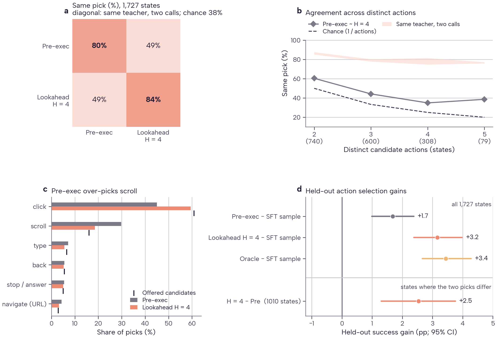

*(a) Share of states where two teachers pick the same distinct action. The two calls of each source are matched by call index and averaged; the diagonal compares a source's two calls with each other. (b) The same by number of distinct candidate actions; the band spans the three self-agreements. (c) Action type of the picked action (first parsed call; both calls, all states), with ticks for the share among offered candidates. (d) Held-out success of the pick on the fixed-five view of the [5-fold label study](ARM_FINAL_RESULTS.md#final-selection-label-kfold-20261101): each state's first five SFT proposals, scored on draws 4–8, valid only. Teacher = argmax of its two-call vote share among the five, with ties averaged. Oracle = best success on draws 1–3. The lower rows compare two teachers on the states where their picks differ. All intervals are task-clustered 95% bootstraps (10,000 resamples). The teacher gains reproduce the 5-fold table (+1.6 / +2.7 / +3.2 / +3.5 on 1,725 states).* [PDF](arm_results/luna_pre_post_k3_20261105/pre-post-k3-picks.pdf) · [SVG](arm_results/luna_pre_post_k3_20261105/pre-post-k3-picks.svg) · [stats](arm_results/luna_pre_post_k3_20261105/stats.json) · [analysis](arm_results/luna_pre_post_k3_20261105/analysis.py) · [plot](arm_results/luna_pre_post_k3_20261105/plot.py)

| Held-out success of the pick | States (count) | Tasks (count) | Pick success (%) | Gain, pp [95% CI] |
| --- | ---: | ---: | ---: | ---: |
| SFT sample (mean of five) | 1,727 | 434 | 38.7 | — |
| Pre-exec − SFT | 1,727 | 434 | 40.4 | +1.7 [+1.0, +2.4] |
| Post-exec − SFT | 1,727 | 434 | 41.5 | +2.8 [+2.0, +3.5] |
| K = 3 − SFT | 1,727 | 434 | 41.9 | +3.2 [+2.4, +4.0] |
| Oracle − SFT | 1,726 | 434 | 42.2 | +3.4 [+2.7, +4.3] |
| Post − pre, picks differ | 903 | 336 | 35.3 → 37.4 | +2.1 [+0.8, +3.4] |
| K = 3 − post, picks differ | 741 | 308 | 35.0 → 36.0 | +0.9 [−0.6, +2.5] |
| K = 3 − pre, picks differ | 1010 | 356 | 36.1 → 38.6 | +2.5 [+1.3, +3.8] |

Setup and caveats

- **Labels:** runtime `selection-head-20261008/sft-actions-20261021/labels/{pre,post,k3}/judgments/`. One judge (`gpt-6-luna`, effort high) with the same prompt and candidates (all distinct actions of the state, 2–5). The three sources differ only in evidence: none, the draw-1 immediate execution result, or that result plus the actor's next 3 steps. There are two calls per state per source, each with its own random candidate order. Answers are an index only, so the reasoning-cue and qualitative analyses of the p16 study cannot be repeated here.
- **States:** 1,727 of the 1,738 labelled states have two valid calls from all three sources. The outcome rows need held-out draws for each of the fixed five.
- **Scope:** the outcomes measure the teacher's pick, not a trained selector. Live heads trained on these labels are in the [label-source comparison](ARM_FINAL_RESULTS.md#final-selection-label-live-3run-20261103). Draw 1 is the evidence draw for post-exec and K = 3, and draws 4–8 are never shown to any teacher.

### Examples: what each teacher saw and picked

**Compact version (paper, 7 × 3.2 in, about a third of a page).** Two of the examples below.

![Two rows per example. Columns: current screen, action, next screen, lookahead (the actor's next steps) and the teachers that picked it with held-out success. A yellow "decides" band marks the evidence that separates the candidates, and the other screens are faded. (a) Netflix, band on the next screen: clicking "Netflix payment options" opens the answer page (picked by post-exec and lookahead, 100%), while scrolling shows more billing text (pre-exec, 0%). (b) arXiv, band on the lookahead: after clicking search the actor types "machine learning" and reaches 353,132 results (lookahead, 100%); after going back it clicks the same listing and goes back again (pre-exec and post-exec, 0%)](arm_results/luna_pre_post_k3_20261105/examples-compact.png)

*Each example has one row per candidate. All teachers see the current screen and the action. Post-exec also sees the next screen. Lookahead (H = 3) additionally sees the actor's next three steps; the first two are shown, and “…” marks the rest. On the current screen, a box marks a click target and an arrow marks a scroll. The yellow "decides" band marks the evidence that separates the two candidates, and the other screens are faded. "Picked by" shows the teachers that chose that candidate on both calls. Success is the share of held-out continuations that succeed (draws 4–8, valid only). An action the actor proposed k times has 5k continuations because duplicate proposals are merged: (a) 20/20 and 0/5, (b) 5/5 and 0/19.* [PDF](arm_results/luna_pre_post_k3_20261105/examples-compact.pdf) · [script](arm_results/luna_pre_post_k3_20261105/compact_examples.py)

Seven states from the same 1,727, chosen as the clearest cases of each pattern. In each one, every teacher picked the same candidate on both of its calls, and the better and worse picks differ by at least 40 pp in held-out success. Each figure shows three things. Top left is the screen all three teachers judge, with each candidate's click or scroll point numbered. Top right lists the candidates, each teacher's pick (×2 = both calls) and held-out success (draws 4–8, valid only). Below are the two contested candidates. The first column is the draw-1 immediate result, which the post-exec teacher sees. The next three columns are the actor's following steps, which only the K = 3 teacher sees. All screenshots are the saved ones.

**1. Seeing the result fixes a guess (the most common pattern: pre-exec scrolls, post-exec clicks).**

*Netflix payment methods.* The help page lists a "Netflix payment options" link. Pre-exec scrolls down (0/5). With the result in view, post-exec and K = 3 click the link, which opens the payment-options article directly (20/20).

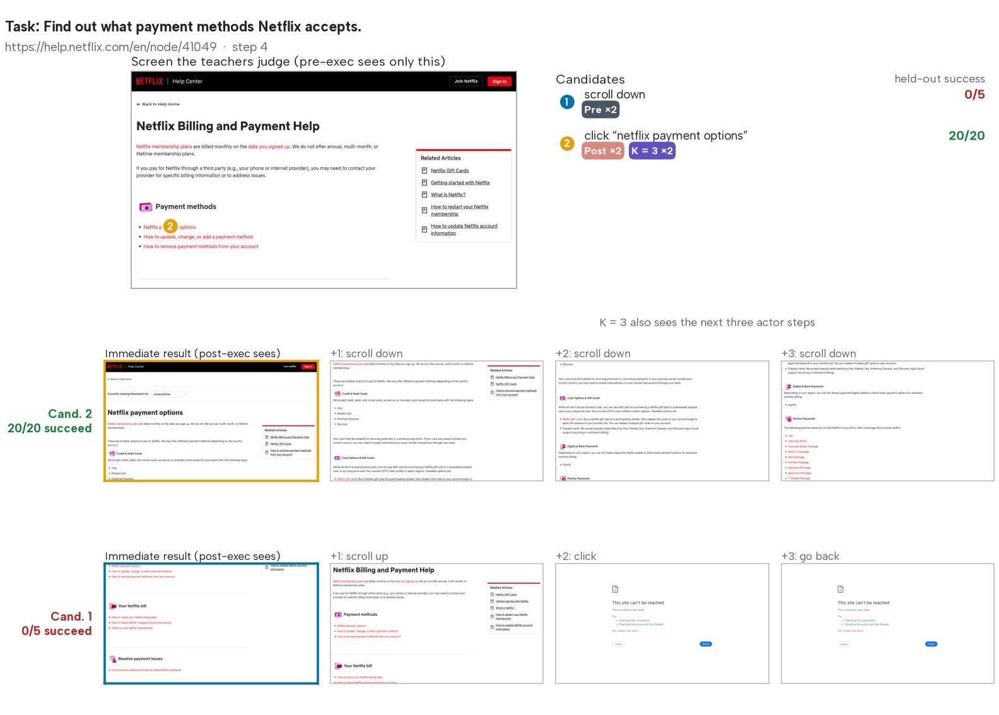

*Blocked news site.* NYTimes blocks the agent as a robot. Pre-exec switches to bbc.com (1/5), whose immediate result is an "Access denied" page. Post-exec sees that page and picks Google News instead (5/5), which loads the headlines.

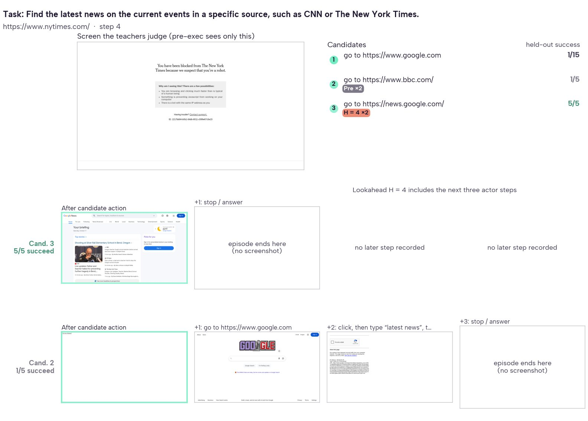

**2. The three-step tail reveals what one result cannot.**

*arXiv search vs going back.* On a Formal Languages listing, pre-exec and post-exec go back (0/19). Going back looks reasonable after one step, and the lookahead shows it turning into a click / back loop. K = 3 picks the search box (5/5): its immediate result is only an open search field, but the next steps type "machine learning" and reach 353,132 results.

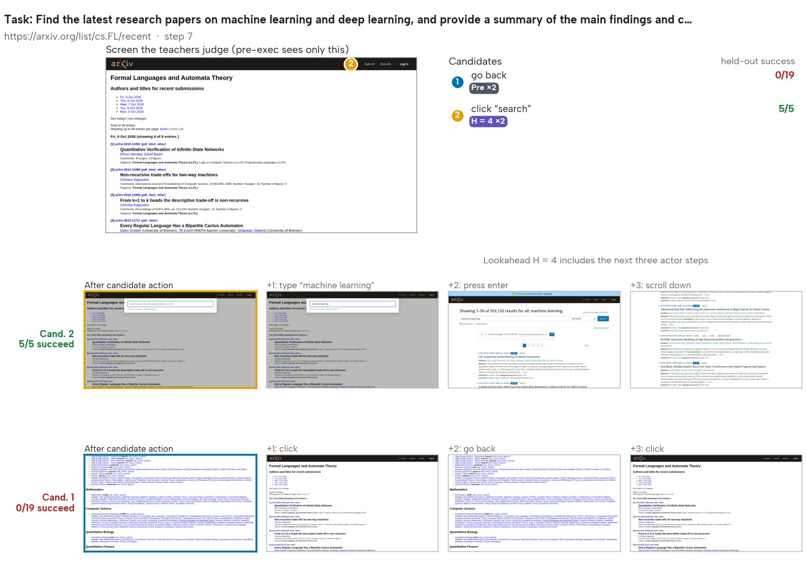

*Finding the 79th abbot.* On the Luxembourgish article about the abbey, pre-exec and post-exec keep scrolling the article (0/20). The scrolling path answers after two more scrolls without ever finding the name. Going back lands on a search-results page, which looks marginal after one step. Its continuation searches again, opens "Willibrord Scheffer" and answers (3/5).

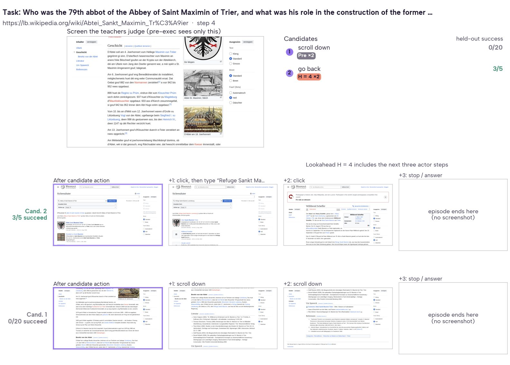

**3. The tail misleads: credit for what the actor happened to do next.**

*West Frisian "Fryske Frijheid".* Pre-exec and post-exec search for the term (9/20). K = 3 picks "click, then go back" (0/5), whose own result is the Wikipedy main page, a step backwards. In its single sampled continuation, the actor then searched for "Fryske Frijheid" by itself, and K = 3 credited the candidate for that recovery. This is the single-continuation noise (category G) found in the p16 coding above.

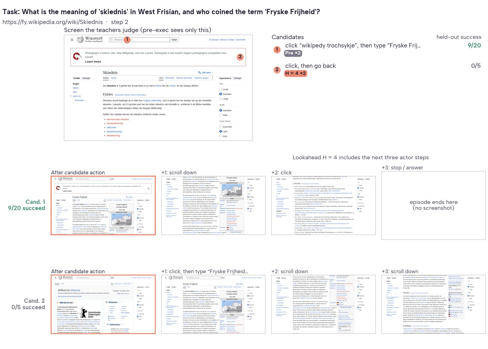

**4. Pre-exec is right and the execution evidence misleads.**

*Stopping on an arXiv listing.* After 12 steps on the Statistics listing, stop/answer succeeds 8/10, and pre-exec picks it. Its immediate "result" is the same page and it has no continuation. So post-exec and K = 3 see no evidence for stopping and prefer clicking "more" (1/5), whose result looks like progress. Execution evidence can only favour actions that visibly change something.

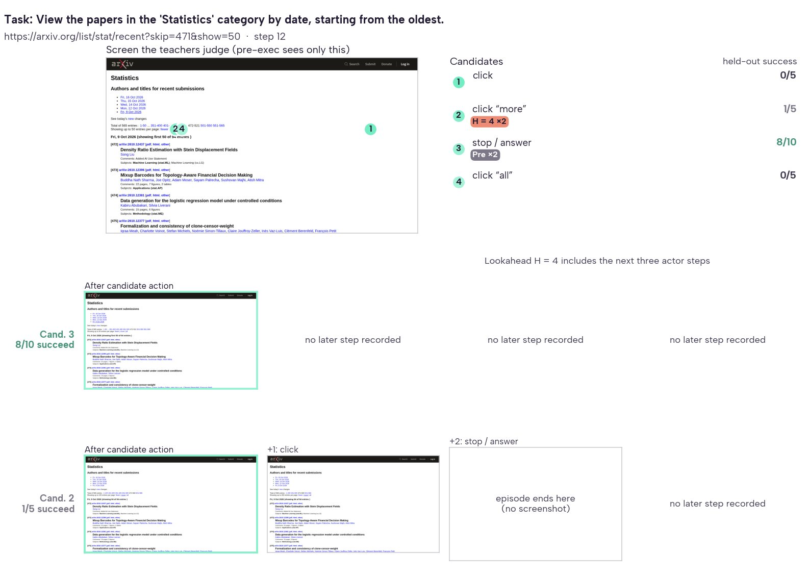

*Norwegian Wikipedia, Eurovision 2025.* The task asks for the answer from the homepage's "Aktuelt" section. Pre-exec scrolls to that section (12/15). Post-exec and K = 3 pick the search, which immediately opens the Eurovision Song Contest 2025 article, a convincing result (1/5). The article path still rarely succeeds. The task names the homepage section as the source, which plausibly explains this, but the held-out verdicts were not inspected.

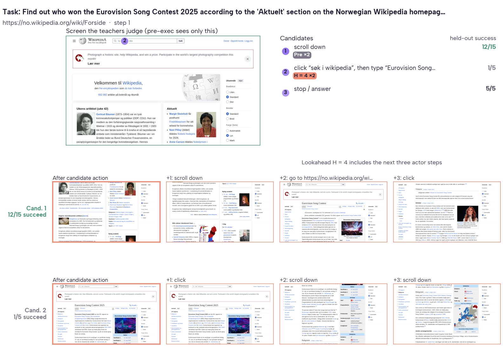

*Selection: [select_examples.py](arm_results/luna_pre_post_k3_20261105/select_examples.py) ranks firm-pick states by held-out gap in four categories (38 / 16 / 7 / 9 states qualify). Rendering: [render_examples.py](arm_results/luna_pre_post_k3_20261105/render_examples.py). Points are the actor's normalised `point_2d` on the 1280 × 720 screen. Lookahead screenshots come from the draw-1 rollout that the K = 3 teacher was shown.*

## Live outcome: K = 3 vs pre labels, Luna vs GPT-5.5, LoRA vs head (3 runs, 2026-11-03)

**Every selector trained on the p16 panels beats one SFT sample except the two pre-label heads, and every 11-03 selector is below same-day SelectionARM (45.7% mean overall).** K = 3 labels help heads (+2.9 Luna, +3.2 GPT-5.5, both significant) but not LoRAs (Luna +0.3, interval crossing zero). With K = 3 labels, the GPT-5.5 head is 1.6 pp above the Luna head ([−0.4, +3.6]), and the Luna LoRA and head are tied (−0.6 [−2.5, +1.5]).

Three runs per row, all 1,045 tasks (WebVoyager 595, Online-Mind2Web 300, DeepShop 150). SFT 4B actor, N = 5 candidates, T 1.0 / top-p 0.9, seed 20261018, 30 steps, local browsers. Judges: gpt-5.6-terra for Online-Mind2Web, GPT-4o for WebVoyager and DeepShop. Per-benchmark columns are valid-only success (successes / valid episodes), pooled over three runs. Mean = equal-weight average of the three benchmarks, overall (invalid = failure) and valid-only. Differences are on mean overall against the same-day SFT run, with per-task success averaged over the three runs and [paired 95% intervals](ARM_FINAL_RESULTS.md#final-paired-bootstrap) (10,000 task resamples within each benchmark, seed 20261103); **bold** intervals exclude zero. Paired intervals against SelectionARM are in the [JSON](arm_results/luna_pre_vs_k3p_20261103/live_3run_20261103.json).

| Selector (labels, model) | Eval date | WebVoyager valid-only | Online-Mind2Web valid-only | DeepShop valid-only | Mean overall | Mean valid-only | − SFT, pp [95% CI] |
| --- | --- | ---: | ---: | ---: | ---: | ---: | ---: |
| SFT 4B, one sample | 11-03/04 | 45.6% | 34.6% | 43.1% | 39.6% | 41.1% | — |
| SelectionARM (Piotr) | 11-03/04 | 52.4% | 43.8% | 50.5% | 45.7% | 48.9% | **+6.2 [+4.0, +8.3]** |
| Luna pre, LoRA | 11-03 | 51.2% | 40.2% | 46.2% | 42.1% | 45.9% | **+2.5 [+0.3, +4.6]** |
| Luna K = 3, LoRA | 11-03 | 49.4% | 37.8% | 50.9% | 42.3% | 46.1% | **+2.8 [+0.7, +4.9]** |
| Luna pre, head | 11-03 | 47.3% | 38.8% | 46.1% | 40.0% | 44.1% | +0.5 [−1.7, +2.7] |
| Luna K = 3, head | 11-03 | 48.0% | 39.8% | 52.2% | 42.9% | 46.7% | **+3.3 [+1.1, +5.5]** |
| GPT-5.5 pre, head | 11-03 | 49.9% | 36.8% | 45.0% | 41.3% | 43.9% | +1.7 [−0.5, +4.0] |
| GPT-5.5 K = 3, head | 11-03 | 52.8% | 37.6% | 51.7% | 44.5% | 47.4% | **+5.0 [+2.9, +7.1]** |
| GPT-5.5 pre, LoRA ¹ | 11-04 | 53.7% | 41.4% | 51.2% | 46.2% | 48.8% | **+6.7 [+4.5, +8.9]** |
| GPT-5.5 K = 3, LoRA ¹ | 11-04 | 52.7% | 41.1% | 47.3% | 44.7% | 47.0% | **+5.1 [+3.0, +7.3]** |

¹ The two GPT-5.5 LoRAs were re-evaluated in a same-day 3-run batch on 11-04 together with SelectionARM, the window right after the 11-03/04 SFT run; SelectionARM did not move between the two windows (−0.5 [−2.4, +1.4] pp). Same-day: K = 3 LoRA − SelectionARM −0.5 [−2.4, +1.4], pre LoRA − SelectionARM +1.0 [−1.0, +3.1] ([data](arm_results/rl_integration/selection-recipe3-gpt55-lora-sameday-20261104.json)). The earlier 11-02/03 runs (46.5% and 48.0% mean overall) are superseded.

| K = 3 − pre, pp [95% CI] | WebVoyager | Online-Mind2Web | DeepShop | Mean overall |
| --- | ---: | ---: | ---: | ---: |
| Luna, LoRA | −0.2 [−2.9, +2.6] | −2.6 [−5.6, +0.4] | +3.6 [−1.3, +8.2] | +0.3 [−1.8, +2.4] |
| Luna, head | +1.5 [−0.9, +3.8] | +1.1 [−1.9, +4.1] | **+6.0 [+0.9, +11.3]** | **+2.9 [+0.7, +5.0]** |
| GPT-5.5, head | **+3.0 [+0.5, +5.5]** | +0.9 [−2.1, +4.0] | **+5.8 [+0.9, +10.7]** | **+3.2 [+1.1, +5.3]** |
| GPT-5.5, LoRA ¹ | −0.5 [−2.8, +1.8] | −0.1 [−2.9, +2.7] | −4.0 [−8.9, +0.9] | −1.5 [−3.6, +0.6] |

Training data, runs and files

- **Training data:** all p16 panels (20,525 labelled by both Luna conditions; 2,309 states, 896 tasks), the same panels and train/validation split for every row. LoRAs: Piotr's SelectionARM LoRA recipe on the 4B decoder, served merged as the selector. Heads: `train_head_round.py --extra-only`, batch 256, 20 epochs, seed 0, best validation epoch. GPT-5.5 labels are the earlier K = 3 lookahead and pre-execution labels on the same panels.
- **Runs:** every row has 1,785 / 900 / 450 completed episodes; there are no missing tasks. Two jobs were retried and resumed from saved records (Luna pre LoRA run 1 DeepShop: startup goto timeouts; Luna pre head run 3 Online-Mind2Web: model service died at 181/300).
- **Files:** [per-row counts and all paired intervals](arm_results/luna_pre_vs_k3p_20261103/live_3run_20261103.json) · [script](arm_results/luna_pre_vs_k3p_20261103/live_3run_20261103.py). Runtime evaluation roots: `evaluations/{p16-lora-lunapre-20261103, p16-lora-lunak3-20261103, p16-heads-luna-20261103, p16-heads-all-20261102, p16-lora-pre-20261102, p16-lora-20261101, controls-sameday-20261103}`.
- **Interval scope:** the intervals cover task sampling only, not training-seed variance (one seed per selector) or drift between eval windows.

### What the trained students pick on the same eval states (LoRAs, 2026-11-07)

**The label type changes student picks more than the judge does.** The two pre-execution students agree on 72.8% of states, and the two K = 3 students on 62.1%. A pre and a K = 3 student trained by the same judge agree on only 63.4% (Luna) and 58.3% (GPT-5.5); chance is 39.4%. On 10.0% of states, both pre students pick one action and both K = 3 students pick another. Only 4.3% split the same way by judge.

**K = 3 students leave the page and stop sooner; pre students follow the majority proposal.** Two patterns hold for both judges:
- **Leaving a scroll loop.** After two or more scrolls, with "go back" among the proposals (93 states), the K = 3 students go back on 55% of states, against 17–18% for the pre students.
- **Stopping on a minority proposal.** When only one or two of the five proposals stop, the K = 3 students stop more often: Luna 6% → 9%, GPT-5.5 10% → 20%.

On the same states, the K = 3 students also pick a scroll less often and more often pick an action that only one of the five candidates proposed.

These patterns cut both ways (figure (b)). The replayed eval states show what changes, not which side is right; [below](#luna-pre-k3-student-outcomes-20261107), outcomes from the states where both picks were played out live show no difference. Live success is in the table above: LoRA K = 3 − pre is +0.3 (Luna) and −1.5 (GPT-5.5) pp, both intervals crossing zero. Outcomes for every candidate exist only on the [branch states](#luna-pre-post-k3-20261105).

*Each panel shows a replayed live state as all four students saw it: the logged screenshot, the task, and the five actor proposals grouped into distinct actions. Dark badges are the pre-execution students, purple the K = 3 lookahead students. In (b) the page still shows the calculator defaults (starting balance $100,000; contributions 16% of income), so the K = 3 students' answer is premature. The pre pick is not shown to succeed either: in the logged GPT-5.5 pre episode, the student set the balance to $0, then answered, and failed. The rate line under each example is over all replayed states of that kind.* [PDF](arm_results/luna_pre_post_k3_20261105/student-examples.pdf)

| Same 7,999 states | Pre (Luna) | K = 3 (Luna) | Pre (GPT-5.5) | K = 3 (GPT-5.5) | Proposals |
| --- | ---: | ---: | ---: | ---: | ---: |
| click | 58.3% | 59.6% | 59.2% | 57.1% | 57.3% |
| scroll | 17.7% | 15.6% | 15.7% | 14.7% | 14.9% |
| go back | 3.5% | 4.6% | 3.2% | 4.8% | 4.1% |
| stop / answer | 6.2% | 6.4% | 7.6% | 8.5% | 11.2% |
| pick proposed by only 1 of 5 | 58.3% | 62.0% | 54.3% | 57.3% | — |
| repeats the previous action | 5.6% | 5.8% | 5.6% | 7.1% | — |
| stop, when 1–2 of 5 propose it | 5.8% | 8.7% | 9.7% | 20.2% | — |

K = 3 − pre, pp, with [task-clustered 95% intervals](arm_results/luna_pre_post_k3_20261105/student-replay.json):

| Judge | go back | scroll | stop / answer | repeats previous | 1-of-5 pick |
| --- | ---: | ---: | ---: | ---: | ---: |
| Luna | **+1.1 [+0.7, +1.5]** | **−2.1 [−2.7, −1.4]** | +0.2 [−0.2, +0.5] | +0.2 [−0.2, +0.6] | **+3.8 [+2.9, +4.7]** |
| GPT-5.5 | **+1.6 [+1.2, +2.1]** | **−1.0 [−1.7, −0.4]** | **+0.8 [+0.4, +1.2]** | **+1.5 [+1.0, +2.0]** | **+3.0 [+2.0, +3.9]** |

Replay protocol, fidelity and live behaviour

- **States:** 8,000 live decisions on the SFT 4B actor where the five proposals contain at least two distinct actions. There are 2,000 from each student's own runs (the 3-run batches in the table above: Luna 11-03, GPT-5.5 11-04), stratified 300 : 595 : 150 over Online-Mind2Web / WebVoyager / DeepShop, seed 20261107. One state lacked its task text, leaving 7,999.
- **Replay:** each selector request was rebuilt from the saved trace: task, URL, history of executed responses, five candidates, and the logged screenshot (its sha256 matches the log). It was sent to all four merged LoRAs on the live serving stack (sglang, greedy, JSON schema), 1 H200 for 55 min. Picks are compared as actions (same tool calls, points within 5/1000).
- **Fidelity:** the replayed pick matches the student's own live pick on 99.1% (Luna pre), 98.4% (Luna K = 3), 98.4% (GPT-5.5 pre) and 95.4% (GPT-5.5 K = 3) of states.
- **Agreement chance:** the expected agreement if each student picked a proposal at random, in proportion to how many of the five proposed each action.
- **Disagreements are often small:** of the 797 consistent label-split states, 278 change the action type. The rest are mostly clicks on different targets, or the same action type with different arguments (for example scroll 0.5 vs 0.7).
- **Live behaviour on each student's own trajectories:** these are not the same states, but the direction matches ([student-live.json](arm_results/luna_pre_post_k3_20261105/student-live.json)). On real choices, the K = 3 students go back more (Luna 3.3% → 4.8%; GPT-5.5 3.2% → 4.4%). GPT-5.5 K = 3 repeats the previous action more (13.2% vs 9.5% of decisions) and has more episodes with a three-step repeat (19.9% vs 16.0%).
- **Episode outcome on split states (weak):** on the consistent label-split states, the logged episode succeeded 26.5% / 29.4% when a pre student made the pick (Luna / GPT-5.5) and 30.6% / 30.7% when a K = 3 student did. Over all of each student's sampled states, the rates are 30.1 / 35.0% and 31.4 / 35.4%. These differ in state, so they do not show which pick is better.
- **Files:** [student_live.py](arm_results/luna_pre_post_k3_20261105/student_live.py) · [student_replay.py](arm_results/luna_pre_post_k3_20261105/student_replay.py) · [student-replay.json](arm_results/luna_pre_post_k3_20261105/student-replay.json) · [student_examples.py](arm_results/luna_pre_post_k3_20261105/student_examples.py) · [student_outcomes.py](arm_results/luna_pre_post_k3_20261105/student_outcomes.py) · [student_outcome_examples.py](arm_results/luna_pre_post_k3_20261105/student_outcome_examples.py). Runtime (task-level, not published): `selection-head-20261008/label-kfold-20261101/pre-post-k3/{student-live-index.jsonl, student-replay/}` (matched episodes: `student-replay/split-outcomes.jsonl`).

#### Outcomes where both picks were played out (eval states only)

**Where both picks have live outcomes, the K = 3 pick does no better than the pre pick.** Every selector evaluated on November 1–4 ran the same SFT 4B actor on the same 1,045 tasks: 40,755 episodes. So the same screen often recurs, and different selectors executed different actions from it. A split state is matched to these episodes by identical screenshot (sha256), task and step, and each matched episode that executed the pre pick or the K = 3 pick contributes its judged outcome (valid episodes only; gpt-4o for WebVoyager and DeepShop, Terra for Online-Mind2Web, the same judge on both sides).

| Split states | Both picks played out | Tasks | After pre pick | After K = 3 pick | K = 3 − pre, pp [95% CI] |
| --- | ---: | ---: | ---: | ---: | ---: |
| Luna students disagree | 173 | 139 | 49.8% | 46.6% | −3.1 [−9.1, +2.7] |
| GPT-5.5 students disagree | 238 | 187 | 46.3% | 48.2% | +2.0 [−2.8, +6.7] |
| Both judges split the same way | 60 | — | 51.5% | 50.9% | — |

*Success is averaged per state over the matched episodes on each side, then over states; intervals are task-clustered bootstraps ([student-outcomes.json](arm_results/luna_pre_post_k3_20261105/student-outcomes.json)). Only 411 of 4,612 split states have both sides played out, mostly early steps (late screens rarely recur exactly), and neither example in the figure above is among them. Each outcome is the whole episode, whose later steps were chosen by different selectors, so this is a rough signal.*

Eight of these states, three where the K = 3 pick did better (W) and three where it did worse (L) plus one alternate each. They show both patterns cutting both ways: going back wins on a rate-limit or blocked page (W1, W3) and loses when the answer is one click or a few scrolls away (L1, L2).

| Sheet | State | Pre students pick | Succeed | K = 3 students pick | Succeed |
| --- | --- | --- | ---: | --- | ---: |
| [W1](arm_results/luna_pre_post_k3_20261105/outcome-review-W1-2586.jpg) | WebVoyager HF--14, step 2 (GPT-5.5): Pricing opened a 429 rate-limit page | click footer "Documentation" | 0/1 | go back | 2/2 |
| [W2](arm_results/luna_pre_post_k3_20261105/outcome-review-W2-7262.jpg) | WebVoyager ArXiv--16, step 1 (Luna): this week's gravitational-wave papers | search box | 0/2 | click the gr-qc listing | 3/3 |
| [W3](arm_results/luna_pre_post_k3_20261105/outcome-review-W3-5324.jpg) | WebVoyager Allrecipes--6, step 1 (GPT-5.5): access-blocked page | go to google.com | 0/1 | new tab, bbcgoodfood.com | 5/9 |
| [L1](arm_results/luna_pre_post_k3_20261105/outcome-review-L1-2809.jpg) | WebVoyager HF--0, step 6 (GPT-5.5): model card after 4 scrolls, task needs the last-update date | click "Files and versions" | 2/2 | go back | 0/2 |
| [L2](arm_results/luna_pre_post_k3_20261105/outcome-review-L2-677.jpg) | WebVoyager Apple--40, step 9 (both judges): Vision Pro specs after 4 scrolls, built-in apps further down | keep scrolling | 8/13 | go back | 0/1 |
| [L3](arm_results/luna_pre_post_k3_20261105/outcome-review-L3-6795.jpg) | WebVoyager Apple--34, step 1 (GPT-5.5): Apple TV 4K specs | click the search icon | 24/24 | click "Entertainment" | 2/8 |
| [alt-W](arm_results/luna_pre_post_k3_20261105/outcome-review-alt-W-3610.jpg) | WebVoyager HF--24, step 5 (GPT-5.5): 429 page on Models | search on the error page | 0/1 | go back | 1/1 |
| [alt-L](arm_results/luna_pre_post_k3_20261105/outcome-review-alt-L-3000.jpg) | WebVoyager ArXiv--38, step 2 (Luna): find the arXiv blog | click footer "General information" | 5/5 | scroll | 0/1 |

Review sheets: the screen, both picks, and one matched episode per side

Each sheet shows the task, earlier actions, and the current screen with the pre pick (grey box) and the K = 3 pick (purple box). Then, per side, one real matched episode (a success and a failure when both exist): the next three screens with the action taken on each (orange box), the final answer and the judged outcome.

**W1.** WebVoyager HF--14, step 2 (GPT-5.5): Pricing opened a 429 rate-limit page.

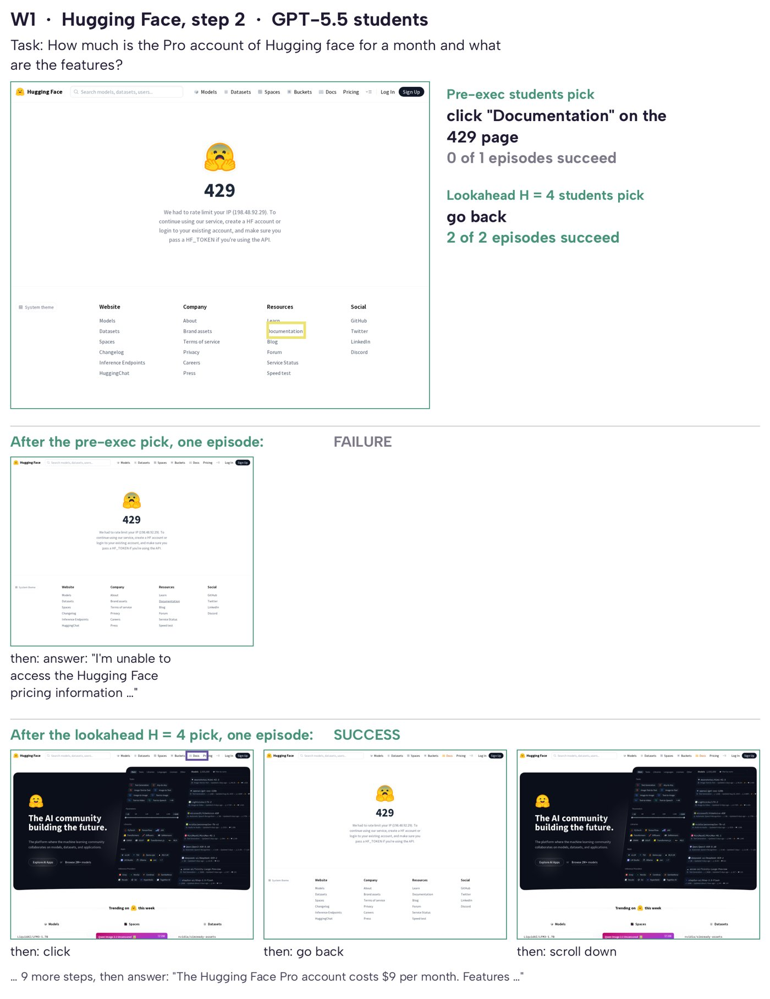

**W2.** WebVoyager ArXiv--16, step 1 (Luna): this week's gravitational-wave papers.

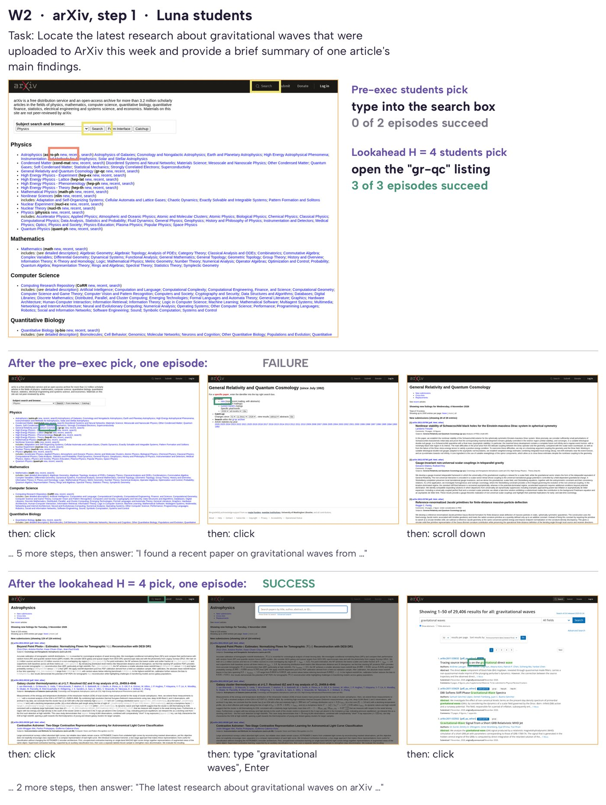

**W3.** WebVoyager Allrecipes--6, step 1 (GPT-5.5): access-blocked page.

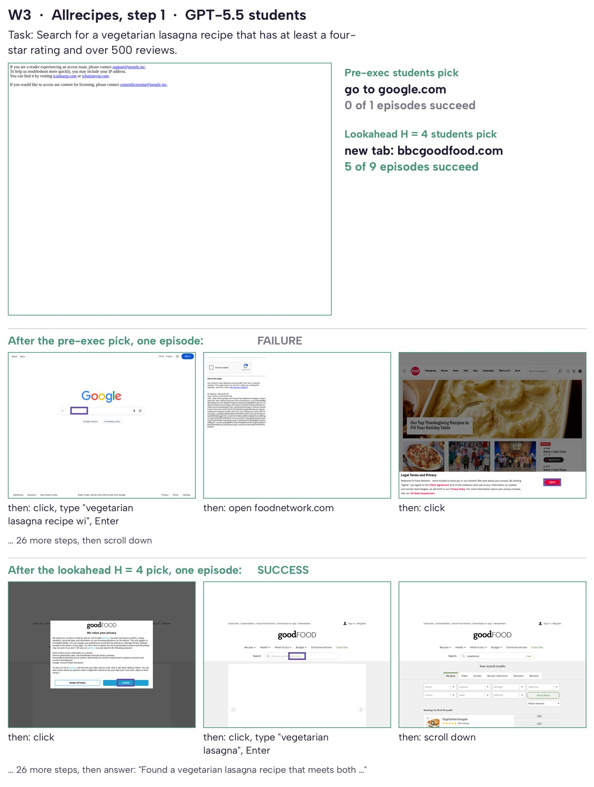

**L1.** WebVoyager HF--0, step 6 (GPT-5.5): model card after 4 scrolls, task needs the last-update date.

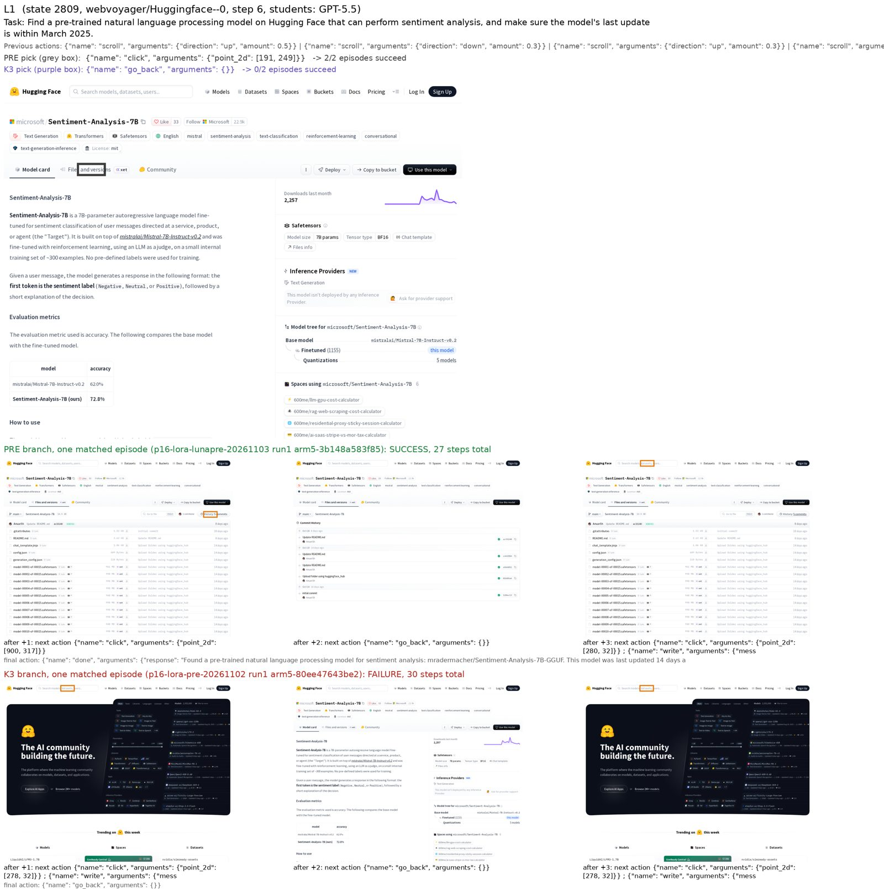

**L2.** WebVoyager Apple--40, step 9 (both judges): Vision Pro specs after 4 scrolls, built-in apps further down.

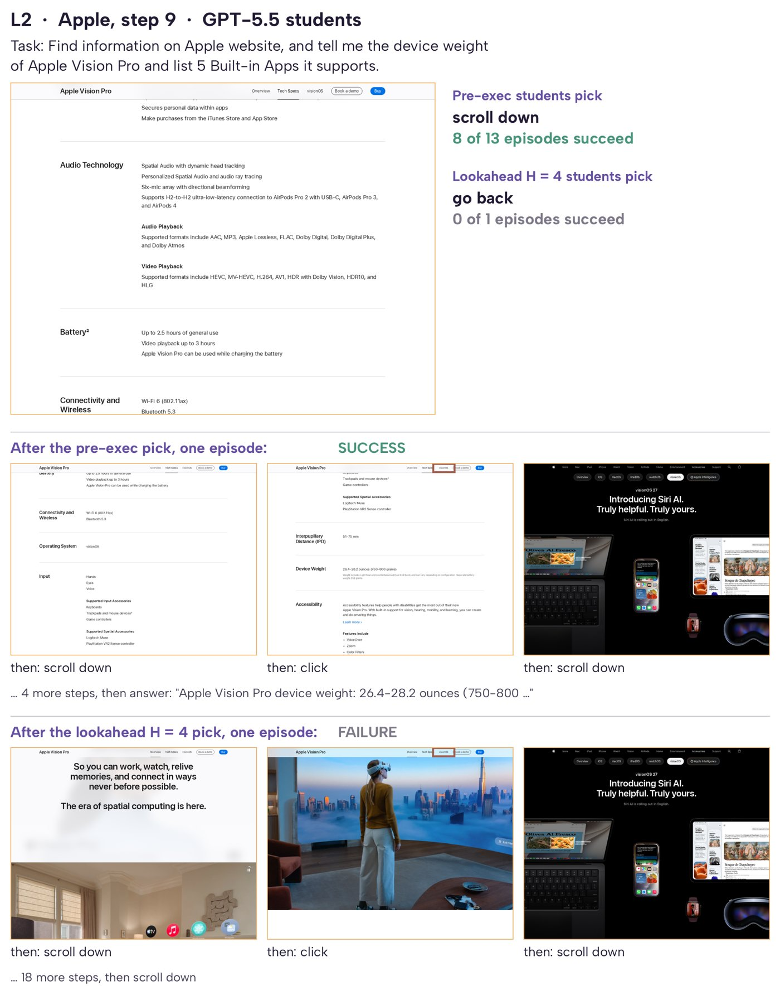

**L3.** WebVoyager Apple--34, step 1 (GPT-5.5): Apple TV 4K specs.

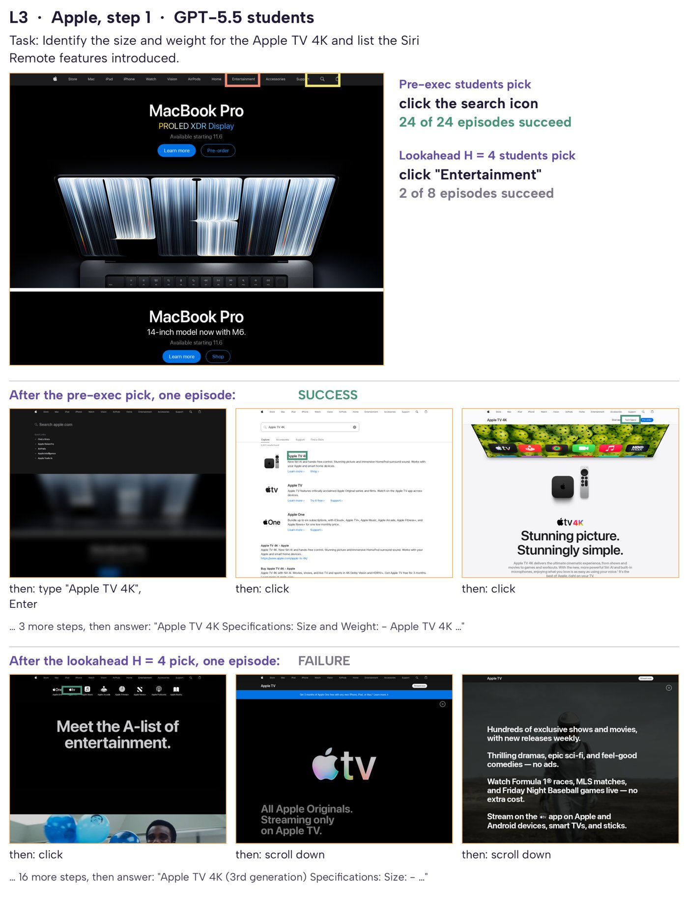

**alt-W.** WebVoyager HF--24, step 5 (GPT-5.5): 429 page on Models.

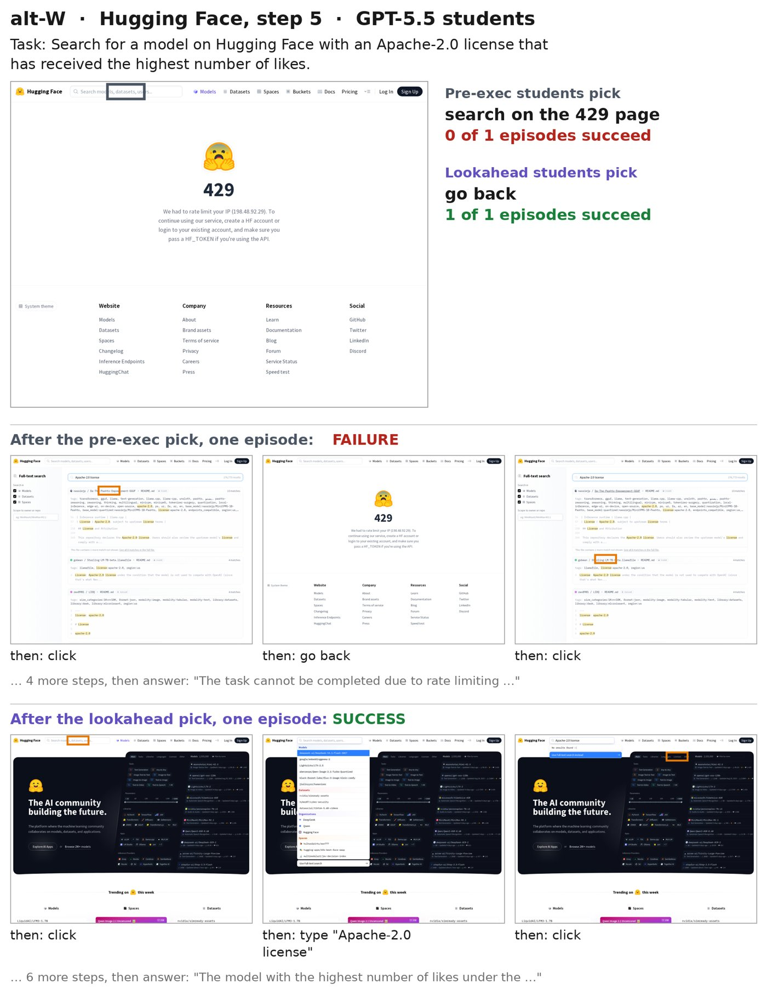

**alt-L.** WebVoyager ArXiv--38, step 2 (Luna): find the arXiv blog.

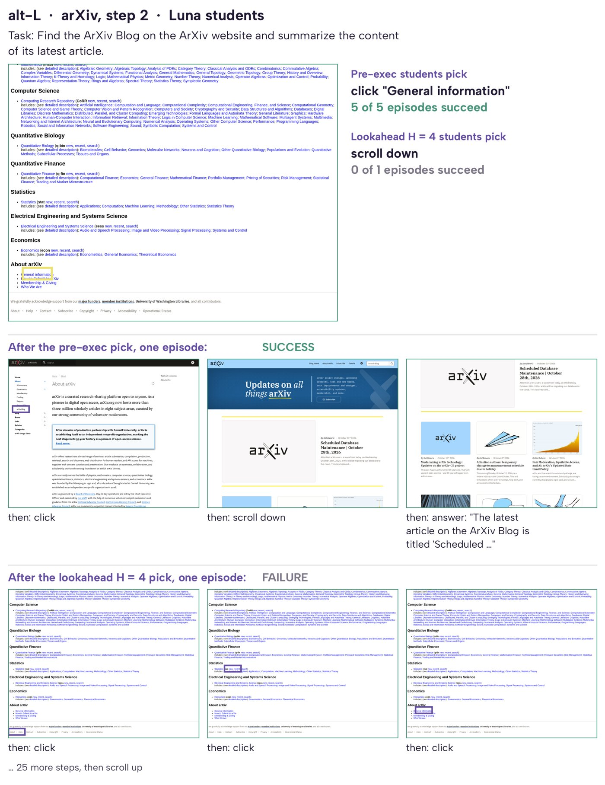

## Setup

| | Pre-execution (`pre`) | K = 3 lookahead (`k3p`) |
| --- | --- | --- |
| Judge | `gpt-6-luna`, effort high, 16,384 output tokens | same |
| Prompt | Piotr's system prompt and instructions: task, action history, current screenshot, 5 candidates with actor thoughts. The judge explains its choice in 2–4 sentences, then outputs `{"selection": N}` | same, plus one "Execution Lookahead" block before the instructions |
| Execution evidence | none | For each candidate: the draw-0 execution result (URL, title, tool response, screenshot), then the actor's next 3 steps with a screenshot after each. Page text and the final answer are hidden. |
| Candidate order | panel order | same, not shuffled |
| Panels | 20,671 (p16a, d, e, f, g); 0 failures | 20,671; 0 failures, 0 with missing lookahead |
| Cost | $13.73 | $63.41 |

Agreement compares the **executed target** of the two picks. Two picks that differ in position but point to the same deduplicated action count as agreement.

Note: the earlier GPT-5.5 K=3 labels used a different prompt: our instructions, a JSON-schema answer with no explanation, and shuffled order. That prompt difference is a confound in the GPT-5.5 K=3 vs pre comparison and does not apply here.

## Picks

**Agreement by panel difficulty and depth**

| Panels | Panels (count) | Same executed target (count) | Same executed target (%) |
| --- | ---: | ---: | ---: |
| All | 20,671 | 13,077 | 63.3 |
| 2 distinct targets | 11,009 | 7,692 | 69.9 |
| 3 distinct targets | 6,540 | 3,806 | 58.2 |
| 4 distinct targets | 2,448 | 1,199 | 49.0 |
| 5 distinct targets | 528 | 234 | 44.3 |
| Depth 0 | 7,400 | 4,440 | 60.0 |
| Depth 1–5 | 5,515 | 3,560 | 64.6 |
| Depth 6–11 | 4,933 | 3,193 | 64.7 |
| Depth 12+ | 2,823 | 1,884 | 66.7 |

**Action type of the pick in the 7,594 disagreement panels.** Types come from the candidate's first parsed call. Smaller types are omitted.

| Action type | Pre picks (count) | k3p picks (count) | Change (count) |
| --- | ---: | ---: | ---: |
| click | 4,532 | 4,400 | −132 |
| scroll | 1,271 | 1,008 | −263 |
| back | 337 | 643 | +306 |
| stop / answer | 332 | 479 | +147 |
| navigate (direct URL) | 362 | 157 | −205 |
| new tab | 293 | 352 | +59 |
| type / write | 325 | 417 | +92 |
| wait | 118 | 88 | −30 |

These are the most common switches between pre's pick and k3p's pick:

| Switch | Panels (count) |
| --- | ---: |
| click → a different click | 3,173 |
| scroll → click | 756 |
| click → scroll | 659 |
| scroll → back | 274 |
| click → back | 195 |
| click → stop / answer | 166 |
| navigate → new tab | 134 |
| stop / answer → scroll | 130 |

On all panels, the share of picks in each position (1–5) is:

| Label | Pos 1 (%) | Pos 2 (%) | Pos 3 (%) | Pos 4 (%) | Pos 5 (%) |
| --- | ---: | ---: | ---: | ---: | ---: |
| pre | 37.8 | 24.8 | 14.9 | 11.5 | 11.0 |
| k3p | 39.6 | 24.2 | 14.6 | 11.8 | 9.9 |

The two labels share almost the same position bias, so the shared prompt and candidate order drive it, not the lookahead.

**Stop/answer picks by depth** (share of each depth band's panels):

| Depth | Panels (count) | Pre stop picks (count) | Pre stop (%) | k3p stop picks (count) | k3p stop (%) |
| --- | ---: | ---: | ---: | ---: | ---: |
| 0 | 7,400 | 308 | 4.2 | 515 | 7.0 |
| 1–5 | 5,515 | 377 | 6.8 | 358 | 6.5 |
| 6–11 | 4,933 | 241 | 4.9 | 194 | 3.9 |
| 12+ | 2,823 | 87 | 3.1 | 93 | 3.3 |

The depth-0 increase matches the qualitative coding: on blocked or anti-bot landing pages, k3p sees that every retry hits the same wall.

**Immediate draw-0 effect of the two picks in disagreements.** All 7,594 disagreement panels have both effects recorded.

| Immediate effect | Pre pick (count) | k3p pick (count) |
| --- | ---: | ---: |
| URL changed | 4,041 | 4,119 |
| Tool response reports an error | 134 | 99 |

Gross effects are similar for the two picks. k3p does not simply prefer actions that navigate somewhere; the qualitative coding below shows the difference lies in what the resulting page contains.

## Reasoning

**Cue frequencies in the explanations (regular-expression counts, share of panels).** "Execution cue" also matches pre wording such as "navigate to" or "result", so compare the two labels rather than reading either number on its own. All 20,671 panels count for "All"; the 7,594 disagreement panels count for "Disagreements".

| Cue | Pre, all (%) | k3p, all (%) | Pre, disagreements (%) | k3p, disagreements (%) |
| --- | ---: | ---: | ---: | ---: |
| Execution / result language | 28.7 | 46.5 | 29.6 | 50.9 |
| Hedging (may, might, likely, appears …) | 47.2 | 20.8 | 48.9 | 19.1 |
| Error / block / no effect | 9.7 | 15.9 | 11.1 | 20.7 |
| Repetition / loop / already | 35.5 | 24.4 | 35.9 | 27.4 |
| Task constraint / filter | 11.1 | 10.3 | 11.5 | 11.2 |
| Premature stop / unverified | 4.5 | 4.9 | 4.3 | 4.2 |

Explanations are about the same length: a mean of 47.1 words for pre and 50.6 for k3p.

**Qualitative coding of 240 disagreements.** The 240 panels are a seeded sample (seed 20261103) from the 7,594 disagreements. Four LLM coders each coded one 60-panel batch, reading the candidates and both explanations only, with no screenshots.

| Primary reason for the different pick | Panels (count) | Panels (%) | Coder: k3p looks better (count) | Coder: pre looks better (count) | Coder: unclear (count) |
| --- | ---: | ---: | ---: | ---: | ---: |
| A. Pre's pick observed to fail (block, CAPTCHA, no-op, zero results, wrong page) | 61 | 25.4 | 34 | 0 | 27 |
| B. k3p's pick observed to reach the needed page or info | 62 | 25.8 | 37 | 0 | 25 |
| D. Stop vs continue | 26 | 10.8 | 16 | 2 | 8 |
| E. Near-tie among equivalent actions | 34 | 14.2 | 0 | 0 | 34 |
| G. k3p over-trusts one sampled continuation | 30 | 12.5 | 0 | 7 | 23 |
| C. Pre's pick avoided for the actor's later steps | 7 | 2.9 | 1 | 0 | 6 |
| F. No lookahead use (ordinary judgement variance) | 20 | 8.3 | 1 | 1 | 18 |
| **Total** | **240** | 100 | **89** | **10** | **141** |

In the same 240 panels:

| Field | Panels (count) | Panels (%) |
| --- | ---: | ---: |
| k3p cites a concrete observed result | 213 | 88.8 |
| Pre misjudged a click's effect from the screenshot | 34 | 14.2 |

Category counts vary by coder: near-ties ranged from 2 to 14 per 60-panel batch. So the category shares carry single-coder uncertainty.

**60 coded agreement panels** (same executed target):

| k3p's basis for the shared pick | Panels (count) |
| --- | ---: |
| Confirmed by the pick's observed result | 35 |
| Rules out the other candidates by their observed failures | 9 |
| Same reasoning as pre (no execution evidence) | 16 |

Pre hedged its explanation in 28 of the 60 agreement panels. Even when the labels agree, k3p usually moves the justification from a guess to an observation, for example: "the follow-up view shows its specific phone number".

### What the lookahead adds

- **Hidden failures.** These include Google or site CAPTCHAs, security-verification pages, 403 errors and maintenance pages, direct URLs that redirect to a homepage, searches that return nothing, and query wordings that a site misinterprets (for example, WolframAlpha returning an aggregate instead of a per-country table).
- **True click effects.** Pre often rejects a click as "missing the link" or "landing in blank space", and k3p sees it open the target. The reverse also happens: a click pre trusted toggles a compare box, opens a video, or lands in the search field instead of on the button.
- **Honest stopping on dead ends.** Pre tends to argue that "done gives up" and picks another retry. k3p sees the retry reach the same block and picks the candidate that reports the access problem without inventing an answer. The opposite also occurs: k3p sometimes continues because scrolling revealed more relevant content than a partial answer covered.

Representative pairs (verbatim, trimmed):

| Case | Pre explanation | k3p explanation |
| --- | --- | --- |
| A — 5-star pancake recipe | "…the click candidates all target a blank area rather than a visible recipe link." (picks scroll) | "Candidate 2 clicks the visible 'Blueberry Buttermilk Pancakes' result, which leads to a recipe page showing a five-star rating, a photo, step-by-step directions…" |
| A — article on a blocked site | "Google can search for the specific GolfWRX article despite the site being blocked." | "Candidate 3 uses Google, but the lookahead shows its search was blocked for unusual traffic…" |
| A — translate 'success' into German | "The Translate link is the most direct route to Cambridge's translation tool…" | "The other candidates all click the Translate link, which leads to a security-verification page and does not advance the task." |
| D — job count on Indeed | "Clicking the visible 'Return home' button is the only candidate that could still make progress…" | "Candidate 1 repeats a navigation action that already led to another blocked Indeed page… Candidates 2–5 accurately report the access barrier…" |

### Where the lookahead hurts

- **Credit for the continuation instead of the action.** k3p sometimes prefers a bare "click the search field" over "type the query and press Enter" because, after the bare click, the actor happened to sort results by rating. It also sometimes ranks two identical searches by which continuation drifted.
- **Transient outcomes treated as decisive.** In one example, an HTTP 429 after Enter led k3p to pick "type without submitting". In another, one failed reload against one successful wait decided the label.
- **Inconsistent conclusions across panels of the same state.** For example, in one state (the Bohol Island area task) k3p draws opposite conclusions about the "Bohol" and "Bohol Island" queries in two panels. This is the signature of single-sample variance.
- **Arbitrary tie-breaks.** For identical actions, pre breaks ties on click centring or key naming, and k3p on whichever continuation went further. Neither carries signal.

| Case | Pre explanation | k3p explanation |
| --- | --- | --- |
| G — recipe comparison | "Candidates 2, 4, and 5 all click the visible search field, enter 'chicken curry,' and submit the search…" | "Candidates 1 and 3 reach the rating-sorted results; candidate 3 clicks the visible search field and its lookahead then advances through the search and sort…" |
| G — statistical learning paper | "Candidate 3 enters the topic query and submits it…" | "Candidate 2 enters the relevant search phrase … without immediately repeating the Enter action that led to an HTTP 429 error." |

## Implications for training on these labels

- **Most of k3p's added signal is in the immediate result, not the 3-step tail.** Categories A and B (51.3% of coded disagreements) rely on what the action itself did. Categories G and C (15.4%) rely on the actor's later steps and are where k3p is most often wrong.
- **About a quarter of the disagreement rate is noise from single sampled continuations and ties.** Categories E and G together make up 26.7%. Several continuation draws per candidate, or collapsing equivalent actions before labelling, would reduce this noise. Head targets already merge equivalent calls (`equivalence_target`), which absorbs part of category E. LoRA targets are a single index.
- **Pre labels rarely look better (4.2%), but their errors are systematic.** Pre misjudges clicks, sticks with direct URLs and Google fallbacks that are blocked, and keeps retrying on dead-end pages. A pre-execution student inherits these errors, and only execution evidence can correct them.

The live outcome comparison is in [Live outcome](#luna-pre-vs-k3p-live-20261103): K = 3 labels beat pre labels for heads (+2.9 Luna, +3.2 GPT-5.5) but not for the Luna LoRA (+0.3).

Method, files and caveats

- **Panels:** `labels/<batch>/panels.jsonl` for p16a, p16d, p16e, p16f and p16g. A panel is 5 candidates drawn from the state's 80 actor samples; "distinct targets" counts deduplicated executed actions. Labels are in `labels-luna/<batch>/{pre,k3p}/<state>-pNN.json`. Labellers: `labels-luna/p16_labels_luna.py` (pre) and `labels-luna/p16_labels_luna_k3p.py` (k3p, which adds the evidence parts to the pre request). All paths are under runtime `rl-actor-recollect-20261016/p16-k3-20261031/`.
- **Analysis:** `analysis/luna_pre_vs_k3p.py`, run as CPU-only job 416334. Action types come from the first parsed call of each candidate. The immediate effect comes from the draw-0 `immediate.json`, comparing the URL before and after and checking the tool response for error terms. Outputs: [`stats.json`](arm_results/luna_pre_vs_k3p_20261103/stats.json), plus the sampled panels (`disagreements.jsonl`, `agreements.jsonl`) and per-panel codes (`coded/`), which stay in runtime only because they contain task payloads.
- **Qualitative coding:** 4 LLM coders, one per 60-panel batch, plus one coder for the agreements. Each coder saw the candidates' calls, the tails of the actor thoughts and both explanations, but no screenshots. The verdicts ("looks better") are plausibility judgements without outcome labels. Aggregate: [`qualitative_coding.json`](arm_results/luna_pre_vs_k3p_20261103/qualitative_coding.json).
- **No ground truth:** p16 has one execution per candidate (the lookahead draw) and no judged continuations, so neither label can be scored against success on these panels.

