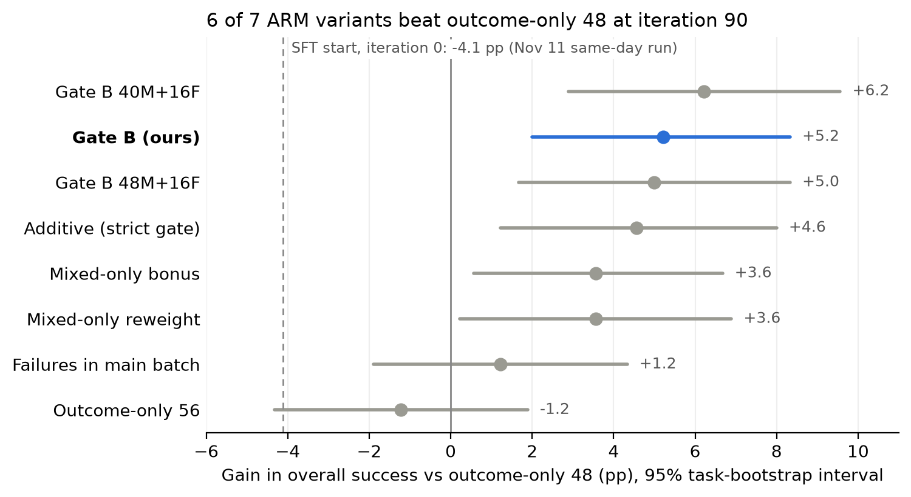

# RL with ARM turn credit: results summary (November 15, 2026)

**RL improves on the SFT start model, and ARM turn credit roughly doubles the gain.** On Online-Mind2Web
(300 tasks, three repeats, Terra judge), outcome-only RL gains +4.1 pp over iteration 0 (p = 0.024)
and Gate B gains +8.6 pp (p < 0.001). Across three benchmarks Gate B is the only run significantly ahead of
outcome-only 48 on each: +5.2 pp on Online-Mind2Web, +6.6 pp on WebVoyager and +6.0 pp on DeepShop (official
GPT-4o judges). One training run per method; seed variability is not measured.

## Three benchmarks at iteration 90

Gate B leads on every benchmark (mean overall 42.55% vs 36.63% for outcome-only 48). 40M+16F ties Gate B on
Online-Mind2Web but trails it on WebVoyager. Each benchmark uses its own judge: Online-Mind2Web shared Terra
(collected November 9–10), WebVoyager and DeepShop their official GPT-4o judges (collected November 15).
Three repeats per model; rates are means over repeats; the mean columns weight benchmarks equally.

| Model | OM2W valid-only % | WebVoyager valid-only % | DeepShop valid-only % | Mean overall % | Mean valid-only % | Δ mean overall vs outcome-only 48, pp |
| --- | ---: | ---: | ---: | ---: | ---: | ---: |
| Outcome-only 48 | 35.73 | 43.17 | 38.52 | 36.63 | 39.14 | — |
| Outcome-only 56 | 34.20 | 43.18 | 31.39 | 33.50 | 36.26 | −3.1 |
| **Gate B (ours)** | 41.74 | **50.90** | **44.44** | **42.55** | **45.69** | **+5.9** |
| Gate B 40M+16F | **42.43** | 46.85 | 41.08 | 40.71 | 43.45 | +4.1 |

| Paired comparison | WebVoyager Δ, pp | 95% CI, pp | p | DeepShop Δ, pp | 95% CI, pp | p |
| --- | ---: | --- | ---: | ---: | --- | ---: |
| Gate B − outcome-only 48 | +6.55 | [+4.09, +9.02] | < 0.001 | +6.00 | [+0.67, +11.56] | 0.039 |
| 40M+16F − outcome-only 48 | +3.59 | [+1.23, +5.94] | 0.003 | +2.44 | [−3.11, +8.00] | 0.44 |
| Outcome-only 56 − outcome-only 48 | −0.84 | [−3.25, +1.51] | 0.52 | −7.33 | [−13.11, −1.56] | 0.018 |
| 40M+16F − Gate B | −2.97 | [−5.43, −0.50] | 0.021 | −3.56 | [−9.11, +2.00] | 0.23 |

| Model | WebVoyager successes per repeat (of 595) | WebVoyager valid per repeat | DeepShop successes per repeat (of 150) | DeepShop valid per repeat |
| --- | --- | --- | --- | --- |
| Outcome-only 48 | 236 / 237 / 229 | 541 / 546 / 539 | 53 / 63 / 57 | 149 / 150 / 150 |
| Outcome-only 56 | 234 / 227 / 226 | 535 / 525 / 531 | 48 / 50 / 42 | 148 / 149 / 149 |
| Gate B (ours) | 292 / 271 / 256 | 540 / 532 / 537 | 64 / 66 / 70 | 150 / 150 / 150 |
| Gate B 40M+16F | 276 / 245 / 245 | 546 / 543 / 546 | 62 / 65 / 57 | 149 / 149 / 150 |

- **Protocol:** local browser, 30 turns, actor T0.6 / top-p 0.95 / top-k 20, 4,096 tokens; one 1-H200 job per
  model and repeat (WebVoyager then DeepShop), all twelve run together. The in-harness judge was off during
  collection; the harness's own WebVoyager and DeepShop GPT-4o judges (seed 42) graded the saved episodes
  afterwards, with the harness's rules: episodes that did not complete score 0 without a call, a verdict with
  neither SUCCESS nor NOT SUCCESS makes the episode invalid (5–17 per model on WebVoyager, none on DeepShop).
  7,977 judge calls, $38.28. Paired tests as for Online-Mind2Web below.
- **Online-Mind2Web column** is the nine-run Terra comparison [below](#rl-arm-credit-summary-iter90).

[GPT-4o aggregate](arm_results/rl_final_20261108/iter90_localbench_gpt4o_20261115.json) · Runner
`scripts/run_iter90_localbench_terra.py` · Grader `scripts/rejudge_localbench_native_gpt4o.py`

Same WebVoyager/DeepShop episodes graded by Terra (stricter; not the reported numbers)

Terra with the shared terminal-success prompt scores 4–8 pp lower than GPT-4o on the same episodes; Gate B
still beats outcome-only 48 on both (WebVoyager +5.2 pp, p < 0.001; DeepShop +6.7 pp, p = 0.010).
Overall % — WebVoyager: outcome-only 48 35.46, outcome-only 56 32.77, Gate B 40.67, 40M+16F 41.34;
DeepShop: 33.11, 23.11, 39.78, 33.56. 7,977 calls, $64.76.
[Terra aggregate](arm_results/rl_final_20261108/iter90_localbench_terra_20261115.json) · Grader
`scripts/rejudge_localbench_shared_terra.py`.

## Iteration 0 vs iteration 90 (same day, November 11)

All nine evaluations ran in one job (451475), interleaved by repeat. Overall = successes / 300;
valid-only = successes / valid episodes; rates are means over three repeats.

| Model | Successes per repeat | Valid per repeat | Judged per repeat | Mean turns | Overall % | Valid-only % |
| --- | --- | --- | ---: | ---: | ---: | ---: |
| SFT, iteration 0 | 86 / 94 / 86 | 271 / 270 / 270 | 185 | 14.6 | 29.56 | 32.80 |
| Outcome-only 48, iteration 90 | 99 / 104 / 100 | 269 / 274 / 274 | 263 | 9.4 | 33.67 | 37.09 |
| Gate B, iteration 90 | 113 / 123 / 107 | 269 / 269 / 265 | 265 | 9.6 | 38.11 | 42.70 |

| Paired comparison | Δ overall, pp | 95% CI, pp | p |
| --- | ---: | --- | ---: |
| Outcome-only 48 − SFT | +4.11 | [+0.67, +7.56] | 0.024 |
| Gate B − SFT | +8.56 | [+4.89, +12.11] | < 0.001 |
| Gate B − outcome-only 48 | +4.44 | [+1.00, +8.00] | 0.020 |

- **Judged** = valid episodes that ended on their own and reached the judge. The rest hit the 30-turn
  limit or failed in the browser, and count as failures.
- **The SFT model runs longer** (14.6 turns vs about 9.5) and reaches the judge on only 185 of ~270 valid
  episodes per repeat. Much of the RL gain comes from finishing more episodes.
- **The anchors match the November 9–10 run:** outcome-only 48 scored 33.67% vs 32.11% then, Gate B
  38.11% vs 37.33%. So iteration 0 can be read against all nine runs below.

## All nine runs at iteration 90 (November 9–10)

Six of the seven ARM variants beat outcome-only 48 (p ≤ 0.044); Failures in main batch does not.

*Paired gain over outcome-only 48 in overall success, 95% task-bootstrap interval, three repeats per run.
The dashed line is the SFT start model from the November 11 same-day run.*
[PDF](arm_results/rl_final_20261108/rl_arm_credit_summary_forest.pdf) ·
[Renderer](arm_results/rl_final_20261108/plot_rl_arm_credit_summary.py)

| Run | Successes per repeat | Valid per repeat | Overall % | Valid-only % |
| --- | --- | --- | ---: | ---: |
| Outcome-only 48 | 106 / 98 / 85 | 273 / 264 / 272 | 32.11 | 35.73 |
| Outcome-only 56 | 91 / 92 / 95 | 272 / 270 / 271 | 30.89 | 34.20 |
| **Gate B (ours)** | 113 / 120 / 103 | 268 / 268 / 269 | 37.33 | 41.74 |
| Gate B 40M+16F | 110 / 114 / 121 | 268 / 272 / 273 | 38.33 | 42.43 |
| Gate B 48M+16F | 116 / 108 / 110 | 270 / 268 / 273 | 37.11 | 41.18 |
| Additive (strict gate) | 111 / 114 / 105 | 267 / 270 / 270 | 36.67 | 40.89 |
| Mixed-only bonus | 106 / 106 / 109 | 270 / 272 / 269 | 35.67 | 39.58 |
| Mixed-only reweight | 107 / 102 / 112 | 274 / 272 / 267 | 35.67 | 39.50 |
| Failures in main batch | 103 / 97 / 100 | 269 / 273 / 273 | 33.33 | 36.82 |

| Against Gate B | Δ overall, pp | 95% CI, pp | p |
| --- | ---: | --- | ---: |
| Gate B 40M+16F | +1.0 | [−2.3, +4.3] | 0.61 |
| Gate B 48M+16F | −0.2 | [−3.3, +2.9] | 0.94 |
| Additive (strict gate) | −0.7 | [−3.8, +2.6] | 0.74 |
| Mixed-only bonus | −1.7 | [−4.7, +1.3] | 0.30 |
| Failures in main batch | −4.0 | [−7.0, −1.0] | 0.011 |

The four leading variants are indistinguishable. Run definitions (group counts, gates, credit form) are in
[ARM_FINAL_RESULTS.md](ARM_FINAL_RESULTS.md#final-rl-arm-turn-credit-20261108).

Protocol and caveats

- **Benchmark and actor:** Online-Mind2Web, 300 tasks, local browser, 30 turns, actor T0.6 / top-p 0.95 /
  top-k 20, 4,096 response tokens.
- **Judge:** gpt-5.6-terra with the shared terminal-success prompt (medium effort, 4,096 tokens, seed 42,
  final screenshot), run offline on saved rollouts. No judge ran during collection.
- **Paired test:** per-task success averaged over the three repeats; 10,000-sample task bootstrap for the
  interval; sign-flip test for p. No multiple-comparison correction.
- **Collection:** the nine-run comparison ran November 9–10 (jobs 442017, 442018). The iteration-0
  comparison ran November 11 (job 451475).
- **SFT loading:** iteration 0 loads OpenWebRL-4B-SFT (revision 15e777db) from its HF weights, the same way
  every fresh RL run starts.
- **Ungraded episode:** one 48M+16F episode got the verdict `Status: "success"` twice, which the frozen
  parser rejects. It counts as a failure (at most +0.1 pp).
- **Judge cost:** $58.36 for the nine runs and $16.98 for iteration 0.
- **Not comparable:** older GPT-4.1 and o4-mini results use different judges and score higher.

**Sources:** [nine-run aggregate](arm_results/rl_final_20261108/iter90_terra_sameday_20261111.json) ·
[iteration-0 aggregate](arm_results/rl_final_20261108/iter0_terra_anchor_20261111.json) ·
[full RL section](ARM_FINAL_RESULTS.md#final-rl-iter90-terra-sameday-20261111) ·
[handoff](RL_HANDOFF.md) · runners `scripts/run_iter90_terra_reeval.py`, `scripts/run_iter90_terra_reeval_ext.py`,
`scripts/run_iter0_terra_anchor.py` · grader `scripts/rejudge_rl_evals_shared_terra.py`.
