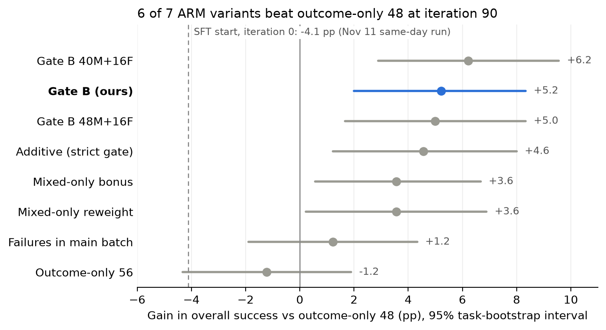

# RL with ARM turn credit: results summary (November 11, 2026)

**RL improves on the SFT start model, and ARM turn credit roughly doubles the gain.** On Online-Mind2Web
(300 tasks, three repeats, one Terra judge), outcome-only RL gains +4.1 pp over iteration 0 (p = 0.024)
and Gate B gains +8.6 pp (p < 0.001). Gate B beats outcome-only 48 by +4.4 pp in that same-day run and by
+5.2 pp in the separate nine-run comparison. One training run per method; seed variability is not measured.

## Iteration 0 vs iteration 90 (same day, November 11)

All nine evaluations ran in one job (451475), interleaved by repeat. Overall = successes / 300;
valid-only = successes / valid episodes; rates are means over three repeats.

| Model | Successes per repeat | Valid per repeat | Judged per repeat | Mean turns | Overall % | Valid-only % |
| --- | --- | --- | ---: | ---: | ---: | ---: |
| SFT, iteration 0 | 86 / 94 / 86 | 271 / 270 / 270 | 185 | 14.6 | 29.56 | 32.80 |
| Outcome-only 48, iteration 90 | 99 / 104 / 100 | 269 / 274 / 274 | 263 | 9.4 | 33.67 | 37.09 |
| Gate B, iteration 90 | 113 / 123 / 107 | 269 / 269 / 265 | 265 | 9.6 | 38.11 | 42.70 |

| Paired comparison | Δ overall, pp | 95% CI, pp | p |
| --- | ---: | --- | ---: |
| Outcome-only 48 − SFT | +4.11 | [+0.67, +7.56] | 0.024 |
| Gate B − SFT | +8.56 | [+4.89, +12.11] | < 0.001 |
| Gate B − outcome-only 48 | +4.44 | [+1.00, +8.00] | 0.020 |

- **Judged** = valid episodes that ended on their own and reached the judge. The rest hit the 30-turn
  limit or failed in the browser, and count as failures.
- **The SFT model runs longer** (14.6 turns vs about 9.5) and reaches the judge on only 185 of ~270 valid
  episodes per repeat. Much of the RL gain comes from finishing more episodes.
- **The anchors match the November 9–10 run:** outcome-only 48 scored 33.67% vs 32.11% then, Gate B
  38.11% vs 37.33%. So iteration 0 can be read against all nine runs below.

## All nine runs at iteration 90 (November 9–10)

Six of the seven ARM variants beat outcome-only 48 (p ≤ 0.044); Failures in main batch does not.

*Paired gain over outcome-only 48 in overall success, 95% task-bootstrap interval, three repeats per run.
The dashed line is the SFT start model from the November 11 same-day run.*
[PDF](arm_results/rl_final_20261108/rl_arm_credit_summary_forest.pdf) ·
[Renderer](arm_results/rl_final_20261108/plot_rl_arm_credit_summary.py)

| Run | Successes per repeat | Valid per repeat | Overall % | Valid-only % |
| --- | --- | --- | ---: | ---: |
| Outcome-only 48 | 106 / 98 / 85 | 273 / 264 / 272 | 32.11 | 35.73 |
| Outcome-only 56 | 91 / 92 / 95 | 272 / 270 / 271 | 30.89 | 34.20 |
| **Gate B (ours)** | 113 / 120 / 103 | 268 / 268 / 269 | 37.33 | 41.74 |
| Gate B 40M+16F | 110 / 114 / 121 | 268 / 272 / 273 | 38.33 | 42.43 |
| Gate B 48M+16F | 116 / 108 / 110 | 270 / 268 / 273 | 37.11 | 41.18 |
| Additive (strict gate) | 111 / 114 / 105 | 267 / 270 / 270 | 36.67 | 40.89 |
| Mixed-only bonus | 106 / 106 / 109 | 270 / 272 / 269 | 35.67 | 39.58 |
| Mixed-only reweight | 107 / 102 / 112 | 274 / 272 / 267 | 35.67 | 39.50 |
| Failures in main batch | 103 / 97 / 100 | 269 / 273 / 273 | 33.33 | 36.82 |

| Against Gate B | Δ overall, pp | 95% CI, pp | p |
| --- | ---: | --- | ---: |
| Gate B 40M+16F | +1.0 | [−2.3, +4.3] | 0.61 |
| Gate B 48M+16F | −0.2 | [−3.3, +2.9] | 0.94 |
| Additive (strict gate) | −0.7 | [−3.8, +2.6] | 0.74 |
| Mixed-only bonus | −1.7 | [−4.7, +1.3] | 0.30 |
| Failures in main batch | −4.0 | [−7.0, −1.0] | 0.011 |

The four leading variants are indistinguishable. Run definitions (group counts, gates, credit form) are in
[ARM_FINAL_RESULTS.md](ARM_FINAL_RESULTS.md#final-rl-arm-turn-credit-20261108).

Protocol and caveats

- **Benchmark and actor:** Online-Mind2Web, 300 tasks, local browser, 30 turns, actor T0.6 / top-p 0.95 /
  top-k 20, 4,096 response tokens.
- **Judge:** gpt-5.6-terra with the shared terminal-success prompt (medium effort, 4,096 tokens, seed 42,
  final screenshot), run offline on saved rollouts. No judge ran during collection.
- **Paired test:** per-task success averaged over the three repeats; 10,000-sample task bootstrap for the
  interval; sign-flip test for p. No multiple-comparison correction.
- **Collection:** the nine-run comparison ran November 9–10 (jobs 442017, 442018). The iteration-0
  comparison ran November 11 (job 451475).
- **SFT loading:** iteration 0 loads OpenWebRL-4B-SFT (revision 15e777db) from its HF weights, the same way
  every fresh RL run starts.
- **Ungraded episode:** one 48M+16F episode got the verdict `Status: "success"` twice, which the frozen
  parser rejects. It counts as a failure (at most +0.1 pp).
- **Judge cost:** $58.36 for the nine runs and $16.98 for iteration 0.
- **Not comparable:** older GPT-4.1 and o4-mini results use different judges and score higher.

**Sources:** [nine-run aggregate](arm_results/rl_final_20261108/iter90_terra_sameday_20261111.json) ·
[iteration-0 aggregate](arm_results/rl_final_20261108/iter0_terra_anchor_20261111.json) ·
[full RL section](ARM_FINAL_RESULTS.md#final-rl-iter90-terra-sameday-20261111) ·
[handoff](RL_HANDOFF.md) · runners `scripts/run_iter90_terra_reeval.py`, `scripts/run_iter90_terra_reeval_ext.py`,
`scripts/run_iter0_terra_anchor.py` · grader `scripts/rejudge_rl_evals_shared_terra.py`.
