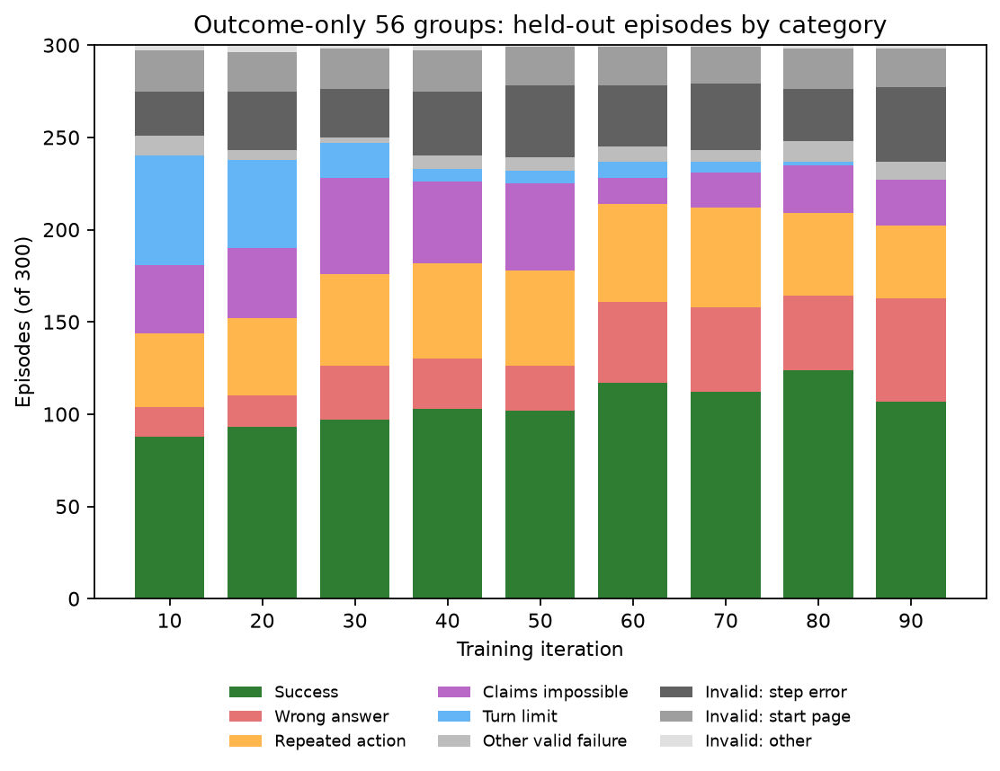
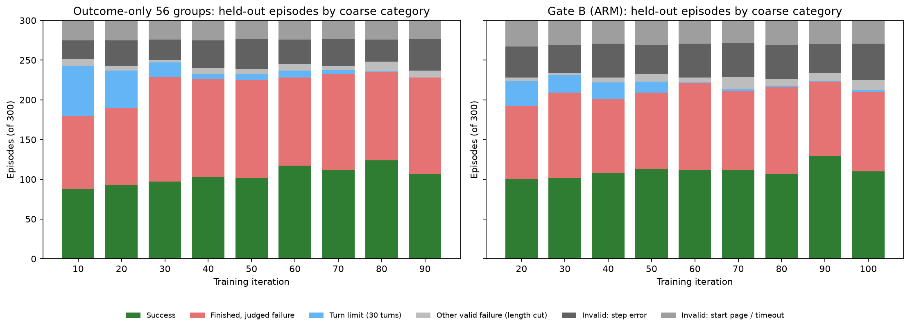
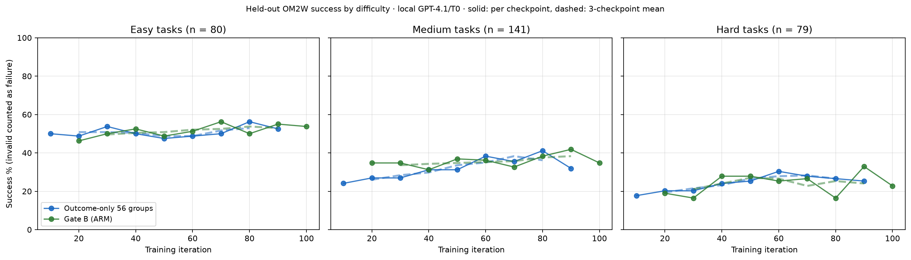
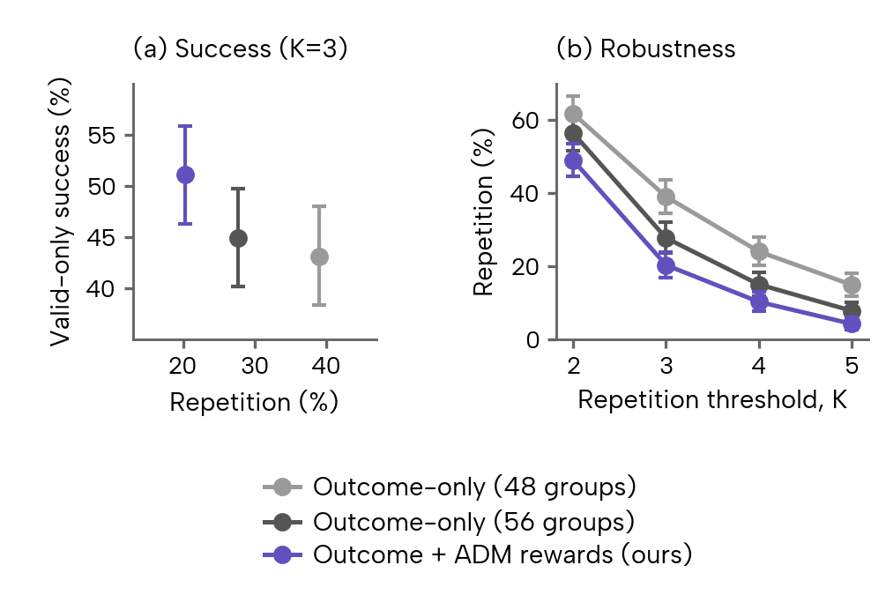
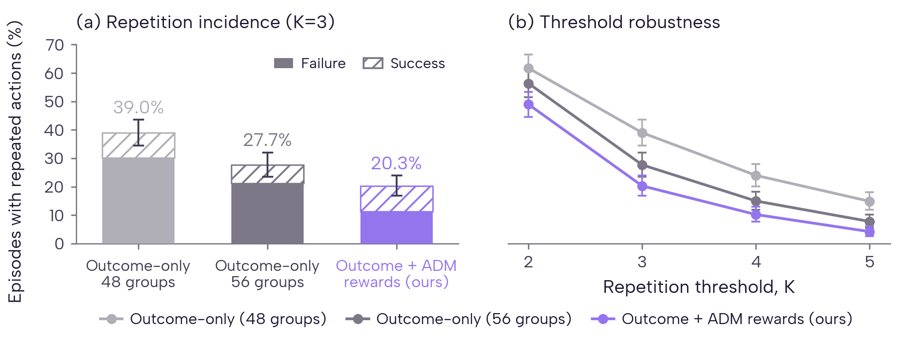
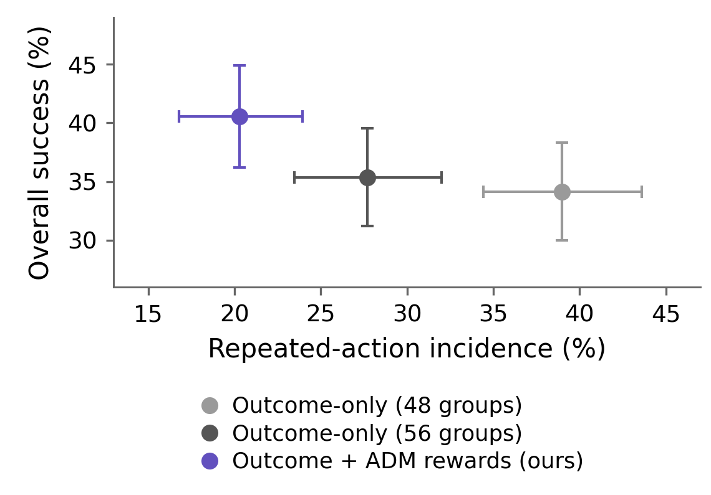
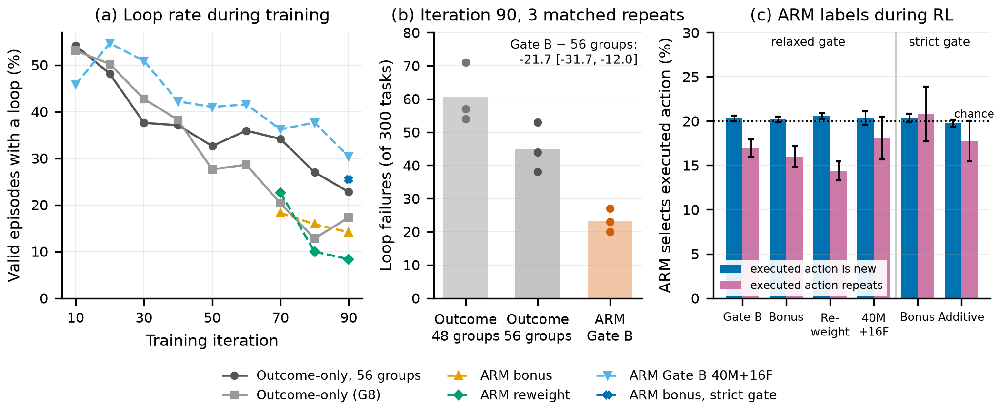
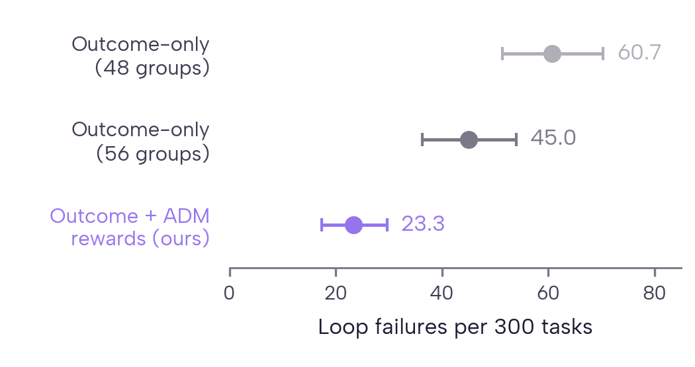
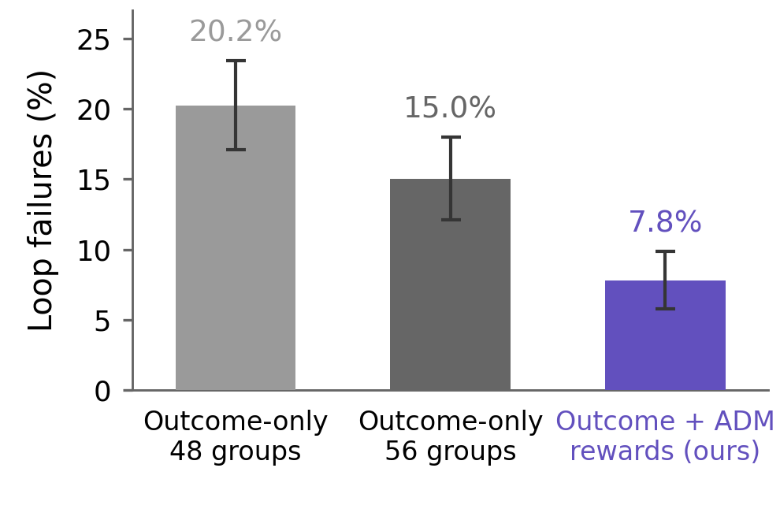

# RL behavior and evaluation noise

What the RL policies actually do on held-out Online-Mind2Web and during training, how
noisy single checkpoint evaluations are, and what that implies for comparing methods.
Scores themselves live in [RL_RESULTS.md](RL_RESULTS.md); protocols in
[RL_EVALUATION.md](RL_EVALUATION.md).

## Takeaways · October 25

1. **Gate B beats outcome-only at iteration 90 on matched repeats.** Three contemporaneous
   full-300 repeats per checkpoint on one harness give Gate B 40.6% overall against 35.3%
   (56 groups) and 34.1% (48 groups): +5.2 pp [+1.6, +8.9] and +6.4 pp [+2.7, +10.2],
   Holm p = 0.014 and 0.004 ([details](#rl-behavior-iter90-repeats-20261025)). The judge is
   GPT-4.1, whose success verdicts loosen over training
   ([audit](RL_REWARD_DESIGN.md#evidence)); a second-judge re-score of these repeats is the
   open check.
2. **The other controlled runs are statistically indistinguishable on the local protocol.**
   Their last-three-checkpoint means are 38.1–38.6% overall, every paired difference is
   below 0.5 pp, and the 95% intervals are about ±3.8 pp.
3. **Single checkpoints are noisy.** About 76 of 300 tasks (25%) change outcome between
   adjacent checkpoints of the same run, and the overall rate moves by a mean of 2.4 pp
   (at most 5.7 pp). A one-checkpoint difference below roughly 4 pp is not evidence.
4. **RL taught the policy to finish, then to finish too early.** Hitting the 30-turn limit
   falls from 59 to 0 episodes (56-group run, iterations 10 → 90). Over the same period
   wrong answers rise from 16 to 56 and failed episodes shorten from 18.8 to 10.8 steps.
5. **A harness error is the largest growing failure** ([cause and fix](#rl-behavior-step-error-20261024)). Invalid episodes with an empty-message
   browser step error grow from 24 to 40–44 per 300 tasks. No task has one in all five
   checkpoints examined, and 7 of the 40 at 56-group iteration 90 occurred on the agent's
   final `done` call. During training (48-group run) 10–15% of rollouts are invalid and
   about 40% of groups contain at least one invalid rollout.
6. **About 21 tasks always fail to load their start page.** These are the same dead or
   blocked sites at every checkpoint, so they cap every method equally.
7. **Relaxed-gate ARM credit roughly halves repeated-action loops, through a measurable
   label bias.** On matched iteration-90 repeats, Gate B has 23.3 loop failures per 300 tasks,
   against 45.0 (56 groups) and 60.7 (48 groups): −21.7 [−31.7, −12.0] against 56 groups.
   During training the ARM picks an executed repeated action 14–17% of the time, against 20%
   for new actions. Outcome-only G8 also reaches a low loop rate, 40M+16F does not, and the
   freed episodes mostly become other failures, so overall success barely moves
   ([loops](#rl-behavior-loops-20261103)).
8. **Larger groups make more groups usable, but at a cost.** Among first-iteration groups
   (SFT checkpoint), 41–48% are mixed with 5 rollouts and 53% with 8, which costs 1.6× more
   rollouts per group. A clean step-0 measurement gives mixed-group probabilities of 47%, 56% and
   67% at K = 5, 8 and 16, but mixed groups per 100 rollouts fall from 9.4 to 7.0 to 4.2, and
   27% of tasks never succeed in 16 draws ([pass@K](#rl-behavior-passk-20261024)).

*Outcome-only 56 groups: held-out episodes per category at each checkpoint (full
categories; [rules](#rl-behavior-failures-20261024)).* [PDF](rl_results/rl_behavior_categories_56.pdf)

### Outcome-only 56 groups vs Gate B

Gate B trajectories were pruned, so this comparison uses coarse categories built only from
fields saved for every evaluation. On the 56-group run, where both exist, "finished,
judged failure" is about 99% wrong answers, repeated actions and impossibility claims. An
invalid episode that stopped by step 1 is a start-page failure or timeout; a later one is
the step error.

| Difficulty (tasks) | 56 groups, iteration 10 | 56 groups, mean of 70/80/90 | Gate B, iteration 20 | Gate B, mean of 80/90/100 |
| --- | ---: | ---: | ---: | ---: |
| Easy (80) | 50.0% | 52.9% | 46.2% | 52.9% |
| Medium (141) | 24.1% | 36.2% | 34.8% | 38.3% |
| Hard (79) | 17.7% | 26.6% | 19.0% | 24.1% |

- **RL gains come from medium and hard tasks.** Easy tasks stay near 50% throughout both
  runs. Medium rises by about 12 pp and hard by about 9 pp (56-group run).
- **Gate B gets to medium-task gains earlier.** At iteration 20 it is already at 35% on
  medium tasks, against 27% for the 56-group run. By the end the two runs are within noise
  in every band.
- **Gate B has more invalid episodes** (start-page and step errors: 66–75 per 300, against
  49–63). Its evaluations ran on earlier dates, so site availability differs and this is not
  a matched comparison; on matched dates the counts agree ([repeats](#rl-behavior-iter90-repeats-20261025)).
- **Noise:** one checkpoint's band rate has a binomial SE of about 4–6 pp. The dashed lines
  are 3-checkpoint means. Overall success counts invalid episodes as failures.

Sources

- **Counts:** [per checkpoint and band](arm_results/rl_integration/behavior/rl-eval-coarse-difficulty-20261024.json).
- **Difficulty bins:** human reference length 1–5 / 6–10 / 11+ steps, the published
  Online-Mind2Web rule (80/141/79 tasks; the [earlier difficulty table](RL_RESULTS.md)
  uses the same bins).
- **Script:** `scripts/plot_rl_behavior.py`.
- **Earlier overview figure:** [mean failed-episode length and 48-group training trends](rl_results/rl_behavior_overview.png).

## Evaluation noise and fair comparison

Local browser · GPT-4.1 action_history judge · actor T0 · 30 turns · full 300. Overall
counts invalid episodes as failures; valid-only uses valid episodes only. The four lineages
share the 2,102-task pool and SFT start.

| Run | Checkpoints averaged | Overall % | Valid-only % |
| --- | --- | ---: | ---: |
| Outcome-only, 56 groups × 5 | 70 / 80 / 90 | 38.11 | 47.12 |
| Outcome-only uniform G8, 48 groups × 8 | 40 / 50 / 60 (last three) | 38.22 | 48.38 |
| Mixed-only ARM bonus | 70 / 80 / 90 | 38.33 | 50.07 |
| Mixed-only ARM reweight | 70 / 80 / 90 | 38.56 | 50.14 |

| Paired comparison, last-three mean | Δ overall, pp | 95% CI, pp |
| --- | ---: | --- |
| 56-group − G8 | −0.11 | [−3.89, +3.67] |
| 56-group − ARM bonus | −0.22 | [−4.00, +3.44] |
| 56-group − ARM reweight | −0.44 | [−4.22, +3.33] |
| G8 − ARM bonus | −0.11 | [−3.89, +3.67] |
| G8 − ARM reweight | −0.33 | [−4.33, +3.56] |
| ARM bonus − ARM reweight | −0.22 | [−4.11, +3.67] |

| Adjacent-checkpoint noise, 29 pairs | Value |
| --- | ---: |
| Mean tasks changing outcome | 75.8 / 300 |
| Mean \|Δ overall\| | 2.43 pp |
| Max \|Δ overall\| | 5.67 pp |

Method, matched-iteration check and limits

- **Recount:** all 33 cohorts were recounted from saved per-task records, and every count
  matches its published audit.
- **CI:** paired percentile bootstrap over the 300 tasks (20,000 draws) on per-task success
  averaged over the three checkpoints. Checkpoints are fixed, so the CI covers task and
  evaluation noise only, not seed-to-seed training variation.
- **Window:** G8 stopped at 60, so its window is earlier and it was still rising
  (34.67 → 37.67 → 42.33%). Its 60 → 90 continuation is running.
- **Matched 40/50/60 window:** the differences are again inside the noise (56-group − G8
  −2.44 pp, CI [−6.11, +1.11]).
- **Sources:** [aggregate](arm_results/rl_integration/behavior/rl-eval-noise-20261024.json) ·
  script `scripts/analyze_rl_eval_noise.py`.

### Iteration-90 repeats on one harness · October 25

Three new full-300 evaluations per checkpoint, collected back to back on October 24–25 by
one job (385593) with the same harness, browser pool and judge (local browser · GPT-4.1
action_history · actor T0 · 30 turns). Overall counts invalid episodes as failures.

| Checkpoint (iteration 90) | Successes r1 / r2 / r3 | Valid r1 / r2 / r3 | Overall mean % | Valid-only % | Earlier single evaluation, successes / valid |
| --- | --- | --- | ---: | ---: | --- |
| Outcome-only 48 groups | 103 / 95 / 109 | 234 / 233 / 246 | 34.11 | 43.06 | 101 / 222 (September) |
| Outcome-only 56 groups | 114 / 102 / 102 | 234 / 237 / 237 | 35.33 | 44.92 | 107 / 237 |
| Gate B (ARM) | 123 / 117 / 125 | 238 / 232 / 245 | 40.56 | 51.05 | 129 / 234 |

| Paired comparison, repeat-mean per task | Δ overall, pp | 95% CI, pp | Permutation p | Holm p |
| --- | ---: | --- | ---: | ---: |
| Gate B − 56 groups | +5.22 | [+1.56, +8.89] | 0.007 | 0.014 |
| Gate B − 48 groups | +6.44 | [+2.67, +10.22] | 0.001 | 0.004 |
| 56 groups − 48 groups | +1.22 | [−2.22, +4.67] | 0.530 | 0.530 |

- **Gate B's lead holds on matched dates.** Its invalid counts (55–68) now match the
  outcome-only runs (54–67), so the earlier site-availability caveat does not explain it.
  Repeat-to-repeat SD is 1.4–2.3 pp per checkpoint.
- **Same direction as the stealth protocol.** Under o4-mini/T0.6 stealth, Gate B −
  outcome-only was +3.56 pp [−0.22, +7.22] ([RL_RESULTS](RL_RESULTS.md)).
- **Open check:** GPT-4.1 increasingly accepts unsupported answers late in training
  ([judge audit](RL_REWARD_DESIGN.md#evidence)). Re-scoring these 2,700 episodes with the
  second judge (about $0.02 per episode) would show whether the gap survives a stricter judge.

Method and limits

- **CI and p:** per-task success averaged over the three repeats; paired percentile bootstrap
  over 300 tasks and paired sign-flip permutation test (20,000 draws each), Holm over the
  three comparisons.
- **Scope:** one checkpoint per run. The CI covers task and evaluation noise, not
  training-seed variation; Gate B has a different training history (auxiliary failure groups,
  relaxed gate) and is one lineage.
- **Sources:** [aggregate](arm_results/rl_integration/behavior/iter90-repeats-20261025.json) ·
  script `scripts/analyze_iter90_repeats.py`.

## Why held-out episodes fail

Each of the 300 episodes gets exactly one category. Rules, first match wins:
success; invalid by cause; **turn limit** (never called `done`); **repeated action** (an
identical non-wait action issued ≥ 3 times); **claims impossible** (final answer says the
task cannot be done); **tool errors** (≥ 30% of tool calls failed); **wrong answer**
(called `done`, judged failure).

### 56-group outcome-only run across training

| Iteration | Success | Wrong answer | Repeated action | Claims impossible | Turn limit | Other valid failure | Invalid: step error | Invalid: start page | Invalid: timeout |
| ---: | ---: | ---: | ---: | ---: | ---: | ---: | ---: | ---: | ---: |
| 10 | 88 | 16 | 40 | 37 | 59 | 11 | 24 | 22 | 3 |
| 20 | 93 | 17 | 42 | 38 | 48 | 5 | 32 | 21 | 4 |
| 30 | 97 | 29 | 50 | 52 | 19 | 3 | 26 | 22 | 2 |
| 40 | 103 | 27 | 52 | 44 | 7 | 7 | 35 | 22 | 3 |
| 50 | 102 | 24 | 52 | 47 | 7 | 7 | 39 | 21 | 1 |
| 60 | 117 | 44 | 53 | 14 | 9 | 8 | 33 | 21 | 1 |
| 70 | 112 | 46 | 54 | 19 | 6 | 6 | 36 | 20 | 1 |
| 80 | 124 | 40 | 45 | 26 | 2 | 11 | 28 | 22 | 2 |
| 90 | 107 | 56 | 39 | 25 | 0 | 10 | 40 | 21 | 2 |

### Late checkpoints of other runs

| Run · iteration | Success | Wrong answer | Repeated action | Claims impossible | Turn limit | Other valid failure | Invalid: step error | Invalid: start page | Invalid: other |
| --- | ---: | ---: | ---: | ---: | ---: | ---: | ---: | ---: | ---: |
| Outcome-only 48 groups · 100 | 104 | 38 | 53 | 23 | 4 | 5 | 43 | 27 | 3 |
| Uniform G8 · 60 | 127 | 33 | 36 | 31 | 3 | 4 | 42 | 21 | 3 |
| Mixed-only ARM bonus · 90 | 122 | 52 | 18 | 25 | 5 | 11 | 44 | 21 | 2 |

- **Turn limit → wrong answer.** Training removes running out of turns almost entirely. The
  freed episodes mostly become confident wrong answers, not successes.
- **Step-error invalids are random, not site-specific.** Across the five checkpoints with
  trajectories, 132 tasks hit a step error at least once and none hit it every time. The
  logged exception message is empty (`env.step() failed, marking as ABORTED:`), which points
  to a request timeout in the browser server client.
- **Start-page invalids are fixed.** The same 20 tasks fail at all five checkpoints (24 in
  total).

Method and limits

- **Rules:** fixed and deterministic, with no LLM labelling. "Wrong answer" is whatever is
  left after the other rules, so it includes partially correct answers the judge rejected.
- **Repeated action:** an identical action (name and arguments) issued ≥ 3 times, ignoring
  `wait`.
- **Trajectory coverage:** Gate B and additive evaluation trajectories (`.pt`) were pruned
  earlier, so those runs cannot be categorized; only their outcomes and step counts remain
  (next section).
- **Sources:** [category counts](arm_results/rl_integration/behavior/rl-eval-failure-categories-20261024.json) ·
  scripts `scripts/analyze_rl_eval_failures.py` and `scripts/analyze_rl_behavior.py`.

## Repeated-action loops: ARM versus outcome-only · November 3

**Main result.** At iteration 90, Outcome + ADM rewards (Gate B) has lower repeated-action incidence than the two matched outcome-only checkpoints: **20.3% versus 27.7% and 39.0%** of valid episodes. Against the 56-group baseline, the paired difference is **−7.4 pp [95% CI −12.3, −2.5]**. This measures repeated action identities, not verified browser-state cycles or lack of progress.
- **Mechanism, from about 350,000 training labels:** the ARM is less likely to pick the executed
  action when that action repeats an earlier step. This is visible as a selection bias during
  training.
- **Matched held-out evaluations:** Gate B has about half the loop failures of outcome-only RL.
- **Limits:**
  - Lower repetition alone does not establish improved task success.
  - One outcome-only run (G8) reaches a similarly low loop rate.
  - The 40M+16F variant does not show the effect.

[Smoothed evaluation curves for these three training lineages](RL_EVALUATION.md#rl-smoothed-eval-learning-curves) use their historical full-300 checkpoint evaluations; the curves do not reuse the matched iteration-90 repeats below.

### Success versus repetition and threshold robustness

*(a) Valid-only success versus repeated-action incidence for three iteration-90 checkpoints; upper left means higher success and less repetition. Success is successes / each method's valid episodes, pooled across three repeats; invalid outcomes are excluded. Repetition incidence is the percentage of those valid episodes containing at least K = 3 identical non-`wait`, non-`done` tool calls, including successful episodes. Only vertical success intervals are shown. (b) The same repetition measure at repetition thresholds K = 2–5, with vertical repetition intervals; connecting segments guide the eye. Calls need not be consecutive. Both panels use the same 300 planned OM2W tasks evaluated three times per checkpoint, with method-specific valid populations rather than a common-valid intersection. Intervals are pointwise 95% task-cluster bootstrap intervals (20,000 draws, seed 20261104), retaining all repeats and methods and recomputing each valid-only ratio in every resample; they condition on these checkpoints and evaluation windows and exclude training-seed and evaluation-window uncertainty. Panel (a) axes are cropped. The 3.35 × 2.25-inch layout uses a narrower left panel, 7 pt Albert Sans labels and a stacked bottom legend; “Repetition % (K=3)” in panel (a) and “Repetition (%)” in panel (b) denote the episode incidence percentage defined above; “Success %” in panel (a) is valid-only OM2W success at iteration 90.* [PDF](rl_results/rl_repetition_success_robustness.pdf) · [SVG](rl_results/rl_repetition_success_robustness.svg) · [Success aggregate](arm_results/rl_integration/behavior/rl-repetition-success-20261104.json) · [Repetition aggregate](arm_results/rl_integration/behavior/rl-repetition-incidence-20261104.json) · [Plot source](arm_results/rl_integration/behavior/plot_rl_repetition_success_robustness.py).

Alternative view: repetition split by successful and unsuccessful episodes

*(a) Percentage of valid episodes containing at least three identical non-`wait`, non-`done` tool calls, split into unsuccessful (solid) and successful (hatched) episodes. Both segments use all valid episodes as their denominator; they sum to total repetition incidence, whose 95% interval is shown. Episodes without `done` are included. (b) Total incidence at thresholds K = 2, 3, 4 and 5; connecting segments guide the eye. Calls need not be consecutive. Online-Mind2Web, iteration 90, the same 300 tasks evaluated three times per checkpoint. Both panels use counts pooled across repeats and pointwise 95% task-cluster bootstrap intervals (20,000 draws, seed 20261104), preserving all repeats and methods within each sampled task. Intervals condition on these checkpoints and evaluation windows; they exclude training-seed and evaluation-window uncertainty.* [PDF](rl_results/rl_repetition_incidence.pdf) · [SVG](rl_results/rl_repetition_incidence.svg) · [Aggregate and intervals](arm_results/rl_integration/behavior/rl-repetition-incidence-20261104.json) · [Analysis and plot source](arm_results/rl_integration/behavior/plot_rl_repetition_incidence.py).

**Definition.** For threshold `K`, incidence is `100 × valid episodes with maximum identical-call count ≥ K / valid episodes`. Each episode counts at most once. Invalid outcomes are excluded, rather than assigned zero repetition; each method uses its own valid episodes, not a common-valid intersection. This differs from the older failure-category metric below, which requires an unsuccessful outcome and a `done` call and uses all planned episodes as its denominator.

| Method | Planned episodes | Valid episodes | Invalid episodes | Incidence, K = 2 | Incidence, K = 3 | Incidence, K = 4 | Incidence, K = 5 |
| --- | ---: | ---: | ---: | ---: | ---: | ---: | ---: |
| Outcome-only, 48 groups | 900 | 713 | 187 | 61.7% | 39.0% | 24.0% | 14.9% |
| Outcome-only, 56 groups | 900 | 708 | 192 | 56.4% | 27.7% | 15.0% | 7.8% |
| Outcome + ADM rewards (ours) | 900 | 715 | 185 | 49.0% | 20.3% | 10.2% | 4.2% |

Matching, paired differences and alternative repetition definition

The matching rule preserves the historical analysis: compare the saved first tool call per actor turn using JSON serialization with sorted object keys, excluding `wait` and `done`. Argument strings, URLs and values are not normalized. The extractor can retain malformed JSON as an `unparsable` pseudo-call with its first 200 raw characters; one ADM episode qualifies at K = 3 solely through those records (excluding malformed calls would give 144/715 = 20.1%, rather than 145/715 = 20.3%). Thresholds 2, 4 and 5 are unaffected. Additional tool calls in the same response are not inspected. See the [full extraction and matching rules](#rl-repetition-matching-rules).

The stacked-bar alternative shows joint rates, `P(repetition and outcome | valid)`, rather than repetition conditioned on success or failure. These segments preserve the original total incidence; they do not estimate the causal effect of repetition on task success. Their counts are:

| Method | Repeated and successful episodes, K = 3 | Repeated and unsuccessful episodes, K = 3 | Repeated and successful / all valid | Repeated and unsuccessful / all valid |
| --- | ---: | ---: | ---: | ---: |
| Outcome-only, 48 groups | 63 | 215 | 8.8% | 30.2% |
| Outcome-only, 56 groups | 46 | 150 | 6.5% | 21.2% |
| Outcome + ADM rewards (ours) | 65 | 80 | 9.1% | 11.2% |

The bootstrap samples the 300 task clusters with replacement, retaining all three repeats, methods and thresholds; each resample recomputes the ratio of summed incidence counts to summed valid counts. Intervals are pointwise, not simultaneous bands over thresholds. The new aggregate uses one shared resampling stream; its Monte Carlo interval endpoints differ slightly from the historical paired table below.

| ADM minus outcome-only, 56 groups | Difference, pp | Paired 95% CI, pp |
| --- | ---: | ---: |
| At least 2 identical calls | −7.4 | [−12.7, −2.0] |
| At least 3 identical calls | −7.4 | [−12.3, −2.5] |
| At least 4 identical calls | −4.8 | [−8.6, −0.9] |
| At least 5 identical calls | −3.6 | [−6.4, −0.8] |
| At least 3 consecutive retained calls | +0.7 | [−2.7, +4.2] |

The historical consecutive check removes absent calls, `wait` and `done` before checking adjacency, so it measures **consecutive retained calls**, not necessarily consecutive actor turns. Its incidence is 20.9%, 10.3% and 11.0% for the 48-group baseline, 56-group baseline and ADM, respectively. ADM does not improve this check against the 56-group baseline. Repeated identical calls can also be legitimate; without browser-state progress checks, these metrics do not establish unproductive looping or a causal failure mechanism.

### Success counts and paired differences

Standalone success-versus-repetition preview

*Each point is one checkpoint evaluated on the same 300 planned OM2W tasks three times. Upper left means higher valid-only success and lower repetition. Horizontal: incidence of at least three identical non-`wait`, non-`done` calls among each method's valid episodes, including successes. Vertical: successes divided by that method's valid episodes, pooling repeats and excluding invalid outcomes. Only vertical success intervals are shown: pointwise 95% task-cluster bootstrap intervals (20,000 draws, seed 20261104), retaining all three repeats and methods and recomputing the ratio in every resample. Repetition intervals remain in the linked aggregate. Axes are cropped. Uncertainty conditions on these checkpoints and evaluation windows, excluding training-seed and evaluation-window uncertainty.* [PDF](rl_results/rl_repetition_success_preview.pdf) · [SVG](rl_results/rl_repetition_success_preview.svg) · [Aggregate and intervals](arm_results/rl_integration/behavior/rl-repetition-success-20261104.json) · [Analysis and plot source](arm_results/rl_integration/behavior/plot_rl_repetition_success.py).

| Method | Successes | Valid episodes | Planned episodes | Valid-only success | Valid-only 95% CI | Overall success |
| --- | ---: | ---: | ---: | ---: | ---: | ---: |
| Outcome-only, 48 groups | 307 | 713 | 900 | 43.1% | [38.3%, 47.9%] | 34.1% |
| Outcome-only, 56 groups | 318 | 708 | 900 | 44.9% | [40.2%, 49.7%] | 35.3% |
| Outcome + ADM rewards (ours) | 365 | 715 | 900 | 51.0% | [46.2%, 55.8%] | 40.6% |

In this matched cohort, ADM has **+6.1 pp valid-only success [paired 95% CI +1.8, +10.5]** and **−7.4 pp repetition incidence [−12.3, −2.5]** versus the 56-group baseline. Versus the 48-group baseline, the valid-only success difference is +8.0 pp [+3.5, +12.5]. Overall success, retained in the aggregate and table for comparison, uses all planned episodes rather than the plotted valid-only denominator. The scatter shows both observed metrics together; it does not establish that lower repetition caused the success difference or that the difference generalizes across training seeds.

Earlier views: training diagnostics and repeated-action failure categories

*(a) Share of valid held-out episodes, successes included, that issue one identical action ≥ 3
times; this does not depend on the judge. (b) Iteration 90, three contemporaneous full-300
evaluations per checkpoint on one harness (dots), bar = mean, with the paired task-bootstrap
95% CI for Gate B − 56 groups. (c) How often SelectionARM picks the executed response among
five candidates during RL, split by whether the executed action repeats an earlier step in the
same trajectory; 95% binomial intervals; chance = 20%.* [PDF](rl_results/rl_action_loops.pdf)

### Matched iteration-90 repeats (one harness, back to back)

*Online-Mind2Web, iteration 90. Points = mean loop failures per 300 planned tasks across three back-to-back evaluations; whiskers = pointwise 95% task-bootstrap intervals (20,000 draws, seed 20261104), retaining all three repeats within each sampled task. Purple = Outcome + ADM rewards (ours; Gate B). Intervals are conditional on the fixed checkpoints and three evaluation windows; they exclude training-seed and evaluation-window uncertainty. Repeat counts and paired differences remain in the tables below.* [PDF](rl_results/rl_action_loops_iter90.pdf) · [SVG](rl_results/rl_action_loops_iter90.svg) · [CI aggregate](arm_results/rl_integration/behavior/rl-action-loops-iter90-ci-20261104.json) · [Analysis and plot source](arm_results/rl_integration/behavior/plot_rl_loops_iter90.py).

Alternative paper view: vertical bars as percentages of planned tasks

*Bars = repeated-action failures as a percentage of all 300 planned OM2W tasks, averaged across three evaluation repeats: 20.2%, 15.0% and 7.8%. Error bars are the same 95% task-bootstrap intervals as above, converted from counts to percentages by dividing by 3. Invalid outcomes remain in the planned-task denominator; this is distinct from the fraction of valid episodes containing any loop. Intervals condition on the fixed checkpoints and evaluation windows.* [PDF](rl_results/rl_action_loops_iter90_bars_preview.pdf) · [SVG](rl_results/rl_action_loops_iter90_bars_preview.svg) · [Source](arm_results/rl_integration/behavior/plot_rl_loops_iter90_bars_preview.py).

**Metric definition: repeated-action failures (%).** An episode contributes one failure if and only if all three conditions hold:

1. Its saved outcome is **valid and unsuccessful**.
2. Its recorded tool-call sequence **contains a `done` call**. Episodes without `done` are classified as turn-limit or other termination failures before repetition is checked.
3. At least one identical tool call, excluding `wait` and `done`, appears **three or more times** in that episode. Occurrences need not be consecutive; each episode counts at most once.

The plotted percentage is `100 × matching episodes / (3 × 300)`: **300 unique planned tasks evaluated three times, totaling 900 task episodes per checkpoint**. Successful, invalid and no-`done` episodes remain in the denominator and contribute zero to this numerator. For example, Outcome + ADM rewards has `(20 + 23 + 27) / 900 × 100 = 7.78%`. This is the existing `repeat_loop` failure category expressed as a percentage of planned episodes; category membership does not establish that repetition caused the failure.

Pointwise 95% intervals use 20,000 percentile-bootstrap draws (seed 20261104) over the **300 task clusters**, keeping all three repeats and all compared methods together for every sampled task. They condition on the fixed checkpoints and evaluation windows. Exact tool-call matching and extraction details are in [Method and sources](#rl-repetition-matching-rules).

| Run | Loop failures, r1 / r2 / r3 | Mean loop failures | Mean 95% CI | Loop rate, mean % | Successes, r1 / r2 / r3 |
| --- | ---: | ---: | ---: | ---: | ---: |
| Outcome-only 48 groups | 54 / 57 / 71 | 60.7 | [51.3, 70.3] | 39.0 | 103 / 95 / 109 |
| Outcome-only 56 groups | 38 / 53 / 44 | 45.0 | [36.3, 54.0] | 27.7 | 114 / 102 / 102 |
| Outcome + ADM rewards (Gate B) | 20 / 23 / 27 | 23.3 | [17.3, 29.7] | 20.3 | 123 / 117 / 125 |

| Gate B minus | Loop failures per 300 [95% CI] | Loop rate, pp [95% CI] |
| --- | ---: | ---: |
| Outcome-only 56 groups | −21.7 [−31.7, −12.0] | −7.4 [−12.4, −2.6] |
| Outcome-only 48 groups | −37.3 [−47.7, −27.3] | −18.7 [−23.8, −13.6] |

### Late training window, iterations 70 / 80 / 90 (one evaluation per checkpoint)

| Run | Loop failures, 70 / 80 / 90 | Loop rate, % | Δ loop rate vs outcome-only, pp [95% CI] | Δ loop failures per 300 [95% CI] |
| --- | ---: | ---: | ---: | ---: |
| Outcome-only 56 groups | 54 / 45 / 39 | 28.0 | reference | reference |
| Outcome-only G8 | 32 / 19 / 21 | 16.8 | reference | reference |
| ARM bonus (relaxed gate) | 20 / 20 / 18 | 16.1 | −6.3 [−9.9, −2.7] | −15.7 [−22.2, −9.3] |
| ARM reweight (relaxed gate) | 30 / 8 / 12 | 13.7 | −8.7 [−12.2, −5.1] | −18.3 [−24.8, −12.0] |
| ARM Gate B 40M+16F | 43 / 50 / 46 | 34.8 | +12.3 [+8.0, +16.6] | +11.3 [+3.7, +19.2] |

The reference pools both outcome-only runs. The two outcome-only runs alone differ by
−11.2 pp [−15.8, −6.7] in loop rate (G8 − 56 groups), so this window places the ARM runs at the
low end of the outcome-only range, not clearly below all of it.

### Why: ARM labels penalize executed repeats

| Run (candidate gate) | Labels where the executed action repeats | ARM picks executed: repeat / new, % | Mixed states | ARM picks a repeat / chance share, % |
| --- | ---: | ---: | ---: | ---: |
| Gate B (relaxed) | 5,377 | 16.9 / 20.3 | 11,903 | 34.6 / 42.5 |
| ARM bonus (relaxed) | 3,676 | 16.0 / 20.2 | 8,462 | 32.7 / 41.6 |
| ARM reweight (relaxed) | 3,978 | 14.4 / 20.5 | 8,780 | 30.7 / 41.7 |
| Gate B 40M+16F (relaxed) | 979 | 18.1 / 20.3 | 2,266 | 34.2 / 39.4 |
| Original bonus (strict) | 663 | 20.8 / 20.3 | 2,619 | 24.4 / 23.8 |
| Additive (strict) | 1,099 | 17.7 / 19.7 | 4,311 | 25.3 / 25.7 |

- **Relaxed-gate runs:**
  - When the executed action repeats an earlier step, the ARM selects it 14–17% of the time,
    against about 20% for new actions.
  - In mixed states (some of the five candidates repeat an earlier step, some do not), it
    picks a repeating candidate 8–11 pp below that candidate's chance share.
  - With β = 0.5, a labelled repeat turn therefore receives a small but systematic negative
    expected bonus (about −0.02).
- **Strict-gate runs show no consistent bias.** Requiring five distinct candidate actions
  excludes most states where the policy keeps proposing the same action, so loop states are
  rarely labelled. Original bonus, the one strict-gate run with held-out trajectories, has a
  25.4% loop rate at iteration 90.
- **40M+16F:** its bias is weakest and its interval includes chance (18.1%, ±2.4 pp). It is
  also the one ARM run that does not reduce loops.

### What loops turn into, and limits

- **Loops are mostly failures.** Pooled over every evaluation with trajectories, 25.2% of the
  3,367 valid loop episodes succeed, against 54.6% of the 7,014 other valid episodes.
- **Gate B turns loops into other failures more often than into successes.** Take the 49 tasks
  that loop in at least 3 of the 6 outcome-only iteration-90 repeats.
  - Under outcome-only they end as loops in 61% of episodes and succeed in 6.5%.
  - Under Gate B they loop in 13% and succeed in 16%.
  - The remaining Gate B episodes become "claims impossible" (30%), wrong answers (24%) or
    invalid episodes (14%).
  - This is why the loop reduction barely moves overall success
    ([figure](rl_results/rl_action_loops_outcomes.png)).
  - Caveat: the same outcome-only repeats choose the tasks and measure their outcome-only
    rates, so the outcome-only loop share (61%) is biased upward. The Gate B column is not
    affected.
- **Definition sensitivity:**
  - With a threshold of ≥ 4 identical actions, Gate B still has fewer loops than 56 groups
    (10.2% vs 15.0% of valid episodes).
  - Counting only consecutive repeats, the two are equal (11.0% vs 10.3%). Gate B's advantage
    therefore comes mainly from cycling back to an earlier action, not from repeating the
    same click back to back.
  - Against 48 groups the gap holds under every definition.
- **Action-only reward** reaches the lowest loop rate (10.6% at iteration 40) by ending
  episodes early while successes collapse, so a low loop rate alone is not a better policy.
- **Coverage:** Gate B trajectories exist only for iteration 10 and the matched repeats.
  Mixed bonus and reweight trajectories exist only for iterations 70–90; earlier ones were
  pruned. Checkpoints are fixed, so the intervals cover task and evaluation noise, not
  training seeds.

Method and sources

- **Exact matching:** the compact extractor retains the first `<tool_call>` capture in each saved actor turn, parsed as JSON; a malformed capture is retained as an `unparsable` pseudo-call with its first 200 raw characters. Calls are compared using `json.dumps(call, sort_keys=True)`, including the tool name and arguments (and any other saved call fields). Object-key ordering is ignored; argument strings, values and URLs are otherwise unnormalized. Additional tool calls in the same actor response are not inspected by this metric.
- **Failure-rule precedence:** success → invalid → no `done` (`turn_limit` or `no_done_other`) → `repeat_loop` → infeasibility/tool-error/other failure categories. Thus repetition is checked only after the first three exclusions; it takes precedence over the later failure categories. The percentage plot uses this category, while the broader loop-episode metric below also includes successes.
- **Loop episode:** a valid episode in which one identical first tool call (name and
  arguments) is issued ≥ 3 times, ignoring `wait` and `done`.
- **Loop failure:** the first-match `repeat_loop` category of the
  [failure rules](#rl-behavior-failures-20261024).
- **Evaluation protocol:** local GPT-4.1/action_history judge, actor temperature 0, 30 turns,
  full 300 tasks.
- **Intervals:** paired percentile bootstrap over tasks (20,000 draws). Loop rates are ratios of
  sums over valid episodes.
- **Label analysis:** every admitted SelectionARM label saved during training, one root per
  iteration, about 350,000 labels.
  - A candidate "repeats" if its first tool call equals an earlier executed call, taken from
    the label's saved history (the prompt's history window).
  - Very old repeats can be missed, which only undercounts repeats.
- **Sources:**
  - [Loop aggregate](arm_results/rl_integration/behavior/rl-action-loops-20261103.json) and
    [label aggregate](arm_results/rl_integration/behavior/arm-label-repeats-20261103.json).
  - Scripts: `scripts/plot_rl_action_loops.py`, `scripts/analyze_arm_label_repeats.py` and
    `scripts/analyze_rl_eval_failures.py`.
  - CPU jobs 416464 (extraction), 416598 (labels) and 416599 onward (figure).
- **Earlier version:** the October 28 figure is [rl_repetition.png](rl_results/rl_repetition.png).

## Episode length and termination, four runs

These use only fields saved for every evaluation, so Gate B and additive are included.
"Turn-limit failures" are valid failures that used all 30 turns.

| Run | Iteration | Success | Mean steps, valid | Mean steps, failures | Turn-limit failures | Aborted (invalid) |
| --- | ---: | ---: | ---: | ---: | ---: | ---: |
| Outcome-only 56 groups | 10 | 88 | 16.1 | 18.8 | 60 | 49 |
| Outcome-only 56 groups | 90 | 107 | 9.6 | 10.8 | 0 | 63 |
| Outcome-only 48 groups | 100 | 104 | 9.6 | 10.8 | 4 | 73 |
| Gate B | 20 | 101 | 12.9 | 15.3 | 31 | 72 |
| Gate B | 90 | 129 | 10.0 | 10.9 | 1 | 66 |
| Gate B | 100 | 110 | 9.5 | 10.5 | 2 | 75 |
| Additive | 80 | 111 | 11.1 | 14.0 | 6 | 88 |
| Additive | 90 | 118 | 11.8 | 14.5 | 9 | 84 |
| Additive | 100 | 109 | 12.0 | 14.3 | 4 | 83 |

- **Outcome-only and Gate B converge to the same length profile:** about 10 steps, with
  essentially no turn-limit failures.
- **Additive keeps longer failed episodes (about 14 steps) and the most aborted episodes
  (83–88).** Its valid-only rate is high partly because more of its episodes are invalid.
- **Task coverage:** across checkpoints, the 56-group run solves 208 distinct tasks at least
  once but only 20 at every checkpoint. For Gate B the figures are 225 and 22. Most solved
  tasks are solved only some of the time.

## Empty-message browser step error: cause and fix

**Symptom.** The client logs `env.step() failed, marking as ABORTED:` with an empty
message, and the episode becomes invalid.

**Cause.** The local env client gives each `/step` request 300 seconds, and an
`aiohttp`/`asyncio` timeout carries no message. On the server, every step runs a
clickable-element scan (`page.evaluate`) before and after the action, then a screenshot and
the title of every open tab. Only the screenshot had a timeout. A page whose JavaScript
thread is busy, or one stalled tab, can therefore hold the step until the client gives up.

- **Timing evidence:** one failed task (56-group, iteration 90) took 7.4 minutes in
  total, consistent with ordinary steps followed by a single step held to the 300-second
  limit.
- **The failing call can be `done`:** of 422 step errors across the analyzed checkpoints,
  64 happened on `done`, which itself does nothing. The failure must therefore come from the
  observation around it.
- **Tabs are only weakly linked:** episodes that opened a new tab have step errors in
  13.3% of cases, against 10.5% for single-tab episodes.
- **Dialogs are not the cause:** they are already intercepted.

**Fix** (commit `c9caa02`, `tests/test_env_step_bounds.py`). It applies to sources prepared
from now on; running jobs use frozen sources.
1. The clickable-element scan is limited to 30 s and falls back to an empty list.
2. Each tab-title read is limited to 5 s and falls back to an empty title.
3. Steps slower than 20 s log cumulative per-phase times, so the next runs show exactly
   which call stalls.
4. If `env.step` fails on a step that contains `done`, the episode keeps the agent's final
   answer and is judged normally (`env_error_after_done` is recorded) instead of being
   discarded.

**Validation pending.** The fix has not yet run on GPUs. Expect fewer invalid episodes,
so evaluations with the fix are not directly comparable to earlier ones; compare them on a
paired re-run.

## Training-time behavior · outcome-only 48 groups

The archive holds every completed training group, accepted or not, for iterations 24–100:
77 iterations, 127 groups each, about 49,000 rollouts. Training uses T0.8 and 15 browser
steps on the 2,102-task pool. Tool results were not archived, so tool-error rates are
omitted.

| Iteration | Rollouts | Success %, valid | Invalid % | Mean steps | Called `done` % | Repeated action % | Claims impossible % | Groups: mixed / all-success / all-failure / contains invalid |
| ---: | ---: | ---: | ---: | ---: | ---: | ---: | ---: | --- |
| 24 | 440 | 43.4 | 9.3 | 7.4 | 86.5 | 21.8 | 19.5 | 30 / 11 / 12 / 35 |
| 40 | 510 | 58.7 | 12.5 | 6.3 | 90.4 | 16.8 | 21.1 | 28 / 20 / 9 / 45 |
| 56 | 465 | 47.1 | 11.8 | 6.2 | 87.6 | 18.0 | 25.4 | 29 / 10 / 8 / 46 |
| 72 | 540 | 55.2 | 10.7 | 5.8 | 90.9 | 16.8 | 20.3 | 29 / 23 / 11 / 45 |
| 88 | 550 | 48.5 | 14.2 | 6.6 | 85.2 | 18.2 | 15.9 | 23 / 16 / 16 / 55 |
| 100 | 505 | 54.6 | 11.1 | 6.2 | 87.5 | 18.3 | 18.3 | 28 / 22 / 9 / 42 |

- **Training behavior is already stable by iteration 24:** about 6 steps, about 88% call
  `done`, and success on valid rollouts fluctuates around 50%. The large held-out shifts
  (turn limit → wrong answer) happen in the first 30 iterations, before this archive
  starts.
- **Invalid rollouts waste groups:** about 40% of groups contain at least one invalid
  rollout, and only about 25% are mixed and fully valid. Fixing the step error would raise
  the usable fraction of every collection.
- **Action mix is steady:** clicks are 44–53% of actions and scrolls 14–19%. New-tab use
  rises from 3% to 8–10% after iteration 48.

Sources and limits

- **Source:** per-iteration summaries for all 77 iterations are in the
  [aggregate](arm_results/rl_integration/behavior/rl-behavior-20261024.json)
  (`training_outcome48`).
- **Coverage:** iterations 1–23 were not archived, and the other runs archived only
  accepted groups with screenshots, so this view exists for the 48-group run only.
- **Group label:** a "contains invalid" group can still be accepted for training if its
  valid rollouts are mixed. The label counts groups, not training loss.

## Step-0 group usefulness and pass@K

Only groups with both successes and failures give GRPO a learning signal. First-iteration
logs (SFT checkpoint) give this fraction for free:

| Run, first iteration | Rollouts per group | Mixed / completed groups | Mixed % |
| --- | ---: | ---: | ---: |
| Outcome-only 56 groups | 5 | 56 / 118 | 47 |
| Mixed-only ARM bonus | 5 | 48 / 99 | 48 |
| Mixed-only ARM reweight | 5 | 48 / 111 | 43 |
| Mixed-only action-only | 5 | 48 / 117 | 41 |
| Uniform G8 | 8 | 48 / 90 | 53 |

**Clean measurement · October 25.** SFT checkpoint, 16 rollouts on each of 128 seed-0
training tasks, uniform-G8 sampling (T0.8, 15 browser steps, GPT-4.1 action_history judge);
unbiased estimators over the 16 draws. Invalid draws (205 of 2,048) count as failures.

| K | Tasks | pass@K % | Mixed-group probability % | Mixed groups per 100 rollouts |
| ---: | ---: | ---: | ---: | ---: |
| 1 | 128 | 35.7 | — | — |
| 5 | 128 | 59.9 | 47.0 | 9.4 |
| 8 | 128 | 65.4 | 56.3 | 7.0 |
| 16 | 128 | 73.4 | 67.2 | 4.2 |

- **G16 buys usable groups at a steep rollout cost.** Going from 8 to 16 rollouts raises the
  chance a group is mixed by 11 pp (56 → 67%) but halves mixed groups per rollout. It pays
  only if per-group signal quality (more distinct outcomes per group) matters more than the
  number of groups.
- **Dead and solved tasks.** 34 of 128 tasks (27%) have 0 successes in 16 draws and 8 (6%)
  have 16; no group size gives these a learning signal. Filtering or curriculum on
  0-of-16 tasks would cut wasted rollouts more than a larger G.
- **Valid draws only** (tasks need ≥K valid draws): pass@1 40.0%, mixed 45.4% at K5
  (125 tasks), 54.8% at K8 (124), 57.4% at K16 (47 tasks; few tasks have 16 valid draws).
- **Matches the logs:** 47% at K5 and 56% at K8 agree with the first-iteration log fractions
  above (41–48% and 53%).
- **Sources:** [aggregate](arm_results/rl_integration/behavior/passk-step0-20261025.json) ·
  `scripts/run_passk_step0.py` (job 385599, $25.88 of the $40 judge cap). Some invalid
  trajectories carried a `webvoyager/` task-id prefix; the aggregate merges them with their
  task.
- **Log caveat:** the log fractions are counted when collection stopped, and groups may be
  dropped because of invalid rollouts.

## Pending

| Item | Job | Adds |
| --- | --- | --- |
| Uniform G8 60 → 90 | 385579 → 385580 | G8 at the same endpoint as the other runs |
| Step-error fix validation | Next GPU run with the fixed source | Invalid-rate change; slow-phase logs locate the stalling call |
