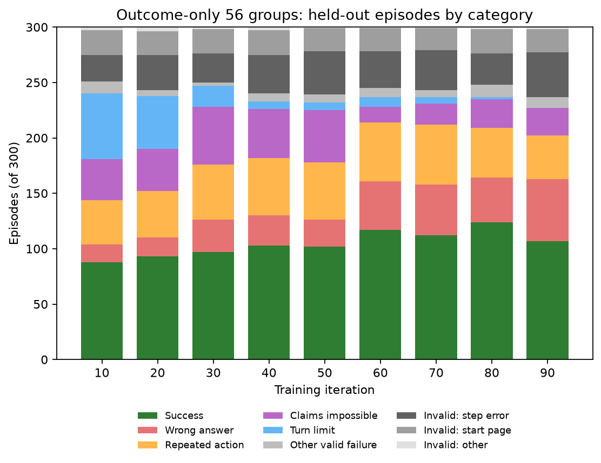
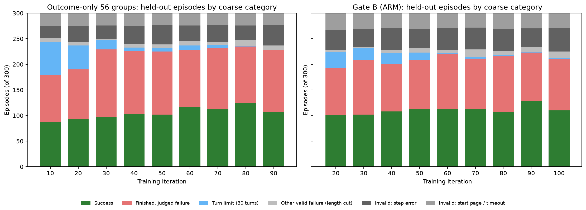
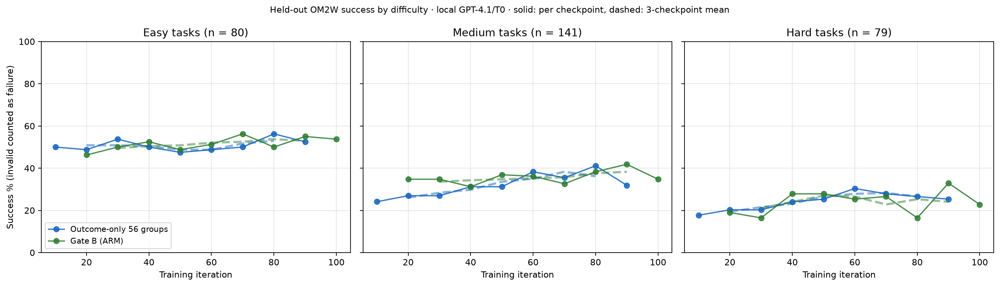

# RL behavior and evaluation noise

What the RL policies actually do on held-out Online-Mind2Web and during training, how
noisy single checkpoint evaluations are, and what that implies for comparing methods.
Scores themselves live in [RL_RESULTS.md](RL_RESULTS.md); protocols in
[RL_EVALUATION.md](RL_EVALUATION.md).

## Takeaways · October 25

1. **Gate B beats outcome-only at iteration 90 on matched repeats.** Three contemporaneous
   full-300 repeats per checkpoint on one harness give Gate B 40.6% overall against 35.3%
   (56 groups) and 34.1% (48 groups): +5.2 pp [+1.6, +8.9] and +6.4 pp [+2.7, +10.2],
   Holm p = 0.014 and 0.004 ([details](#rl-behavior-iter90-repeats-20261025)). The judge is
   GPT-4.1, whose success verdicts loosen over training
   ([audit](RL_REWARD_DESIGN.md#evidence)); a second-judge re-score of these repeats is the
   open check.
2. **The other controlled runs are statistically indistinguishable on the local protocol.**
   Their last-three-checkpoint means are 38.1–38.6% overall, every paired difference is
   below 0.5 pp, and the 95% intervals are about ±3.8 pp.
3. **Single checkpoints are noisy.** About 76 of 300 tasks (25%) change outcome between
   adjacent checkpoints of the same run, and the overall rate moves by a mean of 2.4 pp
   (at most 5.7 pp). A one-checkpoint difference below roughly 4 pp is not evidence.
4. **RL taught the policy to finish, then to finish too early.** Hitting the 30-turn limit
   falls from 59 to 0 episodes (56-group run, iterations 10 → 90). Over the same period
   wrong answers rise from 16 to 56 and failed episodes shorten from 18.8 to 10.8 steps.
5. **A harness error is the largest growing failure** ([cause and fix](#rl-behavior-step-error-20261024)). Invalid episodes with an empty-message
   browser step error grow from 24 to 40–44 per 300 tasks. No task has one in all five
   checkpoints examined, and 7 of the 40 at 56-group iteration 90 occurred on the agent's
   final `done` call. During training (48-group run) 10–15% of rollouts are invalid and
   about 40% of groups contain at least one invalid rollout.
6. **About 21 tasks always fail to load their start page.** These are the same dead or
   blocked sites at every checkpoint, so they cap every method equally.
7. **The mixed-only ARM bonus halves repeated-action loops.** At iteration 90 it has 18
   looping failures against 39 for the 56-group outcome-only run. The overall success rate
   does not show this.
8. **Larger groups make more groups usable, but at a cost.** Among first-iteration groups
   (SFT checkpoint), 41–48% are mixed with 5 rollouts and 53% with 8, which costs 1.6× more
   rollouts per group. Clean pass@K for K = 5, 8 and 16 is [pending](#rl-behavior-passk-20261024).

*Outcome-only 56 groups: held-out episodes per category at each checkpoint (full
categories; [rules](#rl-behavior-failures-20261024)).* [PDF](rl_results/rl_behavior_categories_56.pdf)

### Outcome-only 56 groups vs Gate B

Gate B trajectories were pruned, so this comparison uses coarse categories built only from
fields saved for every evaluation. On the 56-group run, where both exist, "finished,
judged failure" is about 99% wrong answers, repeated actions and impossibility claims. An
invalid episode that stopped by step 1 is a start-page failure or timeout; a later one is
the step error.

| Difficulty (tasks) | 56 groups, iteration 10 | 56 groups, mean of 70/80/90 | Gate B, iteration 20 | Gate B, mean of 80/90/100 |
| --- | ---: | ---: | ---: | ---: |
| Easy (80) | 50.0% | 52.9% | 46.2% | 52.9% |
| Medium (141) | 24.1% | 36.2% | 34.8% | 38.3% |
| Hard (79) | 17.7% | 26.6% | 19.0% | 24.1% |

- **RL gains come from medium and hard tasks.** Easy tasks stay near 50% throughout both
  runs. Medium rises by about 12 pp and hard by about 9 pp (56-group run).
- **Gate B gets to medium-task gains earlier.** At iteration 20 it is already at 35% on
  medium tasks, against 27% for the 56-group run. By the end the two runs are within noise
  in every band.
- **Gate B has more invalid episodes** (start-page and step errors: 66–75 per 300, against
  49–63). Its evaluations ran on earlier dates, so site availability differs and this is not
  a matched comparison; on matched dates the counts agree ([repeats](#rl-behavior-iter90-repeats-20261025)).
- **Noise:** one checkpoint's band rate has a binomial SE of about 4–6 pp. The dashed lines
  are 3-checkpoint means. Overall success counts invalid episodes as failures.

Sources

- **Counts:** [per checkpoint and band](arm_results/rl_integration/behavior/rl-eval-coarse-difficulty-20261024.json).
- **Difficulty bins:** human reference length 1–5 / 6–10 / 11+ steps, the published
  Online-Mind2Web rule (80/141/79 tasks; the [earlier difficulty table](RL_RESULTS.md)
  uses the same bins).
- **Script:** `scripts/plot_rl_behavior.py`.
- **Earlier overview figure:** [mean failed-episode length and 48-group training trends](rl_results/rl_behavior_overview.png).

## Evaluation noise and fair comparison

Local browser · GPT-4.1 action_history judge · actor T0 · 30 turns · full 300. Overall
counts invalid episodes as failures; valid-only uses valid episodes only. The four lineages
share the 2,102-task pool and SFT start.

| Run | Checkpoints averaged | Overall % | Valid-only % |
| --- | --- | ---: | ---: |
| Outcome-only, 56 groups × 5 | 70 / 80 / 90 | 38.11 | 47.12 |
| Outcome-only uniform G8, 48 groups × 8 | 40 / 50 / 60 (last three) | 38.22 | 48.38 |
| Mixed-only ARM bonus | 70 / 80 / 90 | 38.33 | 50.07 |
| Mixed-only ARM reweight | 70 / 80 / 90 | 38.56 | 50.14 |

| Paired comparison, last-three mean | Δ overall, pp | 95% CI, pp |
| --- | ---: | --- |
| 56-group − G8 | −0.11 | [−3.89, +3.67] |
| 56-group − ARM bonus | −0.22 | [−4.00, +3.44] |
| 56-group − ARM reweight | −0.44 | [−4.22, +3.33] |
| G8 − ARM bonus | −0.11 | [−3.89, +3.67] |
| G8 − ARM reweight | −0.33 | [−4.33, +3.56] |
| ARM bonus − ARM reweight | −0.22 | [−4.11, +3.67] |

| Adjacent-checkpoint noise, 29 pairs | Value |
| --- | ---: |
| Mean tasks changing outcome | 75.8 / 300 |
| Mean \|Δ overall\| | 2.43 pp |
| Max \|Δ overall\| | 5.67 pp |

Method, matched-iteration check and limits

- **Recount:** all 33 cohorts were recounted from saved per-task records, and every count
  matches its published audit.
- **CI:** paired percentile bootstrap over the 300 tasks (20,000 draws) on per-task success
  averaged over the three checkpoints. Checkpoints are fixed, so the CI covers task and
  evaluation noise only, not seed-to-seed training variation.
- **Window:** G8 stopped at 60, so its window is earlier and it was still rising
  (34.67 → 37.67 → 42.33%). Its 60 → 90 continuation is running.
- **Matched 40/50/60 window:** the differences are again inside the noise (56-group − G8
  −2.44 pp, CI [−6.11, +1.11]).
- **Sources:** [aggregate](arm_results/rl_integration/behavior/rl-eval-noise-20261024.json) ·
  script `scripts/analyze_rl_eval_noise.py`.

### Iteration-90 repeats on one harness · October 25

Three new full-300 evaluations per checkpoint, collected back to back on October 24–25 by
one job (385593) with the same harness, browser pool and judge (local browser · GPT-4.1
action_history · actor T0 · 30 turns). Overall counts invalid episodes as failures.

| Checkpoint (iteration 90) | Successes r1 / r2 / r3 | Valid r1 / r2 / r3 | Overall mean % | Valid-only % | Earlier single evaluation, successes / valid |
| --- | --- | --- | ---: | ---: | --- |
| Outcome-only 48 groups | 103 / 95 / 109 | 234 / 233 / 246 | 34.11 | 43.06 | 101 / 222 (September) |
| Outcome-only 56 groups | 114 / 102 / 102 | 234 / 237 / 237 | 35.33 | 44.92 | 107 / 237 |
| Gate B (ARM) | 123 / 117 / 125 | 238 / 232 / 245 | 40.56 | 51.05 | 129 / 234 |

| Paired comparison, repeat-mean per task | Δ overall, pp | 95% CI, pp | Permutation p | Holm p |
| --- | ---: | --- | ---: | ---: |
| Gate B − 56 groups | +5.22 | [+1.56, +8.89] | 0.007 | 0.014 |
| Gate B − 48 groups | +6.44 | [+2.67, +10.22] | 0.001 | 0.004 |
| 56 groups − 48 groups | +1.22 | [−2.22, +4.67] | 0.530 | 0.530 |

- **Gate B's lead holds on matched dates.** Its invalid counts (55–68) now match the
  outcome-only runs (54–67), so the earlier site-availability caveat does not explain it.
  Repeat-to-repeat SD is 1.4–2.3 pp per checkpoint.
- **Same direction as the stealth protocol.** Under o4-mini/T0.6 stealth, Gate B −
  outcome-only was +3.56 pp [−0.22, +7.22] ([RL_RESULTS](RL_RESULTS.md)).
- **Open check:** GPT-4.1 increasingly accepts unsupported answers late in training
  ([judge audit](RL_REWARD_DESIGN.md#evidence)). Re-scoring these 2,700 episodes with the
  second judge (about $0.02 per episode) would show whether the gap survives a stricter judge.

Method and limits

- **CI and p:** per-task success averaged over the three repeats; paired percentile bootstrap
  over 300 tasks and paired sign-flip permutation test (20,000 draws each), Holm over the
  three comparisons.
- **Scope:** one checkpoint per run. The CI covers task and evaluation noise, not
  training-seed variation; Gate B has a different training history (auxiliary failure groups,
  relaxed gate) and is one lineage.
- **Sources:** [aggregate](arm_results/rl_integration/behavior/iter90-repeats-20261025.json) ·
  script `scripts/analyze_iter90_repeats.py`.

## Why held-out episodes fail

Each of the 300 episodes gets exactly one category. Rules, first match wins:
success; invalid by cause; **turn limit** (never called `done`); **repeated action** (an
identical non-wait action issued ≥ 3 times); **claims impossible** (final answer says the
task cannot be done); **tool errors** (≥ 30% of tool calls failed); **wrong answer**
(called `done`, judged failure).

### 56-group outcome-only run across training

| Iteration | Success | Wrong answer | Repeated action | Claims impossible | Turn limit | Other valid failure | Invalid: step error | Invalid: start page | Invalid: timeout |
| ---: | ---: | ---: | ---: | ---: | ---: | ---: | ---: | ---: | ---: |
| 10 | 88 | 16 | 40 | 37 | 59 | 11 | 24 | 22 | 3 |
| 20 | 93 | 17 | 42 | 38 | 48 | 5 | 32 | 21 | 4 |
| 30 | 97 | 29 | 50 | 52 | 19 | 3 | 26 | 22 | 2 |
| 40 | 103 | 27 | 52 | 44 | 7 | 7 | 35 | 22 | 3 |
| 50 | 102 | 24 | 52 | 47 | 7 | 7 | 39 | 21 | 1 |
| 60 | 117 | 44 | 53 | 14 | 9 | 8 | 33 | 21 | 1 |
| 70 | 112 | 46 | 54 | 19 | 6 | 6 | 36 | 20 | 1 |
| 80 | 124 | 40 | 45 | 26 | 2 | 11 | 28 | 22 | 2 |
| 90 | 107 | 56 | 39 | 25 | 0 | 10 | 40 | 21 | 2 |

### Late checkpoints of other runs

| Run · iteration | Success | Wrong answer | Repeated action | Claims impossible | Turn limit | Other valid failure | Invalid: step error | Invalid: start page | Invalid: other |
| --- | ---: | ---: | ---: | ---: | ---: | ---: | ---: | ---: | ---: |
| Outcome-only 48 groups · 100 | 104 | 38 | 53 | 23 | 4 | 5 | 43 | 27 | 3 |
| Uniform G8 · 60 | 127 | 33 | 36 | 31 | 3 | 4 | 42 | 21 | 3 |
| Mixed-only ARM bonus · 90 | 122 | 52 | 18 | 25 | 5 | 11 | 44 | 21 | 2 |

- **Turn limit → wrong answer.** Training removes running out of turns almost entirely. The
  freed episodes mostly become confident wrong answers, not successes.
- **Step-error invalids are random, not site-specific.** Across the five checkpoints with
  trajectories, 132 tasks hit a step error at least once and none hit it every time. The
  logged exception message is empty (`env.step() failed, marking as ABORTED:`), which points
  to a request timeout in the browser server client.
- **Start-page invalids are fixed.** The same 20 tasks fail at all five checkpoints (24 in
  total).

Method and limits

- **Rules:** fixed and deterministic, with no LLM labelling. "Wrong answer" is whatever is
  left after the other rules, so it includes partially correct answers the judge rejected.
- **Repeated action:** an identical action (name and arguments) issued ≥ 3 times, ignoring
  `wait`.
- **Trajectory coverage:** Gate B and additive evaluation trajectories (`.pt`) were pruned
  earlier, so those runs cannot be categorized; only their outcomes and step counts remain
  (next section).
- **Sources:** [category counts](arm_results/rl_integration/behavior/rl-eval-failure-categories-20261024.json) ·
  scripts `scripts/analyze_rl_eval_failures.py` and `scripts/analyze_rl_behavior.py`.

## Episode length and termination, four runs

These use only fields saved for every evaluation, so Gate B and additive are included.
"Turn-limit failures" are valid failures that used all 30 turns.

| Run | Iteration | Success | Mean steps, valid | Mean steps, failures | Turn-limit failures | Aborted (invalid) |
| --- | ---: | ---: | ---: | ---: | ---: | ---: |
| Outcome-only 56 groups | 10 | 88 | 16.1 | 18.8 | 60 | 49 |
| Outcome-only 56 groups | 90 | 107 | 9.6 | 10.8 | 0 | 63 |
| Outcome-only 48 groups | 100 | 104 | 9.6 | 10.8 | 4 | 73 |
| Gate B | 20 | 101 | 12.9 | 15.3 | 31 | 72 |
| Gate B | 90 | 129 | 10.0 | 10.9 | 1 | 66 |
| Gate B | 100 | 110 | 9.5 | 10.5 | 2 | 75 |
| Additive | 80 | 111 | 11.1 | 14.0 | 6 | 88 |
| Additive | 90 | 118 | 11.8 | 14.5 | 9 | 84 |
| Additive | 100 | 109 | 12.0 | 14.3 | 4 | 83 |

- **Outcome-only and Gate B converge to the same length profile:** about 10 steps, with
  essentially no turn-limit failures.
- **Additive keeps longer failed episodes (about 14 steps) and the most aborted episodes
  (83–88).** Its valid-only rate is high partly because more of its episodes are invalid.
- **Task coverage:** across checkpoints, the 56-group run solves 208 distinct tasks at least
  once but only 20 at every checkpoint. For Gate B the figures are 225 and 22. Most solved
  tasks are solved only some of the time.

## Empty-message browser step error: cause and fix

**Symptom.** The client logs `env.step() failed, marking as ABORTED:` with an empty
message, and the episode becomes invalid.

**Cause.** The local env client gives each `/step` request 300 seconds, and an
`aiohttp`/`asyncio` timeout carries no message. On the server, every step runs a
clickable-element scan (`page.evaluate`) before and after the action, then a screenshot and
the title of every open tab. Only the screenshot had a timeout. A page whose JavaScript
thread is busy, or one stalled tab, can therefore hold the step until the client gives up.

- **Timing evidence:** one failed task (56-group, iteration 90) took 7.4 minutes in
  total, consistent with ordinary steps followed by a single step held to the 300-second
  limit.
- **The failing call can be `done`:** of 422 step errors across the analyzed checkpoints,
  64 happened on `done`, which itself does nothing. The failure must therefore come from the
  observation around it.
- **Tabs are only weakly linked:** episodes that opened a new tab have step errors in
  13.3% of cases, against 10.5% for single-tab episodes.
- **Dialogs are not the cause:** they are already intercepted.

**Fix** (commit `c9caa02`, `tests/test_env_step_bounds.py`). It applies to sources prepared
from now on; running jobs use frozen sources.
1. The clickable-element scan is limited to 30 s and falls back to an empty list.
2. Each tab-title read is limited to 5 s and falls back to an empty title.
3. Steps slower than 20 s log cumulative per-phase times, so the next runs show exactly
   which call stalls.
4. If `env.step` fails on a step that contains `done`, the episode keeps the agent's final
   answer and is judged normally (`env_error_after_done` is recorded) instead of being
   discarded.

**Validation pending.** The fix has not yet run on GPUs. Expect fewer invalid episodes,
so evaluations with the fix are not directly comparable to earlier ones; compare them on a
paired re-run.

## Training-time behavior · outcome-only 48 groups

The archive holds every completed training group, accepted or not, for iterations 24–100:
77 iterations, 127 groups each, about 49,000 rollouts. Training uses T0.8 and 15 browser
steps on the 2,102-task pool. Tool results were not archived, so tool-error rates are
omitted.

| Iteration | Rollouts | Success %, valid | Invalid % | Mean steps | Called `done` % | Repeated action % | Claims impossible % | Groups: mixed / all-success / all-failure / contains invalid |
| ---: | ---: | ---: | ---: | ---: | ---: | ---: | ---: | --- |
| 24 | 440 | 43.4 | 9.3 | 7.4 | 86.5 | 21.8 | 19.5 | 30 / 11 / 12 / 35 |
| 40 | 510 | 58.7 | 12.5 | 6.3 | 90.4 | 16.8 | 21.1 | 28 / 20 / 9 / 45 |
| 56 | 465 | 47.1 | 11.8 | 6.2 | 87.6 | 18.0 | 25.4 | 29 / 10 / 8 / 46 |
| 72 | 540 | 55.2 | 10.7 | 5.8 | 90.9 | 16.8 | 20.3 | 29 / 23 / 11 / 45 |
| 88 | 550 | 48.5 | 14.2 | 6.6 | 85.2 | 18.2 | 15.9 | 23 / 16 / 16 / 55 |
| 100 | 505 | 54.6 | 11.1 | 6.2 | 87.5 | 18.3 | 18.3 | 28 / 22 / 9 / 42 |

- **Training behavior is already stable by iteration 24:** about 6 steps, about 88% call
  `done`, and success on valid rollouts fluctuates around 50%. The large held-out shifts
  (turn limit → wrong answer) happen in the first 30 iterations, before this archive
  starts.
- **Invalid rollouts waste groups:** about 40% of groups contain at least one invalid
  rollout, and only about 25% are mixed and fully valid. Fixing the step error would raise
  the usable fraction of every collection.
- **Action mix is steady:** clicks are 44–53% of actions and scrolls 14–19%. New-tab use
  rises from 3% to 8–10% after iteration 48.

Sources and limits

- **Source:** per-iteration summaries for all 77 iterations are in the
  [aggregate](arm_results/rl_integration/behavior/rl-behavior-20261024.json)
  (`training_outcome48`).
- **Coverage:** iterations 1–23 were not archived, and the other runs archived only
  accepted groups with screenshots, so this view exists for the 48-group run only.
- **Group label:** a "contains invalid" group can still be accepted for training if its
  valid rollouts are mixed. The label counts groups, not training loss.

## Step-0 group usefulness and pass@K

Only groups with both successes and failures give GRPO a learning signal. First-iteration
logs (SFT checkpoint) give this fraction for free:

| Run, first iteration | Rollouts per group | Mixed / completed groups | Mixed % |
| --- | ---: | ---: | ---: |
| Outcome-only 56 groups | 5 | 56 / 118 | 47 |
| Mixed-only ARM bonus | 5 | 48 / 99 | 48 |
| Mixed-only ARM reweight | 5 | 48 / 111 | 43 |
| Mixed-only action-only | 5 | 48 / 117 | 41 |
| Uniform G8 | 8 | 48 / 90 | 53 |

- **Pending:** a clean measurement (16 rollouts × 128 seed-0 training tasks, unbiased
  pass@1/5/8/16 and mixed-group probability) is queued as job 385599
  (`scripts/run_passk_step0.py`).
- **Log caveat:** the log fractions are counted when collection stopped, and groups may be
  dropped because of invalid rollouts.

## Pending

| Item | Job | Adds |
| --- | --- | --- |
| Step-0 pass@K | 385599 | Clean pass@K and mixed-group probability for K = 5, 8, 16 |
| Uniform G8 60 → 90 | 385579 → 385580 | G8 at the same endpoint as the other runs |
| Step-error fix validation | Next GPU run with the fixed source | Invalid-rate change; slow-phase logs locate the stalling call |
