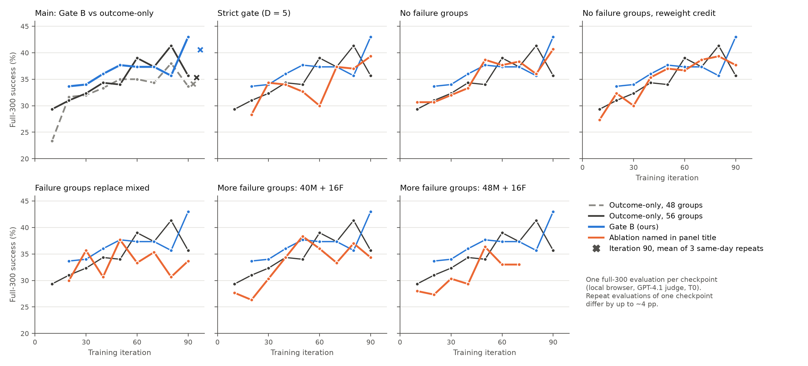
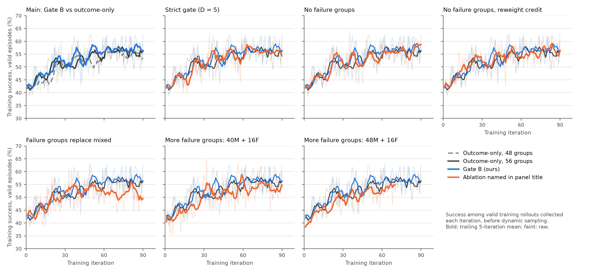

# ARM RL final results: main-paper experiments

Main-paper candidate set for online RL with SelectionARM turn credit, chosen on November 8 from
runs trained to at least iteration 60. Detailed history stays in
[ARM_SUMMARY.md](ARM_SUMMARY.md#arm-rl-method-guide) and [ARM_RESULTS.md](ARM_RESULTS.md).

**Status (November 8):** The only statistically supported claim is the matched iteration-90
comparison. Gate B beats both outcome-only controls by 5–6 pp under the local-browser GPT-4.1
protocol (Holm p ≤ 0.014). On single evaluations Gate B is level with outcome-only and
the mixed-only variants, and the stealth-browser comparison (+3.6 pp) is not significant. A
same-day iteration-90 re-evaluation of every run below is planned for November 9–10: three
repeats each, paper actor sampling, and a shared Terra judge. It replaces the mixed-date columns in Table 2.

## Experiments

One **group** is five trajectories of one task. `M` = mixed-outcome group; `F` = all-failure group.
`A` = group-normalized outcome advantage; `b = β·m·(1[selected executed response] − 1/5)` = SelectionARM
turn bonus (β = 0.5, labels attempted on q = 20% of turns, K = 5 candidates). `D` = distinct candidate
actions required to label a turn. All runs start from OpenWebRL-4B-SFT at iteration 0 with
batch 256, 2 PPO epochs, LR 1e−6, GPT-4.1 training judge and 15 browser turns.

| Method | Mixed groups | Failure groups | Gate | Turn credit | Trained to | Question |
| --- | --- | --- | --- | --- | ---: | --- |
| Outcome-only, 48 groups | 48 | 0 | — | `A` | 100 | Paper baseline |
| Outcome-only, 56 groups | 56 | 0 | — | `A` | 90 | Matches Gate B's group count |
| **Gate B (ours)** | 48 | ≤ 8, separate loss, coef. N/48 | D ≥ 2 | `A + b`; `b` on F | 100 | Main method |
| Additive | 48 | ≤ 8, separate loss, coef. N/48 | D = 5 | `A + b`; `b` on F | 100 | Does relaxing the gate matter? |
| Mixed-only bonus | 48 | 0 | D ≥ 2 | `A + b` | 90 | Do failure groups matter? |
| Mixed-only reweight | 48 | 0 | D ≥ 2 | `A × w` (λ = 0.5) | 90 | Bonus versus redistributing `A` |
| All-failure | 48 − N | N, inside main batch | D = 5 | `A + b`; `b` on F | 100 | Replace versus add failure groups |
| Gate B · 40M + 16F | 40 | ≤ 16, separate loss, coef. N/48 | D ≥ 2 | `A + b`; `b` on F | 90 | Larger ARM-only share |
| Gate B · 48M + 16F | 48 | ≤ 16, separate loss, coef. N/48 | D ≥ 2 | `A + b`; `b` on F | 70 (→ 90 Nov 9) | Larger ARM-only share |

Excluded: uniform G8 outcome-only control (by decision), runs stopped before 60 (failure β = 1,
failure sampling 40%), and the loop-credit and rescue pilots. Appendix candidates: original bonus (to 80), Gate C
(to 60), expanded 4,102-task outcome-only (to 60) and action-only (collapsed by 40; see
[ARM_SUMMARY.md](ARM_SUMMARY.md#arm-rl-method-guide)).

## Results

Online-Mind2Web, all 300 tasks. Invalid episodes count as failures in overall rates.

| Method | Iter. 60 successes | Iter. 60 overall % | Iter. 90 successes | Iter. 90 valid | Iter. 90 overall % | Iter. 90 valid-only % | Mean 70/80/90 overall % | Matched iter. 90, 3 repeats, overall % | Stealth iter. 90, 3 repeats, overall % |
| --- | ---: | ---: | ---: | ---: | ---: | ---: | ---: | ---: | ---: |
| Outcome-only, 48 groups | 105 | 35.00 | 101 | 222 | 33.67 | 45.50 | 35.33 | 34.11 | 55.22 |
| Outcome-only, 56 groups | 117 | 39.00 | 107 | 237 | 35.67 | 45.15 | 38.11 | 35.33 | — |
| **Gate B (ours)** | 112 | 37.33 | 129 | 234 | **43.00** | **55.13** | **38.67** | **40.56** | 58.78 |
| Additive | 90 | 30.00 | 118 | 216 | 39.33 | 54.63 | 37.89 | — | 58.44 |
| Mixed-only bonus | 113 | 37.67 | 122 | 233 | 40.67 | 52.36 | 38.33 | — | **59.00** |
| Mixed-only reweight | 110 | 36.67 | 113 | 227 | 37.67 | 49.78 | 38.56 | — | 56.22 |
| All-failure | 100 | 33.33 | 101 | 217 | 33.67 | 46.54 | 33.22 | — | — |
| Gate B · 40M + 16F | 108 | 36.00 | 103 | 227 | 34.33 | 45.37 | 34.89 | — | — |
| Gate B · 48M + 16F | 99 | 33.00 | pending | pending | pending | pending | 33.00 (iter. 70 only) | — | — |

| Matched iteration-90 comparison (October 25) | Difference | Paired 95% CI | Holm p |
| --- | ---: | --- | ---: |
| Gate B − outcome-only, 56 groups | +5.22 pp | [+1.56, +8.89] pp | 0.014 |
| Gate B − outcome-only, 48 groups | +6.44 pp | [+2.67, +10.22] pp | 0.004 |

- **Iteration and mean columns:** one evaluation per checkpoint with a local browser,
  GPT-4.1 action-history judge, actor temperature 0 and 30 turns. Collection dates and
  valid-task sets differ between runs. Repeat evaluations of one checkpoint differ by up to about 4 pp.
- **Matched column:** three contemporaneous full-300 repeats on October 25 with the same protocol.
  Paired task bootstrap and sign-flip tests. Successes per repeat were 103/95/109 (48 groups),
  114/102/102 (56 groups) and 123/117/125 (Gate B).
- **Stealth column:** stealth browser, o4-mini/AgentTrek judge, actor T0.6/p0.95/k20. The
  outcome-only, additive and Gate B cohorts were collected September 29–30; the mixed-only
  cohorts on October 6. Gate B − outcome-only is +3.56 pp, Holm p = 0.22. WebVoyager and
  DeepShop show no ARM gain ([details](ARM_SUMMARY.md#arm-localbench90-summary-20261008)).
- **Not established:** training-seed variability. Every number comes from one training run per method.

## Validation success across iterations

Panel 1 compares Gate B with both outcome-only controls. The X markers are the October 25
three-repeat means at iteration 90. Each other panel shows one ablation (orange) against Gate B
(blue) and outcome-only 56 (dark gray). [PDF](arm_final_results/validation_success.pdf).

## Training success across iterations

Success among **valid** training rollouts collected at each iteration, before dynamic sampling
removes all-success and all-failure groups. Bold lines are trailing five-iteration means; faint
lines are raw values. This is the GPT-4.1 training judge on 15-turn episodes; the ARM bonus is
not included. Valid-only rates remove infrastructure incidents: for example, at Gate B
iterations 21–24 and 76–77, 42–90% of episodes were invalid, against a usual 6%.
Overall rates and invalid rates are in the data file. [PDF](arm_final_results/training_success.pdf).

Sources and reproduction

- **Aggregate data:** [arm_final_results_data.json](arm_final_results/arm_final_results_data.json), with
  per-checkpoint counts, per-iteration training success, invalid rates and accepted-turn reward, and the W&B run of each lineage.
- **Validation counts:** the verified audits behind
  [ARM_SUMMARY.md](ARM_SUMMARY.md#arm-rl-method-guide). Gate B · 48M + 16F at iteration 70 comes from its
  verified controller progress record (99 successes, 230 valid). Iterations after 90 are omitted:
  outcome-only 48 continued at 30 turns, while Gate B and additive continued at 15.
- **Training curves:** W&B `train/task_success_rate` and `train/task_invalid_rate` on
  `train/reward_iteration`, in project `openwebrl`. Where a resumed run logged an iteration twice, the last value is kept.
- **Figures:** `python scripts/plot_arm_final_results.py` (matplotlib).

