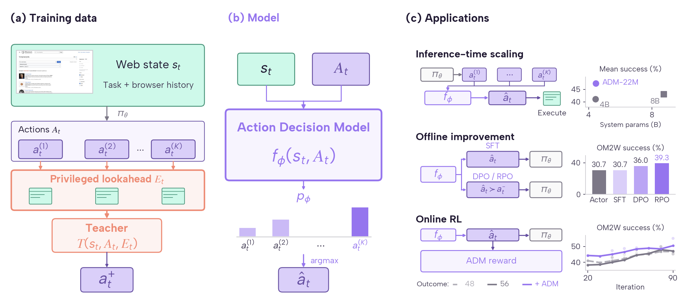

# Action Decision Models overview (paper Figure 1)



[PDF](figure1.pdf) · [SVG](figure1.svg) · [Plot script](plot_figure1.py) · [Coordinates and source hashes](figure1_results.json)

Counterclockwise exports: [PNG](figure1-ccw.png) · [PDF](figure1-ccw.pdf) · [SVG](figure1-ccw.svg)

## Reproduce

From the repository root, install `requirements.txt` in your Python environment, then run:

```sh
python -m pip install -r openwebrl/docs/arm_results/methods/adm_overview/requirements.txt
python openwebrl/docs/arm_results/methods/adm_overview/plot_figure1.py
```

The script writes PNG, PDF and SVG beside itself, plus counterclockwise exports.
It imports the repository's `openwebrl/docs/paper_plot_style.py` and bundled Albert Sans fonts.
No browser session or experiment service is required.

## Sources

The diagram uses green for browser states, purple for actions and ADM, salmon for lookahead evidence and the teacher, and gray for actor controls. Inference and online RL show valid-only success; offline improvement shows overall success from the paper's Table 7. The insets summarize separate studies with different protocols and task populations. The renderer reads the result aggregates directly, records their hashes and plotted coordinates, and checks right-panel text for overlaps with other text, separators and legend handles.

- The real browser observation is the Dinka Wikipedia task state shown in the paper. `web_states/dinka/state.jpg` is the original observation, resized without cropping. Its SHA-256 is `d028c34171bf1fd94709663c7c071f090cbce4bab4751db77d3ab8df8a4080be`. Lookahead icons, teacher choice and model scores are schematic.
- Inference inset: [November 4 Recipe 3 aggregates](../../rl_integration/selection-recipe3-vs-cost-20261104.json), three runs pooled per benchmark. Points show the equal-weight mean of Online-Mind2Web, WebVoyager and DeepShop valid-only rates for SFT 4B, SFT 8B and the GPT-5.5 lookahead-label ADM-22M. System parameters are 4.44 B, 8.77 B and 4.4626 B, respectively.
- Offline inset: [paper Table 7 snapshot](figure1_offline_results.json), OM2W overall success: actor 30.7%, filtered SFT 30.7%, DPO 36.0% and RPO 39.3%. The snapshot records the paper commit and table hash; it replaces the historical valid-only joint-data comparison. The preference branch is labelled DPO / RPO.
- Online inset: [current validation-curve aggregate](../../../rl_results/rl_eval_learning_curves.json), outcome-only 48 groups (light gray, dashed), outcome-only 56 groups (dark gray), and Outcome + ADM (purple). Iterations 20–90; lines and circles pool successes/valid counts over the latest three evaluations within the displayed interval, with faint raw checkpoint dots. Local browser, GPT-4.1/action-history judge, actor temperature 0; one lineage per method, different collection dates and valid populations. This replaces the older two-curve Gaussian-smoothed snapshot. [Full metric definition](../../../RL_EVALUATION.md#rl-smoothed-eval-learning-curves).

The JSON exports contain aggregate counts and figure coordinates, without rollout trajectories or task-pool data. The original paper snapshots remain in `preliminary_results.json` and `results_20261025.json` for provenance; they no longer supply the plotted values.
