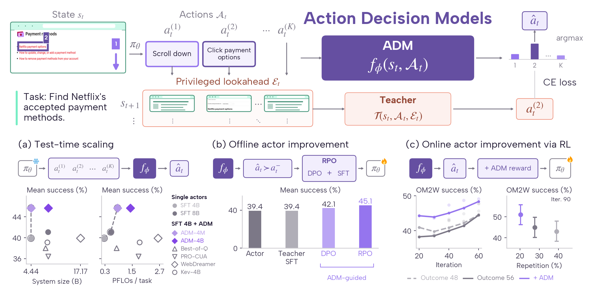
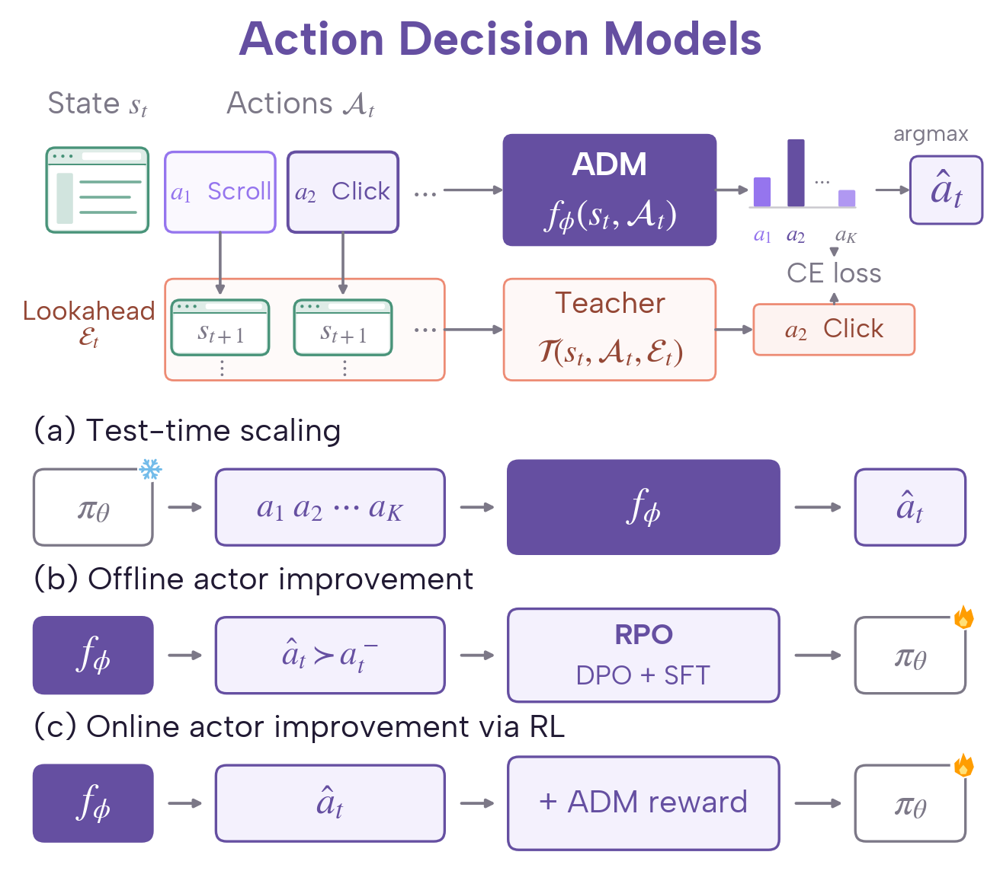
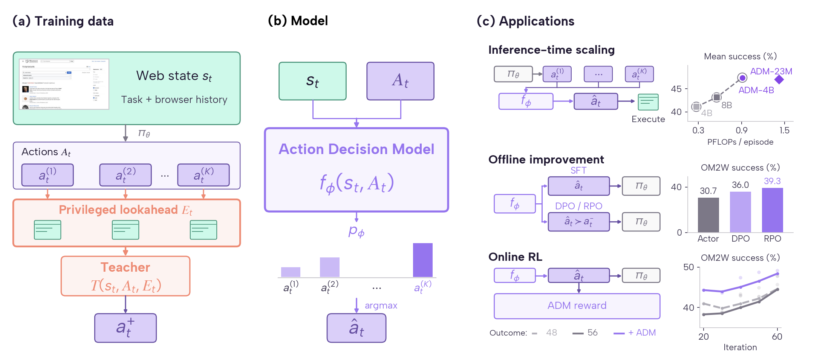

# Action Decision Models overview (paper Figure 1)

## Full-width overview



[PDF](figure1_full_width.pdf) · [SVG](figure1_full_width.svg) · [Plot script](plot_figure1_applications.py) · [Plot coordinates and provenance](figure1_full_width_results.json)

## Single-column overview



[PDF](figure1_single_column.pdf) · [SVG](figure1_single_column.svg) · [Plot script](plot_figure1_single_column.py) · [Layout](figure1_single_column_layout.json)

Both versions use dark-purple ADM boxes and matching titles, green browser states, salmon lookahead/teacher supervision, and gray policy controls. The full-width overview retains the quantitative application plots, with ADM-4M and ADM-4B in the scaling plots; the single-column overview keeps the conceptual workflows. The source figures are the paper snapshot finalized in `6a4767f`.

## Reproduce the current figures

Download and extract [the source bundle](figure1_sources.zip), which includes the scripts, helper, frozen aggregate inputs and Table 7, browser example image, shared paper typography, and licensed Albert Sans fonts. From the extracted directory, run:

```sh
python -m pip install -r requirements.txt
python fig/plot_figure1_applications.py --right-legend --no-phase-headers
python fig/plot_figure1_single_column.py
```

The scripts write PDF, SVG, PNG, and JSON metadata beside themselves, using their original paper filenames. The gallery calls the long full-width export `figure1_full_width`; the single-column export is `figure1_single_column`. [The horizontal training helper](draw_figure1_swapped.py) is included. The bundle manifest records all input hashes. Its previews were reproduced pixel for pixel with Matplotlib 3.9.4 and NumPy 2.0.2.

The inference/offline plots report three-benchmark mean overall success; the RL panels use the OM2W metrics and protocols recorded in the full-width provenance JSON. The probability bars and teacher choices are schematic. No live browser, private trajectory payload, or experiment service is required.

## Earlier overview

<details>
<summary>Previous Figure 1, its rotated exports, and historical reproduction notes</summary>




[PDF](figure1.pdf) · [SVG](figure1.svg) · [Plot script](plot_figure1.py) · [Coordinates and source hashes](figure1_results.json)

Counterclockwise exports: [PNG](figure1-ccw.png) · [PDF](figure1-ccw.pdf) · [SVG](figure1-ccw.svg)

## Reproduce

From the repository root, install `requirements.txt` in your Python environment, then run:

```sh
python -m pip install -r openwebrl/docs/arm_results/methods/adm_overview/requirements.txt
python openwebrl/docs/arm_results/methods/adm_overview/plot_figure1.py
```

The script writes PNG, PDF and SVG beside itself, plus counterclockwise exports.
It imports the repository's `openwebrl/docs/paper_plot_style.py` and bundled Albert Sans fonts.
No browser session or experiment service is required.

## Sources

The diagram uses green for browser states, purple for actions and ADM, salmon for lookahead evidence and the teacher, and gray for actor controls. Inference and online RL show valid-only success; offline improvement shows overall success from the paper's Table 7. The insets summarize separate studies with different protocols and task populations. The renderer reads the result aggregates directly, records their hashes and plotted coordinates, and checks right-panel text for overlaps with other text, separators and legend handles.

- The real browser observation is the Dinka Wikipedia task state shown in the paper. `web_states/dinka/state.jpg` is the original observation, resized without cropping. Its SHA-256 is `d028c34171bf1fd94709663c7c071f090cbce4bab4751db77d3ab8df8a4080be`. Lookahead icons, teacher choice and model scores are schematic.
- Inference inset: uses the PFLOP coordinates from the paper's Figure 7 (image Git blob `adebff6875ecafe30c4e7874fe40f933a8eec90c`), using the same [Recipe 3 aggregate](../../rl_integration/selection-recipe3-vs-cost-20261104.json) and [renderer at `d7d4a1d`](https://github.com/zixianma/OpenWebRL/blob/d7d4a1d/openwebrl/docs/arm_results/rl_integration/selection-recipe3-vs-cost-20261104.py). Four systems are shown: 4B/8B controls and GPT-5.5 lookahead-trained ADM-23M/ADM-4B variants. The two orange Luna variants are omitted to simplify the inset. The best displayed ADM-4B is GPT-5.5 lookahead (47.0433% at 1.421 PFLOPs per episode); pre-execution-labelled variants are excluded, as in Figure 7. Purple encodes the GPT-5.5-labelled ADMs; circles/diamonds encode heads/decoders. The gray dashed frontier and rings are recomputed over the four displayed points, ending at the GPT-5.5 head; the decoder is dominated. Success averages the published per-benchmark valid-only rates, and cost averages per-benchmark PFLOPs per episode, exactly as Figure 7.
- Offline inset: [paper Table 7 snapshot](figure1_offline_results.json), OM2W overall success: actor 30.7%, DPO 36.0% and RPO 39.3%. The source snapshot also retains filtered SFT (30.7%), which is omitted from the inset. The snapshot records the paper commit and table hash; it replaces the historical valid-only joint-data comparison. The preference branch is labelled DPO / RPO.
- Online inset: [current validation-curve aggregate](../../../rl_results/rl_eval_learning_curves.json), outcome-only 48 groups (light gray, dashed), outcome-only 56 groups (dark gray), and Outcome + ADM (purple). Iterations 20–60; lines and circles pool successes/valid counts over the latest three evaluations within the displayed interval, with faint raw checkpoint dots. Local browser, GPT-4.1/action-history judge, actor temperature 0; one lineage per method, different collection dates and valid populations. This replaces the older two-curve Gaussian-smoothed snapshot. [Full metric definition](../../../RL_EVALUATION.md#rl-smoothed-eval-learning-curves).

The JSON exports contain aggregate counts and figure coordinates, without rollout trajectories or task-pool data. The original paper snapshots remain in `preliminary_results.json` and `results_20261025.json` for provenance; they no longer supply the plotted values.

</details>
